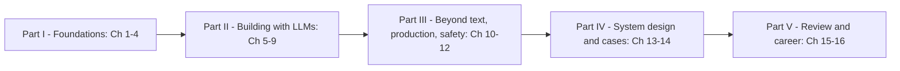

# AI & GenAI Handbook

One place to learn modern AI from the ground up — classical search, transformers, large language models, prompting, LLM apps, RAG, agents, generative models, serving, safety — and to prepare for AI system design interviews, without switching between platforms. Each topic combines, in one explanation:
- **the DesignGurus courses** you own: *Grokking Modern AI Fundamentals*, *Grokking the AI System Design Interview* and *Grokking Prompt Engineering for Professional Portfolio and Job Search*,
- **classic books and papers**: Russell & Norvig's *Artificial Intelligence: A Modern Approach* (Ch 1–2), Chip Huyen's *AI Engineering*, Sebastian Raschka's *Build a Large Language Model (From Scratch)*, and the original papers (Transformer, GPT-3, scaling laws, InstructGPT, DPO, ReAct, PagedAttention, speculative decoding and others),
- **official documentation** (Anthropic and OpenAI API docs, the Model Context Protocol docs, vLLM, NIST AI RMF, the EU AI Act on EUR-Lex) and the web, to fill gaps and check facts,
- **real-world examples** from products and companies that use these techniques today.

Every chapter is written for a first-time learner and defines each term the first time it appears. Every code example is a runnable script (Python 3.14, compatible with 3.12+) whose **real output** appears under it. Scripts need no API key: where a chapter shows real Anthropic or OpenAI SDK calls, they are marked "needs an API key — not run", and the runnable file uses a small local stand-in so the logic still executes. Every chapter was independently reviewed for accuracy.

*Facts are dated September 2026.* Model names, prices and regulatory dates change; each chapter says when it was last reviewed, and [§1.9](chapters/01-ai-landscape/README.md) explains how to check a claim before relying on it.

> Personal study notes. Course-derived material is paraphrased in my own words, not copied. Not for redistribution.

## Who it's for
| Reader | What you get |
|---|---|
| Complete beginners to AI | The map of the field (Ch 1), classical AI (Ch 2), then how transformers and LLMs actually work (Ch 3–4), every term defined |
| Developers building LLM features | Prompting, the API and tool loop, RAG, fine-tuning vs RAG, evaluation, agents, serving and cost (Ch 5–9, 11) |
| Engineers preparing for AI system design interviews | A seven-step framework, reference architecture and cost models (Ch 13), twelve worked cases — five product-centric, seven model-centric (Ch 14), and a 52-question bank (Ch 15) |
| Anyone shipping AI to real users | Safety, privacy, prompt injection, guardrails and regulation (Ch 12) |

## How to use it
Every topic follows the same rhythm: *what it is → why it matters → how it works → code with real output → trade-offs → common mistakes → real-world use → in the interview → self-check → TL;DR*. To review, skim the TL;DRs. To check you really learned a topic, answer the self-check questions without looking back.

**Beginner path (read in order):** 1 → 2 → 3 → 4, then 5 → 6 → 7 → 8, then 9 → 10 → 11 → 12. Chapters 13–15 turn that knowledge into design skill. If you have never written Python or trained a model, start with the companion [Python Handbook](../python/README.md) and the first chapters of the ML Handbook (see [§15.6](chapters/15-rapid-review-future-glossary/README.md) for the staged roadmap).

**"Build LLM apps" path (you already code):**
1. Skim the TL;DRs of Ch 3 and 4 (tokens, attention, context windows, the KV cache, decoding).
2. **Ch 5** — write prompts as specifications; structured output; injection defences.
3. **Ch 6** — the API call, streaming, schemas, the tool-use loop, retries, caching, memory, MCP. Run each script.
4. **Ch 7** — build the mini RAG pipeline; add hybrid search, reranking and permissions.
5. **Ch 8** — decide prompting vs RAG vs fine-tuning; set up a golden test set and an LLM judge.
6. **Ch 9** — bound an agent with limits, action tiers and approval gates.
7. **Ch 11** and **Ch 12** before you ship — cost, latency, caching, guardrails, privacy.

**"AI system design interview" path:**
1. **Ch 13** — the interview forms, what changes when a system learns, the seven-step framework with its time budget, requirements as numbers, build vs buy, the reference architecture, LLMOps and cost modelling.
2. **Ch 14** — narrate each case aloud against the clock (legal research, meeting assistant, text-to-image at scale, coding agent, critiquing a design; then email completion, translation, captioning, GAN faces, high-res synthesis, personalised headshots, text-to-video).
3. Go deeper where a case leans on a mechanism: Ch 7 (RAG, permissions), Ch 9 (agents), Ch 11 (serving and cost), Ch 12 (safety).
4. **Ch 15** — decision cheat sheets, red flags and the question bank, drilled shuffled and aloud (`code/drill.py`).
5. For predictive systems (feeds, ranking, fraud, ads), pair this with ML Handbook chapters 15–18.



## What's in here
| Path | Purpose |
|---|---|
| `AI-Handbook.pdf` | The whole book as one PDF, with a cover and a table of contents. |
| `interview/AI-Interview-Edition.pdf` + `interview/INTERVIEW.md` | Interview Edition: a ~36-page fast-revision digest — per chapter must-know terms, key tables and formulas, likely questions, gotchas; plus a Top 25 and a last-minute checklist. |
| `chapters/NN-name/README.md` + `ChapterNN-Notes.pdf` | One chapter (Markdown source and its PDF). |
| `chapters/NN-name/code/` | Runnable scripts for that chapter (each has an `if __name__ == "__main__":` block). |
| `chapters/NN-name/img/` | Plots generated by the scripts, diagrams, and course images. |
| `tools/` | `regen_pdfs.sh` (rebuild all PDFs) and `md2pdf.mjs` (Markdown → PDF). |

## Chapters
| # | Chapter | In one line | PDF |
|---|---|---|---|
| **Part I — Foundations** | | | |
| 01 | [The World of AI](chapters/01-ai-landscape/README.md) | Definitions and the rational agent (PEAS), the Turing test, a short history, narrow vs general AI, the AI family tree, uses, myths, real-world constraints, staying informed | `Chapter01-Notes.pdf` |
| 02 | [Classical AI and Search](chapters/02-classical-ai-search/README.md) | Problem formulation, BFS/DFS/uniform-cost, heuristics and A\*, local search, minimax and alpha-beta, MCTS and AlphaGo, CSPs, a pathfinding project | `Chapter02-Notes.pdf` |
| 03 | [Transformers and Embeddings](chapters/03-transformers-and-embeddings/README.md) | Tokens, embeddings, positional encoding, self-attention by hand, multi-head attention, the block, causal masking, encoder vs decoder | `Chapter03-Notes.pdf` |
| 04 | [Large Language Models](chapters/04-large-language-models/README.md) | Next-token prediction, pretraining, scaling laws, SFT/RLHF/DPO, decoding, context windows, prefill/decode and the KV cache, limits, reasoning and multimodal models, the dated model landscape | `Chapter04-Notes.pdf` |
| **Part II — Building with LLMs** | | | |
| 05 | [Prompt Engineering](chapters/05-prompt-engineering/README.md) | Anatomy of a prompt, few-shot, system prompts, delimiters, structured output, chain-of-thought, self-consistency, chaining, ReAct, troubleshooting, evaluating prompts | `Chapter05-Notes.pdf` |
| 06 | [Building LLM Apps in Python](chapters/06-building-llm-apps-in-python/README.md) | The API call, streaming, schemas, the tool-use loop, token cost, retries and rate limits, prompt caching, conversation memory, MCP | `Chapter06-Notes.pdf` |
| 07 | [Embeddings, Vector Databases and RAG](chapters/07-embeddings-vector-databases-and-rag/README.md) | ANN indexes (HNSW, IVF, PQ), vector databases, ingestion and chunking, the request path, hybrid search and reranking, grounding, permissions, evaluation, an enterprise Q&A capstone | `Chapter07-Notes.pdf` |
| 08 | [Prompting vs Fine-Tuning vs RAG, and LLM Evaluation](chapters/08-prompting-vs-finetuning-vs-rag-and-llm-evaluation/README.md) | Choosing an adaptation method, LoRA/QLoRA, tuning data, the evaluation pyramid, LLM-as-judge, metrics, online evaluation, guardrail suites | `Chapter08-Notes.pdf` |
| 09 | [AI Agents](chapters/09-ai-agents/README.md) | Agents vs workflows, the ReAct loop, tool calling, guardrails and approvals, planning, memory, multi-agent patterns, MCP, evaluation, the autonomy ladder, a support-agent design | `Chapter09-Notes.pdf` |
| **Part III — Beyond text, production, safety** | | | |
| 10 | [Generative Models Beyond Text](chapters/10-generative-models-beyond-text/README.md) | VAEs, GANs, diffusion, CLIP and text-to-image, audio and speech, video, multimodal models, evaluation (FID), deepfakes and provenance | `Chapter10-Notes.pdf` |
| 11 | [LLM Serving and Inference](chapters/11-llm-serving-and-inference/README.md) | Prefill vs decode, latency metrics, the KV cache, continuous batching, PagedAttention, quantization, distillation, speculative decoding, GPU sizing, caching, routing, cost, observability, a 5M-user capstone | `Chapter11-Notes.pdf` |
| 12 | [Safety, Ethics and Governance](chapters/12-safety-ethics-governance/README.md) | Hallucination, bias, prompt injection, privacy, guardrail gates, misuse, alignment, red-teaming, copyright, environmental cost, the EU AI Act and NIST AI RMF, a deployment checklist | `Chapter12-Notes.pdf` |
| **Part IV — System design and cases** | | | |
| 13 | [AI System Design and GenAI Products](chapters/13-ai-system-design-and-genai-products/README.md) | The interview, what changes when a system learns, the seven-step framework, requirements, build vs buy, the reference architecture, LLMOps, cost modelling, archetype products, a SaaS capstone | `Chapter13-Notes.pdf` |
| 14 | [AI Case Studies](chapters/14-ai-case-studies/README.md) | Running a case; legal research assistant, meeting assistant, text-to-image at scale, autonomous coding agent; critiquing a design; Part II model-centric cases: email sentence completion, machine translation, image captioning, GAN face generation, high-resolution synthesis, personalised headshots (LoRA), text-to-video | `Chapter14-Notes.pdf` |
| **Part V — Review and career** | | | |
| 15 | [Rapid Review, Future Trends and Glossary](chapters/15-rapid-review-future-glossary/README.md) | Two-minute review sheets for Ch 1–14, decision cheat sheets, red flags, a 52-question bank with a drill script, trends, a learning roadmap, a 183-term glossary | `Chapter15-Notes.pdf` |
| 16 | [Appendix: AI for Your Career](chapters/16-appendix-ai-for-your-career/README.md) | Using AI honestly for portfolios, resumes, cover letters, emails, LinkedIn, freelancing, job search and interview practice — the fact-sheet method and a keyword-gap script | `Chapter16-Notes.pdf` |

Each chapter's PDF sits next to its README: `chapters/NN-name/ChapterNN-Notes.pdf`.

## Colour code (in the PDFs)
Section headings are coloured by their role, so you can scan a page for the part you need:

| Colour | Headings |
|---|---|
| Green | **What it is**, analogies, overviews |
| Red / coral | **The problem it solves**, requirements |
| Blue | **How it works**, walkthroughs |
| Amber | **Trade-offs**, comparisons, **When not to use it** |
| Bright red | **Common mistakes**, pitfalls |
| Violet | **Real-world examples** |
| Pink | **In the interview**, 30-second answers (boxed), follow-ups |
| Teal | **Self-check** |
| Yellow | **TL;DR** (boxed) |
| Light blue | Key terms, "before you start" notes |

Code blocks are syntax-highlighted, and Mermaid diagrams are rendered as images.

## Running the code
All scripts use the shared virtual environment `../.venv-books` (Python 3.14 with numpy, pandas, scikit-learn, matplotlib, scipy and torch). Scripts need no network access and no API keys; they use fixed random seeds, so your output should match the book's.

```bash
# from ai/ — run every example in the book (prints OK / FAIL / SKIP per script)
bash ../tools_run_python.sh ai

# run one chapter's script (run it from its code/ folder, because some scripts write to ../img/)
cd chapters/07-embeddings-vector-databases-and-rag/code
"../../../../.venv-books/bin/python" mini_rag.py

# after editing any chapter, check every cross-reference and § link in the book
"../.venv-books/bin/python" chapters/15-rapid-review-future-glossary/code/check_refs.py
```
Timings printed by simulations depend on the machine; the pattern should not. To call a real model, copy the marked SDK snippet from the chapter, install the provider's SDK and set your own API key.

## Rebuilding the PDFs
Requires Node 18+ and Google Chrome (the path is set in `tools/md2pdf.mjs`).

```bash
bash tools/regen_pdfs.sh      # every ChapterNN-Notes.pdf + AI-Handbook.pdf (cover title "AI & GenAI Handbook")

# one chapter only
node tools/md2pdf.mjs chapters/09-ai-agents/Chapter09-Notes.pdf chapters/09-ai-agents/README.md
```
`md2pdf.mjs` reports any Mermaid errors or broken images.

## Sources
- **Courses:** DesignGurus, *Grokking Modern AI Fundamentals*, *Grokking the AI System Design Interview* and *Grokking Prompt Engineering for Professional Portfolio and Job Search*. Their concepts, examples and exercises are covered in my own words; no course text is reproduced. Diagrams taken from the courses are captioned "(course diagram)".
- **Books:** Stuart Russell and Peter Norvig, *Artificial Intelligence: A Modern Approach*; Chip Huyen, *AI Engineering* (O'Reilly, 2025); Sebastian Raschka, *Build a Large Language Model (From Scratch)*; Ian Goodfellow et al., *Deep Learning*.
- **Papers:** each chapter's "Further reading" lists them — among others Vaswani et al. (Transformer), Brown et al. (GPT-3), Kaplan et al. and Hoffmann et al. (scaling laws), Ouyang et al. (InstructGPT), Rafailov et al. (DPO), Bai et al. (Constitutional AI), Wei et al. (chain-of-thought), Yao et al. (ReAct), Kwon et al. (PagedAttention), Leviathan et al. (speculative decoding), GPTQ and AWQ (quantization).
- **Documentation:** Anthropic and OpenAI API and prompting guides, the Model Context Protocol documentation, vLLM docs, OWASP Top 10 for LLM Applications, NIST AI RMF 1.0 and its Generative AI Profile, and Regulation (EU) 2024/1689 (the EU AI Act) as amended by Regulation (EU) 2026/1744.
- **Web:** used to check facts, dates and current model names (as of September 2026).

## Companion books
- [Python Handbook](../python/README.md) — the language, from first program to interview prep.
- ML Handbook (`../ml/`) — classical ML, deep learning, recommenders, ML system design (ch. 15–18) and responsible ML (ch. 19).
