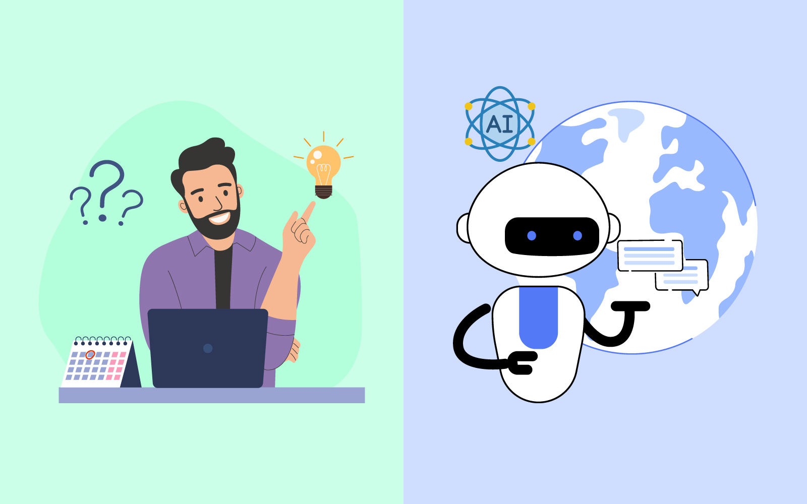
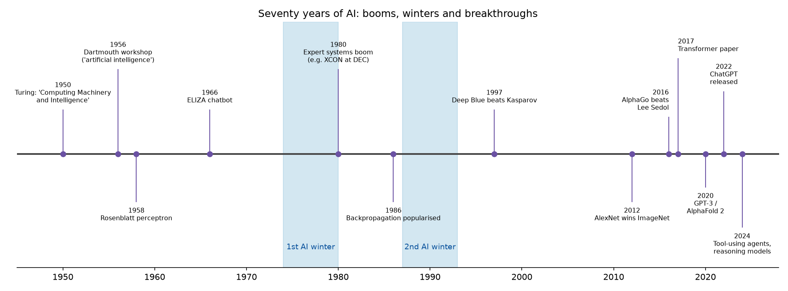
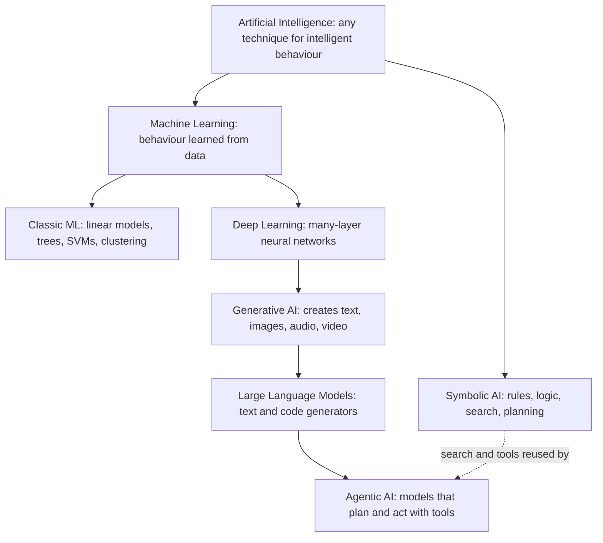

# Chapter 1 — The World of AI

*Last reviewed: September 2026. Every "today" here means "as of this date"; when you read any AI article, check its date first.*

This chapter is the map before the territory: definitions, history, the family tree, uses, myths, practical constraints and how to read AI news (summary in the [Chapter TL;DR](#chapter-tldr)). It needs no heavy maths: it suits beginners, career changers, enthusiasts and managers deciding where AI fits. Code examples are short Python scripts in [`code/`](code/), each run with `python code/<file>.py`.

---

## 1.1 What is AI? Four definitions and the rational agent

### What it is

**Artificial intelligence** is the study and engineering of machines that do things we would call intelligent in a person: perceiving, reasoning, learning, planning, understanding language, and acting sensibly.

Russell and Norvig's *Artificial Intelligence: A Modern Approach* (AIMA, 4th edition) sorts definitions on two axes: **human-like** vs **rational** (doing the right thing by an ideal standard), and **thinking** vs **behaviour**.

| | Human-like | Rational |
|---|---|---|
| **Thinking** | *Thinking humanly* — model how people think (cognitive science) | *Thinking rationally* — reason by the rules of logic ("laws of thought") |
| **Acting** | *Acting humanly* — be indistinguishable from a person (the Turing test) | *Acting rationally* — act to achieve the best expected outcome (the **rational agent**) |

Most modern AI uses the bottom-right cell, AIMA's **standard model**: build agents that act rationally (aeroplanes came from aerodynamics, not copying birds).

### Key terms

- **Agent** — anything that *perceives* its environment through **sensors** (cameras, a text box) and *acts* through **actuators** (wheels, a message it sends): a thermostat, a chess program, a tool-calling chatbot.
- **Percept** — what the agent senses at one moment; the **percept sequence** is everything sensed so far.
- **Agent function** — the mapping from percept sequences to actions; the **agent program** is the code that implements it.
- **Performance measure** — how we score the agent's behaviour *in the environment* (not how the agent rates itself).
- **Rational agent** — for every percept sequence, picks the action expected to maximise its performance measure given what it has perceived and knows. Rational is not all-knowing: an agent that does not know the bridge is out can still be rational.

### How it works: describing a task with PEAS

Before building an agent, fill in **PEAS**: Performance measure, Environment, Actuators, Sensors.

| Agent | Performance | Environment | Actuators | Sensors |
|---|---|---|---|---|
| Robot vacuum | Clean floor, battery used, no collisions | Rooms, furniture, pets | Wheels, brushes, suction | Bump and cliff sensors, camera or lidar (laser distance sensor) |
| Taxi route planner | Arrival time, fuel, safety | Road network, traffic | Route shown to driver | GPS, live traffic feed |
| Customer-support LLM agent | Issues solved, rating, cost | Help desk, order database | Replies, refund API calls | Customer messages, tool results |

Then classify the **environment**, because each property changes which algorithms work:

| Property | Easy end | Hard end | Example of the hard end |
|---|---|---|---|
| Observable? | Fully observable | Partially observable | Poker (hidden cards) |
| Agents? | Single agent | Multi-agent | Driving among other cars |
| Outcomes? | Deterministic (same action, same result) | Nondeterministic / stochastic | Dice games, robot wheels slipping |
| Episodes? | Episodic (decisions independent) | Sequential (decisions affect the future) | Chess |
| Changes while thinking? | Static | Dynamic | Traffic |
| Values? | Discrete | Continuous | Steering angle |
| Rules known? | Known | Unknown (must learn them) | A new video game |

AIMA's five increasingly capable **agent designs**:

1. **Simple reflex** — if-then rules on the current percept ("if dirty, suck").
2. **Model-based reflex** — keeps an internal model of parts of the world it cannot currently see.
3. **Goal-based** — considers which action sequences reach a goal (needs *search* and *planning*, [Chapter 2](../02-classical-ai-search/README.md)).
4. **Utility-based** — among outcomes that reach the goal, prefers the highest **utility** (a number for "how good").
5. **Learning** — improves any of the above from experience (where machine learning enters).

### Code: a rational agent in the two-square vacuum world

Two squares, A and B, each clean or dirty. The agent senses its location and whether that square is dirty; we score +1 per clean square per time step.

```python
# code/vacuum_agent.py (core)
def reflex_agent(percept):
    location, status = percept
    if status == "Dirty":
        return "Suck"
    return "Right" if location == "A" else "Left"

def run(agent, steps=10, seed=0):
    world = {"A": "Dirty", "B": "Dirty"}
    loc, score = "A", 0
    for _ in range(steps):
        action = agent((loc, world[loc]))          # perceive -> decide
        if action == "Suck":                        # act on the environment
            world[loc] = "Clean"
        elif action == "Right":
            loc = "B"
        else:
            loc = "A"
        score += sum(v == "Clean" for v in world.values())   # performance measure
    return score
```

Output:

```
reflex agent score : 18
random agent score : 10.07 (mean of 100 runs)
best possible      : 18 (suck A, move, suck B, then 8 steps fully clean)
```

The two-rule agent is *rational* here because it hits the best possible score. Change the measure (−1 per move, dirt reappears randomly) and it may not be. Rationality is always relative to the performance measure, environment, actions and percepts.

### Trade-offs

| Definition | Strength | Weakness |
|---|---|---|
| Thinking humanly | Teaches us about the mind | Hard to verify what a program "thinks" |
| Thinking rationally | Precise, provable (logic) | Real-world knowledge is uncertain and messy |
| Acting humanly | Easy to test (can people tell?) | Rewards imitation and trickery, not usefulness |
| Acting rationally | Measurable, general, engineering-friendly | Only as good as the performance measure you write down |

### Common mistakes

- **Treating "AI" as one technology.** It is a goal pursued with many techniques: search, logic, probability, learning.
- **Writing the wrong performance measure.** Reward a vacuum for "dirt sucked up" and a clever agent could dump dirt and suck it again — AIMA's entry to the **value alignment problem**: the objective we give a machine must match what we really want.
- **Confusing rational with perfect.** Rational means best *expected* outcome given available information.

### Real-world examples

- Basic robot vacuums are simple reflex agents (bump, turn, keep cleaning); models that map your home are model-based.
- Navigation apps (Google Maps, Waze) are goal- and utility-based: reach the destination, minimise time.
- LLM coding agents (e.g. Claude Code, GitHub Copilot's agent mode) run a perceive–decide–act loop: read files, edit, run tests, observe.

### In the interview

**30-second answer:** "AI is building systems that act intelligently. Textbooks split definitions into thinking vs acting and human-like vs rational; the engineering mainstream is the rational agent: it perceives through sensors, acts through actuators, and picks actions that maximise an expected performance measure. We specify tasks with PEAS and classify environments (observable, deterministic, and so on), because that decides the algorithm."

- *Why not use the Turing test as the definition?* It measures imitation, not usefulness; a calculator is superhuman at arithmetic yet fails it, and a chatbot can pass short tests with tricks.
- *What is the value alignment problem?* The objective we give a machine differs from what we want, so a capable optimiser pursues the wrong thing well.
- *A partially observable, stochastic, multi-agent environment?* Poker, or city driving.

### Self-check

1. Is a rational agent omniscient? → No; it maximises *expected* performance given its percepts and knowledge.
2. Which agent types need search or planning? → Goal-based and utility-based.
3. Chess with a clock: static or dynamic? → Semi-dynamic: the board does not change while you think, but your score (time) does.

### TL;DR

AI = machines acting intelligently; the working definition is the **rational agent** maximising expected performance. Describe any task with **PEAS** and the environment's properties before choosing a technique.

---

## 1.2 What is intelligence? Humans, machines and the Turing test


*Figure — Human reasoning and machine pattern-finding are different kinds of "smart" (course diagram).*

### What it is

**Intelligence** has no agreed definition. A practical one: the ability to achieve goals across a wide range of situations, including new ones, by learning, reasoning and adapting.

| | Biological intelligence | Machine "learning" (today's AI) |
|---|---|---|
| **How it learns** | Experience, emotion, social feedback, a few examples | Statistical patterns in large amounts of **training data** |
| **What it stores** | Memories, intuitions, transferable concepts | Numbers (model **parameters**) that encode patterns |
| **Missing information** | Fills gaps with common sense and context | Often fails or guesses confidently on unfamiliar inputs |
| **Strengths** | Creativity, abstraction, empathy, learning from little data, knowing what matters | Speed, consistency, scale, instant copying of a trained model to thousands of servers |
| **Weaknesses** | Slow, tires, inconsistent, limited memory | Brittle outside its training distribution, no lived experience, can be confidently wrong |

Example: face unlock converts a face into an **embedding** (a list of numbers summarising features such as eye spacing) and compares it with the stored one — fast and accurate, but arithmetic, not human recognition. A large language model (LLM) learns from vast text to predict the next piece of text; whether it "understands" is exactly what people argue about. The strengths are *complementary*: combine machine speed and scale with human judgement and accountability.

### The Turing test

In "Computing Machinery and Intelligence" (1950) Alan Turing replaced "Can machines think?" with the **imitation game**: a judge chats by text with a hidden human and a hidden machine; across many judges, if the machine is picked out no better than chance, it "passes". Turing predicted that by about 2000 an average judge would guess right no more than 70% of the time after five minutes. AIMA's **total Turing test** also requires perception (vision) and physical action (robotics).

### Code: why passing a chat test proves little

Joseph Weizenbaum's ELIZA (1966) imitated a therapist with nothing but pattern matching (**regular expressions**, or **regex**, a mini-language for text patterns) and pronoun swapping, yet some users confided in it. The same trick in about 20 lines:

```python
# code/eliza_toy.py (core)
RULES = [
    (r"i feel (.*)", "Why do you feel {0}?"),
    (r"i am (.*)", "How long have you been {0}?"),
    (r".*\bmother\b.*|.*\bfather\b.*", "Tell me more about your family."),
    (r"(.*)\?", "Why do you ask that?"),
    (r".*", "Please, go on."),
]
SWAP = {"my": "your", "me": "you", "i": "you", "am": "are"}

def reply(user: str) -> str:
    text = user.lower().strip(" .!")
    for pattern, template in RULES:
        m = re.fullmatch(pattern, text)
        if m:
            return template.format(*(reflect(g) for g in m.groups() if g is not None))
```

Output:

```
USER : I feel stuck in my job.
ELIZA: Why do you feel stuck in your job?
USER : I am worried about exams
ELIZA: How long have you been worried about exams?
USER : My mother calls every day
ELIZA: Tell me more about your family.
USER : Can you actually understand me?
ELIZA: Why do you ask that?
USER : The weather is nice
ELIZA: Please, go on.
```

The first match wins; `reflect` swaps pronouns. No world model or meaning, yet replies feel attentive. Reading understanding into such output is the **ELIZA effect**, which matters even more with fluent LLMs.

### The intelligence debate

- **Chinese Room (John Searle, 1980).** A person who speaks no Chinese follows a rulebook to answer Chinese notes perfectly; outsiders think the room understands, but nobody inside does. Correct symbol manipulation is not understanding.
- **Weak vs strong AI** (Searle). *Weak AI*: machines act *as if* intelligent. *Strong AI*: a suitably programmed machine really has a mind. Engineers usually need only the weak claim.
- **LLMs and the test.** A 2025 **preprint** (a paper shared before formal peer review) by Jones and Bergen at UC San Diego reported that in a three-party Turing-style test, GPT-4.5 prompted with a human persona was picked as the human 73% of the time, more often than the real humans. That shows fluent imitation, not understanding or reliability — which is why researchers use **benchmarks** (fixed public test sets with known answers, so models are scored the same way) and real-world evaluations instead.

### Trade-offs: ways to judge "is it intelligent?"

| Test | Measures | Blind spot |
|---|---|---|
| Turing test | Human-likeness in conversation | Rewards deception; ignores non-human skills |
| Benchmarks (maths, coding suites) | Specific skills, comparable scores | Can be "taught to the test"; test data may leak into training |
| Real-world task success | Usefulness where it counts | Expensive and slow to measure |

### Common mistakes

- **Fluency = understanding.** Smooth text shows good pattern modelling, not grounded knowledge.
- **"It failed a trick question, so it is useless."** Narrow systems can be very valuable despite obvious gaps.
- **Anthropomorphising** ("the model wants"). Useful shorthand, misleading if taken literally.

### In the interview

**30-second answer:** "Turing replaced 'can machines think?' with an operational test: can a judge tell a machine from a person in text chat? It measures imitation, not usefulness or understanding. ELIZA fooled people in 1966 with pattern matching; Searle's Chinese Room argues symbol manipulation is not understanding. In practice we evaluate AI with task benchmarks and real-world metrics."

- *Has any system passed?* Claims exist (a 2014 chatbot posing as a 13-year-old; LLMs in 2024–2025 studies), but results depend heavily on test design, time limits and judges, so "passed" is contested.
- *What is the ELIZA effect?* Attributing understanding or emotion to a system because its output looks human.

### TL;DR

Human intelligence is flexible, contextual and learns from little; machine intelligence is fast, scalable pattern-finding. The Turing test checks imitation, not understanding. Judge AI by what it reliably does.

---

## 1.3 A short history of AI


*Figure — Key milestones and the two AI winters (generated by `code/timeline.py`).*

### What it is

AI's history cycles through bold predictions, booms, disappointment ("**AI winters**": cut funding and interest) and comebacks driven by new ideas plus data and compute.

### How it unfolded

| Period | What happened | Why it matters |
|---|---|---|
| **1943–1955: foundations** | McCulloch and Pitts model a neuron mathematically (1943). Turing's 1950 paper proposes the imitation game. | Brains as computation; a test for machine intelligence. |
| **1956: Dartmouth workshop** | The 1955 proposal by John McCarthy, Marvin Minsky, Claude Shannon and Nathaniel Rochester coins "artificial intelligence"; the summer 1956 Dartmouth workshop is taken as the field's birth. | AI becomes a named field; very optimistic predictions begin. |
| **1956–early 1970s: symbolic AI** | Newell and Simon's Logic Theorist and General Problem Solver, McCarthy's Lisp (1958, a language built for AI), Rosenblatt's perceptron (1958, the first trainable artificial neuron), ELIZA (1966), Shakey the robot. | "Good old-fashioned AI" (GOFAI): intelligence as rules and search over symbols. |
| **~1974–1980: first AI winter** | Toy-problem programs failed to scale (**combinatorial explosion**: possibilities grow too fast to check). The UK Lighthill report (1973) was highly critical; UK and US funding fell. Minsky and Papert's *Perceptrons* (1969) had shown limits of single-layer networks. | Toy demos do not imply real-world scale. |
| **1980–1987: expert systems boom** | **Expert systems** encode specialist knowledge as thousands of if-then rules; DEC's XCON/R1 configured computer orders. Japan's Fifth Generation project spurs investment. | First commercial AI wave. |
| **~1987–1993: second AI winter** | Expert systems proved brittle and costly to maintain; the Lisp-machine market collapsed in 1987. | Hand-written knowledge does not scale or adapt. |
| **1986–2000s: statistical and ML era** | Backpropagation (computes how much each weight should change to reduce error) popularised for multi-layer networks (Rumelhart, Hinton and Williams, 1986). Bayesian networks, support vector machines, decision trees. IBM's Deep Blue beats Garry Kasparov (1997) using search, not learning. In the 2000s cheap compute and web-scale data power recommendations and search at Amazon and Google. | From writing rules to learning them from data. |
| **2012: deep learning breakthrough** | AlexNet, a deep convolutional network trained on GPUs (chips doing thousands of calculations in parallel), wins the ImageNet challenge (over a million labelled photos) with top-5 error (right answer missing from its five best guesses) of about 15% vs about 26% for the runner-up. | Deep learning takes over vision, then speech and translation: big data + GPUs + better training tricks. |
| **2014–2016** | Generative adversarial networks (GANs, 2014: one network makes fakes, another spots them, both improve). DeepMind's AlphaGo beats Lee Sedol 4–1 (March 2016), combining deep networks with tree search. | Learning plus search beats humans at a game thought decades away. |
| **2017: the transformer** | Google's "Attention Is All You Need" introduces the **transformer**. | Foundation of nearly every modern language model (Chapter 3). |
| **2018–2021: pre-trained language models** | BERT and GPT-1 (2018), GPT-2 (2019), GPT-3 (2020, 175 billion parameters). AlphaFold 2 largely solves protein-structure prediction at CASP14 (2020). | "Pre-train on huge data, then adapt" — **foundation models** — becomes the recipe. |
| **2022: generative AI goes mainstream** | DALL·E 2, Midjourney, Stable Diffusion, and on 30 November 2022 OpenAI's ChatGPT, reportedly ~100 million users within about two months. | AI becomes a consumer product; "AI engineering" (building on foundation models) becomes a job. |
| **2023–today: multimodal, reasoning, agents** | GPT-4, Claude, Gemini and **open-weight** families such as Llama (trained weights published for anyone to run); **multimodal** models (text, images, audio); "reasoning" models that spend more compute thinking before answering (from 2024); tool-using **agents** and open protocols for connecting models to tools. 2024 Nobel Prizes in Physics (Hopfield, Hinton) and Chemistry (Hassabis, Jumper, with Baker) recognised AI research. | From "can it generate?" to "can it act reliably, safely and cheaply?" |

### Why it matters

1. **Scale changes what works.** Neural networks existed in 1958; they won only when data (the web, ImageNet) and compute (GPUs) caught up.
2. **Over-promising causes winters.** Both followed predictions that outran results.
3. **Old ideas return.** Search (Deep Blue) plus learning produced AlphaGo; LLM agents now call symbolic tools (calculators, code interpreters, databases).

### Common mistakes

- **Thinking AI started with ChatGPT.** Most ideas are decades old; scale and engineering changed.
- **Thinking deep learning replaced everything.** Search, logic, optimisation and classic ML still run route planning, scheduling and fraud scoring on tables.

### In the interview

**30-second answer:** "AI was named at Dartmouth in 1956. Symbolic AI used logic and search; over-promising led to winters in the 1970s and late 1980s. Statistical ML took over from the late 1980s. Deep learning broke through with AlexNet in 2012, transformers arrived in 2017, pre-trained models scaled to GPT-3, and ChatGPT in 2022 took generative AI mainstream. Today's frontier is multimodal, reasoning and agentic systems."

- *What caused the AI winters?* Results failing to match predictions (combinatorial explosion, brittle expert systems), leading to funding cuts.
- *Why did deep learning take off in 2012, not 1990?* Large labelled datasets, GPU computing and better training techniques arrived together.

### Self-check

1. What did Deep Blue (1997) mainly use? → Search with a hand-tuned evaluation function, not learning.

### TL;DR

Dartmouth 1956 → symbolic AI → winter → expert systems → winter → statistical ML → deep learning (2012) → transformers (2017) → foundation models → ChatGPT (2022) → agents. Progress came from ideas *plus* data *plus* compute; winters came from promises ahead of all three.

---

## 1.4 Narrow AI vs general AI

### What it is

- **Narrow AI** (*weak AI* in everyday use, ANI): built for a specific task or family of tasks — spam filters, face unlock, chess engines, recommenders. **Every deployed AI system today is narrow in this sense**, even if some are broad.
- **Artificial general intelligence (AGI)**: hypothetical system that can learn and perform essentially any intellectual task a human can, adapting to new domains without rebuilding. No agreed definition or test; some mean "matches a human at most economically useful work".
- **Artificial superintelligence (ASI)**: hypothetical intelligence far beyond the best humans in nearly every domain.

### Why it matters

LLMs blurred the line: one model writes, translates, codes and answers questions, yet still makes basic errors, does not keep learning after deployment (unless engineered around it), and depends on its training data. "General" depends on your definition, so AGI debates often talk past each other.

### Trade-offs

| | Narrow AI | General-purpose foundation model (e.g. an LLM) |
|---|---|---|
| Scope | One task | Many tasks via prompting |
| Accuracy on its task | Often highest | Good, sometimes below a specialist |
| Build cost | Needs task data and training | Rent via API or adapt; provider pays huge pre-training cost |
| Predictability | High | Lower: open-ended outputs |
| Example | Card-fraud model | Chat assistant that also drafts emails and code |

**When not to use a general model:** when a small specialised model is cheaper, faster, more accurate and easier to audit — a tabular credit-risk score, an on-device keyword spotter ("Hey Siri").

### Common mistakes

- Treating AGI timelines from interviews or social media as facts; expert forecasts vary widely.
- Assuming "general" means "reliable at everything".

### In the interview

**30-second answer:** "Narrow AI solves specific tasks and is everything deployed today. AGI is a hypothetical system matching humans across essentially any intellectual task, with no agreed definition. Foundation models are far more general than classic narrow AI but still have clear reliability limits."

- *Is ChatGPT AGI?* Under most definitions no: it is broad and general-purpose with notable failure modes; people who disagree usually use a looser definition.

### TL;DR

All real AI today is narrow, though foundation models are broad. AGI is a contested, undefined target; ASI is speculative.

---

## 1.5 The AI family tree

### What it is

"AI" is an umbrella over nested families, each a subset of the one above:



| Term | Plain definition | Everyday examples |
|---|---|---|
| **Artificial intelligence (AI)** | Any technique that lets machines do tasks normally needing human intelligence | Route planners, chess engines, chatbots |
| **Machine learning (ML)** | Algorithms that learn patterns from **training data** and apply them to unseen data, instead of hand-typed rules | Spam filters, recommendations, fraud detection, predictive text |
| **Deep learning (DL)** | ML with many-layer **neural networks**; early layers detect simple features (edges), deeper ones complex ones (faces) | Face ID, speech recognition, Google Translate, medical-scan analysis |
| **Generative AI (GenAI)** | Models that *create* new content resembling their training data | Chat assistants, DALL·E and Midjourney images, AI music and video |
| **Large language models (LLMs)** | Very large transformers trained to predict the next token (word or word-piece) on huge text collections | ChatGPT, Claude, Gemini, Llama |
| **Agentic AI** | Systems that pursue a goal over multiple steps: plan, call tools (search, code, APIs), observe and adapt with limited human guidance | Coding agents, browsing research assistants, warehouse robots choosing routes |

ML's two main styles: **supervised learning** (learn from labelled examples, e.g. emails marked spam/not spam) and **unsupervised learning** (find structure in unlabelled data, e.g. group photos by similarity). Reinforcement learning — trial and error from rewards — is the third; the [ML Handbook](../../../ml/chapters/01-what-is-ml/README.md) covers all three.

Generative AI blurs human-made vs machine-made content, raising originality, copyright, authenticity and misuse issues (Chapter 12). Agentic AI is the youngest branch: agents handle multi-step digital tasks but remain error-prone and need **guardrails** (automatic checks and limits on what they may do; Chapter 9).

### Symbolic vs statistical AI

The deepest historical split is *how knowledge gets into the machine*:

| | Symbolic AI (GOFAI) | Statistical / connectionist AI (ML, DL) |
|---|---|---|
| Knowledge | Written by people as rules, logic, search spaces | Learned from data as numeric parameters |
| Strengths | Transparent, exact, needs no data, provable | Handles messy inputs (images, speech, language), improves with data |
| Weaknesses | Brittle, cannot cover every case, costly to maintain | Needs data and compute, hard to explain, can be confidently wrong |
| Examples | Tax rules engine, A* route planning, SQL query planner, expert systems | Image classifiers, recommenders, LLMs |

Modern systems mix both (**neuro-symbolic** or "hybrid"): an LLM (statistical) calls a calculator, database or planner (symbolic).

### Code: rules vs learning on the same task

```python
# code/symbolic_vs_statistical.py (core)
POSITIVE = {"great", "good", "love", "excellent"}     # knowledge written by a person
NEGATIVE = {"bad", "terrible", "hate", "awful"}

def rule_based(text):
    words = set(text.lower().split())
    score = len(words & POSITIVE) - len(words & NEGATIVE)
    return "pos" if score > 0 else "neg" if score < 0 else "unknown"

TRAIN = [("great phone love it", "pos"), ("superb camera and fast", "pos"),
         ("slow and laggy camera", "neg"), ...]            # 8 labelled reviews
vec = CountVectorizer()                                   # words -> counts
model = MultinomialNB().fit(vec.fit_transform(texts), labels)   # knowledge learned from data
```

Output:

```
review             rules    learned  P(pos)
superb and fast    unknown  pos      0.87
slow laggy phone   unknown  neg      0.19
good but slow      pos      neg      0.41
love it            pos      pos      0.68
```

The rules know nothing of "superb" or "laggy" because nobody wrote them down; the learned Naive Bayes model picked them up from examples (`P(pos)` = estimated probability of positive). On "good but slow" they disagree, and neither is obviously right: the model is only as good as its eight examples. With more data learning wins on coverage; rules win on transparency.

**When not to use ML:** when rules are known, stable and must be exact (tax brackets, access control, unit conversions), or when you have no data. Use plain code.

### Common mistakes

- Saying "AI" when you mean a technique: say "a gradient-boosted classifier" (many small trees, each correcting the previous ones) or "an LLM".
- Using GenAI for prediction on tables; classic ML is usually cheaper and more accurate there.
- Forgetting every DL model is ML and every ML model is AI, but not the reverse.

### In the interview

**30-second answer:** "AI is the umbrella; ML learns from data; deep learning is ML with many-layer neural networks; generative AI and LLMs are deep models that create content; agentic AI wraps models in a plan–act–observe loop with tools. Historically the big split is symbolic (hand-written) vs statistical (learned) knowledge, and modern systems combine them."

- *Is a rules engine AI?* Yes in the broad sense (symbolic AI), but not ML.
- *Where does reinforcement learning fit?* A branch of ML; deep RL combines it with deep learning (e.g. AlphaGo).

### TL;DR

AI ⊃ ML ⊃ DL ⊃ GenAI ⊃ LLMs, with agentic AI as LLMs that act. Symbolic AI writes knowledge down; statistical AI learns it; real products combine both.

---

## 1.6 Where AI is used today

### What it is

Most AI is invisible, inside products you already use:

| Area | Examples | Main technique |
|---|---|---|
| Phones and assistants | Face unlock, predictive keyboard, photo enhancement, live translation, Siri/Alexa/Google Assistant | Deep learning, on-device models |
| Generative tools | Chat assistants, writing and coding helpers, image and video generators, meeting summaries | LLMs, diffusion models (generate images by removing noise step by step) |
| Recommendations and feeds | Netflix, Spotify, YouTube, Amazon, TikTok | Classic ML plus deep recommenders |
| Communication | Spam and phishing filters, moderation, smart replies | Classifiers, LLMs |
| Customer service | 24/7 chatbots for common questions, ticket routing | LLMs, intent classifiers |
| Finance | Card-fraud detection, credit scoring, document processing | Gradient-boosted trees, anomaly detection |
| Transport and logistics | Navigation and ETAs, ride matching, warehouse robots, driver assistance, robotaxis in some cities | Search (A*), ML, deep learning |
| Healthcare and science | Medical image screening, AlphaFold, drug-discovery support | Deep learning |
| Software engineering | Code completion, coding agents, test generation | LLMs, agents |

### Why it matters

Where AI already works — narrow, high-volume, error-tolerant or human-checked — shows where new projects are likely to succeed.

### TL;DR

AI already runs recommendations, filters, assistants, fraud checks, navigation and coding tools; most of it is narrow and invisible.

---

## 1.7 Hype vs reality: common myths

### What it is

Reality between the headlines: modern AI excels at **specific tasks**, depends on data, can be wrong or biased, and needs oversight.

| Myth | Reality | Why people believe it |
|---|---|---|
| **"AI will soon be conscious."** | No demonstrated self-awareness or feelings; whether machines *could* be conscious is open, with no agreed test. | Human-like text triggers the ELIZA effect; sci-fi blurs with news. |
| **"AI solves problems instantly."** | Real projects need good data, infrastructure, skilled people and many rounds of tuning, monitoring and maintenance. | Headline wins hide years of work under specific conditions. |
| **"AI is always right."** | Models make mistakes, reflect data biases, and fail on unfamiliar situations. LLMs **hallucinate**: fluent, confident, false statements. | "99% accurate" marketing; that 1% may be exactly the costly cases. |
| **"AI will take all jobs."** | Mostly it changes tasks inside jobs, automating repetitive parts. Some roles shrink, a few appear (ML engineer, AI safety and governance), and AI skills fold into existing jobs; the predicted stand-alone "prompt engineer" job largely merged into ordinary roles. Judgement, leadership, empathy and accountability stay human. | Demos of AI writing code or art generalise too easily. |
| **"More data or bigger models always fix it."** | Bigger usually helps on average but does not remove hallucination, bias, or objective mismatch. | Striking scaling results in 2018–2023. |
| **"AI is objective because it is maths."** | Models learn human biases in their data (e.g. hiring or lending history). | Numbers look neutral. |

### Common mistakes

Swinging from hype to dismissal after one bad answer (evaluate on your data), and trusting a headline accuracy without asking: on what data, versus what baseline, and what do the failures cost?

### In the interview

**30-second answer:** "Current AI is narrow, statistical and data-dependent. It is not conscious, not always right, not instant to deploy, and mostly augments rather than replaces people. Use it where errors are tolerable or checked, measure it on your own data, and keep humans accountable for high-stakes decisions."

### TL;DR

AI is not conscious, not magic, not infallible and not a wholesale replacement for people; it needs data, testing and oversight.

---

## 1.8 Real-world constraints: balancing excitement with reality

### What it is

Most AI projects stall on practical constraints, not algorithms. Chip Huyen's *AI Engineering* frames modern AI work as building applications *on top of* foundation models, where the hard problems are evaluation, cost, latency, reliability and data.

| Constraint | What goes wrong | Practical response |
|---|---|---|
| **Data** | Too little, poor, unrepresentative or biased; privacy rules limit use | Audit data first; start where good data exists; collect production feedback |
| **Budget and infrastructure** | GPUs and cloud are expensive; per-request API costs multiply with traffic | Limited-scope pilots; pay-as-you-go cloud; smallest model that meets quality |
| **Maintenance** | **Data drift** (live data stops looking like training data); pipelines, dependencies and model versions need upkeep | Budget AI as an ongoing cost; monitor quality continuously |
| **Latency** | Users abandon slow features; long answers take seconds | Stream output, shorten outputs, cache, use smaller or faster models |
| **Reliability** | Probabilistic outputs; errors compound across multi-step agents | Evaluate before launch, add checks and fallbacks, humans in the loop for high stakes |
| **Legacy integration** | Older systems were not designed for AI; need custom APIs or middleware | Plan integration explicitly; wrap models behind stable service interfaces |
| **Skills and staffing** | ML engineers, data scientists and MLOps (running ML reliably in production) specialists are scarce | Upskill staff through mentored real projects; hire selectively |
| **Culture and change** | Job fears, resistance, conflicting goals | Communicate early, involve users, align on clear goals |
| **Return on investment (ROI)** | No success metric, so no case for funding; benefits may take time | Define metrics up front (churn, handling time, conversion); mix quick wins with longer bets |
| **Security, safety and regulation** | Prompt injection (hidden text that tricks a model into ignoring instructions), data leaks, harmful outputs; laws such as the EU AI Act (in force since August 2024, obligations phased in over several years) | Threat-model, restrict tool permissions, keep audit logs, check legal obligations (Chapter 12) |

### How it works: back-of-envelope maths

1. **Cost** = (input tokens × input price + output tokens × output price) × requests. A **token** is roughly three-quarters of an English word on average.
2. **Latency** (see [System Design Fundamentals](../../../system-design-patterns/modules/00-system-design-fundamentals/README.md)) ≈ time to first token + output tokens ÷ generation speed.
3. **Compound reliability**: n independent steps each succeeding with probability p succeed together with probability pⁿ; 0.95¹⁰ ≈ 0.60.

```python
# code/constraints_math.py (core) — prices are placeholders, not real quotes
PRICE_IN_PER_M = 3.00    # $ per 1M input tokens
PRICE_OUT_PER_M = 15.00  # $ per 1M output tokens

def monthly_cost(requests_per_day, tokens_in, tokens_out):
    per_request = tokens_in / 1e6 * PRICE_IN_PER_M + tokens_out / 1e6 * PRICE_OUT_PER_M
    return per_request * requests_per_day * 30

def latency_s(tokens_out, time_to_first_token_s, tokens_per_s):
    return time_to_first_token_s + tokens_out / tokens_per_s

def chain_success(step_accuracy, steps):
    return step_accuracy ** steps
```

Output:

```
1) Cost: support bot, 2,000-token prompt, 300-token answer
     1,000 requests/day -> $       315 / month
    10,000 requests/day -> $     3,150 / month
   100,000 requests/day -> $    31,500 / month

2) Latency: 0.5 s to first token, 60 tokens/s generation
      50 output tokens ->   1.3 s
     300 output tokens ->   5.5 s
    1000 output tokens ->  17.2 s

3) Reliability: probability a multi-step task fully succeeds
   per-step 99%:  1 steps=99.0%   5 steps=95.1%  10 steps=90.4%  20 steps=81.8%
   per-step 95%:  1 steps=95.0%   5 steps=77.4%  10 steps=59.9%  20 steps=35.8%
   per-step 90%:  1 steps=90.0%   5 steps=59.0%  10 steps=34.9%  20 steps=12.2%
```

Check row one: 2,000/1M × $3 = $0.006 plus 300/1M × $15 = $0.0045 → $0.0105 × 1,000 × 30 = $315. Cost scales linearly with traffic and prompt size; long answers are slow; a "95% reliable" step makes a 10-step agent fail about 40% of the time. (Real steps are not independent and agents can retry, so pⁿ is a warning, not a forecast.)

**When not to use AI at all:** a simple rule or existing software does the job; errors are unacceptable and uncheckable; there is no data and no way to evaluate; or cost per request exceeds value per request.

### Common mistakes

- Budgeting for building but not running, monitoring and retraining.
- Launching without a success metric, then being unable to defend the project.
- Testing a few happy-path examples and discovering failure modes in production.

### Real-world examples

Companies pilot internally (ticket summarisation, document search) to learn cost, latency and error rates cheaply; autonomous driving shows the reliability constraint — demos came years before limited robotaxi service.

### In the interview

**30-second answer:** "Beyond model quality, AI projects are limited by data, cost, latency, reliability, integration, skills, change management, measurable ROI, security and regulation. I estimate cost and latency up front, define a success metric, pilot small, evaluate on real data, monitor in production and design for failure with fallbacks and human review."

- *How do you cut LLM cost?* Shorter prompts, caching, routing easy requests to smaller models, batching, limiting output length.
- *Why do agents fail more than single calls?* Errors compound; each tool call and decision is another chance to go wrong.

### Self-check

1. 1,000 input and 100 output tokens at $3/$15 per million: cost per request? → 0.003 + 0.0015 = $0.0045.
2. Per-step success 0.9, five steps? → 0.9⁵ ≈ 59%.

### TL;DR

Plan for data, cost, latency, reliability, maintenance, integration, people and ROI from day one. Do the back-of-envelope maths; pilot small; measure.

---

## 1.9 Staying informed without being fooled

### What it is

AI moves weekly and much coverage is marketing. **Critical reading** separates evidenced progress from exaggeration.

### How it works: a checklist for any AI claim

1. **Check the date.** A 2023 "limitation" may be fixed; a 2023 "breakthrough" may be obsolete.
2. **Spot hype words** ("revolutionary", "human-level"); look for numbers instead.
3. **Find the primary source:** paper, technical report, **model card** (how a model was trained, its purpose and known limits) or reproducible demo. Peer-reviewed work (e.g. NeurIPS, ICML, ICLR, ACL, CVPR) and arXiv preprints are primary sources; preprints are not yet peer-reviewed.
4. **Ask what was measured:** which benchmark, which **baseline** (simple reference system), which metric (accuracy, F1 — one number balancing misses against false alarms, pass rate)? Does test data overlap training data (**contamination**)? Were limitations reported?
5. **Ask for real use:** working product, public demo, user trials. No working code or real results often means more pitch than product.
6. **Triangulate** across two or three independent, named sources; distrust anonymous "insiders say".
7. **Consider harms:** who is hurt by errors, bias or misuse? Is the provider transparent about data use, privacy and bias mitigation?

### Credible sources (as of 2026)

| Type | Examples |
|---|---|
| Research | arXiv (cs.AI, cs.LG, cs.CL), NeurIPS, ICML, ICLR, ACL, CVPR proceedings |
| Official docs and model/system cards | Anthropic, OpenAI, Google DeepMind, Meta AI reports; Hugging Face model cards |
| Annual overviews | Stanford HAI *AI Index Report*; Epoch AI compute and model trends |
| Independent evaluation | Leaderboards such as LMArena (one signal: rankings reflect crowd preferences on chat prompts) |
| Books | Russell & Norvig, *AIMA* (4th ed.); Chip Huyen, *AI Engineering* (2025) |
| Regulation and policy | EU AI Act, NIST AI Risk Management Framework |

**Engaging responsibly:** fact-check before sharing (one viral post is not evidence), follow people who explain methods and admit limitations, and ask about data use, privacy, bias and who bears the risk.


### In the interview

**30-second answer:** "I check the date, find the primary source such as a paper or model card, ask which benchmark, baseline and metric were used and whether test data leaked into training, and look for independent confirmation and real-world use before I believe a claim."

### TL;DR

Check the date, find the primary source, demand numbers and baselines, triangulate, and consider who could be harmed.

---

## 1.10 Map of this handbook and its companions

| Part | Chapters | You will be able to… |
|---|---|---|
| Foundations | 1 World of AI · 2 Classical AI and search | Explain the field; implement BFS, A*, minimax and a pathfinding agent |
| How modern models work | 3 Transformers and embeddings · 4 LLMs · 10 Generative models beyond text | Explain attention, embeddings, tokens, pre-training, diffusion |
| Building with LLMs | 5 Prompt engineering · 6 LLM apps in Python and MCP · 7 RAG · 8 Fine-tuning vs RAG and evaluation · 9 Agents | Build, ground, evaluate and extend LLM applications |
| Production and responsibility | 11 Serving and inference · 12 Safety, ethics, governance | Run models efficiently; manage risk, bias, privacy and regulation |
| Design and review | 13 AI system design · 14 Case studies · 15 Rapid review and glossary · 16 Career appendix | Design GenAI products end to end; prepare for interviews |

**Companion handbooks** (same repository):

- **Python Handbook** — [Chapter 1, Getting started](../../../python/chapters/01-getting-started/README.md) if Python is new; [Chapter 13, Type hints](../../../python/chapters/13-type-hints/README.md) and [Chapter 15, Testing and debugging](../../../python/chapters/15-testing-and-debugging/README.md) for the application chapters.
- **ML Handbook** — [Chapter 1, What machine learning is](../../../ml/chapters/01-what-is-ml/README.md), [Chapter 2, Math for ML](../../../ml/chapters/02-math-for-ml/README.md), [Chapter 3, The Python ML stack](../../../ml/chapters/03-python-ml-stack/README.md). Read ML before Chapters 3–4 if neural networks are new to you.

---

## Chapter TL;DR

- **AI** = machines acting intelligently; the working definition is the **rational agent** maximising an expected performance measure. Describe tasks with **PEAS** and classify the environment.
- **Human vs machine intelligence**: flexible and contextual vs fast, scalable pattern-finding. The **Turing test** measures imitation, not understanding (ELIZA fooled people with regex).
- **History**: Dartmouth 1956 → symbolic AI → first winter (~1974–80) → expert systems → second winter (~1987–93) → statistical ML → deep learning (AlexNet 2012) → transformers (2017) → foundation models (GPT-3 2020) → ChatGPT (Nov 2022) → reasoning models and agents (2024 onwards).
- **Narrow vs general**: everything deployed is narrow (though LLMs are broad); AGI has no agreed definition.
- **Family tree**: AI ⊃ ML ⊃ DL ⊃ GenAI ⊃ LLMs; agentic AI wraps models in a plan–act–observe loop. Symbolic (written) vs statistical (learned) knowledge; modern systems combine them.
- **Myths**: not conscious, not instant, not always right, mostly augments jobs rather than replacing them.
- **Constraints**: data, cost, latency, reliability (pⁿ compounding), maintenance, integration, skills, culture, ROI, security and regulation.
- **Staying informed**: date, primary source, numbers and baselines, independent confirmation, harms.
