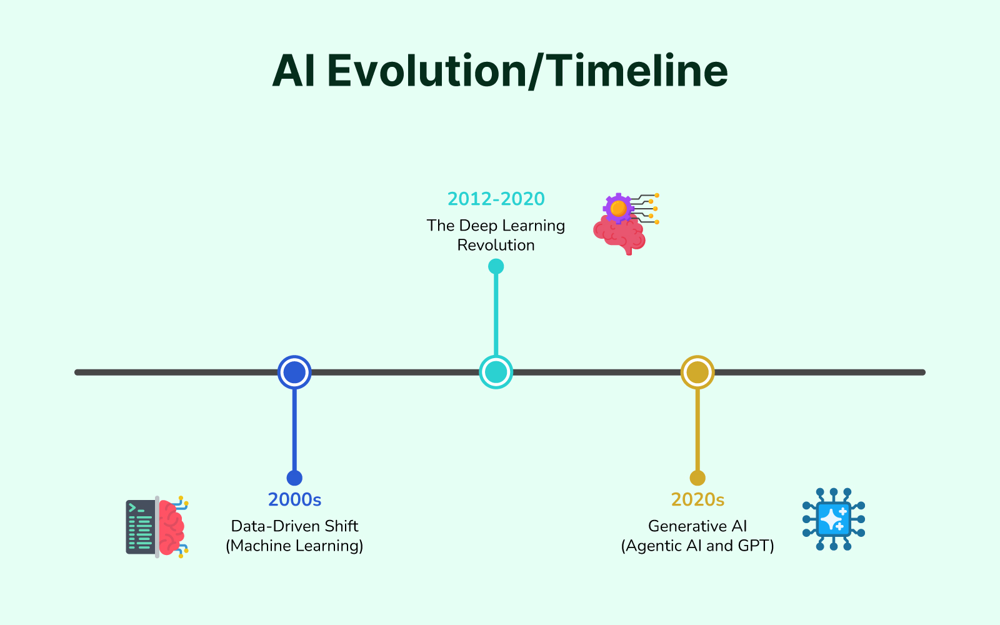
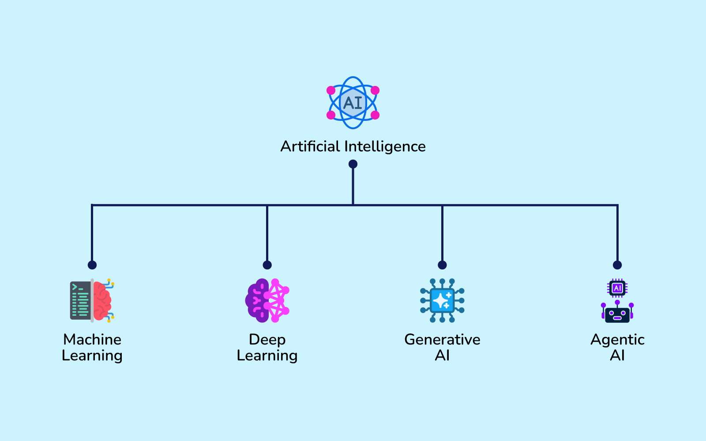
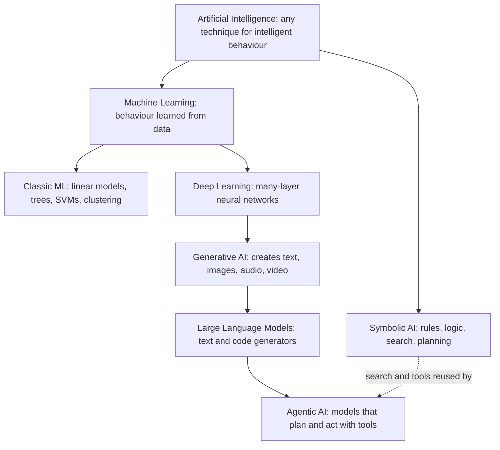

# Chapter 1 — The World of AI

*Last reviewed: September 2026. AI changes fast, so every "today" in this chapter means "as of this date". When you read any AI article, check its date first.*

Artificial intelligence (AI) has moved from research labs into phones, inboxes, cars and code editors. This chapter gives you the map before the territory: what people actually mean by "AI", where the idea came from, how the branches of the field fit together, where AI is used today, which popular beliefs about it are wrong, what limits real projects, and how to keep up without being fooled by hype. Later chapters zoom in on each piece; this one makes sure you know where each piece sits.

**What you'll learn**

- Four ways to define AI, and why most engineers use the "rational agent" definition
- Agents, environments and the PEAS checklist, with a runnable vacuum-cleaner agent
- How human intelligence differs from machine "learning", and what the Turing test does and does not prove
- A seventy-year history: Dartmouth 1956, symbolic AI, two AI winters, the ML era, deep learning in 2012, transformers in 2017, ChatGPT in 2022, and today's agents
- Narrow AI vs general AI (and strong vs weak AI)
- The AI family tree: AI ⊃ machine learning ⊃ deep learning ⊃ generative AI / LLMs, plus agentic AI, and the symbolic vs statistical split
- Where AI is used in everyday products and industries
- Common myths, and the practical constraints (data, cost, latency, reliability, people, return on investment) that decide whether a project succeeds
- How to read AI news critically and which sources to trust
- A map of this handbook and its companion books

**Who this chapter (and book) is for.** You do not need heavy maths or much coding to follow it. It suits four kinds of reader: complete beginners who want a clear first picture; students and career changers heading towards data science, ML or AI engineering; technology enthusiasts who want to understand chatbots, image generators and agents; and managers or business professionals who will not build models themselves but must decide where AI fits in a product or process. Code examples are short Python scripts in [`code/`](code/); each runs in a second or two with `python code/<file>.py`.

---

## 1.1 What is AI? Four definitions and the rational agent

### What it is

**Artificial intelligence** is the study and engineering of machines that do things we would call intelligent when a person does them: perceiving, reasoning, learning, planning, understanding language, and acting sensibly in the world.

That one-liner hides a real disagreement. Russell and Norvig's standard textbook, *Artificial Intelligence: A Modern Approach* (AIMA, 4th edition), sorts historical definitions along two axes: is the goal to be **human-like** or to be **rational** (do the right thing by some ideal standard)? And do we care about **thinking** or about **behaviour**?

| | Human-like | Rational |
|---|---|---|
| **Thinking** | *Thinking humanly* — model how people think (cognitive science) | *Thinking rationally* — reason by the rules of logic ("laws of thought") |
| **Acting** | *Acting humanly* — behave so that people cannot tell it from a person (the Turing test) | *Acting rationally* — act to achieve the best expected outcome (the **rational agent**) |

Most modern AI work uses the bottom-right cell. AIMA calls it the **standard model** of AI: build agents that act rationally. An analogy: we did not get aeroplanes by copying birds feather for feather (human-like) but by understanding aerodynamics (rational). In the same way, a route planner does not need to think like a taxi driver; it needs to find good routes.

### Key terms

- **Agent** — anything that *perceives* its environment through **sensors** (anything that takes in information: cameras, microphones, a text input box) and *acts* on it through **actuators** (anything that changes the world: wheels, a speaker, a message it sends). A thermostat, a chess program, a self-driving car and a chatbot calling tools are all agents.
- **Percept** — what the agent senses at one moment. The **percept sequence** is everything it has sensed so far.
- **Agent function** — the mapping from percept sequences to actions. The **agent program** is the code that implements it.
- **Performance measure** — how we score the agent's behaviour *in the environment* (not how the agent feels about itself).
- **Rational agent** — one that, for every percept sequence, picks the action expected to maximise its performance measure, given what it has perceived and what it knows. Rational does not mean all-knowing: an agent that does not know the bridge is out can still be rational.

### How it works: describing a task with PEAS

Before building any agent, fill in **PEAS**: Performance measure, Environment, Actuators, Sensors.

| Agent | Performance | Environment | Actuators | Sensors |
|---|---|---|---|---|
| Robot vacuum | Clean floor, battery used, no collisions | Rooms, furniture, pets | Wheels, brushes, suction | Bump sensors, cliff sensors, camera or lidar (laser distance sensor) |
| Taxi route planner | Arrival time, fuel, safety | Road network, traffic | Route shown to driver | GPS, live traffic feed |
| Customer-support LLM agent | Issues solved, customer rating, cost | Help desk, order database | Replies, refund API (program-to-program interface) calls | Customer messages, tool results |

Then classify the **environment**, because each property changes which algorithms work:

| Property | Easy end | Hard end | Example of the hard end |
|---|---|---|---|
| Observable? | Fully observable (sees the whole state) | Partially observable | Poker (hidden cards) |
| Agents? | Single agent | Multi-agent | Driving among other cars |
| Outcomes? | Deterministic (same action, same result) | Nondeterministic / stochastic (involves randomness) | Dice games, robot wheels slipping |
| Episodes? | Episodic (each decision independent) | Sequential (decisions affect the future) | Chess |
| Changes while thinking? | Static | Dynamic | Traffic |
| Values? | Discrete | Continuous | Steering angle |
| Rules known? | Known | Unknown (must learn them) | A new video game |

AIMA also lists five increasingly capable **agent designs**:

1. **Simple reflex agent** — acts on the current percept only with if-then rules ("if dirty, suck").
2. **Model-based reflex agent** — keeps an internal model of the parts of the world it cannot currently see.
3. **Goal-based agent** — considers which action sequences reach a goal (this needs *search* and *planning*, the topic of [Chapter 2](../02-classical-ai-search/README.md)).
4. **Utility-based agent** — when many outcomes reach the goal, prefers the one with the highest **utility** (a number for "how good").
5. **Learning agent** — improves any of the above from experience (this is where machine learning enters).

### Code: a rational agent in the two-square vacuum world

The classic teaching example has two squares, A and B, each clean or dirty. The agent senses its location and whether that square is dirty. We score +1 for every clean square at every time step.

```python
# code/vacuum_agent.py (core)
def reflex_agent(percept):
    location, status = percept
    if status == "Dirty":
        return "Suck"
    return "Right" if location == "A" else "Left"

def run(agent, steps=10, seed=0):
    world = {"A": "Dirty", "B": "Dirty"}
    loc, score = "A", 0
    for _ in range(steps):
        action = agent((loc, world[loc]))          # perceive -> decide
        if action == "Suck":                        # act on the environment
            world[loc] = "Clean"
        elif action == "Right":
            loc = "B"
        else:
            loc = "A"
        score += sum(v == "Clean" for v in world.values())   # performance measure
    return score
```

Output:

```
reflex agent score : 18
random agent score : 10.07 (mean of 100 runs)
best possible      : 18 (suck A, move, suck B, then 8 steps fully clean)
```

What it shows: a two-rule agent is *rational* here because it reaches the best possible score for this performance measure. Change the measure (say, −1 for every move, and dirt reappears randomly) and the same agent may no longer be rational. Rationality is always relative to the performance measure, the environment, the available actions and the percepts.

### Trade-offs

| Definition | Strength | Weakness |
|---|---|---|
| Thinking humanly | Teaches us about the mind | Hard to verify what a program "thinks" |
| Thinking rationally | Precise, provable (logic) | Real-world knowledge is uncertain and messy |
| Acting humanly | Easy to test (can people tell?) | Rewards imitation and trickery, not usefulness |
| Acting rationally | Measurable, general, engineering-friendly | Only as good as the performance measure you write down |

### Common mistakes

- **Treating "AI" as one technology.** It is a goal ("act intelligently") pursued with many techniques: search, logic, probability, learning.
- **Writing the wrong performance measure.** Reward a vacuum for "dirt sucked up" and a clever agent could dump dirt and suck it again. AIMA uses this to introduce the **value alignment problem**: the objective we give a machine must match what we really want.
- **Confusing rational with perfect.** Rational means best *expected* outcome given the information available.

### Real-world examples

- Robot vacuums: basic models behave like simple reflex agents (bump, turn, keep cleaning); models that build a map of your home are model-based agents.
- Navigation apps (Google Maps, Waze) are goal- and utility-based agents: reach the destination, minimise time.
- LLM-based coding agents (for example Claude Code or GitHub Copilot's agent mode) run a perceive–decide–act loop: read files, decide an edit, run tests, observe results.

### In the interview

**30-second answer:** "AI is building systems that act intelligently. Textbooks split definitions into thinking vs acting and human-like vs rational; the engineering mainstream is the rational-agent view: an agent perceives through sensors, acts through actuators, and picks actions that maximise an expected performance measure. We specify tasks with PEAS and classify environments as observable or not, deterministic or not, and so on, because that decides the algorithm."

- *Why not just use the Turing test as the definition?* It measures imitation of humans, not usefulness; a calculator is superhuman at arithmetic yet fails the test, and a chatbot can pass short tests using tricks.
- *What is the value alignment problem?* The risk that the objective we give a machine differs from what we actually want, so a capable optimiser pursues the wrong thing well.
- *Give an example of a partially observable, stochastic, multi-agent environment.* Poker, or city driving.

### Self-check

1. What does PEAS stand for? → Performance measure, Environment, Actuators, Sensors.
2. Is a rational agent omniscient? → No. It maximises *expected* performance given its percepts and knowledge.
3. Which agent type needs search or planning? → Goal-based (and utility-based) agents.
4. Chess with a clock: static or dynamic? → Semi-dynamic: the board does not change while you think, but your score (time) does.

### TL;DR

AI = making machines act intelligently. The working definition is the **rational agent**: perceive, then choose the action that maximises expected performance. Describe any task with **PEAS** and the environment's properties before choosing a technique.

---

## 1.2 What is intelligence? Humans, machines and the Turing test


*Figure — Human reasoning and machine pattern-finding are different kinds of "smart" (course diagram).*

### What it is

**Intelligence** has no single agreed definition. A practical one: the ability to achieve goals in a wide range of situations, including new ones, by learning, reasoning and adapting. Humans and machines both show pieces of this, but in very different ways.

| | Biological intelligence (people, animals) | Machine "learning" (today's AI) |
|---|---|---|
| **How it learns** | From experience, emotion, social feedback, a few examples | By finding statistical patterns in large amounts of example data (**training data**) |
| **What it stores** | Memories, intuitions, concepts it can apply in new contexts | Numbers (model **parameters**) that encode patterns |
| **Missing information** | Fills gaps with common sense and context | Often fails or guesses confidently when inputs differ from training data |
| **Strengths** | Creativity, abstraction, empathy, reasoning from little data, knowing what matters | Speed, consistency, tireless scale, instant copying of a trained model to thousands of servers |
| **Weaknesses** | Slow, tires, inconsistent, limited memory | Brittle outside its training distribution (the kind of data it learned from), no lived experience, can be confidently wrong |

Two examples make the difference concrete:

- **Recognising a face.** You spot a friend in a crowd almost instantly and still recognise them with a new haircut. A phone's face-unlock system converts the face into measurements (a numeric "embedding", i.e. a list of numbers that summarises the face, built from features such as eye spacing and jaw shape) and compares it with the stored one. It is very fast and accurate for its narrow job, but it is arithmetic, not recognition in the human sense.
- **Understanding language.** Children learn words through years of interaction, context and correction, and they get sarcasm and jokes. A large language model (LLM) learns from vast amounts of text to predict the next piece of text. It can translate thousands of words in seconds and often sounds fluent, yet whether it "understands" in the human sense is exactly what people argue about (see below).

The practical conclusion: humans and machines have *complementary* strengths. The best systems combine machine speed and scale with human judgement, context and responsibility.

### The Turing test

In 1950 Alan Turing published "Computing Machinery and Intelligence". Rather than argue about the vague question "Can machines think?", he proposed the **imitation game**: a human judge chats by text with a hidden human and a hidden machine; if the judge cannot reliably tell which is which, the machine has shown intelligent behaviour. Turing predicted that by about the year 2000 a computer could fool an average judge often enough (he suggested the judge would guess right no more than 70% of the time after five minutes).

How it works:

1. A judge types questions to two unseen partners, A and B.
2. One partner is a person; the other is a machine trying to seem human.
3. After a fixed time the judge says which is the machine.
4. Repeat with many judges; if the machine is picked out no better than chance, it "passes".

AIMA adds the **total Turing test**, which also requires perception (vision) and physical action (robotics).

### Code: why passing a chat test proves little

In 1966 Joseph Weizenbaum's ELIZA imitated a therapist with nothing more than pattern matching (spotting fixed text shapes, here written as *regular expressions* or **regex**, a mini-language for describing text patterns) and pronoun swapping. Some users still confided in it as if it understood them. Here is the same trick in about 20 lines:

```python
# code/eliza_toy.py (core)
RULES = [
    (r"i feel (.*)", "Why do you feel {0}?"),
    (r"i am (.*)", "How long have you been {0}?"),
    (r".*\bmother\b.*|.*\bfather\b.*", "Tell me more about your family."),
    (r"(.*)\?", "Why do you ask that?"),
    (r".*", "Please, go on."),
]
SWAP = {"my": "your", "me": "you", "i": "you", "am": "are"}

def reply(user: str) -> str:
    text = user.lower().strip(" .!")
    for pattern, template in RULES:
        m = re.fullmatch(pattern, text)
        if m:
            return template.format(*(reflect(g) for g in m.groups() if g is not None))
```

Output:

```
USER : I feel stuck in my job.
ELIZA: Why do you feel stuck in your job?
USER : I am worried about exams
ELIZA: How long have you been worried about exams?
USER : My mother calls every day
ELIZA: Tell me more about your family.
USER : Can you actually understand me?
ELIZA: Why do you ask that?
USER : The weather is nice
ELIZA: Please, go on.
```

The first match wins; `reflect` swaps "my" to "your" so the echo sounds natural. There is no model of the world, no memory and no meaning, yet the replies feel attentive. People's tendency to read understanding into such output is called the **ELIZA effect**, and it matters even more with today's far more fluent LLMs.

### The intelligence debate

- **Chinese Room (John Searle, 1980).** A person who speaks no Chinese follows a rulebook to answer Chinese notes perfectly. To outsiders the room "understands" Chinese; inside, nobody does. Searle's point: manipulating symbols correctly is not the same as understanding them.
- **Weak vs strong AI** (Searle's terms). *Weak AI*: machines can act *as if* intelligent. *Strong AI*: a suitably programmed machine would really have a mind. Most engineers only need the weak claim: what matters is whether the system does the job reliably.
- **LLMs and the test.** Modern chatbots can hold long, fluent conversations. A 2025 preprint by researchers at UC San Diego reported that, in a three-party Turing-style test, GPT-4.5 prompted to adopt a human persona was picked as the human 73% of the time, more often than the real human participants were (Jones and Bergen; a preprint, so not yet peer-reviewed when published). That says a lot about fluent imitation and little about understanding, feelings or reliability, which is why researchers today rely on task **benchmarks** (maths, coding, reasoning tests) and real-world evaluations instead of the Turing test. (A **benchmark** is a fixed, public set of test questions with known answers, so different models can be scored the same way; a **preprint** is a paper shared publicly before other experts have formally reviewed it.)

### Trade-offs: ways to judge "is it intelligent?"

| Test | Measures | Blind spot |
|---|---|---|
| Turing test | Human-likeness in conversation | Rewards deception; ignores non-human skills |
| Benchmarks (e.g. maths, coding suites) | Specific skills, comparable scores | Can be "taught to the test"; test data may leak into training |
| Real-world task success | Usefulness where it counts | Expensive and slow to measure |

### Common mistakes

- **Fluency = understanding.** Smooth text is evidence of good pattern modelling, not proof of grounded knowledge.
- **"It failed a trick question, so it is useless."** Narrow systems can be extremely valuable despite obvious gaps.
- **Anthropomorphising** ("the model wants", "it feels"). Useful shorthand, misleading if taken literally.

### In the interview

**30-second answer:** "Turing replaced 'can machines think?' with an operational test: can a judge tell a machine from a person in text chat? It is historically important but measures imitation, not usefulness or understanding. ELIZA fooled people in 1966 with pattern matching; Searle's Chinese Room argues symbol manipulation is not understanding. In practice we evaluate AI with task benchmarks and real-world metrics."

- *Has any system passed the Turing test?* Claims exist (a 2014 chatbot posing as a 13-year-old; LLMs in 2024–2025 studies), but results depend heavily on test design, time limits and judges, so "passed" is contested.
- *What is the ELIZA effect?* People attributing understanding or emotion to a system because its output looks human.

### Self-check

1. What question did Turing replace? → "Can machines think?" with the imitation game.
2. What does the total Turing test add? → Perception and physical manipulation.
3. What is Searle's Chinese Room meant to show? → Correct symbol manipulation does not by itself imply understanding.
4. Name two strengths machines have over people. → Speed and scale (also consistency and instant copying).

### TL;DR

Human intelligence is flexible, contextual and learns from little; machine intelligence is fast, scalable pattern-finding. The Turing test checks imitation, not understanding. Judge AI by what it reliably does.

---

## 1.3 A short history of AI


*Figure — Key milestones and the two AI winters (generated by `code/timeline.py`).*

### What it is

AI's history is a cycle of bold predictions, funding booms, disappointment ("**AI winters**", periods of cut funding and lost interest) and comebacks driven by new ideas plus more data and computing power. Knowing the cycle protects you from both hype and cynicism.

### How it unfolded

| Period | What happened | Why it matters |
|---|---|---|
| **1943–1955: foundations** | McCulloch and Pitts model a neuron mathematically (1943). Turing's 1950 paper proposes the imitation game. | Brains as computation; a test for machine intelligence. |
| **1956: Dartmouth workshop** | John McCarthy, Marvin Minsky, Claude Shannon and Nathaniel Rochester's 1955 proposal coins "artificial intelligence"; the summer 1956 workshop at Dartmouth College is taken as the field's birth. | AI becomes a named research field, and very optimistic predictions begin. |
| **1956–early 1970s: symbolic AI** | Programs manipulate symbols and logic: Newell and Simon's Logic Theorist and General Problem Solver, McCarthy's Lisp (1958; an early programming language built for AI), Rosenblatt's perceptron (1958; the first trainable artificial neuron), ELIZA (1966), Shakey the robot. | "Good old-fashioned AI" (GOFAI): intelligence as rules and search over symbols. |
| **~1974–1980: first AI winter** | Programs that worked on toy problems failed to scale (combinatorial explosion: the number of possibilities grows far too fast to check them all). The UK Lighthill report (1973) was highly critical; funding fell in the UK and US. Minsky and Papert's *Perceptrons* (1969) had shown limits of single-layer networks, cooling neural-network research. | Lesson: toy demos do not imply real-world scale. |
| **1980–1987: expert systems boom** | Rule-based **expert systems** capture specialist knowledge as thousands of if-then rules; DEC's XCON/R1 configured computer orders. Japan's Fifth Generation project spurs investment. | First commercial AI wave. |
| **~1987–1993: second AI winter** | Expert systems proved brittle and costly to maintain; the specialised Lisp-machine market collapsed in 1987. | Lesson: hand-written knowledge does not scale or adapt. |
| **1986–2000s: statistical and ML era** | Backpropagation (the method that works out how much each weight in a network should change to reduce its error) popularised for multi-layer networks (Rumelhart, Hinton and Williams, 1986). Probability and learning take over: Bayesian networks (probability models of cause and effect), support vector machines (classifiers that find the widest dividing boundary), decision trees (chains of yes/no questions). IBM's Deep Blue beats world chess champion Garry Kasparov (1997) using search, not learning. In the 2000s cheap computing and web-scale data power recommendations and search at Amazon and Google. | Shift from writing rules to learning them from data. |
| **2012: deep learning breakthrough** | AlexNet, a deep convolutional network (a neural network design suited to images) trained on GPUs (graphics chips that do thousands of calculations in parallel), wins the ImageNet (a dataset of over a million labelled photos) image-recognition challenge with a top-5 error (right answer missing from its five best guesses) of about 15% versus about 26% for the runner-up. | Deep learning takes over vision, then speech and translation. Three ingredients: big data (ImageNet), GPUs, better training tricks. |
| **2014–2016** | Generative adversarial networks, GANs (2014: one network makes fakes, another learns to spot them, and both improve). DeepMind's AlphaGo beats Go champion Lee Sedol 4–1 (March 2016), combining deep networks with tree search. | Learning plus search beats humans at a game once thought decades away. |
| **2017: the transformer** | Google researchers publish "Attention Is All You Need", introducing the **transformer** architecture. | Foundation of nearly every modern language model (Chapter 3). |
| **2018–2021: pre-trained language models** | BERT and GPT-1 (2018), GPT-2 (2019), GPT-3 (2020, 175 billion parameters). DeepMind's AlphaFold 2 largely solves protein-structure prediction at CASP14 (2020; a biennial protein-prediction competition). | "Pre-train on huge data, then adapt" becomes the recipe (**foundation models**: very large models pre-trained once on broad data, then adapted to many tasks). |
| **2022: generative AI goes mainstream** | Text-to-image models (DALL·E 2, Midjourney, Stable Diffusion) and, on 30 November 2022, OpenAI's ChatGPT, which reportedly reached around 100 million users within about two months. | AI becomes a consumer product; "AI engineering" (building on top of foundation models) becomes a job. |
| **2023–today: multimodal models, reasoning and agents** | GPT-4, Claude, Gemini and open-weight families (models whose trained numbers are published for anyone to download and run) such as Llama; **multimodal** models that handle text, images and audio; "reasoning" models that spend more computation thinking before answering (from 2024); tool-using **agents** that browse, write code and operate software, and open protocols for connecting models to tools. The 2024 Nobel Prizes in Physics (Hopfield, Hinton) and Chemistry (Hassabis, Jumper, with Baker) recognised AI research. | Focus shifts from "can it generate?" to "can it act reliably, safely and cheaply?" |


*Figure — The recent arc: data-driven ML in the 2000s, the deep learning revolution from 2012, generative and agentic AI in the 2020s (course diagram).*

### Why it matters

Three lessons repeat:

1. **Scale changes what works.** Neural networks existed in 1958; they won only when data (the web, ImageNet) and compute (GPUs) caught up.
2. **Over-promising causes winters.** Both winters followed predictions that outran results. Keep that in mind when reading today's claims.
3. **Old ideas return in new form.** Search (Deep Blue) plus learning (neural networks) produced AlphaGo; symbolic tools (calculators, code interpreters, databases) are now called by LLM agents.

### Common mistakes

- **Thinking AI started with ChatGPT.** Most ideas in today's systems are decades old; what changed is scale and engineering.
- **Thinking deep learning replaced everything.** Search, logic, optimisation and classic ML still run large parts of industry (route planning, scheduling, fraud scoring on tables).

### In the interview

**30-second answer:** "AI was named at Dartmouth in 1956. Early symbolic AI used logic and search; over-promising led to winters in the 1970s and late 1980s. From the late 1980s statistical ML took over. Deep learning broke through with AlexNet in 2012, transformers arrived in 2017, pre-trained models scaled up to GPT-3, and ChatGPT in 2022 took generative AI mainstream. Today's frontier is multimodal, reasoning and agentic systems."

- *What caused the AI winters?* Results failing to match predictions (combinatorial explosion, brittle expert systems), leading to funding cuts.
- *Why did deep learning take off in 2012 and not 1990?* Large labelled datasets, GPU computing and better training techniques arrived together.

### Self-check

1. When and where was the term "artificial intelligence" introduced? → The 1955 proposal for the 1956 Dartmouth summer workshop.
2. What did Deep Blue (1997) mainly use: learning or search? → Search with a hand-tuned evaluation function.
3. What was the 2017 paper that introduced the transformer? → "Attention Is All You Need".
4. What made the second AI winter? → Expert systems were brittle and costly; the Lisp-machine market collapsed.

### TL;DR

Dartmouth 1956 → symbolic AI → winter → expert systems → winter → statistical ML → deep learning (2012) → transformers (2017) → foundation models → ChatGPT (2022) → agents. Progress came from ideas *plus* data *plus* compute; hype cycles came from promises that ran ahead of all three.

---

## 1.4 Narrow AI vs general AI

### What it is

- **Narrow AI** (also *weak AI* in everyday use, or ANI, artificial narrow intelligence): a system built for a specific task or family of tasks. Spam filters, face unlock, chess engines, recommendation systems. **Every deployed AI system today is narrow in this sense**, even if some are broad.
- **Artificial general intelligence (AGI)**: a hypothetical system that can learn and perform essentially any intellectual task a human can, adapting to new domains without being rebuilt. There is no agreed test or definition, and people use the term differently (some mean "matches a human at most economically useful work").
- **Artificial superintelligence (ASI)**: hypothetical intelligence far beyond the best humans in nearly every domain.

### Why it matters

Large language models blurred the line: one model can write, translate, summarise, code and answer questions, which is far more general than a spam filter. But they still make basic errors, lack persistent learning from experience after deployment (unless engineered around it), and depend on their training data. Calling them "general" or "narrow" depends on the definition you choose, which is why the AGI debate is often people talking past each other.

### Trade-offs

| | Narrow AI | General-purpose foundation model (e.g. an LLM) |
|---|---|---|
| Scope | One task | Many tasks via prompting |
| Accuracy on its task | Often highest (specialised) | Good, sometimes lower than a specialist |
| Build cost | Needs task data and training | Rent via API or adapt; huge pre-training cost paid by the provider |
| Predictability | High | Lower: open-ended outputs |
| Example | Card-fraud model | Chat assistant that also drafts emails and code |

### When not to use a general model

When a small specialised model is cheaper, faster, more accurate and easier to audit, for example a tabular credit-risk score or an on-device keyword spotter ("Hey Siri").

### Common mistakes

- Treating AGI timelines from interviews or social media as facts. Forecasts vary widely among experts.
- Assuming "general" means "reliable at everything".

### In the interview

**30-second answer:** "Narrow AI solves specific tasks and is what everything deployed today is. AGI is a hypothetical system matching humans across essentially any intellectual task; there is no agreed definition. Foundation models are much more general than classic narrow AI but still have clear reliability limits."

- *Is ChatGPT AGI?* Under most definitions, no: it is a broad, general-purpose model with notable failure modes; people who disagree are usually using a looser definition.

### Self-check

1. Is a chess engine narrow or general? → Narrow.
2. Why is "Is an LLM AGI?" hard to answer? → No agreed definition or test of AGI.

### TL;DR

All real AI today is narrow (task-specific), though foundation models are broad. AGI is a contested, undefined target; ASI is speculative.

---

## 1.5 The AI family tree


*Figure — The umbrella term AI and the branches inside it, from ML down to generative and agentic systems (course diagram).*

### What it is

"AI" is an umbrella. Inside it are nested families, each a subset of the one above:



| Term | Plain definition | Everyday examples |
|---|---|---|
| **Artificial intelligence (AI)** | Any technique that lets machines perform tasks that normally need human intelligence | Route planners, chess engines, chatbots |
| **Machine learning (ML)** | Algorithms that learn patterns from examples (**training data**) and apply them to new, unseen data, instead of following rules a programmer typed | Spam filters, Netflix and YouTube recommendations, bank fraud detection, predictive text |
| **Deep learning (DL)** | ML using artificial **neural networks** with many layers; early layers detect simple features (edges), deeper layers combine them into complex ones (faces, objects) | Face ID, speech recognition, Google Translate, detecting disease in medical scans |
| **Generative AI (GenAI)** | Models that *create* new content resembling what they learned from | Chat assistants, DALL·E and Midjourney images, AI music and video tools |
| **Large language models (LLMs)** | Very large deep networks (transformers) trained to predict the next token (a word or word-piece) on huge text collections | ChatGPT, Claude, Gemini, Llama |
| **Agentic AI** | Systems that pursue a goal over multiple steps: plan, call tools (web search, code, APIs), observe results and adapt, with limited human guidance | Coding agents, research assistants that browse and summarise, warehouse robots choosing routes |

ML itself has two main styles you will meet everywhere:

- **Supervised learning** — learn from labelled examples, e.g. emails marked "spam"/"not spam", then label new emails.
- **Unsupervised learning** — find structure in unlabelled data, e.g. group thousands of photos by visual similarity without being told what they show.

(Reinforcement learning, learning by trial and error from rewards, is the third; the [ML Handbook](../../../ml/chapters/01-what-is-ml/README.md) covers all of them.)

Generative AI raises its own questions: it blurs the line between human-made and machine-made content, which creates issues of originality, copyright, authenticity and misuse (covered in Chapter 12). Agentic AI is the youngest branch: agents can already handle multi-step digital tasks, but they remain error-prone and need guardrails (automatic checks and limits on what they may do; Chapter 9).

### Symbolic vs statistical AI

The deepest split in the field's history is *how knowledge gets into the machine*:

| | Symbolic AI (GOFAI) | Statistical / connectionist AI (ML, DL) |
|---|---|---|
| Knowledge | Written by people as rules, logic, search spaces | Learned from data as numeric parameters |
| Strengths | Transparent, exact, needs no data, provable | Handles messy real-world inputs (images, speech, language), improves with data |
| Weaknesses | Brittle, cannot cover every case, costly to maintain | Needs lots of data and compute, hard to explain, can be confidently wrong |
| Examples | Tax rules engine, A* route planning (a shortest-path search), SQL query planner (database part that picks how to run a query), expert systems | Image classifiers, recommenders, LLMs |

Modern systems mix both (sometimes called **neuro-symbolic** or simply "hybrid"): an LLM (statistical) calls a calculator, a database or a planner (symbolic).

### Code: rules vs learning on the same task

```python
# code/symbolic_vs_statistical.py (core)
POSITIVE = {"great", "good", "love", "excellent"}     # knowledge written by a person
NEGATIVE = {"bad", "terrible", "hate", "awful"}

def rule_based(text):
    words = set(text.lower().split())
    score = len(words & POSITIVE) - len(words & NEGATIVE)
    return "pos" if score > 0 else "neg" if score < 0 else "unknown"

TRAIN = [("great phone love it", "pos"), ("superb camera and fast", "pos"),
         ("slow and laggy camera", "neg"), ...]            # 8 labelled reviews
vec = CountVectorizer()                                   # words -> counts
model = MultinomialNB().fit(vec.fit_transform(texts), labels)   # knowledge learned from data
```

Output:

```
review             rules    learned  P(pos)
superb and fast    unknown  pos      0.87
slow laggy phone   unknown  neg      0.19
good but slow      pos      neg      0.41
love it            pos      pos      0.68
```

What it shows: the rules say nothing about "superb" or "laggy" because nobody wrote those words down; the learned model (a Naive Bayes classifier, explained in the ML Handbook) picked them up from examples. The `P(pos)` column is the model's estimated probability that the review is positive (0 to 1). But look at "good but slow": the rules say positive, the model says negative. Neither is obviously right; the model is only as good as its eight examples. With more data the learned approach wins on coverage; the rules win on transparency.

### When not to use ML

When the rules are known, stable and must be exact (tax brackets, access control, unit conversions) or when you have no data. Use plain code.

### Common mistakes

- Saying "AI" when you mean a specific technique. Say "a gradient-boosted classifier" (many small decision trees, each correcting the previous ones' mistakes) or "an LLM".
- Assuming GenAI is the right tool for prediction on tables. Classic ML is usually cheaper and more accurate there.
- Forgetting that every DL model is ML and every ML model is AI, but not the reverse.

### In the interview

**30-second answer:** "AI is the umbrella; ML is the subset that learns from data; deep learning is ML with many-layer neural networks; generative AI and LLMs are deep models that create content; agentic AI wraps models in a plan–act–observe loop with tools. Historically the big split is symbolic, hand-written knowledge versus statistical, learned knowledge, and modern systems combine them."

- *Is a rules engine AI?* Yes, in the broad sense (symbolic AI), but it is not ML.
- *Where does reinforcement learning fit?* It is a branch of ML; deep RL combines it with deep learning (e.g. AlphaGo).

### Self-check

1. Order these from broadest to narrowest: DL, AI, LLMs, ML. → AI ⊃ ML ⊃ DL ⊃ LLMs.
2. Supervised vs unsupervised in one line each? → With labels; without labels.
3. Name one strength of symbolic AI. → Transparent and exact without data.

### TL;DR

AI ⊃ ML ⊃ DL ⊃ GenAI ⊃ LLMs, with agentic AI as LLMs that act. Symbolic AI writes knowledge down; statistical AI learns it from data; real products combine both.

---

## 1.6 Where AI is used today

### What it is

AI is mostly invisible: it runs inside products you already use. The table groups common uses (all real, widely deployed categories):

| Area | Examples | Main technique |
|---|---|---|
| Phones and assistants | Face unlock, predictive keyboard, photo enhancement, live translation, voice assistants (Siri, Alexa, Google Assistant) | Deep learning, on-device models |
| Generative tools | Chat assistants, writing and coding helpers, text-to-image and video generators, meeting summaries | LLMs, diffusion models (generate images by step-by-step removing noise) |
| Recommendations and feeds | Netflix, Spotify, YouTube, Amazon, TikTok, news feeds | Classic ML plus deep recommender models |
| Communication | Spam and phishing filters, content moderation, smart replies | Classifiers, LLMs |
| Customer service | Chatbots and virtual agents answering common questions around the clock, routing tickets | LLMs, intent classifiers |
| Finance | Card-fraud detection, credit scoring, document processing | Gradient-boosted trees, anomaly detection (flagging unusual cases) |
| Transport and logistics | Navigation and ETA prediction, ride matching, warehouse robots, driver assistance, robotaxis in some cities | Search (A*), ML, deep learning |
| Healthcare and science | Medical image screening, protein-structure prediction (AlphaFold), drug-discovery support | Deep learning |
| Software engineering | Code completion, coding agents, test generation | LLMs, agents |

### Why it matters

Seeing where AI already works (narrow, high-volume, tolerant of occasional errors, or with a human checking) tells you where new projects are likely to succeed.

### Self-check

1. Name an everyday AI you use without noticing. → Spam filtering, recommendations, predictive text, photo enhancement.
2. Which technique powers most navigation route-finding? → Graph search such as A* and variants (Chapter 2), plus ML for traffic and ETA.

### TL;DR

AI already runs recommendations, filters, assistants, fraud checks, navigation and coding tools. Most of it is narrow and invisible.

---

## 1.7 Hype vs reality: common myths

### What it is

When a technology captures public imagination, headlines swing between "it will solve everything" and "it will replace us all". The truth is in between: modern AI is excellent at **specific tasks** (recognising speech, translating, generating text, finding patterns in large datasets), depends heavily on data, can be wrong or biased, and still needs human oversight.

| Myth | Reality | Why people believe it |
|---|---|---|
| **"AI will soon be conscious."** | Today's models have no demonstrated self-awareness or feelings; they are pattern-learning systems. Whether machines *could* be conscious is an open philosophical and scientific question with no agreed test. | Human-like text triggers the ELIZA effect; science fiction blurs with research news. |
| **"AI solves problems instantly."** | Real projects need high-quality data, infrastructure, skilled people and many rounds of tuning, monitoring and maintenance. | Headline wins (AlphaGo, ChatGPT) hide years of work and very specific conditions. |
| **"AI is always right."** | Models estimate and predict; they make mistakes, reflect biases in their data, and fail on situations unlike their training data. LLMs **hallucinate**: produce fluent, confident, false statements. | Marketing claims like "99% accurate"; that 1% may be exactly the costly cases (medical, financial). |
| **"AI will replace people / take all jobs."** | Mostly it changes tasks inside jobs: it automates repetitive parts and augments people. Some roles shrink, a few new ones appear (ML engineer, AI safety and governance roles), and AI skills get folded into existing jobs. The much-predicted stand-alone "prompt engineer" job largely merged into ordinary engineering, analysis and writing roles. Judgement, leadership, empathy and accountability remain human. | Demos of AI writing code or art generalise too easily to "can do any job". |
| **"More data or bigger models always fix it."** | Bigger usually helps on average but does not remove hallucination, bias, or a mismatch between the objective and what you want. | Scaling results in 2018–2023 were striking. |
| **"AI is objective because it is maths."** | Models learn human biases present in their data (e.g. hiring or lending history). | Numbers look neutral. |

### Common mistakes

- Swinging from hype to dismissal after one bad answer. Evaluate on your task with your data.
- Trusting a headline accuracy number without asking: on what data, compared with what, and what happens in the failure cases?

### In the interview

**30-second answer:** "Current AI is narrow, statistical and data-dependent. It is not conscious, not always right, not instant to deploy, and mostly augments rather than replaces people. The practical stance is: use it where errors are tolerable or checked, measure it on your own data, and keep humans accountable for high-stakes decisions."

### Self-check

1. What is a hallucination? → A fluent, confident output that is false or unsupported.
2. Why is "99% accurate" not enough information? → You need to know the data, the baseline and the cost of the 1% errors.
3. What usually happens to jobs when AI arrives? → Tasks inside them change; repetitive parts are automated; skills shift.

### TL;DR

AI is not conscious, not magic, not infallible and not a wholesale replacement for people. It is a powerful tool that needs data, testing and oversight.

---

## 1.8 Real-world constraints: balancing excitement with reality

### What it is

Most AI projects fail or stall not because the algorithm is wrong but because of practical constraints. Chip Huyen's *AI Engineering* frames modern AI work as building applications *on top of* existing foundation models, where the hard problems become evaluation, cost, latency, reliability and data, not model invention. Here are the constraints to plan for:

| Constraint | What goes wrong | Practical response |
|---|---|---|
| **Data** | Too little, poor quality, unrepresentative or biased; privacy rules limit use | Audit data first; start where good data exists; collect feedback in production |
| **Budget and infrastructure** | GPUs and cloud compute are expensive; per-request API costs multiply with traffic | Pilot projects on limited scope; pay-as-you-go cloud (renting computers from a provider by the hour) to avoid big up-front spend; pick the smallest model that meets quality |
| **Maintenance** | Models degrade as the world changes (**data drift**: live data slowly stops looking like the training data); pipelines, dependencies (other software packages the system relies on) and model versions need upkeep | Budget AI as an ongoing cost, not a one-off; monitor quality continuously |
| **Latency** | Users abandon slow features; long generated answers take seconds | Stream output (show words as they are generated), shorten outputs, cache (store and reuse earlier answers), use smaller or faster models |
| **Reliability** | Models are probabilistic (outputs involve chance); errors compound across multi-step agent workflows | Evaluate before launch, add checks and fallbacks, keep humans in the loop for high stakes |
| **Integration with legacy systems** | Older mission-critical software was not designed for AI; connecting needs custom APIs or middleware (glue software between systems) | Plan integration work explicitly; wrap models behind stable service interfaces |
| **Skills and staffing** | ML engineers, data scientists and MLOps (running ML models reliably in production) specialists are scarce; weak teams build weak systems | Upskill existing staff through workshops and real projects with mentoring; hire selectively |
| **Culture and change** | Staff fear for jobs or resist new workflows; departments want different things | Communicate early, involve users, align stakeholders on a few clear goals |
| **Return on investment (ROI)** | No clear success metric, so no case for continued funding; benefits may take time | Define concrete metrics (churn = customers leaving, handling time, conversion = share who buy) up front; mix quick-win pilots with longer-term bets |
| **Security, safety and regulation** | Prompt injection (hidden text that tricks a model into ignoring its instructions), data leaks, harmful outputs; laws such as the EU AI Act (in force since August 2024, obligations phased in over several years) | Threat-model the system, restrict tool permissions, keep audit logs, check legal obligations (Chapter 12) |

### How it works: back-of-envelope maths

Three quick calculations every AI plan should include:

1. **Cost** = (input tokens × input price + output tokens × output price) × requests. A **token** is the unit models read and write, roughly three-quarters of an English word on average.
2. **Latency** (how long the user waits for the full answer; see [System Design Fundamentals](../../../system-design-patterns/modules/00-system-design-fundamentals/README.md)) ≈ time to first token + output tokens ÷ generation speed.
3. **Compound reliability**: if each step of a workflow succeeds with probability p, and steps are independent, the whole n-step task succeeds with probability pⁿ. For p = 0.95 and n = 10: 0.95¹⁰ ≈ 0.60.

```python
# code/constraints_math.py (core) — prices are placeholders, not real quotes
PRICE_IN_PER_M = 3.00    # $ per 1M input tokens
PRICE_OUT_PER_M = 15.00  # $ per 1M output tokens

def monthly_cost(requests_per_day, tokens_in, tokens_out):
    per_request = tokens_in / 1e6 * PRICE_IN_PER_M + tokens_out / 1e6 * PRICE_OUT_PER_M
    return per_request * requests_per_day * 30

def latency_s(tokens_out, time_to_first_token_s, tokens_per_s):
    return time_to_first_token_s + tokens_out / tokens_per_s

def chain_success(step_accuracy, steps):
    return step_accuracy ** steps
```

Output:

```
1) Cost: support bot, 2,000-token prompt, 300-token answer
     1,000 requests/day -> $       315 / month
    10,000 requests/day -> $     3,150 / month
   100,000 requests/day -> $    31,500 / month

2) Latency: 0.5 s to first token, 60 tokens/s generation
      50 output tokens ->   1.3 s
     300 output tokens ->   5.5 s
    1000 output tokens ->  17.2 s

3) Reliability: probability a multi-step task fully succeeds
   per-step 99%:  1 steps=99.0%   5 steps=95.1%  10 steps=90.4%  20 steps=81.8%
   per-step 95%:  1 steps=95.0%   5 steps=77.4%  10 steps=59.9%  20 steps=35.8%
   per-step 90%:  1 steps=90.0%   5 steps=59.0%  10 steps=34.9%  20 steps=12.2%
```

Worked check for the first row: 2,000 ÷ 1,000,000 × $3 = $0.006 and 300 ÷ 1,000,000 × $15 = $0.0045, so $0.0105 per request × 1,000 × 30 days = $315. What the numbers teach: cost scales linearly with traffic and prompt size; long answers are slow; and a step that looks "95% reliable" makes a 10-step agent fail about 40% of the time. (Real steps are not fully independent and agents can retry, so treat pⁿ as a warning, not a forecast.)

### When not to use AI at all

When a simple rule or existing software does the job, when errors are unacceptable and cannot be checked, when there is no data and no way to evaluate, or when the cost per request exceeds the value per request.

### Common mistakes

- Budgeting only for building, not for running, monitoring and retraining.
- Launching without a success metric, then being unable to defend the project.
- Testing on a handful of happy-path examples and discovering failure modes in production.

### Real-world examples

- Many companies start with internal pilots (support-ticket summarisation, document search) before customer-facing launches, precisely to learn cost, latency and error rates cheaply.
- Autonomous driving shows the reliability constraint at its sharpest: impressive demos arrived years before limited commercial robotaxi service in a few cities.

### In the interview

**30-second answer:** "Beyond model quality, AI projects are limited by data, cost, latency, reliability, integration, skills, change management and measurable ROI, plus security and regulation. I estimate cost and latency up front, define a success metric, pilot small, evaluate on real data, monitor in production and design for failure with fallbacks and human review."

- *How do you cut LLM cost?* Shorter prompts, caching, smaller models for easy requests (routing: sending each request to the cheapest model that can handle it), batching (grouping many requests into one job), limiting output length.
- *Why do agents fail more than single calls?* Errors compound across steps; each tool call and decision is another chance to go wrong.

### Self-check

1. A feature sends 1,000 input and 100 output tokens per request at $3/$15 per million. Cost per request? → 0.003 + 0.0015 = $0.0045.
2. Per-step success 0.9, five steps: whole-task success? → 0.9⁵ ≈ 59%.
3. Name two non-technical constraints. → Culture/employee buy-in and ROI measurement (also skills).

### TL;DR

Plan for data, cost, latency, reliability, maintenance, integration, people and ROI from day one. Do the back-of-envelope maths; pilot small; measure.

---

## 1.9 Staying informed without being fooled

### What it is

AI moves weekly, and much of the coverage is marketing. **Critical reading** means separating genuine, evidenced progress from exaggerated claims.

### How it works: a checklist for any AI claim

1. **Check the date.** A 2023 "limitation" may be fixed; a 2023 "breakthrough" may be obsolete.
2. **Spot hype words.** "Revolutionary", "game-changing", "human-level", "disruptive" usually signal marketing. Look for numbers instead.
3. **Find the primary source.** Is there a paper, technical report, model card (a document describing how a model was trained, what it is for and its known limits) or reproducible demo? Peer-reviewed work (checked by independent experts before publication, e.g. at the top AI conferences NeurIPS, ICML, ICLR, ACL, CVPR) and preprints on arXiv (a free online archive of research papers) are primary sources; preprints are not yet peer-reviewed.
4. **Ask what was measured.** Which benchmark or dataset, which baseline (a simple reference system to compare against), which metric (accuracy, F1 score, a single number balancing missed cases against false alarms, pass rate)? Does the test data overlap the training data (**contamination**)? Were limitations reported?
5. **Ask for evidence of real use.** Working product, public demo, user trials? A company that cannot show working code or real test results may have more pitch than product.
6. **Triangulate.** Read two or three independent sources, including named experts and institutions; treat anonymous "insiders say" claims with extra caution.
7. **Consider harms.** Who could be hurt by errors, bias or misuse? Is the provider transparent about data use, privacy and bias mitigation?

### Credible sources (as of 2026)

| Type | Examples |
|---|---|
| Research | arXiv (cs.AI, cs.LG, cs.CL), conference proceedings (NeurIPS, ICML, ICLR, ACL, CVPR) |
| Official documentation and model/system cards | Anthropic, OpenAI, Google DeepMind, Meta AI docs and technical reports; Hugging Face model cards |
| Annual overviews | Stanford HAI *AI Index Report*; Epoch AI data on compute and model trends |
| Independent evaluation | Public leaderboards such as LMArena (use as one signal: rankings reflect crowd preferences on chat prompts) |
| Books | Russell & Norvig, *Artificial Intelligence: A Modern Approach* (4th ed.); Chip Huyen, *AI Engineering* (2025) |
| Regulation and policy | EU AI Act texts, NIST (US standards agency) AI Risk Management Framework |

### Engaging responsibly

- Fact-check before sharing; a single viral post is not evidence.
- Follow researchers and practitioners who explain methods and admit limitations, not just those who post results.
- Keep an ethical lens: ask about data use, privacy, bias and who bears the risk; argue for transparency.

### Self-check

1. Three questions to ask about a benchmark claim? → Which dataset and metric; compared with which baseline; could test data have leaked into training.
2. Is an arXiv preprint peer-reviewed? → Not necessarily; it is a primary source but unreviewed.

### In the interview

**30-second answer:** "I check the date, look for the primary source such as a paper or model card, ask which benchmark, baseline and metric were used and whether test data could have leaked into training, and look for independent confirmation and real-world use before I believe a claim."

### TL;DR

Check the date, find the primary source, demand numbers and baselines, triangulate across independent sources, and consider who could be harmed.

---

## 1.10 Map of this handbook and its companions

This handbook goes from classical AI to modern LLM applications. Each chapter builds on the previous ones, but you can jump to what you need.

```mermaid
flowchart LR
    A["1 World of AI"] --> B["2 Classical AI and search"]
    B --> C["3 Transformers and embeddings"]
    C --> D["4 Large language models"]
    D --> E["5 Prompt engineering"]
    E --> F["6 LLM apps in Python and MCP"]
    F --> G["7 RAG"]
    G --> H["8 Fine-tuning vs RAG and evaluation"]
    H --> I["9 Agents"]
    D --> J["10 Generative models beyond text"]
    I --> K["11 Serving and inference"]
    K --> L["12 Safety, ethics, governance"]
    L --> M["13 AI system design"]
    M --> N["14 Case studies"]
    N --> O["15 Rapid review and glossary"]
    O --> P["16 AI for your career"]
```



| Part | Chapters | You will be able to… |
|---|---|---|
| Foundations | 1 World of AI · 2 Classical AI and search | Explain the field; implement BFS (breadth-first search), A*, minimax (game-playing search) and a pathfinding agent |
| How modern models work | 3 Transformers and embeddings · 4 LLMs · 10 Generative models beyond text | Explain attention, embeddings, tokens, pre-training, diffusion |
| Building with LLMs | 5 Prompt engineering · 6 LLM apps in Python and MCP · 7 RAG · 8 Fine-tuning vs RAG and evaluation · 9 Agents | Build, ground, evaluate and extend LLM applications |
| Production and responsibility | 11 Serving and inference · 12 Safety, ethics, governance | Run models efficiently; manage risk, bias, privacy and regulation |
| Design and review | 13 AI system design · 14 Case studies · 15 Rapid review and glossary · 16 Career appendix | Design GenAI products end to end; prepare for interviews |

**Companion handbooks** (same repository):

- **Python Handbook** — start at [Chapter 1, Getting started](../../../python/chapters/01-getting-started/README.md) if you are new to Python; [Chapter 13, Type hints](../../../python/chapters/13-type-hints/README.md) and [Chapter 15, Testing and debugging](../../../python/chapters/15-testing-and-debugging/README.md) are useful for the application chapters.
- **ML Handbook** — [Chapter 1, What machine learning is](../../../ml/chapters/01-what-is-ml/README.md) for learning types and the ML workflow, [Chapter 2, Math for ML](../../../ml/chapters/02-math-for-ml/README.md), and [Chapter 3, The Python ML stack](../../../ml/chapters/03-python-ml-stack/README.md). Read ML before Chapters 3–4 here if neural networks are new to you.

---

## Chapter TL;DR

- **AI** = machines acting intelligently; the working definition is the **rational agent** that maximises an expected performance measure. Describe tasks with **PEAS** and classify the environment.
- **Human vs machine intelligence**: flexible and contextual vs fast, scalable pattern-finding. The **Turing test** measures imitation, not understanding (ELIZA fooled people with regex).
- **History**: Dartmouth 1956 → symbolic AI → first winter (~1974–80) → expert systems → second winter (~1987–93) → statistical ML → deep learning (AlexNet 2012) → transformers (2017) → foundation models (GPT-3 2020) → ChatGPT (Nov 2022) → reasoning models and agents (2024 onwards).
- **Narrow vs general**: everything deployed is narrow (though LLMs are broad); AGI has no agreed definition.
- **Family tree**: AI ⊃ ML ⊃ DL ⊃ GenAI ⊃ LLMs; agentic AI wraps models in a plan–act–observe loop. Symbolic (written) vs statistical (learned) knowledge; modern systems combine them.
- **Myths**: not conscious, not instant, not always right, mostly augments jobs rather than replacing them.
- **Constraints**: data, cost, latency, reliability (pⁿ compounding), maintenance, integration, skills, culture, ROI, security and regulation.
- **Staying informed**: date, primary source, numbers and baselines, independent confirmation, harms.
