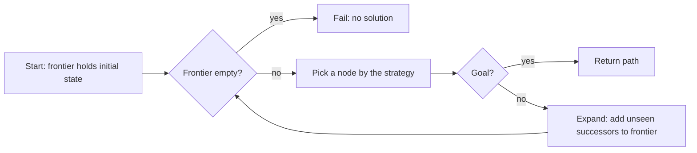
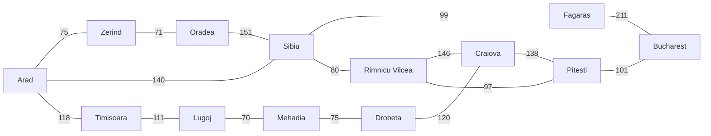
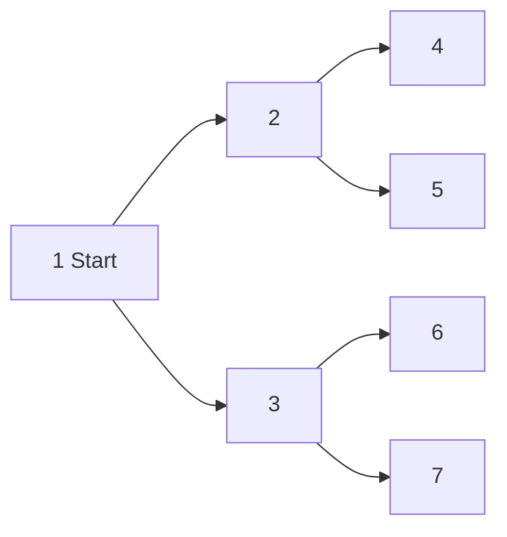
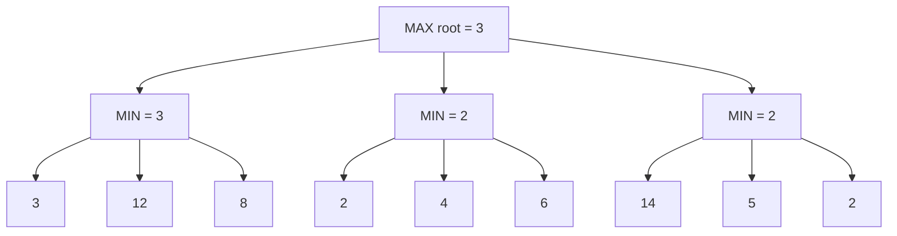

# Chapter 2 — Classical AI: Search

Before machine learning dominated AI, the central idea was **search**: describe a problem as situations connected by actions, then explore systematically until you reach a goal. Search still runs route planners, game engines, robot navigation, schedulers, puzzle solvers, compilers and the planning loops inside AI agents; AlphaGo, a landmark deep learning result, was a search algorithm guided by neural networks.

This chapter builds search from the ground up: problem formulation; uninformed search (BFS, DFS, depth-limited, iterative deepening, uniform-cost, bidirectional); informed search (greedy best-first, A\*, admissible and consistent heuristics); local search (hill climbing, simulated annealing, genetic algorithms); adversarial search (minimax, alpha-beta, a perfect tic-tac-toe player); Monte Carlo tree search and AlphaGo; constraint satisfaction in brief; and a pathfinding-agent project.

All scripts are in [`code/`](code/) and run in seconds: `python code/<file>.py`. Prerequisites: basic Python and the idea of a queue (first in, first out, like a checkout line) and a stack (last in, first out, like a pile of plates); see the Python Handbook's [collections chapter](../../../python/chapters/06-dicts-sets-collections/README.md) for `deque` and its [standard library tour](../../../python/chapters/14-standard-library-tour/README.md) for `heapq` (priority-queue helpers).

---

## 2.1 What search algorithms are, and how to formulate a problem

### What it is

A **search algorithm** explores possible options to find one that reaches a goal, ideally cheaply. Looking for lost keys, you could check every room in order (no clues), go first where keys usually end up (a hint), or retrace your steps (memory). These map to **uninformed search**, **informed (heuristic) search**, and learning-guided search.

### Why it matters

Many AI tasks are "find a sequence of actions from here to there": a driving route, a chess move, a puzzle, a meeting schedule. Search turns a problem description into an actual solution.

### How it works: formulating a search problem

A **goal-based agent** (Chapter 1) first writes the problem down in five parts:

| Part | Meaning | Route example (Romania map) | Grid-maze example |
|---|---|---|---|
| **States** | Every situation the world can be in | Which city you are in | Which cell you are in |
| **Initial state** | Where you start | Arad | (1, 1) |
| **Actions** | Moves available in a state | Drive to a neighbouring city | Up, down, left, right if not a wall |
| **Transition model** | Which state an action leads to | Drive(Arad → Sibiu) gives Sibiu | Right from (1, 1) gives (1, 2) |
| **Goal test** and **action cost** | How to recognise success; cost of each step | In Bucharest? Cost = road km | At (5, 5)? Cost = 1 per move |

States plus actions form the **state space**, a **graph** (*nodes* joined by *edges*) where nodes are states and edges are actions. A **solution** is a path from the initial state to a goal; an **optimal solution** has the lowest **path cost**.

Search grows a **search tree**:

1. Put the initial state on the **frontier** (discovered-but-not-yet-expanded nodes; the open list).
2. Pick a node from the frontier. *Which* node is the only real difference between most algorithms.
3. If it is a goal, return the path.
4. Otherwise **expand** it: generate successors and add new ones to the frontier.
5. Keep a **reached** set (explored or closed list) so states are not revisited; this turns tree search into **graph search** and prevents infinite loops.



The running example from Russell and Norvig's AIMA (*Artificial Intelligence: A Modern Approach*) is a simplified road map of Romania:



*(The full map in the code also has Giurgiu, Urziceni, Hirsova, Eforie, Vaslui, Iasi and Neamt east of Bucharest.)*

### Measuring a search algorithm

| Criterion | Question |
|---|---|
| **Complete** | If a solution exists, is it guaranteed to find one? |
| **Optimal** (cost-optimal) | Does it find the lowest-cost solution? |
| **Time complexity** | How many nodes does it generate or expand? |
| **Space complexity** | How many nodes must it hold in memory at once? |

Complexity uses **b** = branching factor (successors per state), **d** = depth of the shallowest goal, **m** = maximum depth. Spaces grow as bᵈ: with b = 10 and d = 10, 10 billion nodes.

> **Key term — Big-O notation:** O(bᵈ) or O(b·m) describe how work or memory *grows* with problem size, ignoring constant factors. O(bᵈ): one more level of depth multiplies work by about b. O(b·m) grows only in proportion to b times m.

### Real-world examples

- Navigation (road graphs), game AI, robot motion planning. (Web and e-commerce "search" — retrieving and ranking matches — is information retrieval, a related but different idea.)
- The 8-puzzle has 9!/2 = 181,440 reachable states, small enough for any method here; Rubik's cube (about 4.3 × 10¹⁹ states) is not.

### Common mistakes

- **Forgetting the reached set**, so the algorithm loops forever between two states.
- **Bad state design**: irrelevant detail (the car's colour on a route problem) multiplies the state space for nothing.

### Self-check

1. Name the five parts of a problem formulation. → States, initial state, actions, transition model, goal test plus action cost.
2. How does graph search differ from tree search? → It remembers reached states and does not revisit them.

### TL;DR

Formulate states, actions, transitions, goal and costs, then expand nodes from a frontier until you reach a goal. Algorithms differ only in *which* frontier node they expand next.

---

## 2.2 Uninformed search: exploring blindly

### What it is

**Uninformed** (**blind**) search can tell a goal from a non-goal but not whether one non-goal is "closer" than another.

### How each algorithm works

**Breadth-first search (BFS)** explores level by level (all states one step away, then two, …) with a **FIFO queue** frontier.

- Finds the **fewest-steps** solution, so it is optimal when every action costs the same.
- Memory-hungry: the frontier grows as bᵈ.
- Can test for the goal when a node is *generated* (early goal test), saving a layer.

**Depth-first search (DFS)** expands the deepest node: follow one path to the end, then **backtrack** to the next branch. The frontier is a **LIFO stack** (or recursion) — like walking a maze with one hand on the wall.

- Tiny memory: the current path plus siblings, O(b·m).
- Not optimal; can wander down infinite paths (incomplete in infinite spaces).

**Depth-limited search** is DFS with a depth limit ℓ: it cannot loop forever but misses goals deeper than ℓ.

**Iterative deepening DFS (IDDFS)** runs depth-limited search with ℓ = 0, 1, 2, … until it finds a goal: BFS's guarantees (complete, fewest steps) with DFS's memory. Re-generating shallow levels is cheap because most nodes live at the deepest level: with b = 10, d = 5, BFS generates about 111,110 nodes, IDDFS about 123,450 (11% more).

**Uniform-cost search (UCS)** — **Dijkstra's algorithm** from one source — expands the node with the lowest path cost so far, g(n), using a **priority queue** (always returns the smallest key first). Optimal for any positive costs. It must goal-test when a node is *expanded* (popped), not generated, or a cheaper path found later is missed.

**Bidirectional search** searches forward from the start and backward from the goal until they meet: 2·b^(d/2) instead of bᵈ. Needs reversible actions and a single explicit goal.



*Numbers show BFS expansion order; DFS expands 1, 2, 4, 5, 3, 6, 7.*

### Code: all uninformed strategies on the Romania map

```python
# code/graph_search.py (core parts)
def bfs(start, goal):
    frontier, reached, expanded = deque([[start]]), {start}, 0
    while frontier:
        path = frontier.popleft()                     # FIFO queue: shallowest first
        expanded += 1
        for nxt in GRAPH[path[-1]]:
            if nxt == goal:                           # early goal test on generation
                return path + [nxt], expanded
            if nxt not in reached:
                reached.add(nxt)
                frontier.append(path + [nxt])

def dfs(start, goal):
    frontier, expanded = [[start]], 0
    while frontier:
        path = frontier.pop()                         # LIFO stack: deepest first
        expanded += 1
        if path[-1] == goal:
            return path, expanded
        for nxt in reversed(GRAPH[path[-1]]):
            if nxt not in path:                       # avoid cycles along this path
                frontier.append(path + [nxt])

def best_first(start, goal, f):                      # priority queue ordered by f
    frontier, best_g = [(f(0, start), 0, [start])], {start: 0}
    while frontier:
        _, g, path = heapq.heappop(frontier)
        # ... skip stale entries; goal test on expansion; push cheaper successors
def ucs(start, goal):
    return best_first(start, goal, lambda g, n: g)    # f = g
```

Output:

```
algorithm              expanded    km  path
BFS                           6   450  Arad -> Sibiu -> Fagaras -> Bucharest
DFS                           6   607  Arad -> Zerind -> Oradea -> Sibiu -> Fagaras -> Bucharest
Iterative deepening          23   450  Arad -> Sibiu -> Fagaras -> Bucharest
Uniform-cost                 13   418  Arad -> Sibiu -> Rimnicu Vilcea -> Pitesti -> Bucharest
Greedy best-first             4   450  Arad -> Sibiu -> Fagaras -> Bucharest
A*                            6   418  Arad -> Sibiu -> Rimnicu Vilcea -> Pitesti -> Bucharest
```

(The last two rows are informed methods from §2.3.)

- **BFS** finds the fewest roads (3), but 450 km is not the shortest: it counts steps, not kilometres.
- **DFS** dives down the first road (Zerind) to a 607 km, five-road route; its answer depends on successor order.
- **IDDFS** matches BFS while expanding more (23) because it repeats shallow levels, but keeps only one path in memory.
- **UCS** is the only blind method to find the true shortest route, 418 km via Rimnicu Vilcea and Pitesti, expanding 13 nodes.

### Trade-offs

b = branching factor, d = depth of shallowest solution, m = maximum depth, ℓ = depth limit, C\* = optimal cost, ε = smallest action cost (> 0).

| Algorithm | Frontier | Complete? | Optimal? | Time | Space |
|---|---|---|---|---|---|
| BFS | FIFO queue | Yes (finite b) | Yes if all step costs equal | O(bᵈ) | O(bᵈ) |
| Uniform-cost (Dijkstra) | Priority queue on g | Yes (costs ≥ ε > 0) | Yes | O(b^(1+⌊C\*/ε⌋)) | O(b^(1+⌊C\*/ε⌋)) |
| DFS | Stack | No (infinite paths); yes as graph search on finite spaces | No | O(bᵐ) | O(b·m) |
| Depth-limited | Stack, depth ≤ ℓ | No if ℓ < d | No | O(bˡ) | O(b·ℓ) |
| Iterative deepening | Stack, growing ℓ | Yes (finite b) | Yes if all step costs equal | O(bᵈ) | O(b·d) |
| Bidirectional (BFS both ways) | Two queues | Yes | Yes if all step costs equal | O(b^(d/2)) | O(b^(d/2)) |

Rule of thumb: big space, unknown depth, equal costs → **iterative deepening**; varied costs → **uniform-cost**; any sense of direction toward the goal → **A\***. If the space is astronomically large with no structure, or there is no explicit path (pure optimisation), use local search or learning.

### Common mistakes

- **Goal-testing UCS on generation**, returning a costlier path generated first.
- **Using BFS on weighted graphs** and assuming the result is cheapest.
- **Recursive DFS on deep graphs** hits Python's recursion limit (about 1,000 frames by default); use an explicit stack.
- **Storing full paths in the frontier** on huge problems; store **parent pointers** (each node records which node it came from), as the project does.

### Real-world examples

- **BFS**: shortest hops in unweighted graphs ("degrees of connection"), web crawlers exploring level by level.
- **DFS**: maze generation, cycle detection, topological sorting in build systems (compile order), backtracking solvers.
- **Dijkstra**: routing protocols such as OSPF (routers inside one organisation's network); the baseline for road routing.

### In the interview

**30-second answer:** "Uninformed search has no heuristic. BFS uses a queue and finds the fewest-step path but needs O(bᵈ) memory; DFS uses a stack and O(bm) memory but is neither complete nor optimal; iterative deepening gets BFS's guarantees with DFS's memory; uniform-cost search, which is Dijkstra, expands by lowest path cost and is optimal with positive costs."

- *Why is iterative deepening not wasteful?* Most nodes are at the deepest level, so re-expanding shallow levels adds only a small constant factor.
- *When is BFS optimal?* When every action has the same cost.
- *Why does Dijkstra fail with negative edges?* An expanded node's cost is treated as final; a negative edge found later could lower it. Use Bellman–Ford (slower, tolerates negative costs).

### Self-check

1. Space complexity of DFS? → O(b·m), linear in depth.
2. Why did BFS return 450 km rather than 418 km? → It minimises the number of roads, not distance.
3. Where must UCS goal-test? → When a node is popped for expansion.

### TL;DR

BFS (queue): fewest steps, lots of memory. DFS (stack): little memory, no guarantees. IDDFS: best of both for equal costs. UCS/Dijkstra (priority queue on g): cheapest path for any positive costs.

---

## 2.3 Informed search: heuristics, greedy best-first and A\*

### What it is

**Informed search** uses a **heuristic function** h(n): an estimate of the cost from n to the nearest goal. On a map, the **straight-line distance**; on a grid, the **Manhattan distance** |Δrow| + |Δcol|.

### The problem it solves

Blind search expands in every direction; on Romania, UCS spends effort on cities *away* from Bucharest because they are close to Arad. A heuristic focuses effort toward the goal.

### How it works

All three are **best-first search**: always expand the frontier node with the lowest f(n). Only f changes:

| Algorithm | f(n) | Idea |
|---|---|---|
| Uniform-cost | g(n) | Cost so far only |
| **Greedy best-first** | h(n) | Whatever *looks* closest right now |
| **A\*** | g(n) + h(n) | Estimated cost of the cheapest full solution through n |

**Greedy best-first** is fast but short-sighted — it ignores what it has already spent — so it is not optimal and, as tree search, can loop. **A\*** balances distance travelled (g) against estimated distance remaining (h); invented in 1968 by Hart, Nilsson and Raphael for SRI's Shakey robot.

Straight-line km to Bucharest: Arad 366, Sibiu 253, Fagaras 176, Rimnicu Vilcea 193, Pitesti 100, Bucharest 0, … A\* from Arad:

| Step | Expand | f = g + h of new frontier entries |
|---|---|---|
| 1 | Arad (f = 0 + 366) | Sibiu 140 + 253 = **393**, Timisoara 118 + 329 = 447, Zerind 75 + 374 = 449 |
| 2 | Sibiu (393) | Rimnicu Vilcea 220 + 193 = **413**, Fagaras 239 + 176 = 415, Oradea 291 + 380 = 671 |
| 3 | Rimnicu Vilcea (413) | Pitesti 317 + 100 = 417, Craiova 366 + 160 = 526 |
| 4 | Fagaras (415) | Bucharest 450 + 0 = 450 |
| 5 | Pitesti (417) | Bucharest 418 + 0 = **418** (cheaper than 450, replaces it) |
| 6 | Bucharest (418) | Goal popped: optimal, 418 km |

Greedy goes Arad → Sibiu (253) → Fagaras (176) → Bucharest: 4 expansions but 450 km. In the §2.2 output, A\* expanded 6 for the optimal 418 km; UCS needed 13.

### When is A\* optimal? Admissible and consistent heuristics

- **Admissible**: h never *overestimates*: h(n) ≤ h\*(n). Straight-line distance is admissible (no road is shorter than a straight line). With admissible h, tree-search A\* is optimal.
- **Consistent** (**monotone**): for every action n → n′ with cost c, h(n) ≤ c + h(n′) — the triangle inequality. Every consistent h is admissible. f then never decreases along a path, so the first time A\* pops a node it has the cheapest path to it, and graph search with a reached set stays optimal. Check on Romania: Sibiu → Rimnicu Vilcea costs 80; 253 ≤ 80 + 193 = 273 ✓.
- **h = 0** is admissible and consistent and turns A\* into UCS.
- **Dominance**: if h₂(n) ≥ h₁(n) everywhere and both are admissible, A\* with h₂ never expands more nodes. For the 8-puzzle, summed tile Manhattan distance dominates "misplaced tiles".
- An overestimating h can be faster but suboptimal. **Weighted A\*** (f = g + w·h, w > 1) does this deliberately, guaranteeing cost at most w × optimal.

### Worked grid example

5×5 grid, four-way moves of cost 1, Manhattan heuristic (admissible: each move changes it by at most 1). `#` are walls.

```python
# code/astar_grid.py (core)
GRID = ["S....",
        "###.#",
        "....#",
        ".####",
        "....G"]

def astar(start, goal):
    frontier = [(manhattan(start, goal), manhattan(start, goal), 0, start)]  # (f, h, g, cell)
    parent, best_g = {start: None}, {start: 0}
    while frontier:
        f, h, g, cell = heapq.heappop(frontier)     # ties on f broken by smaller h
        if g > best_g[cell]:
            continue                                # a cheaper route to this cell was found
        print(f"expand {cell}  g={g} h={h} f={f}")
        if cell == goal:
            return rebuild_path(parent, cell)
        for nxt in neighbours(cell):
            g2 = g + 1
            if g2 < best_g.get(nxt, float("inf")):
                best_g[nxt], parent[nxt] = g2, cell
                h2 = manhattan(nxt, goal)
                heapq.heappush(frontier, (g2 + h2, h2, g2, nxt))
```

Output:

```
step  1: expand (1, 1)  g=0 h=8 f=8
step  2: expand (1, 2)  g=1 h=7 f=8
step  3: expand (1, 3)  g=2 h=6 f=8
step  4: expand (1, 4)  g=3 h=5 f=8
step  5: expand (1, 5)  g=4 h=4 f=8
step  6: expand (2, 4)  g=4 h=4 f=8
step  7: expand (3, 4)  g=5 h=3 f=8
step  8: expand (3, 3)  g=6 h=4 f=10
step  9: expand (3, 2)  g=7 h=5 f=12
step 10: expand (3, 1)  g=8 h=6 f=14
step 11: expand (4, 1)  g=9 h=5 f=14
step 12: expand (5, 1)  g=10 h=4 f=14
step 13: expand (5, 2)  g=11 h=3 f=14
step 14: expand (5, 3)  g=12 h=2 f=14
step 15: expand (5, 4)  g=13 h=1 f=14
step 16: expand (5, 5)  g=14 h=0 f=14

path length 14 moves, 16 expansions
S * * * .
# # # * #
* * * * #
* # # # #
* * * * G
```

1. Heading toward the goal, g rises by 1 and h falls by 1, so f stays 8 — including the dead end (1, 5), which A\* could not rule out.
2. From (3, 4) the only way is *left*, away from the goal: g and h both rise, so f jumps by 2 (8 → 10 → 12 → 14). A\* is discovering the heuristic was optimistic.
3. Along row 5 f stays at 14, the true optimal cost; A\* stops when the goal is popped.

### Trade-offs

| | Greedy best-first | A\* |
|---|---|---|
| Speed | Often very fast | Fast with a good h |
| Optimal? | No | Yes with admissible (tree) or consistent (graph) h |
| Complete? | Yes as graph search in finite spaces; can loop as tree search | Yes (finite b, costs ≥ ε > 0) |
| Memory | Can be large | Keeps every generated node: the main weakness |

Memory-saving variants: **IDA\*** (iterative deepening on f, linear memory; sliding puzzles) and **SMA\*** (drops the worst nodes when memory is full). Production road routers (OSRM, GraphHopper) combine A\*-family search with **preprocessing** such as contraction hierarchies (precomputed shortcut edges over minor roads), so continent-scale queries take milliseconds. Without a sensible heuristic A\* degenerates to UCS; when any reasonable path will do, use greedy or weighted A\*.

### Common mistakes

- **Inadmissible heuristic, expecting optimal paths**: e.g. Euclidean distance × 2, or Manhattan on a grid with diagonal moves (a diagonal reduces Manhattan by 2 at cost < 2; use Chebyshev, max(|Δrow|, |Δcol|), or octile, which prices diagonals at √2).
- **Stopping when the goal is generated** instead of popped.
- **Not updating** a frontier node when a cheaper path appears (the code pushes a new entry and skips stale ones).

### Real-world examples

- Games: Unity's NavMesh (precomputed walkable areas) and many engines use A\* to move characters.
- Robotics: ROS (Robot Operating System) navigation global planners run Dijkstra or A\* on occupancy grids (cells marked free or blocked).
- Maps and logistics: route and ETA systems use A\*-style search with preprocessing.

### In the interview

**30-second answer:** "A\* is best-first search with f = g + h: cost so far plus a heuristic estimate of cost to go. If h never overestimates (admissible), A\* is optimal; if h also satisfies the triangle inequality (consistent), graph-search A\* never reopens a node. Greedy best-first uses only h: fast but not optimal. With h = 0 A\* becomes Dijkstra."

- *Heuristic on a 4-connected grid? 8-connected?* Manhattan; octile or Chebyshev.
- *A\*'s main weakness?* Memory: it stores all generated nodes. Use IDA\* or SMA\*.
- *Faster A\* if suboptimal paths are acceptable?* Weighted A\* (f = g + w·h), bounded by w.

### Self-check

1. Why is straight-line distance admissible for driving? → No road is shorter than the straight line.
2. In the grid trace, why did f jump from 8 to 10? → Moving left increased both g and h by 1.

### TL;DR

Heuristics guide search toward the goal. Greedy uses h (fast, not optimal); A\* uses g + h (optimal with admissible/consistent h). A\*'s cost is memory.

---

## 2.4 Local search: hill climbing, simulated annealing, genetic algorithms

### What it is

When only the final state matters — 8 queens with no attacks, chip layout, a timetable — **local search** keeps one (or a few) current states and moves to neighbours that score better on an **objective function**. It uses almost no memory and scales to huge or continuous spaces, but does not guarantee the best answer. Picture hiking a landscape in fog, seeing only the ground next to you.

### How it works

**Hill climbing** (steepest ascent, or descent when minimising): start from a random state, move to the best neighbour if it improves the score, stop when none does. It gets stuck on **local maxima** (peaks lower than the highest), **ridges** (narrow uphill directions your moves cannot follow) and **plateaus**. Fixes: **random restarts**, **sideways moves** on plateaus, **stochastic hill climbing** (random choice among uphill moves).

**Simulated annealing** (from metallurgy: slow cooling lets atoms settle into a low-energy structure):

1. Pick a *random* neighbour.
2. If better, move. If worse by Δ, still move with probability e^(−Δ/T) (e ≈ 2.718; shrinks as Δ grows or T falls), where T is the "temperature".
3. Lower T gradually (e.g. × 0.995 per step).

High T roams freely; low T behaves like hill climbing. A move worse by Δ = 2 is accepted with probability e^(−1) ≈ 0.37 at T = 2 but e^(−10) ≈ 0.00005 at T = 0.2. With slow enough cooling it finds a **global optimum** with probability approaching 1.

**Genetic algorithms (GAs)** evolve a *population*: score with a **fitness function**; **select** parents favouring the fit; **crossover** (child built from pieces of two parents, e.g. first 3 columns from one); **mutate** a small part; replace and repeat. Crossover helps when good partial solutions (building blocks) combine well.

### Code: 8-queens four ways

State = tuple of 8 row numbers, one queen per column. Cost = attacking pairs (0 = solved; 28 pairs exist).

```python
# code/local_search.py (core)
def hill_climb(s, rng):
    while True:
        best = min(conflicts(n) for n in neighbours(s))       # 8 x 7 = 56 neighbours
        if best >= conflicts(s):
            return s                                          # local minimum (maybe the goal)
        s = rng.choice([n for n in neighbours(s) if conflicts(n) == best])

def simulated_annealing(s, rng, t0=2.0, cooling=0.995, steps=5000):
    t = t0
    for _ in range(steps):
        c = conflicts(s)
        if c == 0:
            return s
        nxt = s[:(col := rng.randrange(N))] + (rng.randrange(N),) + s[col + 1:]
        delta = conflicts(nxt) - c                            # > 0 means worse
        if delta <= 0 or rng.random() < math.exp(-delta / t):
            s = nxt                                           # sometimes accept a worse move
        t = max(t * cooling, 1e-3)
    return s

def genetic_algorithm(rng, pop_size=100, generations=500, mutation=0.2):
    # ... fitness = 28 - conflicts; keep the best (elitism);
    # parents chosen with rng.choices(pop, weights=fitness); one-point crossover; random mutation
```

Output:

```
hill climbing        : solved 35/300 = 12% of random starts
random-restart HC    : solved 50/50, mean restarts needed 6.5
simulated annealing  : solved 100/100
genetic algorithm    : solved 10/10, mean generations 110

one solution (row of the queen in each column): (4, 6, 0, 2, 7, 5, 3, 1)
. . Q . . . . .
. . . . . . . Q
. . . Q . . . .
. . . . . . Q .
Q . . . . . . .
. . . . . Q . .
. Q . . . . . .
. . . . Q . . .

plot: hill climbing stopped at 1 conflicts after 4 moves; annealing reached 0 after 1681 steps
```


*Figure — Same start: hill climbing stops at 1 conflict; annealing climbs back up several times before reaching 0 (generated by `code/local_search.py`).*

Plain hill climbing solves about one start in eight (AIMA reports about 14%), usually getting stuck within a few moves; random restarts fix that cheaply because each attempt is fast. Annealing trades many cheap random steps for reliability.

### Trade-offs

| Method | Memory | Escapes local optima? | Tuning needed | Good for |
|---|---|---|---|---|
| Hill climbing | One state | No | None | Quick improvement, smooth landscapes |
| Random-restart hill climbing | One state | Yes, by restarting | Number of restarts | Many small local optima |
| Simulated annealing | One state | Yes, by accepting bad moves | Start temperature, cooling rate | Rugged landscapes, layout and scheduling |
| Genetic algorithm | Population | Yes, via diversity | Population, selection, crossover, mutation rates | Problems with combinable building blocks |

Not for problems needing a guaranteed optimum or proof none exists (use systematic search or an exact solver), or differentiable objectives (use gradient descent — hill climbing with calculus; see the [ML Handbook math chapter](../../../ml/chapters/02-math-for-ml/README.md)).

### Common mistakes

- Cooling too fast (annealing becomes hill climbing and gets stuck).
- GA populations collapsing to copies of one individual (too little mutation), or a representation where crossover yields mostly invalid children.
- Reporting one lucky run; always run several random seeds.

### Real-world examples

- Simulated annealing has a long history in VLSI chip placement and routing, and in scheduling.
- NASA's ST5 mission (2006) flew antennas shaped by an evolutionary algorithm.
- Gradient descent, which trains every neural network, is continuous hill climbing.

### In the interview

**30-second answer:** "Local search keeps one state and moves to better neighbours: constant memory, huge spaces, but it can get stuck. Hill climbing stalls on local optima, ridges and plateaus; random restarts and simulated annealing (accept worse moves with probability e^(−Δ/T) while cooling T) escape them; genetic algorithms use a population with selection, crossover and mutation."

- *Is local search complete?* No; it can miss a solution that exists.
- *What does temperature do?* Controls how often bad moves are accepted: high = explore, low = exploit.

### Self-check

1. Probability of accepting a move worse by 1 at T = 1? → e^(−1) ≈ 0.37.

### TL;DR

When only the final state matters, use local search: hill climbing (fast, gets stuck), restarts or simulated annealing (escape local optima), genetic algorithms (population plus crossover). No optimality guarantee.

---

## 2.5 Adversarial search: minimax and alpha-beta

### What it is

In games an **opponent** chooses moves against you. **Adversarial search** plans in a **game tree** where players alternate; the classic setting is two-player, **zero-sum**, **deterministic**, **perfect information** (tic-tac-toe, chess, checkers, Go). We optimise for **MAX**; the opponent is **MIN**. A **terminal state**'s **utility** is MAX's score (+1 win, 0 draw, −1 loss).

### How it works: minimax

The **minimax value** assumes perfect play: a terminal state's utility; at MAX's turn the *maximum* of the children; at MIN's the *minimum*.



MIN picks 3, 2, 2; MAX picks 3. Minimax is complete (finite tree) and optimal against an optimal opponent but visits every node: time O(bᵐ), space O(b·m). Chess (b ≈ 35, dozens of moves per side) has more positions than atoms in the observable universe.

### Alpha-beta pruning

**Alpha-beta** returns minimax's value while skipping branches that cannot affect the decision:

- **α** = best value MAX is already guaranteed on the path (starts −∞).
- **β** = best value MIN is already guaranteed (starts +∞).
- When α ≥ β at a node, stop exploring its remaining children.

Above: after the first MIN node, α = 3. The second MIN node's first leaf is 2, so it is worth at most 2 < 3; MAX will never choose it, so leaves 4 and 6 are pruned.

With perfect move ordering alpha-beta examines about O(b^(m/2)) nodes — doubling searchable depth for the same effort; random ordering gives roughly O(b^(3m/4)).

### Real games: cut off early and estimate

Engines search to a depth or time limit and apply an **evaluation function** (material, mobility, king safety, or a neural network) to non-terminal positions. Add-ons: **iterative deepening** (a best move is always ready), **move ordering**, **transposition tables** (caches of evaluated positions, since different move orders reach the same position), **quiescence search** (keep searching "noisy" positions such as mid-capture).

### Code: a perfect tic-tac-toe player

```python
# code/tictactoe_minimax.py (core)
def minimax(b):
    u = terminal_utility(b)               # +1 X wins, -1 O wins, 0 draw, None = not over
    if u is not None:
        return u
    values = [minimax(play(b, m)) for m in moves(b)]
    return max(values) if to_move(b) == "X" else min(values)

def alphabeta(b, alpha=-2, beta=2):
    u = terminal_utility(b)
    if u is not None:
        return u
    if to_move(b) == "X":                 # MAX
        v = -2
        for m in moves(b):
            v = max(v, alphabeta(play(b, m), alpha, beta))
            alpha = max(alpha, v)
            if alpha >= beta:
                break                     # MIN above will never allow this: prune
        return v
    v = 2                                 # MIN
    for m in moves(b):
        v = min(v, alphabeta(play(b, m), alpha, beta))
        beta = min(beta, v)
        if alpha >= beta:
            break
    return v

@lru_cache(maxsize=None)
def cached_value(b):                      # minimax + transposition table
    ...
def best_move(b):
    pick = max if to_move(b) == "X" else min
    return pick(moves(b), key=lambda m: cached_value(play(b, m)))
```

Output:

```
minimax    : value of empty board = +0, nodes visited = 549,946
alpha-beta : value of empty board = +0, nodes visited = 18,297
memoised   : distinct positions evaluated = 5,478

position (X to move):
X X .
O O .
. . .
best move for X: 2

perfect play from an empty board:
X X O
O O X
X O X
result: draw
```

- Value 0: perfect-play tic-tac-toe is a **draw**.
- Minimax visits 549,946 nodes; alpha-beta reaches the same value after 18,297, about 30× fewer.
- Caching by position (`@lru_cache` **memoisation** as a transposition table) needs only 5,478 evaluations — the number of distinct legal positions. Chess engines rely on the same trick.
- In the puzzle position X correctly completes the top row at cell 2.

### Trade-offs

| | Minimax | Alpha-beta | Depth-limited + evaluation |
|---|---|---|---|
| Result | Exact | Exact (same as minimax) | Approximate |
| Nodes | O(bᵐ) | O(b^(m/2)) best case | Tunable to time budget |
| Needs | Full tree | Good move ordering | A good evaluation function |

Huge branching with no good evaluation (Go, b ≈ 250) → Monte Carlo tree search (next section). Chance (backgammon dice) → **expectiminimax**, averaging over chance nodes. Hidden information (poker) → other methods, e.g. counterfactual regret minimisation (improves a strategy by tracking how much better each alternative would have done).

### Common mistakes

- Mixing up whose turn it is, or evaluating from the wrong player's perspective.
- Assuming an optimal opponent when it is not: minimax plays safe, not exploitatively.
- The **horizon effect**: a threat just beyond the search depth stays invisible, e.g. evaluating mid-capture; quiescence search addresses it.

### Real-world examples

- IBM's Deep Blue beat Kasparov in 1997 with alpha-beta on custom hardware at roughly 100–200 million positions per second (IBM quoted about 200 million; the designers later reported an average nearer 126 million).
- Stockfish, the leading open-source chess engine, still uses alpha-beta-style search, now with an efficiently updatable neural network (NNUE) as its evaluation.
- Checkers was "weakly solved" in 2007 (Chinook project): perfect play from the start is a draw.

### In the interview

**30-second answer:** "Minimax values a position assuming both sides play optimally: MAX takes the max of children, MIN the min. Alpha-beta keeps bounds α and β and prunes a branch once it cannot change the decision; same answer and, with good move ordering, about twice the depth. Real engines cut off at a depth with an evaluation function, plus iterative deepening, move ordering and transposition tables."

- *Does pruning change the result?* No, only the work.
- *Why does move ordering matter?* Cut-offs happen sooner when the best move is tried first.
- *How do you handle dice?* Expectiminimax: chance nodes take the probability-weighted average.

### Self-check

1. What does α represent? → The best value MAX can already guarantee along the path.
2. When does alpha-beta prune? → When α ≥ β.

### TL;DR

Minimax: MAX maximises, MIN minimises, perfect play assumed. Alpha-beta prunes with α/β bounds for the same answer at far lower cost. Real engines add depth limits and evaluation functions.

---

## 2.6 Monte Carlo tree search and search guided by learning

### What it is

**Monte Carlo tree search (MCTS)** estimates a move's value by playing many quick simulated games (**play-outs**/**rollouts**) and keeping statistics, with no hand-written evaluation function. It grows the tree unevenly, spending more on promising moves.

### How it works

Each iteration:

1. **Selection**: walk down from the root choosing children that balance **exploitation** (moves that won often) and **exploration** (moves tried rarely), usually by **UCB1** (the UCT algorithm): maximise w/n + c·√(ln N / n), where w = wins through the child, n = its visits, N = parent visits, c ≈ 1.4.
2. **Expansion**: add one new child.
3. **Simulation**: play random (or cheaply guided) moves to the end.
4. **Back-propagation**: update win and visit counts back to the root.

When the budget runs out, play the child with the **most visits** (the most robust choice).

Worked UCB1: parent N = 100; child A has 60 wins in 70 visits, B 12 in 30. A: 0.857 + 1.4·√(4.605/70) ≈ 0.857 + 0.359 = 1.216. B: 0.400 + 1.4·√(4.605/30) ≈ 0.400 + 0.548 = 0.948. A is chosen, but B's exploration bonus grows each time it is skipped.

### Code: MCTS on tic-tac-toe

```python
# code/mcts_tictactoe.py (core)
def mcts(board, iterations, rng):
    root = Node(board)
    for _ in range(iterations):
        node = root
        while not node.untried and node.children:              # 1. selection by UCB1
            node = max(node.children, key=Node.ucb1)
        if node.untried:                                        # 2. expansion
            m = node.untried.pop(rng.randrange(len(node.untried)))
            node.children.append(Node(play(node.board, m), node, m))
            node = node.children[-1]
        result = rollout(node.board, rng)                       # 3. random play-out
        while node is not None:                                 # 4. back-propagation
            node.visits += 1
            if node.parent is not None:
                mover = to_move(node.parent.board)
                node.wins += 1.0 if result == (1 if mover == "X" else -1) else 0.5 if result == 0 else 0.0
            node = node.parent
    return max(root.children, key=lambda n: n.visits)
```

Output:

```
X can win now  MCTS picks cell 2 (94% of visits, win rate 1.00); minimax picks 2
O must block   MCTS picks cell 2 (79% of visits, win rate 0.55); minimax picks 2
empty board    MCTS picks cell 4 (28% of visits, win rate 0.76); minimax picks 0

20 games, random X vs MCTS O: {'X wins': 0, 'O wins': 19, 'draw': 1}
```

Knowing only the rules, MCTS finds the win, finds the block, and beats a random player 19 times in 20 without losing. On the empty board it prefers the centre (cell 4); minimax picks cell 0 only because every opening is a draw under perfect play and 0 comes first. MCTS's preference reflects which moves win most against imperfect replies, often more useful in practice. A bug worth knowing: an early version kept expanding moves *after* the game was won, which made MCTS noticeably worse — terminal nodes must have no children.

### Search meets learning: AlphaGo and beyond

Go has about 250 legal moves per turn and no good hand-written evaluation, so alpha-beta fails. DeepMind's **AlphaGo** (beat Lee Sedol 4–1, March 2016) combined MCTS with two deep networks:

- a **policy network** suggesting promising moves, narrowing selection and expansion, and
- a **value network** estimating who is winning, reducing the need for long play-outs.

Its networks were trained first on human expert games, then by **reinforcement learning** (RL: trial and error from rewards) through self-play. **AlphaGo Zero** (2017) learned from self-play alone; **AlphaZero** applied the recipe to chess and shogi. The loop: search finds better moves than the network alone → train the network to imitate the search → the better network strengthens the next search.

Outside games: **neural-guided search** (a learned model predicts which branches will succeed, e.g. which corridors of an unfamiliar building are likely open) and **search plus RL** (an agent learns from past searches, e.g. a drone planner remembering which routes are fast at which times). LLM agents follow the same pattern: the model proposes steps (a learned policy) and an outer loop tries, checks and backtracks (search) — see Chapter 9.

### Trade-offs

| | Alpha-beta | MCTS |
|---|---|---|
| Needs an evaluation function? | Yes | No (play-outs), or a learned value network |
| Handles large branching factors? | Poorly | Well: grows the tree selectively |
| Anytime (stop whenever)? | With iterative deepening | Naturally |
| Exact? | Yes, to its depth | Statistical estimate, converges with more iterations |

Avoid MCTS when play-outs are expensive or meaningless, or when an exact answer is cheap (small games: minimax).

### Common mistakes

- Scoring wins from the wrong player's view during back-propagation.
- Choosing the final move by highest win rate on a rarely visited child (noisy); use visit counts.
- Expanding past terminal states (the bug above).

### In the interview

**30-second answer:** "MCTS repeats selection with UCB1, expansion, random simulation and back-propagation of win statistics, then plays the most-visited move. It needs no hand-crafted evaluation, so it suits huge games like Go. AlphaGo added a policy network to focus search and a value network to evaluate positions, trained with supervised learning and self-play reinforcement learning."

- *What does c in UCB1 control?* The exploration–exploitation balance.
- *Why did AlphaGo Zero matter?* It removed human game data: self-play RL plus search alone reached superhuman strength.

### Self-check

1. Name MCTS's four phases. → Selection, expansion, simulation, back-propagation.

### TL;DR

MCTS = selective tree growth by simulated games and UCB1. With learned policy and value networks trained by self-play, it produced AlphaGo. Learning guides search; search generates training data for learning.

---

## 2.7 Constraint satisfaction problems (brief)

### What it is

A **constraint satisfaction problem (CSP)** has **variables** with **domains** of possible values and **constraints** restricting allowed combinations; a solution assigns every variable a value satisfying all constraints. Only the final assignment matters, and constraint structure can be exploited.

AIMA's example: colour Australia's seven regions (WA, NT, SA, Q, NSW, V, T) red, green or blue with no two neighbours alike. Others: Sudoku, N-queens, exam timetabling, staff rostering, compiler register allocation.

### How it works

**Backtracking search** assigns one variable at a time, checks constraints immediately, and backs up when a variable has no legal value. It speeds up dramatically with:

1. **Minimum remaining values (MRV)**: next assign the variable with the fewest legal values ("fail first").
2. **Degree heuristic**: break ties by the variable in the most constraints.
3. **Least constraining value**: try values that rule out the fewest neighbour options.
4. **Forward checking**: after each assignment, delete now-illegal values from neighbours' domains; back up at once if one empties.
5. **Arc consistency (AC-3)**: stronger propagation, repeatedly removing values with no compatible value in a neighbour.

### Code

```python
# code/csp_backtracking.py (core)
def backtrack(assignment, domains):
    if len(assignment) == len(variables):
        return dict(assignment)
    unassigned = [v for v in variables if v not in assignment]
    var = min(unassigned, key=lambda v: len(domains[v])) if smart else unassigned[0]   # MRV
    for val in domains[var]:
        if not all(ok(var, val, o, assignment[o]) for o in assignment):
            continue
        assignment[var] = val
        if smart:                                           # forward checking
            pruned = {v: [x for x in domains[v] if ok(var, val, v, x)] if v not in assignment
                      else domains[v] for v in variables}
            if all(pruned[v] for v in variables if v not in assignment):
                if (result := backtrack(assignment, pruned)):
                    return result
        # ... (plain version recurses without pruning)
        del assignment[var]                                 # undo, try next value
```

Output:

```
Australia: {'WA': 'red', 'NT': 'green', 'SA': 'blue', 'Q': 'red', 'NSW': 'green', 'V': 'red', 'T': 'red'}  (7 assignments)

N-queens as a CSP: assignments made before the first solution
  N  plain backtracking   MRV + forward check
  8                 113                    75
 12                 261                   153
 16              10,052                    44
 20             199,635                   145
```

Australia needs no backtracking; on 20-queens, MRV plus forward checking needs 145 assignments versus almost 200,000.

### Trade-offs and real-world examples

Hand-written backtracking suits teaching and small problems; real scheduling uses a solver such as Google OR-Tools (CP-SAT), which layers constraint propagation, SAT-solving techniques and search. Airlines, sports leagues and universities use such solvers for crews, fixtures and timetables.

### Common mistakes

- One huge check at the end instead of testing each assignment immediately.
- Not restoring domains when backtracking (the code copies domains per level).

### Self-check

1. What does forward checking do? → Removes conflicting values from neighbours' domains after each assignment, detecting dead ends early.

### TL;DR

CSPs = variables + domains + constraints. Backtracking with MRV, forward checking and arc consistency beats blind search by orders of magnitude; production systems use constraint solvers.

---

## 2.8 Project: build a simple pathfinding agent

### Goal

A grid-maze agent that returns the cheapest path, visualises which cells each algorithm explored, and compares algorithms side by side.

### Step 1 — set up the world

A grid with a **start**, a **goal** and **walls**. The mini maze is 5×5, start (1, 1), goal (5, 5) (0-based in code), walls placed randomly with a fixed seed for reproducibility; a 25×25 world with about 30% walls tests a realistic size.

```python
# code/pathfinding_agent.py — Step 1
def random_grid(n, wall_prob, seed, start, goal):
    rng = random.Random(seed)
    walls = {(r, c) for r in range(n) for c in range(n)
             if rng.random() < wall_prob and (r, c) not in (start, goal)}
    return {"n": n, "walls": walls, "start": start, "goal": goal}
```

### Step 2 — choose the algorithm

**BFS** for simplicity and a guaranteed shortest path (all moves cost 1); **A\*** with Manhattan for speed too; uniform-cost and greedy for comparison.

### Step 3 — implement the search

One routine handles all four; only frontier ordering differs. It stores **parent pointers**, keeps a **closed** set, and records expansion order (full listing in [`code/pathfinding_agent.py`](code/pathfinding_agent.py)):

```python
# code/pathfinding_agent.py — Step 3 (core)
    while frontier:
        cell = pop()
        if cell in closed:
            continue                                # already expanded via a cheaper entry
        closed.add(cell)
        order.append(cell)
        if cell == goal:
            path = []
            while cell is not None:                 # walk parent pointers back to start
                path.append(cell)
                cell = parent[cell]
            return path[::-1], order, snaps
        for nxt in neighbours(world, cell):
            g2 = g_cost[cell] + 1
            if nxt not in g_cost or (strategy != "BFS" and g2 < g_cost[nxt]):
                g_cost[nxt], parent[nxt] = g2, cell
                push(nxt)                           # BFS: deque; others: heap keyed on g, h or g+h
    return None, order, snaps
```

### Step 4 — visualise

The agent prints the mini maze (`*` = path, `o` = expanded but not on path) and plots the big maze with matplotlib (blue = expanded, orange = frontier, red = path).

Output (mini maze):

```
Mini maze (S start, G goal, # wall, * path, o expanded but not on path)

BFS: path length 8, cells expanded 19
S * * o o
# # * o #
o o * o o
# o * o o
. # * * G

A*: path length 8, cells expanded 9
S * * . .
# # * . #
. . * . .
# . * . .
. # * * G
```

Output (25×25 world):

```
25x25 grid, 182 walls
strategy       path length  expanded
BFS                     48       434
Uniform-cost            48       434
Greedy                  62        92
A*                      48       125
saved pathfinding_compare.png, astar_snapshots.png
```


*Figure — Blue = expanded, red = path. BFS and uniform-cost flood almost the whole maze; greedy explores little but takes a 62-move detour; A\* finds the optimal 48-move path expanding under a third as much. `astar_snapshots.png` shows A\*'s explored region staying a narrow band aimed at the goal (generated by `code/pathfinding_agent.py`).*

### Step 5 — analyse and reflect

1. **Shortest path?** BFS, uniform-cost and A\* all return the optimal 48 moves (they must: unit costs, admissible Manhattan). Greedy's 62 is 29% longer.
2. **Efficiency?** A\* expanded 125 cells versus BFS's 434 (about 3.5× fewer); 9 versus 19 in the mini maze. Greedy shows the risk of trusting the heuristic alone.
3. **BFS vs uniform-cost:** identical because all moves cost 1; add costly cells (mud, traffic) and only uniform-cost and A\* stay optimal.

Extensions: diagonal moves at cost √2 with the octile heuristic; weighted terrain; weighted A\* (f = g + 2h); animate the frontier every 10 expansions.

### Common mistakes

- Marking a cell visited when *pushed* in A\* (fine for BFS, but for A\*/uniform-cost it can lock in a worse path; mark on *pop* and allow cost improvements).
- Mixing (row, col) with (x, y) when plotting; `plot(x, y)` takes column first.
- Ignoring that a random maze may have no path; `search` returns `None`.

### In the interview

**30-second answer:** "For grid pathfinding with uniform costs, BFS is optimal; A\* with a Manhattan heuristic is also optimal and expands far fewer cells because it heads toward the goal. I store parent pointers for path reconstruction, a closed set to avoid re-expansion, and a priority queue keyed on g + h with a tie-breaker. Greedy is fastest but can return long detours."

### TL;DR

Grid + start + goal + walls → BFS or A\* → expand from a frontier with parent pointers → visualise → compare. A\* gave the optimal path with a fraction of BFS's work; greedy was faster but not optimal.

---

## Chapter TL;DR

- **Formulate** problems as states, actions, transitions, a goal test and costs; search expands nodes from a **frontier** and remembers **reached** states.
- **Uninformed**: BFS (queue, fewest steps, O(bᵈ) memory), DFS (stack, O(bm) memory, no guarantees), iterative deepening (both benefits), uniform-cost/Dijkstra (cheapest path with any positive costs), bidirectional (b^(d/2)).
- **Informed**: greedy best-first (f = h, fast, not optimal) and **A\*** (f = g + h, optimal with admissible/consistent heuristics; memory is the cost).
- **Local search** for optimisation: hill climbing (gets stuck), random restarts, simulated annealing (accept worse moves with probability e^(−Δ/T)), genetic algorithms.
- **Games**: minimax assumes perfect play; alpha-beta prunes with α/β for the same answer (tic-tac-toe: 549,946 → 18,297 nodes; value = draw). Real engines add depth limits and evaluation functions.
- **MCTS** grows the tree by simulation and UCB1; with policy and value networks and self-play RL it became AlphaGo. Learning guides search, and search trains learning.
- **CSPs**: backtracking with MRV and forward checking (20-queens: ~200,000 → 145 assignments); production uses constraint solvers.
- **Project**: on a 25×25 maze, A\* found the optimal 48-move path expanding 125 cells versus 434 for BFS; greedy took 62 moves.
