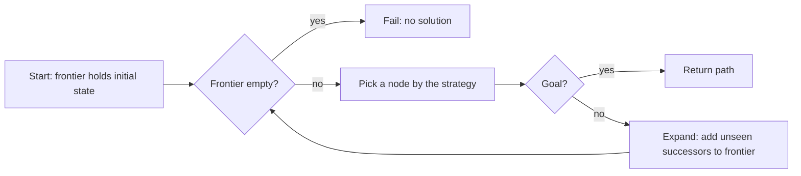
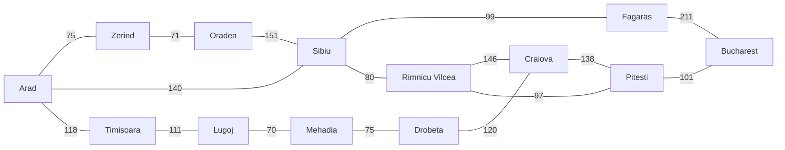
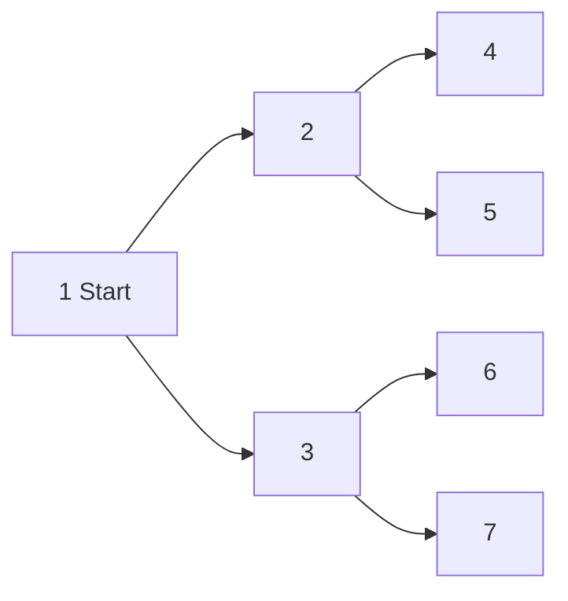
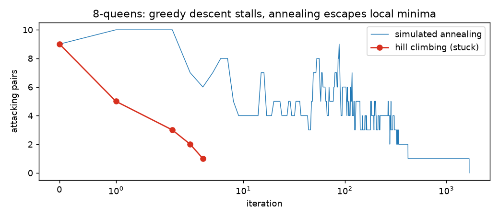
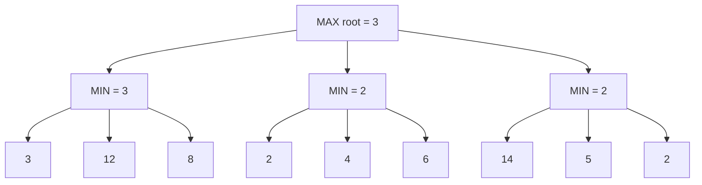
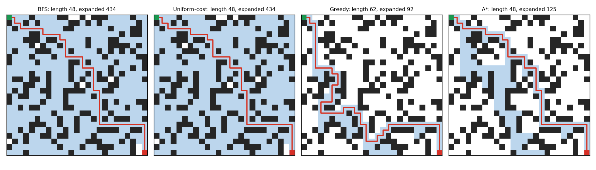
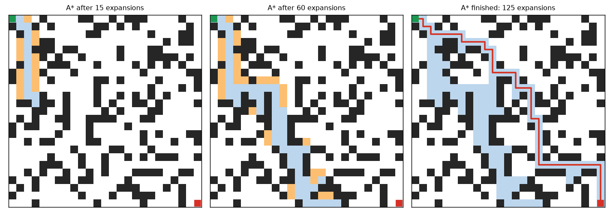

# Chapter 2 — Classical AI: Search

Before machine learning dominated AI, the central idea was **search**: describe a problem as a set of situations connected by actions, then explore systematically until you reach a goal. Search is still everywhere: route planners, game engines, robot navigation, schedulers, puzzle solvers, compilers, and the planning loops inside modern AI agents. AlphaGo, one of the most famous deep learning results, was a search algorithm guided by neural networks.

This chapter builds search from the ground up and ends with a working pathfinding agent.

**What you'll learn**

- How to turn a problem into a **state space** (states, actions, transitions, goal, costs)
- Uninformed ("blind") search: breadth-first, depth-first, depth-limited, iterative deepening, uniform-cost, bidirectional, and how they compare on completeness, optimality, time and memory
- Informed search: heuristics, greedy best-first and A\*, admissible and consistent heuristics, with a worked grid example
- Local search for optimisation: hill climbing, simulated annealing, genetic algorithms
- Adversarial search for games: minimax and alpha-beta pruning, with a perfect tic-tac-toe player
- Monte Carlo tree search and how AlphaGo combined search with neural networks and reinforcement learning
- Constraint satisfaction problems in brief
- A project: a grid pathfinding agent that prints its path and plots what it explored

All scripts are in [`code/`](code/) and run in seconds: `python code/<file>.py`. Prerequisites: basic Python (lists, dicts, functions) and the idea of a queue and a stack; see the Python Handbook's [collections chapter](../../../python/chapters/06-dicts-sets-collections/README.md) for `deque` and its [standard library tour](../../../python/chapters/14-standard-library-tour/README.md) for `heapq`.

---

## 2.1 What search algorithms are, and how to formulate a problem

### What it is

A **search algorithm** is a step-by-step procedure that explores possible options to find one that reaches a goal, ideally cheaply. Think about losing your keys at home. You could check every room in order (systematic, no clues), go first to the spots where keys usually end up (using a hint), or retrace the last places you were (using memory). Those three habits correspond to the families in this chapter: **uninformed search**, **informed (heuristic) search**, and search that reuses past experience (learning-guided search).

### Why it matters

Many AI tasks are "find a sequence of actions that gets from here to there": plan a driving route, pick a chess move, solve a puzzle, schedule meetings, find a product in a huge catalogue. Without a systematic way to explore options, an agent cannot solve even simple planning tasks. Search turns a description of the problem into an actual solution.

### How it works: formulating a search problem

A **goal-based agent** (Chapter 1) first writes the problem down in five parts:

| Part | Meaning | Route example (Romania map) | Grid-maze example |
|---|---|---|---|
| **States** | Every situation the world can be in | Which city you are in | Which cell you are in |
| **Initial state** | Where you start | Arad | (1, 1) |
| **Actions** | Moves available in a state | Drive to a neighbouring city | Up, down, left, right if not a wall |
| **Transition model** | Which state an action leads to | Drive(Arad → Sibiu) gives Sibiu | Right from (1, 1) gives (1, 2) |
| **Goal test** and **action cost** | How to recognise success; cost of each step | In Bucharest? Cost = road km | At (5, 5)? Cost = 1 per move |

Together, states plus actions form the **state space**, a graph where nodes are states and edges are actions. A **solution** is a path from the initial state to a goal; an **optimal solution** has the lowest total **path cost**.

Search algorithms explore this graph by growing a **search tree**:

1. Put the initial state on the **frontier** (the set of discovered-but-not-yet-expanded nodes; also called the open list).
2. Pick a node from the frontier. *Which* node you pick is the only real difference between most algorithms.
3. If it is a goal, return the path to it.
4. Otherwise **expand** it: generate its successor states and add new ones to the frontier.
5. Keep a **reached** set (explored or closed list) so you do not revisit states; this turns tree search into **graph search** and prevents infinite loops.



The classic running example from Russell and Norvig's AIMA is a simplified road map of Romania. We will use it throughout:



*(The full map in the code also has Giurgiu, Urziceni, Hirsova, Eforie, Vaslui, Iasi and Neamt east of Bucharest.)*

### Measuring a search algorithm

| Criterion | Question |
|---|---|
| **Complete** | If a solution exists, is it guaranteed to find one? |
| **Optimal** (cost-optimal) | Does it find the lowest-cost solution? |
| **Time complexity** | How many nodes does it generate or expand? |
| **Space complexity** | How many nodes must it hold in memory at once? |

Complexity is expressed with three numbers: **b** = branching factor (successors per state), **d** = depth of the shallowest goal, **m** = maximum depth of the state space. Search spaces grow as bᵈ, which is why they explode: with b = 10 and d = 10 that is 10 billion nodes.

### Real-world examples

- Navigation apps (route search over road graphs), game AI (chess engines, video-game unit movement), robotics (motion planning), e-commerce and web search (retrieving and ranking matches from millions of items; that is information retrieval, a related but different kind of "search").
- Puzzles: the 8-puzzle has 9!/2 = 181,440 reachable states, small enough for any method here; Rubik's cube (about 4.3 × 10¹⁹ states) is not.

### Common mistakes

- **Forgetting the reached set**, so the algorithm loops forever between two states.
- **Bad state design**: including irrelevant detail (the colour of the car on a route problem) multiplies the state space for nothing.

### Self-check

1. Name the five parts of a problem formulation. → States, initial state, actions, transition model, goal test plus action cost.
2. What is the frontier? → Nodes discovered but not yet expanded.
3. What makes graph search different from tree search? → It remembers reached states and does not revisit them.

### TL;DR

Search = formulate states, actions, transitions, goal and costs, then expand nodes from a frontier until you reach a goal. Algorithms differ only in *which* frontier node they expand next.

---

## 2.2 Uninformed search: exploring blindly

### What it is

**Uninformed** (or **blind**) search knows nothing about where the goal is. It can tell a goal from a non-goal, but it cannot tell whether one non-goal state is "closer" than another. It is like searching every room for your keys with no idea where they are.

### How each algorithm works

**Breadth-first search (BFS)** explores level by level: all states one step away, then all two steps away, and so on. The frontier is a **FIFO queue** (first in, first out). Analogy: lost in a building, you check every room on your floor before trying the next floor.

- Finds the solution with the **fewest steps**, so it is optimal when every action costs the same.
- Memory-hungry: it must store the whole frontier, which grows as bᵈ.
- It can test for the goal when a node is *generated* (early goal test), saving a layer of work.

**Depth-first search (DFS)** always expands the deepest node: follow one path as far as possible, then back up (**backtrack**) and try the next branch. The frontier is a **LIFO stack** (or recursion). Analogy: walking a maze with one hand on the wall until a dead end, then going back to the last junction.

- Memory is tiny: only the current path plus siblings, O(b·m).
- Not optimal, and can wander down very long or infinite paths (incomplete in infinite spaces).

**Depth-limited search** is DFS that refuses to go deeper than a limit ℓ. It cannot loop forever, but misses goals deeper than ℓ.

**Iterative deepening DFS (IDDFS)** runs depth-limited search with ℓ = 0, 1, 2, … until it finds a goal. It combines BFS's guarantees (complete, fewest steps) with DFS's small memory. Re-generating the shallow levels sounds wasteful but is cheap: most nodes live in the deepest level. With b = 10, d = 5, BFS generates about 111,110 nodes; IDDFS about 123,450, only 11% more.

**Uniform-cost search (UCS)**, also known as **Dijkstra's algorithm** when run from one source, expands the node with the lowest path cost so far, g(n), using a **priority queue**. It is optimal for any positive action costs, not just equal ones. It must test for the goal when a node is *expanded* (popped), not when generated, otherwise a cheaper path found later is missed.

**Bidirectional search** runs two searches, forward from the start and backward from the goal, and stops when they meet. Two searches of depth d/2 cost about 2·b^(d/2), far less than bᵈ. It needs actions that can be reversed and a single, explicit goal state.



*Numbers show BFS expansion order. DFS on the same tree expands 1, 2, 4, 5, 3, 6, 7.*

### Code: all uninformed strategies on the Romania map

```python
# code/graph_search.py (core parts)
def bfs(start, goal):
    frontier, reached, expanded = deque([[start]]), {start}, 0
    while frontier:
        path = frontier.popleft()                     # FIFO queue: shallowest first
        expanded += 1
        for nxt in GRAPH[path[-1]]:
            if nxt == goal:                           # early goal test on generation
                return path + [nxt], expanded
            if nxt not in reached:
                reached.add(nxt)
                frontier.append(path + [nxt])

def dfs(start, goal):
    frontier, expanded = [[start]], 0
    while frontier:
        path = frontier.pop()                         # LIFO stack: deepest first
        expanded += 1
        if path[-1] == goal:
            return path, expanded
        for nxt in reversed(GRAPH[path[-1]]):
            if nxt not in path:                       # avoid cycles along this path
                frontier.append(path + [nxt])

def iddfs(start, goal, max_depth=20):
    counter = [0]
    for limit in range(max_depth + 1):                # depth 0, 1, 2, ...
        found = depth_limited([start], goal, limit, counter)
        if found:
            return found, counter[0]

def best_first(start, goal, f):                      # priority queue ordered by f
    frontier, best_g = [(f(0, start), 0, [start])], {start: 0}
    while frontier:
        _, g, path = heapq.heappop(frontier)
        # ... skip stale entries; goal test on expansion; push cheaper successors
def ucs(start, goal):
    return best_first(start, goal, lambda g, n: g)    # f = g
```

Output:

```
algorithm              expanded    km  path
BFS                           6   450  Arad -> Sibiu -> Fagaras -> Bucharest
DFS                           6   607  Arad -> Zerind -> Oradea -> Sibiu -> Fagaras -> Bucharest
Iterative deepening          23   450  Arad -> Sibiu -> Fagaras -> Bucharest
Uniform-cost                 13   418  Arad -> Sibiu -> Rimnicu Vilcea -> Pitesti -> Bucharest
Greedy best-first             4   450  Arad -> Sibiu -> Fagaras -> Bucharest
A*                            6   418  Arad -> Sibiu -> Rimnicu Vilcea -> Pitesti -> Bucharest
```

(Ignore the last two rows for now; they are informed methods from section 2.3.) What the output shows:

- **BFS** finds the route with the fewest roads (3), but 450 km is not the shortest distance, because BFS counts steps, not kilometres.
- **DFS** dives down the first road it sees (Zerind) and returns a 607 km, five-road route. Its answer depends on the order successors are listed.
- **IDDFS** returns BFS's answer while expanding more nodes (23) because it repeats shallow levels, yet it keeps only one path in memory.
- **UCS** is the only blind method that finds the true shortest route, 418 km via Rimnicu Vilcea and Pitesti, at the cost of expanding 13 nodes.

### Trade-offs

b = branching factor, d = depth of shallowest solution, m = maximum depth, ℓ = depth limit, C\* = optimal solution cost, ε = smallest action cost (> 0).

| Algorithm | Frontier | Complete? | Optimal? | Time | Space |
|---|---|---|---|---|---|
| BFS | FIFO queue | Yes (finite b) | Yes if all step costs equal | O(bᵈ) | O(bᵈ) |
| Uniform-cost (Dijkstra) | Priority queue on g | Yes (costs ≥ ε > 0) | Yes | O(b^(1+⌊C\*/ε⌋)) | O(b^(1+⌊C\*/ε⌋)) |
| DFS | Stack | No (infinite paths); yes as graph search on finite spaces | No | O(bᵐ) | O(b·m) |
| Depth-limited | Stack, depth ≤ ℓ | No if ℓ < d | No | O(bˡ) | O(b·ℓ) |
| Iterative deepening | Stack, growing ℓ | Yes (finite b) | Yes if all step costs equal | O(bᵈ) | O(b·d) |
| Bidirectional (BFS both ways) | Two queues | Yes | Yes if all step costs equal | O(b^(d/2)) | O(b^(d/2)) |

Rule of thumb: in a big space with unknown depth and equal costs, prefer **iterative deepening**; with varied costs, **uniform-cost**; if you have any sense of direction toward the goal, move on to **A\***.

### When not to use it

When you have a good heuristic (use A\*), when the state space is astronomically large with no structure (use local search or learning), or when the problem is an optimisation with no explicit path (use local search).

### Common mistakes

- **Goal-testing UCS on generation.** You may return a more expensive path that happened to be generated first.
- **Using BFS on weighted graphs** and assuming the result is the cheapest.
- **Recursive DFS on deep graphs** hits Python's recursion limit (about 1,000 frames by default); use an explicit stack.
- **Storing full paths in the frontier** on huge problems; store parent pointers instead (the pathfinding project does this).

### Real-world examples

- **BFS**: shortest hops in unweighted graphs, such as "degrees of connection" on a social network, or web crawlers exploring links level by level.
- **DFS**: maze generation, cycle detection, topological sorting in build systems (e.g. deciding compile order), backtracking solvers.
- **Dijkstra**: network routing protocols such as OSPF compute shortest paths with it; it is the baseline for road routing.

### Everyday practice: solve a maze two ways

Draw a small maze on paper. Solve it once with BFS (number cells in rings outward from the start) and once with DFS (follow one corridor to the end before backing up). Compare how many cells each touched and whether DFS's path was the shortest. The pathfinding project in section 2.8 automates exactly this.

### In the interview

**30-second answer:** "Uninformed search has no heuristic. BFS uses a queue and finds the fewest-step path but needs O(bᵈ) memory; DFS uses a stack, needs only O(bm) memory but is neither complete nor optimal; iterative deepening gets BFS's guarantees with DFS's memory; uniform-cost search, which is Dijkstra, expands by lowest path cost and is optimal with positive costs."

- *Why is iterative deepening not wasteful?* Most nodes are at the deepest level, so re-expanding shallow levels adds only a small constant factor.
- *When is BFS optimal?* When every action has the same cost.
- *Why does Dijkstra fail with negative edges?* Once a node is expanded its cost is treated as final; a negative edge found later could make it cheaper. Use Bellman–Ford instead.

### Self-check

1. Which data structure makes a search breadth-first? → A FIFO queue.
2. Space complexity of DFS? → O(b·m), linear in depth.
3. On the Romania map, why did BFS return 450 km rather than 418 km? → BFS minimises the number of roads, not distance.
4. Where must UCS perform its goal test? → When a node is popped for expansion.

### TL;DR

BFS (queue): fewest steps, lots of memory. DFS (stack): little memory, no guarantees. IDDFS: best of both for equal costs. UCS/Dijkstra (priority queue on g): cheapest path for any positive costs.

---

## 2.3 Informed search: heuristics, greedy best-first and A\*

### What it is

**Informed search** uses a **heuristic function** h(n): an estimate of the cost from state n to the nearest goal. It is a clue about which direction looks promising, like a friend saying "you always leave your keys by the door, check there first". On a map, a natural heuristic is the **straight-line distance** to the destination; on a grid, the **Manhattan distance** |Δrow| + |Δcol|.

### The problem it solves

Blind search expands nodes in every direction. On the Romania map, UCS spends effort on cities *away* from Bucharest because they happen to be close to Arad. A heuristic focuses effort toward the goal.

### How it works

All three algorithms below are **best-first search**: keep a priority queue and always expand the node with the lowest value of an evaluation function f(n). Only f changes:

| Algorithm | f(n) | Idea |
|---|---|---|
| Uniform-cost | g(n) | Cost so far only |
| **Greedy best-first** | h(n) | Whatever *looks* closest to the goal right now |
| **A\*** | g(n) + h(n) | Estimated cost of the cheapest full solution through n |

**Greedy best-first search** is fast and simple but short-sighted: it ignores how much it has already spent. Analogy: in a supermarket, grabbing whichever item on your list is nearest at each moment; you might finish, but your total walk is rarely shortest. It is not optimal and, as tree search, can loop.

**A\* ("A-star")** balances *distance already travelled* (g) against *estimated distance remaining* (h). Invented in 1968 by Hart, Nilsson and Raphael for the Shakey robot project at SRI.

The heuristic values for Romania (straight-line km to Bucharest): Arad 366, Sibiu 253, Fagaras 176, Rimnicu Vilcea 193, Pitesti 100, Bucharest 0, and so on. A\* from Arad:

| Step | Expand | f = g + h of new frontier entries |
|---|---|---|
| 1 | Arad (f = 0 + 366) | Sibiu 140 + 253 = **393**, Timisoara 118 + 329 = 447, Zerind 75 + 374 = 449 |
| 2 | Sibiu (393) | Rimnicu Vilcea 220 + 193 = **413**, Fagaras 239 + 176 = 415, Oradea 291 + 380 = 671 |
| 3 | Rimnicu Vilcea (413) | Pitesti 317 + 100 = 417, Craiova 366 + 160 = 526 |
| 4 | Fagaras (415) | Bucharest 450 + 0 = 450 |
| 5 | Pitesti (417) | Bucharest 418 + 0 = **418** (cheaper than 450, replaces it) |
| 6 | Bucharest (418) | Goal popped: optimal, 418 km |

Greedy best-first, which looks only at h, goes Arad → Sibiu (253) → Fagaras (176) → Bucharest (0): four expansions, but 450 km. Compare the program output in section 2.2: greedy expanded 4 nodes for a 450 km route, A\* expanded 6 for the optimal 418 km, UCS needed 13.

### When is A\* optimal? Admissible and consistent heuristics

- A heuristic is **admissible** if it never *overestimates* the true cost to the goal: h(n) ≤ h\*(n). Straight-line distance is admissible because no road is shorter than a straight line. With an admissible h, A\* (in its tree-search form) returns an optimal solution.
- A heuristic is **consistent** (or **monotone**) if for every action from n to n′ with cost c: h(n) ≤ c + h(n′). It is the triangle inequality: your estimate cannot drop by more than the step you just paid. Every consistent heuristic is admissible. With a consistent h, f never decreases along a path, so the first time A\* pops a node it has found the cheapest path to it, and graph search with a reached set stays optimal.
- **h = 0** is admissible and consistent, and turns A\* into UCS.
- **Dominance**: if h₂(n) ≥ h₁(n) for all n and both are admissible, h₂ is better informed and A\* with h₂ never expands more nodes. For the 8-puzzle, "Manhattan distance of every tile to its target" dominates "number of misplaced tiles".
- An inadmissible h (overestimating) can make A\* faster but may return a worse path. **Weighted A\***, f = g + w·h with w > 1, does this deliberately and guarantees a cost at most w times optimal.

Checking consistency on Romania: Sibiu → Rimnicu Vilcea costs 80; h(Sibiu) = 253 ≤ 80 + 193 = 273. ✓

### Worked grid example

A 5×5 grid, four-way moves costing 1 each, Manhattan heuristic (admissible on this grid because each move changes the distance by at most 1). `#` are walls.

```python
# code/astar_grid.py (core)
GRID = ["S....",
        "###.#",
        "....#",
        ".####",
        "....G"]

def astar(start, goal):
    frontier = [(manhattan(start, goal), manhattan(start, goal), 0, start)]  # (f, h, g, cell)
    parent, best_g = {start: None}, {start: 0}
    while frontier:
        f, h, g, cell = heapq.heappop(frontier)     # ties on f broken by smaller h
        if g > best_g[cell]:
            continue                                # a cheaper route to this cell was found
        print(f"expand {cell}  g={g} h={h} f={f}")
        if cell == goal:
            return rebuild_path(parent, cell)
        for nxt in neighbours(cell):
            g2 = g + 1
            if g2 < best_g.get(nxt, float("inf")):
                best_g[nxt], parent[nxt] = g2, cell
                h2 = manhattan(nxt, goal)
                heapq.heappush(frontier, (g2 + h2, h2, g2, nxt))
```

Output:

```
step  1: expand (1, 1)  g=0 h=8 f=8
step  2: expand (1, 2)  g=1 h=7 f=8
step  3: expand (1, 3)  g=2 h=6 f=8
step  4: expand (1, 4)  g=3 h=5 f=8
step  5: expand (1, 5)  g=4 h=4 f=8
step  6: expand (2, 4)  g=4 h=4 f=8
step  7: expand (3, 4)  g=5 h=3 f=8
step  8: expand (3, 3)  g=6 h=4 f=10
step  9: expand (3, 2)  g=7 h=5 f=12
step 10: expand (3, 1)  g=8 h=6 f=14
step 11: expand (4, 1)  g=9 h=5 f=14
step 12: expand (5, 1)  g=10 h=4 f=14
step 13: expand (5, 2)  g=11 h=3 f=14
step 14: expand (5, 3)  g=12 h=2 f=14
step 15: expand (5, 4)  g=13 h=1 f=14
step 16: expand (5, 5)  g=14 h=0 f=14

path length 14 moves, 16 expansions
S * * * .
# # # * #
* * * * #
* # # # #
* * * * G
```

How to read it:

1. From (1, 1), h = 8 (4 rows + 4 columns away). While the route really does head toward the goal, g rises by 1 and h falls by 1, so f stays 8.
2. Step 5 explores the dead end (1, 5): its f was also 8, so A\* could not rule it out.
3. At (3, 4) the only way on is *left*, away from the goal. Each step west raises g by 1 **and** h by 1, so f jumps by 2 (8 → 10 → 12 → 14). This is A\* discovering that the heuristic was optimistic.
4. Once the path turns back toward the goal along row 5, f stays at 14, which is the true optimal cost. A\* stops when the goal is popped with f = 14.

### Trade-offs

| | Greedy best-first | A\* |
|---|---|---|
| Speed | Often very fast | Fast with a good h |
| Optimal? | No | Yes with admissible (tree) or consistent (graph) h |
| Complete? | Yes as graph search in finite spaces; can loop as tree search | Yes (finite b, costs ≥ ε > 0) |
| Memory | Can be large | Keeps every generated node: the main weakness |

Memory-saving variants: **IDA\*** (iterative deepening on f, linear memory; used for sliding puzzles) and **SMA\*** (drops the worst nodes when memory is full). Production road routers (e.g. OSRM, GraphHopper) combine A\*-family search with heavy **preprocessing** such as contraction hierarchies, so queries on continent-sized maps take milliseconds.

### When not to use it

When you cannot write a sensible heuristic (A\* degenerates to UCS), when memory is tight on huge spaces (IDA\*), or when any reasonable path is fine and speed matters most (greedy or weighted A\*).

### Common mistakes

- **Using an inadmissible heuristic and expecting optimal paths**, e.g. Euclidean distance × 2, or Manhattan distance on a grid that allows diagonal moves (a diagonal step reduces Manhattan distance by 2 while costing less than 2; use Chebyshev or octile distance instead).
- **Stopping when the goal is generated** instead of popped.
- **Forgetting to update** a node already on the frontier when a cheaper path to it appears (the code handles this by pushing a new entry and skipping stale ones).

### Real-world examples

- Video games: Unity's NavMesh navigation and many game engines use A\* to move characters around obstacles.
- Robotics: global planners in ROS navigation stacks use Dijkstra or A\* on occupancy grids.
- Maps and logistics: route and ETA systems use A\*-style search with preprocessing; delivery companies plan routes on top of shortest-path queries.

### Everyday practice: shortest path on a city map

Take a real or invented city map with a few crossroads. Estimate the straight-line distance from each crossroad to your destination. Run greedy best-first (always go toward the smallest estimate) and then A\* (smallest distance-so-far + estimate). Note how many crossroads each considered and whether both found the shortest route.

### In the interview

**30-second answer:** "A\* is best-first search with f = g + h: the cost so far plus a heuristic estimate of the cost to go. If h never overestimates (admissible), A\* is optimal; if h also satisfies the triangle inequality (consistent), graph-search A\* never needs to reopen a node. Greedy best-first uses only h: fast but not optimal. With h = 0 A\* becomes Dijkstra."

- *What heuristic would you use on a 4-connected grid? 8-connected?* Manhattan; octile or Chebyshev for 8-connected.
- *What's A\*'s main weakness?* Memory: it stores all generated nodes. Use IDA\* or SMA\*.
- *How do you make A\* faster if you can accept suboptimal paths?* Weighted A\* (f = g + w·h) with a bounded cost ratio w.

### Self-check

1. Define admissible. → h(n) never exceeds the true cost to the goal.
2. Why is straight-line distance admissible for driving? → No road is shorter than the straight line.
3. A\* with h = 0 is which algorithm? → Uniform-cost search (Dijkstra).
4. In the grid trace, why did f jump from 8 to 10? → Moving left increased both g and h by 1.

### TL;DR

Heuristics guide search toward the goal. Greedy uses h (fast, not optimal); A\* uses g + h (optimal with admissible/consistent h). A\*'s cost is memory.

---

## 2.4 Local search: hill climbing, simulated annealing, genetic algorithms

### What it is

Sometimes the *path* does not matter, only the final state: arrange 8 queens so none attack, lay out components on a chip, build a timetable. **Local search** keeps just one (or a few) current states and repeatedly moves to a neighbouring state that scores better on an **objective function**. It uses almost no memory and works on huge or continuous spaces, but it does not guarantee the best answer.

Picture the objective as a landscape: hills are good states (for maximising) and you are hiking in fog, seeing only the ground next to you.

### How it works

**Hill climbing** (steepest ascent, or descent when minimising):

1. Start from a random state.
2. Look at all neighbours; move to the best one if it improves the score.
3. Stop when no neighbour is better.

It gets stuck on **local maxima** (a peak lower than the highest), **ridges** (a narrow uphill direction your moves cannot follow), and **plateaus** (flat areas). Fixes: **random restarts** (run again from new random states and keep the best), **sideways moves** on plateaus, **stochastic hill climbing** (choose randomly among uphill moves).

**Simulated annealing** borrows from metallurgy, where metal is cooled slowly so atoms settle into a low-energy structure:

1. Pick a *random* neighbour.
2. If it is better, move. If it is worse by Δ, still move with probability e^(−Δ/T), where T is the "temperature".
3. Lower T gradually (e.g. multiply by 0.995 each step).

Early on (high T) the search accepts many bad moves and roams freely; later (low T) it behaves like hill climbing. Worked numbers: a move that is worse by Δ = 2 is accepted with probability e^(−2/2) ≈ 0.37 at T = 2, but only e^(−2/0.2) ≈ 0.00005 at T = 0.2. With a slow enough cooling schedule, it finds a global optimum with probability approaching 1.

**Genetic algorithms (GAs)** evolve a *population* of states:

1. Score each individual with a **fitness function** (higher is better).
2. **Select** parents, favouring fitter ones.
3. **Crossover**: build a child from pieces of two parents (e.g. first 3 columns from one, the rest from the other).
4. **Mutate**: randomly change a small part of the child.
5. Replace the population; repeat.

Crossover helps when good partial solutions (building blocks) from different parents combine well.

### Code: 8-queens four ways

State = a tuple of 8 row numbers, one queen per column. Cost = number of attacking pairs (0 = solved; 28 pairs exist).

```python
# code/local_search.py (core)
def hill_climb(s, rng):
    while True:
        best = min(conflicts(n) for n in neighbours(s))       # 8 x 7 = 56 neighbours
        if best >= conflicts(s):
            return s                                          # local minimum (maybe the goal)
        s = rng.choice([n for n in neighbours(s) if conflicts(n) == best])

def simulated_annealing(s, rng, t0=2.0, cooling=0.995, steps=5000):
    t = t0
    for _ in range(steps):
        c = conflicts(s)
        if c == 0:
            return s
        nxt = s[:(col := rng.randrange(N))] + (rng.randrange(N),) + s[col + 1:]
        delta = conflicts(nxt) - c                            # > 0 means worse
        if delta <= 0 or rng.random() < math.exp(-delta / t):
            s = nxt                                           # sometimes accept a worse move
        t = max(t * cooling, 1e-3)
    return s

def genetic_algorithm(rng, pop_size=100, generations=500, mutation=0.2):
    # ... fitness = 28 - conflicts; keep the best (elitism);
    # parents chosen with rng.choices(pop, weights=fitness); one-point crossover; random mutation
```

Output:

```
hill climbing        : solved 35/300 = 12% of random starts
random-restart HC    : solved 50/50, mean restarts needed 6.5
simulated annealing  : solved 100/100
genetic algorithm    : solved 10/10, mean generations 110

one solution (row of the queen in each column): (4, 6, 0, 2, 7, 5, 3, 1)
. . Q . . . . .
. . . . . . . Q
. . . Q . . . .
. . . . . . Q .
Q . . . . . . .
. . . . . Q . .
. Q . . . . . .
. . . . Q . . .

plot: hill climbing stopped at 1 conflicts after 4 moves; annealing reached 0 after 1681 steps
```


*Figure — One run of each on the same start: hill climbing stops at 1 conflict; annealing climbs back up several times before reaching 0 (generated by `code/local_search.py`).*

Plain hill climbing solves only about one start in eight (AIMA reports about 14%, the same ballpark) and gets stuck otherwise, usually within a handful of moves. Random restarts fix that cheaply because each attempt is so fast. Annealing trades many cheap random steps for reliability.

### Trade-offs

| Method | Memory | Escapes local optima? | Tuning needed | Good for |
|---|---|---|---|---|
| Hill climbing | One state | No | None | Quick improvement, smooth landscapes |
| Random-restart hill climbing | One state | Yes, by restarting | Number of restarts | Many small local optima |
| Simulated annealing | One state | Yes, by accepting bad moves | Start temperature, cooling rate | Rugged landscapes, layout and scheduling |
| Genetic algorithm | Population | Yes, via diversity | Population, selection, crossover, mutation rates | Problems with combinable building blocks |

### When not to use it

When you need a guaranteed optimal answer or proof that none exists (use systematic search or an exact solver), or when the objective is differentiable (use gradient descent, which is hill climbing with calculus; see the [ML Handbook math chapter](../../../ml/chapters/02-math-for-ml/README.md)).

### Common mistakes

- Cooling too fast in simulated annealing (it becomes plain hill climbing and gets stuck).
- GA populations collapsing to copies of one individual (too little mutation), or a representation where crossover produces mostly invalid children.
- Reporting one lucky run; always run several seeds.

### Real-world examples

- Simulated annealing has a long history in VLSI chip placement and routing, and in scheduling.
- NASA's ST5 mission (2006) flew antennas whose shapes were found by an evolutionary algorithm.
- Gradient descent, which trains every neural network, is a continuous form of hill climbing.

### In the interview

**30-second answer:** "Local search keeps one state and moves to better neighbours, so it uses constant memory and scales to huge spaces, but it can get stuck. Hill climbing stalls on local optima, ridges and plateaus; random restarts and simulated annealing (accept worse moves with probability e^(−Δ/T) while cooling T) escape them; genetic algorithms search with a population using selection, crossover and mutation."

- *Is local search complete?* No. It can fail to find a solution that exists.
- *What is the temperature doing?* Controlling how often bad moves are accepted; high = explore, low = exploit.

### Self-check

1. Three places hill climbing gets stuck? → Local maxima, ridges, plateaus.
2. Probability of accepting a move worse by 1 at T = 1? → e^(−1) ≈ 0.37.
3. What does crossover do? → Combines parts of two parent states into a child.

### TL;DR

When only the final state matters, use local search: hill climbing (fast, gets stuck), restarts or simulated annealing (escape local optima), genetic algorithms (population plus crossover). No optimality guarantee.

---

## 2.5 Adversarial search: minimax and alpha-beta

### What it is

In games, another agent (an **opponent**) chooses moves that work against you. **Adversarial search** plans in a **game tree** where players alternate. The classic setting is two-player, **zero-sum** (one's gain is the other's loss), **deterministic**, **perfect information** (both see everything): tic-tac-toe, chess, checkers, Go.

Definitions: the player we optimise for is **MAX**; the opponent is **MIN**. A **terminal state** is a finished game; its **utility** is the score for MAX (e.g. +1 win, 0 draw, −1 loss).

### How it works: minimax

The **minimax value** of a state assumes both sides play perfectly:

- Terminal state: its utility.
- MAX to move: the *maximum* of its children's values.
- MIN to move: the *minimum* of its children's values.



MIN picks the smallest leaf under each node (3, 2, 2); MAX picks the largest of those (3). Minimax is complete (finite tree) and optimal against an optimal opponent, but it visits every node: time O(bᵐ), space O(b·m) with depth-first order. Chess has b ≈ 35 and games that often last dozens of moves per side, so the full tree (far more positions than atoms in the observable universe) is hopeless.

### Alpha-beta pruning

**Alpha-beta** returns the same value as minimax while skipping branches that cannot affect the decision. It carries two bounds down the tree:

- **α** = the best value MAX is already guaranteed on the current path (starts at −∞).
- **β** = the best value MIN is already guaranteed (starts at +∞).
- If at any node α ≥ β, stop exploring that node's remaining children: the player above will never let the game reach it.

In the tree above: after the first MIN node, α = 3 at the root. At the second MIN node, the first leaf is 2, so that MIN node is worth at most 2 < 3. MAX will never choose it, so leaves 4 and 6 are pruned without being looked at.

With perfect move ordering (best moves first), alpha-beta examines about O(b^(m/2)) nodes, effectively doubling the searchable depth for the same effort; with random ordering it is roughly O(b^(3m/4)).

### Real games: cut off early and estimate

Real engines search to a fixed depth (or time limit) and apply an **evaluation function** that estimates how good a non-terminal position is (material count, piece mobility, king safety, or a neural network). Add-ons: **iterative deepening** (so a best move is always ready when time runs out), **move ordering**, **transposition tables** (caches of positions already evaluated, since different move orders reach the same position), and **quiescence search** (keep searching "noisy" positions such as mid-capture).

### Code: a perfect tic-tac-toe player

```python
# code/tictactoe_minimax.py (core)
def minimax(b):
    u = terminal_utility(b)               # +1 X wins, -1 O wins, 0 draw, None = not over
    if u is not None:
        return u
    values = [minimax(play(b, m)) for m in moves(b)]
    return max(values) if to_move(b) == "X" else min(values)

def alphabeta(b, alpha=-2, beta=2):
    u = terminal_utility(b)
    if u is not None:
        return u
    if to_move(b) == "X":                 # MAX
        v = -2
        for m in moves(b):
            v = max(v, alphabeta(play(b, m), alpha, beta))
            alpha = max(alpha, v)
            if alpha >= beta:
                break                     # MIN above will never allow this: prune
        return v
    v = 2                                 # MIN
    for m in moves(b):
        v = min(v, alphabeta(play(b, m), alpha, beta))
        beta = min(beta, v)
        if alpha >= beta:
            break
    return v

@lru_cache(maxsize=None)
def cached_value(b):                      # minimax + transposition table
    ...
def best_move(b):
    pick = max if to_move(b) == "X" else min
    return pick(moves(b), key=lambda m: cached_value(play(b, m)))
```

Output:

```
minimax    : value of empty board = +0, nodes visited = 549,946
alpha-beta : value of empty board = +0, nodes visited = 18,297
memoised   : distinct positions evaluated = 5,478

position (X to move):
X X .
O O .
. . .
best move for X: 2

perfect play from an empty board:
X X O
O O X
X O X
result: draw
```

What it shows:

- The game's value is 0: with perfect play, tic-tac-toe is always a **draw**.
- Plain minimax walks the whole game tree: 549,946 nodes. Alpha-beta returns the same value after 18,297, about 30 times fewer.
- Caching by position (a transposition table) needs only 5,478 evaluations, because that is how many distinct legal positions exist. Chess engines rely on the same trick.
- In the puzzle position, X correctly completes the top row at cell 2.

### Trade-offs

| | Minimax | Alpha-beta | Depth-limited + evaluation |
|---|---|---|---|
| Result | Exact | Exact (same as minimax) | Approximate |
| Nodes | O(bᵐ) | O(b^(m/2)) best case | Tunable to time budget |
| Needs | Full tree | Good move ordering | A good evaluation function |

### When not to use it

With huge branching factors and no good evaluation function (Go, b ≈ 250): use Monte Carlo tree search (next section). With chance (backgammon dice), use **expectiminimax**, which averages over chance nodes. With hidden information (poker), you need different methods (e.g. counterfactual regret minimisation).

### Common mistakes

- Mixing up whose turn it is, or evaluating from the wrong player's perspective.
- Assuming the opponent is optimal when it is not: minimax plays safe, not exploitatively.
- Evaluating in the middle of a capture sequence (the **horizon effect**); quiescence search addresses it.

### Real-world examples

- IBM's Deep Blue beat Garry Kasparov in 1997 using alpha-beta search on custom hardware, searching roughly 100–200 million positions per second (IBM quoted about 200 million; the designers later reported an average nearer 126 million).
- Stockfish, the leading open-source chess engine, still uses alpha-beta-style search, now paired with an efficiently updatable neural network (NNUE) as its evaluation function.
- Checkers was "weakly solved" in 2007 (Chinook project): perfect play is a draw.

### In the interview

**30-second answer:** "Minimax computes the value of a game position assuming both sides play optimally: MAX takes the max of children, MIN the min. Alpha-beta keeps bounds α and β and prunes a branch as soon as it cannot change the decision; it returns the same answer and, with good move ordering, searches about twice as deep. Real engines cut off at a depth and use an evaluation function, plus iterative deepening, move ordering and transposition tables."

- *Does pruning change the result?* No, only the work done.
- *Why does move ordering matter?* Cut-offs happen sooner when the best move is tried first.
- *How do you handle dice?* Expectiminimax: chance nodes take the probability-weighted average.

### Self-check

1. What is the value of tic-tac-toe under perfect play? → 0 (a draw).
2. What does α represent? → The best value MAX can already guarantee along the path.
3. When does alpha-beta prune? → When α ≥ β.
4. What is a transposition table? → A cache of positions already evaluated.

### TL;DR

Minimax: MAX maximises, MIN minimises, perfect play assumed. Alpha-beta prunes with α/β bounds for the same answer at far lower cost. Real engines add depth limits and evaluation functions.

---

## 2.6 Monte Carlo tree search and search guided by learning

### What it is

**Monte Carlo tree search (MCTS)** estimates how good a move is by playing many quick simulated games (**play-outs** or **rollouts**) and keeping statistics, instead of needing a hand-written evaluation function. It grows the search tree unevenly, spending more simulations on promising moves.

### How it works

Each iteration has four steps:

1. **Selection**: from the root, walk down the tree choosing children by a formula that balances **exploitation** (moves that have won often) and **exploration** (moves tried rarely). The common choice is **UCB1** (the UCT algorithm): pick the child maximising w/n + c·√(ln N / n), where w = wins through that child, n = its visits, N = the parent's visits, c ≈ 1.4.
2. **Expansion**: add one new child node.
3. **Simulation**: play random (or cheaply guided) moves from there to the end of the game.
4. **Back-propagation**: update win and visit counts on the path back to the root.

After the budget runs out, play the move whose child has the **most visits** (the most-tested, most robust choice).

Worked UCB1 numbers: a parent visited N = 100 times has child A with 60 wins in 70 visits and child B with 12 wins in 30 visits. A: 0.857 + 1.4·√(4.605/70) ≈ 0.857 + 0.359 = 1.216. B: 0.400 + 1.4·√(4.605/30) ≈ 0.400 + 0.548 = 0.948. A is chosen, but B's exploration bonus keeps growing each time it is skipped, so it will be revisited.

### Code: MCTS on tic-tac-toe

```python
# code/mcts_tictactoe.py (core)
def mcts(board, iterations, rng):
    root = Node(board)
    for _ in range(iterations):
        node = root
        while not node.untried and node.children:              # 1. selection by UCB1
            node = max(node.children, key=Node.ucb1)
        if node.untried:                                        # 2. expansion
            m = node.untried.pop(rng.randrange(len(node.untried)))
            node.children.append(Node(play(node.board, m), node, m))
            node = node.children[-1]
        result = rollout(node.board, rng)                       # 3. random play-out
        while node is not None:                                 # 4. back-propagation
            node.visits += 1
            if node.parent is not None:
                mover = to_move(node.parent.board)
                node.wins += 1.0 if result == (1 if mover == "X" else -1) else 0.5 if result == 0 else 0.0
            node = node.parent
    return max(root.children, key=lambda n: n.visits)
```

Output:

```
X can win now  MCTS picks cell 2 (94% of visits, win rate 1.00); minimax picks 2
O must block   MCTS picks cell 2 (79% of visits, win rate 0.55); minimax picks 2
empty board    MCTS picks cell 4 (28% of visits, win rate 0.76); minimax picks 0

20 games, random X vs MCTS O: {'X wins': 0, 'O wins': 19, 'draw': 1}
```

With no knowledge of tic-tac-toe beyond the rules, MCTS finds the winning move, finds the block, and beats a random player 19 times in 20 without losing. On the empty board it prefers the centre (cell 4), while minimax picks cell 0 simply because every opening move is a draw under perfect play and cell 0 comes first. MCTS's preference reflects which moves win most often against imperfect replies, which is often more useful in practice. A subtle bug worth knowing: an early version of this script kept expanding moves *after* the game had already been won, which made MCTS play noticeably worse. Terminal nodes must have no children.

### Search meets learning: AlphaGo and beyond

Go has about 250 legal moves per turn and no good hand-written evaluation function, so alpha-beta fails. DeepMind's **AlphaGo** (beat Lee Sedol 4–1 in March 2016) combined MCTS with two deep neural networks:

- a **policy network** that suggests promising moves, narrowing selection and expansion (the "tiny brain" that predicts which paths are worth exploring), and
- a **value network** that estimates who is winning from a position, reducing the need for long random play-outs.

Its networks were first trained on human expert games, then improved by **reinforcement learning** (RL, learning by trial and error from rewards) through self-play. **AlphaGo Zero** (2017) learned from self-play alone, and **AlphaZero** applied the same recipe to chess and shogi. The loop is: search produces better moves than the network alone → train the network to imitate the search's choices → the improved network makes the next search stronger.

The same two ideas appear outside games:

- **Neural-guided search**: a learned model predicts which branches are likely to succeed so the search skips the rest. Example: a robot exploring an unfamiliar building uses a learned model of which corridors are likely open, saving time and memory.
- **Search plus reinforcement learning**: an agent learns from previous searches and improves future ones. Examples: a delivery-drone planner that remembers which routes were fast at which times of day; a scheduling assistant that starts with generic guesses, learns when you are most productive, and plans your day around that.

Modern LLM agents follow the same pattern at a higher level: the model proposes candidate steps (a learned policy), and an outer loop tries, checks and backtracks (search). Chapter 9 returns to this.

### Trade-offs

| | Alpha-beta | MCTS |
|---|---|---|
| Needs an evaluation function? | Yes | No (play-outs), or a learned value network |
| Handles large branching factors? | Poorly | Well: grows the tree selectively |
| Anytime (stop whenever)? | With iterative deepening | Naturally |
| Exact? | Yes, to its depth | Statistical estimate, converges with more iterations |

### When not to use it

When play-outs are expensive or meaningless (random play tells you nothing), or when an exact answer is cheap (small games, use minimax).

### Common mistakes

- Scoring wins from the wrong player's point of view during back-propagation.
- Choosing the final move by highest win rate on a child with very few visits (noisy); use visit counts.
- Expanding past terminal states (the bug described above).

### In the interview

**30-second answer:** "MCTS builds a search tree by repeating selection with UCB1, expansion, random simulation and back-propagation of win statistics, then plays the most-visited move. It needs no hand-crafted evaluation, so it suits huge games like Go. AlphaGo added a policy network to focus the search and a value network to evaluate positions, trained with supervised learning and self-play reinforcement learning."

- *What does the c constant in UCB1 control?* The exploration–exploitation balance.
- *Why did AlphaGo Zero matter?* It removed human game data: self-play RL plus search alone reached superhuman strength.

### Self-check

1. Name MCTS's four phases. → Selection, expansion, simulation, back-propagation.
2. Which move does MCTS finally play? → The root child with the most visits.
3. What two networks did AlphaGo use? → Policy (which moves to try) and value (who is winning).

### TL;DR

MCTS = selective tree growth by simulated games and UCB1. Paired with learned policy and value networks and trained by self-play, it produced AlphaGo. Learning can guide search, and search can generate training data for learning.

---

## 2.7 Constraint satisfaction problems (brief)

### What it is

A **constraint satisfaction problem (CSP)** has **variables**, each with a **domain** of possible values, and **constraints** that restrict which combinations are allowed. A solution assigns every variable a value that satisfies all constraints. Unlike path search, only the final assignment matters, and the structure of the constraints can be exploited.

Classic example (AIMA): colour the seven regions of Australia (WA, NT, SA, Q, NSW, V, T) with red, green or blue so that no two neighbours share a colour. Other examples: Sudoku, N-queens, exam timetabling, staff rostering, register allocation in compilers.

### How it works

**Backtracking search** assigns one variable at a time, checks constraints immediately, and backs up when a variable has no legal value. It becomes dramatically faster with:

1. **Minimum remaining values (MRV)**: assign next the variable with the fewest legal values left ("fail first").
2. **Degree heuristic**: break ties by choosing the variable involved in the most constraints.
3. **Least constraining value**: try values that rule out the fewest options for neighbours.
4. **Forward checking**: after each assignment, delete now-illegal values from neighbours' domains; if a domain empties, back up at once.
5. **Arc consistency (AC-3)**: a stronger propagation that repeatedly removes values that have no compatible value in a neighbouring variable.

### Code

```python
# code/csp_backtracking.py (core)
def backtrack(assignment, domains):
    if len(assignment) == len(variables):
        return dict(assignment)
    unassigned = [v for v in variables if v not in assignment]
    var = min(unassigned, key=lambda v: len(domains[v])) if smart else unassigned[0]   # MRV
    for val in domains[var]:
        if not all(ok(var, val, o, assignment[o]) for o in assignment):
            continue
        assignment[var] = val
        if smart:                                           # forward checking
            pruned = {v: [x for x in domains[v] if ok(var, val, v, x)] if v not in assignment
                      else domains[v] for v in variables}
            if all(pruned[v] for v in variables if v not in assignment):
                if (result := backtrack(assignment, pruned)):
                    return result
        # ... (plain version recurses without pruning)
        del assignment[var]                                 # undo, try next value
```

Output:

```
Australia: {'WA': 'red', 'NT': 'green', 'SA': 'blue', 'Q': 'red', 'NSW': 'green', 'V': 'red', 'T': 'red'}  (7 assignments)

N-queens as a CSP: assignments made before the first solution
  N  plain backtracking   MRV + forward check
  8                 113                    75
 12                 261                   153
 16              10,052                    44
 20             199,635                   145
```

Australia is solved with no backtracking at all. On 20-queens, MRV plus forward checking needs 145 assignments where naive backtracking needs almost 200,000.

### Trade-offs and real-world examples

Hand-written backtracking is fine for teaching and small problems; for real scheduling and planning use a dedicated solver such as Google OR-Tools (CP-SAT), which layers constraint propagation, SAT-solving techniques and search. Airlines, sports leagues and universities use such solvers for crew scheduling, fixtures and timetables.

### Common mistakes

- Encoding constraints as a single huge check at the end instead of testing each assignment immediately.
- Forgetting to restore domains when backtracking (the code avoids this by copying domains per level).

### Self-check

1. Three parts of a CSP? → Variables, domains, constraints.
2. What does MRV choose? → The variable with the fewest legal values left.
3. What does forward checking do? → Removes values from neighbours' domains that conflict with the new assignment, detecting dead ends early.

### TL;DR

CSPs = variables + domains + constraints. Backtracking with MRV, forward checking and arc consistency solves them far faster than blind search; production systems use constraint solvers.

---

## 2.8 Project: build a simple pathfinding agent

### Goal

Build a grid-maze agent that returns the cheapest path, visualise which cells each algorithm explored, and compare the algorithms side by side. This ties together everything above.

### Step 1 — set up the world

A grid of cells with a **start** (drawn green), a **goal** (red) and **walls** (black). The mini maze is 5×5 with start at (1, 1) and goal at (5, 5) (the code uses 0-based indices, (0, 0) to (4, 4)); walls are placed at random with a fixed seed so the run is reproducible. A second, 25×25 world with about 30% walls tests the algorithms at a more realistic size.

```python
# code/pathfinding_agent.py — Step 1
def random_grid(n, wall_prob, seed, start, goal):
    rng = random.Random(seed)
    walls = {(r, c) for r in range(n) for c in range(n)
             if rng.random() < wall_prob and (r, c) not in (start, goal)}
    return {"n": n, "walls": walls, "start": start, "goal": goal}
```

### Step 2 — choose the algorithm

- **BFS** if you want simplicity and a guaranteed shortest path (all moves cost 1).
- **A\*** with the Manhattan heuristic if you also want speed.
- For comparison we add uniform-cost (Dijkstra) and greedy best-first.

### Step 3 — implement the search

One routine handles all four strategies; only the frontier ordering differs. It stores **parent pointers** instead of whole paths, keeps a **closed** set of expanded cells, and records the expansion order for visualisation.

```python
# code/pathfinding_agent.py — Step 3
def search(world, strategy, snapshot_at=()):
    start, goal = world["start"], world["goal"]
    tie = itertools.count()                        # FIFO tie-breaker for the priority queue
    if strategy == "BFS":
        frontier = deque([start])
        push, pop = frontier.append, frontier.popleft
    else:
        frontier = []
        def priority(g, cell):
            h = manhattan(cell, goal)
            return {"Uniform-cost": g, "Greedy": h, "A*": g + h}[strategy], h
        push = lambda cell: heapq.heappush(frontier, (*priority(g_cost[cell], cell), next(tie), cell))
        pop = lambda: heapq.heappop(frontier)[-1]
    g_cost, parent, closed, order, snaps = {start: 0}, {start: None}, set(), [], {}
    push(start)
    while frontier:
        cell = pop()
        if cell in closed:
            continue                                # already expanded via a cheaper entry
        closed.add(cell)
        order.append(cell)
        # ... (save a snapshot of visited + frontier cells at chosen steps)
        if cell == goal:
            path = []
            while cell is not None:                 # walk parent pointers back to start
                path.append(cell)
                cell = parent[cell]
            return path[::-1], order, snaps
        for nxt in neighbours(world, cell):
            g2 = g_cost[cell] + 1
            if nxt not in g_cost or (strategy != "BFS" and g2 < g_cost[nxt]):
                g_cost[nxt], parent[nxt] = g2, cell
                push(nxt)
    return None, order, snaps
```

Expanding a cell means: pop it, mark it closed, and push each open neighbour (up, down, left, right, not a wall, inside the grid) whose cost improved.

### Step 4 — visualise

The agent prints the mini maze (`*` = path, `o` = expanded but not on the path) and draws the big maze with matplotlib: expanded cells in blue, frontier cells in orange, the final path in red.

Output (mini maze):

```
Mini maze (S start, G goal, # wall, * path, o expanded but not on path)

BFS: path length 8, cells expanded 19
S * * o o
# # * o #
o o * o o
# o * o o
. # * * G

A*: path length 8, cells expanded 9
S * * . .
# # * . #
. . * . .
# . * . .
. # * * G
```

Output (25×25 world):

```
25x25 grid, 182 walls
strategy       path length  expanded
BFS                     48       434
Uniform-cost            48       434
Greedy                  62        92
A*                      48       125
saved pathfinding_compare.png, astar_snapshots.png
```


*Figure — Blue = expanded cells, red = path found. BFS and uniform-cost flood almost the whole maze; greedy explores little but takes a 62-move detour; A\* finds the optimal 48-move path while expanding less than a third as much (generated by `code/pathfinding_agent.py`).*


*Figure — A\* after 15 and 60 expansions (orange = frontier) and when finished. The explored region stays a narrow band pointed at the goal (generated by `code/pathfinding_agent.py`).*

### Step 5 — analyse and reflect

1. **Did the agent find the shortest path?** BFS, uniform-cost and A\* all returned 48 moves, the optimum (they must agree: all moves cost 1 and Manhattan distance is admissible here). Greedy's 62-move route is 29% longer.
2. **How efficient was it?** A\* expanded 125 cells versus 434 for BFS, about 3.5 times fewer. In the mini maze, A\* expanded 9 cells versus 19.
3. **Did the heuristic help?** Yes: it points the search at the goal. Greedy shows the risk of trusting the heuristic alone.
4. **BFS vs uniform-cost:** identical here because all moves cost 1. Give some cells a higher cost (mud, traffic) and only uniform-cost and A\* remain optimal.

### Extensions to try

- Allow diagonal moves with cost √2 and switch to the octile heuristic.
- Add weighted terrain and compare BFS with A\*.
- Try weighted A\* (f = g + 2h): count expansions and path length.
- Animate the frontier by saving a snapshot every 10 expansions.

### Common mistakes

- Marking a cell as visited when it is *pushed* in A\* (correct for BFS, but for A\* and uniform-cost it can lock in a worse path; mark on *pop* and allow cost improvements, as the code does).
- Mixing (row, col) and (x, y) when plotting; matplotlib's `plot(x, y)` takes column first.
- Forgetting that a random maze may have no path; the agent must report failure gracefully (`search` returns `None`).

### In the interview

**30-second answer:** "For grid pathfinding with uniform costs, BFS is optimal; A\* with a Manhattan heuristic is also optimal and expands far fewer cells because it heads toward the goal. I store parent pointers for path reconstruction, a closed set to avoid re-expansion, and a priority queue keyed on g + h with a tie-breaker. Greedy is fastest but can return long detours."

### Self-check

1. Why did BFS and uniform-cost give identical results? → Every move cost 1.
2. Why is Manhattan distance admissible here? → Each move changes it by at most 1, so it never overestimates.
3. What does the orange region in the snapshots show? → The frontier: discovered cells waiting to be expanded.

### TL;DR

Grid + start + goal + walls → pick BFS or A\* → expand cells from a frontier with parent pointers → visualise → compare. A\* gave the optimal path with a fraction of BFS's work; greedy was faster still but not optimal.

---

## Chapter TL;DR

- **Formulate** problems as states, actions, transitions, a goal test and costs; search expands nodes from a **frontier** and remembers **reached** states.
- **Uninformed**: BFS (queue, fewest steps, O(bᵈ) memory), DFS (stack, O(bm) memory, no guarantees), iterative deepening (both benefits), uniform-cost/Dijkstra (cheapest path with any positive costs), bidirectional (b^(d/2)).
- **Informed**: greedy best-first (f = h, fast, not optimal) and **A\*** (f = g + h, optimal with admissible/consistent heuristics; memory is the cost).
- **Local search** for optimisation: hill climbing (gets stuck), random restarts, simulated annealing (accept worse moves with probability e^(−Δ/T)), genetic algorithms.
- **Games**: minimax assumes perfect play; alpha-beta prunes with α/β for the same answer (tic-tac-toe: 549,946 → 18,297 nodes; value = draw). Real engines add depth limits and evaluation functions.
- **MCTS** grows the tree by simulation and UCB1; with policy and value networks and self-play RL it became AlphaGo. Learning guides search, and search trains learning.
- **CSPs**: backtracking with MRV and forward checking (20-queens: ~200,000 → 145 assignments); production uses constraint solvers.
- **Project**: on a 25×25 maze, A\* found the optimal 48-move path expanding 125 cells versus 434 for BFS; greedy took 62 moves.
