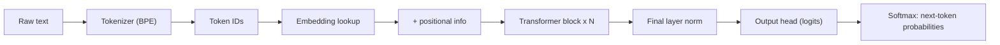
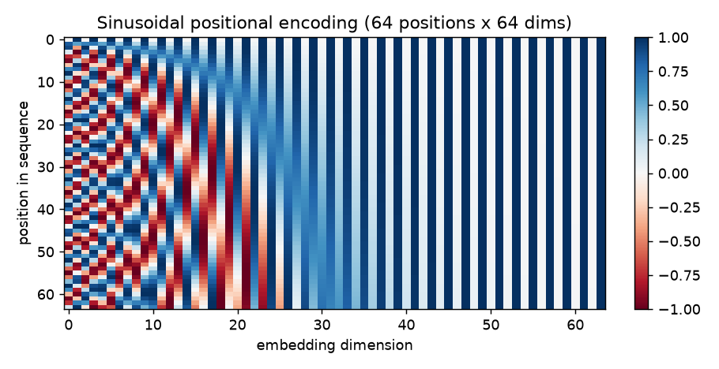
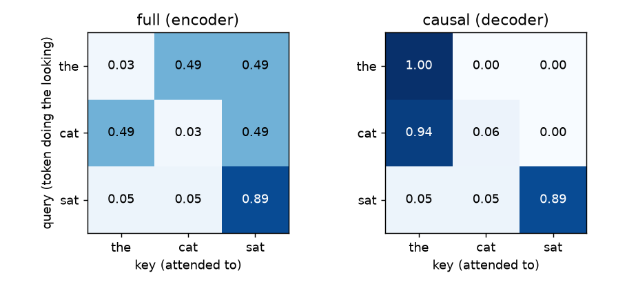
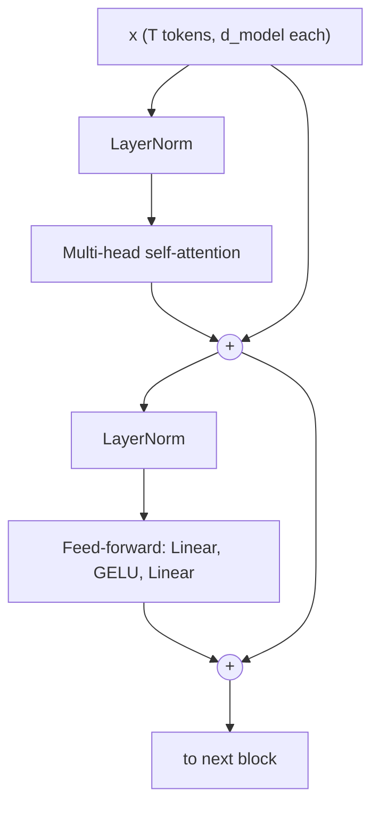
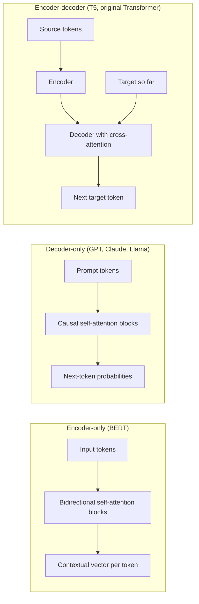
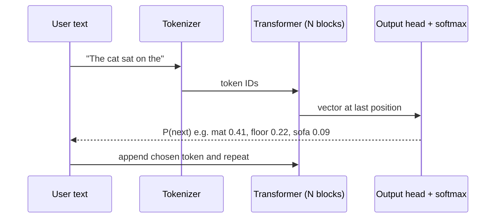

# Chapter 3 — Transformers and Embeddings

Every modern large language model (LLM: a very large neural network trained on huge amounts of text to predict what comes next) — GPT, Claude, Gemini, Llama, Qwen, DeepSeek — is built on the **transformer** architecture from *Attention Is All You Need* (Vaswani et al., Google, 2017). This chapter follows one piece of text as it becomes **tokens**, then **vectors** (lists of numbers), picks up **position** information, flows through **self-attention** (each token gathering information from the others) and **feed-forward** (a small per-token network) layers, and ends as a probability for the next token.

Covered: tokens and **Byte-Pair Encoding (BPE)**; **embeddings** and similarity; **positional encoding** (sinusoidal, learned, RoPE); **self-attention** with Q, K, V by hand; **multi-head** and grouped-query attention; the **transformer block** (residuals, layer norm, FFN); **causal masking**; **encoder-only vs decoder-only vs encoder-decoder**; and a from-scratch PyTorch block that matches PyTorch's fused attention. Everything uses tiny numbers you can check by hand, with runnable NumPy and PyTorch (2.x) code in `code/`; outputs below are real. It picks up where RNNs (recurrent networks that read one token at a time with a running memory) stop in the ML Handbook's [Chapter 12](../../../ml/chapters/12-sequences-rnns-and-attention/README.md), but does not depend on it.



---

## 3.1 Tokens and tokenization

### What it is
A **token** is the unit of text a model reads and writes: a word ("the"), a word piece ("ing", "ization"), punctuation, or a single byte. A **tokenizer** splits text into tokens and maps each to an integer **token ID** from a fixed **vocabulary**. Like LEGO: common words get one big piece; rare words are assembled from smaller ones.

```
"Tokenization is fun!"  ->  ["Token", "ization", " is", " fun", "!"]  ->  [ 3404, 2065, 318, 1257, 0 ]   (IDs illustrative)
```

### The problem it solves
Neural networks process numbers, so text must become integers. Of three ways to cut text, two fail:

| Approach | Vocabulary size | Problem |
|---|---|---|
| **Word-level** ("cat", "cats", "catlike" separate) | Huge (hundreds of thousands+) | Unseen words become `<UNK>`; typos, names, code, new slang break. |
| **Character-level** | Tiny (~100s) | Never unknown, but sequences are ~4–5x longer (more compute) and spelling must be learned from scratch. |
| **Subword** (BPE, WordPiece, Unigram) | Medium (roughly 30K–200K in real models) | Frequent words stay whole, rare words split into known pieces. **Nothing is ever unknown.** Every modern LLM uses this. |

### How it works — Byte-Pair Encoding (BPE)
BPE began as a 1994 compression trick, adapted for neural machine translation by Sennrich et al. (2016). Training:

1. Start from single characters (or, in **byte-level BPE**, the 256 byte values). Split every corpus word into them, marking word ends (`</w>`) so a final "est" differs from an inner one.
2. Count every **adjacent pair**, weighted by word frequency.
3. **Merge** the most frequent pair into a new symbol; record the merge rule.
4. Repeat until the target vocabulary size (e.g. 50,000 merges).

To **tokenize** new text, split into characters and replay the merges **in learned order**.

### Worked example
Corpus: `low` ×5, `lower` ×2, `newest` ×6, `widest` ×3. "e"+"s" appears in *newest* (6) and *widest* (3) → 9, the most frequent, so it is merge 1; then "es"+"t" (9), and so on.

```python
# code/bpe_demo.py (key parts)
def get_pair_counts(vocab):
    pairs = Counter()
    for symbols, freq in vocab.items():
        for a, b in zip(symbols, symbols[1:]):
            pairs[(a, b)] += freq            # weight by word frequency
    return pairs

def train_bpe(word_counts, num_merges):
    vocab = {tuple(w) + ("</w>",): c for w, c in word_counts.items()}
    merges = []
    for step in range(1, num_merges + 1):
        best, count = get_pair_counts(vocab).most_common(1)[0]
        vocab = merge_pair(best, vocab)      # fuse that pair everywhere
        merges.append(best)
    return merges, vocab

def tokenize(word, merges):                  # replay merges in learned order
    symbols = list(word) + ["</w>"]
    for pair in merges:
        ...                                   # fuse each occurrence of pair
    return symbols
```

Output:
```
corpus word counts: {'low': 5, 'lower': 2, 'newest': 6, 'widest': 3}
merge  1: 'e'      + 's'      (seen  9x)
merge  2: 'es'     + 't'      (seen  9x)
merge  3: 'est'    + '</w>'   (seen  9x)
merge  4: 'l'      + 'o'      (seen  7x)
merge  5: 'lo'     + 'w'      (seen  7x)
merge  6: 'n'      + 'e'      (seen  6x)
merge  7: 'ne'     + 'w'      (seen  6x)
merge  8: 'new'    + 'est</w>' (seen  6x)
merge  9: 'low'    + '</w>'   (seen  5x)
merge 10: 'w'      + 'i'      (seen  3x)

words after 10 merges:
  5x  low</w>
  2x  low e r </w>
  6x  newest</w>
  3x  wi d est</w>

tokenizing words (some never seen in training):
  lowest  -> ['low', 'est</w>']
  newer   -> ['new', 'e', 'r', '</w>']
  wider   -> ['wi', 'd', 'e', 'r', '</w>']
  slow    -> ['s', 'low</w>']
```

**"lowest" was never in the corpus**, yet it becomes `low` + `est</w>`: the tokenizer generalizes. Frequent words became single tokens; rare suffixes stay split (more merges would make `er</w>` one token). Real tokenizers run tens of thousands of merges over terabytes of text.

### Real tokenizer families

| Algorithm | How it picks merges / pieces | Used by (examples) |
|---|---|---|
| **Byte-level BPE** | BPE over raw UTF-8 bytes, so any string (emoji, Chinese, code) is representable with no unknown token | GPT-2 (vocab 50,257), later GPT models via OpenAI's `tiktoken`, Llama 3 (~128K vocab) |
| **WordPiece** | Merges the pair that most increases training-data likelihood; continuation pieces marked `##` | BERT (≈30K vocab) |
| **Unigram LM** (usually via Google's **SentencePiece**) | Starts with a big candidate vocabulary and prunes the least useful pieces | T5, ALBERT; SentencePiece also packages BPE (Llama 1/2, 32K vocab) |

SentencePiece treats input as a raw stream and encodes spaces as a visible `▁`, making it language-agnostic (no pre-splitting on spaces, which matters for Japanese or Chinese).

### Rules of thumb
- Typical English: **1 token ≈ 4 characters ≈ ¾ of a word** (100 tokens ≈ 75 words); varies by tokenizer and language.
- Other languages, code and numbers need **more tokens per word**: higher cost, and the context window (maximum tokens a model takes at once) fills faster.
- Spaces usually attach to the *following* word: `" is"` and `"is"` are different tokens.
- **Special tokens** mark structure: start/end of text, padding, and in chat models the system/user/assistant turn boundaries.

### Trade-offs

| Bigger vocabulary | Smaller vocabulary |
|---|---|
| Shorter sequences → less compute, more text fits in context | Longer sequences |
| Larger embedding and output matrices (vocab × d_model parameters each; d_model = the model's vector width) | Fewer parameters |
| Each rare token sees fewer training examples | Each token is well trained |

The trend is toward larger vocabularies (GPT-2 ~50K → Llama 3 ~128K), mainly to encode multilingual text and code efficiently. You never choose a tokenizer for an existing model — **you must use the one it was trained with**; training your own makes sense only when pre-training from scratch (e.g. a specialized language or DNA).

### Common mistakes
- **Budgeting in words or characters.** Limits and prices are in tokens; count with the provider's tokenizer or token-counting endpoint.
- **Mixing tokenizers.** One model's token IDs are meaningless to another.
- **Expecting character-level skills.** "strawberry" may be one or two tokens, so models have historically struggled to count letters, reverse strings or do digit-by-digit arithmetic: they never see the letters.
- **Forgetting special tokens and chat templates** (the exact format wrapping each turn) when calling an open-weights model directly.

### Real-world examples
- OpenAI's `tiktoken` counts tokens locally before a request.
- Hugging Face's `tokenizers` library (Rust) implements BPE, WordPiece and Unigram for most open models.
- API pricing is per million input and output tokens at every major provider, so tokenization directly affects cost.

### In the interview
**30-second answer:** "LLMs work on subword tokens. A BPE tokenizer starts from bytes or characters and repeatedly merges the most frequent adjacent pair until it reaches the target vocabulary size, keeping common words whole and splitting rare ones into known pieces, so nothing is out-of-vocabulary. In English a token is about four characters, and context limits, latency and price are all measured in tokens."

- *Why not word-level?* Unbounded vocabulary and unknown words; subwords handle new words, typos and code.
- *Why can LLMs struggle to count letters?* They see token IDs, not characters.
- *Why do non-English prompts cost more?* English-heavy tokenizers split other scripts into more, smaller tokens.

### Self-check
1. Why can byte-level BPE encode any string? → Its base vocabulary is all 256 byte values.
2. Roughly how many tokens is a 750-word English essay? → About 1,000.

### TL;DR
Text → subword tokens → integer IDs. BPE learns a vocabulary by merging frequent pairs; nothing is out-of-vocabulary. Count, price and limit everything in tokens (~4 English characters each).

---

## 3.2 Embeddings

### What it is
An **embedding** is a **vector** representing a token (or sentence, image, user) so that **similar meanings get similar vectors** — GPS coordinates for meaning. Its length is the **dimension** (e.g. 768 or 4,096).

### The problem it solves
**One-hot** encoding gives word *i* a length-V vector with a single 1. Two problems: **size** (100K-long, almost all zeros) and **no meaning**: every pair is **orthogonal** (dot product — multiply matching entries and sum — is 0), so "cat" is as far from "kitten" as from "carburetor". A **dense embedding** is short (hundreds to thousands of numbers), uses every dimension, and distances carry meaning.

### How it works
1. The model owns an **embedding matrix** E of shape (vocab_size × **d_model**).
2. Token *i*'s embedding is **row i of E** — a lookup, mathematically `one_hot(i) @ E` but far cheaper.
3. E starts random and is **learned by backpropagation** with the rest of the network. Tokens used in similar contexts drift together because that helps prediction (the *distributional hypothesis*: "you shall know a word by the company it keeps").

### Measuring similarity

| Measure | Formula | Range | Notes |
|---|---|---|---|
| **Dot product** | a·b = Σ aᵢbᵢ | any | Grows with vector length. Used inside attention. |
| **Cosine similarity** | cos(a,b) = a·b / (‖a‖ ‖b‖) | −1 to 1 | ‖a‖ = vector length; only the angle matters. Default for text embeddings. |
| **Euclidean distance** | ‖a − b‖ = √Σ(aᵢ − bᵢ)² | 0 to ∞ | Straight-line distance; smaller = more similar. |

With vectors **normalized** to length 1, cosine equals the dot product and Euclidean ranking matches cosine ranking, so vector databases often normalize once and use fast dot products.

**Worked cosine.** king = [0.9, 1.0, 0.7, 0], queen = [0.9, 1.0, −0.7, 0] (royalty, is_person, maleness, is_food). Dot = 0.81 + 1.0 − 0.49 = 1.32; ‖king‖ = ‖queen‖ = √2.3 ≈ 1.517; cos = 1.32 / 2.3 ≈ **0.57**.

```python
# code/embeddings_similarity.py (key parts)
def cosine(a, b):
    return float(a @ b / (np.linalg.norm(a) * np.linalg.norm(b)))

one_hot = np.eye(5)                         # every pair orthogonal
dense = np.array([[0.9, 1.0,  0.7, 0.0],    # king   [royalty, is_person, maleness, is_food]
                  [0.9, 1.0, -0.7, 0.0],    # queen
                  [0.1, 1.0,  0.7, 0.0],    # man
                  [0.1, 1.0, -0.7, 0.0],    # woman
                  [0.0, 0.0,  0.0, 1.0]])   # apple
target = dense[0] - dense[2] + dense[3]     # king - man + woman
E = rng.normal(size=(5, 4)).round(2)        # an embedding table
one_hot[idx] @ E == E[idx]                  # lookup == one-hot matmul
```

Output:
```
One-hot cosine similarity (no notion of meaning):
            king   queen     man   woman   apple
    king    1.00    0.00    0.00    0.00    0.00
   queen    0.00    1.00    0.00    0.00    0.00
     man    0.00    0.00    1.00    0.00    0.00
   woman    0.00    0.00    0.00    1.00    0.00
   apple    0.00    0.00    0.00    0.00    1.00

Dense cosine similarity (meaning lives in the geometry):
            king   queen     man   woman   apple
    king    1.00    0.57    0.85    0.32    0.00
   queen    0.57    1.00    0.32    0.85    0.00
     man    0.85    0.32    1.00    0.35    0.00
   woman    0.32    0.85    0.35    1.00    0.00
   apple    0.00    0.00    0.00    0.00    1.00

king - man + woman = [ 0.9  1.  -0.7  0. ] -> closest: queen

E[queen]            = [-0.54  0.36  1.3   0.95]
one_hot(queen) @ E  = [-0.54  0.36  1.3   0.95]
```

The hand-made dimensions are for teaching: in real models meaning is spread across many dimensions, and king − man + woman ≈ queen (word2vec, Mikolov et al., 2013) holds only approximately.

### Static vs contextual embeddings

| Kind | Example | "bank" in "river bank" vs "bank loan" |
|---|---|---|
| **Static** word embeddings | word2vec (2013), GloVe (2014) | Same vector — one per word |
| **Contextual** embeddings | Hidden states inside BERT, GPT | Different vectors — attention mixes in context |
| **Sentence/document embeddings** | Sentence-BERT (2019), provider embedding APIs | One vector per passage — used for search and RAG |

Inside a transformer the lookup gives a *static* start; each attention layer makes it more *contextual*. **Embedding models** output one vector per text for comparison — the basis of semantic search (by meaning, not exact words) and retrieval-augmented generation (RAG: retrieve relevant documents and hand them to an LLM) ([Chapter 7](../07-embeddings-vector-databases-and-rag/README.md)).

### Trade-offs

| Higher dimension | Lower dimension |
|---|---|
| Finer distinctions | Cheaper to store and search |
| More memory (1M docs × 3,072 floats × 4 bytes ≈ 12 GB) | May blur fine distinctions |

Some models support **truncating** the vector (Matryoshka representation learning), trading a little quality for much less storage.

**When not to use it:** exact matches (IDs, SKUs, error codes) favour keyword search (BM25, a classic word-matching ranker); production often uses **hybrid search** (both). And similarity is not truth: "the drug is safe" / "the drug is not safe" can have very similar vectors.

### Common mistakes
- **Comparing vectors from different models or versions** — each has its own coordinate system; re-embed everything when you switch.
- Raw dot product on unnormalized vectors, biasing results toward long vectors.
- Using a different query/document prefix than the model expects.

### Real-world examples
Semantic search and RAG (nearest-neighbour retrieval of stored vectors); recommendations (YouTube, Spotify embed users and items in one space); deduplication and clustering of tickets or articles.

### In the interview
**30-second answer:** "An embedding is a dense learned vector where geometric closeness means semantic similarity. In a transformer the embedding layer is a vocab × d_model lookup table learned with the model. We compare embeddings with cosine similarity; on normalized vectors that's just a dot product, which vector databases exploit."

- *Why not one-hot?* Too big, and every pair is orthogonal, so no similarity signal.
- *Cosine vs Euclidean?* Cosine ignores length; on unit vectors they rank identically.
- *Static vs contextual?* word2vec gives one vector per word; transformers give one per occurrence, depending on context.

### Self-check
1. What is `one_hot(i) @ E`? → Row *i* of E — the same as a lookup.
2. Cosine 0.95 — are the texts guaranteed to agree? → No; negation is a classic failure.

### TL;DR
Embeddings turn IDs into dense vectors where distance means meaning; the layer is a learned lookup table. Compare with cosine (a dot product after normalization). Transformers make embeddings contextual.

---

## 3.3 Positional encoding

### What it is
Extra information added to each token's embedding telling the model **where** the token sits.

### The problem it solves
Self-attention is **permutation-invariant**: shuffle the inputs and each output is the same, just shuffled, so "dog bites man" = "man bites dog". RNNs got order by reading sequentially; transformers read everything at once, so order must be injected.

### How it works — the main approaches

| Method | Idea | Used by |
|---|---|---|
| **Sinusoidal** (fixed) | Add sines and cosines of different frequencies to each embedding | Original 2017 Transformer |
| **Learned absolute** | Lookup table: position p → learned vector, added to the embedding | BERT, GPT-2 (max 512 / 1,024 positions) |
| **RoPE** (rotary position embedding, Su et al., 2021) | Rotate query and key vectors (§3.4) by an angle proportional to position, so their dot product depends on **relative** distance | Llama, Mistral, Qwen and most modern open LLMs |
| **ALiBi** (Press et al., 2021) | Add an attention-score penalty that grows with distance | BLOOM, MPT |

**Sinusoidal formula** for position *pos* and dimension pair *i*:

- PE(pos, 2i) = sin(pos / 10000^(2i / d_model))
- PE(pos, 2i+1) = cos(pos / 10000^(2i / d_model))

Each dimension pair is a clock hand turning at a different speed (first pair fast, later ones very slowly); together they give each position a unique fingerprint.

```python
# code/positional_encoding.py
def sinusoidal_pe(num_positions, d_model):
    pos = np.arange(num_positions)[:, None]
    i = np.arange(0, d_model, 2)[None, :]          # 0, 2, 4, ... (= 2i)
    angle = pos / np.power(10000, i / d_model)
    pe = np.zeros((num_positions, d_model))
    pe[:, 0::2] = np.sin(angle)
    pe[:, 1::2] = np.cos(angle)
    return pe
```

Output:
```
PE for positions 0..3, d_model=4:
[[ 0.     1.     0.     1.   ]
 [ 0.841  0.54   0.01   1.   ]
 [ 0.909 -0.416  0.02   1.   ]
 [ 0.141 -0.99   0.03   1.   ]]

Similarity (dot product) of position 10 with others:
  pos 10 . pos 10 =  32.00
  pos 10 . pos 11 =  30.92
  pos 10 . pos 12 =  28.30
  pos 10 . pos 15 =  23.50
  pos 10 . pos 20 =  21.05
  pos 10 . pos 40 =  17.07
```

Row 1 by hand: sin(1) = 0.841, cos(1) = 0.540; the second pair uses 1/10000^(2/4) = 1/100, so sin(0.01) ≈ 0.01, cos(0.01) ≈ 1. Nearby positions are more similar (32 → 30.9 → 28.3 …), giving attention a sense of distance.



### Trade-offs

| | Sinusoidal | Learned absolute | RoPE / ALiBi (relative) |
|---|---|---|---|
| Extra parameters | None | max_len × d_model | None |
| Longer sequences than trained on | Defined, but quality drops | **Impossible** (no row for position 1,025 in GPT-2) | Degrades gracefully; RoPE can be stretched with scaling tricks (e.g. position interpolation, YaRN) |
| Encodes relative distance directly | Indirectly | No | Yes |

Context windows grew from 2K tokens (GPT-3) to hundreds of thousands, and 1M or more in some models from 2024, largely thanks to relative schemes like RoPE plus long-context training.

### Common mistakes
- Thinking the model knows order from embeddings alone — remove positions and word order vanishes.
- Assuming any length works because the maths allows it; quality depends on lengths seen in training.

### In the interview
**30-second answer:** "Attention is permutation-invariant, so we inject order. The original transformer added fixed sinusoids; BERT and GPT-2 learned a vector per position, which caps length; most modern LLMs use RoPE, rotating queries and keys so scores depend on relative distance, which can be extended to longer contexts."

- *Why sines and cosines?* Unique per position, bounded in [−1, 1], and a fixed offset is a linear transformation, so relative positions are easy to learn.
- *Why did GPT-2 have a hard 1,024-token limit?* Learned absolute positions: no embedding for position 1,025.

### Self-check
1. Is positional encoding added or concatenated in the original transformer? → Added (same dimension).

### TL;DR
Attention ignores order, so position is added: fixed sinusoids (2017), learned per-position vectors (BERT, GPT-2), or relative schemes like RoPE (modern LLMs), which ease long contexts.

---

## 3.4 Self-attention, step by step

### What it is
**Self-attention** lets every token pull information from every other token in the sequence: each output is a **weighted average of the tokens' information**, with weights computed on the fly from relevance. In "The animal didn't cross the street because **it** was too tired", "it" draws heavily from "animal".

### The problem it solves
RNNs pass information one step at a time: distant words fade and steps cannot run in parallel. Attention connects **any two positions in one step** and processes the sequence **in parallel**, which made internet-scale training practical on GPUs.

### How it works — Query, Key, Value
- **Query (Q)** — what this token is looking for ("I'm a pronoun; who do I refer to?").
- **Key (K)** — the label each token advertises ("I'm a noun, an animal").
- **Value (V)** — the content each token hands over if chosen.

> **Key term — matrix multiplication:** X·W (`X @ W`) multiplies each row of X with each column of W and sums the products; the result has X's rows and W's columns, so a learned W maps each token's vector to a new width. Kᵀ is K transposed (rows become columns).

For input X (one row per token, width d_model):

1. **Project.** Q = X·W_Q, K = X·W_K, V = X·W_V (learned, shape d_model × d_k).
2. **Score.** S = Q·Kᵀ — entry (i, j) is how well token *i*'s query matches token *j*'s key.
3. **Scale.** Divide by √d_k.
4. **Normalize.** **Softmax** each row: softmax(zᵢ) = e^zᵢ / Σⱼ e^zⱼ — exponentiate (positive, gaps exaggerated) and divide by the row total. Scores [0, 2] → [1, 7.39] → weights [0.12, 0.88].
5. **Mix.** Output = weights · V.

**Attention(Q, K, V) = softmax(Q·Kᵀ / √d_k) · V**

**Why divide by √d_k?** If q and k entries are independent with variance 1, their dot product has variance d_k (64 for d_k = 64, so scores spread ~8× wider). Softmax would then saturate (one weight ≈ 1, rest ≈ 0) and gradients would vanish. Dividing by √d_k restores variance ≈ 1.

### Worked example with tiny numbers
Three tokens "the cat sat", d_model = 4, one head with d_k = 2.

```python
# code/attention_numpy.py (key parts)
X = np.array([[1., 0., 1., 0.],     # the
              [0., 1., 0., 1.],     # cat
              [1., 1., 1., 1.]])    # sat
W_Q = np.array([[1, 0], [0, 1], [1, 0], [0, 1]], dtype=float)
W_K = np.array([[0, 1], [1, 0], [0, 1], [1, 0]], dtype=float)
W_V = np.array([[1, 0], [0, 1], [1, 0], [0, 0]], dtype=float)
Q, K, V = X @ W_Q, X @ W_K, X @ W_V

def attention(Q, K, V, mask=None):
    scores = Q @ K.T / np.sqrt(Q.shape[-1])
    if mask is not None:
        scores = np.where(mask, scores, -np.inf)
    weights = softmax(scores, axis=-1)
    return weights @ V, weights
```

Output:
```
Q =
 [[2. 0.]
 [0. 2.]
 [2. 2.]]
K =
 [[0. 2.]
 [2. 0.]
 [2. 2.]]
V =
 [[2. 0.]
 [0. 1.]
 [2. 1.]]

raw scores Q.K^T =
 [[0. 4. 4.]
 [4. 0. 4.]
 [4. 4. 8.]]

scaled scores =
 [[0.    2.828 2.828]
 [2.828 0.    2.828]
 [2.828 2.828 5.657]]

attention weights (rows sum to 1) =
 [[0.029 0.486 0.486]
 [0.486 0.029 0.486]
 [0.053 0.053 0.894]]

output = weights @ V =
 [[1.029 0.971]
 [1.943 0.514]
 [1.894 0.947]]
```

Row 1 ("the") by hand: q_the = [2, 0] scores 0, 4, 4 against the keys; ÷√2 → [0, 2.828, 2.828]; e⁰ = 1, e^2.828 ≈ 16.9, sum ≈ 34.8 → weights [0.029, 0.486, 0.486]; output 0.029·[2, 0] + 0.486·[0, 1] + 0.486·[2, 1] = [1.03, 0.97] ✓. "the" ignores itself and draws half from "cat", half from "sat"; in a trained model such weights reflect learned patterns (syntax, coreference).



### Cost
The score matrix is T × T, so attention costs **O(T² · d)** time and O(T²) memory per head per layer: doubling context quadruples that work. Hence **FlashAttention** (Dao et al., 2022: exact attention without storing the full T × T matrix in slow GPU memory), sparse or sliding-window attention (each token sees only a fixed number of recent tokens), and the **KV cache** (stored keys and values of earlier tokens) ([Chapter 4](../04-large-language-models/README.md), [Chapter 11](../11-llm-serving-and-inference/README.md)).

### Trade-offs — attention vs recurrence

| | Self-attention | RNN / LSTM (long short-term memory, an improved RNN) |
|---|---|---|
| Path between distant tokens | 1 step | T steps |
| Parallel over sequence in training | Yes | No |
| Cost per layer | O(T² · d) | O(T · d²) |
| Built-in notion of order | No (needs positional encoding) | Yes |

### Common mistakes
- Forgetting the √d_k scaling (unstable training).
- Softmax over the wrong axis — it is **per query row**, over keys.
- Reading attention weights as a faithful explanation: they show where information flowed in one layer, not *why* the model decided.

### In the interview
**30-second answer:** "Each token is projected into a query, key and value. Scores are query-key dot products scaled by the square root of the key dimension, softmaxed per row, and used to average the values. It connects any two positions in one step and runs in parallel, but is quadratic in sequence length."

- *Why scale by √d_k?* Keeps score variance ≈ 1 so softmax doesn't saturate and gradients survive.
- *Why separate Q, K, V?* Looking, advertising and passing on are different roles; separate projections learn each.
- *Complexity?* O(T²·d) time, O(T²) memory per head.

### Self-check
1. If all scores in a row are equal, what is the output? → The plain average of the value vectors.
2. Context 4K → 8K: attention score work? → Grows ~4x.

### TL;DR
softmax(Q·Kᵀ/√d_k)·V: each token's question (Q) is matched against every token's label (K) to take a relevance-weighted average of their content (V). Parallel and direct, but O(T²).

---

## 3.5 Multi-head attention

### What it is
Run **h smaller attention computations in parallel** ("heads"), each with its own W_Q, W_K, W_V, then concatenate their outputs and mix them with an output matrix W_O.

### Why it matters
One softmax gives one weighting per token, but a word may need its subject, its adjective and a previous mention at once. Heads specialize: studies of trained models found heads tracking the previous token, syntactic relations or copying patterns.

### How it works
1. d_head = d_model / h (original: d_model = 512, h = 8, d_head = 64).
2. Each head projects X to width-d_head Q, K, V and runs scaled dot-product attention.
3. **Concatenate** back to width d_model.
4. Multiply by **W_O** (d_model × d_model) to mix the heads.

Cost ≈ one full-width head, since heads are narrower. Parameters: four d_model × d_model matrices (Q, K, V, O) = **4·d_model²** (plus biases).

Two random heads from the NumPy demo (with the §3.7 causal mask, hence the zeros upper-right) attend differently:

```
head 0 weights =
 [[1.    0.    0.   ]
 [0.372 0.628 0.   ]
 [0.313 0.372 0.314]]

head 1 weights =
 [[1.    0.    0.   ]
 [0.503 0.497 0.   ]
 [0.337 0.331 0.332]]

multi-head output shape: (3, 4)
```

### Production variants
During **inference** (using a trained model) the model keeps every past token's keys and values (the **KV cache**), which grows large with many heads, so newer models share K and V across heads:

| Variant | Keys/values | Used by (examples) |
|---|---|---|
| **Multi-head (MHA)** | One K/V per head | Original Transformer, GPT-2, BERT |
| **Multi-query (MQA)** (Shazeer, 2019) | One K/V shared by all heads | PaLM, Falcon |
| **Grouped-query (GQA)** (Ainslie et al., 2023) | One K/V per group of heads | Llama 2 70B, Llama 3, Mistral |

GQA keeps most of MHA's quality while shrinking the KV cache several-fold, a big serving-cost win ([Chapter 11](../11-llm-serving-and-inference/README.md)). DeepSeek-V2/V3 use multi-head latent attention (MLA), compressing K/V into a smaller latent vector.

### Common mistakes
- More heads always help? With fixed d_model, heads get narrower; the original paper saw quality drop with too many.
- Forgetting W_O — without it heads never exchange information inside the layer.

### In the interview
**30-second answer:** "Multi-head attention runs several narrower attention operations in parallel so heads capture different relationships, then concatenates and mixes them with an output projection, at roughly one full-width head's cost. For inference, modern LLMs use grouped-query attention, where groups of query heads share keys and values, shrinking the KV cache."

- *Attention layer parameters?* ≈ 4·d_model² (Q, K, V, O).
- *MQA vs GQA?* MQA: one K/V for all heads (smallest cache, some quality loss); GQA: per group (middle ground).

### Self-check
1. d_model = 768, 12 heads: d_head? → 64.

### TL;DR
Several narrow heads in parallel, concatenated and mixed by W_O; heads specialize. GQA/MQA share keys and values to shrink the KV cache.

---

## 3.6 The transformer block

### What it is
The repeating unit: **multi-head attention** + a position-wise **feed-forward network (FFN)**, each wrapped in a **residual connection** and **layer normalization**. Models stack N blocks (6 in the original encoder, 12 in GPT-2 small and BERT-base, 32 in Llama-2-7B, many more in frontier models).



### The three ingredients

**1. Residual (skip) connection: x + f(x).** Each sub-layer learns only a *change* to its input, and gradients flow straight back through the "+", making dozens of layers trainable (from ResNets, 2015). Think of the residual path as a shared stream each layer reads from and writes to.

**2. Layer normalization.** Per token vector: subtract the mean, divide by the standard deviation, then apply learned scale γ and shift β: LN(x) = γ · (x − μ) / √(σ² + ε) + β. It keeps activations in a stable range and, unlike batch norm, does not depend on other examples in the batch — suiting variable-length text.
- **Post-LN** (2017 paper): normalize *after* adding the residual.
- **Pre-LN** (GPT-2 onward, most LLMs): normalize each sub-layer's *input*, as in the diagram; trains deep stacks without careful warm-up (a slowly rising initial learning rate).
- **RMSNorm** (Llama and many others): skip mean subtraction, only rescale — slightly cheaper, works as well.

**3. Feed-forward network (FFN).** Two linear layers with a non-linearity, applied **to each token independently**: FFN(x) = W₂ · act(W₁·x + b₁) + b₂, hidden layer usually **4x wider** (512 → 2,048 originally). Activations: ReLU (max(0, x)) originally; GELU (smooth ReLU) in GPT and BERT; **SwiGLU** in Llama-style models — a gated variant with three matrices, so its hidden width is ~8/3·d (not 4·d) to keep parameters similar. Intuition: attention moves information *between* tokens; the FFN processes it *within* each token, and much factual knowledge seems stored in FFN weights.

**Parameters per block** ≈ attention 4·d² + FFN 2·(d × 4d) = 8·d² → **≈ 12·d²** (ignoring biases and norms). GPT-3 (d_model = 12,288, 96 layers): 12 × 12,288² × 96 ≈ 174 billion, close to its advertised 175B. The FFN holds about two-thirds.

**Mixture of Experts (MoE)** (Mixtral, DeepSeek-V3, Llama 4 and others) replaces the FFN with many expert FFNs and a router sending each token to a few: total parameters grow a lot, per-token compute little.

### From-scratch PyTorch block

```python
# code/mini_transformer_torch.py (key parts)
class MultiHeadSelfAttention(nn.Module):
    def __init__(self, d_model, n_heads):
        super().__init__()
        self.h, self.d_head = n_heads, d_model // n_heads
        self.qkv = nn.Linear(d_model, 3 * d_model)   # W_Q, W_K, W_V in one matrix
        self.out = nn.Linear(d_model, d_model)       # W_O

    def forward(self, x, causal=True):
        B, T, C = x.shape
        q, k, v = self.qkv(x).split(C, dim=-1)
        q, k, v = (t.view(B, T, self.h, self.d_head).transpose(1, 2) for t in (q, k, v))
        scores = q @ k.transpose(-2, -1) / self.d_head ** 0.5       # (B, h, T, T)
        if causal:
            mask = torch.tril(torch.ones(T, T, dtype=torch.bool))
            scores = scores.masked_fill(~mask, float("-inf"))
        y = scores.softmax(dim=-1) @ v
        return self.out(y.transpose(1, 2).contiguous().view(B, T, C))

class TransformerBlock(nn.Module):              # pre-LayerNorm, GPT-2 style
    def __init__(self, d_model, n_heads, d_ff):
        super().__init__()
        self.ln1, self.ln2 = nn.LayerNorm(d_model), nn.LayerNorm(d_model)
        self.attn = MultiHeadSelfAttention(d_model, n_heads)
        self.ffn = nn.Sequential(nn.Linear(d_model, d_ff), nn.GELU(), nn.Linear(d_ff, d_model))

    def forward(self, x):
        x = x + self.attn(self.ln1(x))          # residual around attention
        x = x + self.ffn(self.ln2(x))           # residual around FFN
        return x

# main: compare with torch.nn.functional.scaled_dot_product_attention(..., is_causal=True),
# edit the last token and check earlier outputs, count parameters.
```

Output:
```
max |ours - torch SDPA| = 1.19e-07
per-position change after editing the last token: [0.0, 0.0, 0.0, 0.0, 10.0]
input shape: (2, 5, 16) -> output shape: (2, 5, 16)
params: attention=1088, ffn=2128, layernorms=64, total=3280
rule of thumb 12*d_model^2 = 3072
```

- Our attention matches PyTorch's fused kernel `scaled_dot_product_attention` to floating-point precision (1e-7). In real code use the built-in: it dispatches to FlashAttention-style kernels on GPUs.
- Editing the last token changes **only** the last position — the causal mask works (§3.7).
- Shape is preserved (B, T, d_model), so blocks stack.
- 3,280 parameters vs the 12·d² estimate of 3,072: the gap is biases and LayerNorm.

### Common mistakes
- Dropping residuals (deep stacks fail to train).
- Normalizing over the batch instead of the feature dimension.
- Assuming the FFN mixes tokens — only attention does.

### In the interview
**30-second answer:** "A block is multi-head self-attention then a position-wise FFN, each wrapped in a residual with layer norm; modern LLMs use pre-norm, often RMSNorm, and a gated SwiGLU FFN several times wider than the model. Attention moves information between tokens, the FFN transforms each token. About 12·d² parameters per block, two-thirds in the FFN."

- *Why residuals?* Easy gradient flow; each layer learns only an update.
- *Pre-LN vs post-LN?* Pre-LN is more stable for deep models, less delicate warm-up.
- *What is MoE?* Expert FFNs with a router picking a few per token — more parameters at similar per-token compute.

### Self-check
1. Parameters in a block with d_model = 1,024? → 12 × 1,024² ≈ 12.6M.
2. Why does output shape equal input shape? → So blocks stack and residuals add.

### TL;DR
Block = x + Attention(LN(x)), then x + FFN(LN(x)). Residuals keep deep stacks trainable, LayerNorm keeps them stable, the FFN (≈⅔ of parameters) processes each token. Stack N.

---

## 3.7 Causal masking

### What it is
A **causal mask** (look-ahead mask) stops each position attending to later positions: token *i* uses only tokens 0…*i*.

### The problem it solves
A decoder is trained to predict the next token; if position 3 saw position 4 it would copy the answer. The mask also enables a key efficiency: **one forward pass over T tokens yields T predictions at once** (position 0 predicts token 1, and so on), each seeing only its past. This parallel next-token training (*teacher forcing*: true previous tokens are fed in, not the model's guesses) is a major reason transformers train much faster than RNNs.

### How it works
1. Build a lower-triangular boolean T × T matrix (1 = allowed).
2. Set disallowed scores to −∞ before softmax.
3. Softmax turns −∞ into weight 0.

```
causal mask =
 [[1 0 0]
 [1 1 0]
 [1 1 1]]
causal attention weights =
 [[1.    0.    0.   ]
 [0.944 0.056 0.   ]
 [0.053 0.053 0.894]]
```

The first token attends only to itself; the last row is unchanged because the last token already saw everything. The PyTorch test confirmed it: editing the last token left positions 0–3 unchanged.

Other masks: **padding mask** (pad tokens in batches of unequal lengths are ignored) and **bidirectional (no mask)** in encoders like BERT.

### Common mistakes
- Masking with 0 instead of −∞ (a 0 score still gets positive weight).
- Masking after softmax (rows no longer sum to 1).
- Generating with a bidirectional model — it never learned to predict without the future.

### In the interview
**30-second answer:** "Decoder-only models apply a lower-triangular mask, setting future scores to minus infinity before the softmax, so each position attends only to earlier ones. That prevents cheating on next-token prediction and lets one forward pass train every position in parallel."

- *Is the mask needed at inference?* With a KV cache, each new token attends to cached past tokens, so there is no future to hide; the mask matters in training and prompt processing (prefill).

### Self-check
1. Predictions from one 1,000-token training sequence? → 999, in a single forward pass.

### TL;DR
Set future scores to −∞ before softmax: no peeking, and every position trains in parallel.

---

## 3.8 Encoder vs decoder vs encoder-decoder

### What it is
The original transformer had an **encoder** reading the input bidirectionally and a **decoder** generating output token by token with causal attention plus **cross-attention** to the encoder output. Later models kept one or both halves.



**Cross-attention**: queries from the decoder, keys and values from the encoder output — how a translation decoder "looks at" the source.

### Comparison

| | Encoder-only | Decoder-only | Encoder-decoder |
|---|---|---|---|
| Attention | Bidirectional | Causal | Encoder bidirectional; decoder causal + cross-attention |
| Pre-training objective | **Masked language modeling**: hide ~15% of tokens, predict them | **Next-token prediction** | Reconstruct corrupted spans (T5), denoising damaged text (BART) |
| Best at | Understanding: classification, NER (named-entity recognition), embeddings, reranking | Generation of any kind; with scale, nearly everything | Input → output transformations: translation, summarization |
| Classic models | BERT (Google, 2018; base 110M, large 340M params), RoBERTa | GPT-1/2/3 (OpenAI 2018/2019/2020), today's chat LLMs | Original Transformer (2017), T5 (Google, 2019), BART (Meta, 2019) |
| Generates text? | Not naturally | Yes | Yes |

### Why decoder-only won for LLMs
- **One simple objective** (next token) works on any raw text without labels.
- **Every task can be phrased as continuation** ("Translate to French: … →").
- It scales predictably (Chapter 4's scaling laws), and one architecture serves chat, code, reasoning and tool use.
- Encoders remain the choice for **fast, cheap understanding**: most embedding and reranking models in search and RAG are encoder-based.

Don't generate with an encoder-only model, and don't use a large decoder LLM for high-volume classification a small fine-tuned encoder handles at a fraction of the cost and latency.

### Common mistakes
- "GPT uses the transformer encoder" — GPT is decoder-only (no cross-attention).
- Assuming encoder-decoder is obsolete — still used for translation and speech (OpenAI's Whisper is encoder-decoder).

### Real-world examples
Google Search began using BERT for query understanding in 2019; vector-search embedding models are mostly encoders; ChatGPT, Claude, Gemini and Llama are decoder-only (multimodal input in Chapter 4).

### In the interview
**30-second answer:** "Encoder-only models like BERT use bidirectional attention and masked-token training — great for classification and embeddings. Decoder-only models like GPT use causal attention and next-token prediction; at scale they handle almost any task as continuation, which is why LLMs are decoder-only. Encoder-decoder models like T5 encode bidirectionally and generate with cross-attention — natural for translation and summarization."

- *What is cross-attention?* Decoder queries over encoder keys/values.
- *Model for semantic search embeddings?* Usually an encoder-based embedding model — cheaper and purpose-trained.

### TL;DR
Encoder (BERT) = understand, bidirectional. Decoder (GPT) = generate, causal. Encoder-decoder (T5, Whisper) = transform via cross-attention. LLMs are decoder-only; embedding/reranking models are often encoders.

---

## 3.9 Putting it together: from text to the next token

A decoder-only forward pass:

1. **Tokenize** → IDs (e.g. 7 tokens).
2. **Embed** → 7 × d_model (plus positions, or RoPE inside attention).
3. **N transformer blocks** with causal masking; shape stays 7 × d_model.
4. **Final layer norm**.
5. **Output head (unembedding)**: multiply by a d_model × vocab_size matrix → **logits** (one raw score per vocabulary token). Many models **tie** it to the embedding matrix (reuse Eᵀ) to save parameters.
6. **Softmax** the last position's logits → next-token probabilities.
7. Choose a token (greedy = most likely; sampling = random by probability — [Chapter 4](../04-large-language-models/README.md)), append, repeat.

Training runs the same pass, compares every position's distribution with the actual next token using **cross-entropy loss** (−log probability of the correct token), and backpropagates through everything, including the embedding table.



(Probabilities illustrative.)

### Transformers vs RNNs in one table
(Details in the ML Handbook, [Chapter 12](../../../ml/chapters/12-sequences-rnns-and-attention/README.md).)

| | RNN/LSTM | Transformer |
|---|---|---|
| Reads tokens | One at a time | All at once |
| Long-range dependencies | Fade over many steps | One attention hop |
| Training parallelism | Low | High (GPU-friendly) |
| Memory of the past at inference | Fixed-size hidden state | Grows with context (KV cache) |
| Cost vs sequence length | Linear | Quadratic attention |

The last row drives research into **state-space models** (e.g. Mamba, 2023) and hybrids seeking RNN-like linear cost with transformer-like quality.

---

## Chapter TL;DR

- **Tokens**: subword pieces from BPE (or WordPiece/Unigram); ~4 English characters each; everything is counted and priced in tokens.
- **Embeddings**: a learned lookup table mapping IDs to dense vectors; closeness = meaning; compare with cosine similarity.
- **Positional encoding**: attention ignores order, so add sinusoids, learned positions, or (modern) rotate Q/K with RoPE.
- **Self-attention**: softmax(QKᵀ/√d_k)V — relevance-weighted mixing across all tokens, in parallel, O(T²).
- **Multi-head**: several narrow heads specialize; GQA/MQA share K/V to shrink the KV cache.
- **Block**: pre-norm attention + FFN, each with a residual; ≈12·d² parameters; stacked N times; MoE swaps the FFN for routed experts.
- **Causal mask**: no peeking at the future; trains on every position in one pass.
- **Architectures**: encoder (BERT, understanding), decoder (GPT/Claude/Llama, generation), encoder-decoder (T5/Whisper, transformation).

## Further reading
- Vaswani et al., *Attention Is All You Need* (2017).
- Jay Alammar, *The Illustrated Transformer* (blog, visual walkthrough).
- Andrej Karpathy, *Neural Networks: Zero to Hero* — "Let's build GPT" and "Let's build the GPT Tokenizer" lectures.
- Sebastian Raschka, *Build a Large Language Model (From Scratch)* — chapters on tokenization, attention and the GPT architecture.
