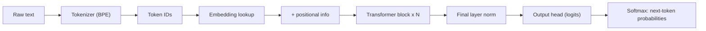
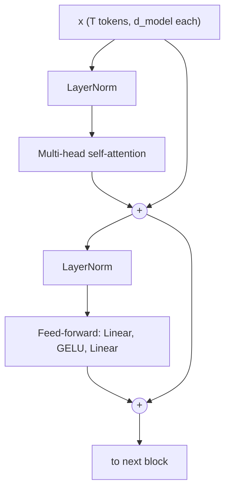
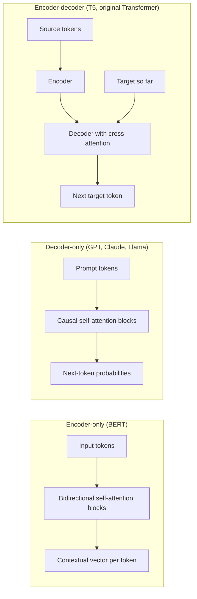
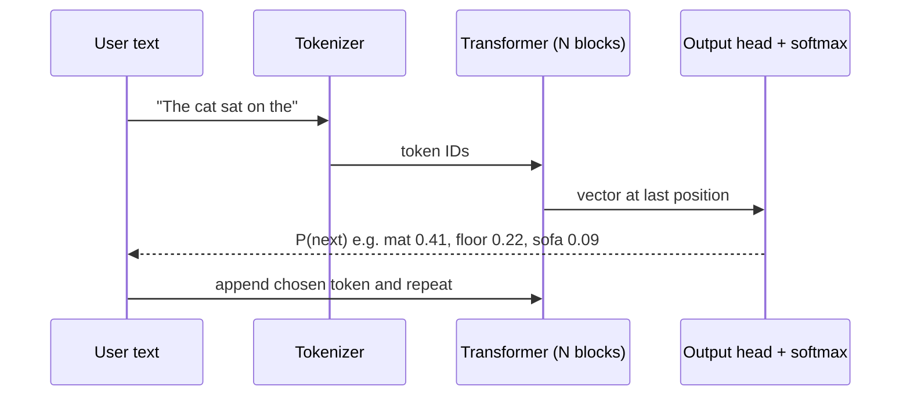

# Chapter 3 — Transformers and Embeddings

Every modern large language model — GPT, Claude, Gemini, Llama, Qwen, DeepSeek — is built on the same architecture: the **transformer**, introduced in the 2017 paper *Attention Is All You Need* (Vaswani et al., Google). This chapter opens the box. We follow one piece of text as it becomes **tokens**, then **vectors**, picks up **position** information, flows through **self-attention** and **feed-forward** layers, and finally turns into a probability for the next token.

Everything is shown with tiny numbers you can check by hand, plus runnable NumPy and PyTorch code. If you have read the ML Handbook's [Chapter 12 — Sequences, RNNs and Attention](../../../ml/chapters/12-sequences-rnns-and-attention/README.md), this chapter picks up exactly where RNNs stop; if not, nothing here depends on it.

**What you'll learn**

1. What a token is, and how **Byte-Pair Encoding (BPE)** builds a vocabulary — with a worked example.
2. **Embeddings**: why one-hot vectors fail, how dense vectors capture meaning, and how to measure similarity (dot product, cosine).
3. **Positional encoding**: why attention needs it, sinusoidal vs learned vs rotary (RoPE).
4. **Self-attention** step by step — Q, K, V with numbers small enough to check on paper.
5. **Multi-head attention**, and the grouped-query variants used in production.
6. The **transformer block**: residual connections, layer normalization, feed-forward network.
7. **Causal masking** and why it lets a decoder train on a whole sentence at once.
8. **Encoder-only vs decoder-only vs encoder-decoder** — BERT, GPT, T5.
9. A from-scratch PyTorch transformer block that matches PyTorch's own fused attention.

All code lives in `code/` and runs with the shared environment (PyTorch 2.x, NumPy). Outputs below are real.



---

## 3.1 Tokens and tokenization

### What it is
A **token** is the unit of text a language model reads and writes. It can be a whole word ("the"), a piece of a word ("ing", "token", "ization"), a punctuation mark, or even a single byte. A **tokenizer** is the program that splits text into tokens and maps each one to an integer **token ID** from a fixed list called the **vocabulary**.

Analogy: LEGO. Instead of manufacturing a unique brick for every possible object (a word-level vocabulary), you keep a box of reusable pieces and snap them together. Common words get a single big piece; rare words are assembled from smaller ones.

```
"Tokenization is fun!"  ->  ["Token", "ization", " is", " fun", "!"]  ->  [ 3404, 2065, 318, 1257, 0 ]   (IDs illustrative)
```

### The problem it solves
A neural network can only process numbers, so text must become integers. There are three obvious ways to cut text, and two of them fail:

| Approach | Vocabulary size | Problem |
|---|---|---|
| **Word-level** ("cat", "cats", "catlike" are separate entries) | Huge (hundreds of thousands+) | Any word not seen in training becomes an unknown token `<UNK>`. Typos, names, code, new slang all break. |
| **Character-level** (a, b, c, …) | Tiny (~100s) | Never unknown, but sequences get ~4–5x longer, so the model needs more compute and must learn spelling from scratch. |
| **Subword** (BPE, WordPiece, Unigram) | Medium (roughly 30K–200K in real models) | Frequent words stay whole, rare words split into known pieces. **Nothing is ever unknown.** This is what every modern LLM uses. |

### How it works — Byte-Pair Encoding (BPE)
BPE began as a 1994 data-compression trick and was adapted for neural machine translation by Sennrich et al. (2016). Training a BPE tokenizer:

1. Start with a vocabulary of single characters (or, in **byte-level BPE**, the 256 possible byte values). Split every word in the training corpus into those symbols. Mark word ends (here with `</w>`) so "est" at the end of a word differs from "est" inside one.
2. Count every **adjacent pair** of symbols across the corpus, weighted by how often each word appears.
3. **Merge** the most frequent pair into a new single symbol and add it to the vocabulary. Record this merge rule.
4. Repeat steps 2–3 until the vocabulary reaches the target size (e.g. 50,000 merges).

To **tokenize** new text, split into characters and replay the merge rules **in the order they were learned**.

### Worked example
Corpus word counts: `low` ×5, `lower` ×2, `newest` ×6, `widest` ×3.

First count pairs. "e"+"s" appears in *newest* (6) and *widest* (3) → 9, the most frequent, so it becomes the first merge. Then "es"+"t" (9), and so on.

```python
# code/bpe_demo.py (key parts)
def get_pair_counts(vocab):
    pairs = Counter()
    for symbols, freq in vocab.items():
        for a, b in zip(symbols, symbols[1:]):
            pairs[(a, b)] += freq            # weight by word frequency
    return pairs

def train_bpe(word_counts, num_merges):
    vocab = {tuple(w) + ("</w>",): c for w, c in word_counts.items()}
    merges = []
    for step in range(1, num_merges + 1):
        best, count = get_pair_counts(vocab).most_common(1)[0]
        vocab = merge_pair(best, vocab)      # fuse that pair everywhere
        merges.append(best)
    return merges, vocab

def tokenize(word, merges):                  # replay merges in learned order
    symbols = list(word) + ["</w>"]
    for pair in merges:
        ...                                   # fuse each occurrence of pair
    return symbols
```

Output:
```
corpus word counts: {'low': 5, 'lower': 2, 'newest': 6, 'widest': 3}
merge  1: 'e'      + 's'      (seen  9x)
merge  2: 'es'     + 't'      (seen  9x)
merge  3: 'est'    + '</w>'   (seen  9x)
merge  4: 'l'      + 'o'      (seen  7x)
merge  5: 'lo'     + 'w'      (seen  7x)
merge  6: 'n'      + 'e'      (seen  6x)
merge  7: 'ne'     + 'w'      (seen  6x)
merge  8: 'new'    + 'est</w>' (seen  6x)
merge  9: 'low'    + '</w>'   (seen  5x)
merge 10: 'w'      + 'i'      (seen  3x)

words after 10 merges:
  5x  low</w>
  2x  low e r </w>
  6x  newest</w>
  3x  wi d est</w>

tokenizing words (some never seen in training):
  lowest  -> ['low', 'est</w>']
  newer   -> ['new', 'e', 'r', '</w>']
  wider   -> ['wi', 'd', 'e', 'r', '</w>']
  slow    -> ['s', 'low</w>']
```

What to notice:
- **"lowest" was never in the corpus**, yet it becomes two meaningful pieces: `low` + `est</w>`. The tokenizer generalizes.
- Frequent words (`newest`, `low`) became single tokens; rare suffixes stay split.
- With more merges, `er</w>` would eventually become one token too. Real tokenizers run tens of thousands of merges over terabytes of text.

### Real tokenizer families

| Algorithm | How it picks merges / pieces | Used by (examples) |
|---|---|---|
| **Byte-level BPE** | BPE over raw UTF-8 bytes, so any string (emoji, Chinese, code) is representable with no unknown token | GPT-2 (vocab 50,257), later GPT models via OpenAI's `tiktoken` library, Llama 3 (~128K vocab) |
| **WordPiece** | Like BPE but merges the pair that most increases the training-data likelihood; continuation pieces are marked `##` | BERT (≈30K vocab) |
| **Unigram LM** (usually via Google's **SentencePiece** library) | Starts with a big candidate vocabulary and prunes the pieces that matter least | T5, ALBERT; SentencePiece also packages BPE (used by Llama 1/2, 32K vocab) |

SentencePiece treats the input as a raw stream and encodes spaces as a visible symbol (`▁`), which makes it language-agnostic (no need to pre-split words on spaces, which matters for Japanese or Chinese).

### Rules of thumb
- For typical English, **1 token ≈ 4 characters ≈ ¾ of a word**, so 100 tokens ≈ 75 words. It varies by tokenizer and language.
- Other languages, code, and numbers often need **more tokens per word**, so the same content costs more and fills the context window faster.
- Spaces usually attach to the *following* word: `" is"` and `"is"` are different tokens.
- **Special tokens** mark structure: start/end of text, padding, and in chat models the boundaries between system, user and assistant turns.

### Trade-offs

| Bigger vocabulary | Smaller vocabulary |
|---|---|
| Shorter sequences → less compute per sentence and more text fits in the context | Longer sequences |
| Larger embedding and output matrices (vocab × d_model parameters each) | Fewer parameters |
| Each rare token sees fewer training examples | Each token is well trained |

The industry trend has been toward larger vocabularies (GPT-2's ~50K → Llama 3's ~128K) mainly to encode multilingual text and code more efficiently.

### When not to use it
You don't choose a tokenizer for an existing model — **you must use the one the model was trained with**. Training your own only makes sense when you pre-train a model from scratch (e.g. for a specialized language or DNA sequences).

### Common mistakes
- **Budgeting in words or characters.** Limits and prices are in tokens. Count with the provider's tokenizer or token-counting endpoint.
- **Mixing tokenizers.** Token IDs from one model are meaningless to another.
- **Expecting character-level skills.** Because "strawberry" may be one or two tokens, models have historically struggled with "count the r's", reversing strings, or digit-by-digit arithmetic. The model never sees the letters directly.
- **Forgetting special tokens and chat templates** when calling an open-weights model directly — the model was trained with a specific format.

### Real-world examples
- OpenAI publishes `tiktoken` so developers can count tokens locally before sending a request.
- Hugging Face's `tokenizers` library (Rust) implements BPE, WordPiece and Unigram and is used by most open models.
- API pricing is per million input and output tokens at every major provider, which is why tokenization directly affects cost.

### In the interview
**30-second answer:** "LLMs work on tokens, which are subword units. A BPE tokenizer starts from bytes or characters and repeatedly merges the most frequent adjacent pair until it reaches the target vocabulary size. That keeps common words as single tokens while splitting rare words into known pieces, so there are no out-of-vocabulary words. In English one token is roughly four characters, and everything — context limits, latency, and price — is measured in tokens."

- *Why not word-level?* Unbounded vocabulary and unknown words; subwords handle new words, typos and code.
- *Why can LLMs struggle to count letters?* They see token IDs, not characters; a word may be one token, so the letters are never explicitly visible.
- *Why do non-English prompts cost more?* Tokenizers trained mostly on English split other scripts into more, smaller tokens.

### Self-check
1. In BPE training, which pair gets merged first? → The most frequent adjacent pair in the corpus (weighted by word counts).
2. Why can byte-level BPE encode any string? → Its base vocabulary is all 256 byte values, so any UTF-8 text can fall back to bytes.
3. Roughly how many tokens is a 750-word English essay? → About 1,000.
4. What does tokenizing a new word do with merges? → Applies the learned merges in the order they were learned.

### TL;DR
Text → subword tokens → integer IDs. BPE learns a vocabulary by repeatedly merging frequent pairs; nothing is ever out-of-vocabulary. Count, price and limit everything in tokens (~4 English characters each).

---

## 3.2 Embeddings

### What it is
An **embedding** is a list of numbers (a **vector**) that represents a token — or a sentence, image, or user — so that **things with similar meaning get similar vectors**. The number of entries is the **dimension** (e.g. 768 or 4,096).

Analogy: GPS coordinates for meaning. Paris and Lyon are close on a map; "cat" and "kitten" are close in embedding space.

### The problem it solves
The simplest numeric encoding is **one-hot**: with a vocabulary of V words, word *i* is a vector of length V with a 1 in position *i* and 0 everywhere else. Two problems:
1. **Size.** With a 100K vocabulary, each word is a 100K-long, almost all-zero vector.
2. **No meaning.** Every pair of one-hot vectors is **orthogonal** (dot product 0). "cat" is exactly as far from "kitten" as it is from "carburetor".

A **dense embedding** fixes both: a short vector (hundreds to thousands of numbers) where every dimension is used and distances carry meaning.

### How it works
1. The model owns an **embedding matrix** E of shape (vocab_size × d_model), where **d_model** is the model's vector width.
2. For token ID *i*, the embedding is simply **row i of E** — a table lookup. Mathematically, this is the same as `one_hot(i) @ E`, but a lookup is far cheaper.
3. E starts random and is **learned by backpropagation** together with the rest of the network. Tokens used in similar contexts get pushed toward similar vectors, because that helps predict the next token (the *distributional hypothesis*: "you shall know a word by the company it keeps").

### Measuring similarity

| Measure | Formula | Range | Notes |
|---|---|---|---|
| **Dot product** | a·b = Σ aᵢbᵢ | any | Grows with vector length. Used inside attention. |
| **Cosine similarity** | cos(a,b) = a·b / (‖a‖ ‖b‖) | −1 to 1 | Only the angle matters. The default for comparing text embeddings. |
| **Euclidean distance** | ‖a − b‖ = √Σ(aᵢ − bᵢ)² | 0 to ∞ | Straight-line distance; smaller = more similar. |

If vectors are **normalized** to length 1, cosine similarity equals the dot product, and ranking by Euclidean distance gives the same order as ranking by cosine. That is why vector databases often normalize once and then use fast dot products.

**Worked cosine example.** king = [0.9, 1.0, 0.7, 0], queen = [0.9, 1.0, −0.7, 0] (dimensions: royalty, is_person, maleness, is_food).
- Dot product: 0.81 + 1.0 − 0.49 + 0 = 1.32
- ‖king‖ = ‖queen‖ = √(0.81 + 1 + 0.49) = √2.3 ≈ 1.517
- cos = 1.32 / (1.517 × 1.517) = 1.32 / 2.3 ≈ **0.57**

```python
# code/embeddings_similarity.py (key parts)
def cosine(a, b):
    return float(a @ b / (np.linalg.norm(a) * np.linalg.norm(b)))

one_hot = np.eye(5)                         # every pair orthogonal
dense = np.array([[0.9, 1.0,  0.7, 0.0],    # king   [royalty, is_person, maleness, is_food]
                  [0.9, 1.0, -0.7, 0.0],    # queen
                  [0.1, 1.0,  0.7, 0.0],    # man
                  [0.1, 1.0, -0.7, 0.0],    # woman
                  [0.0, 0.0,  0.0, 1.0]])   # apple
target = dense[0] - dense[2] + dense[3]     # king - man + woman
E = rng.normal(size=(5, 4)).round(2)        # an embedding table
one_hot[idx] @ E == E[idx]                  # lookup == one-hot matmul
```

Output:
```
One-hot cosine similarity (no notion of meaning):
            king   queen     man   woman   apple
    king    1.00    0.00    0.00    0.00    0.00
   queen    0.00    1.00    0.00    0.00    0.00
     man    0.00    0.00    1.00    0.00    0.00
   woman    0.00    0.00    0.00    1.00    0.00
   apple    0.00    0.00    0.00    0.00    1.00

Dense cosine similarity (meaning lives in the geometry):
            king   queen     man   woman   apple
    king    1.00    0.57    0.85    0.32    0.00
   queen    0.57    1.00    0.32    0.85    0.00
     man    0.85    0.32    1.00    0.35    0.00
   woman    0.32    0.85    0.35    1.00    0.00
   apple    0.00    0.00    0.00    0.00    1.00

king - man + woman = [ 0.9  1.  -0.7  0. ] -> closest: queen

E[queen]            = [-0.54  0.36  1.3   0.95]
one_hot(queen) @ E  = [-0.54  0.36  1.3   0.95]
```

The hand-made dimensions are for teaching. In a real model, no single dimension means "royalty"; meaning is spread across many dimensions, and the famous king − man + woman ≈ queen result (word2vec, Mikolov et al., 2013) holds only approximately.

### Static vs contextual embeddings

| Kind | Example | "bank" in "river bank" vs "bank loan" |
|---|---|---|
| **Static** word embeddings | word2vec (2013), GloVe (2014) | Same vector — one per word |
| **Contextual** embeddings | Hidden states inside BERT, GPT | Different vectors — attention mixes in the surrounding words |
| **Sentence/document embeddings** | Sentence-BERT (2019), provider embedding APIs | One vector for a whole passage — used for search and RAG |

Inside a transformer, the lookup table gives the *static* starting vector; every attention layer then turns it into a more *contextual* one. **Embedding models** (a separate kind of model you call through an API or run locally) output one vector per text so that you can compare texts — the foundation of semantic search and retrieval-augmented generation ([Chapter 7](../07-embeddings-vector-databases-and-rag/README.md)).

### Trade-offs

| Higher dimension | Lower dimension |
|---|---|
| Can capture finer distinctions | Cheaper to store and search |
| More memory in a vector database (e.g. 1M docs × 3,072 floats × 4 bytes ≈ 12 GB) | May blur fine distinctions |

Some embedding models are trained so you can **truncate** the vector (Matryoshka representation learning) and trade a little quality for much less storage.

### When not to use it
- For exact matches (IDs, SKUs, error codes), keyword search (BM25) often beats embeddings. Many production systems use **hybrid search** — both.
- Embedding similarity is not truth: two sentences that contradict each other ("the drug is safe" / "the drug is not safe") can have very similar vectors.

### Common mistakes
- **Comparing vectors from different models** (or versions). Each model has its own coordinate system; re-embed everything when you switch.
- Using the raw dot product on unnormalized vectors and getting results biased toward long vectors.
- Embedding a query with one instruction/prefix and documents with another when the model expects a specific convention.

### Real-world examples
- Semantic search and RAG: documents and queries are embedded; nearest neighbours are retrieved.
- Recommendations: YouTube, Spotify and others embed users and items in the same space (see the ML Handbook's recommender chapter).
- Deduplication and clustering of support tickets or news articles.

### In the interview
**30-second answer:** "An embedding is a dense learned vector for a token or a piece of content, where geometric closeness means semantic similarity. In a transformer the embedding layer is a lookup table of shape vocab × d_model, learned with the rest of the model. We compare embeddings with cosine similarity; if the vectors are normalized, that's just a dot product, which vector databases exploit."

- *Why not one-hot?* Too big and every pair is orthogonal, so there's no similarity signal.
- *Cosine vs Euclidean?* Cosine ignores length; with unit vectors they rank identically.
- *Static vs contextual?* word2vec gives one vector per word; transformers produce a different vector per occurrence depending on context.

### Self-check
1. What is `one_hot(i) @ E`? → Row *i* of E — the same thing as a lookup.
2. Cosine of [1, 0] and [0, 1]? → 0 (orthogonal).
3. Why must you re-embed your corpus when changing embedding models? → Vectors from different models live in unrelated spaces.
4. Two vectors have cosine 0.95. Are the texts guaranteed to agree? → No; similarity ≠ agreement (negation is a classic failure).

### TL;DR
Embeddings turn IDs into dense vectors where distance means meaning. The embedding layer is a learned lookup table. Compare with cosine similarity (a dot product after normalization). Transformers make embeddings contextual.

---

## 3.3 Positional encoding

### What it is
Extra information added to each token's embedding that tells the model **where** the token sits in the sequence.

### The problem it solves
Self-attention (next section) compares every token with every other token using dot products. That operation is **permutation-invariant**: shuffle the input tokens and each token's output is the same, just shuffled. Without position information, "dog bites man" and "man bites dog" would look identical. RNNs got order for free by reading one token at a time; transformers read all tokens at once, so order must be injected.

### How it works — the main approaches

| Method | Idea | Used by |
|---|---|---|
| **Sinusoidal** (fixed) | Add a vector of sines and cosines of different frequencies to each embedding | Original 2017 Transformer |
| **Learned absolute** | A second lookup table: position p → a learned vector, added to the token embedding | BERT, GPT-2 (max 512 / 1,024 positions) |
| **RoPE** (rotary position embedding, Su et al., 2021) | Rotate the query and key vectors by an angle proportional to position, so their dot product depends on the **relative** distance | Llama, Mistral, Qwen and most modern open LLMs |
| **ALiBi** (Press et al., 2021) | Add a penalty to attention scores that grows with distance | BLOOM, MPT |

**Sinusoidal formula** for position *pos* and dimension pair *i*:

- PE(pos, 2i) = sin(pos / 10000^(2i / d_model))
- PE(pos, 2i+1) = cos(pos / 10000^(2i / d_model))

Each pair of dimensions is a clock hand turning at a different speed: the first pair turns fast (changes every position), later pairs turn very slowly. Together they give each position a unique fingerprint, like the hour, minute and second hands of a clock.

```python
# code/positional_encoding.py
def sinusoidal_pe(num_positions, d_model):
    pos = np.arange(num_positions)[:, None]
    i = np.arange(0, d_model, 2)[None, :]          # 0, 2, 4, ... (= 2i)
    angle = pos / np.power(10000, i / d_model)
    pe = np.zeros((num_positions, d_model))
    pe[:, 0::2] = np.sin(angle)
    pe[:, 1::2] = np.cos(angle)
    return pe
```

Output:
```
PE for positions 0..3, d_model=4:
[[ 0.     1.     0.     1.   ]
 [ 0.841  0.54   0.01   1.   ]
 [ 0.909 -0.416  0.02   1.   ]
 [ 0.141 -0.99   0.03   1.   ]]

Similarity (dot product) of position 10 with others:
  pos 10 . pos 10 =  32.00
  pos 10 . pos 11 =  30.92
  pos 10 . pos 12 =  28.30
  pos 10 . pos 15 =  23.50
  pos 10 . pos 20 =  21.05
  pos 10 . pos 40 =  17.07
```

Check row 1 by hand: sin(1) = 0.841, cos(1) = 0.540; the second pair uses 1/10000^(2/4) = 1/100, so sin(0.01) ≈ 0.01, cos(0.01) ≈ 1. Nearby positions have more similar encodings (32 → 30.9 → 28.3 …), which gives attention a sense of distance.


### Trade-offs

| | Sinusoidal | Learned absolute | RoPE / ALiBi (relative) |
|---|---|---|---|
| Extra parameters | None | max_len × d_model | None |
| Longer sequences than trained on | Defined, but quality drops | **Impossible** (no row for position 1,025 in GPT-2) | Degrades gracefully; RoPE can be stretched with scaling tricks (e.g. position interpolation, YaRN) |
| Encodes relative distance directly | Indirectly | No | Yes |

The context-window growth of LLMs (from 2K tokens in GPT-3 to hundreds of thousands, and 1M tokens or more in some models from 2024 onward) relied heavily on relative schemes like RoPE plus long-context training.

### Common mistakes
- Thinking the model "knows" order from the embeddings alone — it does not; remove positions and word order vanishes.
- Assuming a model can handle any length because the math allows it. Quality depends on the lengths seen in training.

### In the interview
**30-second answer:** "Attention is permutation-invariant, so we inject order. The original transformer added fixed sinusoids of different frequencies; BERT and GPT-2 learned a vector per position, which caps the length; most modern LLMs use RoPE, which rotates queries and keys so attention scores depend on relative distance, and which can be extended to longer contexts."

- *Why sines and cosines?* Unique per position, bounded in [−1, 1], and a fixed offset corresponds to a linear transformation, which makes relative positions easy to learn.
- *Why did GPT-2 have a hard 1,024-token limit?* Learned absolute positions: there is no embedding for position 1,025.

### Self-check
1. What happens to a transformer's output if you shuffle the input and there is no positional encoding? → Each token's output is unchanged, just shuffled — order is lost.
2. Which approaches add no parameters and encode relative distance directly in the attention score? → RoPE and ALiBi.
3. Is positional encoding added or concatenated in the original transformer? → Added to the token embedding (same dimension).

### TL;DR
Attention ignores order, so position is added: fixed sinusoids (2017), learned per-position vectors (BERT, GPT-2), or relative schemes like RoPE (modern LLMs), which also make long contexts easier.

---

## 3.4 Self-attention, step by step

### What it is
**Self-attention** lets every token look at every other token in the same sequence and pull in the information it needs. The output for each token is a **weighted average of the other tokens' information**, where the weights are computed on the fly from how relevant each token is.

In "The animal didn't cross the street because **it** was too tired", attention lets the vector for "it" draw heavily from "animal" — so after the layer, "it" carries the meaning of what it refers to.

### The problem it solves
Before transformers, RNNs passed information along one step at a time. Distant words had to survive many steps (they often faded), and the steps could not run in parallel. Attention connects **any two positions in one step** and processes the whole sequence **in parallel**, which is what made training on internet-scale data practical on GPUs.

### How it works — Query, Key, Value
Think of a library search:
- **Query (Q)** — what this token is looking for ("I'm a pronoun; who am I referring to?").
- **Key (K)** — the label each token advertises ("I'm a noun, an animal").
- **Value (V)** — the content each token hands over if chosen.

For an input matrix X (one row per token, width d_model):

1. **Project.** Q = X·W_Q, K = X·W_K, V = X·W_V, where the W's are learned matrices of shape (d_model × d_k).
2. **Score.** S = Q·Kᵀ — entry (i, j) is how well token *i*'s query matches token *j*'s key.
3. **Scale.** Divide by √d_k.
4. **Normalize.** Apply **softmax** to each row so the weights are positive and sum to 1: softmax(zᵢ) = e^zᵢ / Σⱼ e^zⱼ. In words: raise e (≈ 2.718) to the power of each score, which makes every value positive and exaggerates the gaps between them, then divide each result by the row total. Example: scores [0, 2] → [e⁰, e²] = [1, 7.39] → divide by 8.39 → weights [0.12, 0.88].
5. **Mix.** Output = weights · V — each token's output is the weighted average of all value vectors.

In one line: **Attention(Q, K, V) = softmax(Q·Kᵀ / √d_k) · V**

**Why divide by √d_k?** If the entries of q and k are roughly independent with variance 1, their dot product has variance d_k. With d_k = 64 the variance is 64, so raw scores typically spread about √64 = 8 times wider than with d_k = 1; the softmax would then saturate (one weight ≈ 1, the rest ≈ 0), and gradients would vanish. Dividing by √d_k (here 8) brings the variance back to about 1.

### Worked example with tiny numbers
Three tokens "the cat sat", d_model = 4, one head with d_k = 2.

```python
# code/attention_numpy.py (key parts)
X = np.array([[1., 0., 1., 0.],     # the
              [0., 1., 0., 1.],     # cat
              [1., 1., 1., 1.]])    # sat
W_Q = np.array([[1, 0], [0, 1], [1, 0], [0, 1]], dtype=float)
W_K = np.array([[0, 1], [1, 0], [0, 1], [1, 0]], dtype=float)
W_V = np.array([[1, 0], [0, 1], [1, 0], [0, 0]], dtype=float)
Q, K, V = X @ W_Q, X @ W_K, X @ W_V

def attention(Q, K, V, mask=None):
    scores = Q @ K.T / np.sqrt(Q.shape[-1])
    if mask is not None:
        scores = np.where(mask, scores, -np.inf)
    weights = softmax(scores, axis=-1)
    return weights @ V, weights
```

Output:
```
Q =
 [[2. 0.]
 [0. 2.]
 [2. 2.]]
K =
 [[0. 2.]
 [2. 0.]
 [2. 2.]]
V =
 [[2. 0.]
 [0. 1.]
 [2. 1.]]

raw scores Q.K^T =
 [[0. 4. 4.]
 [4. 0. 4.]
 [4. 4. 8.]]

scaled scores =
 [[0.    2.828 2.828]
 [2.828 0.    2.828]
 [2.828 2.828 5.657]]

attention weights (rows sum to 1) =
 [[0.029 0.486 0.486]
 [0.486 0.029 0.486]
 [0.053 0.053 0.894]]

output = weights @ V =
 [[1.029 0.971]
 [1.943 0.514]
 [1.894 0.947]]
```

Check row 1 ("the") by hand:
- Scores: q_the = [2, 0]; k_the = [0, 2] → 0; k_cat = [2, 0] → 4; k_sat = [2, 2] → 4.
- Scaled by √2 ≈ 1.414: [0, 2.828, 2.828].
- Softmax: e⁰ = 1, e^2.828 ≈ 16.9. Sum ≈ 34.8. Weights ≈ [0.029, 0.486, 0.486].
- Output: 0.029·[2, 0] + 0.486·[0, 1] + 0.486·[2, 1] = [1.03, 0.97]. ✓

So "the" ignores itself and draws half from "cat", half from "sat". In a trained model these weights reflect learned patterns (syntax, coreference, and so on).


### Cost
The score matrix is T × T for a sequence of T tokens, so attention costs **O(T² · d)** time and O(T²) memory per head per layer. Doubling the context quadruples that part of the work. This is why long contexts are expensive, and why techniques such as **FlashAttention** (Dao et al., 2022 — an exact attention algorithm that avoids storing the full T × T matrix in slow GPU memory), sparse or sliding-window attention, and the **KV cache** ([Chapter 4](../04-large-language-models/README.md), [Chapter 11](../11-llm-serving-and-inference/README.md)) exist.

### Trade-offs — attention vs recurrence

| | Self-attention | RNN / LSTM |
|---|---|---|
| Path between distant tokens | 1 step | T steps |
| Parallel over sequence in training | Yes | No |
| Cost per layer | O(T² · d) | O(T · d²) |
| Built-in notion of order | No (needs positional encoding) | Yes |

### Common mistakes
- Forgetting the √d_k scaling (training becomes unstable).
- Applying softmax over the wrong axis — it is **per query row**, over keys.
- Reading attention weights as a faithful explanation of the model's reasoning. They show where information flowed in one layer, not *why* the model decided something.

### In the interview
**30-second answer:** "Each token is projected into a query, key and value. Scores are query-key dot products, scaled by the square root of the key dimension, softmaxed per row, and used to take a weighted average of the values. It connects any two positions in one step and runs in parallel, but it's quadratic in sequence length."

- *Why scale by √d_k?* Keeps score variance ≈ 1 so softmax doesn't saturate and gradients survive.
- *Why separate Q, K and V matrices?* What a token looks for, how it advertises itself, and what it passes on are different roles; separate projections let the model learn each.
- *Complexity?* O(T²·d) time, O(T²) memory for the score matrix per head.

### Self-check
1. Shape of Q·Kᵀ for 10 tokens? → 10 × 10.
2. What do the rows of the attention-weight matrix sum to? → 1.
3. If all scores in a row are equal, what is the output? → The plain average of all value vectors.
4. What happens to cost when context grows from 4K to 8K tokens? → The attention score work grows ~4x.

### TL;DR
softmax(Q·Kᵀ/√d_k)·V: each token asks a question (Q), matches it against every token's label (K), and takes a relevance-weighted average of their content (V). Parallel and direct, but O(T²).

---

## 3.5 Multi-head attention

### What it is
Instead of one attention computation, run **h smaller ones in parallel** ("heads"), each with its own W_Q, W_K, W_V, then concatenate their outputs and mix them with an output matrix W_O.

### Why it matters
One softmax produces one weighting per token. But a word may need several things at once: its grammatical subject, the adjective describing it, the previous mention of the same entity. Separate heads can specialize — studies of trained models found heads that track the previous token, syntactic relations, or copying patterns.

### How it works
1. Choose h heads with d_head = d_model / h (original transformer: d_model = 512, h = 8, d_head = 64).
2. For each head, project X to Q, K, V of width d_head and run scaled dot-product attention.
3. **Concatenate** the h outputs back to width d_model.
4. Multiply by **W_O** (d_model × d_model) so the heads' results are mixed.

The total cost is about the same as one full-width head, because each head is narrower. Parameters: four d_model × d_model matrices (Q, K, V, O) = **4·d_model²** (plus biases).

From our NumPy demo, two heads with random weights (and the causal mask from Section 3.7, which is why the upper-right entries are 0) attend differently to the same input:

```
head 0 weights =
 [[1.    0.    0.   ]
 [0.372 0.628 0.   ]
 [0.313 0.372 0.314]]

head 1 weights =
 [[1.    0.    0.   ]
 [0.503 0.497 0.   ]
 [0.337 0.331 0.332]]

multi-head output shape: (3, 4)
```

### Production variants
During generation, a model stores every past token's keys and values (the **KV cache**). With many heads that cache gets large, so newer models share K and V across heads:

| Variant | Keys/values | Used by (examples) |
|---|---|---|
| **Multi-head (MHA)** | One K/V per head | Original Transformer, GPT-2, BERT |
| **Multi-query (MQA)** (Shazeer, 2019) | One K/V shared by all heads | PaLM, Falcon |
| **Grouped-query (GQA)** (Ainslie et al., 2023) | One K/V per group of heads | Llama 2 70B, Llama 3, Mistral |

GQA keeps most of MHA's quality while shrinking the KV cache several-fold — a big deal for serving cost ([Chapter 11](../11-llm-serving-and-inference/README.md)). DeepSeek-V2/V3 use a further variant, multi-head latent attention (MLA), which compresses K/V into a smaller latent vector.

### Common mistakes
- Thinking more heads always help. With fixed d_model, more heads means narrower heads; the original paper found quality dropped with too many.
- Forgetting W_O — without it, heads never exchange information inside the layer.

### In the interview
**30-second answer:** "Multi-head attention runs several narrower attention operations in parallel so different heads can capture different relationships, then concatenates them and mixes with an output projection. Cost is roughly that of one full-width head. For inference efficiency, modern LLMs use grouped-query attention, where groups of query heads share keys and values, which shrinks the KV cache."

- *Parameter count of an attention layer?* ≈ 4·d_model² (Q, K, V, O).
- *MQA vs GQA?* MQA shares one K/V across all heads (smallest cache, some quality loss); GQA shares per group (a middle ground).

### Self-check
1. d_model = 768 with 12 heads — what is d_head? → 64.
2. What does W_O do? → Mixes the concatenated head outputs back into one d_model vector.
3. Why does GQA matter at inference time? → It reduces the size of the KV cache and the memory traffic per generated token.

### TL;DR
Several narrow attention heads in parallel, concatenated and mixed by W_O. Heads specialize. GQA/MQA share keys and values to shrink the KV cache.

---

## 3.6 The transformer block

### What it is
The repeating unit of every transformer. A block = **multi-head attention** + a position-wise **feed-forward network (FFN)**, each wrapped with a **residual connection** and **layer normalization**. Models stack N identical blocks (6 in the original encoder, 12 in GPT-2 small and BERT-base, 32 in Llama-2-7B, and many more in frontier models).



### The three ingredients

**1. Residual (skip) connection: x + f(x).** Each sub-layer only has to learn a *change* to its input, not a whole new representation. Gradients can flow straight back through the "+" path, which makes networks with dozens of layers trainable (the idea comes from ResNets, 2015). You can think of the residual path as a shared "stream" that each layer reads from and writes into.

**2. Layer normalization.** For each token's vector separately, subtract its mean and divide by its standard deviation, then apply a learned scale γ and shift β: LN(x) = γ · (x − μ) / √(σ² + ε) + β. This keeps activations in a stable range. Unlike batch norm, it does not depend on other examples in the batch, which suits variable-length text.
- **Post-LN** (original 2017 paper): normalize *after* adding the residual.
- **Pre-LN** (GPT-2 onward, and most LLMs): normalize the *input* of each sub-layer, as in the diagram. Easier to train deep stacks without careful warm-up.
- **RMSNorm** (used by Llama and many others) skips the mean subtraction and only rescales — slightly cheaper, works as well in practice.

**3. Feed-forward network (FFN).** Two linear layers with a non-linearity, applied **to each token independently**: FFN(x) = W₂ · act(W₁·x + b₁) + b₂. The hidden layer is usually **4x wider** (512 → 2,048 in the original). The original used ReLU; GPT and BERT use GELU; Llama-style models use **SwiGLU**, a gated variant with three weight matrices instead of two, so its hidden layer is made about 8/3·d wide (not 4·d) to keep the parameter count roughly the same. A common intuition: attention moves information *between* tokens, and the FFN processes it *within* each token — much of the model's factual knowledge seems to be stored in FFN weights.

**Parameter count per block** ≈ attention 4·d² + FFN 2·(d × 4d) = 8·d² → **≈ 12·d²** (ignoring biases and norms). For GPT-3 (d_model = 12,288, 96 layers): 12 × 12,288² × 96 ≈ 174 billion — close to its advertised 175B. The FFN holds about two-thirds of the parameters.

**Mixture of Experts (MoE)**, used by Mixtral, DeepSeek-V3, Llama 4 and others, replaces the single FFN with many "expert" FFNs and a small router that sends each token to only a few of them. Total parameters grow a lot; compute per token grows little.

### From-scratch PyTorch block

```python
# code/mini_transformer_torch.py (key parts)
class MultiHeadSelfAttention(nn.Module):
    def __init__(self, d_model, n_heads):
        super().__init__()
        self.h, self.d_head = n_heads, d_model // n_heads
        self.qkv = nn.Linear(d_model, 3 * d_model)   # W_Q, W_K, W_V in one matrix
        self.out = nn.Linear(d_model, d_model)       # W_O

    def forward(self, x, causal=True):
        B, T, C = x.shape
        q, k, v = self.qkv(x).split(C, dim=-1)
        q, k, v = (t.view(B, T, self.h, self.d_head).transpose(1, 2) for t in (q, k, v))
        scores = q @ k.transpose(-2, -1) / self.d_head ** 0.5       # (B, h, T, T)
        if causal:
            mask = torch.tril(torch.ones(T, T, dtype=torch.bool))
            scores = scores.masked_fill(~mask, float("-inf"))
        y = scores.softmax(dim=-1) @ v
        return self.out(y.transpose(1, 2).contiguous().view(B, T, C))

class TransformerBlock(nn.Module):              # pre-LayerNorm, GPT-2 style
    def __init__(self, d_model, n_heads, d_ff):
        super().__init__()
        self.ln1, self.ln2 = nn.LayerNorm(d_model), nn.LayerNorm(d_model)
        self.attn = MultiHeadSelfAttention(d_model, n_heads)
        self.ffn = nn.Sequential(nn.Linear(d_model, d_ff), nn.GELU(), nn.Linear(d_ff, d_model))

    def forward(self, x):
        x = x + self.attn(self.ln1(x))          # residual around attention
        x = x + self.ffn(self.ln2(x))           # residual around FFN
        return x

# main: compare with torch.nn.functional.scaled_dot_product_attention(..., is_causal=True),
# edit the last token and check earlier outputs, count parameters.
```

Output:
```
max |ours - torch SDPA| = 1.19e-07
per-position change after editing the last token: [0.0, 0.0, 0.0, 0.0, 10.0]
input shape: (2, 5, 16) -> output shape: (2, 5, 16)
params: attention=1088, ffn=2128, layernorms=64, total=3280
rule of thumb 12*d_model^2 = 3072
```

What each line shows:
- Our hand-written attention matches PyTorch's fused kernel `scaled_dot_product_attention` to floating-point precision (1e-7). In real code, use the built-in: it dispatches to FlashAttention-style kernels on GPUs.
- Changing the last token changes **only** the last position's output — the causal mask works (next section).
- The block keeps the shape (B, T, d_model), which is why blocks can be stacked.
- 3,280 parameters vs the 12·d² estimate of 3,072; the difference is biases and LayerNorm parameters.

### Common mistakes
- Dropping the residual connections (deep stacks then fail to train).
- Normalizing over the batch instead of over the feature dimension.
- Assuming the FFN mixes tokens. It does not — only attention does.

### In the interview
**30-second answer:** "A transformer block is multi-head self-attention followed by a position-wise feed-forward network, each wrapped in a residual connection with layer norm — modern LLMs use pre-norm, often RMSNorm, and a gated SwiGLU FFN with a hidden layer several times wider than the model. Attention moves information between tokens, the FFN transforms each token. Per block it's about 12·d² parameters, two-thirds in the FFN."

- *Why residuals?* Easy gradient flow and each layer only learns an update.
- *Pre-LN vs post-LN?* Pre-LN is more stable for deep models and doesn't need as delicate a warm-up.
- *What is MoE?* Multiple expert FFNs with a router picking a few per token — more parameters at similar per-token compute.

### Self-check
1. Which sub-layer lets tokens exchange information? → Attention (the FFN is per-token).
2. Roughly how many parameters in a block with d_model = 1,024? → 12 × 1,024² ≈ 12.6M.
3. What does LayerNorm normalize over? → The features of each token vector.
4. Why does the output shape equal the input shape? → So blocks can be stacked and residuals can be added.

### TL;DR
Block = x + Attention(LN(x)), then x + FFN(LN(x)). Residuals keep deep stacks trainable, LayerNorm keeps them stable, the FFN (≈⅔ of parameters) processes each token. Stack N of them.

---

## 3.7 Causal masking

### What it is
A **causal mask** (or look-ahead mask) blocks each position from attending to positions **after** it. Token *i* can only use tokens 0…*i*.

### The problem it solves
A decoder LLM is trained to predict the next token. If position 3 could see position 4 during training, it would simply copy the answer. The mask enforces "no peeking at the future".

It also enables a key efficiency: for a training sentence of T tokens, **one forward pass produces T predictions at once** — position 0 predicts token 1, position 1 predicts token 2, and so on — each seeing only its own past. This parallel next-token training (a form of *teacher forcing*: the true previous tokens are fed in, not the model's own guesses) is a major reason transformers train so much faster than RNNs.

### How it works
1. Build a lower-triangular boolean matrix of shape T × T (1 = allowed).
2. Before softmax, set every disallowed score to −∞.
3. Softmax turns −∞ into weight 0.

```
causal mask =
 [[1 0 0]
 [1 1 0]
 [1 1 1]]
causal attention weights =
 [[1.    0.    0.   ]
 [0.944 0.056 0.   ]
 [0.053 0.053 0.894]]
```

The first token can only attend to itself (weight 1). The last row is unchanged from the unmasked version because the last token could already see everything. The PyTorch test above confirmed the effect: editing the last token left outputs at positions 0–3 exactly unchanged.

Other masks you will meet:
- **Padding mask** — when batching sentences of different lengths, pad tokens are masked out so real tokens ignore them.
- **Bidirectional (no mask)** — encoders like BERT let every token see every other token.

### Common mistakes
- Masking with 0 instead of −∞ (a 0 score still gets positive weight after softmax).
- Applying the mask after softmax (rows then no longer sum to 1).
- Using a bidirectional model for generation — it was never trained to predict without the future.

### In the interview
**30-second answer:** "Decoder-only models apply a lower-triangular mask so each position only attends to earlier positions, by setting future scores to minus infinity before the softmax. That prevents cheating on next-token prediction and lets one forward pass train on every position of a sequence in parallel."

- *At inference time, is the mask still needed?* With a KV cache you process one new token that attends to all cached past tokens, so there's no future to hide; the mask matters during training and prompt processing (prefill).

### Self-check
1. Shape of the mask for T = 5? → 5 × 5 lower-triangular.
2. How many next-token predictions does one training sequence of 1,000 tokens give? → 999 — one for every position that has a next token — all in a single forward pass.
3. Does BERT use a causal mask? → No, it is bidirectional.

### TL;DR
Set future scores to −∞ before softmax. No peeking, and every position trains in parallel.

---

## 3.8 Encoder vs decoder vs encoder-decoder

### What it is
The original transformer had two halves: an **encoder** that reads the input with bidirectional attention, and a **decoder** that generates the output one token at a time with causal attention plus **cross-attention** to the encoder's output. Later models kept one or both halves.



**Cross-attention**: queries come from the decoder; keys and values come from the encoder's output. It is how a translation decoder "looks at" the source sentence.

### Comparison

| | Encoder-only | Decoder-only | Encoder-decoder |
|---|---|---|---|
| Attention | Bidirectional | Causal | Encoder bidirectional; decoder causal + cross-attention |
| Pre-training objective | **Masked language modeling**: hide ~15% of tokens, predict them | **Next-token prediction** | Reconstruct corrupted spans (T5), denoising (BART) |
| Best at | Understanding: classification, NER, embeddings, reranking | Generation of any kind; with scale, nearly everything | Input → output transformations: translation, summarization |
| Classic models | BERT (Google, 2018; base 110M, large 340M params), RoBERTa | GPT-1/2/3 (OpenAI 2018/2019/2020), and today's chat LLMs | Original Transformer (2017), T5 (Google, 2019), BART (Meta, 2019) |
| Generates text? | Not naturally | Yes | Yes |

### Why decoder-only won for LLMs
- **One simple objective** (predict the next token) works on any raw text, no labels needed.
- **Every task can be phrased as continuation**: "Translate to French: … →", "Summary: …".
- It scales predictably (Chapter 4's scaling laws), and one architecture serves chat, code, reasoning and tool use.
- Encoder models remain very much alive where you need **fast, cheap understanding**: most embedding and reranking models used in search and RAG are encoder-based.

### When not to use each
- Don't use an encoder-only model to generate text.
- Don't use a large decoder LLM for a high-volume classification task that a small fine-tuned encoder can do at a fraction of the cost and latency.

### Common mistakes
- Saying "GPT uses the transformer encoder" — GPT is decoder-only (without cross-attention).
- Assuming encoder-decoder is obsolete — it is still used for translation and speech (e.g. OpenAI's Whisper speech-recognition model is encoder-decoder).

### Real-world examples
- Google Search began using BERT for query understanding in 2019.
- Sentence-embedding models used in vector search are mostly encoders.
- ChatGPT, Claude, Gemini, Llama: decoder-only (Gemini and others also accept images and audio, covered in Chapter 4).

### In the interview
**30-second answer:** "Encoder-only models like BERT use bidirectional attention and masked-token training — great for classification and embeddings. Decoder-only models like GPT use causal attention and next-token prediction — they generate, and at scale they handle almost any task as text continuation, which is why LLMs are decoder-only. Encoder-decoder models like T5 encode the input bidirectionally and generate the output with cross-attention — natural for translation and summarization."

- *What is cross-attention?* Decoder queries attend over encoder keys/values.
- *Which would you use for semantic search embeddings?* Usually an encoder-based embedding model — cheaper and trained for that purpose.

### Self-check
1. Which architecture uses masked language modeling? → Encoder-only (BERT).
2. Where do the keys and values of cross-attention come from? → The encoder output.
3. Is Whisper encoder-only, decoder-only or encoder-decoder? → Encoder-decoder.

### TL;DR
Encoder (BERT) = understand, bidirectional. Decoder (GPT) = generate, causal. Encoder-decoder (T5) = transform input to output via cross-attention. LLMs are decoder-only; embedding/reranking models are often encoders.

---

## 3.9 Putting it together: from text to the next token

A decoder-only LLM forward pass, end to end:

1. **Tokenize** the text → IDs, e.g. 7 tokens.
2. **Embed** → a 7 × d_model matrix (plus positional information, or RoPE inside attention).
3. Pass through **N transformer blocks** with causal masking. Shape stays 7 × d_model.
4. Apply a **final layer norm**.
5. **Output head (unembedding)**: multiply each position's vector by a d_model × vocab_size matrix → **logits**, one score per vocabulary token. Many models **tie** this matrix to the embedding matrix (reuse Eᵀ) to save parameters.
6. **Softmax** the last position's logits → a probability for every possible next token.
7. Choose a token (greedy or sampling — [Chapter 4](../04-large-language-models/README.md)), append it, and repeat.

Training uses the same pass: compare the predicted distribution at every position to the actual next token with **cross-entropy loss** (−log of the probability assigned to the correct token), and backpropagate through everything — including the embedding table.



(The probabilities in the diagram are illustrative.)

### Transformers vs RNNs in one table
(Details in the ML Handbook, [Chapter 12](../../../ml/chapters/12-sequences-rnns-and-attention/README.md).)

| | RNN/LSTM | Transformer |
|---|---|---|
| Reads tokens | One at a time | All at once |
| Long-range dependencies | Fade over many steps | One attention hop |
| Training parallelism | Low | High (GPU-friendly) |
| Memory of the past at inference | Fixed-size hidden state | Grows with context (KV cache) |
| Cost vs sequence length | Linear | Quadratic attention |

That last row explains a live research direction: **state-space models** (e.g. Mamba, 2023) and hybrid architectures try to get RNN-like linear cost with transformer-like quality.

---

## Chapter TL;DR

- **Tokens**: subword pieces from BPE (or WordPiece/Unigram); ~4 English characters each; everything is counted and priced in tokens.
- **Embeddings**: a learned lookup table mapping IDs to dense vectors; closeness = meaning; compare with cosine similarity.
- **Positional encoding**: attention ignores order, so add sinusoids, learned positions, or (modern) rotate Q/K with RoPE.
- **Self-attention**: softmax(QKᵀ/√d_k)V — relevance-weighted mixing across all tokens, in parallel, O(T²).
- **Multi-head**: several narrow heads specialize; GQA/MQA share K/V to shrink the KV cache.
- **Block**: pre-norm attention + FFN, each with a residual; ≈12·d² parameters; stacked N times; MoE swaps the FFN for routed experts.
- **Causal mask**: no peeking at the future; trains on every position in one pass.
- **Architectures**: encoder (BERT, understanding), decoder (GPT/Claude/Llama, generation), encoder-decoder (T5/Whisper, transformation).

## Further reading
- Vaswani et al., *Attention Is All You Need* (2017).
- Jay Alammar, *The Illustrated Transformer* (blog, visual walkthrough).
- Andrej Karpathy, *Neural Networks: Zero to Hero* — "Let's build GPT" and "Let's build the GPT Tokenizer" lectures.
- Sebastian Raschka, *Build a Large Language Model (From Scratch)* — chapters on tokenization, attention and the GPT architecture.
