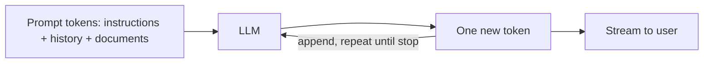
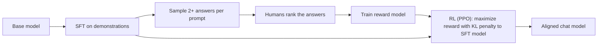
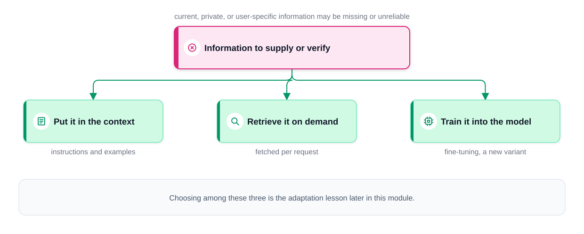
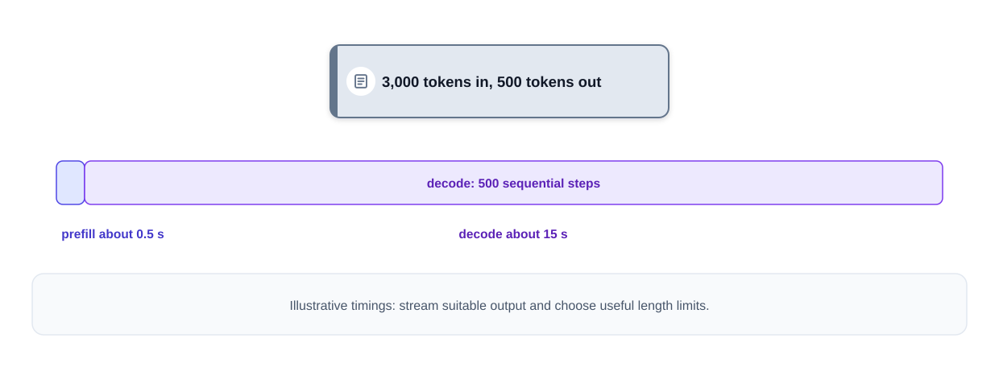

# Chapter 4 — Large Language Models

[Chapter 3](../03-transformers-and-embeddings/README.md) built the transformer. This chapter answers what happens when you make one enormous, train it on a large fraction of the public internet, and then teach it to follow instructions. The result — a **large language model (LLM)** — powers ChatGPT, Claude, Gemini, Copilot and thousands of products built on their APIs.

We cover the LLM as a *model* (how it is trained and why scale works) and as a *system component* (how it behaves when you build on it: latency, cost, context limits, failure modes). Interviewers probe both.

**What you'll learn**

1. What an LLM is, the GPT lineage, and how it differs from earlier NLP models.
2. **Next-token prediction** — trained end to end on a tiny CPU-sized GPT.
3. **Pretraining data and scale**, and **scaling laws** (Kaplan, Chinchilla's ~20 tokens per parameter).
4. **Post-training**: instruction tuning (SFT), **RLHF**, **DPO**, and RL from verifiable rewards.
5. **Decoding**: greedy, beam search, temperature, top-k, top-p — with a runnable demo.
6. **Context windows**, statelessness, and why chat history cost grows quadratically.
7. **Prefill vs decode**, TTFT/TPOT, and the **KV cache**.
8. **Capabilities and limits**: hallucination, reasoning, knowledge cutoff, prompt injection.
9. **Reasoning models**, **multimodal** models, **open vs closed** models, the **model landscape** (dated September 2026), and next-generation trends.

All code lives in `code/` and runs on CPU in seconds. Outputs below are real.

> **About dates.** Model facts change monthly. Everything tied to a specific model is marked with a date; check vendor documentation before relying on a number.

---

## 4.1 What an LLM is

### What it is
A **large language model** is a neural network — almost always a decoder-only transformer — trained on a huge amount of text to **predict the next token**. "Large" refers to both the number of **parameters** (learned numbers; billions to trillions) and the amount of training text (trillions of tokens).

Analogy: your phone keyboard's word suggestion, scaled up by many orders of magnitude. The keyboard has seen your messages; an LLM has seen books, websites, code and papers, so its "suggestions" can continue an essay, a proof, or a Python function.

An important honesty note: the model learns **statistical patterns of language** extremely well. Whether that amounts to "understanding" is debated; what matters in practice is that it produces fluent, often correct text — and sometimes fluent, *incorrect* text, with no built-in signal telling the two apart.

### The system-design view: a function from tokens to tokens
For building products, treat the LLM as a component with a simple contract:



- **Input:** a sequence of tokens called the **prompt** (system instructions, the conversation so far, retrieved documents).
- **Output:** one token at a time. Each new token is appended and fed back in — this is **autoregressive** generation.
- Consequences you design around: long answers take longer (one step per token), **streaming** exists so users can read while the model writes, and pricing has two line items (input tokens and output tokens).

### The GPT lineage (and why it matters)

| Model (OpenAI) | Year | What changed |
|---|---|---|
| GPT-1 | 2018 | Showed that generative pre-training on unlabeled text, followed by fine-tuning, beats task-specific models |
| GPT-2 | 2019 | 1.5B parameters; surprisingly coherent long text; staged release over misuse concerns |
| GPT-3 | 2020 | 175B parameters, 300B training tokens; **few-shot learning from examples in the prompt** without any fine-tuning |
| InstructGPT / ChatGPT | 2022 | Instruction tuning + RLHF made the model follow requests; ChatGPT (Nov 2022) brought LLMs to the public |
| GPT-4 | 2023 | Large gains in reasoning and factual accuracy, stronger multilingual ability, image input |
| GPT-4o, o1, GPT-5 and later | 2024–2026 | Native multimodality (text, image, audio), much longer context windows, and separate **reasoning** modes that spend extra computation thinking before answering |

Other labs followed similar arcs (Section 4.14).

### How LLMs differ from earlier NLP
- **Scale.** Training sets grew from millions of words to trillions of tokens; models from millions to hundreds of billions of parameters.
- **Architecture.** Transformers process a whole sequence in parallel with attention instead of word by word (Chapter 3), capturing long-range context and training efficiently on GPUs.
- **Pre-train once, adapt many times.** One general model is pre-trained on broad text, then adapted — by fine-tuning, by instructions and examples in the prompt, or by retrieval — instead of training a new model per task.

### Real-world uses
| Use | Example |
|---|---|
| Chat assistants and customer support | Answering routine questions, triaging tickets, drafting replies for human agents |
| Code generation | GitHub Copilot, Claude Code, Cursor: completing lines, writing functions from descriptions, fixing bugs |
| Summarization | Condensing reports, meeting transcripts, research papers, legal documents |
| Writing and creative work | Drafting blog posts, product descriptions, social posts; brainstorming plots and characters |
| Extraction and classification | Turning emails or invoices into structured JSON; routing and tagging |
| Agents | Models that call tools and act in multi-step loops ([Chapter 9](../09-ai-agents/README.md)) |

### TL;DR
An LLM is a giant decoder-only transformer trained to predict the next token. For system design: tokens in, one token out at a time, stateless, priced per token, sometimes confidently wrong.

---

## 4.2 Next-token prediction

### What it is
Given the tokens so far, the model outputs a **probability for every token in its vocabulary**. Generation = pick one, append it, repeat.

After "I love", a model might assign: *chocolate* 30%, *music* 24%, *coding* 18%, *you* 13%, … *taxes* 1%. The context decides the ranking: after "As a Python developer, I love", *coding* would move up.

### Why it matters
This one objective is **self-supervised**: every position of every document provides a free training example ("given these tokens, the next one is X"), so no human labels are needed. To predict well across all of the internet, a model must implicitly learn grammar, facts, style, some reasoning, and code semantics. That is the core bet behind LLMs.

### How it works
1. **Input:** a window of tokens, e.g. `[The, cat, sat, on, the]`.
2. **Targets:** the same sequence **shifted by one**: `[cat, sat, on, the, mat]`. With a causal mask (Chapter 3), one forward pass yields a prediction at every position.
3. **Loss:** **cross-entropy** = −log P(correct next token), averaged over positions. If the model gives the right token probability 0.5, the loss is −ln 0.5 = 0.69; at 0.9 it is 0.105; at 0.01 it is 4.6.
4. **Perplexity** = e^loss — roughly "how many tokens the model is choosing between". A uniform guess over V tokens has loss ln V and perplexity V.
5. **Backpropagate** and update all parameters. Repeat over trillions of tokens.
6. **At inference**, the model produces a distribution for the last position only; a **decoding strategy** (Section 4.7) picks the token.

### Code: a tiny GPT trained on a toy "internet"
The script generates 400 random sentences from a tiny grammar ("the cat saw a dog.", "a bird sat on the log.") and trains a 2-layer, character-level GPT for 400 steps.

```python
# code/tiny_gpt.py (key parts)
class TinyGPT(nn.Module):
    def __init__(self):
        super().__init__()
        self.tok = nn.Embedding(V, D)             # token embeddings
        self.pos = nn.Embedding(T, D)             # learned positions (GPT-2 style)
        self.blocks = nn.Sequential(*[Block() for _ in range(L)])   # causal transformer blocks
        self.ln = nn.LayerNorm(D)
        self.head = nn.Linear(D, V)               # logits over the vocabulary

def batch(bs=32):
    ix = torch.randint(len(data) - T - 1, (bs,))
    x = torch.stack([data[i:i + T] for i in ix])
    y = torch.stack([data[i + 1:i + T + 1] for i in ix])   # targets = inputs shifted by one
    return x, y

for step in range(401):
    x, y = batch()
    loss = F.cross_entropy(model(x).reshape(-1, V), y.reshape(-1))
    opt.zero_grad(); loss.backward(); opt.step()

@torch.no_grad()
def generate(model, prompt, n, temperature=1.0):
    idx = torch.tensor([encode(prompt)])
    for _ in range(n):
        logits = model(idx[:, -T:])[:, -1, :]     # only the last position matters
        nxt = logits.argmax(-1, keepdim=True) if temperature == 0 else \
              torch.multinomial(F.softmax(logits / temperature, -1), 1)
        idx = torch.cat([idx, nxt], dim=1)        # append and repeat
    return decode(idx[0].tolist())
```

Output:
```
vocab=18 chars, params=104,466
loss of a uniform guess = ln(18) = 2.890
step   0  loss 3.028  perplexity 20.65
step 100  loss 0.239  perplexity  1.27
step 200  loss 0.215  perplexity  1.24
step 300  loss 0.215  perplexity  1.24
step 400  loss 0.214  perplexity  1.24
trained in 8.1s
P(next char | 'the cat sat on the '): {'m': 0.47, 'l': 0.382, 'c': 0.142}
greedy     : 'the dog saw the mat. the cat sat on the mat. the'
sample T=1 : 'the dog sat on a dog. the cat saw the log. the c'
```

What to notice:
- The loss starts near ln(18), the uniform-guess level, and falls fast. It cannot reach 0 because the data is genuinely random at some positions.
- After "the cat sat on the ", the grammar allows *mat*, *log* or *cat* (1/3 each). The model has learned that exactly those three letters are plausible — its estimates (0.47 / 0.38 / 0.14) are imperfect after only 400 steps, which is a small-scale picture of how real LLMs are **calibrated but not perfectly**.
- Greedy decoding always takes the top letter; sampling produces varied, still grammatical sentences. Real LLMs are this loop with ~100,000-token vocabularies, billions of parameters and trillions of training tokens.

(The training time depends on your CPU, and the sampled line may differ slightly across PyTorch versions; the greedy line is deterministic.)

### Common mistakes
- Thinking the model retrieves stored sentences. It generates token by token from learned probabilities, which is why it can produce text that never existed — both creative text and false "facts".
- Confusing training loss with task quality. Lower loss generally helps, but usefulness depends on post-training (Sections 4.5–4.6).

### In the interview
**30-second answer:** "An LLM is trained with self-supervised next-token prediction: inputs are token windows, targets are the same tokens shifted by one, and the loss is cross-entropy. With a causal mask every position is a training example. At inference it outputs a distribution over the vocabulary for the next token, a decoding strategy picks one, and it's appended and fed back — autoregressive generation."

- *What is perplexity?* e^(average cross-entropy); lower is better; the effective number of choices.
- *Why is generation slow compared to reading the prompt?* The prompt is processed in parallel; output tokens are produced one sequential step at a time (Section 4.9).

### Self-check
1. Loss when the correct token got probability 0.25? → −ln 0.25 ≈ 1.386.
2. What are the targets for input `[a, b, c]` from text "a b c d"? → `[b, c, d]`.
3. Why is pre-training called self-supervised? → The labels (next tokens) come from the text itself.

### TL;DR
Predict the next token, score with cross-entropy, repeat over trillions of tokens. Generate by sampling a token and feeding it back in.

---

## 4.3 Pretraining: data and scale

### What it is
**Pretraining** is the first and most expensive stage: next-token prediction over a massive, mixed corpus. The output is a **base model** (also called a foundation or pretrained model) that continues text but does not reliably follow instructions.

### How it works
1. **Collect** text: web crawls (Common Crawl is the usual starting point), books, Wikipedia, scientific papers, code (e.g. GitHub), math, multilingual data, and increasingly **synthetic data** generated by other models.
2. **Filter** for quality: remove spam, boilerplate, adult or toxic content, and machine-generated junk; classifiers often score "educational quality".
3. **Deduplicate** at document and near-duplicate level — duplicated text wastes compute and increases memorization.
4. **Remove sensitive data** (e.g. personal information) and respect licensing and opt-out signals as policy requires.
5. **Mix** sources in chosen proportions (e.g. more code improves reasoning-style tasks), then **tokenize**.
6. **Train** on thousands of GPUs/TPUs for weeks to months, with data, tensor and pipeline parallelism, checkpointing, and constant monitoring for loss spikes.

### Scale in numbers (publicly reported)

| Model | Parameters | Training tokens |
|---|---|---|
| GPT-3 (2020) | 175B | ~300B |
| Chinchilla (DeepMind, 2022) | 70B | 1.4T |
| Llama 2 (Meta, 2023) | 7B–70B | 2T |
| Llama 3 (Meta, 2024) | 8B–405B | 15T+ |

Frontier labs no longer publish these numbers for their flagship models, so treat any figure you see for them as an estimate. Open datasets give a sense of scale: Hugging Face's FineWeb (2024) is about 15 trillion tokens of filtered web text.

### Trade-offs and limits
- **Data quality beats raw quantity** — well-filtered data trains a better model at the same compute.
- **The "data wall":** high-quality human text is finite, which is one reason for synthetic data and for spending compute at inference time instead (Section 4.11).
- **Knowledge freezes** at the data cutoff (Section 4.10).

### TL;DR
Pretraining = next-token prediction over trillions of filtered, deduplicated tokens from web, books and code. It produces a base model that knows a lot but doesn't yet behave like an assistant.

---

## 4.4 Scaling laws

### What it is
**Scaling laws** are empirical formulas showing that a language model's loss falls **smoothly and predictably** — as a power law — as you increase parameters (N), training tokens (D), and compute (C).

### Why it matters
They turned model building from guesswork into planning. Labs train many small models, fit the curve, and predict how a model 100x bigger will do before spending the money. They also answer the key budgeting question: **for a fixed compute budget, how big should the model be and how much data should it see?**

### How it works
1. **Compute rule of thumb:** training a dense transformer costs **C ≈ 6·N·D** FLOPs (about 2 for the forward pass and 4 for the backward pass, per parameter per token).
   - GPT-3: 6 × 175×10⁹ × 300×10⁹ ≈ 3.15×10²³ FLOPs.
2. **Kaplan et al. (OpenAI, 2020)** found power laws in N, D and C and concluded that model size mattered most — so the next generation of models grew very large on relatively little data (GPT-3: fewer than 2 tokens per parameter).
3. **Hoffmann et al. — "Chinchilla" (DeepMind, 2022)** redid the analysis with better-tuned training runs and found parameters and data should grow **in equal proportion**. The widely used takeaway: a compute-optimal model sees **about 20 training tokens per parameter**.
   - Their test: Chinchilla (70B params, 1.4T tokens) vs their own Gopher (280B, 300B tokens) at a similar compute budget. The 4x smaller Chinchilla won on almost every benchmark — and was 4x cheaper to run.
4. Combining C = 6ND with D = 20N gives **N ≈ √(C/120)**. Step by step: substitute D = 20N into C = 6·N·D to get C = 6·N·20N = 120·N², so N² = C/120 and N = √(C/120). Example: C = 1.2×10²³ FLOPs → N² = 10²¹ → N ≈ 3.2×10¹⁰ (32B parameters) and D = 20N ≈ 630B tokens.

**What "power law" means here.** A term like A/N^α shrinks by the same *factor* every time N is multiplied by the same amount. With α = 0.34, multiplying the parameter count by 10 divides that term by 10^0.34 ≈ 2.2. So each 10x in size buys roughly the same *relative* improvement — which is why progress needs multiplicative, not additive, increases in budget.

The Chinchilla paper also fitted a loss formula L(N, D) = E + A/N^α + B/D^β. Read it as three parts: E is the **irreducible loss** (the randomness of language itself, which no model can remove); A/N^α is the extra loss from having too few parameters; B/D^β is the extra loss from seeing too little data. Growing N or D shrinks its own term but never gets below E. The script uses the reported constants (E = 1.69, A = 406.4, B = 410.7, α = 0.34, β = 0.28):

```python
# code/scaling_laws.py (key parts)
E, A, B, ALPHA, BETA = 1.69, 406.4, 410.7, 0.34, 0.28

def loss(N, D):
    return E + A / N**ALPHA + B / D**BETA

for C in [1e21, 1e23, 5.76e23, 1e25]:
    N = np.sqrt(C / 120)                     # 20 tokens per parameter
    print(C, N, 20 * N)
```

Output:
```
Roughly the same compute budget, two ways to spend it:
  Gopher-like  (280B params, 300B tokens): compute=5.04e+23  predicted loss=1.993
  Chinchilla   ( 70B params, 1.4T tokens): compute=5.88e+23  predicted loss=1.937

Compute-optimal size with the ~20 tokens/parameter rule (N = sqrt(C/120)):
  C=1.00e+21 FLOPs -> N ~     2.9B params, D ~   0.06T tokens
  C=1.00e+23 FLOPs -> N ~    28.9B params, D ~   0.58T tokens
  C=5.76e+23 FLOPs -> N ~    69.3B params, D ~   1.39T tokens
  C=1.00e+25 FLOPs -> N ~   288.7B params, D ~   5.77T tokens

Formula's own optimum at C=5.76e+23: N ~ 32B, D ~ 3.00T tokens (94 tokens/param)
```


Reading the results:
- For Chinchilla's budget (5.76×10²³ FLOPs), the 20-tokens rule gives ~69B parameters and ~1.4T tokens — exactly the model they trained.
- Each curve in the plot is U-shaped: too small a model can't absorb the data; too big a model sees too little data for the budget.
- Honest caveat: the paper's three estimation methods disagree somewhat, and this fitted formula puts the optimum at a smaller model than the rule of thumb (last line). A 2024 replication (Besiroglu et al., Epoch AI) argued that the fitted constants were imprecise and that a corrected fit agrees with roughly 20 tokens per parameter. Treat scaling laws as strong **trends**, not exact constants.

### "Over-training" for cheaper inference
Chinchilla-optimal minimizes **training** cost for a given quality. But a popular model is *run* billions of times, so it is often worth training a **smaller model on far more data** than "optimal": it costs more to train but less to serve. Llama 3 8B was trained on 15T+ tokens — roughly 1,900 tokens per parameter, almost 100x the Chinchilla ratio.

### Emergent abilities (with a caveat)
Some abilities (multi-step arithmetic, following few-shot patterns) appeared to jump suddenly at certain scales. Later work (Schaeffer et al., 2023) showed many such jumps are artifacts of all-or-nothing metrics; with smoother metrics, improvement is gradual. Both views agree that bigger, better-trained models do more.

### Common mistakes
- "More parameters = better." Only if data and compute keep up — and task fit, data quality and post-training matter as much as size.
- Treating loss improvements as linear in cost. Power laws mean each constant improvement needs a *multiplicative* increase in compute.

### In the interview
**30-second answer:** "Loss falls as a power law in parameters, data and compute. Training compute is about 6·N·D. Chinchilla showed parameters and tokens should scale together — about 20 tokens per parameter for compute-optimal training — so a 70B model on 1.4T tokens beat a 280B model on 300B tokens at similar compute. In practice we often over-train smaller models, like Llama 3 8B on 15T tokens, because inference cost dominates over a model's lifetime."

- *Why is it 6ND?* Roughly 2 FLOPs per parameter per token forward, 4 backward.
- *Does scaling go on forever?* The curves flatten toward an irreducible loss, and high-quality data is limited — hence synthetic data and inference-time compute.

### Self-check
1. Training FLOPs for a 10B model on 200B tokens? → 6 × 10¹⁰ × 2×10¹¹ = 1.2×10²² FLOPs.
2. Chinchilla-optimal tokens for a 7B model? → About 140B.
3. Why would Meta train an 8B model on 15T tokens? → To get the best possible *small* model, cheap to serve.

### TL;DR
Loss scales predictably. C ≈ 6ND. Compute-optimal ≈ 20 tokens per parameter (Chinchilla). Over-train small models when inference cost matters.

---

## 4.5 Post-training I: instruction tuning (SFT)

### What it is
**Supervised fine-tuning (SFT)**, also called **instruction tuning**, continues training the base model on curated **(instruction, ideal response)** pairs so it learns to act as an assistant.

### The problem it solves
Ask a base model "What is the capital of France?" and it may continue with more quiz questions ("What is the capital of Germany?…"), because that pattern is common on the web. SFT teaches the format "user asks → assistant answers helpfully".

### How it works
1. Collect tens of thousands to millions of high-quality demonstrations: human-written answers, expert-curated examples, and (increasingly) filtered model-generated data.
2. Format each as a conversation with a **chat template** — special tokens marking system, user and assistant turns.
3. Train with the same next-token loss, but usually **only on the assistant's tokens** (the prompt tokens are masked out of the loss).
4. Result: an **instruct** or **chat** model. Open-weight releases often ship both versions (e.g. a "base" and an "Instruct" checkpoint).

### Trade-offs
- Cheap relative to pretraining; quality of examples matters far more than quantity (the LIMA paper, 2023, got strong results from 1,000 carefully chosen examples).
- SFT can only imitate the demonstrations; it doesn't directly teach the model which of two plausible answers people prefer. That is what preference tuning adds.

### TL;DR
SFT = fine-tune on example conversations so the base model follows instructions in a chat format.

---

## 4.6 Post-training II: RLHF, DPO and RL from verifiable rewards

### What it is
**Preference tuning** makes the model's answers more helpful, honest and harmless according to **comparisons** ("answer A is better than answer B"). Comparing is much easier for people than writing the perfect answer.

### How RLHF works (InstructGPT, OpenAI, 2022)
**RLHF = reinforcement learning from human feedback.**



1. Start from the SFT model.
2. For many prompts, sample several answers; humans rank them.
3. Train a **reward model** (often an LLM with a scalar output head) to give preferred answers a higher score. Loss (Bradley–Terry): −log σ(r_chosen − r_rejected), where σ is the sigmoid function.
4. Optimize the LLM with reinforcement learning (classically **PPO**, proximal policy optimization) to maximize the reward, **minus a KL-divergence penalty** that keeps it close to the SFT model. Without the penalty, the model learns to "hack" the reward model — e.g. overly long, flattering answers that score well but aren't better.

InstructGPT's headline result: labelers preferred outputs from a **1.3B** InstructGPT model over the **175B** GPT-3 base model. Post-training can matter more than raw size for usefulness.

### DPO — Direct Preference Optimization (Rafailov et al., 2023)
DPO shows you can skip the separate reward model and the RL loop. It trains directly on (prompt, chosen, rejected) triples with a simple classification-style loss:

loss = −log σ( β · [ (log π(chosen) − log π_ref(chosen)) − (log π(rejected) − log π_ref(rejected)) ] )

where π is the model being trained, π_ref is the frozen SFT model, and β controls how far the model may move from the reference.

```python
# code/preference_losses.py (key parts)
def reward_model_loss(r_chosen, r_rejected):
    return -math.log(sigmoid(r_chosen - r_rejected))

def dpo_loss(logp_c, logp_r, ref_c, ref_r, beta=0.1):
    margin = (logp_c - ref_c) - (logp_r - ref_r)
    return -math.log(sigmoid(beta * margin)), margin
```

Output:
```
Reward model: a human preferred answer A over answer B
  r(A)=+0.0 r(B)=+0.0 -> P(A preferred)=0.500, loss=0.693
  r(A)=+2.0 r(B)=+0.0 -> P(A preferred)=0.881, loss=0.127
  r(A)=+0.0 r(B)=+2.0 -> P(A preferred)=0.119, loss=2.127
  r(A)=+5.0 r(B)=+0.0 -> P(A preferred)=0.993, loss=0.007

DPO (log-probabilities of whole responses; reference = frozen SFT model)
  policy = reference     : margin=  +0.0, loss=0.693
  policy raises chosen   : margin= +10.0, loss=0.313
  policy lowers rejected : margin= +17.0, loss=0.168
  policy moves wrong way : margin= -10.0, loss=1.313
```

The loss falls whenever the model prefers the chosen answer *more than the reference model did* — by raising the chosen answer, lowering the rejected one, or both. It rises when the model moves the wrong way.

### Other variants
- **RLAIF / Constitutional AI** (Anthropic, 2022): an AI model, guided by a written set of principles, produces the preference labels, reducing the amount of human labeling.
- **RL from verifiable rewards (RLVR):** for math and code, the reward is automatic — did the answer match, did the tests pass? This is central to training reasoning models (Section 4.11); DeepSeek-R1 (2025) used it at scale with the GRPO algorithm.

### Trade-offs

| | RLHF (reward model + PPO) | DPO | RLVR |
|---|---|---|---|
| Needs a reward model | Yes | No | No (a checker/verifier) |
| Engineering complexity | High (several models in memory, unstable RL) | Low (like fine-tuning) | Medium |
| Data | Human (or AI) rankings | Preference pairs | Problems with checkable answers |
| Typical use | Frontier chat models | Widely used for open models | Math, code, reasoning |

### Common mistakes
- Believing alignment adds knowledge. Post-training mostly shapes **behavior and format**; knowledge mostly comes from pretraining.
- Ignoring side effects: preference tuning can cause **sycophancy** (agreeing with the user) or verbosity if raters favored those traits.

### In the interview
**30-second answer:** "After pretraining, we do SFT on example conversations, then preference tuning. Classic RLHF trains a reward model on human rankings and optimizes the LLM with PPO against it, with a KL penalty to stay near the SFT model and avoid reward hacking. DPO gets a similar effect with a simple loss directly on chosen/rejected pairs, no reward model or RL loop. For math and code, RL on verifiable rewards — tests pass or the answer matches — drives modern reasoning models."

- *Why the KL penalty?* Prevents the policy drifting into outputs that exploit reward-model flaws and keeps language quality.
- *Why is DPO popular?* Stable, cheap, no reward model to train or keep in memory.

### Self-check
1. What does the reward model output? → A scalar score for a (prompt, response).
2. What is π_ref in DPO? → The frozen SFT model.
3. What is "reward hacking"? → The policy finds outputs the reward model over-scores that aren't actually better.

### TL;DR
Pretrain → SFT (imitate good answers) → preference tuning (RLHF with a reward model and PPO, or DPO directly on pairs) → optionally RL with verifiable rewards for reasoning.

---

## 4.7 Decoding strategies

### What it is
The **decoding strategy** turns the model's probability distribution into an actual next token. Same model, different decoding → very different text.

### How each works (our toy distribution after "I love")
Logits (raw scores) → softmax: e^2.0 = 7.39, e^1.8 = 6.05, … sum ≈ 24.79, so P(chocolate) = 7.39/24.79 ≈ 0.30.

| Strategy | Rule | Effect |
|---|---|---|
| **Greedy** | Always take the most probable token | Deterministic; can be repetitive or get stuck in loops |
| **Beam search** | Keep the *k* best partial sequences, extend each, keep the best *k* by total probability | Finds higher-probability sequences; good for translation; bland for open-ended chat |
| **Temperature T** | Divide logits by T before softmax | T < 1 sharpens (more predictable), T > 1 flattens (more varied); T → 0 approaches greedy |
| **Top-k** | Keep only the k most probable tokens, renormalize | Cuts off the long tail of unlikely tokens |
| **Top-p (nucleus)** (Holtzman et al., 2019) | Keep the smallest set of tokens whose probabilities add up to at least p, renormalize | Adapts: few tokens when the model is confident, many when it's unsure |

```python
# code/decoding_strategies.py (key parts)
vocab = ["chocolate", "music", "coding", "you", "pizza", "Mondays", "taxes"]
logits = np.array([2.0, 1.8, 1.5, 1.2, 1.0, -0.5, -1.5])

def with_temperature(logits, T):
    return softmax(logits / T)

def top_k(probs, k):
    keep = np.argsort(probs)[::-1][:k]
    out = np.zeros_like(probs); out[keep] = probs[keep]
    return out / out.sum()

def top_p(probs, p):
    order = np.argsort(probs)[::-1]
    cutoff = np.searchsorted(np.cumsum(probs[order]), p) + 1
    out = np.zeros_like(probs); out[order[:cutoff]] = probs[order[:cutoff]]
    return out / out.sum()
```

Output:
```
softmax (T=1)     chocol:0.30   music:0.24  coding:0.18     you:0.13   pizza:0.11  Monday:0.02   taxes:0.01
greedy pick     -> chocolate

temperature 0.2   chocol:0.68   music:0.25  coding:0.06     you:0.01   pizza:0.00  Monday:0.00   taxes:0.00
temperature 0.7   chocol:0.35   music:0.27  coding:0.17     you:0.11   pizza:0.08  Monday:0.01   taxes:0.00
temperature 1.5   chocol:0.25   music:0.22  coding:0.18     you:0.15   pizza:0.13  Monday:0.05   taxes:0.02

top-k (k=3)       chocol:0.41   music:0.34  coding:0.25     you:0.00   pizza:0.00  Monday:0.00   taxes:0.00
top-p (p=0.8)     chocol:0.35   music:0.28  coding:0.21     you:0.16   pizza:0.00  Monday:0.00   taxes:0.00
T=0.7 + top-p .9  chocol:0.39   music:0.29  coding:0.19     you:0.12   pizza:0.00  Monday:0.00   taxes:0.00

10 samples at T=1.0: ['you', 'music', 'pizza', 'coding', 'chocolate', 'Mondays', 'you', 'you', 'chocolate', 'music']
10 samples at T=0.2: ['chocolate', 'music', 'chocolate', 'music', 'chocolate', 'chocolate', 'chocolate', 'chocolate', 'music', 'chocolate']

beam search demo:
  greedy        -> ('The cat', 0.175)
  beam width 2  -> ('A cat', 0.36)
```


Worked details:
- **Top-p = 0.8:** sorted cumulative mass 0.30 → 0.54 → 0.72 → 0.85. The fourth token crosses 0.8, so four tokens survive and are renormalized (0.30/0.85 ≈ 0.35).
- **Beam search beats greedy:** greedy picks "The" (0.5) first, but every continuation of "The" is weak (best 0.35 → 0.175 total). Beam width 2 also keeps "A" (0.4), whose continuation "cat" has 0.9 → 0.36 total. Looking ahead finds the better *sequence*.
- At T = 1.0 the model once sampled "Mondays" (2% probability) — the long tail is exactly what top-k/top-p trim.

### Other controls you will see in APIs
- **max tokens** — a hard cap on output length (protects latency and cost; the response is cut off when hit).
- **stop sequences** — strings that end generation.
- **frequency / presence penalties** — reduce repetition by lowering scores of tokens already used.
- **seed** — some APIs accept one for more repeatable sampling.
- **Structured / constrained decoding** — only tokens that keep the output valid against a JSON schema or grammar are allowed (Chapter 5).

Note on current APIs (as of September 2026): several recent reasoning-focused models do not accept sampling parameters at all — for example, Anthropic's newest Claude models reject `temperature`, `top_p` and `top_k`, and OpenAI's reasoning models have long restricted them. There you control behavior through the prompt, structured outputs and "effort" settings instead.

### Choosing settings

| Task | Typical setting |
|---|---|
| Extraction, classification, code, factual Q&A | Temperature 0 (or low), or the model's default for reasoning models |
| General chat | Provider default (often T ≈ 0.7–1 with top-p) |
| Brainstorming, creative writing | Higher temperature (≈1) — more variety |
| Translation (classic seq2seq) | Beam search |

### Common mistakes
- Believing temperature 0 is perfectly deterministic. Batching and floating-point effects on GPUs can still change outputs slightly — treat it as **nearly** deterministic and validate outputs that must be exact.
- Tuning temperature and top-p simultaneously without measuring; usually change one.
- Using high temperature for tasks with one right answer.

### In the interview
**30-second answer:** "The model gives a distribution; decoding picks a token. Greedy takes the argmax, beam search keeps the k best sequences, and sampling draws from the distribution, shaped by temperature — lower is sharper — and truncated by top-k or top-p, which keeps the smallest set covering probability p. I'd use temperature 0 for extraction and classification and moderate sampling for creative tasks, plus max-token caps and stop sequences."

- *Top-k vs top-p?* Top-k keeps a fixed count; top-p adapts the count to the model's confidence.
- *Why isn't beam search used for chat?* It favors generic, high-probability text and costs k times more.
- *Can we make outputs deterministic?* Temperature 0 gets close; batching and floating-point nondeterminism mean "nearly"; use validators and, where appropriate, cache responses.

### Self-check
1. What does temperature 2 do to the distribution? → Flattens it — rarer tokens become more likely.
2. With probabilities [0.6, 0.3, 0.1] and top-p = 0.7, which tokens remain? → The first two (0.6 + 0.3 ≥ 0.7).
3. Which strategy considers whole sequences rather than single tokens? → Beam search.

### TL;DR
Greedy = argmax; beam = best k sequences; temperature reshapes; top-k/top-p cut the tail. Low temperature for correctness, higher for creativity; nothing is perfectly deterministic.

---

## 4.8 Context windows and statelessness

### What it is
The **context window** is the maximum number of tokens the model can take into account at once — prompt **plus** the output it generates. Everything the model "knows" about your request must fit in it.

Context windows have grown from 2,048 tokens (GPT-3, 2020) to 128K–200K (common by 2024) and 1M tokens (Gemini 1.5 in 2024; as of September 2026, the current flagship models from Anthropic, OpenAI and Google all list windows of about 1M tokens). 200K tokens is roughly 150,000 English words.

### Stateless by default
The model's weights don't change between requests, and the model does not remember your previous call. A "conversation" works only because **the application re-sends the relevant history** inside the context each time (or a provider service stores and re-sends it for you).

Two design consequences:

**1. Context assembly is your subsystem.** For every call you decide what instructions, how much history, and which retrieved documents and tool results go in. RAG ([Chapter 7](../07-embeddings-vector-databases-and-rag/README.md)) and chat products are largely about getting this right.

**2. Re-sending full history grows fast.** If each turn adds ~200 tokens and you send everything each time, turn *n* carries ~200·*n* input tokens, and the **total** across a conversation grows with the **square** of the number of turns:

```python
# code/kv_cache_demo.py (last part)
per_turn, total = 200, 0
for turn in range(1, 21):
    prompt = per_turn * turn          # all previous turns + the new one
    total += prompt
```

Output:
```
Chat history re-sent every turn (200 tokens per turn):
  turn  1: prompt=  200 tokens, cumulative input=   200
  turn  5: prompt= 1000 tokens, cumulative input=  3000
  turn 10: prompt= 2000 tokens, cumulative input= 11000
  turn 20: prompt= 4000 tokens, cumulative input= 42000
```

Doubling the conversation (10 → 20 turns) almost quadruples the input tokens (11K → 42K). The fixes are product decisions: **truncate** old turns (keep the last *k*), **summarize** older history into a short running summary, or **retrieve** only relevant past turns. **Prompt caching** (supported by the major APIs) reduces repeated computation and cost for an unchanged prefix, but the logical context still grows.

### Long context is not a strategy by itself
- **Cost and latency** grow with input length.
- **Attention dilution:** models can miss information buried in long inputs. The "Lost in the Middle" study (Liu et al., 2023) found facts placed in the middle of long contexts were used less reliably than those at the start or end. Newer models are much better, but you should still **test retrieval of evidence at the lengths you actually use**.
- **Adaptation options** — how to get information or behavior into the model — can be combined:



*Figure — Options for supplying information the model lacks (course diagram).*

| Option | Freshness | Cost to change | Best for |
|---|---|---|---|
| Instructions and examples in the prompt | Immediate | Edit the prompt | Behavior, format, small facts |
| Retrieval (RAG) | Per request | Update the index | Large, changing, private knowledge |
| Fine-tuning | Frozen at training | Retrain | Consistent style, specialized formats, narrow skills |

([Chapter 8](../08-prompting-vs-finetuning-vs-rag-and-llm-evaluation/README.md) compares these in depth.)

### In the interview
**Question:** "The model has a 200K-token window — why not put everything in?"
**Answer:** "Because a big window gives room, not a strategy. Long inputs cost more and add latency even with caching discounts, and models can miss evidence in long contexts, so I'd evaluate evidence use at the real lengths. I'd still decide deliberately what goes in — retrieve the relevant pieces, summarize history — and measure latency with real cache behavior."

### Self-check
1. Does the output count toward the context window? → Yes, prompt + output must fit.
2. Why does chat cost grow roughly quadratically when history is re-sent? → Turn *n* re-sends *n* turns; summing 1..*n* gives ~n²/2.
3. Name two ways to stop that growth. → Truncate/summarize history; retrieve only relevant turns (and cache stable prefixes).

### TL;DR
The model is stateless; your app assembles the context each call. Windows are large (≈1M tokens on 2026 flagships) but finite, costly, and imperfectly used — select, summarize, retrieve.

---

## 4.9 Inference: prefill, decode and the KV cache

### What it is
Generating a response has two phases with different performance profiles:

1. **Prefill** — the model reads the whole prompt. All prompt positions are processed **in parallel** (long prompts may be split into chunks), and the model builds the **KV cache**: the keys and values of every prompt token at every layer.
2. **Decode** — the model generates output tokens **one per step**. Each step computes Q, K, V only for the newest token, appends its K and V to the cache, and attends over the cached keys and values instead of recomputing the whole prompt.


*Figure — Prefill reads the prompt in parallel; decode writes the answer one token at a time (course diagram).*

### The two latency numbers
- **TTFT — time to first token.** Driven by prefill (longer prompt → longer prefill), plus network time, queueing, retrieval and any other work before the first visible token.
- **TPOT — time per output token** (inter-token latency). Driven by decode; depends on model size, context length, batch size and load — not a constant.
- Total ≈ TTFT + TPOT × (output tokens).

**Illustrative example** (not a benchmark): 3,000 input tokens and 500 output tokens. Prefill might take ~0.5 s, while 500 sequential decode steps take ~15 s. Generation dominates here; with a very long prompt and a short answer, prefill would dominate instead.



*Figure — Illustrative timing for 3,000 tokens in and 500 out (course diagram).*

Knowing which number is bad tells you which phase to fix: slow TTFT → shorten or cache the prompt, reduce queueing; slow TPOT → smaller/faster model, better batching, speculative decoding, shorter outputs.

### Different hardware bottlenecks
- Prefill is usually **compute-bound**: lots of matrix math on many tokens at once, limited by the GPU's arithmetic throughput.
- Small-batch decode is usually **memory-bandwidth-bound**: for each new token the GPU must read all model weights and the KV cache from memory, doing little math per byte moved.

That difference is why serving engines treat prefill and decode as separate scheduling problems and batch many users' decode steps together ([Chapter 11](../11-llm-serving-and-inference/README.md)).

### The KV cache in code
```python
# code/kv_cache_demo.py (key parts)
def generate_no_cache(x0, steps):
    for _ in range(steps):
        K, V = X @ W_k, X @ W_v            # recompute keys/values for ALL tokens
        ...

def generate_with_cache(x0, steps):
    for _ in range(steps):
        K_cache.append(xs[-1] @ W_k)       # only the NEW token's key/value
        V_cache.append(xs[-1] @ W_v)
        ...

def kv_bytes_per_token(layers, kv_heads, head_dim, bytes_per_value=2):
    return 2 * layers * kv_heads * head_dim * bytes_per_value   # keys and values
```

Output:
```
outputs identical: True
K/V projections for 50 steps: no cache=2550, with cache=100

KV-cache memory (16-bit values):
  7B-class, full MHA (32 layers, 32 KV heads x 128):   512 KiB/token,  4.00 GiB per 8K-token sequence
  8B-class, GQA      (32 layers,  8 KV heads x 128):   128 KiB/token,  1.00 GiB per 8K-token sequence
  70B-class, GQA     (80 layers,  8 KV heads x 128):   320 KiB/token,  2.50 GiB per 8K-token sequence
```

What this shows:
- **Same result, far less work.** Without a cache, step *t* recomputes keys and values for all *t* tokens (total grows quadratically: 2,550 projections); with it, each step does only the new token (100).
- **The price is memory.** The shapes above match Llama-2-7B (full multi-head attention) and Llama-3-8B/70B (grouped-query attention, 8 KV heads). A single 8K-token conversation on the 7B MHA model needs ~4 GiB of cache; GQA cuts that 4x. Multiply by hundreds of concurrent users and the KV cache — not the weights — often limits how many requests a GPU can serve.
- **Speculative decoding** reduces the number of expensive steps: a small "draft" model proposes several tokens and the big model verifies them in one pass, accepting the ones it agrees with.

### Streaming and output limits
Because decode is sequential, **stream** user-facing output so people can start reading immediately, and set sensible **max-token** limits. When output must pass validation or safety checks before anyone sees it (e.g. JSON consumed by code), buffer it instead.

### In the interview
**30-second answer:** "I'd estimate prefill and decode separately. Prefill processes the prompt in parallel and drives time to first token; decode generates one token per step using the KV cache and drives time per output token, so output length dominates completion time. Prefill tends to be compute-bound and decode memory-bandwidth-bound. I'd stream responses, cap output tokens, and manage history size, because KV-cache memory grows with context and concurrency."

- *The first token arrives late but the stream is quick — or the reverse. Why?* Slow first token → long prompt or queueing (prefill side). Slow stream → decode side: model size, load, batch size.
- *Why does GQA matter?* Fewer KV heads → smaller cache → more concurrent users and less memory traffic per token.

### Self-check
1. Which phase is parallel over tokens? → Prefill.
2. KV-cache bytes per token for 40 layers, 8 KV heads, head dim 128, 16-bit? → 2 × 40 × 8 × 128 × 2 = 163,840 bytes = 160 KiB.
3. A user complains the answer starts fast but trickles slowly. Which metric and phase? → TPOT, decode.

### TL;DR
Prefill (parallel, compute-bound) → TTFT. Decode (sequential, memory-bound) → TPOT. The KV cache avoids recomputation but costs memory that grows with context × users. Stream, cap outputs, and use GQA-style models for cheaper serving.

---

## 4.10 Capabilities and limits

### What LLMs do well (as of 2026)
Fluent writing and rewriting in many languages; summarization; extraction into structured formats; coding (writing, explaining, debugging); multi-step reasoning in math and science, especially with reasoning modes; following complex instructions; using tools when given them; understanding images and documents.

### The main limits

| Limit | What happens | Why | Mitigation |
|---|---|---|---|
| **Hallucination** | Fluent, confident, **wrong** statements: invented citations, APIs, facts | The model predicts plausible text; nothing forces it to be true, and training rewarded answering over abstaining | Grounding with retrieval and citations, asking the model to say "I don't know", verification steps, human review for high stakes |
| **Knowledge cutoff** | No knowledge of events after training data ends | Weights are frozen | Retrieval, web-search tools, stating the current date in the prompt |
| **No private or user-specific knowledge** | Doesn't know your company's docs or your user's account | Never saw them | Authorized retrieval and tools, with access control |
| **Reasoning brittleness** | Errors in long multi-step logic, arithmetic, counting characters | Token-level prediction, tokenization, limited "working memory" | Reasoning modes, tool use (calculator, code execution), verification |
| **Non-determinism** | Same input, different output | Sampling and GPU numerics | Low temperature, semantic (not exact-string) tests, validators |
| **Prompt injection** | Text in documents or user input overrides your instructions | The model cannot structurally separate your rules from text it merely reads | Separate and label untrusted content, least-privilege tools, output checks ([Chapter 12](../12-safety-ethics-governance/README.md)) |
| **Bias and sycophancy** | Reflects biases in data; tends to agree with the user | Training data and preference tuning | Evaluation, instructions, human oversight |

### The component "properties sheet"
When an LLM is one box in your architecture, each property implies a design requirement:

| Property | Design consequence |
|---|---|
| Output is sampled; decoding settings affect variation | The same input can give different outputs: cache carefully, test with semantic comparison, and expect "it answered differently yesterday" |
| Output can be fluent and wrong | Expect a spread of quality rather than a promise; build grounding, guardrails and evals as first-class parts |
| Your instructions and untrusted data arrive in the same context window | Prompt injection is possible — treat retrieved and user text as untrusted |
| Priced per input and output token (rates vary by model, provider and caching) | Treat cost as a core requirement and give every design a token budget |
| Finite context window | Long chats and large corpora must be trimmed, condensed or retrieved selectively |
| Latency is seconds, not milliseconds | Measure end-to-end latency; stream, set deadlines, have fallbacks |

A related component: an **embedding model** converts text (or images) into a vector for similarity search. It supports retrieval rather than generating answers. It is often cheaper per token than a generative model, but benchmark cost and quality for your case rather than assuming.

### In the interview
**30-second answer when asked what matters about the model as a component:** "I'd treat it as a stateless, sampled, per-token-priced component with seconds of latency. Prefill drives time to first token and output length drives completion time, so I'd stream and set token budgets. History and knowledge are my subsystems — context assembly and retrieval. And since it can produce unsupported answers or be steered by injected text, evaluation, validation and safe fallbacks are part of the design."

### Self-check
1. Why can't a model tell you about last week's news by default? → Knowledge cutoff; weights are frozen.
2. Why is prompt injection possible at all? → Instructions and untrusted data share the same token stream.
3. How should you test an LLM feature whose output varies? → Semantic comparisons, rubrics, or validators — not exact string matches.

### TL;DR
LLMs are powerful but hallucinate, have a cutoff, don't know your data, can be injected, and vary run to run. Grounding, validation, evaluation and budgets turn that into a reliable system.

---

## 4.11 Reasoning models

### What it is
A **reasoning model** is an LLM trained to generate an extended internal chain of thought — working through the problem step by step, checking and revising — **before** giving its final answer. Examples: OpenAI's o1 (September 2024) and later o-series and GPT-5 "thinking" modes, DeepSeek-R1 (January 2025, open weights), Anthropic's Claude models with extended/adaptive thinking (from Claude 3.7 Sonnet, February 2025), and Google's Gemini "thinking" models.

### Why it matters
It opened a second scaling axis: **test-time compute**. Instead of only making the model bigger, you let it **think longer** on hard problems. Accuracy on math, science and coding benchmarks improved sharply with more thinking tokens.

### How it works
1. Start from a strong pretrained + SFT model.
2. Train with **reinforcement learning on verifiable tasks** (math answers that can be checked, code that must pass tests). The model is rewarded for correct final answers, and learns on its own that longer, self-checking reasoning earns more reward.
3. At inference, the model emits reasoning tokens (often hidden or summarized by the provider), then the answer. APIs typically expose a knob — a thinking budget or an "effort" level — to trade quality against latency and cost.

### Trade-offs
- **Better** on multi-step math, logic, planning, complex coding and agentic tasks.
- **Slower and costlier**: reasoning tokens are generated (and billed) like output tokens.
- Often unnecessary for simple extraction, classification or chit-chat.

### When not to use it
High-volume, latency-sensitive, simple tasks. Use a fast model at low effort and escalate only when needed.

### Self-check
1. What is test-time compute? → Spending more computation at inference (longer reasoning, multiple samples) to improve answers.
2. Why are math and code natural for RL training of reasoning? → Their answers can be verified automatically.

### TL;DR
Reasoning models think (in tokens) before answering, trained with RL on checkable problems. More thinking → better answers on hard tasks, at higher latency and cost.

---

## 4.12 Multimodal LLMs

### What it is
A **multimodal** LLM accepts (and sometimes produces) more than text: images, audio, video, documents.

### How it works (common design)
1. A modality **encoder** turns the input into vectors — e.g. a vision transformer splits an image into patches (say 16×16 pixels each) and embeds each patch.
2. A projection layer maps those vectors into the LLM's embedding space, so image patches become "tokens" the transformer attends over alongside text tokens.
3. Some models are trained on mixed modalities from the start ("natively multimodal"); others bolt an encoder onto a text model and fine-tune.
4. Output of images or speech is usually handled by separate generators (diffusion models, speech synthesis — [Chapter 10](../10-generative-models-beyond-text/README.md)) or by predicting special image/audio tokens.

### Uses
- **Image + text:** describe photos, answer questions about charts and screenshots, read receipts and forms, understand UI screenshots for computer-use agents.
- **Audio + text:** transcribe speech and respond in real time (voice assistants), analyze calls.
- **Documents and video:** PDFs with figures, long video understanding.

Images cost tokens too — a high-resolution image can consume hundreds to thousands of tokens depending on the provider's scheme.

### TL;DR
Encoders turn images/audio into token-like vectors the LLM attends over. Multimodal models read charts, screenshots, documents and speech; image and audio generation usually uses separate generative models.

---

## 4.13 Open vs closed models

### What it is
- **Closed (proprietary) models** are available only through the vendor's API or apps: GPT, Claude, Gemini.
- **Open-weight models** publish the trained weights so you can download, run and fine-tune them: Llama (Meta), Mistral/Mixtral, Qwen (Alibaba), DeepSeek, Gemma (Google), gpt-oss (OpenAI, August 2025).
- "Open **source**" in the strict sense also means open training code and data; most "open" LLMs are **open-weight** with a license that may restrict some uses.

### Trade-offs

| | Closed API | Open-weight |
|---|---|---|
| Peak capability | Usually the frontier | Historically a few months behind; the gap narrowed in 2024–2025 |
| Setup | An API key | GPUs, a serving stack (vLLM, TGI, llama.cpp, Ollama), operations |
| Data control | Data goes to the vendor (with contractual terms) | Can run fully on-premises or on-device |
| Customization | Prompting, provider fine-tuning where offered | Full fine-tuning, LoRA, quantization, any changes |
| Cost profile | Pay per token; no idle cost | Pay for hardware; cheap at high steady volume |
| Model changes | Vendor updates and retires models on its schedule | You pin the version forever |

### When to choose which
Prototype on the best closed model to learn what quality is possible. Move to (or add) an open-weight model when you need data residency, offline or edge deployment, heavy customization, or lower cost at large steady volume — and your evaluation shows quality is sufficient.

### TL;DR
Closed = best convenience and often best quality; open-weight = control, privacy, customization, and potentially lower cost at scale. Most "open" models are open-weight, not fully open-source.

---

## 4.14 The model landscape (dated)

Model names change fast; the families and organizations change slowly. Learn the families.

| Family | Organization | Access | Milestones (verified dates) |
|---|---|---|---|
| **GPT** | OpenAI | Closed (plus open-weight gpt-oss, Aug 2025) | GPT-3 2020 · ChatGPT Nov 2022 · GPT-4 Mar 2023 · GPT-4o May 2024 · o1 reasoning Sep 2024 · GPT-5 Aug 2025 · GPT-6 family (Astra, Sol, Luna) listed as flagship in the API docs, Sep 2026 |
| **Claude** | Anthropic | Closed | Claude 3 Mar 2024 · Claude 3.7 Sonnet (first hybrid reasoning) Feb 2025 · Claude 4 May 2025 · Claude 5 generation 2026; as of Sep 2026 the docs list Fable 5.1 (most capable), Opus 5.5, Sonnet 5.5 and Haiku 4.5 (Opus 5 and Sonnet 5 are now legacy) — 1M-token context except Haiku 4.5 (200K) |
| **Gemini** | Google (DeepMind) | Closed (open-weight sibling: Gemma) | Gemini 1.0 Dec 2023 · Gemini 1.5 (1M context) Feb 2024 · Gemini 2.5 Mar 2025 · Gemini 3 Nov 2025 (1M context) · as of Sep 2026 the API docs list Gemini 3.1 Pro (preview) and Gemini 3.5–3.8 Flash models |
| **Llama** | Meta | Open-weight (custom license) | Llama 1 Feb 2023 · Llama 2 Jul 2023 · Llama 3 Apr 2024 · Llama 4 (MoE) Apr 2025 |
| **Mistral** | Mistral AI | Mix of open-weight and closed | Mistral 7B Sep 2023 · Mixtral 8x7B (MoE) Dec 2023 |
| **Qwen** | Alibaba | Mostly open-weight | Qwen2.5 Sep 2024 · Qwen3 Apr 2025 |
| **DeepSeek** | DeepSeek | Open-weight | DeepSeek-V3 Dec 2024 · DeepSeek-R1 (reasoning, MIT license) Jan 2025 |
| **Grok** | xAI | Mostly closed | Grok-1 weights released Mar 2024 |

Sources checked in September 2026: Anthropic, OpenAI (developers.openai.com models page) and Google (ai.google.dev Gemini models page) documentation. For anything newer, the vendor's "models" page is the authority — third-party leaderboards and aggregators are useful for comparisons but often lag or contain errors.

---

## 4.15 Next-generation trends

Where LLMs are heading (trends visible as of 2026, not predictions of specific products):

1. **Multi-step reasoning.** Models chain intermediate steps, keep track of earlier parts of a conversation and revise their own work — which helps long documents, step-by-step math, structured arguments, and reduces (but does not eliminate) contradictions and hallucinations.
2. **Grounded, verifiable answers.** Models connected to search, knowledge bases, code execution or other checking tools can verify claims, **cite sources**, and ask clarifying questions when a request is ambiguous instead of guessing.
3. **Multimodality everywhere.** Captioning and questioning images, real-time speech conversations, video understanding — closer to how people experience the world.
4. **Agentic models.** Models that plan and carry out multi-step tasks with tools and little supervision: research assistants that survey literature, summarize findings and propose hypotheses; coding agents that open pull requests ([Chapter 9](../09-ai-agents/README.md)).
5. **Interpretability and transparency.** As LLMs influence decisions in healthcare, finance and law, there is pressure to explain *why* they answered; research that exposes and describes what a model's internal features represent is an active area.
6. **Personalized and specialized models.** Smaller, fine-tuned models tuned to a domain (a marketing assistant vs a medical-research assistant) or a person's style — including ones small enough to run on a phone or private server, keeping data local.
7. **Data efficiency.** Better few-shot and zero-shot generalization, synthetic data and RL let models reach niche domains that lack billions of documents.
8. **Edge AI.** Running generative models on phones, AR glasses and IoT devices without a constant cloud connection: lower latency, better privacy, real-time help (e.g. a co-pilot on a factory floor).
9. **Efficiency at the architecture level.** Mixture-of-experts, grouped/latent attention, quantization, speculative decoding, and hybrid attention/state-space designs to make long contexts and high traffic affordable.

---

## Chapter TL;DR

- An LLM is a decoder-only transformer trained on next-token prediction over trillions of tokens; it generates one token at a time.
- **Scale** follows power laws: C ≈ 6ND; compute-optimal ≈ 20 tokens/parameter (Chinchilla); smaller over-trained models are cheaper to serve.
- **Post-training** turns a base model into an assistant: SFT → RLHF (reward model + PPO) or DPO → RL on verifiable rewards for reasoning.
- **Decoding**: greedy, beam, temperature, top-k, top-p. Low temperature for correctness; nothing is perfectly deterministic; some 2026 models don't expose sampling knobs at all.
- **Context**: stateless model, finite window (≈1M on 2026 flagships), history cost grows quadratically — select, summarize, retrieve.
- **Inference**: prefill → TTFT (compute-bound), decode → TPOT (memory-bound); the KV cache trades memory for speed.
- **Limits**: hallucination, knowledge cutoff, no private knowledge, prompt injection, variance — handle with grounding, validation and evaluation.
- **Landscape**: closed (GPT, Claude, Gemini) vs open-weight (Llama, Qwen, DeepSeek, Mistral, gpt-oss); reasoning and multimodal are now standard; always check dates.

## Further reading
- Brown et al., *Language Models are Few-Shot Learners* (GPT-3, 2020); Kaplan et al., *Scaling Laws for Neural Language Models* (2020); Hoffmann et al., *Training Compute-Optimal Large Language Models* (2022).
- Ouyang et al., *Training language models to follow instructions with human feedback* (2022); Rafailov et al., *Direct Preference Optimization* (2023).
- Chip Huyen, *AI Engineering* (2025) — foundation models, sampling, evaluation from an application builder's view.
- Andrej Karpathy, "Let's build GPT" and "Deep Dive into LLMs" lectures.
