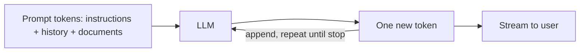
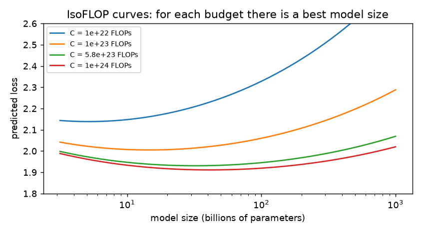
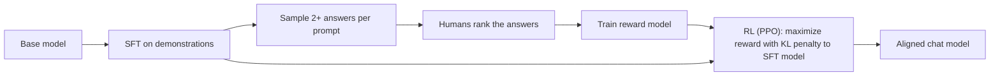
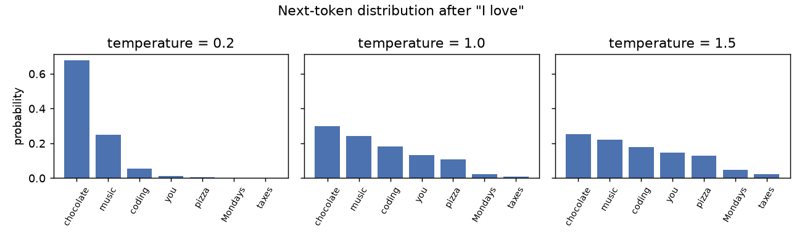
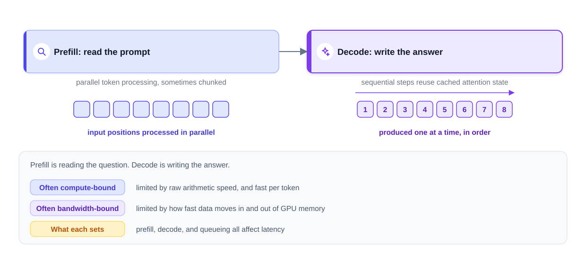

# Chapter 4 — Large Language Models

[Chapter 3](../03-transformers-and-embeddings/README.md) built the transformer. Make one enormous, train it on a large fraction of the public internet, and teach it to follow instructions, and you get a **large language model (LLM)** — the engine of ChatGPT, Claude, Gemini, Copilot and thousands of products built on their APIs (web services your code calls).

Interviewers probe the LLM both as a *model* (training, why scale works) and as a *system component* (latency — see [System Design Fundamentals](../../../system-design-patterns/modules/00-system-design-fundamentals/README.md) — cost, context limits, failure modes). This chapter covers: what an LLM is and the GPT lineage; **next-token prediction** with a tiny CPU-trainable GPT; **pretraining** and **scaling laws** (Kaplan, Chinchilla's ~20 tokens per parameter); **post-training** (SFT, **RLHF**, **DPO**, RL from verifiable rewards); **decoding**; **context windows** and statelessness; **prefill vs decode**, TTFT/TPOT and the **KV cache**; capabilities and limits; **reasoning**, **multimodal** and **open vs closed** models; the dated **model landscape**; and trends. Code in `code/` runs on CPU in seconds; outputs are real.

> **About dates.** Model facts change monthly. Everything tied to a specific model is dated; check vendor documentation before relying on a number.

---

## 4.1 What an LLM is

### What it is
A **large language model** is a neural network — almost always a decoder-only transformer (looks back only at earlier tokens) — trained on huge text to **predict the next token**. "Large" means both **parameters** (learned numbers; billions to trillions) and training text (trillions of tokens). Think of your phone keyboard's next-word suggestion scaled up by orders of magnitude, having seen books, websites, code and papers.

The model learns **statistical patterns of language** extremely well. Whether that is "understanding" is debated; in practice it produces fluent, often correct text — and sometimes fluent, *incorrect* text, with no built-in signal telling the two apart.

### The system-design view: a function from tokens to tokens



- **Input:** the **prompt** — system instructions, conversation so far, retrieved documents.
- **Output:** one token at a time, each appended and fed back in (**autoregressive** generation).
- Consequences: long answers take longer, **streaming** lets users read while the model writes, and pricing has two line items (input and output tokens).

### The GPT lineage (and why it matters)

| Model (OpenAI) | Year | What changed |
|---|---|---|
| GPT-1 | 2018 | Generative pre-training on unlabeled text, then fine-tuning (targeted training on a smaller dataset), beats task-specific models |
| GPT-2 | 2019 | 1.5B parameters; surprisingly coherent long text; staged release over misuse concerns |
| GPT-3 | 2020 | 175B parameters, 300B training tokens; **few-shot learning from examples in the prompt** without fine-tuning |
| InstructGPT / ChatGPT | 2022 | Instruction tuning + RLHF (§4.6) made the model follow requests; ChatGPT (Nov 2022) brought LLMs to the public |
| GPT-4 | 2023 | Large gains in reasoning and factual accuracy, stronger multilingual ability, image input |
| GPT-4o, o1, GPT-5 and later | 2024–2026 | Native multimodality, much longer context, separate **reasoning** modes that think before answering |

Other labs followed similar arcs (§4.14).

### How LLMs differ from earlier NLP
- **Scale:** training sets from millions of words to trillions of tokens; models from millions to hundreds of billions of parameters.
- **Architecture:** transformers process whole sequences in parallel with attention, capturing long-range context and training efficiently on GPUs.
- **Pre-train once, adapt many times:** one general model, adapted by fine-tuning, prompt instructions and examples, or retrieval, instead of a model per task.

### Real-world uses
| Use | Example |
|---|---|
| Chat assistants and customer support | Routine answers, ticket triage, drafting replies for human agents |
| Code generation | GitHub Copilot, Claude Code, Cursor: completions, functions from descriptions, bug fixes |
| Summarization | Reports, meeting transcripts, papers, legal documents |
| Writing and creative work | Blog posts, product descriptions, brainstorming |
| Extraction and classification | Emails or invoices → structured JSON; routing and tagging |
| Agents | Models calling tools in multi-step loops ([Chapter 9](../09-ai-agents/README.md)) |

### TL;DR
An LLM is a giant decoder-only transformer trained to predict the next token. For system design: tokens in, one token out at a time, stateless, priced per token, sometimes confidently wrong.

---

## 4.2 Next-token prediction

### What it is
Given the tokens so far, the model outputs a **probability for every vocabulary token**; generation picks one, appends it, repeats. After "I love": *chocolate* 30%, *music* 24%, *coding* 18%, *you* 13%, … *taxes* 1% — and after "As a Python developer, I love", *coding* moves up.

### Why it matters
The objective is **self-supervised**: every position of every document is a free training example, so no human labels are needed. Predicting well across the internet forces the model to learn grammar, facts, style, some reasoning and code semantics — the core bet behind LLMs.

### How it works
1. **Input:** a token window, e.g. `[The, cat, sat, on, the]`.
2. **Targets:** the same sequence **shifted by one**: `[cat, sat, on, the, mat]`. With a causal mask (Chapter 3), one forward pass predicts every position.
3. **Loss:** **cross-entropy** = −log P(correct next token), averaged. P = 0.5 → −ln 0.5 = 0.69; 0.9 → 0.105; 0.01 → 4.6.
4. **Perplexity** = e^loss — roughly how many tokens the model is choosing between. A uniform guess over V tokens has loss ln V, perplexity V.
5. **Backpropagate** and update all parameters; repeat over trillions of tokens.
6. **At inference** only the last position's distribution is used; a **decoding strategy** (§4.7) picks the token.

### Code: a tiny GPT trained on a toy "internet"
400 random sentences from a tiny grammar ("the cat saw a dog.", "a bird sat on the log.") train a 2-layer, character-level GPT for 400 steps.

```python
# code/tiny_gpt.py (key parts)
class TinyGPT(nn.Module):
    def __init__(self):
        super().__init__()
        self.tok = nn.Embedding(V, D)             # token embeddings
        self.pos = nn.Embedding(T, D)             # learned positions (GPT-2 style)
        self.blocks = nn.Sequential(*[Block() for _ in range(L)])   # causal transformer blocks
        self.ln = nn.LayerNorm(D)
        self.head = nn.Linear(D, V)               # logits over the vocabulary

def batch(bs=32):
    ix = torch.randint(len(data) - T - 1, (bs,))
    x = torch.stack([data[i:i + T] for i in ix])
    y = torch.stack([data[i + 1:i + T + 1] for i in ix])   # targets = inputs shifted by one
    return x, y

for step in range(401):
    x, y = batch()
    loss = F.cross_entropy(model(x).reshape(-1, V), y.reshape(-1))
    opt.zero_grad(); loss.backward(); opt.step()

@torch.no_grad()
def generate(model, prompt, n, temperature=1.0):
    idx = torch.tensor([encode(prompt)])
    for _ in range(n):
        logits = model(idx[:, -T:])[:, -1, :]     # only the last position matters
        nxt = logits.argmax(-1, keepdim=True) if temperature == 0 else \
              torch.multinomial(F.softmax(logits / temperature, -1), 1)
        idx = torch.cat([idx, nxt], dim=1)        # append and repeat
    return decode(idx[0].tolist())
```

Output:
```
vocab=18 chars, params=104,466
loss of a uniform guess = ln(18) = 2.890
step   0  loss 3.028  perplexity 20.65
step 100  loss 0.239  perplexity  1.27
step 200  loss 0.215  perplexity  1.24
step 300  loss 0.215  perplexity  1.24
step 400  loss 0.214  perplexity  1.24
trained in 8.1s
P(next char | 'the cat sat on the '): {'m': 0.47, 'l': 0.382, 'c': 0.142}
greedy     : 'the dog saw the mat. the cat sat on the mat. the'
sample T=1 : 'the dog sat on a dog. the cat saw the log. the c'
```

- Loss starts near ln(18) (uniform guess) and falls fast, but never reaches 0 because the data is genuinely random at some positions.
- After "the cat sat on the ", the grammar allows *mat*, *log* or *cat* (1/3 each). The model found exactly those three letters, with imperfect estimates (0.47 / 0.38 / 0.14) — a small picture of real LLMs being **calibrated but not perfectly** (stated probabilities roughly match how often they are right).
- Greedy always takes the top letter; sampling gives varied but grammatical text. Real LLMs are this loop with ~100,000-token vocabularies, billions of parameters and trillions of tokens.

(Training time depends on your CPU and the sampled line may vary across PyTorch versions; the greedy line is deterministic.)

### Common mistakes
- Thinking the model retrieves stored sentences. It generates from learned probabilities — hence both creative text and false "facts".
- Confusing training loss with task quality; usefulness also depends on post-training (§4.5–4.6).

### In the interview
**30-second answer:** "An LLM is trained with self-supervised next-token prediction: inputs are token windows, targets the same tokens shifted by one, loss is cross-entropy, and with a causal mask every position is a training example. At inference it outputs a distribution over the vocabulary, a decoding strategy picks a token, and it's appended and fed back — autoregressive generation."

- *What is perplexity?* e^(average cross-entropy); lower is better; the effective number of choices.
- *Why is generation slower than reading the prompt?* The prompt is processed in parallel; output tokens come one sequential step at a time (§4.9).

### Self-check
1. Loss when the correct token got probability 0.25? → −ln 0.25 ≈ 1.386.
2. Targets for input `[a, b, c]` from "a b c d"? → `[b, c, d]`.

### TL;DR
Predict the next token, score with cross-entropy, repeat over trillions of tokens. Generate by sampling a token and feeding it back in.

---

## 4.3 Pretraining: data and scale

### What it is
**Pretraining** is the first and most expensive stage: next-token prediction over a massive mixed corpus. It yields a **base model** (foundation or pretrained model) that continues text but does not reliably follow instructions.

### How it works
1. **Collect:** web crawls (Common Crawl is the usual start), books, Wikipedia, papers, code (e.g. GitHub), math, multilingual data, and increasingly **synthetic data** from other models.
2. **Filter** for quality: spam, boilerplate, adult or toxic content, machine-generated junk; classifiers often score "educational quality".
3. **Deduplicate**, including near-duplicates — duplicates waste compute and increase memorization.
4. **Remove sensitive data** (personal information) and respect licensing and opt-out signals.
5. **Mix** sources in chosen proportions (more code helps reasoning-style tasks), then **tokenize**.
6. **Train** on thousands of GPUs/TPUs (Google's AI chips) for weeks to months with data, tensor and pipeline parallelism (splitting data or model across chips), checkpointing, and monitoring for loss spikes.

### Scale in numbers (publicly reported)

| Model | Parameters | Training tokens |
|---|---|---|
| GPT-3 (2020) | 175B | ~300B |
| Chinchilla (DeepMind, 2022) | 70B | 1.4T |
| Llama 2 (Meta, 2023) | 7B–70B | 2T |
| Llama 3 (Meta, 2024) | 8B–405B | 15T+ |

Frontier labs no longer publish these for flagships, so treat such figures as estimates. For scale: Hugging Face's FineWeb (2024) is about 15 trillion tokens of filtered web text.

### Trade-offs and limits
- **Data quality beats raw quantity** at the same compute.
- **The "data wall":** high-quality human text is finite — one reason for synthetic data and inference-time compute (§4.11).
- **Knowledge freezes** at the data cutoff (§4.10).

### TL;DR
Pretraining = next-token prediction over trillions of filtered, deduplicated tokens from web, books and code, producing a knowledgeable base model that doesn't yet act as an assistant.

---

## 4.4 Scaling laws

### What it is
**Scaling laws** are empirical formulas showing loss falls **smoothly and predictably** — as a power law — with parameters (N), training tokens (D) and compute (C).

### Why it matters
Labs train many small models, fit the curve, and predict a 100x bigger model before spending the money. Scaling laws also answer: **for a fixed compute budget, how big a model and how much data?**

### How it works
1. **Compute rule of thumb:** a dense transformer (every parameter used for every token) costs **C ≈ 6·N·D** FLOPs (floating-point operations: ~2 per parameter per token forward, ~4 backward). GPT-3: 6 × 175×10⁹ × 300×10⁹ ≈ 3.15×10²³ FLOPs.
2. **Kaplan et al. (OpenAI, 2020)** found power laws in N, D and C and concluded size mattered most, so models grew very large on little data (GPT-3: under 2 tokens per parameter).
3. **Hoffmann et al. — "Chinchilla" (DeepMind, 2022)** redid the analysis with better-tuned runs: parameters and data should grow **in equal proportion**; compute-optimal ≈ **20 training tokens per parameter**. Chinchilla (70B, 1.4T tokens) beat DeepMind's Gopher (280B, 300B tokens) at similar compute on almost every benchmark — and was 4x cheaper to run.
4. Substituting D = 20N into C = 6ND gives C = 120N², so **N ≈ √(C/120)**. Example: C = 1.2×10²³ → N ≈ 3.2×10¹⁰ (32B) and D ≈ 630B tokens.

**Power law, concretely.** A/N^α shrinks by the same *factor* each time N is multiplied by the same amount: with α = 0.34, 10x parameters divides that term by 10^0.34 ≈ 2.2. Each 10x buys roughly the same *relative* improvement, so progress needs multiplicative budget increases.

Chinchilla's fitted loss L(N, D) = E + A/N^α + B/D^β has three parts: **irreducible loss** E (the randomness of language itself), the too-few-parameters term A/N^α, and the too-little-data term B/D^β. Reported constants: E = 1.69, A = 406.4, B = 410.7, α = 0.34, β = 0.28.

```python
# code/scaling_laws.py (key parts)
E, A, B, ALPHA, BETA = 1.69, 406.4, 410.7, 0.34, 0.28

def loss(N, D):
    return E + A / N**ALPHA + B / D**BETA

for C in [1e21, 1e23, 5.76e23, 1e25]:
    N = np.sqrt(C / 120)                     # 20 tokens per parameter
    print(C, N, 20 * N)
```

Output:
```
Roughly the same compute budget, two ways to spend it:
  Gopher-like  (280B params, 300B tokens): compute=5.04e+23  predicted loss=1.993
  Chinchilla   ( 70B params, 1.4T tokens): compute=5.88e+23  predicted loss=1.937

Compute-optimal size with the ~20 tokens/parameter rule (N = sqrt(C/120)):
  C=1.00e+21 FLOPs -> N ~     2.9B params, D ~   0.06T tokens
  C=1.00e+23 FLOPs -> N ~    28.9B params, D ~   0.58T tokens
  C=5.76e+23 FLOPs -> N ~    69.3B params, D ~   1.39T tokens
  C=1.00e+25 FLOPs -> N ~   288.7B params, D ~   5.77T tokens

Formula's own optimum at C=5.76e+23: N ~ 32B, D ~ 3.00T tokens (94 tokens/param)
```



- At Chinchilla's budget (5.76×10²³ FLOPs) the 20-token rule gives ~69B parameters and ~1.4T tokens — the model they trained.
- Each IsoFLOP curve is U-shaped: too small a model can't absorb the data; too big a model sees too little.
- Caveat: the paper's three estimation methods disagree somewhat, and the fitted formula's optimum is smaller (last line). A 2024 replication (Besiroglu et al., Epoch AI) argued the constants were imprecise and a corrected fit agrees with ~20 tokens per parameter. Treat scaling laws as strong **trends**, not exact constants.

### "Over-training" for cheaper inference
Chinchilla-optimal minimizes **training** cost. A popular model is *run* billions of times, so it often pays to train a **smaller model on far more data**: costlier to train, cheaper to serve. Llama 3 8B saw 15T+ tokens — ~1,900 tokens per parameter, almost 100x the Chinchilla ratio.

### Emergent abilities (with a caveat)
Some abilities (multi-step arithmetic, few-shot pattern following) seemed to jump suddenly at certain scales. Schaeffer et al. (2023) showed many jumps are artifacts of all-or-nothing metrics; with smoother metrics improvement is gradual. Both views agree bigger, better-trained models do more.

### Common mistakes
- "More parameters = better" — only if data and compute keep up; data quality and post-training matter as much.
- Treating loss gains as linear in cost; power laws need *multiplicative* compute increases.

### In the interview
**30-second answer:** "Loss falls as a power law in parameters, data and compute; training compute is about 6·N·D. Chinchilla showed parameters and tokens should scale together — about 20 tokens per parameter — so a 70B model on 1.4T tokens beat a 280B model on 300B at similar compute. In practice we over-train smaller models, like Llama 3 8B on 15T tokens, because inference cost dominates a model's lifetime."

- *Why 6ND?* ~2 FLOPs per parameter per token forward, ~4 backward.
- *Does scaling go on forever?* Curves flatten toward irreducible loss and quality data is limited — hence synthetic data and inference-time compute.

### Self-check
1. FLOPs for a 10B model on 200B tokens? → 6 × 10¹⁰ × 2×10¹¹ = 1.2×10²².
2. Chinchilla-optimal tokens for 7B? → About 140B.

### TL;DR
Loss scales predictably. C ≈ 6ND. Compute-optimal ≈ 20 tokens per parameter (Chinchilla). Over-train small models when inference cost matters.

---

## 4.5 Post-training I: instruction tuning (SFT)

### What it is
**Supervised fine-tuning (SFT)** (**instruction tuning**) continues training the base model on curated **(instruction, ideal response)** pairs so it acts as an assistant.

### The problem it solves
Ask a base model "What is the capital of France?" and it may continue with more quiz questions, a common web pattern. SFT teaches "user asks → assistant answers helpfully".

### How it works
1. Collect tens of thousands to millions of high-quality demonstrations: human-written, expert-curated, and increasingly filtered model-generated.
2. Format each with a **chat template** (special tokens marking system, user and assistant turns).
3. Train with the next-token loss, usually **only on the assistant's tokens** (prompt tokens masked out of the loss).
4. Result: an **instruct**/**chat** model; open-weight releases often ship both "base" and "Instruct" checkpoints.

### Trade-offs
- Cheap relative to pretraining; quality beats quantity (LIMA, 2023: strong results from 1,000 carefully chosen examples).
- SFT only imitates demonstrations; it doesn't teach which of two plausible answers people prefer — preference tuning adds that.

### TL;DR
SFT = fine-tune on example conversations so the base model follows instructions in a chat format.

---

## 4.6 Post-training II: RLHF, DPO and RL from verifiable rewards

### What it is
**Preference tuning** makes answers more helpful, honest and harmless using **comparisons** ("A is better than B"), which are far easier for people than writing perfect answers.

### How RLHF works (InstructGPT, OpenAI, 2022)
**RLHF = reinforcement learning from human feedback.**



1. Start from the SFT model; sample several answers per prompt; humans rank them.
2. Train a **reward model** (often an LLM with a scalar output head) to score preferred answers higher. Bradley–Terry loss: −log σ(r_chosen − r_rejected), σ = sigmoid (squashes any number into 0–1).
3. Optimize the LLM with RL (classically **PPO**, proximal policy optimization, which takes small cautious steps) to maximize reward **minus a KL-divergence penalty** (KL measures how different two distributions are) keeping it near the SFT model. Without it the model **reward-hacks** — e.g. long, flattering answers that score well but aren't better.

InstructGPT's headline: labelers preferred a **1.3B** InstructGPT model over the **175B** GPT-3 base model. Post-training can matter more than raw size.

### DPO — Direct Preference Optimization (Rafailov et al., 2023)
DPO skips the reward model and RL loop, training directly on (prompt, chosen, rejected) triples:

loss = −log σ( β · [ (log π(chosen) − log π_ref(chosen)) − (log π(rejected) − log π_ref(rejected)) ] )

π is the model being trained (the *policy*), π_ref the frozen SFT model, β how far the model may move from the reference.

```python
# code/preference_losses.py (key parts)
def reward_model_loss(r_chosen, r_rejected):
    return -math.log(sigmoid(r_chosen - r_rejected))

def dpo_loss(logp_c, logp_r, ref_c, ref_r, beta=0.1):
    margin = (logp_c - ref_c) - (logp_r - ref_r)
    return -math.log(sigmoid(beta * margin)), margin
```

Output:
```
Reward model: a human preferred answer A over answer B
  r(A)=+0.0 r(B)=+0.0 -> P(A preferred)=0.500, loss=0.693
  r(A)=+2.0 r(B)=+0.0 -> P(A preferred)=0.881, loss=0.127
  r(A)=+0.0 r(B)=+2.0 -> P(A preferred)=0.119, loss=2.127
  r(A)=+5.0 r(B)=+0.0 -> P(A preferred)=0.993, loss=0.007

DPO (log-probabilities of whole responses; reference = frozen SFT model)
  policy = reference     : margin=  +0.0, loss=0.693
  policy raises chosen   : margin= +10.0, loss=0.313
  policy lowers rejected : margin= +17.0, loss=0.168
  policy moves wrong way : margin= -10.0, loss=1.313
```

The DPO loss falls whenever the model prefers the chosen answer *more than the reference did* (raising chosen, lowering rejected, or both) and rises when it moves the wrong way.

### Other variants
- **RLAIF / Constitutional AI** (Anthropic, 2022): an AI model guided by written principles produces the preference labels, reducing human labeling.
- **RL from verifiable rewards (RLVR):** for math and code the reward is automatic (answer matches, tests pass). Central to reasoning models (§4.11); DeepSeek-R1 (2025) used it at scale with **GRPO** (group relative policy optimization: score several answers to one prompt against each other, no separate value model).

### Trade-offs

| | RLHF (reward model + PPO) | DPO | RLVR |
|---|---|---|---|
| Needs a reward model | Yes | No | No (a checker/verifier) |
| Engineering complexity | High (several models in memory, unstable RL) | Low (like fine-tuning) | Medium |
| Data | Human (or AI) rankings | Preference pairs | Problems with checkable answers |
| Typical use | Frontier chat models | Widely used for open models | Math, code, reasoning |

### Common mistakes
- Believing alignment adds knowledge: post-training mostly shapes **behavior and format**; knowledge comes from pretraining.
- Ignoring side effects: preference tuning can cause **sycophancy** (agreeing with the user) or verbosity if raters favoured them.

### In the interview
**30-second answer:** "After pretraining we do SFT on example conversations, then preference tuning. Classic RLHF trains a reward model on human rankings and optimizes the LLM with PPO, with a KL penalty to stay near the SFT model and avoid reward hacking. DPO gets a similar effect with a simple loss on chosen/rejected pairs, no reward model or RL loop. For math and code, RL on verifiable rewards drives modern reasoning models."

- *Why the KL penalty?* Stops the policy exploiting reward-model flaws and preserves language quality.
- *Why is DPO popular?* Stable, cheap, no reward model to train or hold in memory.

### Self-check
1. What does the reward model output? → A scalar score for a (prompt, response).
2. What is π_ref in DPO? → The frozen SFT model.

### TL;DR
Pretrain → SFT (imitate good answers) → preference tuning (RLHF with reward model and PPO, or DPO on pairs) → optionally RL with verifiable rewards for reasoning.

---

## 4.7 Decoding strategies

### What it is
The **decoding strategy** turns the probability distribution into an actual next token; the same model with different decoding gives very different text.

### How each works (our toy distribution after "I love")
Logits → softmax: e^2.0 = 7.39, e^1.8 = 6.05, … sum ≈ 24.79, so P(chocolate) ≈ 0.30.

| Strategy | Rule | Effect |
|---|---|---|
| **Greedy** | Always take the most probable token | Deterministic; can be repetitive or loop |
| **Beam search** | Keep the *k* best partial sequences by total probability | Higher-probability sequences; good for translation; bland for chat |
| **Temperature T** | Divide logits by T before softmax | T < 1 sharpens, T > 1 flattens; T → 0 approaches greedy |
| **Top-k** | Keep the k most probable tokens, renormalize | Cuts the long tail |
| **Top-p (nucleus)** (Holtzman et al., 2019) | Keep the smallest set with cumulative probability ≥ p, renormalize | Adapts: few tokens when confident, many when unsure |

```python
# code/decoding_strategies.py (key parts)
vocab = ["chocolate", "music", "coding", "you", "pizza", "Mondays", "taxes"]
logits = np.array([2.0, 1.8, 1.5, 1.2, 1.0, -0.5, -1.5])

def with_temperature(logits, T):
    return softmax(logits / T)

def top_k(probs, k):
    keep = np.argsort(probs)[::-1][:k]
    out = np.zeros_like(probs); out[keep] = probs[keep]
    return out / out.sum()

def top_p(probs, p):
    order = np.argsort(probs)[::-1]
    cutoff = np.searchsorted(np.cumsum(probs[order]), p) + 1
    out = np.zeros_like(probs); out[order[:cutoff]] = probs[order[:cutoff]]
    return out / out.sum()
```

Output:
```
softmax (T=1)     chocol:0.30   music:0.24  coding:0.18     you:0.13   pizza:0.11  Monday:0.02   taxes:0.01
greedy pick     -> chocolate

temperature 0.2   chocol:0.68   music:0.25  coding:0.06     you:0.01   pizza:0.00  Monday:0.00   taxes:0.00
temperature 0.7   chocol:0.35   music:0.27  coding:0.17     you:0.11   pizza:0.08  Monday:0.01   taxes:0.00
temperature 1.5   chocol:0.25   music:0.22  coding:0.18     you:0.15   pizza:0.13  Monday:0.05   taxes:0.02

top-k (k=3)       chocol:0.41   music:0.34  coding:0.25     you:0.00   pizza:0.00  Monday:0.00   taxes:0.00
top-p (p=0.8)     chocol:0.35   music:0.28  coding:0.21     you:0.16   pizza:0.00  Monday:0.00   taxes:0.00
T=0.7 + top-p .9  chocol:0.39   music:0.29  coding:0.19     you:0.12   pizza:0.00  Monday:0.00   taxes:0.00

10 samples at T=1.0: ['you', 'music', 'pizza', 'coding', 'chocolate', 'Mondays', 'you', 'you', 'chocolate', 'music']
10 samples at T=0.2: ['chocolate', 'music', 'chocolate', 'music', 'chocolate', 'chocolate', 'chocolate', 'chocolate', 'music', 'chocolate']

beam search demo:
  greedy        -> ('The cat', 0.175)
  beam width 2  -> ('A cat', 0.36)
```



- **Top-p = 0.8:** cumulative 0.30 → 0.54 → 0.72 → 0.85; the fourth token crosses 0.8, so four survive, renormalized (0.30/0.85 ≈ 0.35).
- **Beam beats greedy:** greedy takes "The" (0.5), but its best continuation gives 0.175 total; beam width 2 also keeps "A" (0.4), whose "cat" (0.9) gives 0.36. Looking ahead finds the better *sequence*.
- At T = 1.0 the model once sampled "Mondays" (2%) — the long tail top-k/top-p trim.

### Other controls you will see in APIs
- **max tokens** — hard output cap (protects latency and cost; response is cut off).
- **stop sequences** — strings that end generation.
- **frequency / presence penalties** — lower scores of tokens already used, reducing repetition.
- **seed** — some APIs accept one for more repeatable sampling.
- **Structured / constrained decoding** — only tokens that keep output valid against a JSON schema or grammar are allowed (Chapter 5).

As of September 2026, several reasoning-focused models reject sampling parameters: Anthropic's newest Claude models reject `temperature`, `top_p` and `top_k`, and OpenAI's reasoning models have long restricted them. There you steer through the prompt, structured outputs and "effort" settings.

### Choosing settings

| Task | Typical setting |
|---|---|
| Extraction, classification, code, factual Q&A | Temperature 0 (or low), or the default for reasoning models |
| General chat | Provider default (often T ≈ 0.7–1 with top-p) |
| Brainstorming, creative writing | Higher temperature (≈1) |
| Translation (classic seq2seq) | Beam search |

### Common mistakes
- Believing temperature 0 is perfectly deterministic: GPU batching and floating-point effects can still change outputs — treat it as **nearly** deterministic and validate exact outputs.
- Tuning temperature and top-p together without measuring; change one.
- High temperature for tasks with one right answer.

### In the interview
**30-second answer:** "Decoding turns the distribution into a token. Greedy takes the argmax, beam search keeps the k best sequences, and sampling draws from the distribution, shaped by temperature and truncated by top-k or top-p (the smallest set covering probability p). Temperature 0 for extraction and classification, moderate sampling for creative tasks, plus max-token caps and stop sequences."

- *Top-k vs top-p?* Fixed count vs a count adapted to confidence.
- *Why no beam search for chat?* Generic, high-probability text at k times the cost.
- *Deterministic outputs?* Temperature 0 gets close; use validators and, where appropriate, cache responses.

### Self-check
1. Probabilities [0.6, 0.3, 0.1], top-p = 0.7: which remain? → The first two.

### TL;DR
Greedy = argmax; beam = best k sequences; temperature reshapes; top-k/top-p cut the tail. Low temperature for correctness, higher for creativity; nothing is perfectly deterministic.

---

## 4.8 Context windows and statelessness

### What it is
The **context window** is the maximum tokens the model considers at once — prompt **plus** generated output. Windows grew from 2,048 tokens (GPT-3, 2020) to 128K–200K (common by 2024) and 1M (Gemini 1.5, 2024; as of September 2026 the flagship models from Anthropic, OpenAI and Google all list about 1M). 200K tokens ≈ 150,000 English words.

### Stateless by default
Weights don't change between requests and the model remembers nothing: a "conversation" works only because **the application re-sends relevant history** each call (or a provider service does it for you). Two consequences:

**1. Context assembly is your subsystem:** which instructions, how much history, which retrieved documents and tool results go in. RAG ([Chapter 7](../07-embeddings-vector-databases-and-rag/README.md)) and chat products are largely about this.

**2. Re-sending full history grows fast.** At ~200 tokens per turn, turn *n* carries ~200·*n* input tokens and the conversation **total** grows with the **square** of the turns:

```python
# code/kv_cache_demo.py (last part)
per_turn, total = 200, 0
for turn in range(1, 21):
    prompt = per_turn * turn          # all previous turns + the new one
    total += prompt
```

Output:
```
Chat history re-sent every turn (200 tokens per turn):
  turn  1: prompt=  200 tokens, cumulative input=   200
  turn  5: prompt= 1000 tokens, cumulative input=  3000
  turn 10: prompt= 2000 tokens, cumulative input= 11000
  turn 20: prompt= 4000 tokens, cumulative input= 42000
```

10 → 20 turns almost quadruples input (11K → 42K). Fixes: **truncate** (keep the last *k* turns), **summarize** older history, or **retrieve** only relevant turns. **Prompt caching** (the provider reuses work on an unchanged prompt *prefix*) cuts repeated computation and cost, but the logical context still grows.

### Long context is not a strategy by itself
- **Cost and latency** grow with input length.
- **Attention dilution:** "Lost in the Middle" (Liu et al., 2023) found facts mid-context were used less reliably than those at the start or end. Newer models are much better, but **test evidence retrieval at your real lengths**.
- **Adaptation options** for getting information or behavior into the model can be combined ([Chapter 8](../08-prompting-vs-finetuning-vs-rag-and-llm-evaluation/README.md) compares them in depth):

| Option | Freshness | Cost to change | Best for |
|---|---|---|---|
| Instructions and examples in the prompt | Immediate | Edit the prompt | Behavior, format, small facts |
| Retrieval (RAG) | Per request | Update the index | Large, changing, private knowledge |
| Fine-tuning | Frozen at training | Retrain | Consistent style, specialized formats, narrow skills |

### In the interview
**Question:** "The model has a 200K-token window — why not put everything in?"
**Answer:** "A big window gives room, not a strategy. Long inputs cost more and add latency even with caching, and models can miss evidence in long contexts, so I'd evaluate at real lengths. I'd still choose deliberately what goes in — retrieve relevant pieces, summarize history — and measure latency with real cache behavior."

### Self-check
1. Does output count toward the window? → Yes, prompt + output must fit.
2. Why does chat cost grow roughly quadratically? → Turn *n* re-sends *n* turns; summing 1..*n* gives ~n²/2.

### TL;DR
The model is stateless; your app assembles context each call. Windows are large (≈1M on 2026 flagships) but finite, costly and imperfectly used — select, summarize, retrieve.

---

## 4.9 Inference: prefill, decode and the KV cache

### What it is
Generation has two phases with different performance profiles:

1. **Prefill** — read the whole prompt, all positions **in parallel** (long prompts may be chunked), building the **KV cache**: keys and values of every prompt token at every layer.
2. **Decode** — generate **one token per step**: compute Q, K, V for the newest token only, append its K and V to the cache, attend over the cache instead of recomputing the prompt.



*Figure — Prefill reads the prompt in parallel; decode writes the answer one token at a time (course diagram).*

### The two latency numbers
- **TTFT — time to first token:** prefill (longer prompt → longer), plus network, queueing, retrieval and other pre-work.
- **TPOT — time per output token** (inter-token latency): decode; depends on model size, context length, batch size and load.
- Total ≈ TTFT + TPOT × output tokens.

**Illustrative** (not a benchmark): 3,000 input and 500 output tokens — prefill ~0.5 s, 500 sequential decode steps ~15 s, so generation dominates; a very long prompt with a short answer flips that.

Diagnose by phase: slow TTFT → shorten or cache the prompt, reduce queueing; slow TPOT → smaller/faster model, better batching, speculative decoding, shorter outputs.

### Different hardware bottlenecks
- Prefill is usually **compute-bound**: much matrix math on many tokens, limited by arithmetic throughput.
- Small-batch decode is usually **memory-bandwidth-bound**: each token requires reading all weights and the KV cache with little math per byte.

So serving engines schedule prefill and decode separately and batch many users' decode steps ([Chapter 11](../11-llm-serving-and-inference/README.md)).

### The KV cache in code
```python
# code/kv_cache_demo.py (key parts)
def generate_no_cache(x0, steps):
    for _ in range(steps):
        K, V = X @ W_k, X @ W_v            # recompute keys/values for ALL tokens
        ...

def generate_with_cache(x0, steps):
    for _ in range(steps):
        K_cache.append(xs[-1] @ W_k)       # only the NEW token's key/value
        V_cache.append(xs[-1] @ W_v)
        ...

def kv_bytes_per_token(layers, kv_heads, head_dim, bytes_per_value=2):
    return 2 * layers * kv_heads * head_dim * bytes_per_value   # keys and values
```

Output:
```
outputs identical: True
K/V projections for 50 steps: no cache=2550, with cache=100

KV-cache memory (16-bit values):
  7B-class, full MHA (32 layers, 32 KV heads x 128):   512 KiB/token,  4.00 GiB per 8K-token sequence
  8B-class, GQA      (32 layers,  8 KV heads x 128):   128 KiB/token,  1.00 GiB per 8K-token sequence
  70B-class, GQA     (80 layers,  8 KV heads x 128):   320 KiB/token,  2.50 GiB per 8K-token sequence
```

- **Same result, far less work:** without a cache, step *t* recomputes all *t* tokens (2,550 projections, quadratic); with it, only the new one (100).
- **The price is memory.** Shapes match Llama-2-7B (full MHA) and Llama-3-8B/70B (GQA, 8 KV heads). One 8K-token conversation on the 7B MHA model needs ~4 GiB (1 GiB = 1,024 MiB ≈ 1.07 billion bytes; 1 KiB = 1,024 bytes); GQA cuts it 4x. Across hundreds of concurrent users, the KV cache — not the weights — often limits how many requests a GPU serves.
- **Speculative decoding** cuts expensive steps: a small "draft" model proposes several tokens and the big model verifies them in one pass, keeping those it agrees with.

### Streaming and output limits
Because decode is sequential, **stream** user-facing output and set **max-token** limits. Buffer instead when output must pass validation or safety checks first (e.g. JSON consumed by code).

### In the interview
**30-second answer:** "I'd estimate prefill and decode separately. Prefill processes the prompt in parallel and drives time to first token; decode generates one token per step with the KV cache and drives time per output token, so output length dominates completion time. Prefill tends to be compute-bound, decode memory-bandwidth-bound. I'd stream, cap output tokens and manage history, because KV-cache memory grows with context and concurrency."

- *First token late but fast stream, or the reverse?* Late first token → long prompt or queueing (prefill). Slow stream → decode: model size, load, batch size.
- *Why does GQA matter?* Fewer KV heads → smaller cache → more concurrent users and less memory traffic.

### Self-check
1. KV bytes/token for 40 layers, 8 KV heads, head dim 128, 16-bit? → 2 × 40 × 8 × 128 × 2 = 163,840 bytes = 160 KiB.
2. Answer starts fast but trickles — which metric and phase? → TPOT, decode.

### TL;DR
Prefill (parallel, compute-bound) → TTFT. Decode (sequential, memory-bound) → TPOT. The KV cache avoids recomputation but costs memory growing with context × users. Stream, cap outputs, prefer GQA-style models for cheaper serving.

---

## 4.10 Capabilities and limits

### What LLMs do well (as of 2026)
Fluent writing and rewriting in many languages; summarization; extraction into structured formats; coding; multi-step math and science reasoning, especially with reasoning modes; complex instructions; tool use; understanding images and documents.

### The main limits

| Limit | What happens | Why | Mitigation |
|---|---|---|---|
| **Hallucination** | Fluent, confident, **wrong** statements: invented citations, APIs, facts | It predicts plausible text; nothing forces truth, and training rewarded answering over abstaining | **Grounding** (tying answers to supplied sources) with retrieval and citations, allowing "I don't know", verification, human review for high stakes |
| **Knowledge cutoff** | Unaware of events after its training data | Weights are frozen | Retrieval, web-search tools, stating the current date in the prompt |
| **No private or user-specific knowledge** | Doesn't know your docs or user accounts | Never saw them | Authorized retrieval and tools with access control |
| **Reasoning brittleness** | Errors in long logic, arithmetic, character counting | Token-level prediction, tokenization, limited working memory | Reasoning modes, tools (calculator, code execution), verification |
| **Non-determinism** | Same input, different output | Sampling and GPU numerics | Low temperature, semantic (meaning-based) tests, validators |
| **Prompt injection** | Text in documents or input overrides your instructions | Rules and data share one token stream; the model can't structurally separate them | Label untrusted content, least-privilege tools, output checks ([Chapter 12](../12-safety-ethics-governance/README.md)) |
| **Bias and sycophancy** | Reflects data biases; tends to agree with the user | Training data and preference tuning | Evaluation, instructions, human oversight |

### The component "properties sheet"
Each property of the LLM box implies a design requirement:

| Property | Design consequence |
|---|---|
| Output is sampled; decoding settings affect variation | Cache carefully, test semantically, expect "it answered differently yesterday" |
| Output can be fluent and wrong | Build grounding, guardrails (automatic input/output checks) and evals (systematic quality tests) as first-class parts |
| Instructions and untrusted data share the context window | Treat retrieved and user text as untrusted (prompt injection) |
| Priced per input and output token (rates vary by model, provider, caching) | Cost is a core requirement; give every design a token budget |
| Finite context window | Trim, condense or selectively retrieve long chats and corpora |
| Latency is seconds, not milliseconds | Measure end to end; stream, set deadlines, have fallbacks |

A related component, the **embedding model**, converts text (or images) to vectors for similarity search; it supports retrieval rather than generating answers and is often cheaper per token — benchmark rather than assume.

### In the interview
**30-second answer (the model as a component):** "A stateless, sampled, per-token-priced component with seconds of latency. Prefill drives time to first token and output length drives completion time, so I stream and set token budgets. History and knowledge are my subsystems — context assembly and retrieval. And since it can give unsupported answers or be steered by injected text, evaluation, validation and safe fallbacks are part of the design."

### Self-check
1. How do you test an LLM feature whose output varies? → Semantic comparisons, rubrics or validators — not exact string matches.

### TL;DR
LLMs hallucinate, have a cutoff, don't know your data, can be injected and vary run to run. Grounding, validation, evaluation and budgets turn them into a reliable system.

---

## 4.11 Reasoning models

### What it is
A **reasoning model** generates an extended chain of thought — working step by step, checking and revising — **before** answering. Examples: OpenAI's o1 (September 2024), later o-series and GPT-5 "thinking" modes; DeepSeek-R1 (January 2025, open weights); Claude with extended/adaptive thinking (from Claude 3.7 Sonnet, February 2025); Google's Gemini "thinking" models.

### Why it matters
A second scaling axis: **test-time compute** — let the model **think longer** on hard problems instead of only making it bigger. Math, science and coding accuracy rose sharply with more thinking tokens.

### How it works
1. Start from a strong pretrained + SFT model.
2. Train with **RL on verifiable tasks** (checkable math, code that must pass tests); rewarded for correct final answers, the model learns that longer, self-checking reasoning pays.
3. At inference it emits reasoning tokens (often hidden or summarized), then the answer; APIs expose a thinking budget or "effort" level trading quality against latency and cost.

### Trade-offs
- **Better** at multi-step math, logic, planning, complex coding and agentic tasks.
- **Slower and costlier**: reasoning tokens are generated and billed like output.
- Usually unnecessary for simple extraction, classification or chit-chat: for high-volume, latency-sensitive tasks use a fast model at low effort and escalate only when needed.

### Self-check
1. What is test-time compute? → More computation at inference (longer reasoning, multiple samples) to improve answers.

### TL;DR
Reasoning models think in tokens before answering, trained with RL on checkable problems: better answers on hard tasks at higher latency and cost.

---

## 4.12 Multimodal LLMs

### What it is
A **multimodal** LLM accepts (and sometimes produces) more than text: images, audio, video, documents.

### How it works (common design)
1. A modality **encoder** turns input into vectors — e.g. a vision transformer splits an image into patches (say 16×16 pixels) and embeds each.
2. A projection layer maps them into the LLM's embedding space, so patches become "tokens" attended alongside text.
3. Some models are "natively multimodal" (trained on mixed modalities from the start); others bolt an encoder onto a text model and fine-tune.
4. Image or speech output usually comes from separate generators (diffusion models, which refine random noise step by step; speech synthesis — [Chapter 10](../10-generative-models-beyond-text/README.md)) or from predicting special image/audio tokens.

### Uses
- **Image + text:** photos, charts, screenshots, receipts and forms; UI screenshots for computer-use agents (AI operating a screen, mouse and keyboard).
- **Audio + text:** real-time transcription and voice assistants, call analysis.
- **Documents and video:** PDFs with figures, long video.

Images cost tokens too — a high-resolution image can take hundreds to thousands, depending on the provider.

### TL;DR
Encoders turn images/audio into token-like vectors the LLM attends over; image and audio generation usually uses separate generative models.

---

## 4.13 Open vs closed models

### What it is
- **Closed (proprietary):** only via the vendor's API or apps — GPT, Claude, Gemini.
- **Open-weight:** trained weights published to download, run and fine-tune — Llama (Meta), Mistral/Mixtral, Qwen (Alibaba), DeepSeek, Gemma (Google), gpt-oss (OpenAI, August 2025).
- Strict "open **source**" also means open training code and data; most "open" LLMs are **open-weight** under licenses that may restrict some uses.

### Trade-offs

| | Closed API | Open-weight |
|---|---|---|
| Peak capability | Usually the frontier | Historically a few months behind; the gap narrowed in 2024–2025 |
| Setup | An API key | GPUs, a serving stack (vLLM, TGI, llama.cpp, Ollama), operations |
| Data control | Data goes to the vendor (with contractual terms) | Can run fully on-premises or on-device |
| Customization | Prompting, provider fine-tuning where offered | Full fine-tuning, LoRA (cheap fine-tuning of small add-on matrices), quantization (fewer bits per weight), any changes |
| Cost profile | Pay per token; no idle cost | Pay for hardware; cheap at high steady volume |
| Model changes | Vendor updates and retires models on its schedule | You pin the version forever |

Prototype on the best closed model to learn what quality is possible; move to (or add) open-weight models for data residency (data kept in a country or region), offline or edge deployment, heavy customization, or lower cost at large steady volume — once evaluation shows quality suffices.

### TL;DR
Closed = convenience and often best quality; open-weight = control, privacy, customization and potentially lower cost at scale. Most "open" models are open-weight, not fully open-source.

---

## 4.14 The model landscape (dated)

Names change fast; families and organizations change slowly. Learn the families.

| Family | Organization | Access | Milestones (verified dates) |
|---|---|---|---|
| **GPT** | OpenAI | Closed (plus open-weight gpt-oss, Aug 2025) | GPT-3 2020 · ChatGPT Nov 2022 · GPT-4 Mar 2023 · GPT-4o May 2024 · o1 reasoning Sep 2024 · GPT-5 Aug 2025 · GPT-6 family (Astra, Sol, Luna) listed as flagship in the API docs, Sep 2026 |
| **Claude** | Anthropic | Closed | Claude 3 Mar 2024 · Claude 3.7 Sonnet (first hybrid reasoning) Feb 2025 · Claude 4 May 2025 · Claude 5 generation 2026; as of Sep 2026 the docs list Fable 5.1 (most capable), Opus 5.5, Sonnet 5.5 and Haiku 4.5 (Opus 5 and Sonnet 5 are now legacy) — 1M-token context except Haiku 4.5 (200K) |
| **Gemini** | Google (DeepMind) | Closed (open-weight sibling: Gemma) | Gemini 1.0 Dec 2023 · Gemini 1.5 (1M context) Feb 2024 · Gemini 2.5 Mar 2025 · Gemini 3 Nov 2025 (1M context) · as of Sep 2026 the API docs list Gemini 3.1 Pro (preview) and Gemini 3.5–3.8 Flash models |
| **Llama** | Meta | Open-weight (custom license) | Llama 1 Feb 2023 · Llama 2 Jul 2023 · Llama 3 Apr 2024 · Llama 4 (MoE, mixture of experts) Apr 2025 |
| **Mistral** | Mistral AI | Mix of open-weight and closed | Mistral 7B Sep 2023 · Mixtral 8x7B (MoE) Dec 2023 |
| **Qwen** | Alibaba | Mostly open-weight | Qwen2.5 Sep 2024 · Qwen3 Apr 2025 |
| **DeepSeek** | DeepSeek | Open-weight | DeepSeek-V3 Dec 2024 · DeepSeek-R1 (reasoning, MIT license — very permissive) Jan 2025 |
| **Grok** | xAI | Mostly closed | Grok-1 weights released Mar 2024 |

Sources checked September 2026: Anthropic, OpenAI (developers.openai.com models page) and Google (ai.google.dev Gemini models page) documentation. For anything newer the vendor's "models" page is the authority; third-party leaderboards and aggregators often lag or err.

---

## 4.15 Next-generation trends

Trends visible as of 2026 (not product predictions):

1. **Multi-step reasoning** — chaining and revising steps helps long documents, math and arguments, reducing (not eliminating) contradictions and hallucinations.
2. **Grounded, verifiable answers** — search, knowledge bases and code execution let models verify claims, **cite sources**, and ask clarifying questions instead of guessing.
3. **Multimodality everywhere** — images, real-time speech, video.
4. **Agentic models** — planning and executing multi-step tasks with tools: research assistants, coding agents opening pull requests ([Chapter 9](../09-ai-agents/README.md)).
5. **Interpretability and transparency** — pressure from healthcare, finance and law to explain *why*; research describing what internal features represent.
6. **Personalized and specialized models** — smaller domain- or person-tuned models, some small enough for a phone or private server, keeping data local.
7. **Data efficiency** — better few-shot and zero-shot (no examples) generalization, synthetic data and RL for niche domains.
8. **Edge AI** — generative models on phones, AR glasses and IoT devices without constant cloud: lower latency, more privacy.
9. **Architecture-level efficiency** — mixture-of-experts, grouped/latent attention, quantization, speculative decoding, hybrid attention/state-space designs.

---

## Chapter TL;DR

- An LLM is a decoder-only transformer trained on next-token prediction over trillions of tokens; it generates one token at a time.
- **Scale** follows power laws: C ≈ 6ND; compute-optimal ≈ 20 tokens/parameter (Chinchilla); smaller over-trained models are cheaper to serve.
- **Post-training** turns a base model into an assistant: SFT → RLHF (reward model + PPO) or DPO → RL on verifiable rewards for reasoning.
- **Decoding**: greedy, beam, temperature, top-k, top-p. Low temperature for correctness; nothing is perfectly deterministic; some 2026 models don't expose sampling knobs at all.
- **Context**: stateless model, finite window (≈1M on 2026 flagships), history cost grows quadratically — select, summarize, retrieve.
- **Inference**: prefill → TTFT (compute-bound), decode → TPOT (memory-bound); the KV cache trades memory for speed.
- **Limits**: hallucination, knowledge cutoff, no private knowledge, prompt injection, variance — handle with grounding, validation and evaluation.
- **Landscape**: closed (GPT, Claude, Gemini) vs open-weight (Llama, Qwen, DeepSeek, Mistral, gpt-oss); reasoning and multimodal are now standard; always check dates.

## Further reading
- Brown et al., *Language Models are Few-Shot Learners* (GPT-3, 2020); Kaplan et al., *Scaling Laws for Neural Language Models* (2020); Hoffmann et al., *Training Compute-Optimal Large Language Models* (2022).
- Ouyang et al., *Training language models to follow instructions with human feedback* (2022); Rafailov et al., *Direct Preference Optimization* (2023).
- Chip Huyen, *AI Engineering* (2025) — foundation models, sampling, evaluation from an application builder's view.
- Andrej Karpathy, "Let's build GPT" and "Deep Dive into LLMs" lectures.
