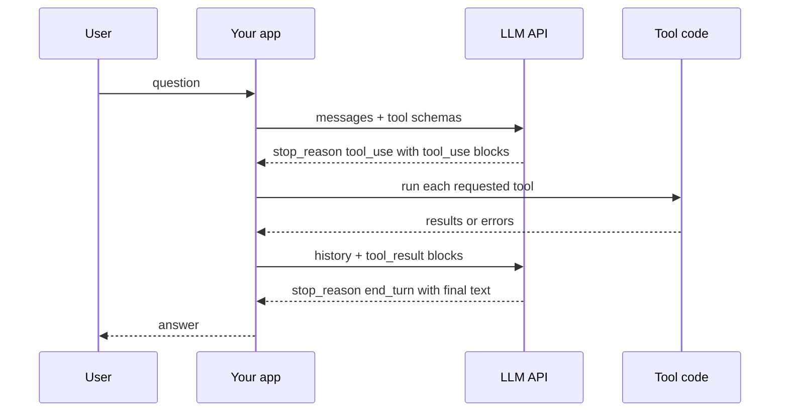
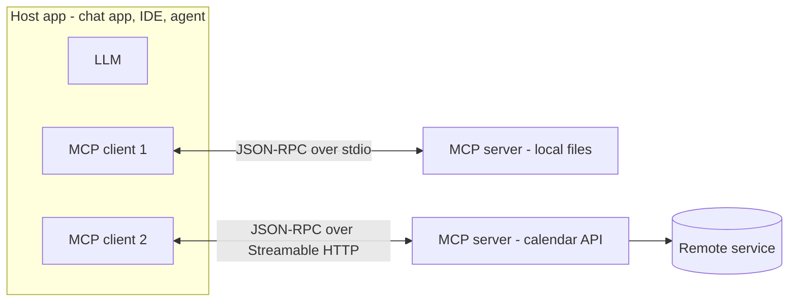

# Chapter 6 — Building LLM Apps in Python (APIs, Tools and MCP)

*Last reviewed: September 2026. Model names, prices and some parameters drift every few months; the concepts (messages, tokens, tool loops, caching, retries, MCP roles) have been stable for years. Check the provider's current docs before shipping.*

This chapter turns Chapters 3–5 into software: the AI tools people already use, then calling a model from Python the way production apps do — system prompt (standing instructions for the whole conversation), message history, token limits, streaming, JSON output, tools, retries, caching and memory — ending with the **Model Context Protocol (MCP)**, the open standard that lets one AI app plug into many tools and data sources.

API snippets are real SDK code (the provider's official library) but **not run here** (they need an API key and network). Every script in [`code/`](code/) runs offline with small local stand-ins. Prerequisites: basic Python (functions, dicts, classes, `try/except`) and tokens and context windows from [Chapter 4](../04-large-language-models/README.md); prompting is [Chapter 5](../05-prompt-engineering/README.md), multi-step agents [Chapter 9](../09-ai-agents/README.md).

---

## 6.1 The landscape of modern AI tools

### What it is

A **modern AI tool** is an application with a trained model inside that does a task described in plain language. The model is the engine; the tool is the car around it (interface, file handling, search, safety filters, billing).

| Family | What it does | Example products (as of Sept 2026) | Typical uses |
|---|---|---|---|
| **Chat assistants** (language and communication) | Answer, explain, summarise, draft, translate | ChatGPT (OpenAI), Claude (Anthropic), Gemini (Google), Microsoft Copilot, Meta AI | Research summaries, emails and reports, brainstorming |
| **Coding assistants** | Complete, explain, write and fix code; multi-step coding tasks | GitHub Copilot, Claude Code, Cursor, OpenAI Codex, Gemini Code Assist | Functions from descriptions, refactoring (restructuring without changing behaviour), tests, onboarding to a codebase |
| **Image and video generators** | Create or edit visuals from text | Midjourney, OpenAI image generation (the DALL·E line, now in ChatGPT), Adobe Firefly, Google Imagen and Veo, OpenAI Sora | Slide visuals, social posts, concept art, mock-ups |
| **Voice and audio** | Text-to-speech, voice cloning, transcription, music | ElevenLabs, OpenAI Whisper (speech-to-text), Google and Microsoft speech services | Narrated lessons, podcasts, dubbing, meeting transcripts |
| **Writing assistants** | Grammar, style, paraphrase, long-form drafting | Grammarly, QuillBot, Wordtune, Jasper, Sudowrite, NovelAI; Hemingway Editor (classic version: rule-based readability checks; its paid Plus tier adds AI rewrites) | Polishing emails, simplifying text, drafts |
| **Productivity and automation** | Act on files, inbox, calendar and apps | Copilot in Microsoft 365, Gemini in Google Workspace, Notion AI, Zapier and n8n AI steps | Sorting documents, scheduling, routine replies, meeting notes |

Names change quickly; families do not, and general chat assistants increasingly span several families.

### Why it matters

These tools save time on repetitive work, produce first drafts in seconds and condense reading into actionable summaries. Engineers use them and build features like them: every product above is *prompt + context + model call + tools + safety checks*.

### How to try them well

1. **Start free** — try two or three free tiers before paying.
2. **Prompt, then refine** — add constraints ("formal tone", "happy ending") iteratively.
3. **Be specific** — audience, length, format, an example.
4. **Compare models** — the same question to two assistants shows how much depends on the model.
5. **Verify** — all can be confidently wrong or biased; check facts, numbers, citations, code.
6. **Mind privacy** — read data-use settings before pasting company or personal data.

Access differs: web or mobile apps with an account; third-party apps with a small free allowance then a subscription; assistants with web search (e.g. Microsoft Copilot) that cite current pages; Midjourney began as a Discord bot (`/imagine` plus a prompt returns variations) and now has a web app; writing tools plug into editors and browsers.

**Hands-on reflection:** pick a repetitive weekly task (summarising, slides, boilerplate code, narration, filing, scheduling). Which family fits, how much time might it save, what must you double-check? §6.5 shows how to build such a helper.

### Common mistakes

- Treating output as final: hallucinated facts, fake citations and subtly wrong code are normal failure modes.
- Paying for overlapping subscriptions before learning what one general assistant can do.
- Pasting secrets or customer data into a consumer app whose settings allow training on inputs.

### Self-check

1. Is the classic Hemingway Editor generative AI? → No; fixed readability rules (only its Plus tier adds AI rewriting).

### TL;DR

AI tools are model engines wrapped in product features. Learn the families, try free tiers, refine prompts, compare models, verify everything important.

---

## 6.2 Calling an LLM API

### What it is

An **LLM API** is a web endpoint: you send JSON (model, instructions, conversation, limits) and receive JSON (generated content, why it stopped, tokens used). **SDKs** (software development kits) such as the `anthropic` and `openai` Python packages wrap HTTP (see [System Design Fundamentals](../../../system-design-patterns/modules/00-system-design-fundamentals/README.md)), authentication, retries and types.

**The API is stateless**: each request must carry everything — system prompt, conversation so far, tool definitions, retrieved documents.

### The anatomy of a request

| Field | Meaning | Anthropic Messages API | OpenAI Responses API | OpenAI Chat Completions |
|---|---|---|---|---|
| Model | Which model to run | `model` | `model` | `model` |
| **System prompt** | Standing instructions, persona, rules | top-level `system` | `instructions` (or a `developer`/`system` item) | a `{"role": "system"}` (or `developer`) message |
| **Messages** | Alternating user / assistant turns | `messages=[{"role": "user", ...}]` | `input` (string or list of items) | `messages` |
| Output limit | Hard cap on generated tokens | `max_tokens` (required) | `max_output_tokens` | `max_completion_tokens` (older `max_tokens`) |
| Randomness | Sampling temperature | `temperature` (not accepted on some newest models) | `temperature` (not on reasoning models) | `temperature` |
| Stop strings | Stop when this text appears | `stop_sequences` | — | `stop` |
| Tools | Functions the model may call | `tools` | `tools` | `tools` |

- **Token** — unit models read and write (~4 characters, ¾ of an English word); **context window** — maximum input + output tokens per call.
- **`max_tokens`** — your *output* cap; hitting it cuts the reply mid-sentence. On models that think before answering (Claude Opus 5.5 always does), thinking tokens count toward it, so leave headroom.
- **Stop reason** — finished (`end_turn` / `stop`), hit the cap (`max_tokens` / `length`), wants a tool (`tool_use` / function call), or matched a stop sequence.
- **Usage** — input and output token counts, which you are billed on.

### Code: the same call on two providers (needs an API key — not run)

```python
# Anthropic Messages API  (pip install anthropic; export ANTHROPIC_API_KEY=...)
import anthropic

client = anthropic.Anthropic()          # reads the key from the environment
resp = client.messages.create(
    model="claude-opus-5-5",            # current id (Sept 2026); ids change, see the models page
    max_tokens=1024,                    # required: cap on output tokens
    system="You are a concise tutor. Answer in at most 3 sentences.",
    messages=[{"role": "user", "content": "What is a context window?"}],
)
print(resp.stop_reason)                  # "end_turn", "max_tokens", "tool_use", ...
print(resp.usage.input_tokens, resp.usage.output_tokens)
for block in resp.content:               # content is a LIST of typed blocks
    if block.type == "text":
        print(block.text)
```

```python
# OpenAI Responses API  (pip install openai; export OPENAI_API_KEY=...)
from openai import OpenAI

client = OpenAI()
resp = client.responses.create(
    model="gpt-6-luna",                  # current id (Sept 2026); check the models page
    instructions="You are a concise tutor. Answer in at most 3 sentences.",
    input="What is a context window?",
    max_output_tokens=1024,
)
print(resp.output_text)                  # convenience: all text output joined
print(resp.usage.input_tokens, resp.usage.output_tokens)

# The older Chat Completions API (still widely used and copied by other vendors)
chat = client.chat.completions.create(
    model="gpt-6-luna",
    messages=[{"role": "system", "content": "You are a concise tutor."},
              {"role": "user", "content": "What is a context window?"}],
    max_completion_tokens=1024,
)
print(chat.choices[0].message.content, chat.choices[0].finish_reason)
```

The client reads the key from an environment variable (never hard-code keys); the system prompt sets rules for the whole conversation; `messages`/`input` holds the turns; the response gives content, stop reason and usage. To continue a conversation, append the assistant reply and the next user turn and send **everything** again (§6.9). Many providers and local servers (vLLM, Ollama) expose a Chat-Completions-compatible endpoint, making it the de facto lingua franca.

### Temperature: controlling randomness

Temperature T divides the model's **logits** before **softmax**: p_i = e^(z_i/T) / Σ_j e^(z_j/T) (decoding in depth: [Chapter 4](../04-large-language-models/README.md)). Logits [2.0, 1.0, 0.1]:

| T | Probabilities | Effect |
|---|---|---|
| 0.5 | 0.864, 0.117, 0.019 | Sharper: nearly always the top token (focused, repeatable) |
| 1.0 | 0.659, 0.242, 0.099 | The model's own distribution |
| 2.0 | 0.502, 0.304, 0.194 | Flatter: more variety, more mistakes |

Low (0–0.3) for extraction, classification and code; 0.7–1.0 for creative work. **Temperature 0 is not a determinism guarantee** (server batching, floating-point effects). **Top-p** (sample from the smallest set covering probability p) is the alternative knob; change one, not both.

**Reasoning models** manage sampling internally and several reject the parameters: recent Claude models (Opus 4.7 and later, Sonnet 5 and later) error on `temperature`, and OpenAI's reasoning models don't accept it. Steer with the prompt and an **effort** setting (Anthropic `output_config={"effort": "low"|"medium"|"high"|...}`, OpenAI `reasoning={"effort": ...}`): lower effort = less thinking, fewer tokens, faster answers.

### Trade-offs: which OpenAI API?

| | Chat Completions | Responses |
|---|---|---|
| Shape | List of messages in, one message out | Items in, a list of output items out (text, tool calls, reasoning) |
| State | You resend history | Resend history, or chain with `previous_response_id` / conversation objects |
| Built-in tools | Function calling | Function calling plus hosted tools (web search, file search, code interpreter = a sandbox where the model runs code, remote MCP) |
| Status | Supported, industry-standard shape | OpenAI's recommended API for new projects |

### Common mistakes

- **Forgetting that `max_tokens` truncates** — check the stop reason; `max_tokens`/`length` means incomplete.
- **Reading `content` as a string** — in the Messages API it is a list of blocks (text, tool_use, thinking); check `type`.
- **Putting the key in code** or a front-end app where anyone can read it; call LLM APIs from your server.
- **Pinning a model id forever** — models retire; keep the id in configuration and re-run evaluations on change ([Chapter 8](../08-prompting-vs-finetuning-vs-rag-and-llm-evaluation/README.md)).

### In the interview

**30-second answer:** "An LLM API is stateless: each call sends the model id, a system prompt, the message history and an output-token cap, and returns content blocks, a stop reason and token usage. I keep keys server-side, check the stop reason for truncation or tool calls, log usage for cost, and keep model ids in config so I can swap and re-evaluate."

- *Why is `max_tokens` required on Anthropic?* It bounds cost and latency per call; generation stops at the cap with `stop_reason="max_tokens"`.
- *More consistent outputs?* Lower temperature (where supported), clearer instructions and examples, structured outputs, validation — never assume bit-for-bit determinism.
- *Why do vendors mimic Chat Completions?* It became the common interface, so SDKs and tools work across providers with a changed base URL.

### Self-check

1. Logits [2, 1, 0.1] at T = 0.5: top-token probability? → About 0.86.
2. Where does the system prompt go in the Anthropic API? → The top-level `system` parameter, not inside `messages`.

### TL;DR

Request = model + system + messages + limits (+ tools). Response = content blocks + stop reason + usage. The API forgets everything between calls. Temperature reshapes the distribution but isn't on every model and never guarantees determinism.

---

## 6.3 Streaming

### What it is

**Streaming** returns the answer in pieces as generated, via **server-sent events** (SSE — a long-lived HTTP response that pushes events), instead of a spinner until the whole answer is done.

### Why it matters

A 600-token answer at ~60 tokens/second takes ~10 seconds. Streaming shows the first words after the **time to first token (TTFT)**, often under a second or two: perceived latency drops though total time is the same. It also avoids HTTP timeouts on very long outputs; the Anthropic SDK asks you to stream when `max_tokens` is very large.

### How it works

1. Set a stream flag (or use a streaming helper).
2. Events: message start → content-block start → many **deltas** (text fragments) → block stop → message stop (with final usage).
3. Forward each delta to the UI (via SSE or WebSocket) and accumulate the full text for logging and checks.

### Code (needs an API key — not run)

```python
# Anthropic: the stream helper accumulates state for you
with client.messages.stream(
    model="claude-opus-5-5", max_tokens=2048,
    messages=[{"role": "user", "content": "Explain RAG to a new hire."}],
) as stream:
    for text in stream.text_stream:          # just the text deltas
        print(text, end="", flush=True)
    final = stream.get_final_message()       # full message + usage at the end

# OpenAI Responses: iterate typed events
stream = client.responses.create(model="gpt-6-luna", input="Explain RAG.", stream=True)
for event in stream:
    if event.type == "response.output_text.delta":
        print(event.delta, end="", flush=True)
```

The offline `FakeLLM.stream()` in [`code/fake_llm_tool_loop.py`](code/fake_llm_tool_loop.py) yields chunks the same way (output in §6.5).

### Trade-offs

| Streaming | Buffering (wait for full answer) |
|---|---|
| Fast perceived latency, good chat UX | Simpler code |
| Harder to validate or moderate before the user sees it | Safety, JSON and citation checks run **before** release |
| Partial output if the connection drops | All-or-nothing |

Buffer when a check must pass before anything is shown (regulated answers, JSON for a parser, verified citations) — a mid-stream check can stop further text but can't take back words on screen — and for batch jobs, which gain nothing.

### Common mistakes

- Not accumulating the full text, leaving nothing to log or evaluate.
- Not handling a stream that errors half-way (show what arrived plus a retry).
- Streaming JSON into a parser expecting a complete document.

### TL;DR

Stream for chat UX; buffer when output must be checked first. Always keep the assembled final text and usage.

---

## 6.4 Structured output (JSON mode and schemas)

### What it is

**Structured output** gets the model to return machine-readable data (usually JSON) matching a **schema** (required fields and types, usually JSON Schema). Prompting technique is in [Chapter 5 §5.6](../05-prompt-engineering/README.md); this section covers the API options.

### The problem it solves

"Return JSON" usually works, and "usually" breaks pipelines: a friendly sentence before the JSON, a code fence, `"12"` instead of `12`, a missing field.

### How it works: four levels of strictness

| Level | How | Guarantee |
|---|---|---|
| 1. Prompt only | "Return only JSON with keys …" plus an example | None; validate and retry |
| 2. **JSON mode** | OpenAI `text={"format": {"type": "json_object"}}` (Responses) or `response_format={"type": "json_object"}` (Chat Completions) | Valid JSON syntax, but not your schema |
| 3. **Structured outputs** | Supply a JSON Schema; decoding is constrained to it (Anthropic `output_config={"format": {"type": "json_schema", ...}}`; OpenAI `text={"format": {"type": "json_schema", "strict": True, ...}}`) | Output parses and matches the schema (within documented schema limits) |
| 4. **Strict tool use** | A tool whose input schema is your data shape, with `strict: true` | Tool-call arguments match the schema |

**Constrained decoding** masks tokens: at each step only tokens keeping the output a valid prefix of something the schema accepts are allowed. Shape is guaranteed, *values* are not (a misread date), so validate business rules in code.

### Code (needs an API key — not run)

```python
schema = {
    "type": "object",
    "properties": {"name": {"type": "string"}, "email": {"type": "string"},
                   "plan": {"type": "string"}, "seats": {"type": "integer"}},
    "required": ["name", "email", "plan", "seats"],
    "additionalProperties": False,
}
# Anthropic structured outputs
resp = client.messages.create(
    model="claude-opus-5-5", max_tokens=1024,
    messages=[{"role": "user", "content": "Asha Rao, asha@example.com, Team plan, 12 seats"}],
    output_config={"format": {"type": "json_schema", "schema": schema}},
)
data = json.loads(next(b.text for b in resp.content if b.type == "text"))

# OpenAI Responses structured outputs
resp = client.responses.create(
    model="gpt-6-luna", input="Asha Rao, asha@example.com, Team plan, 12 seats",
    text={"format": {"type": "json_schema", "name": "signup", "schema": schema, "strict": True}},
)
data = json.loads(resp.output_text)
```

Both SDKs offer Pydantic helpers (`client.messages.parse(...)`, `client.responses.parse(...)`) returning a validated Python object.

### Code: validate-and-retry fallback (runs offline)

Without native structured outputs, validate yourself and feed errors back:

```python
# code/memory_and_json.py (core)
def get_structured(llm, request, max_attempts=3):
    prompt = f"Return ONLY JSON with keys name, email, plan, seats (int).\n{request}"
    for attempt in range(1, max_attempts + 1):
        raw = llm.complete(prompt)
        try:
            obj = extract_json(raw)            # tolerate chatter around the JSON
            errors = validate(obj)             # required keys + types
        except json.JSONDecodeError as e:
            errors = [f"invalid JSON: {e}"]
        if not errors:
            return obj
        prompt += f"\nYour last answer had problems: {errors}. Fix them."
    raise ValueError("model never produced valid output")
```

Output:

```
Structured output with validate-and-retry:
  attempt 1: errors=["'seats' must be int, got str"]
  attempt 2: errors=[]
  result: {'name': 'Asha Rao', 'email': 'asha@example.com', 'plan': 'Team', 'seats': 12}
```

The fake model first returned chatty text with `"seats": "12"`; the error steered attempt 2. Bound retries and log failures.

### Trade-offs

| Approach | Pros | Cons |
|---|---|---|
| Prompt + validate | Works with any model | Extra calls on failure |
| JSON mode | Always parses | Fields and types not enforced |
| Structured outputs / strict tools | Schema guaranteed | Only some schema features supported; first use of a new schema can add latency; values can still be wrong |

### Common mistakes

- Assuming JSON mode enforces the schema.
- Asking for JSON plus "a friendly explanation" in one output.
- Skipping semantic validation (`seats` ≥ 1, email contains `@`).
- Deeply nested, optional-everything schemas; flat, required fields are more reliable.

### In the interview

**30-second answer:** "I use schema-constrained structured outputs or strict tool definitions so JSON always parses and matches the schema, then validate business rules in code. Where unavailable, I prompt with an example, extract and validate, and retry with the error message, bounded."

- *JSON mode vs structured outputs?* Syntax only vs schema guaranteed.
- *Can the model still be wrong?* Yes; shape is guaranteed, content is not.

### Self-check

1. Why add `"additionalProperties": false`? → To forbid unexpected keys.

### TL;DR

Prefer schema-constrained structured outputs; fall back to validate-and-retry. Shape can be guaranteed, truth cannot.

---

## 6.5 Tool use (function calling): the end-to-end loop

### What it is

**Tool use** (OpenAI: **function calling**) lets the model ask *your code* to run a function. You describe tools (name, description, JSON Schema for arguments); the model replies with a structured request such as `get_weather(city="Paris")`; your code runs it and returns the result; the model answers. **The model never executes anything itself** — like a manager on the phone who can't touch the filing cabinet but can say "look up file 42".

### Why it matters

Tools supply **fresh or private data** (databases, search, internal APIs), **exact computation** (calculator, SQL, code execution) and **actions** (create a ticket, send an email). Every agent in [Chapter 9](../09-ai-agents/README.md) is this loop repeated.

### How it works



1. **Define tools**: clear name, a description saying *when* to use it, JSON Schema for inputs.
2. **Call the model** with messages and tools.
3. On `tool_use`, **append the assistant message** (with its tool_use blocks) to history.
4. **Validate and run** each requested tool; one turn may request several (**parallel tool calls**).
5. **Send all results back** in one user message, each `tool_result` linked by `tool_use_id`; report failures with `is_error: true` so the model can recover.
6. **Repeat** until `end_turn`, with a **maximum number of steps**.

### Code: the real loop (needs an API key — not run)

```python
tools = [{
    "name": "get_weather",
    "description": "Current weather for a city. Use when the user asks about weather.",
    "input_schema": {"type": "object",
                     "properties": {"city": {"type": "string"}},
                     "required": ["city"]},
}]
messages = [{"role": "user", "content": "Weather in Paris?"}]

for _ in range(8):                                      # step limit
    resp = client.messages.create(model="claude-opus-5-5", max_tokens=2048,
                                  tools=tools, messages=messages)
    if resp.stop_reason != "tool_use":
        break
    messages.append({"role": "assistant", "content": resp.content})
    results = []
    for block in resp.content:
        if block.type == "tool_use":
            try:
                out = TOOL_FUNCS[block.name](**block.input)   # your code runs it
                results.append({"type": "tool_result", "tool_use_id": block.id,
                                "content": str(out)})
            except Exception as e:
                results.append({"type": "tool_result", "tool_use_id": block.id,
                                "content": str(e), "is_error": True})
    messages.append({"role": "user", "content": results})   # ALL results, one message

print(next(b.text for b in resp.content if b.type == "text"))
```

OpenAI Responses uses the same loop with different names: tools are `{"type": "function", "name", "description", "parameters"}`; the model returns items with `type == "function_call"`, a `call_id` and JSON-string `arguments`; append `resp.output` to your input and add `{"type": "function_call_output", "call_id": ..., "output": ...}` items. The Anthropic SDK has a beta **tool runner** that drives the loop for you; write it by hand once to understand it.

### Code: the loop with a local FakeLLM (runs offline)

[`code/fake_llm_tool_loop.py`](code/fake_llm_tool_loop.py) defines a rule-based `FakeLLM` returning the same shapes (text and tool_use blocks, stop reason, usage); the loop is identical:

```python
# code/fake_llm_tool_loop.py (core of the loop)
def run_agent(llm, question, max_steps=5):
    messages = [{"role": "user", "content": question}]
    for step in range(1, max_steps + 1):
        resp = llm.create(system="You are a helpful travel assistant.",
                          messages=messages, tools=TOOLS)
        if resp.stop_reason != "tool_use":
            return "".join(b.text for b in resp.content if b.type == "text")
        messages.append({"role": "assistant", "content": resp.content})
        results = []
        for block in resp.content:
            if block.type != "tool_use":
                continue
            try:
                validate(block.input, schemas[block.name])          # check args
                output = REGISTRY[block.name](**block.input)        # run the tool
                results.append({"type": "tool_result", "tool_use_id": block.id,
                                "content": output})
            except Exception as exc:                                # report, don't crash
                results.append({"type": "tool_result", "tool_use_id": block.id,
                                "content": str(exc), "is_error": True})
        messages.append({"role": "user", "content": results})
    return "Stopped: too many tool steps."
```

Output:

```
Q1: What's the weather in Paris, and what is 100 USD in EUR?
step 1: stop_reason=tool_use, blocks=['text', 'tool_use', 'tool_use']
   ran get_weather({'city': 'Paris'}) -> Weather in Paris: 18°C and cloudy.
   ran convert_currency({'amount': 100.0, 'from': 'USD', 'to': 'EUR'}) -> 100 USD is about 92.00 EUR.
step 2: stop_reason=end_turn, blocks=['text']
tokens used: input=421, output=36
A1: Weather in Paris: 18°C and cloudy. 100 USD is about 92.00 EUR. 

Q2: What's the weather in Oslo?
step 1: stop_reason=tool_use, blocks=['text', 'tool_use']
   ran get_weather({'city': 'Oslo'}) -> no weather data for Oslo
step 2: stop_reason=end_turn, blocks=['text']
tokens used: input=351, output=22
A2: I could not get one result (no weather data for Oslo). 

Streaming the same final answer in chunks:
'Weather in T'
'okyo: 24°C a'
'nd sunny.'
```

(1) One turn requests two tools in parallel, both results return in one message; (2) a failing tool becomes an `is_error` result the model explains, not a crash; (3) input tokens grow each step because history is resent — tool loops get expensive fast.

### Trade-offs

| Choice | Option A | Option B |
|---|---|---|
| Tool count | Few, well-described tools: higher accuracy | Many tools: more capability, more confusion and prompt tokens (use tool search or routing) |
| Loop control | Model decides (`tool_choice: auto`) | Force a specific tool when you know it is needed (not supported on every model) |
| Side effects | Read-only tools run automatically | Write actions (payments, emails, deletes) need human confirmation |

Skip tools when data fits in the prompt or the step sequence is fixed (call the API yourself, then ask the model to summarise): deterministic code is cheaper and more reliable than a model deciding to call it.

### Common mistakes

- **Dropping the assistant's tool_use message** before sending results — the API rejects a `tool_result` without its call.
- **Splitting parallel results** across several user messages.
- **Trusting arguments blindly** — validate types and ranges; never pass model-written strings into SQL or a shell.
- **No step limit** and no per-tool timeout.
- **Trusting tool output** — a returned web page or email can carry instructions (**prompt injection**); keep permissions minimal and require approval for risky actions ([Chapter 12](../12-safety-ethics-governance/README.md)).

### Real-world examples

ChatGPT and Claude use tools for web search, code execution and file analysis; Claude Code, Cursor and GitHub Copilot's agent mode read files, edit and run tests; support bots call order-lookup and refund APIs behind approval rules.

### In the interview

**30-second answer:** "I describe tools with JSON Schemas. The model returns tool-call blocks; my code validates arguments, runs functions with least privilege, and returns results linked by id, errors included. I loop until the model finishes, with a step cap, per-tool timeouts and human approval for side-effecting actions. The model never executes code itself."

- *Stopping a runaway loop?* Max steps, max tokens/cost per task, timeouts, detection of repeated identical calls.
- *Right tool choice?* Clear names and when-to-use descriptions, few overlapping tools, examples, evaluation on real queries.
- *Why is tool output a security risk?* Untrusted text entering the prompt can carry injected instructions; defend with permissions, confirmation and isolation, not just a stern system prompt.

### Self-check

1. What links a result to its call? → `tool_use_id` (Anthropic) or `call_id` (OpenAI).
2. Why do tokens grow each step? → The full history, including tool results, is resent each call.

### TL;DR

Define tools → model requests calls → you validate and run → return results by id → repeat until `end_turn`, with step limits and approvals for risky actions.

---

## 6.6 Tokens, counting and cost estimation

### What it is

Providers bill per token, separately for **input** (everything sent, including history, tool definitions and retrieved text) and **output** (generated text). Output usually costs about 4–5× more per token.

### How it works

**Cost per request = input_tokens × input_price + output_tokens × output_price** (prices per million tokens, "MTok").

1. **Count tokens** with the provider's tokenizer — counts differ between vendors: Anthropic's `client.messages.count_tokens(model=..., messages=...)` endpoint; for OpenAI models `tiktoken` (e.g. `tiktoken.encoding_for_model(...)`). Offline, ~4 characters per English token is a first estimate; code and non-English text use more.
2. **Log real usage** per request, feature and user.
3. **Estimate monthly** = requests/day × cost/request × 30, then attack the biggest term.

```python
# needs an API key — not run
n = client.messages.count_tokens(model="claude-opus-5-5",
                                 messages=[{"role": "user", "content": long_text}])
print(n.input_tokens)
```

### Code: estimate before you build (runs offline)

[`code/token_cost.py`](code/token_cost.py) uses illustrative tiers: small $1/$5, mid $3/$15, large $5/$25 per MTok (input/output). For comparison, Anthropic's September 2026 list prices are $1/$5 (Haiku 4.5), $2/$10 (Sonnet 5.5) and $4/$20 (Opus 5.5).

```python
def request_cost(model, in_tok, out_tok):
    p_in, p_out = PRICES[model]
    return in_tok / 1e6 * p_in + out_tok / 1e6 * p_out
```

Output:

```
Token estimates for a 149 character sentence:
  chars/4       37
  words*1.33    29
  regex pieces  33

One request: 3,500 input tokens, 400 output tokens
  small  $0.0055
  mid    $0.0165
  large  $0.0275

Support bot, 10,000 requests/day on the 'mid' model:
  no caching          $  165.00/day  ($4,950/month)
  prefix cached       $   86.98/day  ($2,609/month)
  saving              47%
  output share of bill (no cache): 36%
  cached + routed to 'small' model $28.99/day
```

By hand (mid): 3,500 × $3/1M = $0.0105 input + 400 × $15/1M = $0.0060 output = $0.0165; × 10,000 = $165/day. The offline estimators disagree by ~25%, so real budgets use the provider's counter. Caching and routing easy traffic to a smaller model are the two biggest levers.

### Cost levers, in order

1. Cache the stable prefix (§6.8). 2. Trim input: shorter system prompts, fewer/shorter retrieved chunks, summarised history. 3. Cap and shape output (`max_tokens`, "answer in 3 bullets"). 4. Route easy requests to a smaller model. 5. **Batch APIs** for offline jobs (Anthropic and OpenAI both discount 50%, results within 24 hours). 6. Cut retries and tool-loop steps.

### Common mistakes

- Using one vendor's tokenizer for another's model.
- Forgetting that tool definitions, system prompts and the whole history are input on **every** call.
- Judging cost per request rather than **cost per completed task** (a cheap model needing three retries isn't cheap).

### Self-check

1. 2,000 input at $3/MTok + 500 output at $15/MTok? → $0.006 + $0.0075 = $0.0135.

### TL;DR

Cost = tokens in × price in + tokens out × price out. Count with the provider's tokenizer, log usage, attack the biggest term: history, retrieved context, output length or model choice.

---

## 6.7 Retries, rate limits and timeouts

### What it is

Remote APIs fail. **Rate limits** cap requests per minute (RPM) and input/output tokens per minute (TPM), per model and organisation tier; exceeding them returns **HTTP 429** ("too many requests"; see [System Design Fundamentals](../../../system-design-patterns/modules/00-system-design-fundamentals/README.md) for rate limiting), often with a `retry-after` header. Overloaded servers return **5xx** errors (Anthropic uses 529 for "overloaded"), and networks time out.

### How it works

| Error | Retry? | What to do |
|---|---|---|
| 400 bad request, 401/403 auth, 404 model not found | **No** | Fix the request or credentials |
| 408 timeout, 409 conflict, 429 rate limit | Yes | Wait (use `retry-after` if present) |
| 500, 502, 503, 529 | Yes | Exponential backoff with jitter |
| Connection error / client timeout | Yes | Backoff; consider a fallback model or provider |

**Exponential backoff with jitter:** wait a random time in [0, min(cap, base × 2^attempt)]. Doubling spreads retries; **jitter** stops thousands of clients retrying in lock-step (the "thundering herd").

Both official Python SDKs retry connection errors, 408, 409, 429 and 5xx with backoff (default 2 retries) and default to a 10-minute timeout; set `max_retries` and `timeout` per client or request:

```python
# needs an API key — not run
client = anthropic.Anthropic(max_retries=4, timeout=30.0)
try:
    resp = client.with_options(timeout=10.0).messages.create(...)
except anthropic.RateLimitError:        # 429 after all retries
    ...                                  # queue it, degrade, or tell the user
except anthropic.APIStatusError as e:    # other HTTP errors (check e.status_code)
    ...
except anthropic.APIConnectionError:     # network problems, including timeouts
    ...
```

### Code: backoff, retry-after and a token bucket (runs offline)

```python
# code/retry_backoff.py (core)
for attempt in range(max_retries + 1):
    try:
        return api.call(prompt, timeout)
    except BadRequestError:
        raise                                        # never retry a 4xx bug
    except (RateLimitError, ServerError, TimeoutError) as e:
        if attempt == max_retries:
            raise
        wait = (e.retry_after if isinstance(e, RateLimitError)
                else rng.uniform(0, min(cap, base * 2 ** attempt)))   # full jitter
        clock.sleep(wait)
```

Output:

```
Flaky API: 429, 500, timeout, then OK
  t= 0.00s attempt 1: 429 rate limited -> wait 2.00s
  t= 2.00s attempt 2: 500 internal error -> wait 0.84s
  t=12.84s attempt 3: no response within 10.0s -> wait 1.52s
  t=14.36s attempt 4: success
 -> answer to 'hello'

A 400 error is raised immediately:
  t=14.36s attempt 1: 400 invalid request: max_tokens too large -> not retryable
 -> caller fixes the request instead of retrying

Token bucket: 2 requests/second, burst of 3, 8 requests arrive at once
  send times (s): [0.0, 0.0, 0.0, 0.5, 1.0, 1.5, 2.0, 2.5]
```

The **token bucket** is a client-side limiter: it refills at `rate` per second up to `capacity` (the burst size), each request spending one, so bursts pass and then traffic smooths under your quota instead of collecting 429s. Timeouts add up: worst-case latency ≈ timeout × (retries + 1) plus backoff, so set timeouts from your latency budget, not the SDK default.

### Trade-offs

More retries raise success rate but also tail latency (the slowest few percent) and cost. User-facing chat: few retries plus a **fallback** (smaller model, another region or provider, a cached answer); batch jobs: retry patiently.

### Common mistakes

- Retrying 400s (they fail forever).
- No jitter, or retries in several layers at once (SDK × yours × a queue's = a retry storm).
- Retrying non-**idempotent** actions (idempotent = doing it twice has the same effect as once): a retried "send email" sends two. Use idempotency keys (unique request IDs the receiver de-duplicates; see [System Design Fundamentals](../../../system-design-patterns/modules/00-system-design-fundamentals/README.md)).
- No timeout on stalled streams.

### In the interview

**30-second answer:** "4xx client errors fail fast; 429, 5xx, overload and timeouts retry with capped exponential backoff and jitter, honouring retry-after. Timeouts come from the latency budget; I rate-limit client-side with a token bucket or queue, make side effects idempotent, and fall back to another model or a graceful message when retries run out."

- *Why jitter?* To avoid synchronised retry waves.
- *Limits besides RPM?* Input and output tokens per minute, per model; a long-context call can hit the token limit with few requests.

### Self-check

1. Base 0.5 s, cap 8 s: maximum wait before attempt index 3? → min(8, 0.5 × 2³) = 4 s.

### TL;DR

Fail fast on client errors; back off with jitter on 429/5xx/timeouts; honour retry-after; limit yourself before the server does; make retried actions idempotent.

---

## 6.8 Caching: prompt caching and response caching

### What it is

1. **Prompt caching (provider-side prefix caching):** the provider stores the processed state (the KV cache from Chapter 4) for a **prefix** of your prompt; a request starting with the identical prefix skips recomputing it — cheaper and faster.
2. **Response caching (your side):** store final answers and return them for repeated (exact) or similar (semantic) questions without calling the model.

### How prompt caching works

1. **Stable content first** (tool definitions, system prompt, long reference documents, few-shot examples); **changing content last** (user question, timestamps, IDs).
2. On Anthropic, mark the end of the reusable prefix with `cache_control`, or set top-level automatic caching. It is an exact **prefix match**: one changed byte (a timestamp in the system prompt) invalidates everything after it.
3. Pricing (Anthropic, Sept 2026): cache **write** 1.25× normal input for a 5-minute lifetime (2× for 1 hour); cache **read** 0.1× on most models (0.05× on Opus 5.5, 0.025× on Fable 5.1). Each hit refreshes the lifetime. Two requests in the window already win (1.25 + 0.1 = 1.35 vs 2.0).
4. OpenAI caches **automatically** (current models, prompts of at least 1,024 tokens; cached input 0.1× on the newest models), with an optional explicit mode for placing breakpoints; mainly keep the prefix stable.
5. Verify in usage: Anthropic `cache_creation_input_tokens` and `cache_read_input_tokens`; OpenAI `usage.input_tokens_details.cached_tokens`.

```python
# needs an API key — not run
resp = client.messages.create(
    model="claude-opus-5-5", max_tokens=1024,
    system=[{"type": "text", "text": LONG_POLICY_MANUAL,       # stable, >1 page
             "cache_control": {"type": "ephemeral"}}],           # cache up to here
    messages=[{"role": "user", "content": question}],            # varies per call
)
print(resp.usage.cache_creation_input_tokens, resp.usage.cache_read_input_tokens)
```

In the §6.6 cost script, caching a 3,000-token prefix cut the bill 47% even with the cache expiring every 5 minutes (288 writes a day). Each model has a **minimum cacheable length** (a few hundred to a few thousand tokens); shorter prefixes silently don't cache.

### Response caching

| Kind | Key | Good for | Danger |
|---|---|---|---|
| Exact cache | Hash of (model, prompt, parameters) | Repeated identical requests, evaluations, dev loops | Stale answers after data changes |
| Semantic cache | Embedding similarity (Chapter 7) of the question | FAQ-style traffic | "Similar" is not "same": *cancel my order* vs *cancel my subscription*; can leak one user's answer to another |

Include model version, prompt version and **permission scope** in keys, and invalidate when source documents change or are deleted ([Chapter 7](../07-embeddings-vector-databases-and-rag/README.md)).

### Common mistakes

- A timestamp or random ID at the top of the system prompt (nothing ever caches).
- Reordering tools or switching models mid-conversation (caches are per model and prefix).
- Shared semantic caches that ignore who is asking.

### Self-check

1. What must be identical for a prompt-cache hit? → The whole prefix up to the cache point, byte for byte.

### TL;DR

Prompt caching reuses the provider's work on a stable prefix: stable first, variable last, verify with usage. Response caching skips the model but needs careful keys and invalidation.

---

## 6.9 Conversation memory management

### What it is

With a stateless API, "memory" is whatever **you** send back. **Memory management** decides which past turns, summaries and facts go into each request so the model stays coherent within the context window and budget.

### Why it matters

History grows every turn, and you pay for all of it on every call. Very long contexts also dilute attention ("lost in the middle": mid-context information is used less reliably).

### How it works: strategies

| Strategy | How | Pros | Cons |
|---|---|---|---|
| Full history | Send everything | Simple, nothing lost | Cost grows each turn; hits the window |
| Sliding window | Last N turns or last T tokens | Bounded cost | Forgets early facts (names, goals) |
| **Summary + window** | Summarise dropped turns with a cheap model; keep recent turns verbatim | Bounded, keeps gist | Summaries lose details and can distort |
| Fact memory | Extract durable facts ("user's plan = Team") into a store; inject relevant ones | Precise, persists across sessions | Extraction errors; privacy duties |
| Retrieval memory | Embed past turns; retrieve relevant ones (Chapter 7) | Scales to long histories | More moving parts |
| Server-side state | OpenAI `previous_response_id` / conversation objects; Anthropic's compaction (beta) summarises server-side | Less client code | Provider-specific; you still pay for the tokens used |

### Code: summary + sliding window under a token budget (runs offline)

```python
# code/memory_and_json.py (core)
def build_context(history, budget, keep_last=2):
    kept, used = [], 0
    for turn in reversed(history):                  # newest first
        cost = tokens(turn["content"])
        if len(kept) >= keep_last and used + cost > budget:
            break
        kept.insert(0, turn)
        used += cost
    dropped = history[: len(history) - len(kept)]
    if dropped:
        kept.insert(0, {"role": "user", "content": "[summary] " + fake_summarize(dropped)})
    return kept, dropped
```

Output:

```
full history: 7 turns, ~74 tokens
sent to model: 4 messages, ~52 tokens, 4 turns summarized
  user      [summary] Earlier the user said: My name is Asha; We use the Team plan.
  user      Can we switch to annual billing and add 3 seats?
  assistant Yes. Annual billing saves money; seats can be added any time.
  user      Great, what will the new total be?
```

The summary lost "12-person design studio", yet "new total" needs the seat count — the classic failure of lossy memory. Fix: extract key facts (seats = 12) into a small structured memory that is always sent.

### Common mistakes

- Dropping the system prompt when trimming (always keep it).
- Cutting between a tool call and its result (the pair stays together).
- Storing personal data long-term without consent, retention limits and a way to delete it.

### TL;DR

You own memory: system prompt, recent turns verbatim, a summary of older turns, and a small store of durable facts, all under a token budget.

---

## 6.10 The Model Context Protocol (MCP)

### What it is

The **Model Context Protocol (MCP)** is an open protocol, introduced by Anthropic in November 2024, standardising how an AI application connects to external **tools** and **data sources** — "**USB-C for AI**": a service written once as an **MCP server** works in any AI app containing an **MCP client**, instead of custom glue per app and service.

It is widely supported: Claude's apps and Claude Code, ChatGPT and the OpenAI APIs (remote MCP servers), Microsoft's Copilot tools and VS Code, Cursor and many others. In December 2025 Anthropic donated MCP to the Agentic AI Foundation, a Linux Foundation project, making it a vendor-neutral standard.

### The problem it solves

M AI apps × N tools need M × N custom connectors; a shared protocol needs M clients + N servers:

- **Integration:** a GitHub, Postgres or Google Drive server works in every MCP host unchanged.
- **Efficiency:** less custom code; tools are discovered at run time, plug-and-play.
- **Future-proofing:** switch model or app vendor and keep your servers.

MCP connects **an AI application to capabilities and context**; it is not mainly for models talking to each other — agent-to-agent messaging has its own emerging standards (e.g. the Agent2Agent protocol).

### How it works

**Roles**



- **Host** — the application the user runs (Claude Desktop, an IDE, your agent); owns the LLM, UI and user consent.
- **Client** — a connector inside the host, one per server connection.
- **Server** — a program exposing capabilities (a wrapper around Git, a database, a SaaS API).

**Messages.** **JSON-RPC 2.0** (function calls and results as JSON): requests (`{"jsonrpc": "2.0", "id": 1, "method": "tools/list", "params": {}}`), responses with `result` or `error`, and one-way notifications.

**Transports.** **stdio** (the host launches a local subprocess and talks over standard input/output; credentials from the environment) and **Streamable HTTP** (remote server, optionally streaming with SSE; the spec defines an OAuth-based authorization framework — OAuth lets an app act for you without your password).

**What servers offer — three primitives, by who controls them:**

| Primitive | Controlled by | What it is | Methods | Example |
|---|---|---|---|---|
| **Tools** | The model | Functions the LLM may call (with the host asking the user's permission) | `tools/list`, `tools/call` | `create_issue`, `run_sql`, `search_notes` |
| **Resources** | The application | Read-only data identified by a URI that the host may put into context | `resources/list`, `resources/read` | `file:///README.md`, `notes://meeting/2026-09-21` |
| **Prompts** | The user | Reusable templates, often shown as slash commands | `prompts/list`, `prompts/get` | `/summarize_meeting` |

**What clients offer servers:** **elicitation** (the server asks the user for extra input via the host), plus two features the 2026-07-28 revision **deprecates** but supports for a 12-month window: **sampling** (the server asks the host's model to generate text; new servers should call a model API directly) and **roots** (which folders or URIs the server may use; pass them as tool arguments or configuration instead).

**Versions.** The spec is versioned by date. Up to 2025-11-25, sessions are stateful with an `initialize` handshake negotiating version and capabilities. The **2026-07-28** revision is stateless: every request carries protocol version and client capabilities in `_meta`, there is no handshake or session ID, servers must implement `server/discover`, and every result carries `resultType`. When a server needs input mid-request (elicitation), it returns an "input required" result and the client retries with the answers (**multi round-trip requests**). Servers may support both eras; SDKs hide the details.

**Worked flow: scheduling a meeting.** With calendar, contacts and email servers connected, "Set up 30 minutes with Priya and Omar next week" makes the model call `contacts.lookup` for both, then `calendar.find_free_slots`, pick a time, and call `calendar.create_event` (which sends invitations) — each a `tools/call` through a different client, with a host confirmation before the event is created. A scheduled weekly newsletter works the same way: news-search server, the model summarising, a docs or email server sending.

### Code: a minimal MCP server (official Python SDK — not run here)

The SDK derives each tool's JSON Schema from type hints and docstrings:

```python
# server.py  (pip install mcp)  - Python SDK v2; in v1 the class is FastMCP:
#   from mcp.server.fastmcp import FastMCP
from mcp.server import MCPServer

mcp = MCPServer("notes")

NOTES = {"2026-09-21": "Decided: ship v2 on Oct 5. Owner: Priya."}

@mcp.tool()
def search_notes(query: str) -> str:
    """Search meeting notes by keyword."""
    hits = [f"{d}: {t}" for d, t in NOTES.items() if query.lower() in t.lower()]
    return "\n".join(hits) or "no matches"

@mcp.resource("notes://meeting/{date}")
def meeting(date: str) -> str:
    """The full notes of one meeting."""
    return NOTES[date]

@mcp.prompt()
def summarize_meeting(date: str) -> str:
    """Summarize one meeting as three bullets."""
    return f"Summarize this meeting in 3 bullets:\n{NOTES[date]}"

if __name__ == "__main__":
    mcp.run()        # stdio by default; test with the MCP Inspector
```

A host launches it (e.g. its MCP settings file lists `python server.py`), lists its tools and offers them to the model.

### Code: the JSON-RPC messages underneath (runs offline)

[`code/mcp_toy.py`](code/mcp_toy.py) is a toy imitation (not the SDK) printing the core request/response shapes and the host-side conversion of MCP tools into LLM tool definitions; it omits the 2026-07-28 `_meta` and `resultType` fields for brevity:

```python
def mcp_tools_to_llm_tools(mcp_tools):
    """Host glue: MCP 'inputSchema' -> the LLM API's tool format."""
    return [{"name": t["name"], "description": t["description"],
             "input_schema": t["inputSchema"]} for t in mcp_tools]
```

Output (long lines truncated by the script):

```
1) discover tools
  -> {"jsonrpc": "2.0", "id": 1, "method": "tools/list", "params": {}}
  <- {"jsonrpc": "2.0", "id": 1, "result": {"tools": [{"name": "search_notes", "description": "Search meeting notes...
   LLM tool definitions: [{'name': 'search_notes', 'description': 'Search meeting notes by keyword.', 'input_schema': {'type': 'object', 'properties': {'query': {'type': 'string'}}, 'required': ['query']}}]
2) the model asked to call search_notes -> host calls the server
  -> {"jsonrpc": "2.0", "id": 2, "method": "tools/call", "params": {"name": "search_notes", "arguments": {"query": "ship"}}}
  <- {"jsonrpc": "2.0", "id": 2, "result": {"content": [{"type": "text", "text": "notes://meeting/2026-09-21: Decid...
3) read a resource
  -> {"jsonrpc": "2.0", "id": 3, "method": "resources/read", "params": {"uri": "notes://meeting/2026-09-21"}}
  <- {"jsonrpc": "2.0", "id": 3, "result": {"contents": [{"uri": "notes://meeting/2026-09-21", "mimeType": "text/pl...
4) fetch a prompt template
  -> {"jsonrpc": "2.0", "id": 4, "method": "prompts/get", "params": {"name": "summarize_meeting", "arguments": {"uri": "notes://meeting/2026-09-21"}}}
  <- {"jsonrpc": "2.0", "id": 4, "result": {"messages": [{"role": "user", "content": {"type": "text", "text": "Summ...
5) unknown method
  -> {"jsonrpc": "2.0", "id": 5, "method": "files/delete", "params": {}}
  <- {"jsonrpc": "2.0", "id": 5, "error": {"code": -32601, "message": "Method not found"}}
```

With §6.5: MCP handles *discovering and executing* tools; the LLM API's tool loop handles *the model choosing* them; the host translates between them.

### Trade-offs

| MCP server | Direct tool code inside your app |
|---|---|
| Reusable across hosts and teams; ecosystem of ready servers | Simplest for one app and one or two tools |
| Process or network boundary: isolation, but more latency and ops | In-process, fastest |
| Standard auth and discovery | Your own conventions |

One app with two internal functions doesn't need a protocol; use MCP when several apps, teams or vendors share integrations, or to use existing servers.

### Common mistakes and security

- **Untrusted servers** — a server is code with your permissions; a malicious tool description can hide instructions for the model (**tool poisoning**), and a server can change its tools after approval.
- **Over-broad scopes** — minimum access (read-only, limited folders, scoped OAuth tokens).
- **Skipping consent** — the spec requires user consent before invoking tools and before exposing user data to servers; keep a human in the loop for writes.
- **Prompt injection through data** — resources and tool results (emails, web pages, tickets) can carry instructions; treat them as data.
- **Too many servers** — dozens of tools bloat the prompt and confuse tool choice; enable per task.

### Real-world examples

Official and community servers exist for GitHub, Slack, Google Drive, Postgres, filesystems, browsers (Playwright) and many SaaS products. Claude Code, VS Code and Cursor use them for coding; ChatGPT and the OpenAI Responses API call remote MCP servers; the Anthropic Messages API has an MCP connector for remote servers.

### In the interview

**30-second answer:** "MCP is an open JSON-RPC protocol connecting AI hosts to external capabilities. A host runs one client per server; servers expose tools the model calls, resources the app reads into context, and prompts users invoke; clients can ask the user for input through elicitation. The 2026-07-28 revision made it stateless — no handshake, version in every request. Transports are stdio locally and Streamable HTTP remotely with OAuth. It turns M×N integrations into M+N, but servers are code with your permissions, so I vet them, scope access, require consent and treat returned content as untrusted."

- *Tools vs resources?* Model-invoked actions or queries vs application-controlled read-only data addressed by URI.
- *How does an MCP tool reach the model?* The host lists server tools, converts them to the LLM API's tool definitions, and routes the model's tool call to `tools/call` on the right server.
- *What's sampling for?* A server asking the host's model to generate text, needing no model or key of its own; deprecated in 2026-07-28 (still works for now) — new servers call a model API directly.

### Self-check

1. Which primitive is user-controlled? → Prompts.
2. Which transport suits a local server? → stdio.

### TL;DR

MCP standardises the plug between AI apps and the outside world: hosts contain clients, clients talk JSON-RPC to servers, servers expose tools, resources and prompts. Build once, use everywhere — and treat every server as code running with your permissions.

---

## Chapter TL;DR

- **AI tools** come in six families (chat, coding, image/video, voice, writing, productivity); try free tiers, refine prompts, compare models, verify.
- **API call** = model + system prompt + messages + `max_tokens` (+ tools); response = content blocks + stop reason + usage. The API is **stateless**. Temperature reshapes probabilities (logits/T) but is not on every model and never guarantees determinism.
- **Streaming** cuts perceived latency (TTFT); buffer when output must be checked first.
- **Structured output**: schema-constrained outputs or strict tools guarantee shape; validate values; validate-and-retry as a fallback.
- **Tool use loop**: tools described with JSON Schema → model asks → your code validates and runs → results back by id (errors with `is_error`) → repeat until `end_turn`, with step limits and approvals.
- **Cost** = in-tokens × in-price + out-tokens × out-price; count with the provider's tokenizer; cache, trim, route, batch.
- **Reliability**: no retries on 4xx; backoff + jitter on 429/5xx/timeouts; honour retry-after; client-side rate limiting; idempotent side effects.
- **Caching**: stable prefix first for prompt caching (write 1.25×, read 0.1× or less on Anthropic; automatic on OpenAI); response caches need permission-aware keys and invalidation.
- **Memory**: system prompt + recent turns + summary + durable facts under a token budget.
- **MCP**: host / client / server over JSON-RPC (stdio or Streamable HTTP); tools (model), resources (app), prompts (user); M×N → M+N; vet servers, scope access, require consent.
