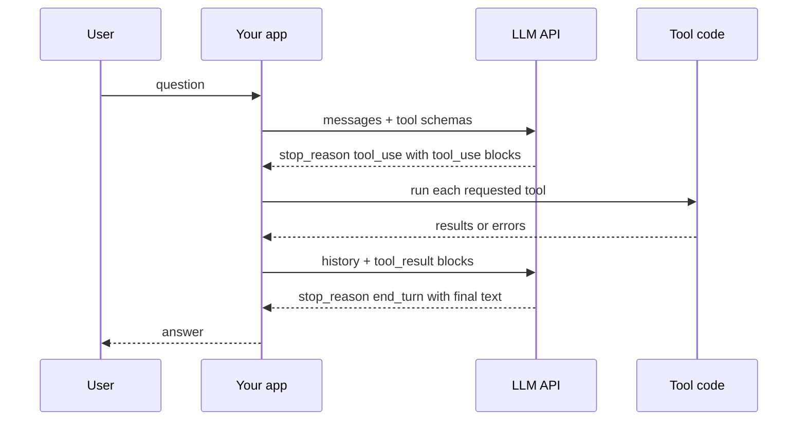
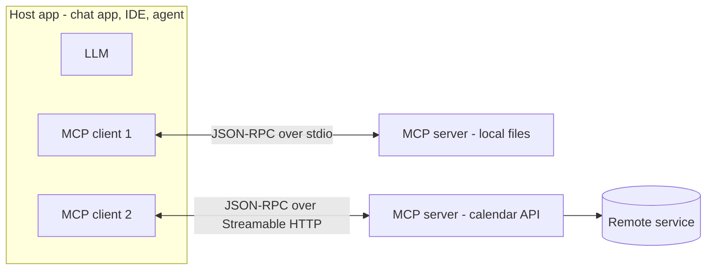

# Chapter 6 — Building LLM Apps in Python (APIs, Tools and MCP)

*Last reviewed: September 2026. LLM APIs change every few months: model names, prices and some parameters in this chapter will drift. The concepts (messages, tokens, tool loops, caching, retries, MCP roles) have been stable for years. Always check the provider's current docs before shipping.*

Chapters 3–5 explained what a large language model (LLM) is and how to prompt it. This chapter turns that into software. You will see the AI tools people already use, then learn to call a model from Python the way production apps do: with a system prompt, a message history, token limits, streaming, JSON output, tools the model can call, retries, caching and memory. The chapter ends with the **Model Context Protocol (MCP)**, the open standard that lets one AI app plug into many tools and data sources.

Every API snippet is real SDK code but is **not run here** (it needs an API key and network). Every script in [`code/`](code/) runs offline with small local stand-ins, so you can study the logic without paying for tokens.

**What you'll learn**

- The landscape of AI tools in 2026: chat assistants, coding assistants, image, video, voice and productivity tools, and how to try them sensibly
- The anatomy of an LLM API call (Anthropic Messages API and OpenAI Responses / Chat Completions): system prompt, messages, `max_tokens`, temperature, stop reasons, usage
- Streaming responses token by token
- Getting reliable JSON: JSON mode, schema-constrained structured outputs, validate-and-retry
- Tool use (function calling) as an end-to-end loop, with a runnable `FakeLLM`
- Counting tokens and estimating cost; prompt caching and response caching
- Retries, rate limits and timeouts
- Managing conversation memory within a context budget
- MCP: hosts, clients, servers, tools, resources, prompts, transports, security, and a minimal server

**Prerequisites.** Basic Python (functions, dicts, classes, `try/except`), and the ideas of tokens and context windows from [Chapter 4](../04-large-language-models/README.md). Prompting technique is in [Chapter 5](../05-prompt-engineering/README.md); agents that plan over many tool calls are [Chapter 9](../09-ai-agents/README.md).

---

## 6.1 The landscape of modern AI tools

### What it is

A **modern AI tool** is an application with a trained model inside that does a task you describe in plain language: answer a question, draft an email, write code, draw a picture, read text aloud, or tidy your calendar. The model is the engine; the tool is the car built around it (interface, file handling, search, safety filters, billing).

Most tools fall into six families:

| Family | What it does | Example products (as of Sept 2026) | Typical uses |
|---|---|---|---|
| **Chat assistants** (language and communication) | Answer, explain, summarise, draft, translate | ChatGPT (OpenAI), Claude (Anthropic), Gemini (Google), Microsoft Copilot, Meta AI | Research summaries, drafting emails and reports, brainstorming |
| **Coding assistants** | Complete, explain, write and fix code; run multi-step coding tasks | GitHub Copilot, Claude Code, Cursor, OpenAI Codex, Gemini Code Assist | Writing functions from a description, refactoring, tests, onboarding to a codebase |
| **Image and video generators** | Create or edit visuals from a text description | Midjourney, OpenAI image generation (the DALL·E line, now built into ChatGPT), Adobe Firefly, Google Imagen and Veo, OpenAI Sora | Slide visuals, social posts, concept art, marketing mock-ups |
| **Voice and audio** | Text-to-speech, voice cloning, transcription, music | ElevenLabs, OpenAI Whisper (speech-to-text), Google and Microsoft speech services | Narrated lessons, podcasts, dubbing into other languages, meeting transcripts |
| **Writing assistants** | Grammar, style, paraphrase, long-form drafting | Grammarly, QuillBot, Wordtune, Jasper, Sudowrite, NovelAI; Hemingway Editor (classic version: rule-based readability checks; its paid Plus tier adds AI rewrites) | Polishing emails, simplifying text, blog and story drafts |
| **Productivity and automation** | Act on your files, inbox, calendar, and apps | Copilot in Microsoft 365, Gemini in Google Workspace, Notion AI, Zapier and n8n AI steps | Sorting documents, scheduling, routine email replies, meeting notes |

Product names change quickly; the families do not. Many general chat assistants now span several families (they write code, generate images, speak, and call tools).

### Why it matters

These tools save time on repetitive work, raise output (a first draft in seconds), make creative ideas visible quickly, and condense large amounts of reading into summaries you can act on. For an engineer they matter twice: you use them, and you will build features like them. Every product in the table is, underneath, the pattern this chapter teaches: *prompt + context + model call + tools + safety checks*.

### How to try them well

1. **Start free.** Most offer a free tier or trial. Try two or three before paying.
2. **Prompt, then refine.** Ask ("Write a short poem about summer"), then add constraints ("formal tone", "include a happy ending"). Iteration beats one perfect prompt.
3. **Be specific.** Audience, length, format and an example improve results more than clever wording.
4. **Compare models.** Send the same question to two assistants; the differences show you how much depends on the model.
5. **Verify.** All of them can be confidently wrong or biased. Treat output as a draft; check facts, numbers, citations and code.
6. **Mind privacy.** Read the data-use settings before pasting company or personal data.

Access styles differ. Most run in a web or mobile app after you create an account; many third-party apps embed a model with a small free allowance and then charge a subscription; assistants connected to web search (Microsoft Copilot, for example) can pull in current pages and link their sources; Midjourney started as a Discord bot (you type `/imagine` plus a prompt and get several variations) and now also has a web app; writing tools often plug into your editor or browser.

### Hands-on reflection

Pick one repetitive task from your week (summarising long reading, making slides, writing boilerplate code, recording narration, sorting files, scheduling). Ask: which family above fits it? How would your workflow change, how much time might you save, and what would you have to double-check? Keep the answer; Section 6.5 shows how to build such a helper yourself.

### Common mistakes

- Treating output as final: hallucinated facts, fake citations and subtly wrong code are normal failure modes.
- Paying for many overlapping subscriptions before learning what one general assistant can do.
- Pasting secrets or customer data into a consumer app whose settings allow training on your inputs.

### Self-check

1. Name the six tool families. → Chat, coding, image/video, voice/audio, writing, productivity/automation.
2. Why compare two assistants on the same prompt? → It shows how much the answer depends on the model, not only your prompt.
3. Is the classic Hemingway Editor a generative AI tool? → No; it applies fixed readability rules (only its Plus tier adds AI rewriting).

### TL;DR

AI tools are model engines wrapped in product features. Learn the families, try free tiers, refine prompts, compare models, and verify everything important.

---

## 6.2 Calling an LLM API

### What it is

An **LLM API** is a web endpoint: you send JSON (which model, instructions, conversation, limits) and receive JSON (generated content, why it stopped, and how many tokens it used). **SDKs** (software development kits) such as the `anthropic` and `openai` Python packages wrap the HTTP details, authentication, retries and types.

The key idea: **the API is stateless**. The model remembers nothing between calls. Each request must carry everything the model should consider: the system prompt, the conversation so far, tool definitions and any retrieved documents.

### The anatomy of a request

| Field | Meaning | Anthropic Messages API | OpenAI Responses API | OpenAI Chat Completions |
|---|---|---|---|---|
| Model | Which model to run | `model` | `model` | `model` |
| **System prompt** | Standing instructions, persona, rules | top-level `system` | `instructions` (or a `developer`/`system` item) | a `{"role": "system"}` (or `developer`) message |
| **Messages** | Alternating user / assistant turns | `messages=[{"role": "user", ...}]` | `input` (string or list of items) | `messages` |
| Output limit | Hard cap on generated tokens | `max_tokens` (required) | `max_output_tokens` | `max_completion_tokens` (older `max_tokens`) |
| Randomness | Sampling temperature | `temperature` (not accepted on some newest models) | `temperature` (not on reasoning models) | `temperature` |
| Stop strings | Stop when this text appears | `stop_sequences` | — | `stop` |
| Tools | Functions the model may call | `tools` | `tools` | `tools` |

Terms:

- **Token** — the unit models read and write: a whole word, a fragment of one, or a punctuation mark. Roughly 4 characters or ¾ of an English word.
- **Context window** — the maximum tokens (input + output) the model can handle in one call.
- **`max_tokens`** — your cap on the *output*. If the model hits it, the reply is cut off mid-sentence. On models that think before answering (Claude Opus 5.5 always does), the thinking tokens count toward this cap too, so leave headroom.
- **Stop reason** — why generation ended: finished naturally (`end_turn` / `stop`), hit the cap (`max_tokens` / `length`), wants a tool (`tool_use` / a function call), or matched a stop sequence.
- **Usage** — input and output token counts, which is what you are billed on.

### Code: the same call on two providers (needs an API key — not run)

```python
# Anthropic Messages API  (pip install anthropic; export ANTHROPIC_API_KEY=...)
import anthropic

client = anthropic.Anthropic()          # reads the key from the environment
resp = client.messages.create(
    model="claude-opus-5-5",            # current id (Sept 2026); ids change, see the models page
    max_tokens=1024,                    # required: cap on output tokens
    system="You are a concise tutor. Answer in at most 3 sentences.",
    messages=[{"role": "user", "content": "What is a context window?"}],
)
print(resp.stop_reason)                  # "end_turn", "max_tokens", "tool_use", ...
print(resp.usage.input_tokens, resp.usage.output_tokens)
for block in resp.content:               # content is a LIST of typed blocks
    if block.type == "text":
        print(block.text)
```

```python
# OpenAI Responses API  (pip install openai; export OPENAI_API_KEY=...)
from openai import OpenAI

client = OpenAI()
resp = client.responses.create(
    model="gpt-6-luna",                  # current id (Sept 2026); check the models page
    instructions="You are a concise tutor. Answer in at most 3 sentences.",
    input="What is a context window?",
    max_output_tokens=1024,
)
print(resp.output_text)                  # convenience: all text output joined
print(resp.usage.input_tokens, resp.usage.output_tokens)

# The older Chat Completions API (still widely used and copied by other vendors)
chat = client.chat.completions.create(
    model="gpt-6-luna",
    messages=[{"role": "system", "content": "You are a concise tutor."},
              {"role": "user", "content": "What is a context window?"}],
    max_completion_tokens=1024,
)
print(chat.choices[0].message.content, chat.choices[0].finish_reason)
```

What each part does: the client reads your key from an environment variable (never hard-code keys); the system prompt sets rules for the whole conversation; `messages`/`input` holds the turns; the response gives content, a stop reason and token usage. To continue a conversation you append the assistant reply and the next user turn and send **everything** again (Section 6.9). Many other providers (and local servers such as vLLM or Ollama) expose a Chat-Completions-compatible endpoint, so this shape is the de facto lingua franca.

### Temperature: controlling randomness

The model produces a score (**logit**) for every possible next token; **softmax** turns scores into probabilities. **Temperature** T divides the logits first: p_i = e^(z_i/T) / Σ_j e^(z_j/T).

Worked example with three candidate tokens whose logits are [2.0, 1.0, 0.1]:

| T | Probabilities | Effect |
|---|---|---|
| 0.5 | 0.864, 0.117, 0.019 | Sharper: nearly always the top token (focused, repeatable) |
| 1.0 | 0.659, 0.242, 0.099 | The model's own distribution |
| 2.0 | 0.502, 0.304, 0.194 | Flatter: more variety, more mistakes |

Use low temperature (0–0.3) for extraction, classification and code; higher (0.7–1.0) for brainstorming and creative writing. **Temperature 0 is not a determinism guarantee**: batching and floating-point effects on the server can still change outputs. **Top-p** (nucleus sampling) is an alternative knob: sample only from the smallest set of tokens whose probabilities add up to p. Change one of the two, not both.

Newer **reasoning models** manage sampling internally, and several reject sampling parameters: recent Claude models (Opus 4.7 and later, Sonnet 5 and later) return an error if you send `temperature`, and OpenAI's reasoning models do not accept it either. On those models you steer with the prompt and an **effort** setting (Anthropic `output_config={"effort": "low"|"medium"|"high"|...}`, OpenAI `reasoning={"effort": ...}`): lower effort means less thinking, fewer tokens and faster answers.

### Trade-offs: which OpenAI API?

| | Chat Completions | Responses |
|---|---|---|
| Shape | List of messages in, one message out | Items in, a list of output items out (text, tool calls, reasoning) |
| State | You resend history | You may resend history, or chain with `previous_response_id` / conversation objects |
| Built-in tools | Function calling | Function calling plus hosted tools (web search, file search, code interpreter, remote MCP) |
| Status | Supported, industry-standard shape | OpenAI's recommended API for new projects |

### Common mistakes

- **Forgetting that `max_tokens` truncates.** Always check the stop reason; `max_tokens`/`length` means the answer is incomplete.
- **Reading `content` as a string.** In the Messages API it is a list of blocks (text, tool_use, thinking); loop and check `type`.
- **Putting the key in code** or in a front-end app. Call LLM APIs from your server.
- **Pinning to a model id forever.** Models are retired; keep the id in configuration and re-run your evaluations when you change it ([Chapter 8](../08-prompting-vs-finetuning-vs-rag-and-llm-evaluation/README.md)).

### In the interview

**30-second answer:** "An LLM API is stateless: each call sends the model id, a system prompt, the message history and an output-token cap, and returns content blocks, a stop reason and token usage. I keep keys server-side, check the stop reason for truncation or tool calls, log usage for cost, and keep model ids in config so I can swap and re-evaluate."

- *Why is `max_tokens` required on Anthropic?* It forces you to bound cost and latency per call; generation stops at the cap with `stop_reason="max_tokens"`.
- *How do you make outputs more consistent?* Lower temperature (where supported), clearer instructions and examples, structured outputs, and validation — but never assume bit-for-bit determinism.
- *Why do many vendors mimic Chat Completions?* It became the common interface, so SDKs and tools work across providers with a changed base URL.

### Self-check

1. What does "stateless API" imply for chat apps? → You must resend the conversation (or a summary) every call.
2. Logits [2, 1, 0.1] at T = 0.5 give the top token what probability? → About 0.86.
3. Where does the system prompt go in the Anthropic API? → The top-level `system` parameter, not inside `messages`.
4. What does `stop_reason == "max_tokens"` tell you? → The output hit your cap and is probably cut off.

### TL;DR

Request = model + system + messages + limits (+ tools). Response = content blocks + stop reason + usage. The API forgets everything between calls. Temperature reshapes the next-token distribution but is not available on every model and never guarantees determinism.

---

## 6.3 Streaming

### What it is

**Streaming** returns the answer in small pieces as they are generated, using **server-sent events** (SSE — a long-lived HTTP response that pushes events). Without it, the user stares at a spinner until the whole answer is done.

### Why it matters

Generation is sequential: a 600-token answer at ~60 tokens/second takes ~10 seconds. With streaming, the user sees the first words after the **time to first token (TTFT)**, often well under a second or two, and reads while the rest arrives. Perceived latency drops even though total time is the same. Streaming also avoids HTTP timeouts on very long outputs; the Anthropic SDK asks you to stream when `max_tokens` is very large.

### How it works

1. You set a stream flag (or use a streaming helper).
2. The server sends events: message start → content-block start → many **deltas** (text fragments) → block stop → message stop (with final usage).
3. Your code forwards each text delta to the UI (via SSE or WebSocket to the browser) and accumulates the full text for logging and checks.

### Code (needs an API key — not run)

```python
# Anthropic: the stream helper accumulates state for you
with client.messages.stream(
    model="claude-opus-5-5", max_tokens=2048,
    messages=[{"role": "user", "content": "Explain RAG to a new hire."}],
) as stream:
    for text in stream.text_stream:          # just the text deltas
        print(text, end="", flush=True)
    final = stream.get_final_message()       # full message + usage at the end

# OpenAI Responses: iterate typed events
stream = client.responses.create(model="gpt-6-luna", input="Explain RAG.", stream=True)
for event in stream:
    if event.type == "response.output_text.delta":
        print(event.delta, end="", flush=True)
```

The offline stand-in `FakeLLM.stream()` in [`code/fake_llm_tool_loop.py`](code/fake_llm_tool_loop.py) yields text chunks the same way (output shown in 6.5).

### Trade-offs

| Streaming | Buffering (wait for full answer) |
|---|---|
| Fast perceived latency, good chat UX | Simpler code |
| Harder to validate or moderate before the user sees it | You can run safety, JSON and citation checks **before** release |
| Partial output if the connection drops | All-or-nothing |

### When not to use it

When a check must pass before anything is shown (a regulated answer, JSON that a program will parse, an answer whose citations must be verified). A mid-stream check can stop further text but cannot take back words already on screen. Batch jobs also gain nothing from streaming.

### Common mistakes

- Forgetting to accumulate the full text, then having nothing to log or evaluate.
- Not handling a stream that errors half-way (show what arrived plus a retry option).
- Streaming JSON straight into a parser that expects a complete document.

### Self-check

1. What does streaming improve, total time or perceived latency? → Perceived latency (TTFT); total generation time is similar.
2. Name the protocol usually used. → Server-sent events over HTTP.
3. When would you buffer instead? → When output must be validated or moderated before display, or for batch jobs.

### TL;DR

Stream for chat UX; buffer when output must be checked first. Always keep the assembled final text and usage.

---

## 6.4 Structured output (JSON mode and schemas)

### What it is

Programs need data, not prose. **Structured output** means getting the model to return machine-readable data (usually JSON) that matches a **schema** (a description of required fields and their types, usually JSON Schema).

### The problem it solves

"Return JSON" in a prompt usually works, but "usually" breaks pipelines: the model adds a friendly sentence before the JSON, wraps it in a code fence, uses `"12"` instead of `12`, or omits a field.

### How it works: four levels of strictness

| Level | How | Guarantee |
|---|---|---|
| 1. Prompt only | "Return only JSON with keys …" plus an example | None; validate and retry |
| 2. **JSON mode** | OpenAI `text={"format": {"type": "json_object"}}` (Responses) or `response_format={"type": "json_object"}` (Chat Completions) | Valid JSON syntax, but not your schema |
| 3. **Structured outputs** | Supply a JSON Schema; decoding is constrained to it (Anthropic `output_config={"format": {"type": "json_schema", ...}}`; OpenAI `text={"format": {"type": "json_schema", "strict": True, ...}}`) | Output parses and matches the schema (within documented schema limits) |
| 4. **Strict tool use** | Define a tool whose input schema is your data shape, with `strict: true` | The tool-call arguments match the schema |

Constrained decoding works by masking tokens: at each step the server only allows tokens that keep the output a valid prefix of something your schema accepts. Even with a guarantee on *shape*, the *values* can still be wrong (a misread date), so validate business rules in code.

### Code (needs an API key — not run)

```python
schema = {
    "type": "object",
    "properties": {"name": {"type": "string"}, "email": {"type": "string"},
                   "plan": {"type": "string"}, "seats": {"type": "integer"}},
    "required": ["name", "email", "plan", "seats"],
    "additionalProperties": False,
}
# Anthropic structured outputs
resp = client.messages.create(
    model="claude-opus-5-5", max_tokens=1024,
    messages=[{"role": "user", "content": "Asha Rao, asha@example.com, Team plan, 12 seats"}],
    output_config={"format": {"type": "json_schema", "schema": schema}},
)
data = json.loads(next(b.text for b in resp.content if b.type == "text"))

# OpenAI Responses structured outputs
resp = client.responses.create(
    model="gpt-6-luna", input="Asha Rao, asha@example.com, Team plan, 12 seats",
    text={"format": {"type": "json_schema", "name": "signup", "schema": schema, "strict": True}},
)
data = json.loads(resp.output_text)
```

Both SDKs also offer Pydantic helpers (`client.messages.parse(...)`, `client.responses.parse(...)`) that return a validated Python object.

### Code: validate-and-retry fallback (runs offline)

When a provider or model lacks native structured outputs, validate yourself and feed the errors back:

```python
# code/memory_and_json.py (core)
def get_structured(llm, request, max_attempts=3):
    prompt = f"Return ONLY JSON with keys name, email, plan, seats (int).\n{request}"
    for attempt in range(1, max_attempts + 1):
        raw = llm.complete(prompt)
        try:
            obj = extract_json(raw)            # tolerate chatter around the JSON
            errors = validate(obj)             # required keys + types
        except json.JSONDecodeError as e:
            errors = [f"invalid JSON: {e}"]
        if not errors:
            return obj
        prompt += f"\nYour last answer had problems: {errors}. Fix them."
    raise ValueError("model never produced valid output")
```

Output:

```
Structured output with validate-and-retry:
  attempt 1: errors=["'seats' must be int, got str"]
  attempt 2: errors=[]
  result: {'name': 'Asha Rao', 'email': 'asha@example.com', 'plan': 'Team', 'seats': 12}
```

The fake model first returned chatty text with `"seats": "12"`; the error message steered the second attempt. Bound the retries and log failures.

### Trade-offs

| Approach | Pros | Cons |
|---|---|---|
| Prompt + validate | Works with any model | Extra calls on failure |
| JSON mode | Always parses | Fields and types not enforced |
| Structured outputs / strict tools | Schema guaranteed | Only some schema features supported; first use of a new schema can add latency; values can still be wrong |

### Common mistakes

- Using JSON mode and assuming the schema is enforced.
- Asking for JSON but also for "a friendly explanation" in the same output.
- Skipping semantic validation (e.g. `seats` must be ≥ 1, email must contain `@`).
- Deeply nested, optional-everything schemas; flat, required fields are more reliable.

### In the interview

**30-second answer:** "I use the provider's schema-constrained structured outputs or strict tool definitions so the JSON always parses and matches the schema, then validate business rules in code. Where that's unavailable, I prompt with an example, extract and validate, and retry with the error message, with a bounded number of attempts."

- *JSON mode vs structured outputs?* JSON mode only guarantees syntax; structured outputs guarantee the schema.
- *Can the model still be wrong?* Yes; the shape is guaranteed, the content is not.

### Self-check

1. What does constrained decoding do? → Masks tokens so output can only continue as schema-valid JSON.
2. Why add `"additionalProperties": false`? → To forbid unexpected keys.
3. What should a retry prompt include? → The specific validation errors.

### TL;DR

Prefer schema-constrained structured outputs; fall back to validate-and-retry. Shape can be guaranteed, truth cannot.

---

## 6.5 Tool use (function calling): the end-to-end loop

### What it is

**Tool use** (OpenAI calls it **function calling**) lets the model ask *your code* to run a function. You describe tools (name, description, JSON Schema for arguments); the model replies with a structured request such as `get_weather(city="Paris")`; your code runs it and sends back the result; the model then writes its answer. **The model never executes anything itself.** It only proposes calls; your program decides whether and how to run them.

Analogy: the model is a manager on the phone. It cannot touch the filing cabinet, but it can say "please look up file 42", and you read back what you found.

### Why it matters

Tools give a model three things it lacks: **fresh or private data** (databases, search, internal APIs), **exact computation** (a calculator, SQL, code execution) and **actions** (create a ticket, send an email). Every agent in [Chapter 9](../09-ai-agents/README.md) is this loop repeated.

### How it works



1. **Define tools** with a clear name, a description that says *when* to use it, and a JSON Schema for inputs.
2. **Call the model** with the messages and tools.
3. If the stop reason is `tool_use`, **append the assistant message** (including its tool_use blocks) to the history.
4. **Validate and run** each requested tool. The model may request several in one turn (**parallel tool calls**).
5. **Send all results back** in one user message, each `tool_result` linked by the `tool_use_id`. Report failures as results with `is_error: true` so the model can recover.
6. **Repeat** until the stop reason is `end_turn`, with a **maximum number of steps** so a confused model cannot loop forever.

### Code: the real loop (needs an API key — not run)

```python
tools = [{
    "name": "get_weather",
    "description": "Current weather for a city. Use when the user asks about weather.",
    "input_schema": {"type": "object",
                     "properties": {"city": {"type": "string"}},
                     "required": ["city"]},
}]
messages = [{"role": "user", "content": "Weather in Paris?"}]

for _ in range(8):                                      # step limit
    resp = client.messages.create(model="claude-opus-5-5", max_tokens=2048,
                                  tools=tools, messages=messages)
    if resp.stop_reason != "tool_use":
        break
    messages.append({"role": "assistant", "content": resp.content})
    results = []
    for block in resp.content:
        if block.type == "tool_use":
            try:
                out = TOOL_FUNCS[block.name](**block.input)   # your code runs it
                results.append({"type": "tool_result", "tool_use_id": block.id,
                                "content": str(out)})
            except Exception as e:
                results.append({"type": "tool_result", "tool_use_id": block.id,
                                "content": str(e), "is_error": True})
    messages.append({"role": "user", "content": results})   # ALL results, one message

print(next(b.text for b in resp.content if b.type == "text"))
```

The OpenAI Responses API has the same loop with different names: tools are `{"type": "function", "name", "description", "parameters"}`; the model returns output items with `type == "function_call"`, a `call_id` and JSON-string `arguments`; you append `resp.output` to your input list and add `{"type": "function_call_output", "call_id": ..., "output": ...}` items. The Anthropic SDK also has a beta **tool runner** that drives this loop for you; writing it once by hand is the best way to understand it.

### Code: the loop with a local FakeLLM (runs offline)

[`code/fake_llm_tool_loop.py`](code/fake_llm_tool_loop.py) defines a `FakeLLM` that returns the same shapes (text and tool_use blocks, a stop reason, usage) using simple rules instead of a neural network. The loop is identical to the real one:

```python
# code/fake_llm_tool_loop.py (core of the loop)
def run_agent(llm, question, max_steps=5):
    messages = [{"role": "user", "content": question}]
    for step in range(1, max_steps + 1):
        resp = llm.create(system="You are a helpful travel assistant.",
                          messages=messages, tools=TOOLS)
        if resp.stop_reason != "tool_use":
            return "".join(b.text for b in resp.content if b.type == "text")
        messages.append({"role": "assistant", "content": resp.content})
        results = []
        for block in resp.content:
            if block.type != "tool_use":
                continue
            try:
                validate(block.input, schemas[block.name])          # check args
                output = REGISTRY[block.name](**block.input)        # run the tool
                results.append({"type": "tool_result", "tool_use_id": block.id,
                                "content": output})
            except Exception as exc:                                # report, don't crash
                results.append({"type": "tool_result", "tool_use_id": block.id,
                                "content": str(exc), "is_error": True})
        messages.append({"role": "user", "content": results})
    return "Stopped: too many tool steps."
```

Output:

```
Q1: What's the weather in Paris, and what is 100 USD in EUR?
step 1: stop_reason=tool_use, blocks=['text', 'tool_use', 'tool_use']
   ran get_weather({'city': 'Paris'}) -> Weather in Paris: 18°C and cloudy.
   ran convert_currency({'amount': 100.0, 'from': 'USD', 'to': 'EUR'}) -> 100 USD is about 92.00 EUR.
step 2: stop_reason=end_turn, blocks=['text']
tokens used: input=421, output=36
A1: Weather in Paris: 18°C and cloudy. 100 USD is about 92.00 EUR. 

Q2: What's the weather in Oslo?
step 1: stop_reason=tool_use, blocks=['text', 'tool_use']
   ran get_weather({'city': 'Oslo'}) -> no weather data for Oslo
step 2: stop_reason=end_turn, blocks=['text']
tokens used: input=351, output=22
A2: I could not get one result (no weather data for Oslo). 

Streaming the same final answer in chunks:
'Weather in T'
'okyo: 24°C a'
'nd sunny.'
```

What it shows: (1) one model turn can request two tools in parallel, and both results return in one message; (2) a failing tool becomes an `is_error` result the model can explain, not a crash; (3) input tokens grow every step because the whole history is resent — tool loops get expensive fast.

### Trade-offs

| Choice | Option A | Option B |
|---|---|---|
| Tool count | Few, well-described tools: higher accuracy | Many tools: more capability, more confusion and prompt tokens (use tool search or routing) |
| Loop control | Model decides (`tool_choice: auto`) | Force a specific tool when you know it is needed (not supported on every model) |
| Side effects | Read-only tools run automatically | Write actions (payments, emails, deletes) need human confirmation |

### When not to use it

If the data can simply be put in the prompt (a short document), or the sequence of steps is fixed and known (call the API yourself, then ask the model to summarise). Deterministic code is cheaper and more reliable than a model deciding to call it.

### Common mistakes

- **Dropping the assistant's tool_use message** before sending results; the API rejects a `tool_result` without its matching call.
- **Splitting parallel results** across several user messages.
- **Trusting arguments blindly.** Validate types and ranges; never pass model-written strings straight into SQL or a shell.
- **No step limit** and no timeout per tool.
- **Treating tool output as trusted.** A web page or email returned by a tool can contain instructions ("ignore previous rules…"): this is **prompt injection**. Keep tool permissions minimal and require approval for risky actions ([Chapter 12](../12-safety-ethics-governance/README.md)).

### Real-world examples

ChatGPT and Claude use tools for web search, code execution and file analysis; coding assistants such as Claude Code, Cursor and GitHub Copilot's agent mode call tools to read files, edit and run tests; customer-support bots call order-lookup and refund APIs behind approval rules.

### In the interview

**30-second answer:** "I describe tools with JSON Schemas. The model returns tool-call blocks; my code validates the arguments, runs the functions with least privilege, and returns results linked by id, errors included. I loop until the model finishes, with a step cap, per-tool timeouts, and human approval for side-effecting actions. The model never executes code itself."

- *How do you stop a runaway loop?* Max steps, max tokens/cost per task, timeouts, and detection of repeated identical calls.
- *How do you make the model pick the right tool?* Clear names and descriptions that say when to use it, few overlapping tools, examples, and evaluation on real queries.
- *Why is tool output a security risk?* It is untrusted text entering the prompt, so it can carry injected instructions; the defence is permissions, confirmation and isolation, not just a stern system prompt.

### Self-check

1. Who executes a tool? → Your application, never the model.
2. What links a result to its call? → The `tool_use_id` (Anthropic) or `call_id` (OpenAI).
3. How do you report a failed tool? → A `tool_result` with the error text and `is_error: true`.
4. Why do tokens grow each step? → The full history, including tool results, is resent each call.

### TL;DR

Define tools → model requests calls → you validate and run → return results by id → repeat until `end_turn`, with step limits and approvals for risky actions.

---

## 6.6 Tokens, counting and cost estimation

### What it is

Providers bill per token, separately for **input** (everything you send, including history, tool definitions and retrieved text) and **output** (what the model generates). Output tokens usually cost about 4–5× more than input tokens.

### How it works

**Cost per request = input_tokens × input_price + output_tokens × output_price** (prices are quoted per million tokens, "MTok").

1. **Count tokens.** Each model family has its own tokenizer, so counts differ between vendors. Use the provider's tool: Anthropic's `client.messages.count_tokens(model=..., messages=...)` endpoint; for OpenAI models, the `tiktoken` library (for example `tiktoken.encoding_for_model(...)`). Offline, ~4 characters per English token is a workable first estimate; code and non-English text use more tokens.
2. **Log real usage.** Every response reports `usage`; store it per request, per feature and per user.
3. **Estimate the monthly bill** = requests/day × cost/request × 30, then look for the biggest term.

```python
# needs an API key — not run
n = client.messages.count_tokens(model="claude-opus-5-5",
                                 messages=[{"role": "user", "content": long_text}])
print(n.input_tokens)
```

### Code: estimate before you build (runs offline)

[`code/token_cost.py`](code/token_cost.py) uses illustrative round-number tiers: small $1/$5, mid $3/$15, large $5/$25 per MTok (input/output). For comparison, Anthropic's list prices in September 2026 are $1/$5 (Haiku 4.5), $2/$10 (Sonnet 5.5) and $4/$20 (Opus 5.5); the arithmetic is what matters.

```python
def request_cost(model, in_tok, out_tok):
    p_in, p_out = PRICES[model]
    return in_tok / 1e6 * p_in + out_tok / 1e6 * p_out
```

Output:

```
Token estimates for a 149 character sentence:
  chars/4       37
  words*1.33    29
  regex pieces  33

One request: 3,500 input tokens, 400 output tokens
  small  $0.0055
  mid    $0.0165
  large  $0.0275

Support bot, 10,000 requests/day on the 'mid' model:
  no caching          $  165.00/day  ($4,950/month)
  prefix cached       $   86.98/day  ($2,609/month)
  saving              47%
  output share of bill (no cache): 36%
  cached + routed to 'small' model $28.99/day
```

Worked by hand for the mid model: input 3,500 × $3/1,000,000 = $0.0105; output 400 × $15/1,000,000 = $0.0060; total $0.0165 per request, × 10,000 = $165/day. The three offline estimators disagree by ~25%, which is why real budgets use the provider's counter. Caching (next section) and routing easy traffic to a smaller model are the two biggest levers.

### Cost levers, in order

1. Cache the stable prefix (6.8). 2. Trim input: shorter system prompts, fewer and shorter retrieved chunks, summarised history. 3. Cap and shape output (`max_tokens`, "answer in 3 bullets"). 4. Route easy requests to a smaller model. 5. Use **batch APIs** for offline jobs (both Anthropic and OpenAI discount batch processing by 50%, with results within 24 hours). 6. Cut retries and tool-loop steps.

### Common mistakes

- Estimating with one vendor's tokenizer for another vendor's model.
- Forgetting that tool definitions, system prompts and the entire history count as input on **every** call.
- Looking at cost per request instead of **cost per completed task** (a cheap model that needs three retries is not cheap).

### Self-check

1. Input 2,000 tokens at $3/MTok and output 500 at $15/MTok cost? → $0.006 + $0.0075 = $0.0135.
2. Why not count Claude tokens with `tiktoken`? → Different tokenizer; counts will be off.
3. Which is usually pricier per token, input or output? → Output.

### TL;DR

Cost = tokens in × price in + tokens out × price out. Count with the provider's tokenizer, log usage, and attack the biggest term: history, retrieved context, output length or model choice.

---

## 6.7 Retries, rate limits and timeouts

### What it is

Remote APIs fail. **Rate limits** cap how much you may send: requests per minute (RPM) and tokens per minute (input and output TPM), per model and per organisation tier. Exceed them and you get **HTTP 429**, often with a `retry-after` header. Servers also return **5xx** errors when overloaded (Anthropic uses 529 for "overloaded"), and networks time out.

### How it works

| Error | Retry? | What to do |
|---|---|---|
| 400 bad request, 401/403 auth, 404 model not found | **No** | Fix the request or credentials |
| 408 timeout, 409 conflict, 429 rate limit | Yes | Wait (use `retry-after` if present) |
| 500, 502, 503, 529 | Yes | Exponential backoff with jitter |
| Connection error / client timeout | Yes | Backoff; consider a fallback model or provider |

**Exponential backoff with jitter:** wait a random time between 0 and min(cap, base × 2^attempt). Doubling spreads retries out; **jitter** (randomness) stops thousands of clients retrying in lock-step and knocking the server over again (the "thundering herd").

Both official Python SDKs already retry connection errors, 408, 409, 429 and 5xx with backoff (default 2 retries) and use a default timeout of 10 minutes; configure `max_retries` and `timeout` on the client or per request:

```python
# needs an API key — not run
client = anthropic.Anthropic(max_retries=4, timeout=30.0)
try:
    resp = client.with_options(timeout=10.0).messages.create(...)
except anthropic.RateLimitError:        # 429 after all retries
    ...                                  # queue it, degrade, or tell the user
except anthropic.APIStatusError as e:    # other HTTP errors (check e.status_code)
    ...
except anthropic.APIConnectionError:     # network problems, including timeouts
    ...
```

### Code: backoff, retry-after and a token bucket (runs offline)

```python
# code/retry_backoff.py (core)
for attempt in range(max_retries + 1):
    try:
        return api.call(prompt, timeout)
    except BadRequestError:
        raise                                        # never retry a 4xx bug
    except (RateLimitError, ServerError, TimeoutError) as e:
        if attempt == max_retries:
            raise
        wait = (e.retry_after if isinstance(e, RateLimitError)
                else rng.uniform(0, min(cap, base * 2 ** attempt)))   # full jitter
        clock.sleep(wait)
```

Output:

```
Flaky API: 429, 500, timeout, then OK
  t= 0.00s attempt 1: 429 rate limited -> wait 2.00s
  t= 2.00s attempt 2: 500 internal error -> wait 0.84s
  t=12.84s attempt 3: no response within 10.0s -> wait 1.52s
  t=14.36s attempt 4: success
 -> answer to 'hello'

A 400 error is raised immediately:
  t=14.36s attempt 1: 400 invalid request: max_tokens too large -> not retryable
 -> caller fixes the request instead of retrying

Token bucket: 2 requests/second, burst of 3, 8 requests arrive at once
  send times (s): [0.0, 0.0, 0.0, 0.5, 1.0, 1.5, 2.0, 2.5]
```

The **token bucket** is a client-side limiter: the bucket refills at `rate` tokens per second up to `capacity`; each request spends one. It lets short bursts through and then smooths traffic so you stay under your quota instead of hammering it and collecting 429s. Note the timeout: the 10-second wait is spent even before the retry, so worst-case latency ≈ timeout × (retries + 1) plus backoff. Set timeouts from your latency budget, not the SDK default.

### Trade-offs

More retries raise success rate but also tail latency and cost. For user-facing chat, prefer few retries plus a **fallback** (a smaller model, another region or provider, or a cached answer); for batch jobs, retry patiently.

### Common mistakes

- Retrying 400s (the request will fail forever).
- Retrying without jitter, or in several layers at once (SDK retries × your retries × a queue's retries = a retry storm).
- Retrying non-**idempotent** tool actions (an operation is idempotent if doing it twice has the same effect as once): a retried "send email" sends two emails. Use idempotency keys.
- No timeout on streams that stall.

### In the interview

**30-second answer:** "I classify errors: 4xx client errors fail fast; 429, 5xx, overload and timeouts retry with capped exponential backoff and jitter, honouring retry-after. I set timeouts from the latency budget, rate-limit on the client with a token bucket or queue, make side effects idempotent, and fall back to another model or a graceful message when retries run out."

- *Why jitter?* To avoid synchronised retry waves.
- *What limits apply besides requests per minute?* Input and output tokens per minute, per model; a long-context call can hit the token limit with few requests.

### Self-check

1. Should you retry a 401? → No; fix credentials.
2. With base 0.5 s and cap 8 s, what is the maximum wait before attempt 4 (attempt index 3)? → min(8, 0.5 × 2³) = 4 s.
3. What does a token bucket's capacity control? → The burst size.

### TL;DR

Fail fast on client errors; back off with jitter on 429/5xx/timeouts; honour retry-after; limit yourself before the server does; make retried actions idempotent.

---

## 6.8 Caching: prompt caching and response caching

### What it is

Two different caches are both called "caching":

1. **Prompt caching (provider-side prefix caching).** The provider stores the processed internal state (the attention key–value cache) for a **prefix** of your prompt. If the next request starts with the identical prefix, that part is not recomputed, so it is cheaper and faster.
2. **Response caching (your side).** You store final answers and return them for repeated (exact) or similar (semantic) questions without calling the model.

### How prompt caching works

1. Put **stable content first**: tool definitions, system prompt, long reference documents, few-shot examples. Put **changing content last**: the user question, timestamps, IDs.
2. On Anthropic, mark where the reusable prefix ends with `cache_control`, or set top-level automatic caching. The cache is an exact **prefix match**: one changed byte (a timestamp in the system prompt) invalidates everything after it.
3. Pricing (Anthropic, Sept 2026): a cache **write** costs 1.25× the normal input price for a 5-minute lifetime (2× for 1 hour); a cache **read** costs 0.1× on most models (0.05× on Opus 5.5, 0.025× on Fable 5.1). Each hit refreshes the lifetime. Two requests within the window already beat no caching (1.25 + 0.1 = 1.35 vs 2.0).
4. OpenAI applies prompt caching **automatically** (on current models, for prompts of at least 1,024 tokens; cached input costs 0.1× on the newest models), with an optional explicit mode for placing breakpoints; you mainly keep the prefix stable.
5. Verify with usage fields: Anthropic reports `cache_creation_input_tokens` and `cache_read_input_tokens`; OpenAI reports them in `usage.input_tokens_details.cached_tokens`.

```python
# needs an API key — not run
resp = client.messages.create(
    model="claude-opus-5-5", max_tokens=1024,
    system=[{"type": "text", "text": LONG_POLICY_MANUAL,       # stable, >1 page
             "cache_control": {"type": "ephemeral"}}],           # cache up to here
    messages=[{"role": "user", "content": question}],            # varies per call
)
print(resp.usage.cache_creation_input_tokens, resp.usage.cache_read_input_tokens)
```

In the cost script above, caching a 3,000-token prefix cut the bill by 47% even assuming the cache expires every 5 minutes (288 writes a day). Each model also has a **minimum cacheable length** (from a few hundred to a few thousand tokens); shorter prefixes silently do not cache.

### Response caching

| Kind | Key | Good for | Danger |
|---|---|---|---|
| Exact cache | Hash of (model, prompt, parameters) | Repeated identical requests, evaluations, dev loops | Stale answers after data changes |
| Semantic cache | Embedding similarity of the question | FAQ-style traffic | "Similar" is not "same": *cancel my order* vs *cancel my subscription*; can leak one user's answer to another |

Include model version, prompt version and **permission scope** in cache keys, and invalidate when source documents change or are deleted ([Chapter 7](../07-embeddings-vector-databases-and-rag/README.md)).

### Common mistakes

- A timestamp or random ID at the top of the system prompt (nothing ever caches).
- Reordering tools or switching models mid-conversation (caches are per model and prefix).
- Shared semantic caches that ignore who is asking.

### Self-check

1. What must be identical for a prompt-cache hit? → The whole prefix up to the cache point, byte for byte.
2. Where do you put the user's question? → After the cached prefix.
3. Why is a semantic cache risky? → Similar questions can need different answers, and cached answers can cross permission boundaries.

### TL;DR

Prompt caching reuses the provider's work on a stable prefix: stable first, variable last, verify with usage. Response caching skips the model entirely but needs careful keys and invalidation.

---

## 6.9 Conversation memory management

### What it is

Because the API is stateless, "memory" is whatever **you** choose to send back. **Memory management** is deciding which past turns, summaries and facts go into each request so the model stays coherent without blowing the context window or the budget.

### Why it matters

History grows every turn, and with it cost and latency (you pay for the whole history on every call). Very long contexts also dilute attention: models tend to use information in the middle of long inputs less reliably than information at the start or end (the "lost in the middle" effect).

### How it works: strategies

| Strategy | How | Pros | Cons |
|---|---|---|---|
| Full history | Send everything | Simple, nothing lost | Cost grows each turn; hits the window |
| Sliding window | Last N turns or last T tokens | Bounded cost | Forgets early facts (names, goals) |
| **Summary + window** | Summarise dropped turns with a cheap model; keep recent turns verbatim | Bounded, keeps gist | Summaries lose details and can distort |
| Fact memory | Extract durable facts ("user's plan = Team") into a store; inject relevant ones | Precise, persists across sessions | Extraction errors; privacy duties |
| Retrieval memory | Embed past turns; retrieve the relevant ones (Chapter 7) | Scales to long histories | More moving parts |
| Server-side state | OpenAI `previous_response_id` / conversation objects; Anthropic's compaction (beta) summarises server-side | Less client code | Provider-specific; you still pay for the tokens used |

### Code: summary + sliding window under a token budget (runs offline)

```python
# code/memory_and_json.py (core)
def build_context(history, budget, keep_last=2):
    kept, used = [], 0
    for turn in reversed(history):                  # newest first
        cost = tokens(turn["content"])
        if len(kept) >= keep_last and used + cost > budget:
            break
        kept.insert(0, turn)
        used += cost
    dropped = history[: len(history) - len(kept)]
    if dropped:
        kept.insert(0, {"role": "user", "content": "[summary] " + fake_summarize(dropped)})
    return kept, dropped
```

Output:

```
full history: 7 turns, ~74 tokens
sent to model: 4 messages, ~52 tokens, 4 turns summarized
  user      [summary] Earlier the user said: My name is Asha; We use the Team plan.
  user      Can we switch to annual billing and add 3 seats?
  assistant Yes. Annual billing saves money; seats can be added any time.
  user      Great, what will the new total be?
```

Notice what the summary lost: "12-person design studio" disappeared, yet the next question ("new total") needs the seat count. That is the classic failure of lossy memory; the fix is to extract key facts (seats = 12) into a small structured memory that is always sent.

### Common mistakes

- Dropping the system prompt when trimming (always keep it).
- Cutting between a tool call and its tool result (the pair must stay together).
- Storing personal data in long-term memory without consent, retention limits and a way to delete it.

### Self-check

1. Why does chat cost grow over a conversation? → The entire history is resent and billed on every call.
2. What is lost with a pure sliding window? → Early facts such as names and goals.
3. What must never be separated when trimming? → A tool call and its result (and the system prompt must stay).

### TL;DR

You own memory. Keep the system prompt, recent turns verbatim, a summary of older turns, and a small store of durable facts, all under a token budget.

---

## 6.10 The Model Context Protocol (MCP)

### What it is

The **Model Context Protocol (MCP)** is an open protocol, introduced by Anthropic in November 2024, that standardises how an AI application connects to external **tools** and **data sources**. The popular analogy is **USB-C for AI**: before USB-C every device had its own charger; with one standard port, any charger fits any device. Before MCP, every AI app needed custom glue code for every service; with MCP, a service written once as an **MCP server** works in any AI app that includes an **MCP client**.

MCP is now widely supported: Claude's apps and Claude Code, ChatGPT and the OpenAI APIs (remote MCP servers), Microsoft's Copilot tools and VS Code, Cursor and many others. In December 2025 Anthropic donated MCP to the Agentic AI Foundation, a Linux Foundation project, so it is governed as a vendor-neutral standard.

### The problem it solves

With M AI apps and N tools, custom integrations need M × N connectors. With a shared protocol you need M clients + N servers. Concretely:

- **Integration:** a GitHub, Postgres or Google Drive server works in every MCP host without changes.
- **Efficiency:** less custom code; new tools are plug-and-play, discovered at run time.
- **Future-proofing:** switch model or app vendor and keep your servers.

MCP is about connecting **an AI application to capabilities and context**. It is not mainly a protocol for AI models to talk to each other; agent-to-agent messaging is a separate area with its own emerging standards (such as the Agent2Agent protocol).

### How it works

**Roles**



- **Host** — the application the user runs (Claude Desktop, an IDE, your own agent). It owns the LLM, the UI and the user's consent.
- **Client** — a connector inside the host; one client per server connection.
- **Server** — a program that exposes capabilities (a wrapper around Git, a database, a SaaS API).

**Messages.** All communication is **JSON-RPC 2.0**: requests (`{"jsonrpc": "2.0", "id": 1, "method": "tools/list", "params": {}}`), responses with a `result` or an `error`, and one-way notifications.

**Transports.** **stdio** (the host launches the server as a local subprocess and talks over standard input/output; credentials come from the environment) and **Streamable HTTP** (a remote server over HTTP, optionally streaming with SSE; the spec defines an OAuth-based authorization framework for this case).

**What servers offer — three primitives, distinguished by who is in control:**

| Primitive | Controlled by | What it is | Methods | Example |
|---|---|---|---|---|
| **Tools** | The model | Functions the LLM may call (with the host asking the user's permission) | `tools/list`, `tools/call` | `create_issue`, `run_sql`, `search_notes` |
| **Resources** | The application | Read-only data identified by a URI that the host may put into context | `resources/list`, `resources/read` | `file:///README.md`, `notes://meeting/2026-09-21` |
| **Prompts** | The user | Reusable templates, often shown as slash commands | `prompts/list`, `prompts/get` | `/summarize_meeting` |

**What clients may offer back to servers:** **elicitation** (the server asks the user for extra input, through the host), plus two older features that the 2026-07-28 revision **deprecates** but still supports during a 12-month window: **sampling** (the server asks the host's model to generate text; new servers should call a model API directly) and **roots** (which folders or URIs the server may work in; pass them as tool arguments or configuration instead).

**Versions.** The spec is versioned by date. Revisions up to 2025-11-25 open a stateful session with an `initialize` handshake that negotiates version and capabilities. The **2026-07-28** revision made the protocol stateless: every request carries its protocol version and client capabilities in a `_meta` field, there is no handshake or session ID, servers must implement a `server/discover` method, and every result carries a `resultType` field. When a server needs more input mid-request (an elicitation), it returns an "input required" result and the client retries the request with the answers (**multi round-trip requests**). Servers may support both eras. SDKs hide these details.

**A worked flow: scheduling a meeting.** A host has three servers connected: a calendar server, a contacts server and an email server. The user says "Set up 30 minutes with Priya and Omar next week". The model calls `contacts.lookup` for both emails, then `calendar.find_free_slots`, picks a time, and calls `calendar.create_event`, which sends invitations. Each hop is a `tools/call` through a different MCP client; the host shows a confirmation before the event is created. A weekly newsletter works the same way: a news-search server (fetch articles), the model itself (summarise and organise), and a docs or email server (fill the template and send), run on a schedule.

### Code: a minimal MCP server (official Python SDK — not run here)

The SDK derives each tool's JSON Schema from type hints and docstrings:

```python
# server.py  (pip install mcp)  - Python SDK v2; in v1 the class is FastMCP:
#   from mcp.server.fastmcp import FastMCP
from mcp.server import MCPServer

mcp = MCPServer("notes")

NOTES = {"2026-09-21": "Decided: ship v2 on Oct 5. Owner: Priya."}

@mcp.tool()
def search_notes(query: str) -> str:
    """Search meeting notes by keyword."""
    hits = [f"{d}: {t}" for d, t in NOTES.items() if query.lower() in t.lower()]
    return "\n".join(hits) or "no matches"

@mcp.resource("notes://meeting/{date}")
def meeting(date: str) -> str:
    """The full notes of one meeting."""
    return NOTES[date]

@mcp.prompt()
def summarize_meeting(date: str) -> str:
    """Summarize one meeting as three bullets."""
    return f"Summarize this meeting in 3 bullets:\n{NOTES[date]}"

if __name__ == "__main__":
    mcp.run()        # stdio by default; test with the MCP Inspector
```

A host then launches it (for example via its MCP settings file listing the command `python server.py`), lists its tools, and offers them to the model.

### Code: the JSON-RPC messages underneath (runs offline)

[`code/mcp_toy.py`](code/mcp_toy.py) is a toy imitation (not the SDK) that prints the core request/response shapes and the host-side conversion of MCP tools into LLM tool definitions. It leaves out the per-request `_meta` version fields and the `resultType` field that the 2026-07-28 revision adds, to keep the lines short:

```python
def mcp_tools_to_llm_tools(mcp_tools):
    """Host glue: MCP 'inputSchema' -> the LLM API's tool format."""
    return [{"name": t["name"], "description": t["description"],
             "input_schema": t["inputSchema"]} for t in mcp_tools]
```

Output (long lines truncated by the script):

```
1) discover tools
  -> {"jsonrpc": "2.0", "id": 1, "method": "tools/list", "params": {}}
  <- {"jsonrpc": "2.0", "id": 1, "result": {"tools": [{"name": "search_notes", "description": "Search meeting notes...
   LLM tool definitions: [{'name': 'search_notes', 'description': 'Search meeting notes by keyword.', 'input_schema': {'type': 'object', 'properties': {'query': {'type': 'string'}}, 'required': ['query']}}]
2) the model asked to call search_notes -> host calls the server
  -> {"jsonrpc": "2.0", "id": 2, "method": "tools/call", "params": {"name": "search_notes", "arguments": {"query": "ship"}}}
  <- {"jsonrpc": "2.0", "id": 2, "result": {"content": [{"type": "text", "text": "notes://meeting/2026-09-21: Decid...
3) read a resource
  -> {"jsonrpc": "2.0", "id": 3, "method": "resources/read", "params": {"uri": "notes://meeting/2026-09-21"}}
  <- {"jsonrpc": "2.0", "id": 3, "result": {"contents": [{"uri": "notes://meeting/2026-09-21", "mimeType": "text/pl...
4) fetch a prompt template
  -> {"jsonrpc": "2.0", "id": 4, "method": "prompts/get", "params": {"name": "summarize_meeting", "arguments": {"uri": "notes://meeting/2026-09-21"}}}
  <- {"jsonrpc": "2.0", "id": 4, "result": {"messages": [{"role": "user", "content": {"type": "text", "text": "Summ...
5) unknown method
  -> {"jsonrpc": "2.0", "id": 5, "method": "files/delete", "params": {}}
  <- {"jsonrpc": "2.0", "id": 5, "error": {"code": -32601, "message": "Method not found"}}
```

Put together with 6.5: MCP handles *discovering and executing* tools; the LLM API's tool-use loop handles *the model choosing* them. The host sits in the middle translating between the two.

### Trade-offs

| MCP server | Direct tool code inside your app |
|---|---|
| Reusable across hosts and teams; ecosystem of ready servers | Simplest for one app and one or two tools |
| Process or network boundary: isolation, but more latency and ops | In-process, fastest |
| Standard auth and discovery | Your own conventions |

### When not to use it

A single app with two internal functions does not need a protocol. Use MCP when several AI apps (or teams, or vendors) should share the same integrations, or when you want to use existing servers.

### Common mistakes and security

- **Installing untrusted servers.** A server is code with your permissions; a malicious tool description can hide instructions for the model (**tool poisoning**), and a server can change its tools after you approved it.
- **Over-broad scopes.** Give each server the minimum access (read-only where possible, limited folders, scoped OAuth tokens).
- **Skipping consent.** The spec requires hosts to get user consent before invoking tools and before exposing user data to servers; keep a human in the loop for writes.
- **Prompt injection through data.** Resources and tool results (emails, web pages, tickets) can carry instructions; treat them as data.
- **Too many servers at once.** Dozens of tools bloat the prompt and confuse tool choice; enable per task.

### Real-world examples

Official and community servers exist for GitHub, Slack, Google Drive, Postgres, filesystems, browsers (Playwright) and many SaaS products. Claude Code and IDEs such as VS Code and Cursor connect to them for coding workflows; ChatGPT and the OpenAI Responses API can call remote MCP servers; the Anthropic Messages API has an MCP connector for remote servers.

### In the interview

**30-second answer:** "MCP is an open JSON-RPC protocol that connects AI hosts to external capabilities. A host runs one client per server; servers expose tools the model can call, resources the app can read into context, and prompts users can invoke; clients can ask the user for extra input through elicitation. The 2026-07-28 revision made it stateless — no handshake, version in every request. Transports are stdio locally and Streamable HTTP remotely with OAuth. It turns M×N custom integrations into M+N, but servers are code with your permissions, so I vet them, scope access, require consent for tool calls and treat returned content as untrusted."

- *Tools vs resources?* Tools are model-invoked actions or queries; resources are application-controlled read-only data addressed by URI.
- *How does an MCP tool reach the model?* The host lists server tools, converts them into the LLM API's tool definitions, and when the model emits a tool call, routes it to `tools/call` on the right server.
- *What's sampling for?* Letting a server ask the host's model to generate text, so the server needs no model or API key. It is deprecated in the 2026-07-28 revision (still works for now); new servers call a model API directly.

### Self-check

1. Name the three roles. → Host, client, server.
2. Which primitive is user-controlled? → Prompts.
3. What wire format does MCP use? → JSON-RPC 2.0.
4. Which transport suits a local server? → stdio.
5. Why is MCP "USB-C for AI"? → One standard connection lets any compatible app use any compatible server.

### TL;DR

MCP standardises the plug between AI apps and the outside world: hosts contain clients, clients talk JSON-RPC to servers, servers expose tools, resources and prompts. Build once, use everywhere — and treat every server as code running with your permissions.

---

## Chapter TL;DR

- **AI tools** come in six families (chat, coding, image/video, voice, writing, productivity); try free tiers, refine prompts, compare models, verify.
- **API call** = model + system prompt + messages + `max_tokens` (+ tools); response = content blocks + stop reason + usage. The API is **stateless**. Temperature reshapes probabilities (logits/T) but is not on every model and never guarantees determinism.
- **Streaming** cuts perceived latency (TTFT); buffer when output must be checked first.
- **Structured output**: schema-constrained outputs or strict tools guarantee shape; validate values; validate-and-retry as a fallback.
- **Tool use loop**: tools described with JSON Schema → model asks → your code validates and runs → results back by id (errors with `is_error`) → repeat until `end_turn`, with step limits and approvals.
- **Cost** = in-tokens × in-price + out-tokens × out-price; count with the provider's tokenizer; cache, trim, route, batch.
- **Reliability**: no retries on 4xx; backoff + jitter on 429/5xx/timeouts; honour retry-after; client-side rate limiting; idempotent side effects.
- **Caching**: stable prefix first for prompt caching (write 1.25×, read 0.1× or less on Anthropic; automatic on OpenAI); response caches need permission-aware keys and invalidation.
- **Memory**: system prompt + recent turns + summary + durable facts under a token budget.
- **MCP**: host / client / server over JSON-RPC (stdio or Streamable HTTP); tools (model), resources (app), prompts (user); M×N → M+N; vet servers, scope access, require consent.
