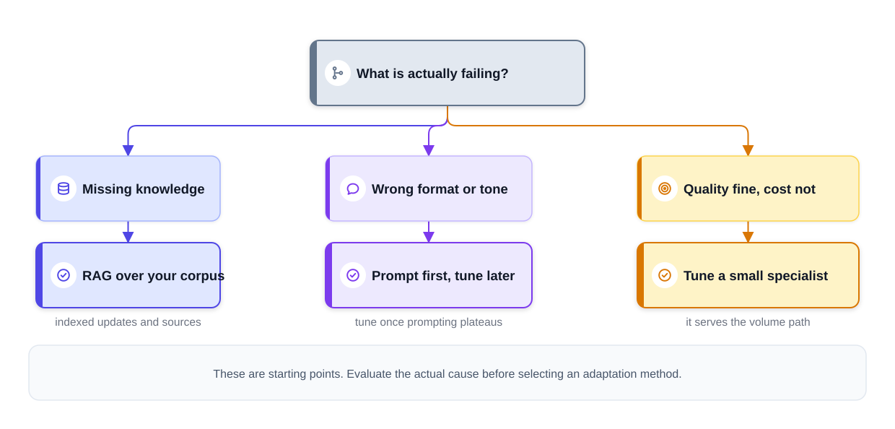
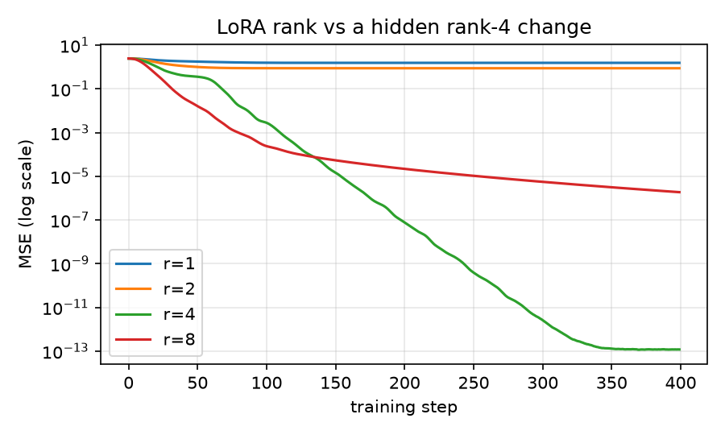
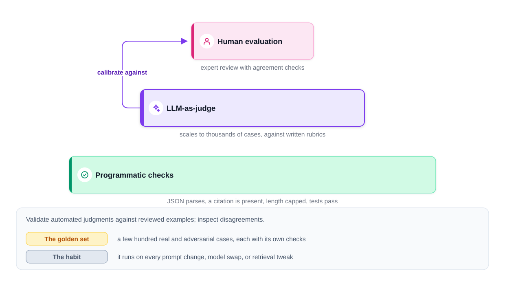

# Chapter 8 — Prompting vs Fine-Tuning vs RAG, and Evaluating LLM Systems

*Last reviewed: September 2026. Tooling and model names move quickly; the decision logic, the LoRA arithmetic and the evaluation methods in this chapter do not.*

A general-purpose model rarely fits a product perfectly out of the box. It may lack your facts, miss your format or tone, or cost too much at your volume. You have three tools to close the gap — **prompting**, **retrieval (RAG)** (retrieval-augmented generation: looking up relevant documents and adding them to the prompt) and **fine-tuning** (continuing to train the model on your own examples) — and they fix *different* problems. The second half of the chapter answers the question that decides whether any of them worked: **how do you evaluate a system whose correct answers can be written a thousand ways?**

Runnable code is in [`code/`](code/): a LoRA parameter and memory calculator with a tiny LoRA layer trained in PyTorch (a popular deep-learning library), and an evaluation harness that scores fake models on a golden set (a fixed collection of test inputs with known good answers; Section 8.5).

**What you'll learn**

- A decision framework: which failure calls for prompting, RAG, fine-tuning, or a combination
- Full fine-tuning vs parameter-efficient fine-tuning (PEFT): LoRA and QLoRA, with the maths, rank, and worked memory numbers
- Where tuning data comes from: instruction (SFT) data, preference data (RLHF, DPO), distillation, and when fine-tuning hurts
- Continued pretraining and training from scratch — and why they are rarely the answer
- The evaluation pyramid: programmatic checks, LLM-as-judge (and its biases), human evaluation
- Golden sets, regression testing in CI, metrics (exact match, F1, BLEU/ROUGE and their limits, pass@k), statistical care
- Online evaluation: feedback, behavioural proxies, task outcomes, A/B tests and canaries
- Guardrail evaluations and the tooling landscape

**Prerequisites.** Chapters [4](../04-large-language-models/README.md) (how LLMs are trained), [5](../05-prompt-engineering/README.md) (prompting) and [7](../07-embeddings-vector-databases-and-rag/README.md) (RAG). Gradient descent (the step-by-step way training nudges weights to reduce error) and loss functions (formulas that score how wrong a prediction is) from the [ML Handbook](../../../ml/chapters/10-neural-networks-and-deep-learning/README.md).

---

## 8.1 The adaptation question: three tools for three problems

### What it is

**Adapting** a model means making a general model behave well for *your* task. Interviewers ask it directly ("would you fine-tune here?") or wait to see whether you raise it. The key insight is that the three tools are not a ladder from basic to advanced; each addresses a different kind of gap.

A handy rule of thumb: **retrieval hands the model facts while it answers; fine-tuning reshapes how it behaves by updating its weights.** (Weights are the model's learned numbers.) It is a guideline, not a wall — both can affect what a model knows and how it answers.


*Figure — Start from the failure you observe, not from the fanciest tool (course diagram).*

### The three tools

**1. Prompting (with few-shot examples).** Each request carries the task description, a persona, the required output shape and a few worked input→output pairs (**few-shot examples**); the model copies the pattern.

- Weights stay untouched, so a change deploys like a config edit (a settings change) — though it still has to pass your evals (evaluation runs) and roll out gradually.
- Instructions and examples consume context tokens on every call; long or contradictory prompts get less reliable.
- A prompt can *supply* facts, but they don't persist in the weights.
- Start here: write a clear prompt with representative examples, measure what still fails, *then* decide whether retrieval or training is needed.

**2. RAG (retrieval-augmented generation).** Fetch relevant facts (documents, database rows, user records) at request time and put them in the context; the model answers **grounded** in them (Chapter 7).

- The tool for **knowledge**: private, large or fast-changing information.
- Updates appear once documents are ingested (loaded and split), indexed (added to the search structure) and caches invalidated (stale stored answers thrown away) — easier than retraining, but not magically instant.
- Sources can be shown; **access control is enforced per user at retrieval time**.
- Costs: a retrieval subsystem to build and evaluate, longer prompts, and answer quality capped by retrieval quality.

**3. Fine-tuning.** Continue training an existing model on curated examples (often input→output pairs).

- The tool for **behaviour**: reliable formats, a house voice, domain-specific reasoning patterns or task skills.
- Can shorten prompts (the behaviour is learned, so fewer instructions and examples are needed) and can let a **smaller, cheaper model** handle a narrow task — if evaluation confirms quality.
- Costs: data curation, training runs, evaluation, deployment and versioning; iteration takes hours to days depending on model size, data and method.
- **Poor at frequently changing or access-controlled facts.** Models memorise unevenly, every update needs more training, and nothing inside the weights can check who is asking. For an internal wiki, begin with retrieval that respects access rights rather than hoping a model trained on the wiki will answer accurately and only to the right people.

### The decision framework

Start from **the failure you actually observe** in examples, not from the most impressive technique.

| Observed problem | Likely cause to check first | Start with | Escalate to |
|---|---|---|---|
| Wrong or outdated facts; "I don't know our policy" | Missing or stale evidence; poor retrieval | **RAG** (fix sources and retrieval) | Better chunking (how documents are split into passages), hybrid + rerank (keyword plus meaning search, then precise re-scoring); tuning for evidence use |
| Answers private/user-specific data | Needs per-user data and permissions | **RAG** with access control | — (never weights) |
| Wrong format, schema or length | Unclear instructions | **Prompt** + examples, structured outputs, validation | Fine-tune if errors persist |
| Wrong tone or style | Underspecified voice | **Prompt** with examples | Fine-tune for consistent voice |
| Can't do the task well at all | Model capability | Better prompt, stronger model | Fine-tune on task data |
| Quality fine, but too expensive or slow at volume | Model size | Try an existing smaller model | Fine-tune (or distil into, i.e. train a small model to copy a big one) a small specialist |
| Tuned model invents policy details | Evidence path, not training | Check that current policy is available, retrieved and used; add grounding checks | More tuning alone won't keep policies current |

Two refinements:

- **Diagnose before choosing.** "Wrong facts" can mean stale sources, bad retrieval or the model ignoring good evidence — three different fixes. "Bad formatting" may disappear with sharper instructions, a JSON schema (a description of required fields and types), constrained decoding (the API only lets the model produce tokens that keep the output valid) — or, failing those, tuning.
- **Combine when the benefits justify the complexity.** A common production combination: **retrieval supplies the policy facts while a small tuned model supplies the voice and structure**, with a prompt still wrapped around both. When cost is the driver, weigh an off-the-shelf small model against a tuned one, counting the tuned model's training and upkeep too.

### What about training your own model?

- **Pretraining from scratch** a general foundation model (a large model pre-trained on broad data) needs vast data, compute (processing power) and expertise; it is outside almost every product design question. If you propose it, justify why no existing model works and what it would take.
- **Continued pretraining** — more unsupervised training (learning from raw text, no labels) of an existing model on a large domain corpus (collection of text) (e.g. Code Llama was Llama 2 continued on code) — can improve domain fluency but needs its own quality, cost and data-governance (rules on how data may be collected and used) case. More training is not automatically the answer to missing or changing knowledge.

### Common mistakes

- Fine-tuning to "teach the model our documents" when the documents change monthly and have permissions.
- Tuning before a strong prompt and an evaluation set exist — you cannot tell whether it helped.
- Treating the three as mutually exclusive.

### Real-world examples

Support assistants typically pair RAG over help-centre articles with prompts or small tuned models for tone. Coding assistants fine-tune on code and use retrieval over the user's repository. Many companies fine-tune small open models (for example with LoRA via Hugging Face PEFT, a library for the methods in 8.2) for high-volume classification or extraction to cut cost. Hosted fine-tuning services (for example OpenAI's fine-tuning API and cloud platforms such as Amazon Bedrock and Google Vertex AI) let teams tune selected models without managing GPUs (the graphics processors used for AI training); which models are tunable changes often.

### In the interview

**30-second answer:** "First a solid prompt and an eval set, so I can see what actually fails. If the failures are about facts that are recent or private, I add retrieval with access checks. If format, tone or task errors survive better prompting and output constraints, I consider tuning — and if cost is the issue, I benchmark a tuned small model against an untuned small one. The approaches stack, and none of them replaces authorization, output validation or production monitoring."

- *Where would the training examples come from?* Logs you are allowed to use (scrubbed for personal data and within retention rules, i.e. limits on how long data may be kept), conversations users rated well, answers that reviewers corrected, and synthetic pairs written by a stronger model and screened by people — so today's traffic becomes tomorrow's training set.
- *Does RAG eliminate hallucination?* No. It reduces it; the model can still contradict or embellish the retrieved text. Grounding instructions, citations and claim checks complete it (Chapter 7.8).
- *Full fine-tuning or LoRA?* LoRA keeps base weights frozen and trains small low-rank updates, cutting training memory and storage; compare quality with full fine-tuning for your task. The decision logic above is the same either way.

### Self-check

1. A bot doesn't know this week's price changes. Which tool? → RAG.
2. Outputs are correct but the JSON is often malformed. First step? → Clear instructions + examples, structured outputs and validation; fine-tune only if that plateaus.
3. Why not use fine-tuning for per-user confidential data? → Weights can't enforce access control, and updates need retraining.
4. What must exist before any fine-tune? → An evaluation suite.

### TL;DR

Prompting is the baseline; RAG adds knowledge (fresh, private, permissioned); fine-tuning changes behaviour (format, tone, skill, cost). Diagnose the failure, start simple, combine when justified, and never tune without evals.

---

## 8.2 Fine-tuning: full vs parameter-efficient

### What it is

**Full fine-tuning** updates every weight of the model on your data. **Parameter-efficient fine-tuning (PEFT)** freezes the original weights and trains a small number of new or selected parameters. The most popular PEFT method is **LoRA** (Low-Rank Adaptation; Hu et al., 2021); **QLoRA** (Dettmers et al., 2023) runs LoRA on top of a 4-bit-quantised frozen model (weights stored in 4 bits each instead of 16, trading a little precision for much less memory).

### Why it matters: the memory wall

Training with the Adam optimiser in mixed precision needs, per parameter, roughly: 2 bytes (bf16 weight) + 2 (gradient) + 4 (fp32 master copy) + 4 + 4 (Adam's two moment estimates) = **16 bytes**, before activations.

> **Key term — what training memory holds:** An *optimiser* is the algorithm that updates the weights; **Adam** is the standard one and keeps two running averages (*moment estimates*) of each weight's recent gradients. A *gradient* says how much, and in which direction, each weight should change. *Mixed precision* means doing most maths in 16-bit numbers (**bf16**, a 16-bit floating-point format) while keeping a 32-bit (**fp32**) *master copy* of the weights for accurate updates. *Activations* are the intermediate values saved during the forward pass so gradients can be computed; they grow with batch size and sequence length. For a 7-billion-parameter model that is ~108 GB — more than one 80 GB GPU. And each fine-tuned variant is another full 13.5 GB checkpoint (saved copy of the weights) to store and serve.

### How LoRA works

The hypothesis (supported by the LoRA paper's experiments): the *change* a task needs, ΔW, has **low intrinsic rank** (a matrix's *rank* is how many truly independent directions it contains) — it can be expressed with far fewer numbers than the full matrix.

1. Take a frozen weight matrix W₀ of shape d × k (e.g. a 4,096 × 4,096 attention projection, one of the weight matrices inside an attention layer; Chapter 3).
2. Add a trainable update ΔW = B·A, where **A** is r × k and **B** is d × r, with **rank r** small (4–64). The layer computes h = W₀x + (α/r)·B·A·x.
3. Initialise A with small random values and **B with zeros**, so B·A = 0 and training starts exactly at the original model.
4. Train only A and B. **α** (lora_alpha) is a scaling constant; dividing by r keeps the update's size comparable when you change r.
5. After training, either keep the small adapter separate (swap adapters per customer or task on one base model) or **merge**: W' = W₀ + (α/r)·B·A — no extra inference latency (delay when the model is used; see [System Design Fundamentals](../../../system-design-patterns/modules/00-system-design-fundamentals/README.md)).

**Parameter arithmetic** for one 4,096 × 4,096 matrix: full = 16,777,216 parameters; LoRA with r = 8 trains 8 × (4,096 + 4,096) = **65,536** — 0.39% of that matrix. The LoRA paper reports that on GPT-3 175B it cut trainable parameters by about 10,000× and GPU memory by about 3× compared with full fine-tuning, with comparable quality on its benchmarks.

**Which matrices?** The original paper adapted the attention query and value projections; practice today often targets all linear layers (attention and MLP, the feed-forward block in each transformer layer), which usually helps quality at modest extra cost.

**Choosing r.** Start around 8–16; raise it if the task is far from the base model's behaviour (and the data supports it). Too small underfits (cannot capture the task); too large wastes memory and can overfit (memorise the training examples and do worse on new ones) small datasets.

### How QLoRA works

1. Quantise (store with fewer bits) the frozen base model to 4 bits using the **NF4** (4-bit NormalFloat) data type, designed for normally distributed (bell-curve shaped) weights.
2. **Double quantisation**: also quantise the per-block scaling constants, saving a bit more memory.
3. **Paged optimisers** move optimiser state (Adam's extra per-weight numbers) between GPU and CPU (ordinary processor) memory to survive memory spikes.
4. Train LoRA adapters in 16-bit on top; gradients flow through the dequantised (temporarily converted back to higher precision) weights.

The QLoRA paper fine-tuned a 65B model on a single 48 GB GPU while matching 16-bit fine-tuning quality on its benchmarks.

### Code: parameter counts, memory, and a real LoRA layer (runs offline)

[`code/lora_calculator.py`](code/lora_calculator.py) uses Llama-2-7B shapes (hidden size 4,096, 32 layers, MLP size 11,008, vocabulary 32,000).

```python
def lora_params(c, r, targets):
    shapes = {"q": (c["d"], c["d"]), "k": (c["d"], c["d"]), "v": (c["d"], c["d"]),
              "o": (c["d"], c["d"]), "gate": (c["d"], c["ffn"]), "up": (c["d"], c["ffn"]),
              "down": (c["ffn"], c["d"])}
    # each adapted matrix W (d_in x d_out) gets A (r x d_in) and B (d_out x r)
    return c["layers"] * sum(r * (shapes[t][0] + shapes[t][1]) for t in targets)

class LoRALinear(nn.Module):
    def __init__(self, base: nn.Linear, r: int, alpha: float):
        super().__init__()
        self.base = base
        for p in self.base.parameters():
            p.requires_grad = False                                     # frozen W0
        self.A = nn.Parameter(torch.randn(r, base.in_features) * 0.01)  # small random
        self.B = nn.Parameter(torch.zeros(base.out_features, r))        # zero: starts at W0
        self.scale = alpha / r

    def forward(self, x):
        return self.base(x) + self.scale * (x @ self.A.T @ self.B.T)

    def merged(self):
        return self.base.weight + self.scale * self.B @ self.A          # W0 + (alpha/r)·B·A
```

Output:

```
Base model parameters: 6.74 B

setup                                trainable  % of base
LoRA r=8 on q,v (LoRA paper style)       4.2 M      0.06%
LoRA r=16 on attention                  16.8 M      0.25%
LoRA r=16 on all linear                 40.0 M      0.59%
LoRA r=64 on all linear                159.9 M      2.37%

Rough GPU memory for weights + gradients + Adam state (no activations):
  full fine-tune (16 bytes/param)       107.8 GB
  LoRA, bf16 frozen base + adapters      14.1 GB
  QLoRA, 4-bit frozen base + adapters     4.0 GB
  one saved adapter (bf16)               80.0 MB  vs full checkpoint 13.5 GB

Tiny LoRA layer (64x64 frozen, hidden rank-4 change):
  r=1: trainable  128 of 4288 total params, final MSE 1.56e+00
  r=2: trainable  256 of 4416 total params, final MSE 8.82e-01
  r=4: trainable  512 of 4672 total params, final MSE 1.18e-13
  r=8: trainable 1024 of 5184 total params, final MSE 1.88e-06
  merged W' = W0 + (alpha/r)BA gives same outputs: max diff 4.3e-06
saved img/lora_rank_loss.png
```



Reading it: the 7B model's attention-only r = 8 adapter trains 0.06% of the weights; even all-linear r = 64 trains under 2.5%. Memory drops from ~108 GB to ~14 GB (LoRA) and ~4 GB (QLoRA) for weights and optimiser state; activations come on top and grow with batch size and sequence length. In the toy layer, the true change has rank 4: ranks 1 and 2 cannot represent it (loss plateaus), rank 4 fits it exactly with 11% of the layer's parameters, and merging the adapter reproduces the adapter's outputs to within floating-point error — which is why merged LoRA adds no inference cost.

### The same with Hugging Face PEFT (not run here — needs a model download and a GPU)

```python
from transformers import AutoModelForCausalLM
from peft import LoraConfig, get_peft_model

model = AutoModelForCausalLM.from_pretrained("<base-model-id>")
config = LoraConfig(r=16, lora_alpha=32, lora_dropout=0.05,
                    target_modules=["q_proj", "k_proj", "v_proj", "o_proj"],
                    task_type="CAUSAL_LM")
model = get_peft_model(model, config)
model.print_trainable_parameters()      # a fraction of a percent
# ... train with your usual loop or the transformers Trainer ...
model = model.merge_and_unload()        # optional: fold adapters into the weights
```

For QLoRA, load the base model in 4-bit (bitsandbytes, a quantisation library: `BitsAndBytesConfig` with `load_in_4bit=True` and `bnb_4bit_quant_type="nf4"`) before attaching the adapters. Module names (`q_proj`…) depend on the architecture.

### Trade-offs

| | Full fine-tuning | LoRA | QLoRA |
|---|---|---|---|
| Trainable params | 100% | ~0.1–3% | ~0.1–3% |
| Training memory (7B, excl. activations) | ~108 GB | ~14 GB | ~4 GB |
| Quality ceiling | Highest in principle | Often close on narrow tasks | Close to LoRA; slightly slower (dequantisation) |
| Artefact per task | Full checkpoint (GBs) | Adapter (MBs), swappable | Adapter |
| Forgetting risk | Higher | Lower (base frozen) | Lower |

Other PEFT methods exist — adapter layers (Houlsby et al., 2019), prefix tuning, prompt tuning (learned soft-prompt vectors), IA³, DoRA — but LoRA-style adapters dominate practice.

### Common mistakes

- Picking a huge rank "to be safe" on a few hundred examples (overfitting).
- Forgetting activation memory when sizing GPUs.
- Evaluating the adapter only on the new task and missing regressions elsewhere.
- Comparing to an unpinned base model (one whose version may change under you, so you can't tell which change helped).

### In the interview

**30-second answer:** "LoRA freezes W and learns ΔW = BA with rank r — A is r×k, B is d×r, B starts at zero so training starts from the base model. For a 4096×4096 matrix at r=8 that's 65K trainable parameters instead of 16.8M. Full fine-tuning a 7B model needs ~16 bytes per parameter, over 100 GB before activations; LoRA needs roughly the bf16 weights plus tiny adapters, and QLoRA quantises the frozen base to 4-bit NF4 to get to single-GPU budgets. Adapters are megabytes, swappable per task, and mergeable for zero added latency."

- *Why initialise B to zero?* So ΔW = 0 at step 0: the model starts exactly as the base model and training moves away from it smoothly.
- *What does α do?* Scales the update; using α/r keeps its magnitude comparable when you change r, so learning rates transfer.
- *When prefer full fine-tuning?* Large distribution shift (your data looks very different from the model's training data), abundant data and compute, and evidence that adapters plateau below target quality.

### Self-check

1. LoRA params for a 4,096 × 11,008 matrix at r = 16? → 16 × (4,096 + 11,008) = 241,664.
2. Why does merged LoRA add no latency? → W' = W₀ + (α/r)BA is a single ordinary matrix.
3. What does QLoRA quantise? → The frozen base weights (to 4-bit NF4); the adapters train in 16-bit.
4. Full fine-tuning memory for a 13B model at 16 bytes/param? → ~208 GB before activations.

### TL;DR

LoRA trains a low-rank update BA beside frozen weights: tiny, swappable, mergeable. QLoRA adds a 4-bit base for single-GPU training. Size memory with ~16 bytes/param for full fine-tuning.

---

## 8.3 Tuning data: instructions, preferences and distillation

### What it is

The data decides what fine-tuning teaches. Three kinds matter:

| Stage | Data format | What it teaches | Example |
|---|---|---|---|
| **Supervised fine-tuning (SFT)** / **instruction tuning** | (instruction, ideal response) pairs, or multi-turn chats | Follow instructions, a format, a task | FLAN; the SFT step of InstructGPT |
| **Preference tuning** | (prompt, chosen response, rejected response) | Which of two answers people prefer: helpfulness, safety, style | RLHF in InstructGPT; DPO |
| **Distillation** | A strong **teacher** model's outputs (or probabilities) on many inputs | Make a small **student** imitate the teacher | Hinton et al. (2015); Stanford Alpaca (52K instructions generated with an OpenAI model) |

### How it works

**SFT** is ordinary next-token training, with the loss usually computed only on the response tokens. Quality beats quantity: LIMA (Zhou et al., 2023) showed about 1,000 carefully curated examples could produce a strong instruction follower from a good base model. Sources: permitted product logs (with privacy and retention rules), top-rated conversations, human-corrected outputs from review queues, and synthetic (model-generated) examples from a frontier model (the most capable available model) filtered by people.

**Preference tuning.**

- **RLHF** (reinforcement learning from human feedback; InstructGPT, Ouyang et al., 2022): collect human rankings of responses, train a **reward model** to predict them, then optimise the LLM against it with reinforcement learning (learning by trial and error from a reward signal; here the PPO algorithm), with a penalty for drifting too far from the SFT model.
- **DPO** (Direct Preference Optimization; Rafailov et al., 2023): skips the separate reward model and RL loop, and trains directly on chosen/rejected pairs with a classification-style loss. Simpler and now common.

**Distillation.** Classic distillation trains the student on the teacher's softened probability distribution ("soft targets"), which carries more information than hard labels (just the single correct answer). With LLMs, it often means generating a large synthetic dataset with the teacher and running SFT on the student. It is how many small, cheap production models are made. Check the teacher provider's terms of use — some prohibit using outputs to build competing models.

### When fine-tuning hurts

- **Catastrophic forgetting**: gains on the new task, losses on general abilities you didn't test.
- **Safety erosion**: research (Qi et al., 2023) showed that fine-tuning aligned models (models already trained to be helpful and safe) — even on small or benign datasets — can weaken their safety behaviour. Re-run safety evaluations after every tune.
- **More hallucination from new facts**: teaching facts the base model didn't know can encourage confident guessing (Gekhman et al., 2024 found such examples are learned slowly and increase hallucination tendency).
- **Stale knowledge baked in**: facts in weights go out of date; retraining is slow.
- **Overfitting to a narrow format**: great on the training distribution, brittle elsewhere.
- **Operational drag**: every base-model upgrade means re-tuning and re-evaluating your variants.

### Common mistakes

- Training on raw logs without removing personal data or bad answers.
- No held-out test set separate from the tuning data.
- Mixing train and evaluation examples (leakage makes results look great).

### Self-check

1. What does a preference example contain? → A prompt with a chosen and a rejected response.
2. How does DPO differ from RLHF? → It optimises directly on preference pairs without training a reward model and running RL.
3. Name two ways fine-tuning can hurt. → Forgetting; weakened safety (also hallucination, staleness, overfitting).

### TL;DR

SFT teaches tasks and formats, preference tuning (RLHF, DPO) teaches which answers people prefer, distillation compresses a big model into a small one. Curate carefully, hold out test data, and re-check safety after tuning.

---

## 8.4 Why evaluating LLM systems is hard

### The problem it solves

Predictive systems (click prediction, delivery-time estimates) eventually observe an outcome to compare against — even if labels (the correct answers attached to examples) are delayed, partial or biased. Generative systems add a new difficulty: **many different outputs can all be acceptable.** "Summarise this meeting" has countless good answers and no single correct label; "was this support reply good?" is a judgement, not an observable fact.

Yet you still need what any production model needs: compare versions, catch **regressions** (things that used to work and now don't), and notice decay in production. So the real engineering problem is turning human judgement into something inexpensive and consistent that can be rerun automatically whenever anything changes.

### How it works: define quality per task

Write down what "good" means for your task before measuring. Some requirements are objectively checkable (valid JSON, compiles, cites a source); others need a **rubric** (a written scoring guide) and informed judgement. No label source is perfect, so combine several and investigate disagreements. Chip Huyen's *AI Engineering* (2025) calls this **evaluation-driven development**: define the evaluation criteria before building, the way test-driven development writes tests first.

### TL;DR

Generative outputs have many right answers, so define task-specific quality criteria and build a repeatable, layered evaluation that runs on every change.

---

## 8.5 Offline evaluation: the evaluation pyramid


*Figure — Three complementary layers, each with limits, run over a golden set (course diagram).*

### Layer 1 — Programmatic checks

Anything code can assert with no model or human: output parses as JSON; required fields present; contains a citation; under a length limit; no banned phrases; generated SQL (database query language) executes; code compiles and passes unit tests (small automated tests of individual functions).

- Cheap, fast, repeatable — the base of the pyramid.
- Only as strong as what they test: a passing test suite is *evidence*, not proof of correctness; a citation being present doesn't mean it supports the claim.

### Layer 2 — LLM-as-judge

Use a (usually strong) model to grade outputs against a written rubric, e.g. *"You will see a user question, the passages we retrieved, and our reply. Rate from 1 to 5 how well the reply sticks to the passages, and name every statement they do not back up."* This is the layer that scales evaluation to thousands of cases. Forms: **single-answer grading** (score one output), **pairwise comparison** (which of two is better), and **reference-guided** grading (compare with a gold answer).

Known biases (documented e.g. by Zheng et al., 2023, the MT-Bench / Chatbot Arena paper):

| Bias | What happens | Mitigation |
|---|---|---|
| **Position bias** | In pairwise comparisons, favours the answer in a particular position (often the first) | Judge both orders; count inconsistent verdicts as ties |
| **Verbosity bias** | Prefers longer answers | Rubric that rewards concision; length-controlled comparisons |
| **Self-preference** | Prefers outputs from its own model family or style | Use a different model family as judge; human anchor |
| **Leniency / scale drift** | Scores cluster high; shift when the judge model updates | Clear anchored rubric with examples; pin the judge version |

A judge score must be **validated before it drives release decisions**: compare it with a representative human-labelled sample, use clear rubrics, and measure agreement. **Cohen's kappa** corrects raw agreement for the agreement two raters would reach by pure chance: κ = (p_o − p_e)/(1 − p_e), where p_o is the observed agreement and p_e the chance agreement. Worked example on 100 items, each labelled "good" or "bad" by the judge and by a human:

| | Human: good | Human: bad | Judge total |
|---|---|---|---|
| **Judge: good** | 63 | 7 | 70 |
| **Judge: bad** | 7 | 23 | 30 |
| **Human total** | 70 | 30 | 100 |

1. Observed agreement p_o = (63 + 23)/100 = 0.86.
2. Chance agreement: both say "good" by chance with probability 0.7 × 0.7 = 0.49, both say "bad" with 0.3 × 0.3 = 0.09, so p_e = 0.58.
3. κ = (0.86 − 0.58)/(1 − 0.58) = 0.28/0.42 ≈ **0.67** — "substantial" on the common Landis–Koch scale (0.61–0.80). Note how 86% raw agreement shrinks once chance is removed: with a 70/30 label split, two raters guessing at those rates would already agree 58% of the time.

**Judge discipline**: pin the judge model's version like any dependency (external component your system relies on); keep a **human-scored anchor set** to recalibrate when the judge changes; mark judge migrations on dashboards (live charts of key metrics), or every trend line becomes unreadable.

### Layer 3 — Human evaluation

Specialists grading a sample, people choosing between two versions side by side, and systematic reviews of failed cases. Expensive, slower, and also fallible — use guidelines, multiple reviewers where it matters, and a process to resolve disagreements. Spend it on important samples, new failure categories, high-risk changes and calibrating the judge.

### The golden set

The **golden set** (also "eval set" or "test set") turns the pyramid into practice: a versioned collection of inputs with expected outputs or grading criteria.

1. **Contents**: real user requests (sampled and anonymised, i.e. with personal details removed), difficult cases, past incidents, adversarial inputs (inputs crafted to break the system), and — for RAG — unanswerable questions and permission probes (Chapter 7.11).
2. **Size**: each user intent, tricky case and former incident needs enough items for the per-category numbers to mean something, yet the whole suite must stay cheap enough to rerun constantly. A few hundred cases is a common start; rare harms need targeted suites and larger samples.
3. **Separation**: keep a stable **held-out** test set apart from the examples you tune prompts on, or you will overfit to your own test.
4. **Growth by accretion**: every representative production failure becomes a new test case — just as a developer adds a unit test for every bug they fix.
5. **Versioning**: version inputs, rubrics, judge and model settings so comparisons across time are meaningful.

### Regression testing: evals as CI

Whenever a prompt is edited, a model replaced or retrieval adjusted, the matching suite runs automatically and can block the release — the same role unit tests play in **continuous integration (CI)**. Report per category, not only an average: an overall gain can hide a collapse in one category.

### Evaluate RAG as two systems

Did authorised, relevant evidence reach the model (retrieval)? Did the answer use it correctly (generation)? If the evidence arrived, suspect the prompt, which chunks were kept, the model itself, or the output checks; if it never arrived, suspect indexing, the query rewrite or the search step (Chapter 7.11).

### In the interview

**30-second answer:** "Three layers: code-level assertions, a model grader I've checked against people, and periodic human review. They run over a versioned test collection — real traffic, hard cases, attacks, old incidents — whenever prompts, models or retrieval change, the way CI gates code. Human-labelled samples keep the grader honest and reveal gaps in the set. Results are broken down by category, and a held-out slice guards against overfitting."

- *Your judge model updates and all scores shift — now what?* Pin judge versions; re-calibrate against the human anchor set; record the migration as a versioned event on dashboards.
- *How big should the golden set be?* Enough per intent/edge case/incident for statistically meaningful comparisons, cheap enough for every change — commonly hundreds — growing as production failures are added.

### Self-check

1. Name the three layers of the pyramid. → Programmatic checks, LLM-as-judge, human evaluation.
2. How do you detect position bias? → Swap the order of the two answers and see if the verdict flips.
3. Why keep a held-out set? → To avoid overfitting prompts to the test.

### TL;DR

Programmatic checks at the base, a calibrated LLM judge in the middle, humans at the top, all over a versioned, growing golden set that runs like CI.

---

## 8.6 Metrics: what each one can and cannot tell you

### What it is

| Metric | Measures | Good for | Limits |
|---|---|---|---|
| **Exact match (EM)** | Normalised (lower-cased, punctuation stripped) string equality | Short factual answers, classification | Penalises correct but differently phrased answers |
| **Token F1** | Word overlap (precision = share of predicted words that are right; recall = share of reference words found) | Extractive QA (answers copied from a passage) | Rewards overlap, not correctness |
| **BLEU** (Papineni et al., 2002) | n-gram (run of n consecutive words) precision vs references, with a brevity penalty | Machine translation (with several references) | Poor correlation with quality for open-ended generation |
| **ROUGE** (Lin, 2004), e.g. ROUGE-L | n-gram / longest-common-subsequence recall/F vs reference | Summarisation benchmarks | Paraphrases score low; fluent wrong text can score high |
| Embedding similarity (e.g. BERTScore) | Semantic closeness to a reference | Paraphrase-tolerant comparison | Still can't verify facts |
| **pass@k** | Probability at least one of k samples passes unit tests | Code generation | Needs good tests; ignores code quality |
| Faithfulness, answer relevance | Supported by context; addresses the question | RAG | Needs judge or NLI (natural language inference: does the text support the claim?) model (validate it) |
| Refusal correctness / over-refusal | Abstains when it should, answers when it should | Safety and RAG | Needs unanswerable and benign-but-scary items |
| Latency, cost per task | Time to first token, total time, $ per completed task | Every system | Must be measured per category, under load |

**pass@k** (Chen et al., 2021, the Codex/HumanEval paper) is estimated without bias (correct on average) by drawing n ≥ k samples per problem, counting the c that pass, and computing

pass@k = 1 − C(n − c, k) / C(n, k)

where C(n, k) is the number of ways to choose k items from n.

Worked: n = 10, c = 3, k = 3 → 1 − C(7,3)/C(10,3) = 1 − 35/120 = **0.708**.

### Code: a tiny eval harness (runs offline)

[`code/eval_harness.py`](code/eval_harness.py) scores two fake model versions on a nine-item golden set with categories (factual, summary, JSON, unanswerable, guardrail), then runs a regression gate, pass@k, a judge-bias test and a bootstrap confidence interval (a range likely to contain the true difference, estimated by resampling the test items many times).

```python
def rouge_l(pred, ref):
    """F-score of the longest common subsequence of words."""
    a, b = normalize(pred).split(), normalize(ref).split()
    dp = [[0] * (len(b) + 1) for _ in range(len(a) + 1)]
    for i in range(len(a)):
        for j in range(len(b)):
            dp[i + 1][j + 1] = dp[i][j] + 1 if a[i] == b[j] else max(dp[i][j + 1], dp[i + 1][j])
    lcs = dp[-1][-1]
    ...

def pass_at_k(n, c, k):
    """Unbiased estimator (Chen et al., 2021): 1 - C(n-c, k) / C(n, k)."""
    if n - c < k:
        return 1.0
    return 1 - comb(n - c, k) / comb(n, k)

def check_json(pred, ref):
    """Programmatic check: must parse as JSON (nothing else) and match types/values."""
    try:
        obj = json.loads(pred)
    except json.JSONDecodeError:
        return 0.0
    return float(obj == ref)
```

Output:

```
1) Surface metrics on one reference
   paraphrase, correct  EM=0  F1=0.60  ROUGE-L=0.40
   near-copy, WRONG     EM=0  F1=0.90  ROUGE-L=0.90

2) Golden-set results by category (pass rate)
   category           v1     v2
   factual          0.67   0.67
   summary          0.90   0.60
   json             1.00   0.00
   unanswerable     1.00   0.50
   guardrail        1.00   1.00

3) Regression gate: block if any category drops > 0.10, or any guardrail fails
   v2 BLOCKED by: summary (0.90 -> 0.60), json (1.00 -> 0.00), unanswerable (1.00 -> 0.50)

4) pass@k for a code task: n=10 samples, c=3 pass the unit tests
   pass@1 = 0.300
   pass@3 = 0.708
   pass@5 = 0.917

5) LLM-as-judge position bias on 40 pairwise comparisons
   A wins when shown first : 29/40
   verdict flips when order swapped: 15/40 -> count these as ties

6) Is v2 better overall? Paired bootstrap over the 9 items
   mean v2 - v1 = -0.367, 95% CI [-0.778, +0.078] -> too few items to tell
```

What each block teaches:

1. **Overlap metrics can invert the truth.** The correct paraphrase ("no data was lost… about twelve minutes") scores ROUGE-L 0.40; a near-copy that says *all data was lost* scores 0.90. Use BLEU/ROUGE for trend-watching on fixed tasks, never as the definition of quality.
2. **Categories hide inside averages.** v2 fixed a factual error (Canberra, not Sydney) but EM marked its *correct* long-form answer "The transformer paper appeared in 2017." as wrong, so factual stays flat; meanwhile it wraps JSON in chatter, returns `"seats": "3"` as a string, and predicts a stock price instead of refusing.
3. **The regression gate** blocks the release on per-category drops, with a hard rule for guardrails.
4. **pass@k** rises quickly with more samples — useful when a system can generate several candidates and test them.
5. **Position bias**: the simulated judge picks the first-shown answer whenever the two are close; swapping the order flips 15 of 40 verdicts. Judging both orders and treating flips as ties removes this artefact.
6. **Statistics**: with nine items the 95% interval for the difference spans zero. Small golden sets can't separate close versions; you need more items (or paired tests on more data) before claiming a win.

### Common mistakes

- Reporting a single average score.
- Using ROUGE/BLEU as the main quality metric for open-ended generation.
- Declaring victory from a 2-point change on 50 items with no confidence interval.
- **Benchmark contamination**: public benchmark questions leak into training data, inflating scores; prefer private, product-specific sets.

### Self-check

1. pass@1 with n = 10 and c = 3? → 0.3.
2. Why can ROUGE rank a wrong answer above a right one? → It rewards word overlap, not meaning or truth.
3. What does a CI spanning zero mean for "v2 is better"? → You can't conclude it from this data.

### TL;DR

Choose metrics per category: programmatic checks and pass@k where outputs are verifiable, validated judges for open-ended quality, overlap metrics only as rough signals — and always report per category with uncertainty.

---

## 8.7 Online evaluation: the truth arrives anyway

### What it is

Offline evals catch problems before release; production shows how the system behaves with real users — with its own biases and noise. Signals range from cheap to rich:

1. **Explicit feedback** — thumbs up/down, ratings, comments. Only a self-selected minority responds; sample other sessions too.
2. **Behavioural proxies** — inferred from actions: regenerate, rephrase, copy, abandon mid-conversation, escalate to a human. Ambiguous: a regeneration may be exploration, a copy or a short session doesn't prove success. Validate proxies against task outcomes and reviewed samples.
3. **Task-level outcomes** — the best evidence when available: ticket resolved, code suggestion accepted and kept (GitHub Copilot popularised acceptance rate), purchase completed. Watch for later reopenings, reverts (code changes undone) or other harms rather than treating the first outcome as final truth.

### How it works

Familiar production-ML practice carries straight over:

- **A/B tests** — randomised comparisons on these metrics — choose the version to promote (randomise users, pre-register the metric, i.e. fix it before seeing results, compute confidence intervals).
- **Canary releases** send a small slice of traffic to the new version and watch closely before widening.
- **Dashboards** segment metrics by intent, user tier, topic and language.

**Offline and online will sometimes disagree**, for structural reasons: different users, different behaviours. For example, the test set favours a new instruction while regeneration rises in production. Investigate before promoting: check measurement errors, statistical uncertainty, segments and safety. A good online proxy never overrides a known safety regression. When justified, add the representative failures to the golden set.

### In the interview

**30-second answer:** "Online I track task outcomes where they exist, plus validated behavioural signals — regeneration, abandonment, escalation — and explicit feedback, segmented by intent and user type. A/B tests decide promotion, canaries protect rollouts. When offline and online disagree I investigate rather than trusting one number, and safety regressions block regardless."

- *Negative ratings haven't moved, yet support complaints keep climbing. What's going on?* Ratings come only from people who choose to leave them; users who gave up or left never press a button. Cross-check with regeneration and abandonment, and review random samples, not just flagged ones — then look for a real quality decline.

### Self-check

1. Why isn't thumbs-down rate enough? → Self-selected, sparse, biased responders.
2. What is a canary release? → A small traffic slice on the new version, watched closely before full rollout.
3. What wins if an online metric improves but a safety eval regresses? → Safety: the regression blocks release.

### TL;DR

Measure outcomes and validated behaviour in production, promote with A/B tests and canaries, investigate offline/online conflicts, never trade away safety.

---

## 8.8 Guardrail evaluations and eval tooling

### Guardrail evals

**Guardrails** are the checks that keep a system within safety, security and policy limits (input filters, output moderation (screening for harmful content), refusal behaviour, tool-permission rules). They need their own suites, run on every change and after every fine-tune:

| Suite | Tests | Pass condition |
|---|---|---|
| Harmful requests | Requests the policy forbids | Refuses (and helpfully redirects where appropriate) |
| **Over-refusal** | Benign requests that *sound* risky ("how do I kill a Python process?") | Answers — e.g. the XSTest benchmark measures exaggerated safety |
| Jailbreaks (tricks to make a model break its rules) | Role-play, obfuscation (disguising the request), multi-turn manipulation | Still refuses |
| **Prompt injection** | Instructions hidden in documents, web pages, tool results | Ignores injected instructions; no tool misuse |
| Data leakage | PII (personally identifiable information), secrets, system prompt, other users' data, permission probes | Nothing leaks |
| Format and policy | Required disclaimers, banned content, brand rules | Programmatic checks pass |

Guardrail failures are usually **hard gates** (any failure blocks) rather than averages, and adversarial suites need regular refreshing because attacks evolve (red-teaming, i.e. deliberately attacking your own system, [Chapter 12](../12-safety-ethics-governance/README.md)).

### Eval tooling (concepts, as of 2026)

| Need | Examples |
|---|---|
| Prompt/app test suites in CI | promptfoo, DeepEval, OpenAI Evals |
| RAG metrics | RAGAS, TruLens |
| Tracing (recording every step of each request) + eval + datasets platforms | LangSmith, Braintrust, Arize Phoenix, Langfuse, Weights & Biases Weave |
| Model benchmarking harnesses | EleutherAI lm-evaluation-harness, Stanford HELM, Inspect (UK AI Security Institute) |
| Crowd-sourced pairwise rankings | LMArena (formerly Chatbot Arena), which ranks models from human votes with a Bradley–Terry / Elo-style (like chess ratings) model |

The concepts matter more than the brand: versioned datasets, scorers (programmatic, judge, human), experiment tracking across versions, tracing of production requests, and turning traces into new test cases.

### Common mistakes

- Only testing that the model refuses harmful requests, not that it answers benign ones.
- One-time red-teaming instead of a standing schedule.
- Averaging guardrail results with quality results.

### Self-check

1. What does an over-refusal suite catch? → A model refusing benign requests that merely sound risky.
2. Why are guardrails usually hard gates? → A single leak or harmful output can be an incident regardless of average quality.
3. What makes an eval platform useful beyond a script? → Versioned data, tracing, experiment comparison and turning production failures into tests.

### TL;DR

Treat safety, injection, leakage and over-refusal as their own suites with hard gates, refreshed continuously; pick tools that version data, trace production and compare experiments.

---

## Chapter TL;DR

- **Adaptation**: prompting is the baseline; **RAG = knowledge** (fresh, private, permissioned, citable); **fine-tuning = behaviour** (format, tone, skill, cheaper small models). Diagnose the observed failure first; combine (RAG + tuned small model) when justified; never use weights as access control; never tune without evals.
- **Training from scratch / continued pretraining**: rarely justified in product design; needs its own data, cost and governance case.
- **LoRA**: h = W₀x + (α/r)BAx, B initialised to zero; r×(d+k) trainable params per matrix (65K vs 16.8M for 4096² at r=8); adapters in MBs, mergeable with no latency. Full fine-tuning ≈ 16 bytes/param (~108 GB for 7B); LoRA ~14 GB; **QLoRA** (4-bit NF4 base, double quantisation, paged optimisers) ~4 GB before activations.
- **Data**: SFT (instruction → response), preferences (chosen vs rejected: RLHF, DPO), distillation (teacher → student). Fine-tuning can cause forgetting, safety erosion and more hallucination; re-run all evals after tuning.
- **Evaluation pyramid**: programmatic checks → LLM-as-judge (position, verbosity, self-preference biases; validate with humans, pin versions) → human review; all over a versioned, growing golden set run like CI with per-category gates.
- **Metrics**: EM/F1 for short answers, pass@k = 1 − C(n−c,k)/C(n,k) for code, BLEU/ROUGE only as rough signals, faithfulness/relevance/refusal for RAG; report uncertainty.
- **Online**: task outcomes, validated behavioural proxies, feedback; A/B tests, canaries, segmented dashboards; investigate offline/online conflicts; safety regressions always block.
- **Guardrails**: harmful, over-refusal, jailbreak, injection and leakage suites as hard gates, refreshed continuously.
