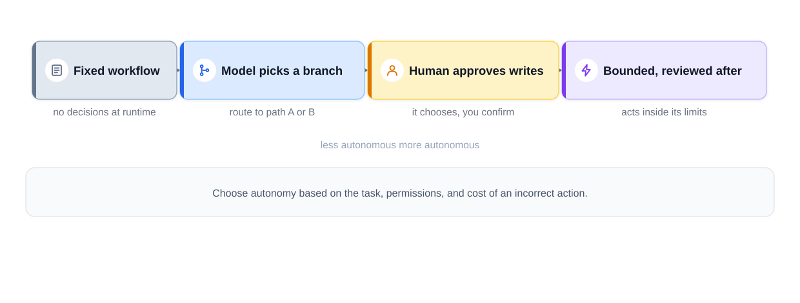
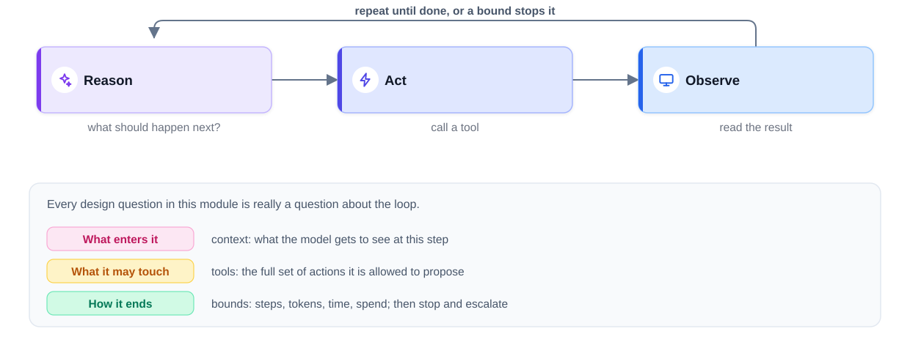
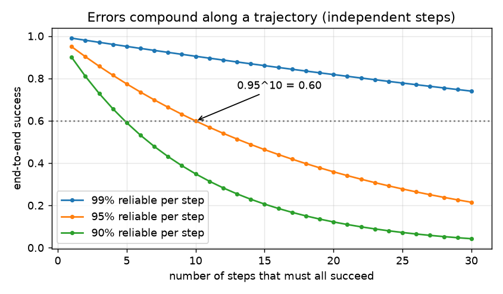
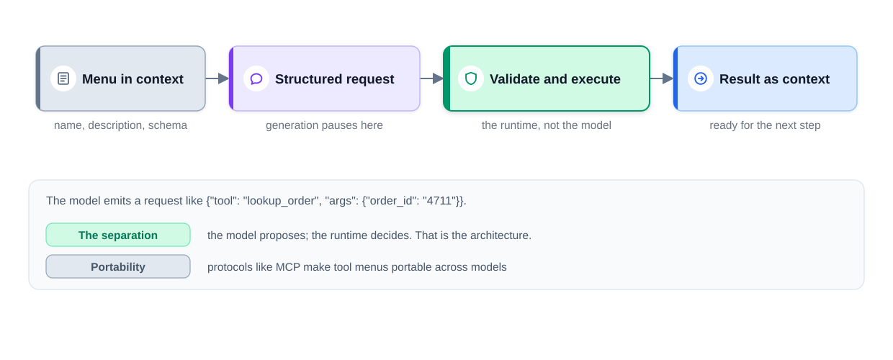
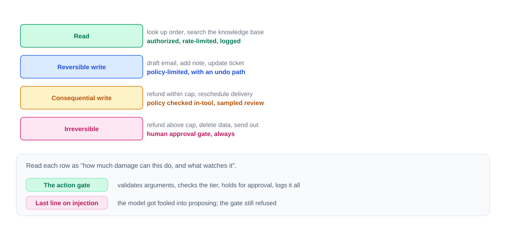
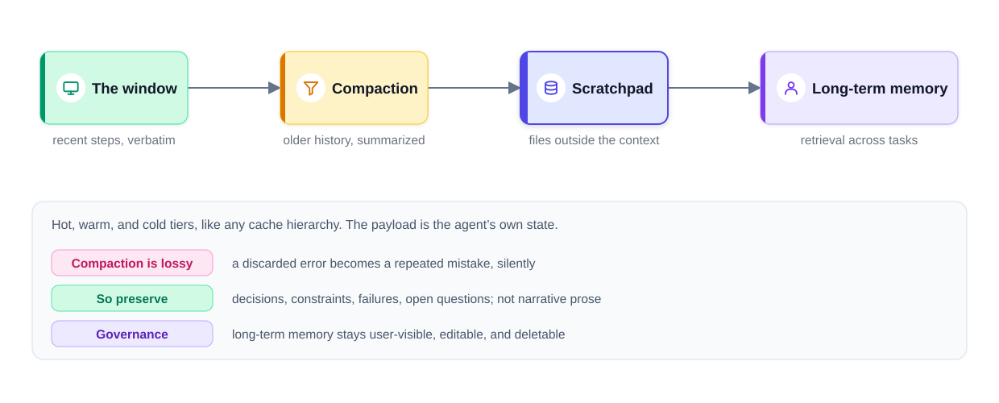
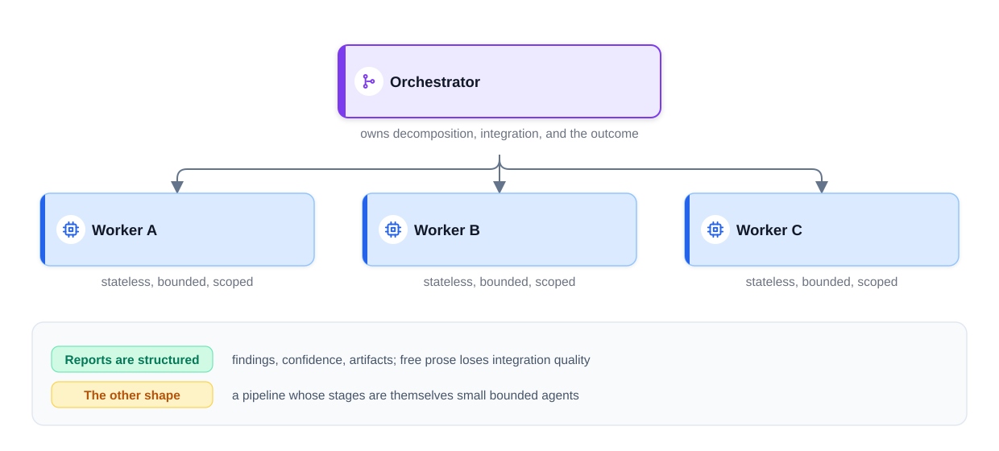
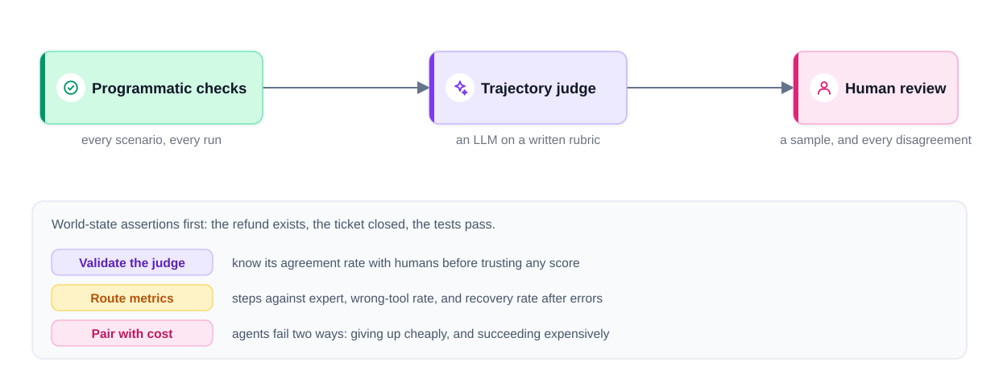
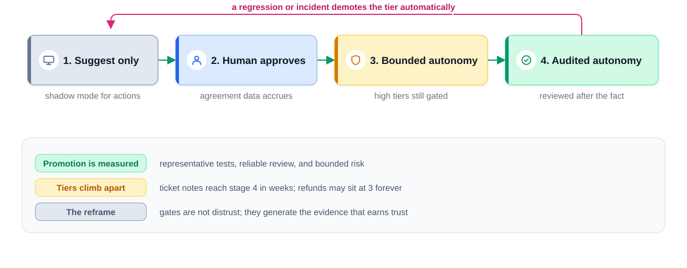
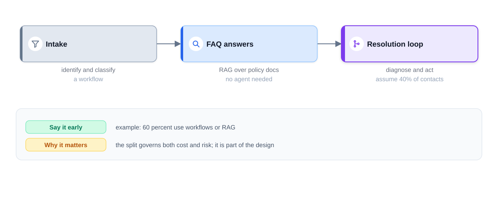

# Chapter 9 — AI Agents

*Last reviewed: September 2026. Agent frameworks and products change every few months; the ideas here (the loop, tools, bounds, memory, evaluation, control) change much more slowly.*

So far this book has treated a language model as something that **answers**: text in, text out, a person reads it. An **AI agent** goes further: what the model writes can also **do things** — look up an order, run code, send an email, book a room. That change from answering to acting brings new power and new risk. A wrong answer misleads a reader; a wrong action changes the world, sometimes irreversibly.

**What you'll learn:** what an agent is and when to use one; the ReAct loop and its budgets; tool calling and tool design; guardrails and human approval; planning; memory; multi-agent patterns; MCP; evaluating agents; rollout, cost and failure modes; and a full design walk-through.

All code is in [`code/`](code/); each script runs offline in about a second with `python code/<file>.py`. The "LLM" in the scripts is a small, deterministic, scripted stand-in so you can see every step; the real-API version is shown as a snippet marked "(needs an API key — not run)". Interview answers for the whole chapter are collected in the "Interview practice" section at the end.

---

## 9.1 What an agent is

### What it is

An **AI agent** is a program that pursues a goal by repeatedly deciding what to do next, doing it through **tools**, looking at the result, and deciding again. Today the deciding part is usually a large language model (LLM).


*Figure — agentic AI as a collaborator rather than a single-shot tool (course diagram).*

| Part | What it is | Everyday analogy |
|---|---|---|
| **Model (LLM)** | Reads the situation and proposes the next step | A new employee's judgment |
| **Tools** | Functions the model may request: search, calculator, database lookup, send email, run code | The phone, computer and forms the employee may use |
| **Memory** | What it sees now (the context window) plus what it can look up (notes, past cases, preferences) | A notepad and the company wiki |
| **Loop** | Code that calls the model, runs the requested tool, feeds back the result, and repeats until done or stopped | Think, act, check, repeat |

**Key terms.** The model never runs a **tool** itself: it emits a structured request ("call `lookup_order` with `order_id="4711"`") and the **runtime** (or **harness** — the loop, tool execution, validation, permissions and logging around the model) decides whether to run it. The result, fed back into context, is an **observation**; the full ordered record of one task is its **trajectory**; the set of things the agent may do is its **action space**.

### Agent vs chatbot vs workflow

A plain **chatbot** is *reactive*: asked about London's weather, it answers. An agent might check a forecast, see rain, add "pack an umbrella" to your to-do list and suggest indoor plans — it serves the goal behind the question (generative AI is the brain; the agent adds hands). In a **workflow**, an engineer fixed the steps at design time (*transcribe → summarise → extract action items*); the LLM fills in each step but never chooses the next one. The cleanest test:

> **Who chooses the next step?** If the path was fixed in code at design time, it is a workflow. If the model picks it while running, based on what it has found so far, it is an agent.

### The autonomy spectrum

**Autonomy** is how much work the system may finish before a person looks at it — a dial, not a switch.


*Figure — autonomy is a spectrum; say where your design sits (course diagram).*

The settings run from a **fixed workflow** (code decides everything), through a **router** (the model picks branch A or B) and an **agent whose writes a person approves**, to **bounded autonomy** (the model acts inside hard limits, such as refunds under $30, and people audit samples). Section 9.12 turns this into maturity levels.

### Why it matters

Agents let software handle **multi-step tasks that are hard to specify in advance** — diagnosing a support problem, fixing a failing test, researching across sources. The price is more cost, latency and new failure modes (Section 9.10).

### How it works: "agent or workflow?"

1. **List the steps.** If you can draw the flowchart with all its branches, build a workflow: cheaper, faster, easier to test and budget.
2. **Find the open-ended part** (diagnosis, debugging, research), where the next step depends on what was just learned. Only there does an agent earn its cost.
3. **Build a hybrid**: fixed code for intake, validation and post-processing around a small action space.
4. **Justify every extra tool, agent or loop** with measured quality gains.

Anthropic's guide *Building effective agents* (December 2024) gives the same advice: start with one call, then a workflow, and reach for an autonomous agent only when those fall short.

### Trade-offs

| | Single LLM call | Workflow | Agent |
|---|---|---|---|
| Who decides steps | — | Engineer, at design time | Model, at run time |
| Cost and latency | Lowest | Low, predictable | Higher, variable (seconds to minutes) |
| Testability | Easy | Easy (known paths) | Hard (many paths) |
| Handles surprises | No | Only foreseen ones | Yes, within its tools |

### When not to use it

Stable, known steps; irreversible, expensive mistakes with no approval step; sub-second latency budgets; or when one well-prompted call already works.

### Common mistakes

- Calling every LLM feature an "agent", or building one for the whole product when only 30–40% of cases are open-ended.
- Giving the agent every tool "just in case": a bigger action space means more ways to go wrong.

### Real-world examples

Coding agents (Claude Code, GitHub Copilot's coding agent, OpenAI Codex, Devin), "deep research" modes, computer-use agents that drive a browser, and customer-service agents (dates in Section 9.12).

### Self-check

1. What separates a workflow from an agent? → Who picks the next step: code at design time, or the model at run time.
2. Does the model execute tools? → No; it emits a request and the runtime validates and runs it.

### TL;DR

Agent = LLM + tools + memory + loop; the model proposes, code decides and acts. Use one only for the open-ended part.

---

## 9.2 The agent loop and ReAct

### What it is

Every agent runs the same cycle: **reason → act → observe → repeat**.


*Figure — the loop, and the three design questions it raises: what enters it, what it may touch, how it ends (course diagram).*

**ReAct** ("Reason + Act", Yao et al., 2022) is the classic way to prompt a model to run this loop. The model writes:

```text
Thought: what I know and what I should do next
Action: the tool to call
Action Input: {"arg": "value"}
```

The runtime appends `Observation: <result>` and the cycle repeats until the model writes `Final Answer: ...`. Interleaving lets each observation correct the plan; reasoning alone invites made-up facts, acting alone invites aimless calls. Modern APIs use structured tool calls instead of text (Section 9.3); the loop is the same.

### Why it matters: the loop has no built-in brakes

Nothing guarantees the loop will **end**, **make progress** or **stay cheap**:

1. **Errors compound.** If each step independently succeeds 95% of the time and all 10 must succeed, the task succeeds 0.95¹⁰ ≈ **0.60** of the time; 20 steps give 0.95²⁰ ≈ 0.36. Real errors are not fully independent and retries help, so measure end to end — but an early mistake becomes the premise for every later step.


*Figure — generated by `code/agent_eval.py`: 0.95¹⁰ ≈ 0.60, and even 99%-reliable steps give only 0.99³⁰ ≈ 0.74.*

2. **Cost grows faster than the number of steps.** Each call resends the growing history. If history grows by a fixed amount per step, total input tokens over n steps grow like 1 + 2 + … + n = n(n+1)/2, i.e. roughly n². Prompt caching and compaction (Section 9.6) reduce this.
3. **Agents fail quietly** — a stuck agent repeats calls and burns tokens rather than crashing.

So **every loop ships with budgets** (steps, tokens or dollars, wall-clock time, caps on consequential actions) and a defined exhaustion behaviour: **halt, save state, summarise progress, hand to a person**.

### How it works: a complete ReAct agent in pure Python

`code/react_agent.py` has two real tools — a calculator that walks Python's syntax tree (never `eval()`, which would run any code the model wrote) and a TF-IDF-style search over five fictional handbook pages (rare words count more). `run_tool()` turns unknown tools, bad arguments and exceptions into `ERROR ...` observations. The loop:

```python
def react(question: str, llm, max_steps: int = 6) -> AgentResult:
    # ... build the prompt: instructions + tool descriptions + question
    for _ in range(max_steps):                      # bound 1: step budget
        reply = llm.complete(transcript)
        try:
            thought, action, args, final = parse(reply)
        except (ValueError, json.JSONDecodeError) as e:
            transcript += f"{reply}\nObservation: ERROR could not parse reply ({e})\n"
            continue
        if final is not None:
            return AgentResult(final, "final_answer", steps)
        key = f"{action}:{json.dumps(args, sort_keys=True)}"
        if key in seen_actions:                     # bound 2: no-progress detector
            return AgentResult("I could not find this; escalating to a human.",
                               "repeated_action", steps)
        seen_actions.add(key)
        observation = run_tool(action, args)
        transcript += f"{reply}\nObservation: {observation}\n"
    return AgentResult("Step budget used up; escalating to a human.", "max_steps", steps)
```

The stand-in `ScriptedLLM` receives exactly the prompt a real model would, reads the observations, and reproduces two classic failures on purpose. Output (observations cut at 90 characters by the script; some lines elided with "..."):

```text
Q: How much do 3 Pro plan seats cost per year if we pay annually?
  [1] Thought: I need the Pro plan price first.   (prompt ~120 tokens)
      Action: search_docs {"query": "Pro plan price"}
      Observation: [pricing.md] Pricing. The Basic plan costs $8 per seat per month. The Pro plan costs $20 p
  [2] Thought: Pro is $20, annual discount 15%. Compute 3 seats x 12 months.   (prompt ~207 tokens)
      Action: calculator {"expression": "3 * 20 * 12 * (1 - 15/100)"}
      Observation: 612
  [3] Thought: The calculator returned 612.   (prompt ~248 tokens)
  => 3 Pro seats billed annually cost $612 per year.   [stopped: final_answer]
  total input tokens sent across steps: ~575

Q: How long does delivery to Canada take?
      Action: lookup_shipping {"country": "Canada"}
      Observation: ERROR unknown tool 'lookup_shipping'. Available tools: ['calculator', 'search_docs']
  ...
  => Delivery to Canada takes 5-8 business days.   [stopped: final_answer]

Q: What is the CEO's favourite colour?
  ...
      Observation: (repeat blocked)
  => I could not find this; escalating to a human.   [stopped: repeated_action]
```

- **Q1**: one search returned both the pricing and billing pages; the maths went to the calculator (3 × 20 × 12 = 720; 720 × 0.85 = 612 ✓). Prompt size grows each step (120 → 207 → 248) because the transcript is resent; the sum (~575) is the input cost.
- **Q2**: a **hallucinated tool** crashed nothing; the error listed the real tools and the agent recovered next step.
- **Q3**: the answer is not in the documents; the repeat detector stops after two identical searches and escalates — honest failure beats confident invention.

### Trade-offs

Text ReAct works with any text model and shows its reasoning, but parsing is fragile; **native tool calling** (Section 9.3) returns schema-checked JSON blocks and is the production default.

### Common mistakes

- **No step limit**; letting a tool exception crash the loop instead of becoming an observation.
- Trusting "I'm done" without checking the goal (tests pass, record exists).
- Letting the model do arithmetic, date maths or lookups from memory.

### Self-check

1. Why does total input grow faster than steps? → Each call resends the growing history; 1 + … + n ≈ n²/2.
2. What should an exhausted budget trigger? → Halt, save state, summarise progress, hand to a person.

### TL;DR

Reason → act → observe, inside budgets; failures become observations, repeats are caught, completion is verified.

---

## 9.3 Tool (function) calling

### What it is

**Function calling** (or "tool use") is the API feature that lets a model request a tool in a structured, machine-checkable form. You give the model a tool list — for each tool a name, a plain-language description and a **JSON Schema** for its inputs. (**JSON Schema** describes JSON data: fields, types, required fields, allowed values `enum`, ranges `minimum`, and whether extra fields are allowed, `additionalProperties`.) When the model wants a tool, the response contains a block such as `{"name": "get_order", "input": {"order_id": "A-100"}}` and generation stops; your code runs the tool and sends back a **tool result**.


*Figure — menu in context → structured request → runtime validates and executes → result back as context (course diagram).*

### Why it matters: the model proposes, the runtime decides

This split is every agent's security architecture: the model can only **ask**; trusted code decides whether the request is valid, allowed and safe, so validation, permissions and audit logs live where no prompt can rewrite them.

### How it works

1. **Call the model** with the conversation and the tool list.
2. **Inspect the response.** If it stopped to use tools, read the tool-call blocks — there may be **several** to run in parallel.
3. **Validate and execute** each call (schema, permissions, policy — Section 9.4).
4. **Return all results** in the next message, each linked to its call by id, failures marked as errors; **loop** until a final answer or a budget stops you.

| Concept | Anthropic Messages API | OpenAI Chat Completions |
|---|---|---|
| Tool definition | `{"name", "description", "input_schema"}` | `{"type": "function", "function": {"name", "description", "parameters"}}` |
| Model asks for a tool | block `type: "tool_use"` with `id`, `name`, `input` (a dict) | `message.tool_calls[i]` with `id`, `function.name`, `function.arguments` (a JSON *string*) |
| Signal to run tools | `stop_reason == "tool_use"` | `finish_reason == "tool_calls"` |
| Send the result back | user message with `type: "tool_result"`, `tool_use_id`, `content`, optional `is_error` | message `role: "tool"` with `tool_call_id`, `content` |
| Guarantee schema-valid arguments | `strict: true` on the tool | `strict: true` on the function |

### Code: the real API version (needs an API key — not run)

The loop of `react_agent.py` with native tool calling in the Anthropic Python SDK (see Chapter 6 for SDK set-up). Not executed here: there is no key or network in this book's environment.

```python
# (needs an API key — not run)
import anthropic

client = anthropic.Anthropic()          # reads ANTHROPIC_API_KEY
tools = [
    # {"name": "search_docs", ...} is defined the same way
    {"name": "calculator",
     "description": "Evaluate an arithmetic expression exactly. Use for all maths.",
     "input_schema": {"type": "object",
                      "properties": {"expression": {"type": "string"}},
                      "required": ["expression"], "additionalProperties": False}},
]
messages = [{"role": "user",
             "content": "How much do 3 Pro plan seats cost per year if we pay annually?"}]

for step in range(8):                                   # bounded loop
    response = client.messages.create(
        model="claude-opus-5-5",                        # model ids change; check the models page
        max_tokens=16000, tools=tools, messages=messages)
    if response.stop_reason != "tool_use":              # final answer (or other stop)
        break
    messages.append({"role": "assistant", "content": response.content})
    results = []
    for block in response.content:
        if block.type == "tool_use":
            out = run_tool(block.name, block.input)      # same validation as before
            results.append({"type": "tool_result", "tool_use_id": block.id,
                            "content": out, "is_error": out.startswith("ERROR")})
    messages.append({"role": "user", "content": results})   # all results in ONE message

print("".join(b.text for b in response.content if b.type == "text"))
```

Note: the full `response.content` is appended (not just its text), and all results from one turn go back in one message, each with its `tool_use_id`. SDKs also ship "tool runner" helpers that write this loop for you; you still own validation, permissions and budgets.

### Tool design: an API for an easily confused client

The only consumer of your tools rereads their docs on every call, pays for them in tokens and confuses them easily. Four rules:

1. **Few, coarse, task-shaped tools.** `search_orders`, `get_order_details`, `issue_refund(order_id, amount, reason)` beat twenty overlapping low-level tools. They are also **safer**: `issue_refund` can enforce a cap and eligibility in its own code; a general `run_sql` cannot easily be limited to legitimate refunds.
2. **Descriptions are prompts.** Say when to use a tool *and when not to* ("not for other customers' orders; use `escalate`"). Measure tool choice on a small **golden set** (fixed cases with known answers) of "scenario → expected call", re-run whenever descriptions change.
3. **Errors are information.** Return a code (`INVALID_ORDER_ID`), what a valid value looks like, and whether retrying makes sense. Vague errors cause retry loops; stack traces leak internals. Add timeouts and rate limits.
4. **Writes must be idempotent** (doing it twice = doing it once). Derive an **idempotency key** from the operation (case + order + amount), reuse it on retries, and have the service return the stored result for duplicates.

**Hallucinated arguments.** Models sometimes invent tools or fields, use the wrong type (`100` instead of `"A-100"`) or fill in values nobody gave. Defences, cheapest first: schema validation that rejects extra fields (strict mode constrains generation to the schema's shape); checks against the world, since schema-valid is not *true* (does this order exist and belong to this user?); precise errors so the model can self-correct; and ids the runtime already knows rather than ids the model types.

### Common mistakes

- A general-purpose tool (shell, SQL, HTTP) where a narrow one would do; business rules only in the prompt.
- A fresh random idempotency key per retry — that protects nothing.
- Returning results for only some parallel calls, or splitting them across messages.

### Self-check

1. How is a result linked to its call in Anthropic's API? → `tool_use_id` equals the `tool_use` block's `id`.
2. What makes a retried `issue_refund` safe? → A key derived from the logical operation, deduplicated by the service.

### TL;DR

Name + description + JSON Schema; the model requests, the runtime decides. Few, task-shaped, well-described tools; idempotent writes.

---

## 9.4 Guardrails, permissions and human-in-the-loop

### What it is

**Guardrails** are the checks that keep a model's behaviour inside acceptable bounds: input filters, output filters and — for agents — an **action gate**, a checkpoint every proposed tool call passes before anything executes. **Human-in-the-loop (HITL)** means a person approves certain actions (or reviews them afterwards). Chapter 12 covers guardrails and prompt injection in depth ([§12.4](../12-safety-ethics-governance/README.md), [§12.6](../12-safety-ethics-governance/README.md)); this section focuses on what changes when the model can act.

### The problem it solves

Once outputs trigger actions, a model error can move money or delete data, and the model can be manipulated by **prompt injection** — text crafted to override its instructions, typed by the user (*direct*) or hidden in an email, page or document the agent reads (*indirect*). No prompt reliably prevents it, so the defence must sit **outside the model**.

### How it works: three permission principles

1. **Least privilege, per task.** Credentials hold only what this task's tools need. A support agent can read *this customer's* orders and issue capped refunds — not query arbitrary tables.
2. **The agent acts as someone, never beyond them.** Tools run under an authorised identity (the signed-in user, or a narrow service role under approved policy) with short-lived, per-task credentials; authority never comes from model output. If the agent works for Alice, Bob's orders are unreachable whatever text it reads.
3. **Tier tools by consequence** and map each tier to a control.


*Figure — read, reversible, consequential and irreversible tiers, each with a matching control (course diagram).*

| Tier | Examples | Control |
|---|---|---|
| Read | Look up an order, search the knowledge base | Authorised reads only; rate-limited; logged |
| Reversible write | Case note, draft email, ticket status | Within policy; logged; undo path |
| Consequential write | Refund within a cap, reschedule a delivery | Policy checked inside the tool; sampled review |
| Irreversible / high-stakes | Refund above the cap, delete data, send externally | **Human approval, always** |

### The action gate, step by step

1. **Validate** against the tool's schema.
2. **Authorise**: may this principal use this tool on this object now?
3. **Apply business rules**: caps, eligibility, per-conversation action limits.
4. **Classify risk**; if approval is needed, show the reviewer the *exact* tool and arguments, bind the approval to them, and re-check just before executing.
5. **Execute** with idempotency, then **log** decision, reason and approver (sensitive data redacted).

A fooled model can still *propose* a harmful action; the gate refuses it.

### Code: an action gate in action

`code/guarded_tools.py` gives three tools schemas and tiers, and a scripted model proposes ten calls, several deliberately bad. The heart of the gate:

```python
def action_gate(call: dict, s: Session) -> dict:
    """Validate -> authorise -> apply policy -> maybe ask a human -> execute -> log."""
    tool, args = call["name"], call["input"]
    # ... unknown tool -> rejected
    problems = validate(args, TOOLS[tool]["input_schema"])
    if problems:  # readable, structured error the model can fix
        return done({"ok": False, "error": "INVALID_ARGUMENTS", "details": problems,
                     "retryable": True}, "rejected")
    # ... if the call names an order that is missing OR not this customer's:
    #     return ORDER_NOT_FOUND (same answer for both: leak nothing)
    if TOOLS[tool]["tier"] == "consequential":
        key = refund_key(s.case_id, args)
        if key in REFUNDS:  # idempotent replay: same result, no new money moves
            return done({"ok": True, "duplicate": True, "refund": REFUNDS[key]}, "deduplicated")
        # ... per-session action cap; amount <= what is still refundable on the order
        if args["amount"] > REFUND_CAP:  # above the cap: irreversible tier -> human
            if not human_approves(tool, args):
                return done({"ok": False, "error": "APPROVAL_DECLINED"}, "declined_by_human")
            decision["approved_by"] = "reviewer-7"
        s.consequential += 1
    return done(execute(tool, args, s), "executed")
```

The script prints each of the ten calls with the gate's verdict. Reading that trace:

| Step | Failure mode | Defence that fired |
|---|---|---|
| 1, 6 | Wrong type, invented field, invalid enum | Schema validation with a precise error |
| 3 | Injected request to refund another customer's $900 order | Authority check ("not found" reveals nothing about Bob) |
| 5 | Network retry of the same refund | Idempotency key → deduplicated |
| 7 | Refund larger than what is left on the order | Business rule in the tool path |
| 8–9 | Refunds above the $30 cap | Human approval: one approved, one declined |
| end | Too many steps | Step budget → stop and escalate |

The run ends with `Audit summary: {'declined_by_human': 1, 'deduplicated': 1, 'denied': 2, 'executed': 4, 'rejected': 2}`. Only $72 moved ($12 + $60), exactly as policy allows: the model was wrong repeatedly; the system never was.

### Other guardrails

Input and output filters; **sandboxes** for code-running tools (isolated containers, network allow-lists); a **kill switch** per tool; **alarms** on action rates (a spike may be an attack, a bug or a genuine surge — investigate first). Measure the approvers too: someone who approves everything unread is not a control. Against indirect injection, treat fetched content as data and, for high-risk agents, separate the part that reads untrusted content from the part that acts, or require approval for actions that follow such reading.

### When not to use human approval

Approval costs reviewer time and latency. Reads and easily undone writes rarely need it (use logging, sampling and undo paths); keep it for irreversible or high-stakes actions.

### Common mistakes

- Relying on the system prompt for safety ("you must never …").
- Checking that a tool is allow-listed, not that *this user* may do *this action* to *this object*.
- Approval screens that hide the consequence ("Approve action #4?" instead of "Refund $60 to order A-102"), or letting the call change between approval and execution.

### Self-check

1. Why answer "not found" for another user's order? → To avoid confirming that it exists.
2. The four consequence tiers? → Read, reversible write, consequential write, irreversible/high-stakes.

### TL;DR

The model can be fooled; the runtime cannot be argued with. Least privilege, tiers, an action gate and targeted approval.

---

## 9.5 Planning: plan-and-execute and reflection

### What it is

**Planning** is deciding a sequence of steps before (or while) acting — like planning your day and adjusting when the internet goes down. Four moves: **set a clear goal** ("book a room for 6 on Friday afternoon"), **reason** about what is known, **make a plan** of concrete steps, and **adapt** when a step fails or new facts arrive.

### Why it matters

Pure ReAct calls the LLM before every step: flexible, but it wanders and costs more. Planning up front gives structure, lets cheap code execute the steps and makes progress checkable; adapting keeps it from being brittle.

### How it works: the main patterns

| Pattern | Idea | Trade-off |
|---|---|---|
| **ReAct** (Section 9.2) | One step at a time from the latest observation | Adapts instantly; many LLM calls, can drift |
| **Plan-and-execute** | Planner writes the plan, executor runs it, re-plan on failure | Fewer calls, readable plan; plan may be wrong from the start |
| **ReWOO** (Xu et al., 2023) | Plan all tool calls with placeholders, run them, one "solver" call answers | Very few calls; cannot react mid-way |
| **Reflection** | Critique the result and retry | Catches own errors; may agree with itself |
| **Reflexion** (Shinn et al., 2023) | Store a short verbal **lesson** per failure, reuse it next attempt | Learns without retraining; needs a reliable success signal |
| **Tree search** (Tree of Thoughts, Yao et al., 2023) | Explore candidate steps, back up from bad ones | Good for puzzles; costly |

A crucial rule: **verify the world, not the agent's claim**. "I booked the room" is a claim; a booking record with enough capacity is a fact.

### Code: plan, execute, verify, reflect, re-plan

`code/plan_execute_reflect.py` books a room for 6. The planner (an LLM stand-in) first makes the naive choice; a code **verifier** checks the real bookings; **reflection** turns each failure into a one-line lesson; the planner re-plans with its lessons; a **compensating action** undoes a wrong booking.

```python
def run(goal: Goal, max_attempts: int = 3) -> None:
    lessons: list[str] = []                 # long-lived "reflection memory"
    for attempt in range(1, max_attempts + 1):
        plan = planner(goal, lessons)
        for tool, args in plan:              # executor: no LLM needed per step
            out = TOOLS[tool](**args)
            if out is False or str(out).startswith("FAILED"):
                break
        ok, why = verifier(goal)             # checks the WORLD, not the claim
        if ok:
            return
        if BOOKINGS and BOOKINGS[-1][1] == goal.slot:
            undo_last_booking()                # compensate the bad side effect
        lessons.append(reflect(why))
    print("Gave up after max attempts; escalate with lessons:", lessons)
```

Output (the `run` lines are elided with "..."):

```text
Attempt 1: plan = [('book', {'name': 'Aspen', 'slot': 'fri-pm', 'people': 6})]
   ... -> BOOKED Aspen for fri-pm
   verifier: FAIL (Aspen fits only 4 people)
   compensating action: cancelled the wrong booking
   reflection -> lesson stored: 'Filter rooms by capacity >= party size before booking.'
Attempt 2: plan = [('book', {'name': 'Birch', 'slot': 'fri-pm', 'people': 6})]
   ... -> FAILED: Birch already booked for fri-pm
   verifier: FAIL (no booking exists for the slot)
   reflection -> lesson stored: 'Check availability before booking; do not assume a room is free.'
Attempt 3: plan = [('is_free', {'name': 'Cedar', 'slot': 'fri-pm'}), ('book', {'name': 'Cedar', 'slot': 'fri-pm', 'people': 6})]
   ...
   verifier: PASS (verified: Cedar holds 10 >= 6)
Final bookings: [('Cedar', 'fri-pm', 6)]
```

Attempt 1 "succeeded" as far as the tool knew (`BOOKED`) but missed the goal; only the independent verifier caught it. Attempt 3, informed by two lessons, checks first and then acts.

### When not to use it

Heavy planning is wasted on one- or two-call tasks. Reflection needs a real success signal (tests, checks, a validated judge); without one the model may just rephrase its mistake.

### Common mistakes

- Letting the agent grade its own homework; unbounded "try until it works" loops.
- Vague, unverifiable steps ("research the topic"); forgetting to undo a failed attempt's side effects.

### Self-check

1. What does the verifier check? → The actual world state against the goal.
2. Why can plan-and-execute be cheaper than ReAct? → One planning call instead of one per step.

### TL;DR

Goal → plan → act → verify against the world → reflect → re-plan, within an attempt budget.

---

## 9.6 Memory: short-term, long-term and durable state

### What it is

Memory carries information between steps, sessions and tasks. **Short-term (working) memory** is the **context window** — all the text sent in one call, like a shopping list held in your head. **Long-term memory** is stored outside the model and brought back when relevant — preferences, facts, past outcomes — like remembering a friend's favourite food.

### The problem it solves

History piles up on long tasks; resending it costs tokens, and **more context is not better context** — models use the middle of long prompts less reliably ("lost in the middle", Liu et al., 2023). And no window survives a crash, resumes tomorrow or remembers the user next week.

### How it works: four tiers plus durable state


*Figure — window, compaction, scratchpad and long-term memory (course diagram).*

| Tier | Holds | Rule of thumb |
|---|---|---|
| 1. **Window** | Current plan, recent steps and results, verbatim | Drop the 4,000-token log from eleven steps ago |
| 2. **Compaction** | A summary of older history, made near the budget | Summarise into **structure** — decisions, constraints, failures, open questions — with links to originals |
| 3. **Scratchpad** | Notes, findings, code written to files via tools | The window keeps a **pointer** ("see findings.md") and reads back only what it needs |
| 4. **Long-term** | Preferences, past outcomes, learned facts | Embeddings in a vector index (RAG over the agent's own experience, [Chapter 7](../07-embeddings-vector-databases-and-rag/README.md)); injected selectively; **visible, editable, deletable** by the user |
| **Durable task state** | Every intended operation, its id, result and status | Written before and after each step so a crashed task **resumes** |

Compaction is **lossy**: drop *why* an approach failed and the agent retries it; drop a constraint and it breaks it — so keep them as explicit lists.

**"What if the server dies mid-task?"** Resume from the last recorded step; for a call that may have completed unrecorded, check the external system or retry with the **same** idempotency key. Restarting from scratch repeats costs, may repeat side effects and — models being non-deterministic — may take a different path. The same record is the **audit trail** and **debugging trace**.

Names you will meet: **episodic** (past events), **semantic** (facts) and **procedural** memory (how-to, often stored as instructions or "skills"). *Generative Agents* (Park et al., 2023) ranked memories by **recency**, **importance** and **relevance**; MemGPT (Packer et al., 2023) treated the window as RAM and external storage as disk.

### How agents "learn"

Mostly **without changing weights**: store what worked and failed and retrieve it next time (Reflexion-style lessons); **spot patterns** ("this user declines 8 a.m. meetings") and plan around them; occasionally **fine-tune** a smaller model on accumulated traces ([Chapter 8](../08-prompting-vs-finetuning-vs-rag-and-llm-evaluation/README.md)). Trial and error that *does* update a policy — a game agent that avoids losing moves until it wins — is reinforcement learning ([ML book, Chapter 14](../../../ml/chapters/14-reinforcement-learning/README.md)).

### Code: the four tiers in 100 lines

`code/agent_memory.py` implements a token-budgeted window with **structured compaction**, a scratchpad that returns pointers, and long-term memory using cosine similarity over hashed bag-of-words vectors (a deterministic stand-in for a real embedding model).

```python
    def _compact(self, old: Step) -> None:
        """Loss-aware compaction: raw tool output is dropped, but decisions,
        constraints and failures survive as one-line bullets."""
        bucket = {"decision": "decisions", "constraint": "constraints",
                  "failure": "failures"}.get(old.kind)
        if bucket:
            self.summary[bucket].append(old.text[:70])
```

Output (two lines elided):

```text
--- tiers 1+2: a long task squeezed into a 40-token window ---
SUMMARY OF EARLIER WORK:
decisions: -
constraints: Budget for the offsite is 5000 dollars.
failures: Venue Lakeside rejected: no wheelchair access.
RECENT STEPS (verbatim):
[tool_result] (saved 120 tokens to venues_raw.txt)
[decision] Shortlist: Hilltop and Riverside.
[tool_result] get_quote Hilltop -> 4200 dollars
[tool_result] get_quote Riverside -> 4700 dollars

Scratchpad holds: {'venues_raw.txt': '120 tokens'}

--- tier 4: long-term memory across tasks ---
Task: Book a flight to Denver for the user
   recalled: [(0.35, 'm1', 'User prefers aisle seats on flights.')]
Task: Choose a restaurant for the team dinner
   recalled: [(0.29, 'm2', 'User is vegetarian; avoid steak restaurants.'), (0.26, 'm3', 'Team offsite venues must have wheelchair access.')]
...
After user deletes m2: ['m1', 'm3', 'm4']
Restaurant task now recalls: [(0.26, 'm3', 'Team offsite venues must have wheelchair access.')]
```

What to notice:

- The budget constraint and the wheelchair failure **survived** compaction; the raw venue list sits in the scratchpad behind a one-line pointer.
- Retrieval is imperfect in instructive ways: the restaurant task pulled in the offsite note (both say "team" — a **lexical** match), and the flight task **missed** m4 ("manager approves travel over 1000 dollars") because no words overlap. Real embeddings link "flight" and "travel", but you still need relevance thresholds and evaluation.
- Deleting m2 removed it from all later recalls: the user controls their memory.

### Common mistakes

- Treating a bigger window as a memory strategy — it is a limit, not a design.
- Narrative summaries that lose failures ("we explored several venues…"); restarting crashed tasks from scratch.
- Writing to long-term memory automatically. Memory writes are consequential: consented preferences yes, secrets and sensitive data no. A **poisoned memory** (an injected "fact" saved for later) is prompt injection that persists into every future task.

### Self-check

1. What must compaction preserve? → Decisions, constraints, failures, open questions.
2. How does an agent resume safely after a crash? → From durable state; reconcile uncertain calls or retry with the same idempotency key.

### TL;DR

Curate the window, compact into structure, offload to a scratchpad, keep long-term memory user-controlled, persist task state.

---

## 9.7 Multi-agent patterns

### What it is

A **multi-agent system** splits work between several LLM-driven agents, each with its own instructions, tools and context, coordinated by code or by a lead agent.

### Why it matters — and the sceptical default

More agents mean more coordination, more handoffs where errors spread, harder debugging and more cost. **Start with one bounded agent**; split only when tests show a gain, for one of three reasons:

1. **Context isolation** — a fresh worker with a small, clean context answers one sub-question.
2. **Parallelism** — independent subtasks **fan out** and **fan in** (scatter-gather with prompts), cutting wall-clock time, not compute.
3. **Specialisation** — different prompts, tools, permissions or model sizes per subtask (often one model, configured differently).

### How it works: the main shapes

| Pattern | How control flows | Typical use |
|---|---|---|
| **Orchestrator-workers** (supervisor) | A lead agent splits the task, delegates scoped subtasks, integrates structured reports, owns the answer | Research, multi-file code review |
| **Pipeline with agentic stages** | Fixed sequence of small bounded agents (triage → resolve → QA) | Support, document processing |
| **Handoff / router** | A triage agent transfers the whole conversation to one specialist | Billing / tech / sales service desks |
| **Producer-reviewer** (evaluator-optimizer) | One drafts, another critiques against a rubric, fixed number of rounds | Writing, code, translation |


*Figure — an orchestrator owns decomposition, integration and the outcome; workers are stateless, bounded and scoped (course diagram).*

Three disciplines make any shape work. **Handoffs are contracts**: task, *only* the needed context, tool scope, budget and report schema (findings, evidence pointers, open questions, tokens used); a worker's stated "confidence" is a claim to check. **State lives outside the agents**, in a store the orchestrator owns, so workers can be retried. **Budgets are hierarchical**: worker slices plus an integration reserve, and a worker that runs out returns a **partial report**, never silence. Avoid free-form agent "debates" and open-ended agent chat — hard to bound, reproduce and evaluate.

### Code: orchestrator-workers and handoffs

`code/multi_agent.py` runs three research workers in parallel under handoff contracts, then a triage agent routes conversations to specialists.

```python
@dataclass
class Handoff:
    """The contract: what the worker gets and what it must return."""
    task: str
    context: dict                 # only what this worker needs
    tools: list[str]              # scoped tool menu
    budget_tokens: int            # this worker's slice of the task budget
    report_schema: tuple = ("findings", "evidence", "open_questions", "tokens_used")

def orchestrator(companies: list[str], total_budget: int) -> str:
    # ... per_worker = (total_budget - integration_reserve) // len(companies)
    with ThreadPoolExecutor(max_workers=len(handoffs)) as pool:   # fan-out
        for h, report in zip(handoffs, pool.map(research_worker, handoffs)):
            assert set(report) == set(h.report_schema), "worker broke the contract"
            state.reports[h.context["company"]] = report              # fan-in
            state.spent += report["tokens_used"]
    # ... integration uses only structured findings + evidence pointers
```

Output (wall time varies slightly by machine):

```text
A. Orchestrator-workers
   Cheapest: Initech at $18/seat (source: initech.example/buy). Tokens spent 3300/4000; wall time 0.21s for 3 workers run in parallel.
   A worker given only 500 tokens returns a partial report: {'findings': {}, 'evidence': [], 'open_questions': ['budget exhausted'], 'tokens_used': 500}

B. Handoffs
   'I was charged twice this month' -> handoff to billing: Billing agent: I can see a duplicate charge; refund request drafted for approval.
   ...
   'Can I change my company name?' -> handoff to human: Escalated to a human with the full transcript.
```

Each worker "takes" 0.2 s, so three in parallel take ~0.2 s instead of 0.6 s — but token spend (3 × 900 + 600 for integration = 3,300) is the same as in sequence. The answer cites evidence, and an unknown request goes to a human instead of being guessed.

### Frameworks you will meet

LangGraph (graphs with persisted state), the OpenAI Agents SDK (handoffs, guardrails; successor to Swarm), Microsoft AutoGen, CrewAI (role-based "crews"), the Claude Agent SDK (the Claude Code harness as a library, with sub-agents). They package loop, state and tracing — not bounds, permissions or evaluation.

### Common mistakes

- Many agents because it looks like an org chart; free-text reports instead of schemas with evidence pointers.
- Overlapping worker scopes, so the same evidence is counted twice and looks like confirmation; no shared trace id.

### Self-check

1. What does a handoff contract contain? → Task, minimal context, tool scope, budget, report schema.
2. Does parallel fan-out reduce cost? → It cuts wall-clock time; compute is the same or higher.

### TL;DR

One agent first; split only for isolation, parallelism or specialisation, with contracts, external state and split budgets.

---

## 9.8 MCP and agent protocols

### What it is

The **Model Context Protocol (MCP)** is an open standard, introduced by Anthropic in November 2024, for connecting AI applications to tools and data. A service is wrapped once as an **MCP server** and any MCP-capable app can use it (M + N integrations instead of M × N) — the "USB-C port for AI". In December 2025 Anthropic donated MCP to the **Agentic AI Foundation**, a new Linux Foundation fund co-founded with OpenAI and Block, giving it vendor-neutral governance. [Chapter 6 (§6.10)](../06-building-llm-apps-in-python/README.md) explains the protocol in detail and builds a server; here is its place in the agent picture.

### How it works

A **host** (Claude Desktop, an IDE, your agent) contains one **client** per connected **server**. Servers expose **tools** (functions the model may call), **resources** (read-only data such as files or records) and **prompts** (reusable templates), over JSON-RPC 2.0 via **stdio** (a local subprocess) or **Streamable HTTP** (remote, with OAuth-based authorisation). The client lists a server's tools (`tools/list`), the host adds them to the model's menu, and a model request becomes `tools/call`. That is exactly the cycle of Section 9.3 — MCP standardises *where the tools come from*.

### What MCP does not do

MCP makes tools portable, **not safe**: Section 9.4 still applies. An untrusted server can ship misleading tool descriptions ("tool poisoning") or return injected instructions, and installing one is installing code — use trusted servers, pin versions, review descriptions.

**Agent-to-agent protocols.** Google's **A2A** (Agent2Agent, April 2025; moved to the Linux Foundation in June 2025) standardises how agents from different vendors discover each other (through "agent cards") and delegate tasks. MCP connects an agent to tools; A2A connects agents to agents.

### Self-check

1. MCP's three server primitives? → Tools, resources, prompts.
2. Two transports? → stdio and Streamable HTTP.
3. Does MCP replace permission checks? → No.

### TL;DR

MCP plugs tools into apps, A2A connects agents; neither replaces guardrails.

---

## 9.9 Evaluating agents

### What it is

For an agent you grade a **trajectory**, not just an output: two agents may both "resolve the ticket", one in four clean steps, the other in nineteen with three refund attempts and some luck. Agent evaluation grades **the destination and the route**. The general machinery — golden sets, LLM judges, metrics, statistics — is in [Chapter 8 (§8.5)](../08-prompting-vs-finetuning-vs-rag-and-llm-evaluation/README.md); here is what agents add.

### How it works

**1. A scenario bank.** Each scenario has a resettable **initial world state** (fake customer, orders, balances); **checkable success criteria**, ideally in code (refund exists for the right amount; tests pass), including forbidden effects; an optional expert **reference trajectory** for judging the route (not the only valid path); and a **category** — normal, edge, attack, unclear request. Report per category; every reviewed incident becomes a new scenario.

**2. A sandbox** of **replica tools** on synthetic data (a test that refunds a real customer is not a test) that **fail like the real ones** — timeouts, rate limits, denials, empty results — or you learn nothing about recovery.

**3. Three graders, rising in cost and falling in frequency.**


*Figure — code checks always, a rubric-based LLM judge next, sampled human review last (course diagram).*

Code checks on every run (final world state, route rules); an **LLM judge** with a rubric for what code cannot check, validated against human labels first; **human review** of a sample and of judge–human disagreements.

**4. Route metrics.**

Task success per category; steps compared with the expert baseline (efficient or wandering?); how often it picks a wrong tool or hits a dead end; how often it **recovers** from a failed tool call; **refusal correctness both ways** (refuses out-of-policy actions *and* allows legitimate ones); and **cost per completed task** = total cost of all attempts ÷ tasks completed.

**Success and cost go together**: an agent can fail by quitting cheaply or by succeeding at a painful price.

**5. Reliability: pass@k vs pass^k.** With n runs of a scenario of which c succeed:

- **pass@k** — probability that *at least one* of k attempts succeeds, estimated as 1 − C(n − c, k) / C(n, k). Fine when a person picks the best of several drafts.
- **pass^k** — probability that *all* k attempts succeed, estimated as C(c, k) / C(n, k). This is what a customer-facing agent needs, since each customer gets one try. τ-bench (Sierra, 2024), which simulates users talking to tool-using agents and checks the final database state, introduced pass^k and showed it falling sharply with k even when pass^1 looked good.

Worked example: n = 8, c = 6, k = 4. pass@4 = 1 − C(2,4)/C(8,4) = 1 − 0/70 = 1.0; pass^4 = C(6,4)/C(8,4) = 15/70 ≈ 0.21. Same agent, very different picture.

### Code: a trajectory evaluation harness

`code/agent_eval.py` runs a scripted support agent over six scenarios (8 runs each) in a sandbox whose `get_order` tool times out with a set probability. Success needs the exact right money movement *and* a finished task.

```python
def check(sc: Scenario, box: Sandbox, outcome: str) -> bool:
    """Programmatic checks: did exactly the right money move, and did the
    agent actually finish (giving up is never a success)?"""
    if outcome == "gave_up":
        return False
    if sc.expect_refund == 0:
        return box.refunds == [] and sc.category != "ambiguous"
    return box.refunds == [sc.expect_refund]
# ... pass@k and pass^k use the estimators above, per scenario, then averaged
```

Output (per-category lines for the happy and edge scenarios, 16/16 in both runs, elided):

```text
timeout rate 0%:  overall success 40/48 = 83%
   adversarial  8/8
   ambiguous    0/8
   mean steps / reference: 1.00   wrong-tool calls: 8   tool errors: 0   recovered after error: 0
   cost per COMPLETED task: $0.0096  (total $0.384 / 40 successes)
   pass@4 = 0.83   pass^4 = 0.83
timeout rate 40%:  overall success 38/48 = 79%
   adversarial  6/8
   ambiguous    0/8
   mean steps / reference: 1.14   wrong-tool calls: 8   tool errors: 17   recovered after error: 13
   cost per COMPLETED task: $0.0115  (total $0.436 / 38 successes)
   pass@4 = 0.83   pass^4 = 0.70
0.95**10 = 0.599, 0.99**30 = 0.740
```

- **Per category**, a flaw the 83% headline hides appears: on ambiguous requests the agent never asks a clarifying question (0/8) and picks the wrong tool instead.
- With flaky tools, recovery mostly works (13 of 17 errors), but two timeouts in a row make it give up — here, on the adversarial scenario.
- Steps rose 14% and **cost per completed task** 20% while success fell only 4 points (the per-step price is illustrative).
- **pass@4 stays 0.83 but pass^4 falls to 0.70**: some scenarios now succeed only sometimes.

### Public benchmarks

SWE-bench (real GitHub issues judged by the repo's tests; Verified = a human-checked 500-task subset), WebArena (websites), GAIA (tool-using assistant questions), OSWorld (desktop use), τ-bench (customer service). Good for comparing models; only your own scenarios tell you whether *your* agent works.

### Observability in production

Every task emits a redacted **trace** (steps, tool calls and results, tokens, cost, gate decisions, approvals) for **incident forensics**, **dashboards and alerts** (success, cost, loop alarms when steps spike) and **new eval cases**. A model's own explanation helps triage but is not proof of what drove it.

### Common mistakes

- Grading only final answers; replica tools that never fail; one blended number with no categories.
- An unvalidated LLM judge; success reported without cost, or cost without success.

### Self-check

1. Why is the trajectory the unit of evaluation? → Runs with the same answer can differ hugely in risk, cost and luck.
2. pass@k vs pass^k? → At least one of k succeeds vs all k succeed.

### TL;DR

Grade trajectories in a failing sandbox: categories, code checks → judge → humans, success with cost, pass^k.

---

## 9.10 Controlling agents: rollout, cost, latency and failure modes

### The autonomy ladder

An agent **earns freedom one action tier at a time, as evidence accumulates**.


*Figure — suggest only → human approves → bounded autonomy → audited autonomy; demotion is automatic on regression (course diagram).*

1. **Suggest only (shadow mode)** — proposals are compared with what humans did; nothing executes.
2. **Human-approved execution** — each action runs only after a person approves it.
3. **Bounded autonomy** — low-risk tiers run alone inside caps; high tiers still need approval.
4. **Audited autonomy** — approved low-risk actions run alone and are reviewed afterwards.

Promotion is a **measured decision** — representative tests, reliable reviewers, verified outcomes, acceptable error and abuse rates, bounded exposure — not just "reviewers approved 98%": a canary rollout for authority instead of traffic. Tiers climb at different speeds (case notes may reach stage 4 in weeks; refunds may stay at stage 3), and a regression **demotes** a tier automatically.

**Controls that never switch off:** per-task and per-account caps on steps, tokens, money and actions (e.g. "at most three refunds per chat", enforced in code), a kill switch per tool, and alarms on abnormal action rates.

### Cost and latency

| Driver | Levers |
|---|---|
| Number of steps (each is an LLM call) | Workflows for known parts; plan-and-execute; tools that do more per call |
| Growing history (resent every call) | Prompt caching; compaction; a compact case record; scratchpad pointers |
| Model size | **Routing**: small models for mechanical steps, the strongest for planning; later a fine-tuned small model |
| Retries and failures | Readable errors, idempotent retries, loop detection, budgets |
| Tool latency | Timeouts, parallel tool calls, progress messages |

Estimate: cost per task = Σ over steps (input tokens × input price + output tokens × output price) + tool costs, × average attempts; × daily volume for the daily bill. Compare it with the task's value and the human baseline.

### Failure modes and fixes

| Failure mode | What it looks like | Fix |
|---|---|---|
| **Infinite / thrashing loop** | Same call repeated, no progress | Step and cost budgets; repeat detection; escalate with state |
| **Hallucinated tool or arguments** | Non-existent tool, wrong types, invented ids | Schema validation, strict mode, world checks, readable errors |
| **Wrong tool** | Searches the FAQ instead of the order system | Fewer, clearer tools; tool-choice evals |
| **Compounding errors / premature "done"** | Early mistake poisons later steps; success claimed, not achieved | Verify intermediate results and completion against world state |
| **Context rot** | Quality drops as context fills with noise | Curate context; structured compaction; scratchpads |
| **Prompt injection / memory poisoning** | Obeys hidden instructions; a bad "fact" saved and reused | Action gate; least privilege; governed, user-visible memory |
| **Cost blow-up** | A few tasks eat the budget | Per-task caps; routing; alerts |
| **Over-refusal** | Blocks legitimate requests | Measure refusal correctness both ways |
| **Double side effects** | Refund issued twice after a crash | Durable task state + idempotency keys |

### TL;DR

Earn autonomy per tier with evidence; budgets, kill switches and alarms stay on; know the failure modes.

---

## 9.11 Agent system design: a customer-support agent, end to end

The whole chapter as one 45-minute interview answer.

### The prompt

> "Our food-delivery help bot only answers questions. Make it fix problems too: check orders, give credits, move deliveries, refund, and hand off to staff when stuck. Volume is 40,000 chats a day. Leadership tracks **support cost per ticket** and worries about **refund abuse**."

### 1. Goals, numbers and the split

Success = *issues resolved with no human stepping in* (actions done, not advice). Track cost per resolved ticket against a verified human baseline (say an assumed $4), satisfaction, and two guardrail metrics: refund dollars per 1,000 chats versus history, and two-way refusal correctness. Budget model and tool latency separately and show honest status messages while tools work.

Then decide what should be an agent at all:


*Figure — intake is a workflow, FAQs go to RAG, only open-ended resolution enters the agent loop (course diagram).*

Identifying the customer and classifying intent is workflow code; policy questions go to RAG ([Chapter 7](../07-embeddings-vector-databases-and-rag/README.md)); only live order problems needing diagnosis enter the loop. Assume ~40% of chats reach the loop and check that guess against real ticket categories — it drives both cost and risk.

### 2. Tools, grouped by what can go wrong

- **Reads** — `get_customer_orders`, `get_order_status`, `search_policies` (permission-filtered retrieval), `get_risk_signals` (refund history, account age, address velocity). All scoped to the verified customer.
- **Undoable writes** — `add_case_note`, `update_ticket_state`, logged with an undo path.
- **Capped writes** — `reschedule_delivery` (windows and eligibility in code; may need customer confirmation), `apply_credit` up to $15, `issue_refund` up to $30 — each with per-order and per-customer velocity limits, idempotency keys and sampled review.
- **Approval-only** — refunds over $30 and account-level changes.
- **Exit** — `escalate_to_human` is always available and carries the full case state; reaching it is a planned outcome, not a failure.

The runtime pins each task to the verified customer and their orders; money moves under a narrow service role, so neither the customer nor injected text can widen authority. Caps are code, so no persuasive story talks the model past them.

### 3. The loop

Pick models by measured resolution and safety on your scenarios (start strong, try cheaper); small models for intake and wrap-up. Bound each conversation — e.g. 12 steps, 90 seconds, $0.50 of model spend, one refund and three capped writes — and on breach save state and escalate. Feed each step a compact **case record** (customer, order, problem, actions so far) instead of the raw chat. Record every intended operation and its result durably; after a crash, confirm whether an uncertain refund went through before retrying it under the same operation id.

### 4. Abuse and evaluation

People will learn the rules and repeat the same "never arrived" story. Borrow from fraud systems: risk signals, caps that hold regardless, refund-rate alarms per cohort, and reviewers sampling *both* granted and denied refunds (or wrong denials stay invisible). Test with fake customers — genuine and ineligible refunds, injection attempts, vague upset users — and replay every incident.

### 5. Rollout and arithmetic

Money tools go shadow → per-action approval → autonomous under the cap, each promotion backed by tests, trustworthy review, confirmed outcomes and acceptable abuse numbers; any guardrail breach demotes the tier. Rescheduling earns its own evidence — changing someone's delivery is not harmless just because no money moves.

Cost, said aloud: 40,000 × 40% = **16,000 loop runs a day**; at a $0.50 ceiling that is at most **$8,000 a day** of model spend, before tools, reviewers, retries and unresolved cases. Divide the total by *resolved* tickets and compare with the human baseline for the same kinds of ticket.

### What separates answers

A weak answer gives one agent every tool, puts "escalate when unsure" and the refund cap in the prompt, and sends FAQs through the expensive loop. A strong one prices the split first, puts policy and identity in the runtime, bounds steps, time, money and actions, raises durable state and idempotency unprompted, and ramps money tools through shadow and approval. The strongest treats refund abuse as an ongoing adversary and writes promotion and demotion rules as governance.

**Two follow-ups to practise**

- *"After a crash, one customer got two refunds."* — Two protections failed: resuming from the recorded step (not replaying the chat) and an idempotency key built from case + order. A key minted randomly per attempt is the usual culprit.
- *"Cut cost per resolved ticket by 30%."* — Route more chats to RAG, tighten the case record, move loop reasoning to a smaller fine-tuned model once traces allow, and let proven tiers climb so reviewers spend less time.

The skeleton transfers: an airline rebooking agent spends seats, vouchers and hotel rooms and must escalate fast because stranded passengers cannot wait; an internet provider's agent mostly runs free remote diagnostics and guards technician visits instead of refunds.

### A reusable agent design checklist

(1) goal, metric, cost and latency budgets → (2) the split: workflow, RAG, agent → (3) tools, tiers, policy in tools, idempotency → (4) identity and credentials → (5) loop bounds and exhaustion → (6) case record, memory, durable state → (7) guardrails and abuse → (8) scenario bank, sandbox, graders, pass^k → (9) autonomy ladder per tier, standing controls → (10) observability and cost arithmetic.

---

## 9.12 Maturity, real products and your first agent project

### Where agentic AI is heading

AI is moving from single-task tools to systems that plan, adapt and work alongside people: **collaborative robots (cobots)** that share space with workers, stop when someone steps into their path and refine movements from past runs (handing parts for fine assembly, preparing surgical instruments); and **"digital employees"** — software agents that research, schedule and carry out multi-step work around the clock (tracking shipments and returns, running email campaigns and retargeting from feedback).

Three ingredients drive this: **reasoning plus memory** (logging outcomes and consulting the log), **tool and API integration**, and **human-in-the-loop mechanisms** (full autonomy is risky in safety-critical or regulated settings). As routine work runs continuously, people shift towards creative and supervisory work — so **reskilling** matters.

### Maturity levels

No official scale exists; this informal one combines the autonomy dial (9.1) and the rollout ladder (9.10):

| Level | Name | What the system does | Typical example |
|---|---|---|---|
| 0 | Single call / fixed workflow | No runtime decisions | Summarise every support call |
| 1 | Router | Model chooses a branch | Classify and route emails |
| 2 | Assistant, human approves | Model picks tools; a person confirms each write | Drafted refunds for approval |
| 3 | Bounded autonomy | Acts alone within caps; high risk gated | Refunds under $30; code changes via pull request |
| 4 | Audited autonomy ("digital employee") | Long jobs, reviewed afterwards | Coding agents opening PRs overnight |
| 5 | Open-ended autonomy | Sets its own goals, unbounded tools | Not advisable in production today |

Moving up is a per-tier, evidence-based decision; moving down is automatic when metrics regress.

### Real products and milestones

| When | What | Why it mattered |
|---|---|---|
| 2022 | ReAct paper | Reason-act loop with tools |
| 2023 | AutoGPT, BabyAGI | Self-prompting demos: promise, but loops and cost blow-ups |
| Jun 2023 | Function calling in the OpenAI API | Structured tool requests became standard |
| 2024 | Devin announced; Claude computer use; τ-bench; SWE-bench Verified | Agents for software and GUIs; reliability benchmarks |
| Nov 2024 | Model Context Protocol | Standard tool/data connections |
| 2025 | Claude Code, OpenAI Codex, GitHub Copilot coding agent, Operator / ChatGPT agent, deep-research modes, A2A | Agents become everyday products |
| Dec 2025 | Agentic AI Foundation (Linux Foundation) | Vendor-neutral home for MCP and related standards |

AutoGPT's self-prompting idea — split a broad goal ("research sustainable packaging for my shop") into sub-goals, work through them, adjust — lives on in today's research and coding agents, now with bounds, tools and evaluation; everyday assistants apply it narrowly (scheduling, reordering supplies).

### Project: design your first agent

On paper first, for example a **grocery assistant**: (1) **role** — shopping helper; (2) **goal** — on-budget shopping, no forgotten staples; (3) **tasks** — collect items, prioritise by need and budget, propose a list, adjust when something is missing; (4) **memory** — past lists, favourite products, weekly spend, preferences such as organic vegetables; (5) **learning** — milk bought weekly is added automatically; a forgotten item triggers an earlier reminder. Then add what paper designs forget: **tools** with tiers (reading prices is a read; ordering is consequential), **bounds**, **approval** for anything that spends money, five **test** scenarios including an ambiguous one, and a way to **delete** memory. Get a friend's critique, then build from `code/react_agent.py` and `code/guarded_tools.py`.

### Self-check

1. Why is Level 5 not advisable today? → No bounds or approvals; errors compound and injection risk is unmanaged.

### TL;DR

From demos (AutoGPT) to products (coding, research, support); climb maturity levels per tier, with evidence.

---

## Interview practice

**30-second answers** (for planning, memory, multi-agent and MCP, the section TL;DRs work as spoken answers)

- **"What is an agent?"** — "An LLM in a loop with tools and memory: the model proposes an action, the runtime validates and runs it, the result goes back into context, until the goal is verified or a limit stops it. The test is who decides what happens next — fixed code, or the model while it runs. I use an agent only for the open-ended part and keep intake and post-processing as plain code."
- **"Walk me through the loop."** — "Goal, tool menu and history in; a tool request or final answer out; validate, run, append, repeat. Bound steps, tokens, dollars and time, detect repeats, and on exhaustion snapshot and escalate. Since 0.95¹⁰ ≈ 0.6, verify intermediate results."
- **"How do you make an agent with real permissions safe?"** — "Authority lives in the runtime: per-task least-privilege credentials scoped to the user, tools tiered by consequence, and an action gate — schema, authorisation, business rules, risk tier, idempotency, audit. Injection can make the model propose something; the gate still decides."
- **"How would you evaluate it?"** — "Whole runs in a sandbox whose tools also fail: categorised scenarios with checkable end states, code checks on every run, a judge validated against people, sampled human review. Success by category next to cost per finished task, route metrics, two-way refusal correctness and pass^k."
- **"How do you roll it out?"** — "Per action tier: suggest, human-approved, bounded, audited — promoted on realistic tests and verified outcomes, demoted automatically on regression, with budgets, kill switches and alarms always on."

**Follow-ups**

- *Isn't a chatbot with search an agent?* — Only if the model decides whether and what to search over several steps; search that always runs once is a RAG workflow.
- *Expected 8 steps, reached 40?* — Thrashing; the budget should have stopped it: snapshot, escalate, flag the trace.
- *Would a bigger model fix compounding errors?* — It raises per-step reliability, never to 100%; reliability comes from bounds, checkpoints and approvals.
- *Wrong tool keeps being picked?* — Measure on a tool-choice golden set; sharpen "use X, not Y" descriptions, merge confusable tools; fine-tune only once the menu is stable.
- *Why not direct database access?* — Policy must live where the model cannot argue with it; task-shaped tools make it code.
- *Repeats a mistake from 20 steps ago?* — Compaction dropped the failure; keep a standing "what didn't work" list.
- *90% in the sandbox, 70% in production?* — Distribution gap: harvest failing traces; check timeouts, data freshness and real permission denials first.
- *One metric on the dashboard?* — Refuse: tasks finished without a human *next to* cost per finished task, with action-rate alarms underneath.

---

## Chapter TL;DR

| Topic | Remember |
|---|---|
| Agent vs workflow | LLM + tools + memory + loop; the model picks the next step at run time. Drawable flowchart → workflow |
| Loop | Reason → act → observe; bound steps, tokens, money, time, actions; 0.95¹⁰ ≈ 0.60, so verify as you go |
| Tools | JSON-Schema menu; model requests, runtime validates, authorises, executes, logs; few coarse tools, idempotent writes |
| Guardrails | Least privilege, user-scoped credentials, consequence tiers, action gate, targeted human approval |
| Planning and memory | Verify against the world, reflect into lessons; window, structured compaction, scratchpad, governed long-term memory, durable state |
| Multi-agent, MCP, A2A | Default to one agent; contracts and external state when splitting; protocols standardise plugs, not authority |
| Evaluation and control | Trajectories in a sandbox, success with cost, pass^k; autonomy ladder per tier, budgets, kill switches, alarms |
| Design | Split → tools and tiers → identity → bounds → memory → guardrails → eval → rollout → cost |
