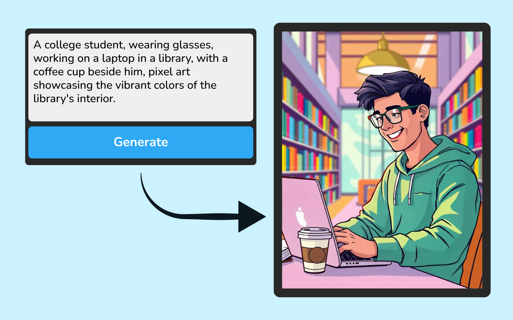
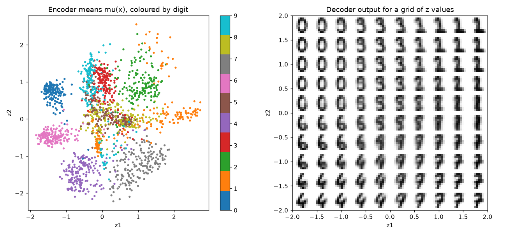
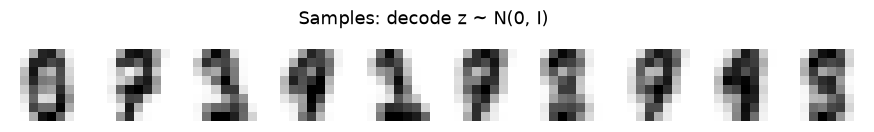
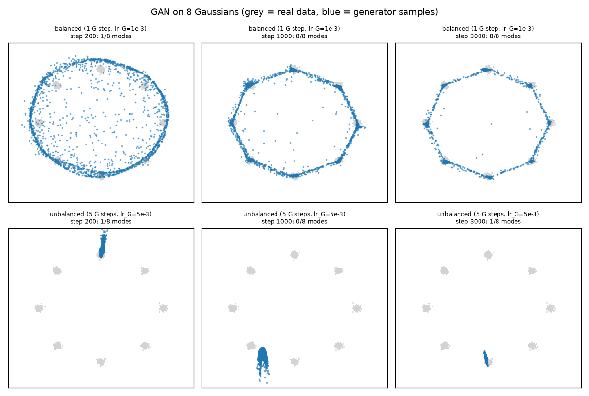
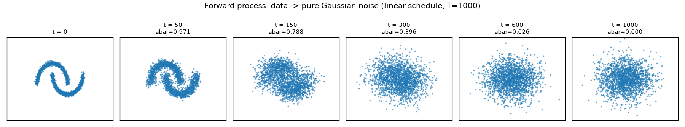
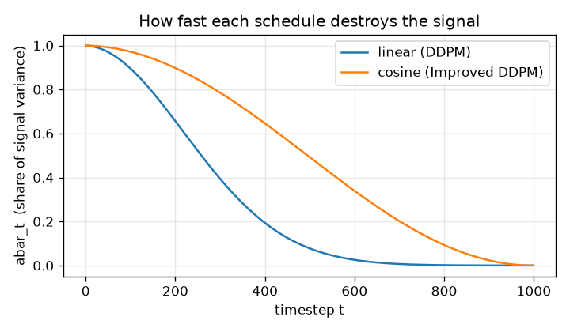
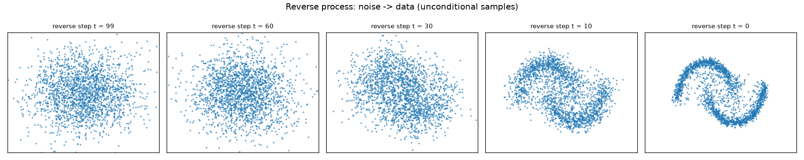
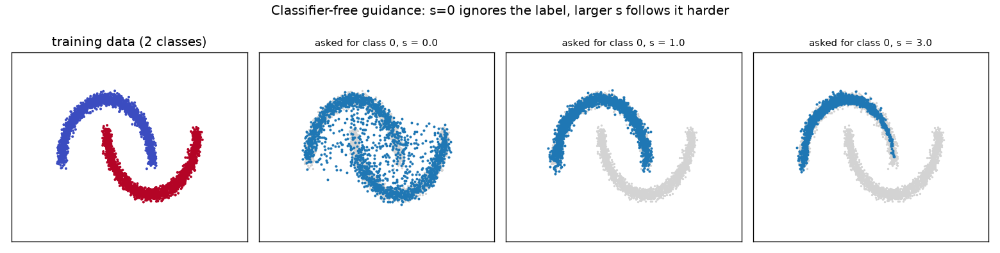
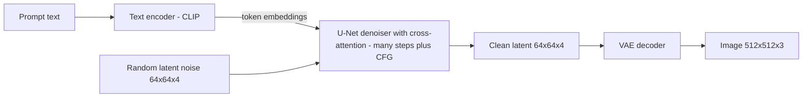
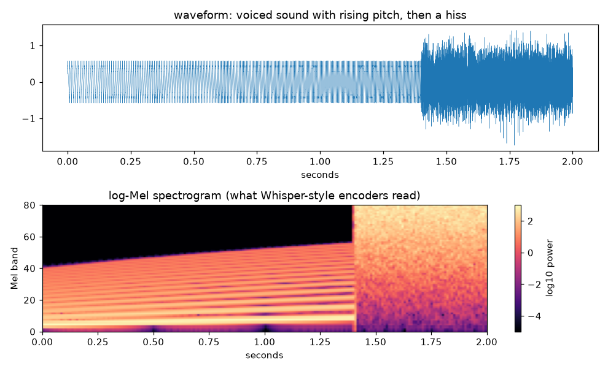

# Chapter 10 — Generative Models Beyond Text

*Last reviewed: September 2026. Product names and "state of the art" move fast; the model families and the maths in this chapter are stable.*

A few years ago, a small business launching a product needed a designer or a stock-photo budget for every social-media image, and an independent filmmaker needed paid voice actors for every narration. Today both can type a description and get usable images or a natural-sounding voice in minutes. Large language models (Chapter 4) generate text; this chapter is about machines that generate **images, audio, speech, music and video**, and models that **understand several kinds of data at once**.

You will build four kinds of generator from scratch on toy data — an autoencoder-based **VAE**, a **GAN**, a **diffusion model** with classifier-free guidance, and a miniature **CLIP** — then see how the same ideas scale up into Stable Diffusion, DALL·E, Midjourney, Whisper, text-to-speech systems, video generators and multimodal assistants. The chapter ends with how these models are **evaluated** and the **risks** they bring: deepfakes, fraud, watermarking and copyright.

**What you'll learn**

- The four families of generative model and their trade-offs (quality, diversity, speed)
- **Autoencoders and VAEs**: latent spaces, the reparameterisation trick, the ELBO loss
- **GANs**: generator vs discriminator, the minimax game, **mode collapse**
- **Diffusion**: forward noising, reverse denoising, noise schedules, the U-Net, fast samplers
- **Text-to-image**: conditioning, **CLIP**, **classifier-free guidance**, **latent diffusion (Stable Diffusion)**, DALL·E, Imagen, Midjourney, diffusion transformers
- **Audio and speech**: spectrograms, **ASR (Whisper)**, **TTS** and voice cloning, music
- **Video** generation and deepfakes
- **Multimodal LLMs** that see and hear
- **Evaluation**: FID, CLIP score, precision/recall, human evaluation, WER and MOS
- **Risks**: deepfakes, misinformation, consent, **watermarking and provenance**, copyright, regulation

Code lives in [`code/`](code/); every script runs on a laptop CPU in under 30 seconds and saves its figures to `img/`.

---

## 10.1 The landscape: what "generative" means beyond text

### What it is

A **generative model** learns the probability distribution of its training data — which images, sounds or videos are "likely" — so that it can **sample** new examples that look as if they came from the same source. A **conditional** generative model samples given some input: a text prompt, a class label, a reference voice, a sketch.

Image generators learn from very large collections of **images paired with text descriptions**. Over millions of pairs they absorb how words, objects, styles and moods relate to visual patterns, which lets them produce new images from a description. Ask for "a watercolour of a lighthouse at dawn, gulls overhead, soft pastel light" and the model composes a scene it has never seen from patterns it has learned.


*Figure — an image produced by a text-to-image model from a descriptive prompt (course image).*

### The main products (orientation)

| Tool | Maker | Notes |
|---|---|---|
| **Stable Diffusion** (2022 →) | Stability AI, with CompVis (LMU Munich) and Runway | Open weights: you can run it on your own GPU, fine-tune it and control it (ControlNet, LoRA). Latent diffusion (Section 10.5) |
| **DALL·E** (2021, 2, 3) | OpenAI | Known for imaginative combinations of concepts; DALL·E 3 (2023) was built into ChatGPT, and in 2025 ChatGPT moved to native image generation in its GPT-4o model |
| **Midjourney** (2022 →) | Midjourney, Inc. | Strong artistic, stylised look; architecture not published |
| **Imagen** / Gemini image models | Google | Imagen used a large frozen text encoder (T5) with cascaded diffusion |
| **FLUX** (2024) | Black Forest Labs | Open-weight family from former Stable Diffusion researchers |

### Why it matters

- **Marketing and branding** — draft logos, packaging and whole ad campaigns quickly.
- **Art and design** — artists use generated sketches as inspiration or as parts of final work.
- **Concept visualisation** — architects and game studios sketch early ideas from a prompt, then polish the best by hand.
- **Voice** — narration for videos and audiobooks, and assistive voices for people who have lost the ability to speak.
- **Film** — recreating historical figures, de-ageing actors, dubbing.

The same power creates problems: copyright disputes, forged artworks, and realistic fakes of real people (Section 10.10).

### The four families

| Family | Core idea | Sampling speed | Sample quality | Diversity | Famous examples |
|---|---|---|---|---|---|
| **VAE** (variational autoencoder) | Compress to a smooth latent space, decode samples from it | Fast (one pass) | Blurry on its own | Good | Image tokenisers/compressors inside Stable Diffusion |
| **GAN** (generative adversarial network) | Generator vs discriminator game | Fast (one pass) | Very sharp | Prone to **mode collapse** | StyleGAN faces |
| **Autoregressive** | Predict the next token (pixel patch, audio token) | Slow (one step per token) | High | Good | Original DALL·E, VALL-E speech, GPT-4o images |
| **Diffusion / flow** | Learn to remove noise step by step | Slow (tens of steps; distillation cuts this) | Very high | Good | Stable Diffusion, Imagen, Sora-style video |

This is sometimes called the **generative trilemma**: fast sampling, high quality and full diversity are hard to get all at once. GANs are fast and sharp but may drop modes; VAEs are fast and diverse but blurry; diffusion is high quality and diverse but slow.

### Self-check

1. What does a generative model learn? → The distribution of its training data, so it can sample new, similar examples.
2. What is a conditional generator? → One that samples given an input such as a prompt, label or reference.
3. Which family is fast and sharp but can drop modes? → GANs.

### TL;DR

Generative models learn "what data looks like" and sample new data, usually conditioned on text. Four families — VAEs, GANs, autoregressive models and diffusion — trade off speed, quality and diversity. Diffusion dominates images and video today.

---

## 10.2 Autoencoders and variational autoencoders (VAEs)

### What it is

An **autoencoder** is a neural network trained to copy its input to its output through a narrow middle layer. The **encoder** squeezes an image into a short vector, the **latent code** z; the **decoder** rebuilds the image from z. Because the bottleneck is small, the network must learn the essentials — like describing a face in a few words and having a sketch artist redraw it.

A plain autoencoder is a good compressor but a poor generator: its latent space has gaps, so decoding a random z often gives garbage. A **variational autoencoder** (VAE; Kingma and Welling, 2013) fixes this by making the latent space smooth and well-organised, so that *any* z drawn from a standard normal distribution N(0, I) decodes into something sensible.

### How it works

1. **Encode to a distribution, not a point.** For input x, the encoder outputs a mean μ(x) and a variance σ²(x) (in practice log σ²). This defines q(z | x) = N(μ, σ²).
2. **Sample with the reparameterisation trick.** z = μ + σ ⊙ ε, with ε ~ N(0, I). Randomness moves into ε, so gradients can flow through μ and σ during back-propagation.
3. **Decode** z into a reconstruction x̂.
4. **Loss = reconstruction + KL.** We would like to maximise log p(x), the probability the model gives the data, but it cannot be computed directly. The **ELBO** (evidence lower bound) is a quantity that is always ≤ log p(x) and can be computed, so we maximise it instead — equivalently, minimise the negative ELBO:

   Loss = reconstruction error(x, x̂) + KL( N(μ, σ²) ‖ N(0, I) )

   **KL divergence** measures how far one distribution is from another (0 when they are identical). For Gaussians it has a closed form, summed over latent dimensions: KL = −½ Σ (1 + log σ² − μ² − σ²).

   Worked number: one latent dimension with μ = 1, σ = 1 → KL = −½(1 + 0 − 1 − 1) = 0.5. With μ = 0, σ = 1 it is 0 — the prior itself.

5. **Generate** by sampling z ~ N(0, I) and decoding.

The two terms pull against each other: reconstruction wants each input to have its own sharp, distinct code; KL pulls all codes towards the same standard normal. The balance is what makes the space smooth — nearby points decode to similar images — and also why VAE samples tend to be **blurry**. (A β-VAE multiplies the KL term by β to shift this balance.)

### Code: a VAE on handwritten digits

`code/vae_digits.py` trains a VAE with a **2-dimensional** latent space on scikit-learn's 1,797 digit images (8 × 8 pixels), so the whole latent space can be drawn.

```python
class VAE(nn.Module):
    def __init__(self, d_in=64, hidden=128, d_z=2):
        super().__init__()
        self.enc = nn.Sequential(nn.Linear(d_in, hidden), nn.ReLU(),
                                 nn.Linear(hidden, hidden), nn.ReLU())
        self.mu = nn.Linear(hidden, d_z)
        self.logvar = nn.Linear(hidden, d_z)
        self.dec = nn.Sequential(nn.Linear(d_z, hidden), nn.ReLU(),
                                 nn.Linear(hidden, hidden), nn.ReLU(),
                                 nn.Linear(hidden, d_in))      # logits

    def forward(self, x):
        mu, logvar = self.encode(x)
        z = mu + torch.exp(0.5 * logvar) * torch.randn_like(mu)   # reparameterisation
        return self.dec(z), mu, logvar


def loss_fn(logits, x, mu, logvar):
    recon = F.binary_cross_entropy_with_logits(logits, x, reduction="sum") / len(x)
    kl = (-0.5 * (1 + logvar - mu ** 2 - logvar.exp()).sum(1)).mean()
    return recon + kl, recon, kl
```

Output:

```text
epoch   1: loss 34.14 = reconstruction 33.77 + KL 0.38
epoch  10: loss 27.18 = reconstruction 27.16 + KL 0.01
epoch  50: loss 25.06 = reconstruction 23.17 + KL 1.89
epoch 150: loss 24.34 = reconstruction 21.93 + KL 2.41
latent means: mean [0.04 0.02], std [0.99 0.93] (prior is 0, 1)
saved img/vae_latent_space.png and img/vae_samples.png
```


*Figure — generated by `code/vae_digits.py`. Left: each image's latent mean, coloured by its true digit (labels were never used in training). Right: decoding a grid of z values shows digits morphing smoothly (0 → 9 → 3 → 1 across the top).*


*Figure — ten new digits made by decoding z ~ N(0, I).*

What to notice:

- **Unsupervised structure**: digits form clusters without ever seeing a label.
- **Smoothness**: moving across the grid changes the digit gradually; that is what makes sampling work.
- **Posterior collapse, briefly**: at epoch 10 the KL term fell to 0.01 — the encoder was nearly ignoring the input and the decoder was producing an "average digit". It recovered as training went on. Collapse is a real failure mode of VAEs with powerful decoders; KL warm-up (starting with a small KL weight) is a common fix.
- The latent means have roughly mean 0 and standard deviation 1, as the KL term demands.
- The samples are recognisable but soft-edged: the typical VAE blur.

### Where VAEs are used today

Rarely as stand-alone image generators, but everywhere as **compressors**: Stable Diffusion's VAE turns a 512 × 512 × 3 image into a 64 × 64 × 4 latent (8× smaller per side) so diffusion can run cheaply in latent space (Section 10.5). **VQ-VAE** (van den Oord et al., 2017) uses a discrete codebook, turning images or audio into **tokens** that transformers can model — the basis of the first DALL·E and of neural audio codecs.

### Common mistakes

- Forgetting the reparameterisation trick (sampling z directly blocks gradients).
- Summing the KL over dimensions but averaging reconstruction over pixels (or the reverse), silently re-weighting the two terms.
- Expecting sharp images from a plain VAE.

### In the interview

**30-second answer — "What is a VAE?"** "An autoencoder whose encoder outputs a Gaussian over latent codes instead of a single point. We sample with z = μ + σε so gradients flow, decode, and train on reconstruction error plus a KL term that pulls each code distribution towards N(0, I). That makes the latent space smooth, so decoding random normal samples generates new data. Samples tend to be blurry; today VAEs are mostly used as the compressor in latent diffusion."

- *"Why is the KL term needed?"* — Without it the codes spread out arbitrarily and leave gaps; random samples decode to nonsense.
- *"Why blurry?"* — Pixel-wise losses reward averaging over plausible outputs, and the KL pressure limits how much detail each code can carry.

### Self-check

1. Write the reparameterisation trick. → z = μ + σ ⊙ ε, ε ~ N(0, I).
2. KL for μ = 1, σ = 1 in one dimension? → 0.5.
3. What does Stable Diffusion use a VAE for? → Compressing images to a small latent where diffusion runs, and decoding the result back to pixels.

### TL;DR

VAE = encoder to a Gaussian + reparameterised sample + decoder, trained on reconstruction + KL. Smooth latent space, easy sampling, blurry outputs; now the workhorse compressor inside larger generators.

---

## 10.3 Generative adversarial networks (GANs)

### What it is

A **GAN** (Goodfellow et al., 2014) trains two networks against each other:

- the **generator** G turns random noise z into a fake sample G(z);
- the **discriminator** D looks at a sample and outputs the probability that it is real.

The classic analogy is a forger and a detective. The forger improves until the detective can no longer tell fakes from real paintings.

### How it works

1. Sample a batch of real data and a batch of fakes G(z).
2. **Update D** to output 1 on real and 0 on fake (binary cross-entropy).
3. **Update G** so that D outputs 1 on its fakes. In practice G minimises −log D(G(z)) (the **non-saturating** loss), because the original min log(1 − D(G(z))) gives almost no gradient early on, when D easily rejects every fake.
4. Repeat, keeping the two roughly balanced.

Formally it is a **minimax game**: min over G, max over D of E_x[log D(x)] + E_z[log(1 − D(G(z)))], where E_x averages over real data and E_z over random noise. D wants both terms large (confident on real, rejecting fakes); G wants the second term small. For a fixed G the best discriminator is D*(x) = p_data(x) / (p_data(x) + p_G(x)); the game's equilibrium is p_G = p_data, where D outputs ½ everywhere.

### The problem: mode collapse and instability

A **mode** is one distinct "type" of data (one digit, one face style, one cluster). **Mode collapse** happens when G discovers that a few outputs fool D and keeps producing only those — sharp samples, little variety. D then learns to reject that mode, G hops to another, and training can cycle instead of converging. Remedies include better losses (Wasserstein GAN with gradient penalty), architectural tricks (DCGAN, spectral normalisation), minibatch statistics that let D notice low variety, and careful balancing of the two learning rates.

### Code: a GAN on 8 Gaussian blobs

`code/gan_2d.py` trains a small GAN on points arranged in eight blobs on a ring, then counts how many blobs ("modes") the generator covers. It trains twice: a balanced setup, and a deliberately unbalanced one (5 generator updates per discriminator update, with a 5× higher generator learning rate).

```python
for step in range(1, steps + 1):
    real, fake = real_batch(256), G(torch.randn(256, 2)).detach()
    d_loss = bce(D(real), torch.ones(256, 1)) + bce(D(fake), torch.zeros(256, 1))
    opt_d.zero_grad(); d_loss.backward(); opt_d.step()
    for _ in range(g_steps):
        g_loss = bce(D(G(torch.randn(256, 2))), torch.ones(256, 1))   # non-saturating
        opt_g.zero_grad(); g_loss.backward(); opt_g.step()
```

Output:

```text
balanced (1 G step, lr_G=1e-3)
   step  200: modes covered 1/8, samples on a mode 6%
   step 1000: modes covered 8/8, samples on a mode 54%
   step 3000: modes covered 8/8, samples on a mode 77%
unbalanced (5 G steps, lr_G=5e-3)
   step  200: modes covered 1/8, samples on a mode 37%
   step 1000: modes covered 0/8, samples on a mode 0%
   step 3000: modes covered 1/8, samples on a mode 50%
saved img/gan_modes.png
```


*Figure — generated by `code/gan_2d.py`. Top: the balanced GAN spreads out, then concentrates on all eight modes. Bottom: the unbalanced GAN collapses to a single tight cluster that jumps between places — mode collapse and mode hopping.*

What to notice: the balanced run covers all 8 modes and puts 77% of samples on them (the thin "bridges" between blobs are a typical GAN artefact); the unbalanced run never covers more than one mode, and at step 1000 its cluster sits *between* modes — sharp-looking but wrong. The same code with different settings behaves completely differently: GAN training is fragile.

### Trade-offs and where GANs stand today

GANs sample in **one forward pass** (fast) and produce very sharp images; **StyleGAN** (NVIDIA, 2018–2019) made photorealistic faces famous ("this person does not exist"). But training is unstable and diversity is hard to guarantee, and diffusion models overtook them for text-to-image around 2021–2022. GAN ideas live on as **adversarial losses** inside other systems — for example, the discriminator losses used to train the VAE of Stable Diffusion and neural audio vocoders, and adversarial distillation that makes diffusion models sample in one to four steps.

### In the interview

**30-second answer — "Explain GANs and mode collapse."** "Two networks play a game: the generator maps noise to samples, the discriminator classifies real versus fake, and each is trained to beat the other; at equilibrium the generator matches the data distribution. Mode collapse is when the generator finds a few outputs that fool the discriminator and stops covering the rest of the data — sharp but low-diversity samples. Fixes include Wasserstein losses with gradient penalties, spectral normalisation, minibatch discrimination and balancing the two players."

- *"Why the non-saturating loss?"* — Early on D rejects fakes confidently, so log(1 − D(G(z))) is flat and gives G almost no gradient; −log D(G(z)) is steep there.
- *"GAN or diffusion for a new image product?"* — Diffusion for quality, diversity and text conditioning; GAN-style one-step generation (or a distilled diffusion model) when latency is critical.

### Self-check

1. What does the optimal discriminator output at equilibrium? → ½ everywhere.
2. Define mode collapse. → The generator covers only a few modes of the data distribution.
3. Why do GANs sample faster than diffusion models? → One forward pass versus many denoising steps.

### TL;DR

GAN = generator vs discriminator. Fast and sharp, but unstable and prone to mode collapse. Mostly replaced by diffusion for text-to-image, yet adversarial losses remain a common ingredient.

---
## 10.4 Diffusion models

### What it is

A **diffusion model** learns to turn random noise into data by **removing noise a little at a time**. Training teaches a network to undo small amounts of corruption; generation starts from pure noise and applies that "undo" step many times. Analogy: a sculptor who, shown a block of static, removes a thin layer of "wrong" at each pass until a statue appears.

The idea goes back to Sohl-Dickstein et al. (2015); **DDPM** (denoising diffusion probabilistic models, Ho et al., 2020) made it practical, and by 2021–2022 diffusion beat GANs on image quality.

### How it works: the forward (noising) process

Take a clean example x₀ and add a little Gaussian noise at each of T steps (typically T = 1000). Step t uses a small variance β_t from a **noise schedule** (DDPM: β rises linearly from 0.0001 to 0.02). Define α_t = 1 − β_t and ᾱ_t = α₁ · α₂ · … · α_t (the product so far). Then a closed form lets you jump straight to any step:

x_t = √ᾱ_t · x₀ + √(1 − ᾱ_t) · ε,  ε ~ N(0, I)

√ᾱ_t is how much signal survives and √(1 − ᾱ_t) how much noise has been mixed in. As t → T, ᾱ_t → 0 and x_T is essentially pure noise, whatever x₀ was.

`code/forward_noising.py` applies this to 2-D "two moons" data:

```python
T = 1000
betas = np.linspace(1e-4, 0.02, T)            # DDPM (Ho et al. 2020) linear schedule
alphas = 1.0 - betas
abar = np.cumprod(alphas)                      # abar[t-1] is abar_t

def q_sample(x0: np.ndarray, t: int) -> np.ndarray:
    """Jump straight to step t (1-based) in one shot."""
    eps = rng.standard_normal(x0.shape)
    return np.sqrt(abar[t - 1]) * x0 + np.sqrt(1 - abar[t - 1]) * eps
```

Output:

```text
 t    abar_t   signal coef sqrt(abar)   noise std sqrt(1-abar)
   1  0.9999   0.9999                   0.0100
  50  0.9710   0.9854                   0.1702
 150  0.7883   0.8879                   0.4601
 300  0.3964   0.6296                   0.7769
 600  0.0259   0.1609                   0.9870
1000  0.0000   0.0064                   1.0000

step-by-step to t=300: mean +0.009, std 0.986
closed-form jump t=300: mean -0.005, std 1.006

abar drops below 0.5 at t=260 (linear) vs t=497 (cosine)
saved img/forward_noising.png and img/noise_schedules.png
```


*Figure — generated by `code/forward_noising.py`: the moons blur by t = 150 and are pure Gaussian noise by t = 600.*


*Figure — the cosine schedule (Nichol and Dhariwal, 2021) destroys signal more gradually, wasting fewer steps on near-pure noise.*

Two checks: stepping 300 times and jumping once give the same statistics (mean ≈ 0, std ≈ 1, since the data were standardised), confirming the closed form; and the linear schedule has lost half its signal variance by step 260, while the cosine schedule keeps it until step 497.

### How it works: the reverse (denoising) process and training

We cannot reverse the noise exactly, but a neural network ε_θ(x_t, t) can learn to **predict the noise** that was added. Training is simple supervised regression:

1. Pick a real example x₀, a random step t and random noise ε.
2. Make x_t with the closed form.
3. Train ε_θ(x_t, t) to predict ε: loss = ‖ε − ε_θ(x_t, t)‖² (mean squared error).

To **generate**, start from x_T ~ N(0, I) and for t = T … 1 apply

x_{t−1} = (1/√α_t) · ( x_t − (β_t / √(1 − ᾱ_t)) · ε_θ(x_t, t) ) + σ_t · z,  z ~ N(0, I) (no noise at the last step), with σ_t² = β_t in the simplest version.

Each step removes the predicted noise and adds back a smaller amount of fresh noise, so samples stay varied. Predicting noise at every noise level is equivalent to learning the **score** (the direction towards higher data probability), which links DDPM to score-based models (Song et al.).

**The network.** For images, ε_θ is usually a **U-Net**: a convolutional encoder that downsamples, a decoder that upsamples, and skip connections between matching resolutions so fine detail is not lost; the timestep enters as a sinusoidal embedding, and text enters through cross-attention layers (Section 10.5). Newer systems replace the U-Net with a **diffusion transformer (DiT)** that processes the latent as a sequence of patches (Peebles and Xie, 2023) — the backbone of Stable Diffusion 3, FLUX and Sora-style video models.

**Faster sampling.** 1,000 network calls per image is slow. **DDIM** (Song, Meng and Ermon, 2020) samples deterministically in 20–50 steps with the same trained network; better ODE solvers need even fewer; **distillation** (consistency models, adversarial distillation such as SDXL Turbo) gets to 1–4 steps. **Flow matching / rectified flow** — used in Stable Diffusion 3 and FLUX — learns straighter paths from noise to data, which also allows fewer steps.

### Code: a tiny diffusion model you can train in 20 seconds

`code/toy_diffusion_2d.py` trains an MLP noise predictor on two-moons data with T = 100 steps (a shorter schedule, β from 0.001 to 0.1, suits a toy problem) and samples with the DDPM update above. It is also **class-conditional** and supports guidance, which Section 10.5 uses.

```python
def train(model, x0, y0, steps=6000, batch=512, p_uncond=0.2):
    # ... optimiser and scheduler
    for step in range(steps):
        idx = torch.randint(0, len(x0), (batch,))
        x, y = x0[idx], y0[idx].clone()
        y[torch.rand(batch) < p_uncond] = NULL          # label dropout for CFG
        t = torch.randint(0, T, (batch,))
        eps = torch.randn_like(x)
        a = abar[t][:, None]
        xt = a.sqrt() * x + (1 - a).sqrt() * eps        # closed-form forward jump
        loss = ((model(xt, t, y) - eps) ** 2).mean()    # "simple" DDPM loss
        # ... backward, step

@torch.no_grad()
def sample(model, n, cls=None, guidance=1.0, keep=()):
    x = torch.randn(n, 2)
    for t in reversed(range(T)):
        tt = torch.full((n,), t)
        e_u = model(x, tt, torch.full((n,), NULL))
        if cls is None:
            eps = e_u
        else:
            e_c = model(x, tt, torch.full((n,), cls))
            eps = e_u + guidance * (e_c - e_u)          # classifier-free guidance
        mean = (x - betas[t] / (1 - abar[t]).sqrt() * eps) / alphas[t].sqrt()
        x = mean + (betas[t].sqrt() * torch.randn_like(x) if t > 0 else 0)
    return x
```

Output:

```text
Training the noise-prediction network:
  step    0  loss 1.0284
  step 1000  loss 0.2576
  step 2000  loss 0.2712
  step 3000  loss 0.2355
  step 4000  loss 0.2223
  step 5000  loss 0.2315
  step 5999  loss 0.2444

Unconditional: 50% near moon 0, off-manifold 3.2%
Class 0, guidance s=0.0: 51.5% on class 0, off-manifold 3.7%, spread (std) 0.996
Class 0, guidance s=1.0: 100.0% on class 0, off-manifold 0.0%, spread (std) 0.725
Class 0, guidance s=3.0: 100.0% on class 0, off-manifold 0.0%, spread (std) 0.582
saved img/reverse_denoising.png and img/cfg_guidance.png
```


*Figure — generated by `code/toy_diffusion_2d.py`: unconditional samples at reverse steps 99, 60, 30, 10 and 0. The shape emerges only in the last few dozen steps.*

What to notice: the loss plateaus around 0.22–0.27 rather than going to zero — predicting random noise from a noisy point can never be perfect, especially at high noise levels. Unconditionally, samples land half on each moon, with only about 3% off the data "manifold" (farther than 0.25 from any real point).

### Trade-offs

| Strength | Weakness |
|---|---|
| Stable training (just regression) | Slow sampling (many network calls) |
| High quality and diversity; no mode collapse in practice | Heavy compute for training at scale |
| Easy to condition (text, images, masks, poses) | Fine details such as text in images and hands were long a weak spot |

### Common mistakes

- Using a schedule that never reaches pure noise (ᾱ_T well above 0), so sampling starts from a distribution the model never saw.
- Forgetting the timestep input — the network must know how noisy its input is.
- Confusing "predict x₀", "predict ε" and "predict v" parameterisations; they are interchangeable but the sampler must match.

### In the interview

**30-second answer — "How do diffusion models work?"** "A fixed forward process gradually adds Gaussian noise until data become pure noise; there is a closed form for jumping to any step. We train a network — a U-Net or a diffusion transformer — to predict the added noise from the noisy input and the timestep, with a simple MSE loss. To generate, we start from noise and repeatedly subtract predicted noise, adding a little fresh noise each step. Samplers like DDIM, flow-matching models and distillation cut the steps from about a thousand to between one and fifty."

- *"Why predict noise rather than the clean image?"* — It gives a well-scaled target at every noise level and connects to score matching; in practice all parameterisations work if the sampler is consistent.
- *"Why are diffusion models slow and how is it fixed?"* — One network call per step; use DDIM or ODE solvers, run in a compressed latent space, and distil into few-step students.

### Self-check

1. Write x_t in terms of x₀. → x_t = √ᾱ_t x₀ + √(1 − ᾱ_t) ε.
2. What is the training loss? → MSE between true noise ε and predicted noise ε_θ(x_t, t).
3. What does a U-Net's skip connection preserve? → Fine spatial detail from the downsampling path.
4. Name two ways to sample in fewer steps. → DDIM / ODE solvers; distillation (consistency, adversarial); flow matching.

### TL;DR

Diffusion = learn to denoise. Forward noising has a closed form; a U-Net or transformer learns to predict noise; sampling runs the reverse process from pure noise. Stable to train, excellent samples, slow unless you use fast samplers or distillation.

---

## 10.5 Text-to-image: CLIP, guidance and latent diffusion

### What it is

A text-to-image model is a **conditional diffusion model**: the denoiser receives the prompt as an extra input and learns to denoise *towards images matching that text*. Three ingredients make it work: a **text encoder** that turns the prompt into vectors, a way to inject those vectors into the denoiser (**cross-attention**), and **classifier-free guidance** to make the model follow the prompt closely. Running diffusion in a compressed **latent space** makes it affordable.

### CLIP: a shared space for images and text

**CLIP** (Contrastive Language–Image Pre-training; Radford et al., OpenAI, 2021) trains an image encoder and a text encoder together on about 400 million image–caption pairs from the web. In each batch of N pairs it computes all N × N cosine similarities and uses a **contrastive loss**: each image should be most similar to *its own* caption (the diagonal) and dissimilar to the other N − 1 captions, and vice versa. The result is a shared embedding space where "a photo of a dog" lands near photos of dogs.

CLIP gives you:

- **Zero-shot classification** — embed an image and the captions "a photo of a {class}" and pick the most similar caption, with no task-specific training.
- **A text encoder for generators** — Stable Diffusion 1.x conditions on CLIP's text encoder (ViT-L/14); DALL·E 2 generated a CLIP image embedding from the text and decoded it into an image.
- **An evaluation metric** — **CLIP score**, how well an image matches its prompt (Section 10.9).

`code/clip_contrastive_toy.py` reproduces the idea at toy scale: 12 concepts ("red square", "blue circle", …), each seen as a noisy 48-number "image" and a different noisy 32-number "caption", with two small encoders trained on CLIP's symmetric loss.

```python
zi, zt = embed(img, txt)                            # L2-normalised embeddings
logits = log_temp.exp() * zi @ zt.T                 # 64 x 64 similarities
target = torch.arange(64)                           # pair i matches caption i
loss = (F.cross_entropy(logits, target) + F.cross_entropy(logits.T, target)) / 2
```

Output:

```text
step    1  contrastive loss 6.275
step  500  contrastive loss 1.929
step 1500  contrastive loss 1.890

zero-shot accuracy on 1000 new images: 96.5% (chance = 8.3%)
CLIP-score style: mean cos(image, its caption) = 0.81, with a wrong caption = 0.29
example: image of 'blue circle' -> predicted 'blue circle'
```

The loss stops falling around 1.9 rather than 0 because a batch of 64 drawn from only 12 concepts contains several pairs of the same concept, which the loss still treats as "negatives" — real CLIP has the same issue with near-duplicate captions, at a much smaller scale. Zero-shot accuracy is 96.5% against 8.3% chance, and matching pairs have far higher cosine similarity than mismatched ones: the two modalities now share one space. The learnable **temperature** (initialised to 1/0.07, as in CLIP) sharpens the softmax over similarities.

### Classifier-free guidance (CFG)

A conditional model that is only *mildly* influenced by the prompt produces images that are plausible but loosely related to it. **Classifier-free guidance** (Ho and Salimans, 2021) fixes this without any extra classifier:

1. During training, replace the condition by a "null" token some of the time (commonly 10–20%), so one network learns both the **conditional** prediction ε(x_t, c) and the **unconditional** prediction ε(x_t, ∅).
2. At sampling time, compute both and extrapolate away from the unconditional one:

   ε̂ = ε(x_t, ∅) + s · ( ε(x_t, c) − ε(x_t, ∅) )

   s = 0 ignores the prompt; s = 1 is the plain conditional model; s > 1 pushes harder towards the prompt. (This is the convention used by the diffusers library, whose Stable Diffusion default is 7.5; the original paper writes the same thing as (1 + w)ε_c − wε_∅.)

3. Cost: two network evaluations per step (often batched together).

The trade-off: higher guidance gives better **prompt adherence** and fidelity but **less diversity**, and very high values give over-saturated, harsh images.

The toy model shows exactly this. Asked for class 0 (the upper moon):


*Figure — generated by `code/toy_diffusion_2d.py`. With s = 0 the label is ignored (samples on both moons); s = 1 follows it; s = 3 follows it more tightly and the samples bunch together.*

From the output above: on-class rate goes 51.5% → 100% → 100%, off-manifold samples 3.7% → 0% → 0%, and the spread (standard deviation) shrinks 0.996 → 0.725 → 0.582. Guidance buys fidelity with diversity.

(**Classifier guidance**, the earlier approach of Dhariwal and Nichol, 2021, used the gradient of a separately trained noisy-image classifier; CFG made that classifier unnecessary.)

### Latent diffusion and Stable Diffusion

Running diffusion on 512 × 512 × 3 pixels (786,432 numbers) at every step is expensive. **Latent diffusion** (Rombach et al., 2022) runs it in the latent space of a pretrained autoencoder instead. Stable Diffusion 1.x, released in August 2022, has three parts:



1. **VAE** — encoder compresses 512 × 512 × 3 images to 64 × 64 × 4 latents (48× fewer numbers); decoder maps latents back to pixels.
2. **Text encoder** — CLIP ViT-L/14 turns the prompt into a sequence of token embeddings.
3. **U-Net denoiser** — about 860 million parameters, with **cross-attention** layers where the image latent's positions (queries) attend to the prompt's token embeddings (keys and values), so each region of the image can "look up" the relevant words.

Generation: random latent → 20–50 guided denoising steps → VAE decoder → image. Because the weights are open, a large ecosystem grew around it:

- **Image-to-image / inpainting** — start from a noised version of an existing image, or denoise only a masked region.
- **ControlNet** (Zhang et al., 2023) — adds a trainable copy of the encoder that conditions on edges, depth maps or human poses.
- **LoRA** fine-tuning and **DreamBooth** — teach a new style or subject from a handful of images by training small low-rank adapters (LoRA is explained in [Chapter 8](../08-prompting-vs-finetuning-vs-rag-and-llm-evaluation/README.md)).
- Newer open models (SDXL in 2023; Stable Diffusion 3 and FLUX in 2024) use larger text encoders (including T5), transformer backbones and flow matching; SD3's MMDiT lets image and text tokens attend to each other in the same transformer.

Other designs: **Imagen** (Google, 2022) showed that a large frozen *language-model* text encoder (T5-XXL) improves prompt understanding, with cascaded pixel-space diffusion (a small image, then super-resolution stages); **DALL·E 3** (2023) improved prompt following by training on detailed, machine-rewritten captions; **autoregressive** image generation (native image output in GPT-4o, 2025) generates image tokens with the same transformer that writes text.

### Common mistakes

- Cranking the guidance scale too high to "make it follow the prompt" — images become harsh and repetitive.
- Assuming the model "understands" counts, spatial relations or text rendering; these improved a lot with larger text encoders but still fail on complex prompts.
- Ignoring the negative prompt / null condition: in many UIs the "negative prompt" simply replaces ∅ in the CFG formula, pushing *away* from those words.

### In the interview

**30-second answer — "How does Stable Diffusion turn text into an image?"** "It's latent diffusion. A VAE compresses images into a 64×64×4 latent; a CLIP text encoder turns the prompt into token embeddings; a U-Net denoiser with cross-attention to those embeddings removes noise from a random latent over 20 to 50 steps, using classifier-free guidance — predicting with and without the prompt and extrapolating towards the prompt; then the VAE decoder produces the 512×512 image."

- *"What does the guidance scale trade off?"* — Prompt adherence and fidelity versus diversity; too high gives over-saturated images.
- *"Why run diffusion in latent space?"* — About 48× fewer numbers per step, so training and sampling are far cheaper, while the VAE preserves perceptual detail.

### Self-check

1. What does CLIP's contrastive loss push together and apart? → Matching image–caption pairs together; all other pairs in the batch apart.
2. Write the CFG formula. → ε̂ = ε_∅ + s(ε_c − ε_∅).
3. Name Stable Diffusion's three components. → VAE, CLIP text encoder, U-Net denoiser with cross-attention.
4. How does text influence the U-Net? → Through cross-attention from image positions to text-token embeddings.

### TL;DR

Text-to-image = conditional diffusion. CLIP aligns text and images; cross-attention injects the prompt; classifier-free guidance strengthens it at the cost of diversity; latent diffusion (Stable Diffusion) makes it cheap enough for consumer GPUs.

---
## 10.6 Audio and speech: ASR, TTS, voice cloning and music

### What it is

- **ASR (automatic speech recognition)** turns speech into text.
- **TTS (text-to-speech)** turns text into speech.
- **Voice cloning** is TTS that imitates a specific speaker's voice — its pitch, timbre, rhythm and accent — from a sample of their speech.
- **Music and sound generation** create audio from text descriptions or melodies.

### How audio is represented

A **waveform** is a list of air-pressure samples (16,000 per second at 16 kHz). Models rarely work on raw samples directly; the usual input is a **log-Mel spectrogram**:

1. Cut the waveform into short overlapping windows (e.g. 25 ms, every 10 ms).
2. Take the Fourier transform of each window → energy per frequency (a **spectrogram**).
3. Pool frequencies into **Mel bands**: triangular filters spaced evenly on the Mel scale, mel = 2595 · log₁₀(1 + f / 700), which is dense at low frequencies and sparse at high ones, like human hearing.
4. Take the logarithm (loudness is perceived roughly logarithmically).

The result is an image-like grid (bands × time) that convolutional and transformer models handle well. `code/log_mel_spectrogram.py` builds it from scratch on a synthetic signal:

```python
def log_mel(wave):
    window = np.hanning(N_FFT)
    frames = [wave[i:i + N_FFT] * window for i in range(0, len(wave) - N_FFT + 1, HOP)]
    power = np.abs(np.fft.rfft(np.array(frames), axis=1)) ** 2       # (frames, 201)
    mel = power @ mel_filterbank().T                                  # (frames, 80)
    S = np.log10(np.maximum(mel, 1e-10)).T                            # (80, frames)
    return np.maximum(S, S.max() - 8.0)       # Whisper also clips to 8 decades below max
```

Output:

```text
waveform: 32000 samples (2.0 s at 16000 Hz)
log-Mel spectrogram: 80 Mel bands x 198 frames
30 s of audio would give 80 x 3000 frames (Whisper's input size)
low Mel filters are spaced 23 Hz apart, high ones 266 Hz apart (ears resolve low pitches finely)
saved img/log_mel_spectrogram.png
```


*Figure — generated by `code/log_mel_spectrogram.py`: a voiced sound with rising pitch shows as parallel harmonic stripes climbing over time; the hiss is broadband noise concentrated in high bands.*

### ASR: Whisper

**Whisper** (OpenAI, September 2022) is an encoder–decoder transformer trained on about 680,000 hours of multilingual audio paired with (weakly supervised) transcripts from the web. The encoder reads 30-second chunks as log-Mel spectrograms (80 bands at 16 kHz with 25 ms windows and a 10 ms hop — exactly the 80 × 3000 input above; large-v3 uses 128 bands); the decoder writes text tokens, with special tokens selecting the task (transcribe or translate to English), language and timestamps. Its size and diversity of training data make it robust to accents and background noise. Known weaknesses: it can **hallucinate** text during silences or noise, and long audio must be chunked.

ASR is measured by **word error rate**: WER = (substitutions + deletions + insertions) / number of reference words. Example: reference "turn the lights off" (4 words), hypothesis "turn lights of" → one deletion ("the") + one substitution ("off"→"of") = 2 / 4 = 50%.

### TTS and voice cloning

Neural TTS has evolved in three waves:

1. **Two-stage pipelines**: an acoustic model maps text (or phonemes) to a Mel spectrogram (Tacotron 2, 2017; FastSpeech), and a **vocoder** turns the spectrogram into a waveform (WaveNet, 2016; later fast GAN vocoders such as HiFi-GAN).
2. **Neural audio codecs + language models**: codecs such as SoundStream (2021) and EnCodec (2022) compress audio into sequences of discrete tokens; a transformer then predicts audio tokens like text tokens. Microsoft's **VALL-E** (2023) showed that a 3-second recording was enough to imitate a new speaker.
3. **Diffusion / flow-matching TTS** and speech-native assistants that listen and speak directly (e.g. real-time voice modes in ChatGPT and Gemini).

Voice cloning captures a speaker's characteristic pitch, tone and rhythm. Uses: narration and dubbing, audiobooks, accessibility (restoring a voice for people who lost the ability to speak, from old recordings). Abuses: impersonation scams and fake audio of public figures (Section 10.10).

TTS quality is judged mainly by listeners: **MOS** (mean opinion score, 1–5 ratings of naturalness), plus speaker-similarity scores for cloning and the WER of an ASR system run on the generated speech (intelligibility).

### Music and sound

Text-to-music systems such as Google's MusicLM (2023), Meta's MusicGen (2023), Stable Audio and commercial services like Suno and Udio generate songs or sound effects from prompts, typically as audio-codec tokens (autoregressive) or with latent diffusion over spectrograms or codec latents.

### In the interview

**30-second answer — "How do speech models work?"** "Audio is usually turned into a log-Mel spectrogram — short-time Fourier transforms pooled into perceptual Mel bands, then logged. ASR models like Whisper encode that with a transformer and decode text tokens; they're scored by word error rate. TTS either predicts a spectrogram and uses a vocoder, or predicts discrete neural-codec tokens with a language model, which is what makes few-second voice cloning possible; it's scored by listener MOS and intelligibility."

### Self-check

1. Why use Mel bands? → They mimic human pitch resolution: fine at low frequencies, coarse at high.
2. Whisper's input for 30 s of 16 kHz audio? → 80 × 3000 log-Mel frames (128 bands in large-v3).
3. WER formula? → (S + D + I) / N.
4. What does a vocoder do? → Converts a spectrogram (or acoustic features) into a waveform.

### TL;DR

Audio → log-Mel spectrogram → transformer. Whisper does robust ASR; TTS moved from spectrogram + vocoder to codec tokens + language models, enabling voice cloning from seconds of speech. Measure ASR with WER, TTS with MOS.

---

## 10.7 Video generation and deepfakes

### What it is

**Video generation** creates moving images from text, an image or another video. **Deepfakes** are synthetic media that put a real person's face or voice into content they never recorded.

### How it works

- **Text/image-to-video models** extend image diffusion through time: the latent becomes a stack of frames, compressed by a video autoencoder into **spacetime patches**, and a diffusion transformer denoises all patches jointly so motion stays consistent. OpenAI's **Sora** (announced February 2024; Sora 2 in 2025) described exactly this "diffusion transformer over spacetime patches" design; Google's **Veo** (Veo 3, 2025, also generates synchronised sound), Runway, Kling and others follow similar ideas. The hard parts are **temporal consistency** (objects must not morph between frames), physics that looks right, and cost — a few seconds of video is far more data than one image.
- **Classic face-swap deepfakes** use an autoencoder trick: one shared encoder learns general face structure (pose, expression, lighting) from videos of two people, with a separate decoder per person. Encode person A's frame, decode it with person B's decoder, and B appears with A's expression and head movement. Modern tools add GAN or diffusion refinement and lip-sync models that match mouth movement to new audio.

### Why it matters

Legitimate uses include film effects (recreating historical figures, de-ageing actors, dubbing with matching lip movement), education, advertising prototypes and accessibility. The same technology can fabricate events that never happened, impersonate public figures, steal identities and create non-consensual imagery, raising questions of **consent, authenticity and legal protection** — and driving demand for detection tools and new laws (Section 10.10).

### Self-check

1. What makes video harder than images? → Temporal consistency across frames and much more data per sample.
2. How does a classic face-swap deepfake work? → A shared encoder with one decoder per identity; encode A, decode with B's decoder.

### TL;DR

Video models are diffusion transformers over spacetime patches; deepfakes swap identities with shared-encoder autoencoders plus refinement. Powerful for film and education, dangerous for trust.

---

## 10.8 Multimodal models

### What it is

A **multimodal** model combines several kinds of data — text, images, audio, video, even sensor readings — in one system, instead of handling a single type. For example, it can read an article, look at its photos and watch a related clip to build one understanding of the story.

### Why it matters

- **Richer context** — combining inputs gives a fuller picture; matching an image to a written description becomes more accurate.
- **More natural interaction** — people communicate with sight, sound and words together; a model that takes all three can respond more naturally (show a photo of a broken part and ask, by voice, how to fix it).

### How it works

1. **Separate encoders plus fusion** — each modality has its own encoder (a vision transformer for images, an audio encoder for sound) whose outputs are projected into the language model's embedding space and treated as extra "tokens". LLaVA (2023) showed that even a simple projection from a CLIP image encoder into an LLM, fine-tuned on image-instruction data, yields a capable visual assistant. Flamingo (DeepMind, 2022) instead used cross-attention from the language model to image features.
2. **Natively multimodal** — one model trained from the start on interleaved text, image and audio tokens; GPT-4o (2024) and the Gemini family (from December 2023) are described this way, and they can also *output* audio and images.
3. **Any-to-any generation** — the same model decodes text, image tokens or speech, so an assistant can listen, look and reply in voice or with a picture.

**Applications**: assistants that see and hear (reading a document through the camera while you give spoken instructions), captioning and visual question answering, accessibility (describing scenes for blind users), document and chart understanding, and content creation (turning a text prompt into slides, infographics or short videos). Today's frontier assistants (Claude, ChatGPT, Gemini) accept images and documents as input as a matter of course.

### Common mistakes

- Assuming image understanding is as reliable as text understanding — small text, counting and precise spatial reasoning still cause errors.
- Forgetting that images cost tokens: a high-resolution image may use hundreds to thousands of tokens in the context window.
- Forgetting that images and audio can carry **prompt injection** too (instructions written inside a picture).

### In the interview

**30-second answer — "How do multimodal LLMs see images?"** "Usually a vision encoder — often CLIP-like — turns the image into patch embeddings, a projector maps them into the LLM's token space, and the LLM attends over image tokens and text tokens together. Natively multimodal models go further and train on interleaved text, image and audio tokens from the start, so they can also generate those modalities."

### Self-check

1. Two benefits of multimodality? → Richer context; more natural interaction.
2. What does LLaVA connect? → A CLIP image encoder to an LLM via a learned projection.

### TL;DR

Multimodal models turn images and audio into tokens the language model can attend to, or are trained natively on mixed tokens. They enable assistants that see, hear and speak.

---

## 10.9 Evaluating generative models

### What it is

Generated content has no single "correct" answer, so evaluation checks two things: **quality/fidelity** (does each sample look real and match its prompt?) and **diversity/coverage** (does the model produce the full range of the data, or collapse?). Automatic metrics are cheap and repeatable; human evaluation is the final judge.

### How it works: the main metrics

| Metric | What it measures | How | Better |
|---|---|---|---|
| **FID** (Fréchet Inception Distance; Heusel et al., 2017) | Distance between real and generated image distributions | Embed both sets with Inception-v3 (2048-d features); fit a Gaussian to each; FID = ‖μ_r − μ_g‖² + Tr(Σ_r + Σ_g − 2(Σ_r Σ_g)^½), with μ the mean feature vector, Σ the covariance matrix and Tr the trace (sum of the diagonal) | Lower |
| **Inception Score** (IS, 2016) | Confident *and* varied class predictions | From Inception-v3 class probabilities | Higher (dated; ignores real data) |
| **Precision / recall** for generative models | Precision = fraction of samples that look real (fidelity); recall = fraction of real data the model covers (diversity) | Nearest-neighbour manifolds in feature space | Higher |
| **CLIP score** | Image–prompt agreement | Cosine similarity of CLIP embeddings (often scaled, e.g. × 100) | Higher |
| **Human evaluation** | Overall preference, prompt adherence, aesthetics, artefacts | Side-by-side comparisons, rating scales, Elo-style arenas | — |
| **WER / MOS** (speech) | ASR accuracy; TTS naturalness | See Section 10.6 | Lower WER; higher MOS |

### Code: what the Fréchet distance can and cannot see

`code/frechet_distance.py` implements the FID formula and applies it to 2-D "features" from the 8-blob ring, comparing real data with several kinds of fake.

```python
def frechet(a: np.ndarray, b: np.ndarray) -> float:
    mu1, mu2 = a.mean(0), b.mean(0)
    s1, s2 = np.cov(a, rowvar=False), np.cov(b, rowvar=False)
    covmean = linalg.sqrtm(s1 @ s2)
    if np.iscomplexobj(covmean):          # tiny imaginary parts from numerics
        covmean = covmean.real
    return float(((mu1 - mu2) ** 2).sum() + np.trace(s1 + s2 - 2 * covmean))
```

Output:

```text
another real sample (ideal model)    FD =  0.003
blurry: right modes, extra noise     FD =  0.009
mode collapse: only 2 of 8 modes     FD =  2.203
mode collapse: only 1 of 8 modes     FD =  7.762
shifted: everything moved +0.5       FD =  0.510

ideal model but only 50 samples      FD =  0.040  (small n biases FID upward)
```

Lessons:

- Mode collapse is punished heavily, and shifts are caught.
- The **blurry** fake scores almost as well as a perfect model. FID only compares means and covariances (it assumes both feature clouds are Gaussian), and on raw 2-D points blur barely changes those. Real FID works in rich Inception features, where blur *does* move the distribution — which is exactly why the choice of feature extractor matters, and why FID can disagree with human judgement.
- With few samples the estimate is biased upward (0.040 instead of ≈0.003), so FID values are only comparable at the same sample size (commonly 10,000–50,000 images) and the same preprocessing. KID (kernel inception distance) is an unbiased alternative for small sets.

### Human evaluation

Automatic scores do not capture everything people care about: aesthetics, subtle artefacts (hands, text), cultural appropriateness, and whether the image matches the *intent* of the prompt. Standard practice is side-by-side preference tests on a fixed prompt set, with several raters per item, and public "arenas" that turn many pairwise votes into Elo-style leaderboards. Report inter-rater agreement and use prompt sets that cover hard cases (counting, spatial relations, text rendering, diverse people).

### Common mistakes

- Comparing FID numbers computed with different sample sizes, resolutions or feature extractors.
- Optimising CLIP score alone (models can learn to please CLIP rather than people).
- Evaluating quality but not diversity (or vice versa).

### In the interview

**30-second answer — "How would you evaluate an image generator?"** "Automatic metrics first: FID against a real reference set for overall realism and coverage, precision and recall to separate fidelity from diversity, and CLIP score for prompt alignment — all at fixed sample sizes and preprocessing. Then human side-by-side evaluations on a curated prompt suite covering hard cases, with multiple raters and agreement statistics, plus safety and bias checks. Humans decide launches; metrics catch regressions."

### Self-check

1. Is a lower or higher FID better? → Lower.
2. Why can FID miss blur in raw space? → It compares only means and covariances of the chosen features.
3. What does CLIP score measure? → Similarity between an image and its prompt in CLIP's embedding space.

### TL;DR

Measure fidelity and diversity. FID (lower is better) compares feature distributions; precision/recall separate the two; CLIP score checks prompt alignment; speech uses WER and MOS; humans remain the final judge.

---

## 10.10 Risks: deepfakes, provenance, copyright and regulation

### The problems

- **Misinformation and impersonation** — realistic fake videos, photos and voices of politicians, executives or family members. In a widely reported case from early 2024, an employee of the engineering firm Arup in Hong Kong transferred about US$25 million after a video call in which the "colleagues", including the CFO, were deepfakes.
- **Fraud and identity theft** — cloned voices in "emergency" calls; synthetic faces passing weak identity checks.
- **Non-consensual imagery** — sexualised deepfakes of real people, overwhelmingly targeting women.
- **Consent and likeness** — actors, voice artists and artists whose voice, face or style is reproduced without agreement.
- **Bias** — generators reproduce and can amplify stereotypes in their training data (e.g. who appears when you ask for "a CEO").
- **Copyright** — whether training on copyrighted works is lawful, and who (if anyone) owns outputs.

### Detection

Human cues exist, though they fade as models improve: malformed hands or extra limbs, garbled lettering on signs, inconsistent shadows or reflections, skin that looks too smooth, mismatched earrings or eyes ([Chapter 12, §12.7](../12-safety-ethics-governance/README.md) covers spotting generated media). Automated detectors are an arms race and generalise poorly to new generators, so they should inform — not decide — high-stakes judgements. **Context checks** (reverse image search, source verification, calling back on a known number) remain the strongest defence against scams.

### Watermarking and provenance

- **Invisible watermarks** — **SynthID** (Google DeepMind, 2023) embeds a signal in generated images, audio, video and text that survives common edits such as compression and cropping, and can be detected by a matching tool. Watermarks can be weakened by heavy editing and only exist if the generator added them.
- **Provenance metadata** — the **C2PA** "Content Credentials" standard (backed by Adobe, Microsoft, Google, OpenAI and others) attaches a cryptographically signed record of how content was created and edited. Because metadata can be stripped, a file without credentials is not thereby shown to be fake or real.
- Best practice combines both, plus visible labels in products.

### Copyright and ownership (as of 2026; this is evolving and varies by country)

- **Training data** — several lawsuits challenge training on copyrighted material without permission. In *Getty Images v. Stability AI*, the English High Court (November 2025) rejected Getty's main copyright claim — Getty had dropped its training claim, and the court held the Stable Diffusion model was not an "infringing copy" — while finding only very limited trade-mark infringement over watermark-like artefacts in early versions; Getty's US case continues in California. The artists' class action *Andersen v. Stability AI* (also against Midjourney and others) went to a jury trial in San Francisco in September 2026. No universal rule has emerged; results differ by country and by claim.
- **Outputs** — the US Copyright Office holds that works need human authorship; purely machine-generated images are not protected, while human selection, arrangement or substantial editing can be. Courts upheld this in *Thaler v. Perlmutter* (district court 2023, appeal 2025), and the US Supreme Court declined to hear the case in March 2026.
- **Practical rules** — check the generator's licence and terms, avoid prompts that imitate a living artist's protected work or a trademark, get consent for anyone's likeness or voice, and keep records of human contributions.

### Regulation

- The **EU AI Act** puts generated content in its **limited / transparency risk** tier (Chapter 12): Article 50 requires providers to tell people when they are interacting with an AI system and to **mark synthetic content in machine-readable form** (audio, images, video, text), and requires deployers to **label deepfakes**. These duties apply from 2 August 2026; the EU's "Digital Omnibus on AI" (Regulation (EU) 2026/1744, in force since 27 July 2026) gives generative systems placed on the market before that date until 2 December 2026 for the marking duty. The same amendment postponed high-risk obligations (Annex III systems from 2 December 2027, Annex I products from 2 August 2028) and added bans on generating non-consensual intimate imagery or child sexual abuse material from 2 December 2026. Check current guidance before relying on any date.
- In the US, the **TAKE IT DOWN Act** (signed May 2025) makes it a crime to publish non-consensual intimate images, including AI-generated "digital forgeries", and required covered platforms to run a notice-and-removal process (removal within 48 hours of a valid request) by May 2026; several states regulate election deepfakes.
- China's **labelling measures for AI-generated content** (in force since 1 September 2025) require visible labels on generated text, images, audio and video plus hidden labels in file metadata.

### In the interview

**30-second answer — "What safeguards would you ship with an image generator?"** "Input and output safety classifiers for disallowed content, especially sexual content and real-person likeness; refusal policies for impersonation; invisible watermarking plus C2PA provenance on every output; visible labels in the product; licensed or opt-out-respecting training data; red-teaming for bias and misuse before launch; and monitoring with a takedown and appeals process after launch — with the understanding that detection alone is not enough."

### Self-check

1. Why is metadata-based provenance not proof of authenticity on its own? → Metadata can be stripped; missing credentials prove nothing.
2. Can a purely AI-generated image be copyrighted in the US? → No; copyright requires human authorship.
3. What does EU AI Act Article 50 require of generators? → Machine-readable marking of synthetic content (providers) and labelling of deepfakes (deployers).

### TL;DR

Generative media threatens trust through deepfakes, fraud and non-consensual imagery, and raises consent, bias and copyright questions. Defences are layered: safety policies, watermarking (SynthID) and provenance (C2PA), labelling, verification habits and new laws — none sufficient alone.

---

## Chapter TL;DR

| Topic | Remember |
|---|---|
| Families | VAE (smooth latent, blurry), GAN (sharp, fast, mode collapse), autoregressive (tokens, slow), diffusion/flow (best quality, slow without tricks) |
| VAE | Encoder → N(μ, σ²); z = μ + σε; loss = reconstruction + KL; used as the compressor in latent diffusion |
| GAN | Generator vs discriminator minimax; non-saturating loss; mode collapse; now mostly adversarial losses inside other systems |
| Diffusion | x_t = √ᾱ_t x₀ + √(1−ᾱ_t) ε; predict ε with MSE; sample by iterative denoising; U-Net or DiT; DDIM/distillation/flow matching for speed |
| Text-to-image | CLIP aligns text and images; cross-attention injects prompts; CFG ε̂ = ε_∅ + s(ε_c − ε_∅) trades diversity for adherence; Stable Diffusion = VAE + text encoder + denoiser in latent space |
| Audio | Log-Mel spectrograms; Whisper ASR (WER); TTS via vocoders or codec-token LMs; voice cloning from seconds of audio (MOS) |
| Video | Diffusion transformers over spacetime patches; temporal consistency is the hard part; deepfakes via shared-encoder autoencoders |
| Multimodal | Encoders + projection into the LLM, or natively multimodal models that also generate images and speech |
| Evaluation | FID (lower better, sample-size sensitive), precision/recall, CLIP score, human side-by-side |
| Risks | Deepfakes, fraud, consent, bias, copyright; SynthID-style watermarks, C2PA provenance, labelling, EU AI Act Art. 50, TAKE IT DOWN Act |
