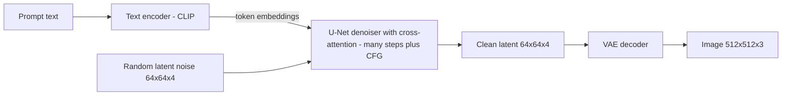

# Chapter 10 — Generative Models Beyond Text

*Last reviewed: September 2026. Product names and "state of the art" move fast; the model families and maths here are stable.*

A small business once needed a designer or stock-photo budget for every social-media image, and a filmmaker paid voice actors for every narration; today both type a description and get usable images or a natural voice in minutes. LLMs (Chapter 4) generate text; this chapter covers machines that generate **images, audio, speech, music and video**, and models that **understand several kinds of data at once**.

You will build four generators from scratch on toy data — a **VAE**, a **GAN**, a **diffusion model** with classifier-free guidance, and a miniature **CLIP** (a model that matches images with captions) — then see how the ideas scale to Stable Diffusion, DALL·E, Midjourney, Whisper, TTS, video generators and multimodal assistants, ending with **evaluation** and **risks**: **deepfakes** (realistic fake video, images or audio of real people), fraud, watermarking, copyright.

**What you'll learn**

- The four families of generative model and their trade-offs (quality, diversity, speed)
- **Autoencoders and VAEs**: latent spaces (compressed internal representations), the reparameterisation trick, the ELBO loss
- **GANs**: generator vs discriminator, the minimax game, **mode collapse**
- **Diffusion**: forward noising, reverse denoising, noise schedules, the U-Net, fast samplers
- **Text-to-image**: conditioning, **CLIP**, **classifier-free guidance**, **latent diffusion (Stable Diffusion)**, DALL·E, Imagen, Midjourney, diffusion transformers
- **Audio and speech**: spectrograms, **ASR (Whisper)**, **TTS** and voice cloning, music
- **Video** generation and deepfakes; **multimodal LLMs** that see and hear
- **Evaluation**: FID, CLIP score, precision/recall, human evaluation, WER and MOS
- **Risks**: deepfakes, misinformation, consent, **watermarking and provenance**, copyright, regulation

Code lives in [`code/`](code/); every script runs on a laptop **CPU** (no graphics card) in under 30 seconds and saves figures to `img/`.

---

## 10.1 The landscape: what "generative" means beyond text

### What it is

A **generative model** learns the **probability distribution** of its training data (how likely each possible image, sound or video is) so it can **sample** new examples that look as if they came from the same source. A **conditional** generative model samples given an input: a text prompt, class label, reference voice, sketch.

Image generators learn from huge collections of **images paired with text descriptions**, absorbing how words, objects, styles and moods map to visual patterns — so "a watercolour of a lighthouse at dawn, gulls overhead, soft pastel light" yields a scene the model has never seen.


*Figure — an image produced by a text-to-image model from a descriptive prompt (course image).*

### The main products (orientation)

| Tool | Maker | Notes |
|---|---|---|
| **Stable Diffusion** (2022 →) | Stability AI, with CompVis (LMU Munich) and Runway | Open weights (model file published): run on your own GPU, fine-tune, control (ControlNet, LoRA). Latent diffusion (10.5) |
| **DALL·E** (2021, 2, 3) | OpenAI | Imaginative concept combinations; DALL·E 3 (2023) built into ChatGPT; in 2025 ChatGPT moved to native image generation in GPT-4o |
| **Midjourney** (2022 →) | Midjourney, Inc. | Strong artistic, stylised look; architecture not published |
| **Imagen** / Gemini image models | Google | Imagen used a large frozen (not further trained) text encoder (T5) with cascaded diffusion (small image first, then upscaled) |
| **FLUX** (2024) | Black Forest Labs | Open-weight family from former Stable Diffusion researchers |

### Why it matters

Marketing and branding (logos, packaging, ad campaigns), art and design (sketches as inspiration or parts of final work), concept visualisation (architects, game studios), voice (narration, audiobooks, assistive voices for people who lost speech), film (historical figures, de-ageing, dubbing). The same power brings copyright disputes, forged artworks and realistic fakes of real people (10.10).

### The four families

| Family | Core idea | Sampling speed | Sample quality | Diversity | Famous examples |
|---|---|---|---|---|---|
| **VAE** (variational autoencoder) | Compress to a smooth latent space, decode samples from it | Fast (one pass) | Blurry on its own | Good | Image compressors inside Stable Diffusion |
| **GAN** (generative adversarial network) | Generator vs discriminator game | Fast (one pass) | Very sharp | Prone to **mode collapse** | StyleGAN faces |
| **Autoregressive** | Predict the next token (word piece, pixel patch, audio chunk) | Slow (one step per token) | High | Good | Original DALL·E, VALL-E speech, GPT-4o images |
| **Diffusion / flow** | Learn to remove noise step by step | Slow (tens of steps; distillation — training a fast student to copy it — cuts this) | Very high | Good | Stable Diffusion, Imagen, Sora-style video |

The **generative trilemma**: fast sampling, high quality and full diversity are hard to get at once — GANs fast and sharp but drop modes; VAEs fast and diverse but blurry; diffusion high quality and diverse but slow.

### Self-check

1. What does a generative model learn? → The data distribution, so it can sample new, similar examples.
2. Which family is fast and sharp but can drop modes? → GANs.

### TL;DR

Generative models learn "what data looks like" and sample new data, usually conditioned on text. VAEs, GANs, autoregressive models and diffusion trade off speed, quality and diversity; diffusion dominates images and video today.

---

## 10.2 Autoencoders and variational autoencoders (VAEs)

### What it is

An **autoencoder** is a **neural network** trained to copy its input to its output through a narrow middle layer: the **encoder** squeezes an image into a short **vector**, the **latent code** z; the **decoder** rebuilds the image from z. The small bottleneck forces it to learn the essentials — like describing a face in a few words for a sketch artist.

A plain autoencoder compresses well but generates poorly: its latent space has gaps, so a random z often decodes to garbage. A **variational autoencoder** (VAE; Kingma and Welling, 2013) makes the space smooth, so *any* z drawn from the **standard normal** N(0, I) (bell curve, mean 0, spread 1 in every dimension) decodes into something sensible.

### How it works

1. **Encode to a distribution, not a point**: mean μ(x) and **variance** σ²(x) (in practice log σ²; σ is the **standard deviation**), defining q(z | x) = N(μ, σ²).
2. **Reparameterisation trick**: z = μ + σ ⊙ ε, ε ~ N(0, I) (⊙ = element-wise multiply). Randomness moves into ε, so **gradients** can flow through μ and σ during **back-propagation**.
3. **Decode** z into a reconstruction x̂.
4. **Loss = reconstruction + KL.** We want to maximise log p(x) but can't compute it; the **ELBO** (evidence lower bound) is always ≤ log p(x) and computable, so we minimise the negative ELBO:

   Loss = reconstruction error(x, x̂) + KL( N(μ, σ²) ‖ N(0, I) )

   **KL divergence** measures how far one distribution is from another (0 when identical). For **Gaussians** it has a **closed form**, summed over latent dimensions: KL = −½ Σ (1 + log σ² − μ² − σ²). Worked: μ = 1, σ = 1 → −½(1 + 0 − 1 − 1) = 0.5; μ = 0, σ = 1 → 0, the **prior** itself (the distribution codes should follow, N(0, I)).
5. **Generate** by sampling z ~ N(0, I) and decoding.

The terms pull against each other: reconstruction wants a sharp, distinct code per input; KL pulls all codes towards one standard normal. The balance makes the space smooth (nearby points decode to similar images) — and makes samples **blurry**. A β-VAE multiplies the KL term by β to shift the balance.

### Code: a VAE on handwritten digits

`code/vae_digits.py` trains a VAE with a **2-D** latent space on **scikit-learn**'s 1,797 digit images (8 × 8 pixels), so the whole latent space can be drawn.

```python
    def forward(self, x):
        mu, logvar = self.encode(x)
        z = mu + torch.exp(0.5 * logvar) * torch.randn_like(mu)   # reparameterisation
        return self.dec(z), mu, logvar


def loss_fn(logits, x, mu, logvar):
    recon = F.binary_cross_entropy_with_logits(logits, x, reduction="sum") / len(x)
    kl = (-0.5 * (1 + logvar - mu ** 2 - logvar.exp()).sum(1)).mean()
    return recon + kl, recon, kl
```

Output:

```text
epoch   1: loss 34.14 = reconstruction 33.77 + KL 0.38
epoch  10: loss 27.18 = reconstruction 27.16 + KL 0.01
epoch  50: loss 25.06 = reconstruction 23.17 + KL 1.89
epoch 150: loss 24.34 = reconstruction 21.93 + KL 2.41
latent means: mean [0.04 0.02], std [0.99 0.93] (prior is 0, 1)
saved img/vae_latent_space.png and img/vae_samples.png
```


*Figure — generated by `code/vae_digits.py`. Left: each image's latent mean, coloured by true digit (labels never used in training). Right: decoding a grid of z values shows digits morphing smoothly (0 → 9 → 3 → 1 across the top).*


*Figure — ten new digits made by decoding z ~ N(0, I).*

- **Unsupervised structure**: digits cluster without ever seeing a label; **smoothness** across the grid is what makes sampling work.
- **Posterior collapse**: at **epoch** 10 (one full pass over the data) KL fell to 0.01 — the encoder nearly ignored the input and the decoder produced an "average digit"; it recovered. A real failure mode with powerful decoders; KL warm-up (start with a small KL weight) is a common fix.
- Latent means have ≈ mean 0, std 1, as KL demands; samples are recognisable but soft-edged — the typical VAE blur.

### Where VAEs are used today

Rarely as stand-alone generators, everywhere as **compressors**: Stable Diffusion's VAE turns a 512 × 512 × 3 image into a 64 × 64 × 4 latent (8× smaller per side) so diffusion runs cheaply (10.5). **VQ-VAE** (van den Oord et al., 2017) uses a **discrete codebook** (a fixed list of learned vectors; each input piece is replaced by its nearest entry's number), turning images or audio into **tokens** that **transformers** can model — the basis of the first DALL·E and of **neural audio codecs** (networks compressing sound into tokens and back).

### Common mistakes

Forgetting the reparameterisation trick (sampling z directly blocks gradients); summing KL over dimensions but averaging reconstruction over pixels (or the reverse), silently re-weighting the terms; expecting sharp images from a plain VAE.

### In the interview

**30-second answer — "What is a VAE?"** "An autoencoder whose encoder outputs a Gaussian over latent codes instead of a point. We sample with z = μ + σε so gradients flow, decode, and train on reconstruction error plus a KL term pulling each code distribution towards N(0, I). That makes the latent space smooth, so decoding random normal samples generates new data. Samples tend to be blurry; today VAEs are mostly the compressor in latent diffusion."

- *"Why is the KL term needed?"* — Without it codes spread arbitrarily and leave gaps; random samples decode to nonsense.
- *"Why blurry?"* — Pixel-wise losses reward averaging over plausible outputs, and KL pressure limits detail per code.

### Self-check

1. Reparameterisation trick? → z = μ + σ ⊙ ε, ε ~ N(0, I).
2. KL for μ = 1, σ = 1 in one dimension? → 0.5.
3. Stable Diffusion's use of a VAE? → Compress images to a small latent where diffusion runs, then decode back to pixels.

### TL;DR

VAE = encoder to a Gaussian + reparameterised sample + decoder, trained on reconstruction + KL. Smooth latent space, easy sampling, blurry outputs; now the workhorse compressor inside larger generators.

---

## 10.3 Generative adversarial networks (GANs)

### What it is

A **GAN** (Goodfellow et al., 2014) trains two networks against each other — a forger and a detective: the **generator** G turns random noise z into a fake G(z); the **discriminator** D outputs the probability a sample is real. The forger improves until the detective can't tell.

### How it works

1. Sample a **batch** of real data and a batch of fakes G(z).
2. **Update D** to output 1 on real and 0 on fake (**binary cross-entropy**).
3. **Update G** so D outputs 1 on its fakes. In practice G minimises −log D(G(z)) (the **non-saturating** loss), because the original min log(1 − D(G(z))) gives almost no gradient early, when D easily rejects every fake.
4. Repeat, keeping the two balanced.

Formally a **minimax game**: min over G, max over D of E_x[log D(x)] + E_z[log(1 − D(G(z)))] (E_x averages over real data, E_z over noise). For fixed G the best discriminator is D*(x) = p_data(x) / (p_data(x) + p_G(x)); the equilibrium is p_G = p_data, where D outputs ½ everywhere.

### The problem: mode collapse and instability

A **mode** is one distinct "type" of data (one digit, one face style, one cluster). **Mode collapse**: G finds a few outputs that fool D and produces only those — sharp, low variety; D learns to reject that mode, G hops to another, and training cycles instead of converging. Remedies: Wasserstein GAN with gradient penalty (a loss measuring how much probability mass must move to turn one distribution into the other), architectural tricks (DCGAN, spectral normalisation), minibatch statistics letting D notice low variety, and balancing the two **learning rates**.

### Code: a GAN on 8 Gaussian blobs

`code/gan_2d.py` trains on points in eight blobs on a ring and counts covered blobs ("modes"), twice: balanced, and deliberately unbalanced (5 generator updates per discriminator update, 5× higher generator learning rate).

```python
for step in range(1, steps + 1):
    real, fake = real_batch(256), G(torch.randn(256, 2)).detach()
    d_loss = bce(D(real), torch.ones(256, 1)) + bce(D(fake), torch.zeros(256, 1))
    opt_d.zero_grad(); d_loss.backward(); opt_d.step()
    for _ in range(g_steps):
        g_loss = bce(D(G(torch.randn(256, 2))), torch.ones(256, 1))   # non-saturating
        opt_g.zero_grad(); g_loss.backward(); opt_g.step()
```

Output:

```text
balanced (1 G step, lr_G=1e-3)
   step  200: modes covered 1/8, samples on a mode 6%
   step 1000: modes covered 8/8, samples on a mode 54%
   step 3000: modes covered 8/8, samples on a mode 77%
unbalanced (5 G steps, lr_G=5e-3)
   step  200: modes covered 1/8, samples on a mode 37%
   step 1000: modes covered 0/8, samples on a mode 0%
   step 3000: modes covered 1/8, samples on a mode 50%
saved img/gan_modes.png
```


*Figure — generated by `code/gan_2d.py`. Top: balanced GAN concentrates on all eight modes. Bottom: unbalanced GAN collapses to one tight cluster that jumps around — mode collapse and mode hopping.*

The balanced run covers all 8 modes with 77% of samples on them (thin "bridges" between blobs are a typical GAN artefact); the unbalanced run never covers more than one, and at step 1000 its cluster sits *between* modes — sharp-looking but wrong. Same code, different settings, completely different behaviour: GAN training is fragile.

### Trade-offs and where GANs stand today

GANs sample in **one forward pass** (fast) and are very sharp; **StyleGAN** (NVIDIA, 2018–2019) made photorealistic faces famous ("this person does not exist"). But training is unstable and diversity hard to guarantee; diffusion overtook them for text-to-image around 2021–2022. GAN ideas live on as **adversarial losses** — in training Stable Diffusion's VAE and neural audio **vocoders** (spectrogram → sound wave), and in adversarial distillation that makes diffusion sample in 1–4 steps.

### In the interview

**30-second answer — "Explain GANs and mode collapse."** "The generator maps noise to samples, the discriminator classifies real vs fake, each trained to beat the other; at equilibrium the generator matches the data distribution. Mode collapse is when the generator finds a few outputs that fool the discriminator and stops covering the rest — sharp but low-diversity. Fixes: Wasserstein losses with gradient penalties, spectral normalisation, minibatch discrimination, balancing the players."

- *"Why the non-saturating loss?"* — Early on D rejects fakes confidently, so log(1 − D(G(z))) is flat and gives G almost no gradient; −log D(G(z)) is steep there.
- *"GAN or diffusion for a new image product?"* — Diffusion for quality, diversity and text conditioning; GAN-style one-step generation (or a distilled diffusion model) when latency is critical.

### Self-check

1. Optimal discriminator output at equilibrium? → ½ everywhere.
2. Why do GANs sample faster than diffusion? → One forward pass vs many denoising steps.

### TL;DR

GAN = generator vs discriminator. Fast and sharp, but unstable and prone to mode collapse. Mostly replaced by diffusion for text-to-image; adversarial losses remain a common ingredient.

---
## 10.4 Diffusion models

### What it is

A **diffusion model** turns random noise into data by **removing noise a little at a time** — like a sculptor removing a thin layer of "wrong" from a block of static each pass. Training teaches a network to undo small corruptions; generation starts from pure noise and applies the "undo" many times. The idea dates to Sohl-Dickstein et al. (2015); **DDPM** (denoising diffusion probabilistic models, Ho et al., 2020) made it practical, and by 2021–2022 diffusion beat GANs on image quality.

### How it works: the forward (noising) process

Add a little Gaussian noise to clean x₀ at each of T steps (typically T = 1000), with small variance β_t from a **noise schedule** (DDPM: linear from 0.0001 to 0.02). With α_t = 1 − β_t and ᾱ_t = α₁ · … · α_t, a closed form jumps straight to any step:

x_t = √ᾱ_t · x₀ + √(1 − ᾱ_t) · ε,  ε ~ N(0, I)

√ᾱ_t is the surviving signal, √(1 − ᾱ_t) the mixed-in noise; as t → T, ᾱ_t → 0 and x_T is pure noise whatever x₀ was. `code/forward_noising.py` applies it to 2-D "two moons" data:

```python
T = 1000
betas = np.linspace(1e-4, 0.02, T)            # DDPM (Ho et al. 2020) linear schedule
alphas = 1.0 - betas
abar = np.cumprod(alphas)                      # abar[t-1] is abar_t

def q_sample(x0: np.ndarray, t: int) -> np.ndarray:
    """Jump straight to step t (1-based) in one shot."""
    eps = rng.standard_normal(x0.shape)
    return np.sqrt(abar[t - 1]) * x0 + np.sqrt(1 - abar[t - 1]) * eps
```

Output:

```text
 t    abar_t   signal coef sqrt(abar)   noise std sqrt(1-abar)
   1  0.9999   0.9999                   0.0100
  50  0.9710   0.9854                   0.1702
 150  0.7883   0.8879                   0.4601
 300  0.3964   0.6296                   0.7769
 600  0.0259   0.1609                   0.9870
1000  0.0000   0.0064                   1.0000

step-by-step to t=300: mean +0.009, std 0.986
closed-form jump t=300: mean -0.005, std 1.006

abar drops below 0.5 at t=260 (linear) vs t=497 (cosine)
saved img/forward_noising.png and img/noise_schedules.png
```


*Figure — generated by `code/forward_noising.py`: the moons blur by t = 150 and are pure Gaussian noise by t = 600.*


*Figure — the cosine schedule (Nichol and Dhariwal, 2021) destroys signal more gradually, wasting fewer steps on near-pure noise.*

Stepping 300 times and jumping once give the same statistics (mean ≈ 0, std ≈ 1, the data being **standardised**), confirming the closed form; the linear schedule loses half its signal variance by step 260, the cosine one only by step 497.

### How it works: the reverse (denoising) process and training

A network ε_θ(x_t, t) learns to **predict the added noise** — plain **supervised regression**:

1. Pick a real x₀, a random step t and noise ε.
2. Make x_t with the closed form.
3. Minimise ‖ε − ε_θ(x_t, t)‖² (MSE).

To **generate**, start from x_T ~ N(0, I) and for t = T … 1 apply

x_{t−1} = (1/√α_t) · ( x_t − (β_t / √(1 − ᾱ_t)) · ε_θ(x_t, t) ) + σ_t · z,  z ~ N(0, I) (no noise at the last step), with σ_t² = β_t in the simplest version.

Each step removes predicted noise and adds back a smaller amount of fresh noise, keeping samples varied. Predicting noise at every level is equivalent to learning the **score** (direction towards higher data probability), linking DDPM to score-based models (Song et al.).

**The network.** For images ε_θ is usually a **U-Net**: a **convolutional** encoder that **downsamples**, a decoder that upsamples, and skip connections between matching resolutions so fine detail survives; the timestep enters as a **sinusoidal embedding** (sine/cosine waves encoding the step number), text through **cross-attention** (each image position "looks up" the relevant prompt words; 10.5). Newer systems use a **diffusion transformer (DiT)** over the latent as a sequence of **patches** (Peebles and Xie, 2023) — the backbone of Stable Diffusion 3, FLUX and Sora-style video.

**Faster sampling.** 1,000 network calls per image is slow. **DDIM** (Song, Meng and Ermon, 2020) samples deterministically in 20–50 steps with the same network; better **ODE solvers** (following a continuous path in a few large, accurate steps) need fewer; **distillation** (consistency models, adversarial distillation such as SDXL Turbo) reaches 1–4 steps. **Flow matching / rectified flow** (Stable Diffusion 3, FLUX) learns straighter noise-to-data paths, also allowing fewer steps.

### Code: a tiny diffusion model you can train in 20 seconds

`code/toy_diffusion_2d.py` trains an **MLP** (plain stack of fully connected layers) noise predictor on two moons with T = 100 (β from 0.001 to 0.1 suits a toy problem), samples with the DDPM update, and is **class-conditional** with guidance (used in 10.5).

```python
def train(model, x0, y0, steps=6000, batch=512, p_uncond=0.2):
    # ... optimiser and scheduler
    for step in range(steps):
        idx = torch.randint(0, len(x0), (batch,))
        x, y = x0[idx], y0[idx].clone()
        y[torch.rand(batch) < p_uncond] = NULL          # label dropout for CFG
        t = torch.randint(0, T, (batch,))
        eps = torch.randn_like(x)
        a = abar[t][:, None]
        xt = a.sqrt() * x + (1 - a).sqrt() * eps        # closed-form forward jump
        loss = ((model(xt, t, y) - eps) ** 2).mean()    # "simple" DDPM loss
        # ... backward, step

@torch.no_grad()
def sample(model, n, cls=None, guidance=1.0, keep=()):
    x = torch.randn(n, 2)
    for t in reversed(range(T)):
        tt = torch.full((n,), t)
        e_u = model(x, tt, torch.full((n,), NULL))
        if cls is None:
            eps = e_u
        else:
            e_c = model(x, tt, torch.full((n,), cls))
            eps = e_u + guidance * (e_c - e_u)          # classifier-free guidance
        mean = (x - betas[t] / (1 - abar[t]).sqrt() * eps) / alphas[t].sqrt()
        x = mean + (betas[t].sqrt() * torch.randn_like(x) if t > 0 else 0)
    return x
```

Output (loss lines for steps 2000–5000 elided):

```text
Training the noise-prediction network:
  step    0  loss 1.0284
  step 1000  loss 0.2576
  step 5999  loss 0.2444

Unconditional: 50% near moon 0, off-manifold 3.2%
Class 0, guidance s=0.0: 51.5% on class 0, off-manifold 3.7%, spread (std) 0.996
Class 0, guidance s=1.0: 100.0% on class 0, off-manifold 0.0%, spread (std) 0.725
Class 0, guidance s=3.0: 100.0% on class 0, off-manifold 0.0%, spread (std) 0.582
saved img/reverse_denoising.png and img/cfg_guidance.png
```


*Figure — generated by `code/toy_diffusion_2d.py`: unconditional samples at reverse steps 99, 60, 30, 10 and 0; the shape emerges only in the last few dozen steps.*

The loss plateaus around 0.22–0.27, not zero — predicting random noise from a noisy point can never be perfect, especially at high noise. Unconditional samples land half on each moon, only ~3% off the data "manifold" (farther than 0.25 from any real point).

### Trade-offs

| Strength | Weakness |
|---|---|
| Stable training (just regression) | Slow sampling (many network calls) |
| High quality and diversity; no mode collapse in practice | Heavy compute for training at scale |
| Easy to condition (text, images, masks, poses) | Fine details such as text in images and hands were long a weak spot |

### Common mistakes

A schedule that never reaches pure noise (ᾱ_T well above 0), so sampling starts from a distribution the model never saw; forgetting the timestep input (the network must know how noisy its input is); mixing up "predict x₀", "predict ε" and "predict v" — interchangeable, but the sampler must match.

### In the interview

**30-second answer — "How do diffusion models work?"** "A fixed forward process adds Gaussian noise until data become pure noise, with a closed form to jump to any step. A U-Net or diffusion transformer learns to predict the added noise from the noisy input and timestep, with MSE loss. To generate, start from noise and repeatedly subtract predicted noise, adding a little fresh noise each step. DDIM, flow matching and distillation cut steps from ~1,000 to 1–50."

- *"Why predict noise rather than the clean image?"* — A well-scaled target at every noise level, connected to score matching; all parameterisations work if the sampler is consistent.
- *"Why slow, and the fix?"* — One network call per step; use DDIM or ODE solvers, run in a compressed latent space, distil into few-step students.

### Self-check

1. x_t in terms of x₀? → √ᾱ_t x₀ + √(1 − ᾱ_t) ε.
2. What does a U-Net skip connection preserve? → Fine spatial detail from the downsampling path.
3. Two ways to sample in fewer steps? → DDIM / ODE solvers; distillation; flow matching.

### TL;DR

Diffusion = learn to denoise. Forward noising has a closed form; a U-Net or transformer predicts noise; sampling runs the reverse process from pure noise. Stable to train, excellent samples, slow without fast samplers or distillation.

---

## 10.5 Text-to-image: CLIP, guidance and latent diffusion

### What it is

A text-to-image model is a **conditional diffusion model** that denoises *towards images matching the prompt*: a **text encoder** turns the prompt into vectors, **cross-attention** injects them into the denoiser, **classifier-free guidance** makes it follow the prompt closely, and a compressed **latent space** makes it affordable.

### CLIP: a shared space for images and text

**CLIP** (Contrastive Language–Image Pre-training; Radford et al., OpenAI, 2021) trains an image encoder and a text encoder together on ~400 million web image–caption pairs. For a batch of N pairs it computes all N × N **cosine similarities** (1 = same direction, 0 = unrelated) and a **contrastive loss**: each image should be most similar to *its own* caption (the diagonal) and dissimilar to the other N − 1, and vice versa. The result is a shared **embedding space** where "a photo of a dog" lands near dog photos. Uses:

- **Zero-shot classification** — compare an image with captions "a photo of a {class}"; no task-specific training.
- **Text encoder for generators** — Stable Diffusion 1.x uses CLIP's text encoder (ViT-L/14 — a large vision transformer cutting images into 14-pixel patches); DALL·E 2 generated a CLIP image embedding from text and decoded it.
- **Evaluation** — **CLIP score**, image–prompt agreement (10.9).

`code/clip_contrastive_toy.py`: 12 concepts ("red square", "blue circle", …), each a noisy 48-number "image" and a noisy 32-number "caption", two small encoders trained on CLIP's symmetric loss:

```python
zi, zt = embed(img, txt)                            # L2-normalised embeddings
logits = log_temp.exp() * zi @ zt.T                 # 64 x 64 similarities
target = torch.arange(64)                           # pair i matches caption i
loss = (F.cross_entropy(logits, target) + F.cross_entropy(logits.T, target)) / 2
```

```text
step    1  contrastive loss 6.275
step  500  contrastive loss 1.929
step 1500  contrastive loss 1.890

zero-shot accuracy on 1000 new images: 96.5% (chance = 8.3%)
CLIP-score style: mean cos(image, its caption) = 0.81, with a wrong caption = 0.29
example: image of 'blue circle' -> predicted 'blue circle'
```

The loss stalls near 1.9 because a batch of 64 from 12 concepts contains same-concept pairs the loss still treats as "negatives" (real CLIP has this with near-duplicate captions, at smaller scale). Zero-shot 96.5% vs 8.3% chance, and matched pairs far more similar than mismatched: the two **modalities** (kinds of data) share one space. The learnable **temperature** (initialised to 1/0.07, as in CLIP) sharpens the **softmax** over similarities.

### Classifier-free guidance (CFG)

A conditional model only *mildly* influenced by the prompt gives plausible but loosely related images. **Classifier-free guidance** (Ho and Salimans, 2021) fixes this without an extra classifier:

1. In training, replace the condition by a "null" token some of the time (commonly 10–20%), so one network learns both **conditional** ε(x_t, c) and **unconditional** ε(x_t, ∅).
2. At sampling, extrapolate away from the unconditional prediction:

   ε̂ = ε(x_t, ∅) + s · ( ε(x_t, c) − ε(x_t, ∅) )

   s = 0 ignores the prompt; s = 1 is the plain conditional model; s > 1 pushes harder. (This is the **diffusers** library's convention — Hugging Face's open-source diffusion toolkit — with Stable Diffusion default 7.5; the paper writes it as (1 + w)ε_c − wε_∅.)
3. Cost: two network evaluations per step (often batched).

Trade-off: higher guidance → better **prompt adherence** and fidelity, **less diversity**; very high values give **over-saturated**, harsh images. The toy model, asked for class 0 (upper moon):


*Figure — generated by `code/toy_diffusion_2d.py`. s = 0 ignores the label (both moons); s = 1 follows it; s = 3 follows it more tightly and samples bunch together.*

On-class rate 51.5% → 100% → 100%, off-manifold 3.7% → 0% → 0%, spread 0.996 → 0.725 → 0.582: guidance buys fidelity with diversity. (Earlier **classifier guidance**, Dhariwal and Nichol 2021, used the gradient of a separately trained noisy-image classifier; CFG made it unnecessary.)

### Latent diffusion and Stable Diffusion

Diffusing 512 × 512 × 3 pixels (786,432 numbers) every step is expensive. **Latent diffusion** (Rombach et al., 2022) runs in the latent space of a **pretrained** autoencoder. Stable Diffusion 1.x (August 2022):



1. **VAE** — compresses 512 × 512 × 3 images to 64 × 64 × 4 latents (48× fewer numbers) and decodes back.
2. **Text encoder** — CLIP ViT-L/14 turns the prompt into token embeddings.
3. **U-Net denoiser** — ~860 million **parameters**, with **cross-attention** where image-latent positions (**queries** — what each position looks for) attend to prompt token embeddings (**keys** — what each word offers to match — and **values**, the information passed back), so each region "looks up" the relevant words.

Generation: random latent → 20–50 guided denoising steps → VAE decoder → image. Open weights grew an ecosystem:

- **Image-to-image / inpainting** (filling or replacing part of an image) — start from a noised existing image, or denoise only a masked region.
- **ControlNet** (Zhang et al., 2023) — a trainable encoder copy conditioning on edges, **depth maps** (brightness = distance) or human poses.
- **LoRA** fine-tuning and **DreamBooth** — teach a new style or subject from a handful of images via small **low-rank adapters** beside the frozen model ([Chapter 8](../08-prompting-vs-finetuning-vs-rag-and-llm-evaluation/README.md)).
- Newer open models (SDXL 2023; Stable Diffusion 3 and FLUX 2024) use larger text encoders (including T5), transformer **backbones** and flow matching; SD3's MMDiT lets image and text tokens attend to each other in one transformer.

Other designs: **Imagen** (Google, 2022) showed a large frozen *language-model* encoder (T5-XXL) improves prompt understanding, with cascaded pixel-space diffusion (small image, then **super-resolution** stages); **DALL·E 3** (2023) improved prompt following by training on detailed machine-rewritten captions; **autoregressive** image generation (native in GPT-4o, 2025) generates image tokens with the same transformer that writes text.

### Common mistakes

- Cranking guidance too high to "make it follow the prompt" — harsh, repetitive images.
- Assuming the model "understands" counts, spatial relations or text rendering — much improved with larger text encoders, still fails on complex prompts.
- Ignoring the negative prompt: in many **UIs** it simply replaces ∅ in the CFG formula, pushing *away* from those words.

### In the interview

**30-second answer — "How does Stable Diffusion turn text into an image?"** "Latent diffusion. A VAE compresses images to a 64×64×4 latent; a CLIP text encoder turns the prompt into token embeddings; a U-Net with cross-attention to those embeddings denoises a random latent over 20–50 steps with classifier-free guidance — predicting with and without the prompt and extrapolating towards it; the VAE decoder then produces the 512×512 image."

- *"What does the guidance scale trade off?"* — Prompt adherence and fidelity vs diversity; too high over-saturates.
- *"Why latent space?"* — ~48× fewer numbers per step, so training and sampling are far cheaper, while the VAE preserves perceptual detail.

### Self-check

1. What does CLIP's loss push together and apart? → Matching pairs together; all other batch pairs apart.
2. CFG formula? → ε̂ = ε_∅ + s(ε_c − ε_∅).
3. Stable Diffusion's three components? → VAE, CLIP text encoder, U-Net denoiser with cross-attention.

### TL;DR

Text-to-image = conditional diffusion. CLIP aligns text and images; cross-attention injects the prompt; CFG strengthens it at the cost of diversity; latent diffusion (Stable Diffusion) makes it cheap enough for consumer GPUs.

---
## 10.6 Audio and speech: ASR, TTS, voice cloning and music

### What it is

- **ASR (automatic speech recognition)**: speech → text. **TTS (text-to-speech)**: text → speech.
- **Voice cloning**: TTS imitating a specific speaker — pitch, **timbre** (the tone "colour" that makes a voice recognisable), rhythm, accent — from a sample.
- **Music and sound generation** from text descriptions or melodies.

### How audio is represented

A **waveform** is a list of air-pressure samples (16,000 per second at 16 kHz). Models usually take a **log-Mel spectrogram**:

1. Cut the waveform into short overlapping windows (e.g. 25 ms, every 10 ms).
2. **Fourier transform** each window (split it into its frequencies) → energy per frequency (a **spectrogram**).
3. Pool into **Mel bands**: triangular filters spaced evenly on mel = 2595 · log₁₀(1 + f / 700) — dense at low frequencies, sparse at high, like human hearing.
4. Take the log (loudness is perceived roughly logarithmically).

The result is an image-like grid (bands × time) that convolutional and transformer models handle well. `code/log_mel_spectrogram.py` builds it from scratch:

```python
def log_mel(wave):
    window = np.hanning(N_FFT)
    frames = [wave[i:i + N_FFT] * window for i in range(0, len(wave) - N_FFT + 1, HOP)]
    power = np.abs(np.fft.rfft(np.array(frames), axis=1)) ** 2       # (frames, 201)
    mel = power @ mel_filterbank().T                                  # (frames, 80)
    S = np.log10(np.maximum(mel, 1e-10)).T                            # (80, frames)
    return np.maximum(S, S.max() - 8.0)       # Whisper also clips to 8 decades below max
```

```text
waveform: 32000 samples (2.0 s at 16000 Hz)
log-Mel spectrogram: 80 Mel bands x 198 frames
30 s of audio would give 80 x 3000 frames (Whisper's input size)
low Mel filters are spaced 23 Hz apart, high ones 266 Hz apart (ears resolve low pitches finely)
saved img/log_mel_spectrogram.png
```


*Figure — generated by `code/log_mel_spectrogram.py`: a voiced sound with rising pitch shows as parallel harmonic stripes climbing over time; the hiss is broadband noise in high bands.*

### ASR: Whisper

**Whisper** (OpenAI, September 2022) is an **encoder–decoder transformer** (one part reads the input, the other writes output token by token) trained on ~680,000 hours of multilingual audio with **weakly supervised** (noisy, not hand-checked) web transcripts. The encoder reads 30-second chunks as log-Mel spectrograms (80 bands, 16 kHz, 25 ms windows, 10 ms **hop** — exactly the 80 × 3000 input above; large-v3 uses 128 bands); the decoder writes text tokens, with special tokens selecting task (transcribe or translate to English), language and timestamps. Its scale and data diversity make it robust to accents and noise. Weaknesses: it can **hallucinate** text during silence or noise, and long audio must be chunked.

**Word error rate**: WER = (substitutions + deletions + insertions) / reference words. Reference "turn the lights off" (4 words), hypothesis "turn lights of" → one deletion ("the") + one substitution ("off"→"of") = 2/4 = 50%.

### TTS and voice cloning

Three waves:

1. **Two-stage pipelines**: an **acoustic model** maps text (or **phonemes**, a language's distinct sounds) to a Mel spectrogram (Tacotron 2, 2017; FastSpeech); a **vocoder** turns it into a waveform (WaveNet, 2016; later fast GAN vocoders such as HiFi-GAN).
2. **Neural audio codecs + language models**: codecs (SoundStream 2021, EnCodec 2022) turn audio into discrete tokens; a transformer predicts them like text. Microsoft's **VALL-E** (2023) imitated a new speaker from a 3-second recording.
3. **Diffusion / flow-matching TTS** and speech-native assistants that listen and speak directly (real-time voice modes in ChatGPT and Gemini).

Uses of cloning: narration, dubbing, audiobooks, accessibility (restoring a lost voice from old recordings). Abuses: impersonation scams, fake audio of public figures (10.10). TTS is judged by listeners — **MOS** (mean opinion score, 1–5 naturalness) — plus speaker similarity for cloning and the WER of ASR on the generated speech (intelligibility).

### Music and sound

Google's MusicLM (2023), Meta's MusicGen (2023), Stable Audio, and services like Suno and Udio generate songs or effects from prompts, as audio-codec tokens (autoregressive) or latent diffusion over spectrograms or codec latents.

### In the interview

**30-second answer — "How do speech models work?"** "Audio becomes a log-Mel spectrogram — short-time Fourier transforms pooled into perceptual Mel bands, then logged. ASR models like Whisper encode it with a transformer and decode text tokens, scored by word error rate. TTS either predicts a spectrogram and uses a vocoder, or predicts neural-codec tokens with a language model — which enables few-second voice cloning; scored by listener MOS and intelligibility."

### Self-check

1. Why Mel bands? → They mimic human pitch resolution: fine at low frequencies, coarse at high.
2. Whisper's input for 30 s of 16 kHz audio? → 80 × 3000 log-Mel frames (128 bands in large-v3).
3. What does a vocoder do? → Spectrogram (or acoustic features) → waveform.

### TL;DR

Audio → log-Mel spectrogram → transformer. Whisper does robust ASR; TTS moved from spectrogram + vocoder to codec tokens + language models, enabling voice cloning from seconds of speech. ASR → WER, TTS → MOS.

---

## 10.7 Video generation and deepfakes

### What it is

**Video generation** creates moving images from text, an image or another video. **Deepfakes** put a real person's face or voice into content they never recorded.

### How it works

- **Text/image-to-video** extends image diffusion through time: a video autoencoder compresses frames into **spacetime patches**, and a diffusion transformer denoises all patches jointly so motion stays consistent. OpenAI's **Sora** (announced February 2024; Sora 2 in 2025) described exactly this design; Google's **Veo** (Veo 3, 2025, also generates synchronised sound), Runway, Kling and others are similar. Hard parts: **temporal consistency** (objects mustn't morph between frames), plausible physics, and cost — seconds of video are far more data than one image.
- **Classic face-swap deepfakes**: one shared encoder learns general face structure (pose, expression, lighting) from videos of two people, with a decoder per person; encode A's frame, decode with B's decoder, and B appears with A's expression and head movement. Modern tools add GAN or diffusion refinement and lip-sync models matching mouths to new audio.

### Why it matters

Legitimate uses: film effects (historical figures, de-ageing, lip-matched dubbing), education, ad prototypes, accessibility. The same technology fabricates events, impersonates public figures, steals identities and creates non-consensual imagery — raising **consent, authenticity and legal protection** questions and driving detection tools and new laws (10.10).

### Self-check

1. Why is video harder than images? → Temporal consistency and much more data per sample.
2. Classic face swap? → Shared encoder, one decoder per identity; encode A, decode with B's decoder.

### TL;DR

Video models are diffusion transformers over spacetime patches; deepfakes swap identities with shared-encoder autoencoders plus refinement. Powerful for film and education, dangerous for trust.

---

## 10.8 Multimodal models

### What it is

A **multimodal** model combines several kinds of data — text, images, audio, video, even sensor readings — in one system, e.g. reading an article, looking at its photos and watching a related clip to build one understanding. Benefits: **richer context** (matching an image to a description becomes more accurate) and **more natural interaction** (show a photo of a broken part and ask, by voice, how to fix it).

### How it works

1. **Separate encoders plus fusion** — each modality's encoder (a vision transformer, an audio encoder) outputs embeddings **projected** by a small learned layer into the LLM's embedding space as extra "tokens". LLaVA (2023): a simple projection from a CLIP image encoder into an LLM, fine-tuned on image-instruction data, yields a capable visual assistant. Flamingo (DeepMind, 2022) used cross-attention from the language model to image features instead.
2. **Natively multimodal** — one model trained from the start on **interleaved** text, image and audio tokens; GPT-4o (2024) and Gemini (from December 2023) are described this way and can also *output* audio and images.
3. **Any-to-any generation** — the same model decodes text, image tokens or speech, so an assistant can listen, look and reply in voice or with a picture.

**Applications**: assistants that see and hear (reading a document through the camera while you give spoken instructions), captioning and **visual question answering**, accessibility (describing scenes for blind users), document and chart understanding, content creation (slides, infographics, short videos from a prompt). **Frontier** assistants (Claude, ChatGPT, Gemini) accept images and documents routinely.

### Common mistakes

- Assuming image understanding is as reliable as text — small text, counting and precise spatial reasoning still fail.
- Forgetting images cost tokens: a high-resolution image may use hundreds to thousands of tokens of the **context window**.
- Forgetting images and audio can carry **prompt injection** (instructions written inside a picture).

### In the interview

**30-second answer — "How do multimodal LLMs see images?"** "A vision encoder — often CLIP-like — turns the image into patch embeddings, a projector maps them into the LLM's token space, and the LLM attends over image and text tokens together. Natively multimodal models train on interleaved text, image and audio tokens from the start, so they can also generate those modalities."

### Self-check

1. Two benefits of multimodality? → Richer context; more natural interaction.
2. What does LLaVA connect? → A CLIP image encoder to an LLM via a learned projection.

### TL;DR

Multimodal models turn images and audio into tokens the LLM attends to, or train natively on mixed tokens — assistants that see, hear and speak.

---

## 10.9 Evaluating generative models

### What it is

Generated content has no single correct answer, so evaluation checks **quality/fidelity** (does each sample look real and match its prompt?) and **diversity/coverage** (does the model produce the full range of data, or collapse?). Automatic metrics are cheap and repeatable; human evaluation is the final judge.

### How it works: the main metrics

| Metric | What it measures | How | Better |
|---|---|---|---|
| **FID** (Fréchet Inception Distance; Heusel et al., 2017) | Distance between real and generated image distributions | Embed both sets with Inception-v3 (an older image classifier used as feature extractor; 2048-d features); fit a Gaussian to each; FID = ‖μ_r − μ_g‖² + Tr(Σ_r + Σ_g − 2(Σ_r Σ_g)^½), μ = mean feature vector, Σ = covariance matrix, Tr = trace (sum of the diagonal) | Lower |
| **Inception Score** (IS, 2016) | Confident *and* varied class predictions | From Inception-v3 class probabilities | Higher (dated; ignores real data) |
| **Precision / recall** for generative models | Precision = fraction of samples that look real (fidelity); recall = fraction of real data covered (diversity) | Nearest-neighbour manifolds in feature space | Higher |
| **CLIP score** | Image–prompt agreement | Cosine similarity of CLIP embeddings (often × 100) | Higher |
| **Human evaluation** | Preference, prompt adherence, aesthetics, artefacts | Side-by-side comparisons, rating scales, Elo-style arenas (rankings from head-to-head votes) | — |
| **WER / MOS** (speech) | ASR accuracy; TTS naturalness | See 10.6 | Lower WER; higher MOS |

### Code: what the Fréchet distance can and cannot see

`code/frechet_distance.py` implements the FID formula on 2-D "features" from the 8-blob ring, comparing real data with several fakes.

```python
def frechet(a: np.ndarray, b: np.ndarray) -> float:
    mu1, mu2 = a.mean(0), b.mean(0)
    s1, s2 = np.cov(a, rowvar=False), np.cov(b, rowvar=False)
    covmean = linalg.sqrtm(s1 @ s2)
    if np.iscomplexobj(covmean):          # tiny imaginary parts from numerics
        covmean = covmean.real
    return float(((mu1 - mu2) ** 2).sum() + np.trace(s1 + s2 - 2 * covmean))
```

```text
another real sample (ideal model)    FD =  0.003
blurry: right modes, extra noise     FD =  0.009
mode collapse: only 2 of 8 modes     FD =  2.203
mode collapse: only 1 of 8 modes     FD =  7.762
shifted: everything moved +0.5       FD =  0.510

ideal model but only 50 samples      FD =  0.040  (small n biases FID upward)
```

- Mode collapse is punished heavily; shifts are caught.
- The **blurry** fake scores almost like a perfect model: FID compares only means and covariances (assuming Gaussian feature clouds), and on raw 2-D points blur barely changes them. Real FID uses rich Inception features where blur *does* move the distribution — why the feature extractor matters, and why FID can disagree with humans.
- Few samples **bias** the estimate upward (0.040 vs ≈0.003), so FID is only comparable at the same **sample size** (commonly 10,000–50,000 images) and preprocessing. KID (kernel inception distance) is an unbiased alternative for small sets.

### Human evaluation

Automatic scores miss aesthetics, subtle artefacts (hands, text), cultural appropriateness and whether the image matches the prompt's *intent*. Standard practice: side-by-side preference tests on a fixed prompt set with several raters per item, and public "arenas" turning pairwise votes into Elo-style leaderboards. Report **inter-rater agreement** (how often raters agree) and cover hard cases (counting, spatial relations, text rendering, diverse people).

### Common mistakes

Comparing FID across different sample sizes, resolutions or feature extractors; optimising CLIP score alone (models learn to please CLIP rather than people); evaluating quality but not diversity (or vice versa).

### In the interview

**30-second answer — "How would you evaluate an image generator?"** "Automatic metrics first: FID against a real reference set for realism and coverage, precision and recall to separate fidelity from diversity, CLIP score for prompt alignment — at fixed sample sizes and preprocessing. Then human side-by-side evaluations on a curated prompt suite of hard cases, multiple raters with agreement statistics, plus safety and bias checks. Humans decide launches; metrics catch **regressions** (things that used to work getting worse)."

### Self-check

1. Lower or higher FID better? → Lower.
2. Why can FID miss blur in raw space? → It compares only means and covariances of the chosen features.

### TL;DR

Measure fidelity and diversity. FID (lower better) compares feature distributions; precision/recall separate the two; CLIP score checks prompt alignment; speech uses WER and MOS; humans remain the final judge.

---

## 10.10 Risks: deepfakes, provenance, copyright and regulation

### The problems

- **Misinformation and impersonation** — fake videos, photos and voices of politicians, executives or family. Early 2024: an employee of engineering firm Arup in Hong Kong transferred about US$25 million after a video call in which the "colleagues", including the CFO (chief financial officer), were deepfakes.
- **Fraud and identity theft** — cloned voices in "emergency" calls; synthetic faces passing weak identity checks.
- **Non-consensual imagery** — sexualised deepfakes of real people, overwhelmingly targeting women.
- **Consent and likeness** — actors, voice artists and artists whose voice, face or style is reproduced without agreement.
- **Bias** — generators reproduce and amplify stereotypes (who appears for "a CEO").
- **Copyright** — whether training on copyrighted works is lawful, and who owns outputs.

### Detection

Human cues fade as models improve: malformed hands or extra limbs, garbled lettering, inconsistent shadows or reflections, too-smooth skin, mismatched earrings or eyes ([Chapter 12, §12.7](../12-safety-ethics-governance/README.md)). Automated detectors are an **arms race** (better detectors prompt better fakes) and generalise poorly to new generators, so they should inform, not decide, high-stakes judgements. **Context checks** — **reverse image search** (where else has this image appeared?), source verification, calling back on a known number — remain the strongest defence against scams.

### Watermarking and provenance

- **Invisible watermarks** — **SynthID** (Google DeepMind, 2023) embeds a signal in generated images, audio, video and text that survives common edits (compression, cropping) and is detectable by a matching tool; heavy editing can weaken it, and it only exists if the generator added it.
- **Provenance metadata** (origin information stored with the file) — **C2PA** "Content Credentials" (backed by Adobe, Microsoft, Google, OpenAI and others) attaches a **cryptographically signed** (tampering detectable) record of creation and edits. Metadata can be stripped, so a file without credentials is not thereby shown fake or real.
- Best practice combines both, plus visible product labels.

### Copyright and ownership (as of 2026; this is evolving and varies by country)

- **Training data** — several lawsuits challenge training on copyrighted material. In *Getty Images v. Stability AI*, the English High Court (November 2025) rejected Getty's main copyright claim — Getty had dropped its training claim, and the court held the Stable Diffusion model was not an "infringing copy" — finding only very limited trade-mark infringement over watermark-like artefacts in early versions; Getty's US case continues in California. The artists' **class action** (a suit on behalf of a whole group) *Andersen v. Stability AI* (also against Midjourney and others) went to jury trial in San Francisco in September 2026. No universal rule; results differ by country and claim.
- **Outputs** — the US Copyright Office requires human authorship: purely machine-generated images are unprotected; human selection, arrangement or substantial editing can be. Upheld in *Thaler v. Perlmutter* (district court 2023, appeal 2025); the US Supreme Court declined to hear it in March 2026.
- **Practical rules** — check the generator's licence and terms, avoid imitating a living artist's protected work or a trademark, get consent for anyone's likeness or voice, keep records of human contributions.

### Regulation

- **EU AI Act** (EU law regulating AI by risk level) puts generated content in the **limited / transparency risk** tier (Chapter 12): Article 50 requires **providers** (who build or sell the system) to tell people they are interacting with AI and to **mark synthetic content in machine-readable form** (audio, images, video, text), and **deployers** (who use it in their service) to **label deepfakes**. Applies from 2 August 2026; the "Digital Omnibus on AI" (Regulation (EU) 2026/1744, in force since 27 July 2026) gives generative systems placed on the market before that date until 2 December 2026 for marking. The same amendment postponed high-risk obligations (Annex III systems to 2 December 2027, Annex I products to 2 August 2028) and added bans on generating non-consensual intimate imagery or child sexual abuse material from 2 December 2026. Check current guidance before relying on any date.
- **US**: the **TAKE IT DOWN Act** (signed May 2025) criminalises publishing non-consensual intimate images, including AI "digital forgeries", and required covered platforms to run notice-and-removal (within 48 hours of a valid request) by May 2026; several states regulate election deepfakes.
- **China**: **labelling measures for AI-generated content** (in force 1 September 2025) require visible labels on generated text, images, audio and video plus hidden labels in file metadata.

### In the interview

**30-second answer — "What safeguards would you ship with an image generator?"** "Input and output **safety classifiers** (models screening requests and results) for disallowed content, especially sexual content and real-person likeness; refusal policies for impersonation; invisible watermarking plus C2PA provenance on every output; visible labels; licensed or opt-out-respecting training data; **red-teaming** (attacking your own system to find failures) for bias and misuse before launch; monitoring with takedown and appeals after — knowing detection alone is not enough."

### Self-check

1. Why isn't metadata provenance proof on its own? → It can be stripped; missing credentials prove nothing.
2. Is a purely AI-generated image copyrightable in the US? → No; copyright requires human authorship.
3. EU AI Act Article 50 for generators? → Machine-readable marking (providers); deepfake labels (deployers).

### TL;DR

Generative media threatens trust through deepfakes, fraud and non-consensual imagery, and raises consent, bias and copyright questions. Defences are layered — safety policies, watermarking (SynthID), provenance (C2PA), labelling, verification habits, new laws — none sufficient alone.

---

## Chapter TL;DR

| Topic | Remember |
|---|---|
| Families | VAE (smooth latent, blurry), GAN (sharp, fast, mode collapse), autoregressive (tokens, slow), diffusion/flow (best quality, slow without tricks) |
| VAE | Encoder → N(μ, σ²); z = μ + σε; loss = reconstruction + KL; the compressor in latent diffusion |
| GAN | Generator vs discriminator minimax; non-saturating loss; mode collapse; now mostly adversarial losses inside other systems |
| Diffusion | x_t = √ᾱ_t x₀ + √(1−ᾱ_t) ε; predict ε with MSE; sample by iterative denoising; U-Net or DiT; DDIM/distillation/flow matching for speed |
| Text-to-image | CLIP aligns text and images; cross-attention injects prompts; CFG ε̂ = ε_∅ + s(ε_c − ε_∅) trades diversity for adherence; Stable Diffusion = VAE + text encoder + denoiser in latent space |
| Audio | Log-Mel spectrograms; Whisper ASR (WER); TTS via vocoders or codec-token LMs; voice cloning from seconds of audio (MOS) |
| Video | Diffusion transformers over spacetime patches; temporal consistency is the hard part; deepfakes via shared-encoder autoencoders |
| Multimodal | Encoders + projection into the LLM, or natively multimodal models that also generate images and speech |
| Evaluation | FID (lower better, sample-size sensitive), precision/recall, CLIP score, human side-by-side |
| Risks | Deepfakes, fraud, consent, bias, copyright; SynthID-style watermarks, C2PA provenance, labelling, EU AI Act Art. 50, TAKE IT DOWN Act |
