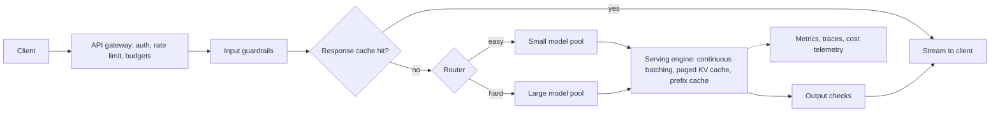
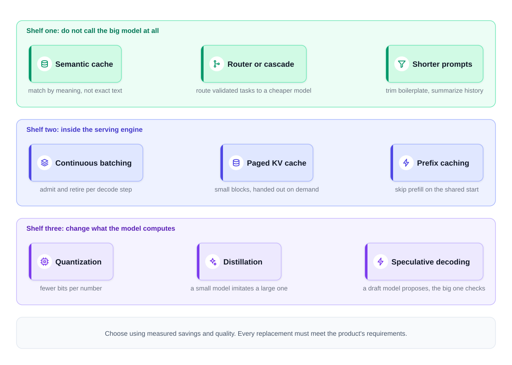
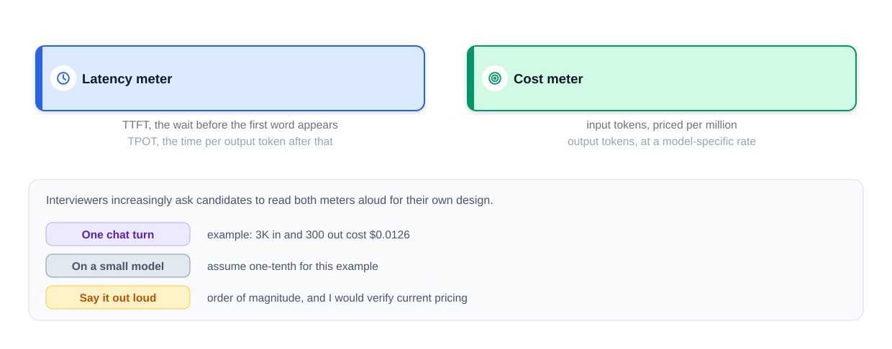
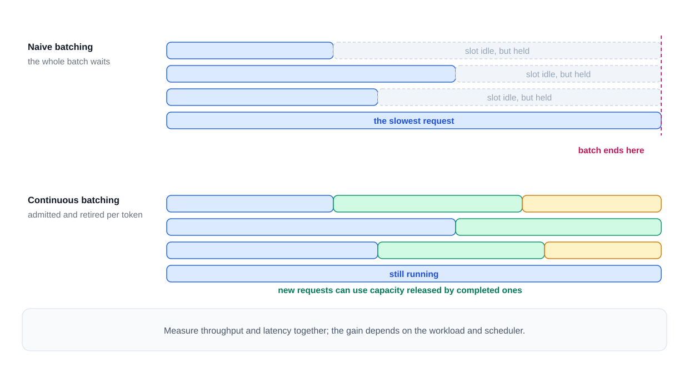
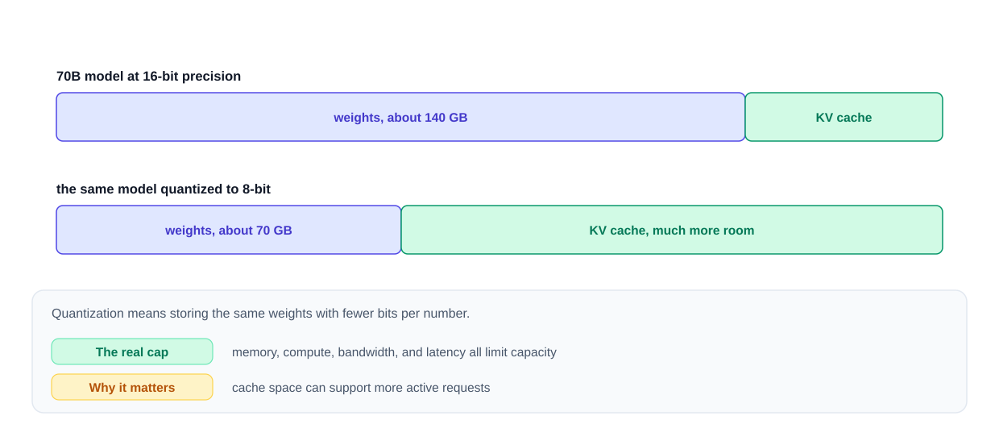
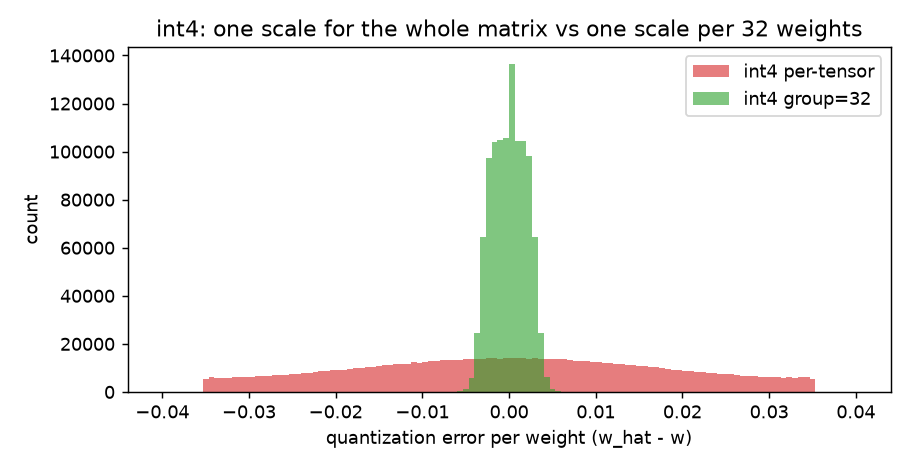
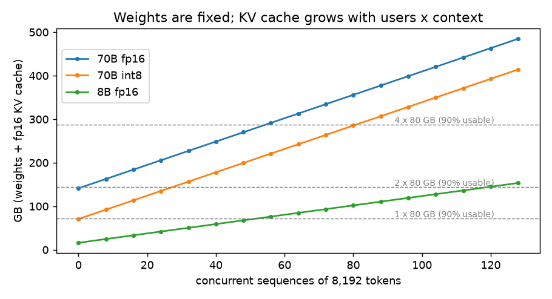
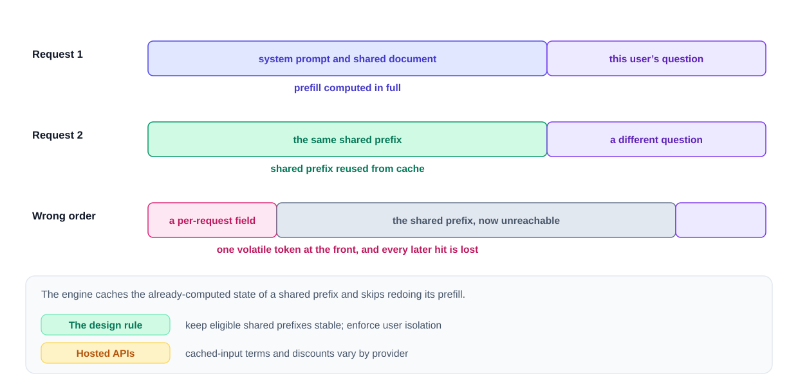
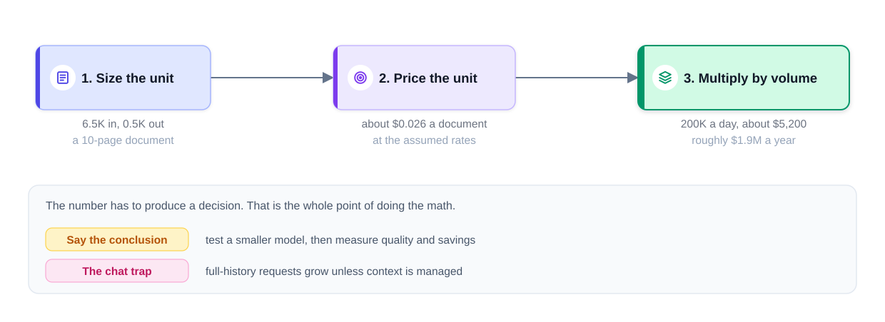
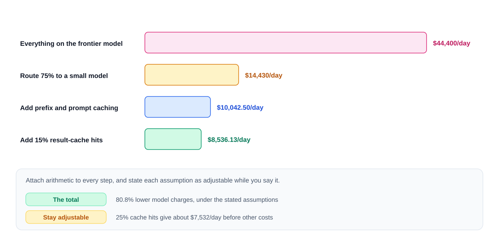

# Chapter 11 — LLM Serving and Inference

This chapter opens the LLM box from the **operations** side: what happens on the **GPU** (graphics processing unit — the chip doing the model's maths) when a request arrives, why an answer takes the time it does, what runs out first as traffic grows, and how to make generation faster and cheaper without making it worse.

A classic ML service (a fraud score) returns one number in ~10 ms. A **generative** service writes hundreds of **tokens** (word pieces; §11.1) one after another on expensive **accelerators** (specialised chips such as GPUs), so a feature can cost a fraction of a cent or several cents per request. **Inference** (running a trained model to get an output) moves to the centre of the design — put numbers on it early.

**What you'll learn**

1. **Prefill** vs **decode**, and **latency** metrics (latency = how long a request takes; [System Design Fundamentals](../../../system-design-patterns/modules/00-system-design-fundamentals/README.md)) (**TTFT**, **TPOT**, goodput).
2. The **KV cache**, **batching** (static, dynamic, continuous) and **PagedAttention / vLLM**.
3. **Quantization**, **distillation** and **speculative decoding**.
4. **GPU memory sizing** and **model parallelism**.
5. **Streaming**, **caching** (exact, semantic, prefix), **routing and cascades**.
6. **Cost estimation**, **rate limiting** (capping what each caller may send per minute), API (a provider's hosted model) vs self-hosting (the model on your own GPUs), **observability** — and a capstone pricing a 5-million-user product.

Prices and throughput figures are **illustrative assumptions** chosen for easy arithmetic; learn the relationships and check current prices. Code in `code/` runs on a laptop **CPU** with **NumPy**; outputs shown are real.



Optimizations fall into three groups: skip the expensive call (caching, routing, shorter prompts), use the hardware better (continuous batching, paged KV memory, prefix reuse), make the model cheaper to run (quantization, distillation, speculative decoding). Start with whichever attacks the largest *measured* cost or latency.


*Figure — The optimization menu, grouped by where each technique works (course diagram).*

---

## 11.1 The LLM as a production component

### What it is
To a system designer an LLM **endpoint** (the network address your code calls) is a function: **tokens in → tokens out**, latency depending on both counts, a price per token.

- **Token** — the unit a model reads, writes and bills in: ≈ 4 characters ≈ 0.75 words in English (1,000 words ≈ 1,300 tokens). Code and non-English text use more; use the provider's token counter when accuracy matters.
- **Context window** — the maximum tokens one request may use; input, output and reasoning tokens usually share it, with a separate cap on output.

### Why it matters
Latency grows with tokens, prices are per million tokens, the context window caps them. The model does **not** remember earlier conversations — your app re-sends the relevant history each time, so choosing what to include (**context assembly**) is one of your biggest cost levers.

### How it works — a request's life
1. The server **tokenizes** the text (splits into tokens, maps each to a number).
2. **Prefill**: the model reads all input tokens and builds internal state (the KV cache, §11.4).
3. **Decode**: output tokens one at a time, each depending on the previous.
4. Tokens are **streamed** back as produced, or returned together.
5. Bill = `input_tokens × input_price + output_tokens × output_price` (plus cached-input charges).


*Figure — Read two meters aloud for any GenAI design: latency and token cost (course diagram).*

### Common mistakes
Quoting "an LLM call costs X" without tokens in and out; forgetting chat history is re-sent every turn (§11.15); treating the context window as memory.

### TL;DR
Latency and cost are both token-shaped. Count tokens first.

---

## 11.2 Prefill vs decode

### What it is

| | Prefill | Decode |
|---|---|---|
| What it does | Processes the whole prompt | Produces one new token per step |
| Parallelism | All prompt positions at once (one big matrix multiply — the GPU's core operation) | Sequential — token *t+1* needs token *t* |
| Bottleneck | **Compute** (FLOPs — floating-point operations) | **Memory bandwidth** (bytes/s read from GPU memory: weights + KV cache) at small batch |
| Drives | Time to first token | Time per output token |
| Grows with | Input length | Output length |

Analogy: prefill is a chef reading the whole order at a glance; decode is plating one spoonful at a time, walking to the pantry (GPU memory) before each.

### Why it matters
- **The first word takes a moment, then text flows** — the wait is prefill (+ **queueing** for a free slot); the flow rate is decode.
- **Output tokens cost more than input** — each needs its own sequential pass; input tokens share one parallel pass. (Prices are commercial, not physics; list prices typically put output at ~4–8× input.)
- **"Be concise" saves real money** — fewer decode steps.

### How it works — worked numbers
A 7-billion-**parameter** model in **16-bit precision** (2 bytes per parameter → **14 GB of weights**) on a GPU with ~**2 TB/s** memory bandwidth (NVIDIA A100 80 GB; H100 SXM ~3.35 TB/s):

1. **Decode, batch 1.** Each step reads all 14 GB: 14 GB ÷ 2 TB/s = **7 ms per token at best**, ≈ 140 tokens/s. Arithmetic units sit mostly idle — each 2-byte weight feeds only ~2 FLOPs.
2. **Decode, batch 32.** The same read serves 32 sequences; the step stays ~7 ms plus KV-cache reads, so throughput approaches 32 × 140 ≈ 4,500 tokens/s — why **batching** (§11.5) is key.
3. **Prefill of 2,000 tokens.** ~2 × parameters FLOPs per token → 2 × 7×10⁹ × 2,000 = 2.8×10¹³ FLOPs. At an effective ~150 **TFLOP/s** (half the A100's 312 TFLOP/s **BF16** peak — a 16-bit format built for ML) ≈ 0.19 s, so long prompts show up directly in TTFT.

Back-of-envelope ceilings, not **benchmarks** (measured runs). The §11.4 toy shows the same shape on a CPU: prefill ~90,000 prompt tokens/s in one pass, decode ~5,000 tokens/s one at a time.

### Trade-offs
RAG (retrieved documents pasted into the prompt) and summarization are **prefill-heavy**; chat and long code answers are **decode-heavy** — benchmark both. Engines use **chunked prefill** (split a long prompt into pieces interleaved with others' decode steps so their output doesn't stall); some large deployments use **disaggregated serving** (separate GPU pools for prefill and decode).

### In the interview
**30-second answer:** "Prefill reads the whole prompt in parallel, is compute-bound and sets time to first token. Decode emits one token per step and, at small batch, is limited by memory bandwidth because every step re-reads the weights — it sets streaming speed. That's why output tokens cost more and why batching matters."

- *Why is decode memory-bound?* Each step reads every weight but does ~2 FLOPs per weight per sequence; the GPU computes far faster than it streams weights, until the batch is large.
- *Cut TTFT for a RAG app?* Fewer/shorter chunks, prefix caching, chunked prefill, a smaller model or more GPUs per **replica** (one running copy of the model server).

### Self-check
1. Which phase dominates "summarize this 50-page PDF in one sentence"? → Prefill.
2. Why does a batch of 32 barely slow each decode step? → The expensive weight read is shared.

### TL;DR
Prefill = parallel, compute-bound, sets TTFT. Decode = sequential, bandwidth-bound, sets tokens/s. Batch to use the idle compute.

---

## 11.3 Latency and throughput metrics

### What it is
| Metric | Meaning | Typical target (chat, illustrative) |
|---|---|---|
| **TTFT** — time to first token | Request sent → first output token (queueing + prefill + network) | < 0.5–1 s |
| **TPOT** — time per output token (≈ **ITL**, inter-token latency) | Average gap between output tokens | 20–50 ms (20–50 tokens/s, faster than reading) |
| **End-to-end latency** | Request sent → last token | Depends on answer length |
| **Tokens/s per user** | 1 / TPOT | — |
| **Throughput** | Total tokens/s (or requests/s) the server produces | Maximize, subject to the above |
| **Goodput** | Requests/s that **meet** their latency targets | What actually matters |

**E2E ≈ TTFT + TPOT × (output_tokens − 1)**. TTFT 0.4 s, TPOT 30 ms, 300 tokens → 0.4 + 0.03 × 299 ≈ **9.4 s** — but the user reads after 0.4 s, which is why streaming feels fast.

### Why it matters
Per-user speed and total throughput pull apart: bigger batches raise throughput but slow each step. Report **percentiles** — p95 is the value 95% of requests beat; a p99 TTFT of 8 s is what users complain about. An **SLO** (service level objective) such as "p95 TTFT < 1 s and p95 TPOT < 50 ms" makes it a measurable contract; **goodput** counts only requests meeting it.

**Mistakes:** one "latency" number for a streaming product; benchmarking one request at a time (misses queueing) or with unrealistic lengths.

### Self-check
1. TTFT 1 s, TPOT 25 ms, 500 output tokens — E2E? → 1 + 0.025 × 499 ≈ 13.5 s.
2. Why goodput over throughput? → Throughput also counts late answers.

### TL;DR
Measure TTFT, TPOT and E2E percentiles under realistic load; optimize goodput.

---

## 11.4 The KV cache

### What it is
In a transformer ([Chapter 3](../03-transformers-and-embeddings/README.md)), each token's **attention** step compares its **query** vector with the **key** vectors of all earlier tokens and mixes their **value** vectors. When generating token 101, tokens 1–100's keys and values are unchanged, so the engine **stores** them per layer instead of recomputing: the **KV cache** — like meeting minutes you read and add one line to, instead of replaying the whole recording.

### The problem it solves
Without a cache, token *t* pushes all *t* tokens through the model again, so *n* tokens cost 1 + 2 + … + *n* ≈ *n²/2* token-passes; with a cache each new token costs one pass (plus reading the cache): linear. The price is **memory**.

### How it works
1. **Prefill** computes K and V for every prompt position in every layer and stores them.
2. Each **decode** step computes Q, K, V for the **one** new token, appends K and V, attends over the whole cache.
3. When the request ends its cache is freed (or kept for prefix caching, §11.13).

```
KV bytes per token = 2 (K and V) × n_layers × n_kv_heads × head_dim × bytes_per_value
KV bytes per request = KV bytes per token × tokens in the sequence (prompt + output so far)
```

At 16-bit (2 bytes), published model shapes:

| Model | Layers | KV heads × head dim | Per token | One 4,096-token sequence |
|---|---|---|---|---|
| Llama-2-7B (standard multi-head attention: many attention heads in parallel) | 32 | 32 × 128 | 2·32·32·128·2 = 524,288 B = **512 KiB** | **2.0 GiB** |
| Llama-3-8B (grouped-query attention) | 32 | 8 × 128 | **128 KiB** | **0.5 GiB** |
| Llama-3-70B (grouped-query attention) | 80 | 8 × 128 | **320 KiB** | **1.25 GiB** |

One long conversation can need gigabytes (KiB = 1,024 bytes; GiB = 1,024³). **Grouped-query attention (GQA)** — several query heads sharing one K/V head — cuts Llama-3-8B's cache to a quarter of Llama-2-7B's at the same depth, which is why modern models use GQA (or **multi-query attention**, MQA, one shared K/V head). 8-bit storage (**KV-cache quantization**) halves it again at a small accuracy cost.

### Code — cache vs no cache on a toy transformer
`code/kv_cache_demo.py` builds a 4-layer **decoder** (left-to-right generator, like GPT) with random weights and generates 256 tokens both ways. The heart is one block that optionally appends to past K/V:

```python
def block(x, w, k_past=None, v_past=None):
    """One transformer block. x: (T_new, D). Returns output and full K, V."""
    h = rms_norm(x)
    q, k, v = h @ w["q"], h @ w["k"], h @ w["v"]
    if k_past is not None:                      # decode: reuse cached K, V
        k = np.concatenate([k_past, k])
        v = np.concatenate([v_past, v])
    t_new, t_all = q.shape[0], k.shape[0]
    scores = q @ k.T / np.sqrt(D)               # (T_new, T_all)
    mask = np.triu(np.ones((t_new, t_all)), k=t_all - t_new + 1).astype(bool)
    scores[mask] = -1e9                         # causal: no peeking ahead
    x = x + softmax(scores) @ v @ w["o"]
    x = x + np.maximum(0, rms_norm(x) @ w["m1"]) @ w["m2"]
    return x, k, v
```

`generate_no_cache` re-runs the whole sequence through every block each step; `generate_with_cache` does one prefill pass, stores each layer's `(k, v)`, then pushes one token per step. Output:

```
prompt tokens=32  generated=256  layers=4  d_model=128
identical output tokens: True
no cache :   0.53 s  (  481.9 tokens/s)
KV cache :   0.05 s  ( 5041.0 tokens/s)
speed-up : 10.5x
KV cache holds 293,888 floats = 2 (K,V) x 4 layers x 287 tokens x 128
  = 574 KiB at fp16
token positions pushed through the model: no cache=40,832  cache=287
prefill: 32 tokens in 0.34 ms -> 94,263 tokens/s (one parallel pass)
decode : 255 tokens one by one -> 5,021 tokens/s
```

Same tokens, ~10× faster: 287 token positions processed instead of 40,832 (timings vary per run). The gap grows with length, so no real engine serves without a KV cache.

### Trade-offs
Compute drops from ~*n²*/2 to ~*n* token passes; memory grows with users × context, so cache memory (not compute) becomes the concurrency limit.

### Common mistakes
Sizing GPUs for weights only; forgetting a 128K-token context needs 32× the cache of a 4K one; confusing the **KV cache** (inside the engine) with a **response cache** (in front of the model, §11.13).

### Real-world examples
Every production engine (vLLM, TensorRT-LLM, SGLang, llama.cpp) keeps one; **Hugging Face** (the main hub and Python library for open models) `transformers` calls it `past_key_values`, on by default in `generate()`. GQA: Llama 2 70B, the Llama 3 family, Mistral 7B.

### In the interview
**30-second answer:** "The KV cache stores each layer's keys and values for tokens already processed, so each decode step computes them only for the newest token — quadratic recomputation becomes linear work. It costs 2 × layers × KV-heads × head-dim × bytes per token, about 320 KiB per token for Llama-3-70B, so it, not the weights, usually limits concurrent users per GPU."

- *How do you shrink it?* GQA/MQA, 8-bit KV, shorter contexts, paged allocation (§11.6), **offloading** old blocks to CPU memory.
- *Why does it limit batch size?* Each sequence needs its own cache; when memory runs out the engine queues or **pre-empts** requests (pauses one and evicts its cache).

### Self-check
1. KV per token, 40 layers, 8 KV heads, head dim 128, fp16? → 2·40·8·128·2 = 163,840 B = 160 KiB.
2. Does the KV cache change the output? → No — identical tokens.
3. What does GQA trade away? → A little modelling capacity for a much smaller cache.

### TL;DR
Compute K and V once, reuse them every step. 2·L·H_kv·d·bytes per token, times users × context — usually the real capacity limit.

---

## 11.5 Batching: static, dynamic and continuous

### What it is
**Batching** runs several requests through one **forward pass** (one run through all layers) so one weight read serves many sequences (§11.2).

- **Static** — collect a fixed-size batch, run until **every** sequence finishes, take the next.
- **Dynamic** — start when the batch is full **or** the oldest request has waited a maximum time (e.g. 200 ms); still runs to completion.
- **Continuous** (**in-flight** / **iteration-level**, from Orca, OSDI 2022) — the **scheduler** (which sequences run each step) adds and removes sequences **at every decode step**, so a waiting request takes a freed slot immediately.

Analogy: a tour bus that returns only when the last tourist is back (static) vs hop-on/hop-off (continuous).

### The problem it solves
Output lengths vary wildly ("yes" vs a 600-token essay). With static/dynamic batching, finished sequences hold idle slots until the longest ends and new arrivals wait for the whole batch; continuous batching removes both wastes.


*Figure — Continuous batching admits and retires requests every token (course diagram).*

### Code — a small simulator
`code/batching_sim.py`: one GPU, 16 slots; a decode step gives every sequence one token and costs `25 ms + 0.5 ms × batch size` (nearly flat — decode is memory-bound); 400 random arrivals wanting 20–500 tokens. Continuous refills any free slot every step; static/dynamic admit only between batches and keep finished slots until the batch ends.

```
400 requests, 20-500 output tokens each (mean 256), 16 slots per GPU
step time = 25.0 ms + 0.5 ms per sequence in the batch

--- load: 0.8 req/s = 205 output tok/s demanded ---
metric                  static     dynamic  continuous
throughput tok/s           194         192         196
slot utilisation           55%         36%         34%
mean TTFT s              10.10        7.45        0.04
p95 TTFT s               21.77       13.79        0.05
mean latency s           18.53       15.29        7.26

--- load: 1.6 req/s = 410 output tok/s demanded ---
metric                  static     dynamic  continuous
throughput tok/s           260         259         382
slot utilisation           55%         53%         74%
mean TTFT s              65.60       66.68        0.30
p95 TTFT s              123.36      124.45        1.95
mean latency s           74.03       75.10        8.32

batch of 1 would give 39 tok/s; a full batch of 16 gives 485 tok/s
```

- **Light load:** all keep up, but static makes people wait ~10 s for a first token (it waits for 16 requests); dynamic's 200 ms timer helps but new requests still wait behind long batches; continuous starts in ~40 ms.
- **Heavy load:** static and dynamic cap near 260 tokens/s (~45% of slot-steps wasted on finished sequences), TTFT over a minute; continuous gives ~380 tokens/s at 74% utilisation, p95 TTFT under 2 s.
- **Batching at all:** 39 tokens/s alone vs 485 full — 12× from the same hardware.

### Trade-offs
| | Static | Dynamic | Continuous |
|---|---|---|---|
| Good for | Offline jobs, similar lengths | Fixed-cost models (classifiers, embeddings) | LLM serving — the default today |
| Weakness | Idle slots, long waits | Wastes slots on finished sequences | Needs per-step scheduling; per-user speed dips as the batch grows |

### When not to use it
**Embedding** or **classification** models (one pass, no decode loop): dynamic batching suffices. **Offline** jobs: maximize batch size, ignore TTFT; hosted **asynchronous batch APIs** (submit now, collect later) are discounted (Anthropic's and OpenAI's are 50% of standard price) for work that can wait hours.

### Common mistakes
Comparing engines at batch size 1; unlimited batch growth (throughput rises but TPOT breaks the SLO — engines cap concurrent sequences, vLLM's `max_num_seqs`, and tokens per step).

### In the interview
**30-second answer:** "Decode underuses the GPU, so we batch. Static batching holds finished slots until the longest sequence ends. Continuous batching schedules per decode step — a slot is refilled the moment a sequence finishes — raising throughput and cutting queueing when lengths vary. It's the default in vLLM, SGLang and TensorRT-LLM (which calls it in-flight batching)."

- *Its cost?* Per-user tokens/s dips as the batch grows, and long prefills can stall others' decode — fixed with chunked prefill and batch caps.

### Self-check
1. Why does static batching waste capacity? → Finished answers keep their slots until the longest ends.
2. What does dynamic batching add? → A maximum wait, so small batches can start.

### TL;DR
Batch to share weight reads; continuous batching is the LLM standard.

---

## 11.6 PagedAttention, vLLM and serving engines

### What it is
**PagedAttention** (Kwon et al., SOSP 2023 — the paper behind **vLLM**) manages the KV cache as an **operating system** manages **RAM**: small fixed-size **blocks** (16 tokens by default in vLLM) handed out on demand, with a per-sequence **block table** mapping positions to physical blocks that need not be **contiguous**.

### The problem it solves
Earlier engines reserved one contiguous slab per request sized for the **maximum** output (say 2,048 tokens) even if the answer ended after 50. The vLLM paper measured only ~20–38% of KV memory holding real token data — **60–80% wasted** by over-reservation and **fragmentation** (free memory in gaps too small to use). Paging cut waste to under 4%, fitting more sequences per GPU for **2–4× higher throughput** than FasterTransformer and Orca at the same latency.

### How it works
1. Free GPU memory (after weights) is carved into equal KV blocks.
2. A sequence gets blocks only as tokens arrive; only its last block is partly filled.
3. A finished sequence's blocks return to the pool.
4. Sequences with the same prefix (or parallel samples of one prompt) **share** physical blocks, copying only when they diverge (**copy-on-write**).
5. When memory runs out the scheduler **pre-empts** a sequence (swaps blocks to CPU or recomputes later).

Paging makes **prefix caching** cheap: a common system prompt's blocks stay resident and later requests skip that prefill (§11.13). SGLang's **RadixAttention** keeps cached prefixes in a tree for the same purpose.

### Serving engines at a glance
| Engine | Notes |
|---|---|
| **vLLM** (open source) | PagedAttention, continuous batching, prefix caching, many quantization formats, tensor/pipeline parallel, OpenAI-compatible server (accepts OpenAI's request format) |
| **TensorRT-LLM** (NVIDIA) | Compiled, highly optimized **kernels** (low-level GPU programs for one operation) for NVIDIA GPUs; "in-flight batching"; often served via Triton |
| **SGLang** (open source) | RadixAttention prefix sharing, fast structured generation |
| **Hugging Face TGI** | Early continuous-batching server; in maintenance mode since December 2025 — Hugging Face now points users to vLLM and SGLang |
| **llama.cpp / Ollama** | Runs GGUF-quantized (llama.cpp's compact file format) models on laptops, CPUs and consumer GPUs — the usual local choice |

Your job is usually to **choose and configure** one, not write kernels. One kernel name you'll hear: **FlashAttention**, exact attention that **tiles** the computation (small blocks in fast on-chip memory) to cut slow memory traffic. Paging adds bookkeeping but the memory win dominates; it doesn't create memory, it stops wasting it.

### In the interview
**30-second answer:** "PagedAttention stores the KV cache in small blocks allocated on demand instead of a max-length slab per request. That removes most fragmentation, lets requests share prefix blocks, and fits far more concurrent sequences per GPU — the core of vLLM."

### Self-check
1. OS idea borrowed? → Virtual-memory paging with a page (block) table.
2. How does it help prefix caching? → Many sequences can point at the same prefix blocks.

### TL;DR
KV memory in pages, not slabs: less waste, more users, shared prefixes.

---

## 11.7 Quantization

### What it is
**Quantization** stores numbers with fewer bits: weights normally 16-bit **floats** (FP16 or BF16) become 8- or 4-bit **integers** plus a **scale** mapping them back — like recording heights to the nearest centimetre instead of micrometre.

### Why it matters
- **Memory:** raw weights shrink to ½ (int8) or ¼ (int4): a 70B model goes ~140 GB → ~70 GB or ~35 GB.
- **Speed:** decode is bandwidth-bound, so reading half the bytes can make it faster — *if* hardware and kernels support the format.
- **Room for KV cache:** a 70B model on 2×80 GB fits 2 concurrent 4K sequences at fp16 but 54 at int8 (§11.10).


*Figure — A 70B model's raw weights at 16-bit vs 8-bit (course diagram).*

### How it works — symmetric "absmax" quantization
1. Pick a group of weights (the whole **tensor** — multi-dimensional array — one output channel, or e.g. 128 weights).
2. `scale = max(|w|) / q_max`, `q_max = 127` for int8, `7` for int4.
3. Store `q = round(w / scale)`; at run time use `ŵ = q × scale`.

Example (int4): `[0.12, −0.03, 0.40, −0.21]`, max|w| = 0.40 → scale = 0.40/7 ≈ 0.0571 → q = `[2, −1, 7, −4]` → dequantized `[0.114, −0.057, 0.400, −0.229]`; errors at most half a step (≈ 0.029).

The catch is **outliers**: one huge weight makes the scale huge and small weights round to zero. Smaller groups (one scale per 32–128 weights) contain the damage at the cost of more scales.

### Code — measuring quantization error
`code/quantization_demo.py` quantizes a 1024×1024 weight matrix (normal, σ = 0.02, 20 planted outliers) per-tensor, per-channel (one scale per output column) and per-group, measuring relative error of weights and of `y = x @ W`. The per-group core:

```python
    q_max = 2 ** (bits - 1) - 1
    wg = w.reshape(-1, group, w.shape[1])
    scale = np.abs(wg).max(axis=1, keepdims=True) / q_max
    return (np.clip(np.round(wg / scale), -q_max, q_max) * scale).reshape(w.shape)
```

```
scheme             bytes/param  weight err  output err
fp16 (baseline)          2.000      0.0000      0.0000
int8 per-tensor          1.000      0.0559      0.0557
int8 per-channel         1.000      0.0100      0.0101
int4 per-tensor          0.500      0.8790      0.8814
int4 per-channel         0.500      0.1767      0.1768
int4 group=128           0.516      0.1227      0.1223
int4 group=32            0.562      0.0985      0.0985

per-tensor int4 scale = 0.0705; typical |w| = 0.0135
weights rounded to 0 by per-tensor int4: 92.2%

70B model, raw weight memory:
  fp16        140.0 GB
  int8         70.0 GB
  int4 g128    36.1 GB
saved img/quantization_error.png
```



int8 per-channel is almost lossless (1% error). Naive per-tensor int4 is a disaster — outliers make the step so large that **92% of weights become zero**. Group-wise scales bring int4 to ~10–12% for a little storage (a 16-bit scale per 128 weights adds 0.125 bits per weight). That is plain round-to-nearest; the methods below reduce the error's *effect* on output.

### Smarter methods (intuition only)
| Method | Idea in one line |
|---|---|
| **LLM.int8()** (Dettmers et al., 2022) | Keep the few outlier **activation** channels (activations = intermediate values between layers) in 16-bit, the rest in int8. |
| **GPTQ** (Frantar et al., 2022) | Quantize one column at a time and **adjust not-yet-quantized weights** to cancel the error, using second-order statistics (output sensitivity per weight) from a small **calibration set** of realistic inputs. One-shot, no retraining; popular for 4-bit. |
| **AWQ** (Lin et al., 2023) | "Activation-aware": the ~0.1–1% of weight channels meeting large activations matter most, so **scale them up before quantizing** (input down to compensate). No backprop. |
| **SmoothQuant** (Xiao et al., 2022) | Move activation outliers into the weights with a per-channel rescale so **weights and activations** can both be int8 (W8A8). |
| **FP8** | 8-bit floating point, native on recent GPUs (e.g. H100); little quality loss. |
| **GGUF k-quants** (llama.cpp) | Block-wise 2–8-bit formats for CPU/consumer GPU, e.g. `Q4_K_M`. |

**Weight-only** (W4A16, W8A16) saves memory and bandwidth, maths still 16-bit; **weight + activation** (W8A8, FP8) also uses faster low-precision maths units.

### Trade-offs
| | fp16/bf16 | int8 / fp8 | int4 (GPTQ/AWQ) |
|---|---|---|---|
| Weight memory | 1× | ½× | ~¼× |
| Quality | Reference | Usually near-identical | Measurable drop, larger on small models and hard tasks (maths, code) |
| Speed | Baseline | Faster where kernels support it | Faster decode at small batch; dequantization can hurt at large batch |

**Skip it** when memory and bandwidth aren't the bottleneck or your eval shows a drop on a sensitive task. Never ship without re-running your task eval — **perplexity** (generic next-token prediction quality) can hide task-specific losses. **Mistakes:** assuming int4 = 4× faster (savings are memory; speed depends on kernels and batch); forgetting scales and KV cache in memory maths; calibrating GPTQ/AWQ on data unlike your traffic.

**Real world:** Hugging Face hosts thousands of GPTQ/AWQ/GGUF **checkpoints** (saved model files); vLLM and SGLang load AWQ/GPTQ/FP8 directly; Ollama ships 4-bit GGUF by default so 7–8B models run on laptops; QLoRA fine-tunes **adapters** (small trainable add-on layers) on a 4-bit base ([Chapter 8](../08-prompting-vs-finetuning-vs-rag-and-llm-evaluation/README.md)).

### In the interview
**30-second answer:** "Quantization stores weights — optionally activations or the KV cache — in 8 or 4 bits with per-group scales. It halves or quarters weight memory and, since decode is bandwidth-bound, often speeds it up. The risk is outlier-driven quality loss; GPTQ (error-compensating) and AWQ (protecting salient channels) make 4-bit practical. I'd always A/B it (old vs new on the same tests) on our task eval."

- *Weight-only vs W8A8?* Weight-only saves memory/bandwidth; W8A8 also uses int8 maths units, useful when compute-bound (large batch, prefill).

### Self-check
1. int4 bytes per parameter with one fp16 scale per 64 weights? → (4 + 16/64)/8 = 0.53 bytes.
2. Why did per-tensor int4 zero 92% of weights? → Outliers made the step (0.07) five times a typical weight (0.0135).
3. What does AWQ protect? → Weight channels that see large activations.

### TL;DR
Fewer bits → less memory, often faster decode. Per-group scales, GPTQ/AWQ for 4-bit, FP8/int8 near-lossless; always re-evaluate.

---

## 11.8 Distillation and small specialist models

### What it is
**Knowledge distillation** (Hinton, Vinyals & Dean, 2015) trains a small **student** to imitate a large **teacher**. Classic distillation matches the teacher's full probability distribution ("soft targets", softened by a **temperature** that flattens or sharpens probabilities), carrying more information than one correct label; for LLMs teams often just fine-tune the student on **teacher-generated answers** to real product prompts.

### Why it matters
A student sized for a narrow task serves the high-volume path at a fraction of the cost and latency. **DistilBERT** kept ~97% of BERT's (Google's 2018 language-understanding model) score with 40% fewer parameters and ~60% faster inference.

### How it works
1. Collect representative prompts from traffic (with consent and privacy review).
2. Have the teacher answer; filter bad answers.
3. Fine-tune the student on the pairs (optionally on teacher probabilities).
4. Evaluate on a **held-out golden set** (fixed cases with known answers, never trained on); deploy behind a router (§11.14) that escalates hard cases.

### Trade-offs and cautions
Students inherit the teacher's mistakes and are good only **inside** the training distribution; retrain when teacher or product changes. **Check provider terms** — several forbid using outputs to build competing models.

### In the interview
"Distil when a narrow, high-volume task clears the quality bar on a small model: teacher outputs on real traffic, fine-tune a student, gate it with evals, route to it with escalation."

### TL;DR
Teach a small model your task with a big model's answers; serve the small one on the volume path.

---

## 11.9 Speculative decoding

### What it is
A cheap **draft** model guesses the next *k* tokens; the big **target** model checks all *k* in **one** parallel pass (like prefill). Accepted guesses are kept; at the first rejection the target supplies a corrected token. Decode being bandwidth-bound, verifying 5 tokens costs about as much as generating 1, so accepted guesses are nearly free.

### How it works — the exact acceptance rule (Leviathan et al. 2023; Chen et al. 2023)
For each drafted token *x* (draft probability q(x), target p(x)):
1. Accept with probability **min(1, p(x)/q(x))**.
2. If rejected, sample a replacement from the **residual** ∝ max(0, p − q) (∝ = proportional to) and stop.
3. If all *k* are accepted, sample a bonus token from p.

This provably yields **exactly the target's distribution** — quality unchanged (sampled text still varies run to run). With acceptance α = Σ min(p, q), expected tokens per target pass = **(1 − α^(k+1)) / (1 − α)** (assuming independent acceptance).

### Code
`code/speculative_decoding.py` uses fixed toy distributions over 6 tokens (α = 0.80):

```python
def speculative_step(k):
    drafts = rng.choice(len(p), size=k, p=q)          # draft model runs k cheap steps
    out = []
    for x in drafts:                                  # target scores all k at once
        if rng.random() < min(1.0, p[x] / q[x]):      # accept with prob min(1, p/q)
            out.append(x)
        else:                                         # reject: resample from residual
            resid = np.maximum(p - q, 0)
            out.append(rng.choice(len(p), p=resid / resid.sum()))
            return out
    out.append(rng.choice(len(p), p=p))               # all accepted: bonus token
    return out
```

```
acceptance rate a = sum(min(p, q)) = 0.80
k=1: tokens per target pass = 1.80 (theory 1.80); max |freq - p| = 0.0009
k=2: tokens per target pass = 2.44 (theory 2.44); max |freq - p| = 0.0017
k=4: tokens per target pass = 3.36 (theory 3.36); max |freq - p| = 0.0009
k=8: tokens per target pass = 4.33 (theory 4.33); max |freq - p| = 0.0012
target p : {'the': 0.3, 'cat': 0.25, 'sat': 0.15, 'on': 0.12, 'mat': 0.1, '.': 0.08}
emitted  : {'the': 0.299, 'cat': 0.25, 'sat': 0.15, 'on': 0.12, 'mat': 0.1, '.': 0.08}
```

Emitted frequencies match the target to three decimals; tokens per pass match the formula. Diminishing returns: k = 4 → 8 adds ~1 token per pass while doubling draft work.

### Trade-offs
- Speed-up depends on **acceptance rate** on your traffic, draft cost and load: often 2–3× published on favourable workloads, shrinking at large batch (the GPU is already busy).
- The draft adds memory and complexity. Variants: **Medusa** (extra prediction heads, no separate draft), **EAGLE**, **prompt-lookup / n-gram** drafting (copy continuations of n consecutive tokens from the prompt — good for edits and RAG answers quoting sources).

### In the interview
**30-second answer:** "A small draft proposes several tokens; the target verifies them in one parallel pass with an accept/reject rule that preserves its exact output distribution. Decode steps become multi-token steps; gains depend on acceptance rate and load, so benchmark it."

### Self-check
1. α = 0.6, k = 3 — expected tokens per pass? → (1 − 0.6⁴)/0.4 = (1 − 0.1296)/0.4 ≈ 2.18.
2. Does it change quality? → Not with the exact acceptance rule.

### TL;DR
Guess cheaply, verify in bulk: same distribution, fewer expensive passes.

---

## 11.10 GPU memory sizing

### What it is
Check that the model **fits** and how many users it serves at once:

```
GPU memory needed ≈ weights + KV cache + activations/runtime overhead
weights           ≈ parameters × bytes per parameter   (fp16/bf16 = 2, int8/fp8 = 1, int4 ≈ 0.5 + scales)
KV cache          ≈ concurrent sequences × tokens per sequence × KV bytes per token   (§11.4)
overhead          ≈ activations, CUDA context, allocator slack — engines typically reserve a fraction
```

**Mixture-of-experts (MoE)** models (many "expert" sub-networks; a small router picks a few per token) need **all** experts in memory: Mixtral 8×7B has ~47B parameters but uses ~13B per token — memory follows 47B, compute 13B.

### How it works — worked examples
`code/serving_calculator.py` assumes the engine may use 90% of GPU memory (vLLM's default `gpu_memory_utilization`), activations in the other 10% — a simplification.

```python
def fit(m, n_gpus, gpu_gb, bytes_per_param, ctx_len, util=0.90):
    usable = n_gpus * gpu_gb * 1e9 * util
    free = usable - m.params * bytes_per_param        # what is left after the weights
    tokens = free / kv_bytes_per_token(m)
    return tokens, int(tokens // ctx_len)              # KV room, concurrent sequences
```

Output (section 2 of the script):
```
Llama-3-8B (GQA)     fp16 on 1 x 24 GB    weights   16.0 GB | KV room    42,725 tokens =   10 concurrent 4K sequences
Llama-3-8B (GQA)     fp16 on 1 x 80 GB    weights   16.0 GB | KV room   427,246 tokens =  104 concurrent 4K sequences
Llama-3-70B (GQA)    fp16 on 2 x 80 GB    weights  141.2 GB | KV room     8,545 tokens =    2 concurrent 4K sequences
Llama-3-70B (GQA)    fp16 on 4 x 80 GB    weights  141.2 GB | KV room   447,998 tokens =  109 concurrent 4K sequences
Llama-3-70B (GQA)    int8 on 2 x 80 GB    weights   70.6 GB | KV room   223,999 tokens =   54 concurrent 4K sequences
Llama-3-70B (GQA)    int4 on 1 x 80 GB    weights   35.3 GB | KV room   112,000 tokens =   27 concurrent 4K sequences
```

By hand — **70B at fp16 on two 80 GB GPUs**: usable = 2 × 80 × 0.9 = 144 GB; weights = 70.6 × 10⁹ × 2 B = 141.2 GB, leaving 2.8 GB; KV per token = 320 KiB = 327,680 B → ≈ 8,500 tokens → **two** 4K conversations. It "fits" but is useless as a service. With 4 GPUs ≈ 147 GB left → ~448,000 tokens → **109** sequences; int8 on 2 GPUs → **54**. Honest answers to "does 70B fit?": barely on 2×80 GB fp16, comfortably on 4×80 GB, or 2×80 GB at int8 (1×80 GB at int4, before ~3% for group scales) — each a quality/cost trade-off.



The plot shows memory vs concurrent 8K-token sequences: weights set the intercept, KV the slope; where a line crosses a dashed "N × 80 GB" line is that setup's concurrency limit.

### Common mistakes
Forgetting the KV cache (the most common error); parameters × 4 bytes (fp32) — serving is almost always 16-bit or lower; assuming fit implies acceptable speed; mixing GB (10⁹) and GiB (2³⁰), a 7% difference.

### In the interview
**30-second answer:** "Weights are parameters × bytes: 70B at bf16 is ~140 GB. KV cache is 2 × layers × KV-heads × head-dim × bytes per token — ~320 KiB for Llama-3-70B — times users times context, plus ~10% overhead. On 2×80 GB the weights leave no cache room, so 4 GPUs with tensor parallelism, or int8/FP8 on 2."

### Self-check
1. Raw weights of 13B at bf16? → ~26 GB.
2. Why can a model fit yet be unusable? → No KV room, so almost no concurrency.
3. MoE memory — total or active parameters? → Total.

### TL;DR
Memory = params × bytes + users × context × KV-per-token + overhead. Size for concurrency, not "it loads".

---

## 11.11 Model parallelism: tensor and pipeline

### What it is
When one GPU cannot hold or serve a model fast enough, split the work:

| Kind | What is split | Communication | Typical use |
|---|---|---|---|
| **Replicas (data parallelism)** | Nothing — each GPU group holds a full copy; requests load-balanced ([System Design Fundamentals](../../../system-design-patterns/modules/00-system-design-fundamentals/README.md)) | None | Scale **throughput** once one replica fits |
| **Tensor parallelism (TP)** | Each layer's weight matrices sliced across GPUs (Megatron-LM style); every GPU computes part of every layer | An **all-reduce** (every GPU sums partial results with all others) **in every layer** → needs fast links such as NVIDIA's **NVLink** | Within one node (one server, usually ≤ 8 GPUs); also lowers per-token latency |
| **Pipeline parallelism (PP)** | Consecutive **layers** on different GPUs (stage 1 = layers 1–40, stage 2 = 41–80) | Activations passed between stages once per step | Across nodes, when the model is too big for one node |
| **Expert parallelism (EP)** | Different MoE experts on different GPUs | Tokens routed to their expert's GPU | Large MoE models |

Analogy: TP is four cooks chopping one onion together (fast, constant coordination); PP is an assembly line passing a tray.

### How it works
- **TP:** in `Y = X·W` with `W` split by columns across 4 GPUs, each computes a quarter of `Y`; the next matrix is split by rows, so its partial sums are all-reduced — two communications per layer (after attention, after the MLP): fine over NVLink, slow over ordinary networking.
- **PP:** with one request in flight, stage 2 idles while stage 1 works (a **pipeline bubble**); engines keep several **micro-batches** in flight so all stages stay busy.

vLLM settings: `--tensor-parallel-size 4` (and `--pipeline-parallel-size` for multi-node). TP adds communication, so 8-way TP of a small model can be *slower* than one GPU — use replicas; PP adds capacity, not single-request speed. Mistake: TP across nodes over slow networking.

### In the interview
"Replicas scale throughput; TP splits each layer across GPUs in a node over NVLink; PP splits layers into stages across nodes, with micro-batching against bubbles. For 70B: TP=4 in a node, then replicas behind a load balancer."

### TL;DR
Fit with TP (inside a node) or PP (across nodes); scale throughput with replicas.

---

## 11.12 Streaming responses

### What it is
**Streaming** sends tokens as they are generated. LLM APIs typically use **Server-Sent Events (SSE)** — a long-lived **HTTP** response carrying small events (Anthropic emits `message_start`, `content_block_delta` events with text, `message_stop`; OpenAI Chat Completions emits `chat.completion.chunk` objects).

### Why it matters
Streaming does **not** cut compute or cost, but an answer starting after 0.5 s feels responsive. It enables **early cancellation**: if Stop reaches the engine, remaining decode work (and billed output) is saved; merely hiding output in the UI saves nothing.

### How it works — client code (needs an API key — not run)
```python
import anthropic

client = anthropic.Anthropic()                      # reads ANTHROPIC_API_KEY
with client.messages.stream(
    model="claude-opus-5-5",
    max_tokens=4096,
    messages=[{"role": "user", "content": "Explain the KV cache in two sentences."}],
) as stream:
    for text in stream.text_stream:                 # yields text as it is generated
        print(text, end="", flush=True)
    final = stream.get_final_message()              # full message + usage at the end
print("\nusage:", final.usage.input_tokens, "in /", final.usage.output_tokens, "out")
```

A server relaying to browsers re-emits SSE (or uses **WebSockets**, an always-open two-way connection) and records TTFT when the first chunk is flushed.

### Trade-offs and common mistakes
- **Safety vs speed:** output checks can't see the whole answer before it shows. Buffer a sentence or a few hundred characters, run a streaming classifier, keep a **stop control** — which can't un-show displayed text.
- **Structured output:** streamed JSON is invalid until complete; parse incrementally or wait.
- Buffering **proxies** (servers forwarding traffic) silently break streaming; long streams need timeouts and **heartbeats** (periodic "still alive" messages).

### In the interview
"Streaming improves perceived latency and lets cancellation stop decode early, but doesn't cut cost by itself. Stream over SSE, buffer enough for output checks, make sure cancel reaches the engine."

### TL;DR
Stream for perceived speed; buffer for checks; cancellation must reach the GPU to save money.

---

## 11.13 Caching: exact, semantic and prefix

| Cache | Key | What it saves | Where it lives |
|---|---|---|---|
| **Exact response** | Normalized request (+ tenant — the customer organisation — model, settings) | The whole call | In front of the model (e.g. Redis, a fast in-memory key–value store) |
| **Semantic response** | Embedding similarity ≥ threshold | The whole call, for paraphrases | In front (vector index) |
| **Prefix / prompt** | Exact token prefix | Prefill of the shared part only | Inside the engine or provider |

### What it is
- **Exact cache:** same question and context → stored answer. Low **hit rate** (share answered from cache) for free text, high for requests like "summarize document v17".
- **Semantic cache:** embed the request (an **embedding** is a meaning vector — [Chapter 3](../03-transformers-and-embeddings/README.md)), search earlier requests, reuse an answer if cosine similarity ≥ threshold; catches paraphrases ("reset password" vs "change my pwd").
- **Prefix (prompt) cache:** the engine keeps the KV cache of a prompt's beginning (**system prompt** — standing instructions — tools, a shared document) and reuses it when a request starts with **exactly** the same tokens. Hosted APIs sell it as discounted **cached input** — Anthropic bills cache reads at 10% of base input on most models, less on some (5% on Claude Opus 5.5), with a 5-minute cache write at 1.25×; OpenAI caches long repeated prefixes automatically. Minimum lengths and lifetimes vary.

Support bots see many repeats, and a cached answer costs almost nothing; prefix caching cuts cost and TTFT for long shared prompts.

### How it works — the design rules
1. **Stable content first:** tools → system prompt → shared documents → conversation → new question. One changing token early (timestamp, user ID) breaks every prefix hit after it.
2. **Scope every response-cache entry** by tenant, permissions, model, prompt and source-document versions — never serve one customer's answer to another.
3. **Exclude or key** personalized and time-sensitive answers ("my order status").
4. **Expire** with a TTL (time to live); invalidate when documents change.
5. **Tune the similarity threshold on labelled pairs** of same/different-meaning questions.
6. For personalized flows, cache the **retrieved context** instead of the answer.


*Figure — Prefix caching only works if the shared part comes first (course diagram).*

Prefix caching with the Anthropic SDK (needs an API key — not run):
```python
response = client.messages.create(
    model="claude-opus-5-5",
    max_tokens=4096,
    system=[{
        "type": "text",
        "text": LONG_STATIC_POLICY_DOCUMENT,              # identical on every request
        "cache_control": {"type": "ephemeral"},           # cache everything up to here
    }],
    messages=[{"role": "user", "content": user_question}],  # volatile part goes last
)
u = response.usage
print(u.cache_creation_input_tokens, u.cache_read_input_tokens, u.input_tokens)
```
If `cache_read_input_tokens` stays zero across repeats, something in the prefix changes — or it is shorter than the model's minimum cacheable length.

### Code — exact + semantic cache with a local fake embedder
`code/semantic_cache.py` uses a deterministic stand-in embedder (synonym normalization + hashed words and character **trigrams**, three-letter chunks). Lookup: exact key `(tenant, normalized text)` within TTL first; otherwise the best cosine match among the same tenant's unexpired entries, accepted only at ≥ threshold.

```
[acme] 'How do I reset my password?'                -> miss                                             sim=-1.00
[acme] 'how do i reset my password'                 -> exact                                            sim=1.00
[acme] 'How can I change my pwd?'                   -> semantic (matched 'How do I reset my password?') sim=1.00
[acme] 'Please tell me how to modify my password'   -> semantic (matched 'How do I reset my password?') sim=1.00
[acme] 'how do I reset my pasword'                  -> miss                                             sim=0.67
[acme] 'How do I cancel my subscription?'           -> miss                                             sim=0.05
[acme] 'How do I terminate my sub?'                 -> semantic (matched 'How do I cancel my subscription?') sim=1.00
[acme] 'How do I cancel my order?'                  -> miss                                             sim=0.50
[globex] 'How do I reset my password?'                -> miss                                             sim=-1.00
[acme] 'Can I get my money back?'                   -> miss                                             sim=0.14

LLM calls: 6 of 10 requests
similarity 'cancel subscription' vs 'cancel order' = 0.50 (threshold 0.85 keeps them apart; 0.40 would wrongly merge them)
same question 2 h later: miss (TTL expired)
```

It shows exact hits after normalization; semantic hits for paraphrases; a **near-miss** ("cancel my order" vs "cancel my subscription", 0.50) rejected at 0.85 but merged at a loose threshold; a typo missing at 0.67 (real embedders handle typos better, same trade-off); **tenant isolation** (globex never sees acme's entries); **TTL expiry**. The perfect 1.00 scores are a toy-synonym artefact; real models give ~0.85–0.95 for paraphrases.

### Trade-offs
Semantic caching trades a small risk of a wrong answer for savings; the cost of a wrong answer (refund policy vs a joke) sets strictness. Measure **hit rate** and **wrong-hit rate** on real traffic before promising savings; the lookup itself costs a little.

### In the interview
"Three layers: an exact cache keyed by normalized request plus tenant and versions; a semantic cache with a threshold tuned on labelled pairs, TTLs and invalidation; and prefix caching in the engine or provider, which needs static content first. The main risk is serving a near-miss or another user's answer, so scoping comes before hit rate."

### Self-check
1. Does prefix caching skip output generation? → No, only the shared prefix's prefill.
2. Why put the timestamp last? → An early change invalidates the whole cached prefix.
3. Two metrics for a semantic cache? → Hit rate and wrong-hit rate.

### TL;DR
Exact cache for repeats, semantic for paraphrases (thresholded, scoped), prefix for shared prompt beginnings.

---

## 11.14 Routing and cascades to cheaper models

### What it is
A **router** decides up front which model answers; a **cascade** tries a cheap model first and escalates when a check fails.

### How it works
Router signals, cheapest first:
1. **Heuristics** — task type (summaries, classification, drafts → small model), prompt length, keywords.
2. **A trained classifier** on labelled outcomes ("did the small model's answer pass?").
3. **A verifier** — the cheap model answers, then a check (schema validation, citation check, grader model) decides whether to escalate. Self-reported confidence is often poorly **calibrated** (stated confidence ≠ how often it's right); test it against outcomes first.

Savings: if 75% of traffic can use a model at 1/10 the price, cost × (0.75 × 0.1 + 0.25 × 1) = **0.325** (67.5% saved), assuming equal token counts. A cascade also pays for the cheap attempt on escalations.

### Code — router vs cascade
`code/router_and_limits.py` runs 8 tasks through two fake models (small: $0.3/$1.2 per M tokens, handles difficulty ≤ 2; large: $3/$12, handles everything).

```python
def rule_router(task):                      # decide first, before any model runs
    easy_kinds = {"summarize_thread", "status_draft", "classify"}
    return SMALL if task["kind"] in easy_kinds and task["tin"] < 4000 else LARGE

for t in TASKS:                             # cascade: small first, escalate on failure
    ans, tin, tout = SMALL.run(t)
    c = SMALL.cost(tin, tout)
    if not verifier(ans):
        escalations += 1
        ans, tin, tout = LARGE.run(t)
        c += LARGE.cost(tin, tout)
```

```
all on large model : $0.08796 for 8 tasks, 0 bad answers
rule router        : $0.05038 (43% cheaper), 1 bad answer(s) slipped through
cascade + verifier : $0.03400 (61% cheaper), escalation rate 2/8, 0 bad answers
cost telemetry by (model, feature):
  large answer_question   $0.01380
  large summarize_thread  $0.01140
  small answer_question   $0.00240
  small classify          $0.00025
  small status_draft      $0.00168
  small summarize_thread  $0.00447
```

The rule router let a hard "summarize" task through to the small model (a quality miss) and sent an easy question to the large one (a cost miss) — routing's two failure modes. The cascade won because its verifier was perfect; real verifiers miss things and add latency, and escalations pay twice.

### Trade-offs
| | Router | Cascade |
|---|---|---|
| Latency | One call | Two calls on escalation |
| Needs | Good up-front signal | A reliable verifier |
| Failure mode | Misroutes silently | Pays twice for hard requests |

**Mistakes:** routing by task name without measuring quality per route; not watching the **escalation rate**; forgetting prompt caches are per model, so splitting traffic lowers hit rates.

### In the interview
"Most requests are simple, so a cheap model serves them and the strongest model handles the rest — via a router deciding up front or a cascade escalating on a failed check. Validate the split on a golden set; monitor escalation rate and sampled quality per route."

### TL;DR
Most traffic is easy: cheap model first, escalate on failure, measure cost and quality per route.

---

## 11.15 Cost estimation: back-of-the-envelope for AI systems

### What it is
Out-loud arithmetic turning "users and features" into tokens, dollars and GPUs — it tells you which optimization matters.

### The anchors (illustrative — verify current prices)
| Anchor | Value used in this chapter |
|---|---|
| Token size | ~4 characters ≈ 0.75 words |
| Large hosted model | $3 per M input, $12 per M output |
| Small hosted model | ~10× cheaper ($0.3 / $1.2) |
| One chat turn | a few thousand tokens in, a few hundred out ≈ 1 cent on the large model |
| Self-hosted node | $3–4/hour, sustaining 2,500 output tokens/s on *your* workload (must be load-tested) |
| Raw weights | 2 bytes per parameter in fp16/bf16 |
| Raw vectors | chunks × dimensions × 4 bytes (float32) |

### How it works — the unit-economics habit
1. **Size one user-visible unit** (turn, conversation, document) in tokens. 2. **Price it.** 3. **Multiply by volume**, then state which optimization you'd try first.


*Figure — Size, price, multiply, decide (course diagram).*

**A — one turn:** 3,000 in, 300 out → 3,000 × $3/M + 300 × $12/M = $0.009 + $0.0036 = **$0.0126**.

**B — support bot:** 100,000 conversations/day × 10 turns at 3K in / 300 out → 30K in + 3K out per conversation = **$0.126** → **$12,600/day ≈ $378,000 per 30 days**, before retrieval, retries and monitoring. → Summarize history, route easy turns, cache.

**C — document summarization:** 10 pages ≈ 5,000 words ≈ 6,700 tokens in (5,000 ÷ 0.75); a 400-word summary ≈ 500 out → $0.0201 + $0.006 ≈ **$0.026 per document**; 200K/day ≈ **$5,220/day ≈ $1.9M/year**. → Test a small model on representative documents; length alone doesn't make a task hard.

**The chat-history trap:** re-sending the whole conversation, with a 500-token system prompt and 200-token messages, turn *i* sends 500 + 200 × (2*i* − 1) tokens: 10 turns send **25,000** input tokens instead of 7,000 (10 × 700) — 3.6× more, growing quadratically with length. Fixes: summarize or window old turns, prefix-cache the stable part.

**Self-host fleet:** peak 100 requests/s × 400 output tokens = 40,000 tokens/s; at a measured 2,500 tokens/s per node → 16 nodes, + **headroom** (spare for spikes and failures) → 20. At $3/node-hour → 20 × 3 × 24 × 365 = **$525,600/year** before networking, storage and people (benchmark with real input lengths).

**Vector storage for RAG:** 10M chunks × 768 dims × 4 B = **30.72 GB** raw (before index overhead, metadata, text, replicas); 1B chunks ≈ **3.07 TB** → a **sharded** design (data split across machines; [System Design Fundamentals](../../../system-design-patterns/modules/00-system-design-fundamentals/README.md)).

### API vs self-hosting
| Factor | Favours a hosted API | Favours self-hosting |
|---|---|---|
| Volume | Low or spiky | High and steady |
| Quality needed | Only frontier models are good enough | A small or open model passes your evals |
| Data governance | Provider terms suffice | Requirements hosted options can't meet |
| Team | No inference team | Infra team, strategic priority |
| Control | Rate limits and deprecations (provider retiring a model) acceptable | Need control of versions, capacity, latency |

Compute **break-even** (volume where both cost the same) on total cost — people, **redundancy** (spare machines) and **on-call** (engineers on an incident rota) — not GPU price alone. The usual end state is a **mix**: frontier API for hard, low-volume paths, a cheap small model for the bulk, a router between.

**Mistakes:** a total with no per-unit number; assumptions stated as facts; a conclusion that flips if one assumption doubles — find and confirm that one first.

### In the interview
**30-second answer:** "Size one unit in tokens, price it, multiply by volume, with prices to confirm against today's list. The per-unit and per-day numbers point at the next step: route the simple bulk to a cheaper model, cache repeats, shorten history. At large, stable volume I'd also cost a GPU fleet — peak output tokens/s over measured per-node throughput, plus headroom — and compare with the API bill at equal quality."

### Self-check
1. 1,000 words in, 200 out at $3/$12 per M? → ~1,333 × 3/M + ~267 × 12/M ≈ $0.004 + $0.0032 ≈ $0.0072.
2. Why is a 10-turn chat not 10× one turn? → History is re-sent every turn.
3. Compare a fleet estimate against? → The API bill at equal quality and availability.

### TL;DR
Per unit → price → volume → decision. Say assumptions aloud; make the conclusion survive a 2× error.

---

## 11.16 Rate limiting, backpressure and provider risk

### What it is
Hosted APIs limit **requests per minute** and **tokens per minute** (Anthropic counts input and output separately) and return HTTP **429** ("too many requests") beyond them. Your service should also limit **its** users so one tenant can't consume the budget.

### How it works
- **Token bucket:** capacity *C* tokens, refilling at *C*/60 per second; a request of *n* tokens proceeds only if *n* are available — bursts allowed, average enforced.
- **Backpressure:** when empty, queue (bounded), return "busy", or **degrade** (smaller model, shorter context). Retry 429s with **exponential backoff** (1 s, 2 s, 4 s …) plus random **jitter** (so clients don't retry in lockstep), honouring `retry-after`.
- **Budgets:** per-org and per-feature spend limits with alerts; a **kill switch** per feature.
- **Outages:** a **degradation ladder** — canned answers for common intents → second provider or self-hosted small model → honest "temporarily unavailable".

```python
class TokenBucket:
    def __init__(self, tokens_per_min):
        self.capacity = self.level = tokens_per_min
        self.rate, self.t = tokens_per_min / 60.0, 0.0
    def try_take(self, n, now):
        self.level = min(self.capacity, self.level + (now - self.t) * self.rate)
        self.t = now
        if n <= self.level:
            self.level -= n
            return True
        return False
```

```
token bucket 20K tok/min, 12 x 2.8K-token requests in 3 s: 7 admitted, 5 queued/degraded
```

The bucket absorbed 7 requests (19.6K tokens; 3 s of refill adds only 1K) and pushed back the rest instead of triggering 429s.

### In the interview
"Treat the provider like any dependency: client-side token budgets, bounded queues, jittered retries, a fallback model or provider, per-tenant quotas, kill switches, a defined degraded mode."

### TL;DR
Budget tokens before the provider does; degrade gracefully.

---

## 11.17 Observability

### What it is
**Observability**: answering "what is happening and why?" from **metrics** (numbers over time), **traces** (one request's path through gateway → cache → router → model → checks) and **logs**.

### What to measure
| Area | Metrics |
|---|---|
| Latency | TTFT, TPOT, E2E at p50/p95/p99; queue time |
| Capacity | Requests/s, tokens/s, GPU utilization, **KV-cache usage %**, pre-emptions |
| Cost | Tokens per request; **cost per request, feature, tenant, model** |
| Efficiency | Cache hit and wrong-hit rates, prefix-cache hit rate, router split, escalation rate |
| Reliability | Error and 429 rates, timeouts, fallback activations |
| Quality & safety | Sampled grader scores per path, golden-set results per change, refusal and guardrail-block rates, user feedback |

### How it works
1. Emit engine metrics (vLLM exposes **Prometheus** — open-source metrics system — metrics such as KV-cache usage and running/waiting requests) and gateway metrics.
2. Trace each request with IDs linking prompt version, model, route, cache result and token counts (**OpenTelemetry**, the open tracing/metrics standard, has GenAI semantic conventions; LLM tools include Langfuse, LangSmith, Arize Phoenix).
3. Put **cost on the same dashboard as latency** and alert on **drift** (slow unplanned change) — a prompt edit that doubles input size is a production regression.
4. Run evaluations continuously on the cheap paths (router, cache, distilled model), not just at launch ([Chapter 8](../08-prompting-vs-finetuning-vs-rag-and-llm-evaluation/README.md)).
5. Prompts and outputs may hold personal data — redact, restrict access, set **retention** ([Chapter 12](../12-safety-ethics-governance/README.md)).

### In the interview
"TTFT/TPOT percentiles, throughput and KV-cache pressure for capacity; tokens and dollars per request by feature, tenant and model; cache-hit and escalation rates; sampled quality on every cheap path — alerts on cost drift as well as latency."

### TL;DR
Latency, capacity, cost and quality on one dashboard, with alerts on all four.

---

## 11.18 Capstone: pricing the inference layer of a 5M-user product

**Scenario:** a project-management **SaaS** (software rented over the internet) with 5 million daily active users (DAU) plans an AI assistant that explains project status, drafts updates and condenses long threads. You own the serving layer: design and price it.

**Assumptions (state them, invite correction):** 20% of DAU use it daily, 4 interactions each; with retrieved context, 2,500 input and 300 output tokens on average; peak = 3× average; prices as in §11.15.

### Step 1 — volumes and the naive bill
- Interactions: 5M × 20% × 4 = **4M/day** → 46.3/s average, ×3 ≈ 139/s peak (plan ~150).
- Tokens: **10B input/day**, **1.2B output/day**.
- Large model: 10B × $3/M = $30,000 + 1.2B × $12/M = $14,400 → **$44,400/day ≈ $16.2M/year**.
- Per active user-day: $44,400 / 1M = **$0.044**; a daily user for 30 days ≈ $1.33 — **6.7% of a $20/month seat**: a real budget item, not automatically a margin-killer.

Always produce the naive number first — it justifies every optimization after.

### Step 2 — the optimized stack, priced step by step
1. **Route** 75% (summaries, drafts — validated on a golden set) to a small model at 1/10 price: × 0.325 → **$14,430/day**.
2. **Prefix caching:** 50% of input tokens hit at a 90% discount → input −45% (0.5 × 0.9): $9,750 → $5,362.50; plus output $4,680 → **$10,042.50/day**.
3. **Result cache** (exact, keyed by thread version, tenant, permissions): 15% of requests skip the model → × 0.85 → **$8,536/day ≈ $3.1M/year**, **80.8% below naive** before lookup and eval costs.
4. **Sensitivity:** at 25% cache hits ≈ $7,532/day. Say which assumption you'd verify first.


*Figure — From $44,400/day to about $8,536/day under the stated assumptions (course diagram).*

### Step 3 — should the small-model path be self-hosted?
- Calls after caching: 4M × 75% × 85% = **2.55M/day**; × 300 output = 765M tokens/day = 8,854/s average, ×3 ≈ **26,562/s peak**.
- At 2,500 tokens/s per node: 10.6 → **11 nodes**, provision **14** for failures and bursts → 14 × $3 × 24 = **$1,008/day**.
- Hosted small model: input 6.375B × $0.30/M × 0.55 (prefix caching) = $1,051.88 + output 765M × $1.20/M = $918 → **$1,969.88/day**.
- Difference ≈ $962/day ≈ **$351K/year** *before* engineering, on-call and **failover** (switching to a backup) — worth it only with a team and equal quality; keep API overflow for peaks.

Section 8 of `serving_calculator.py` reproduces every capstone number; change an assumption and re-run.

### Step 4 — guard the bill and the quality
- **Cost telemetry** per interaction by feature, model and team, next to latency; alert on drift.
- **Quality on every cheap path:** golden set + sampled grading; watch escalation rate both ways (too high → cost, too low → quality).
- **Budgets and backpressure:** per-org token/spend limits, a tested outage policy, per-feature kill switches.

### Follow-ups worth rehearsing
- *"Prefix-cache hit rate halved overnight."* Check recent **deploys**: someone probably put a per-request field (timestamp, user name) near the prompt's top. Fix the structure; add a test asserting cache hits.
- *"Proactive suggestions on every page load."* Re-run the naive math at page-load volume (far higher); that usually forces precomputation, aggressive caching, the smallest viable model — or not shipping.
- *"Fixed cost ceiling per user."* Only with enforced per-org token budgets and a degradation ladder (smaller model → shorter context → polite refusal).
- **Scale changes the answer:** at 50K DAU just use an API; at 50M DAU self-hosting and the router become central.

**What separates levels:** mid-level names caching and a cheaper model; senior produces the naive number first, prices each optimization with an explicit assumption and runs a real break-even; staff ties cost per user to revenue per user and says who owns cost regressions.

---

## Chapter TL;DR

- **Two phases:** prefill (parallel, compute-bound, TTFT) and decode (sequential, bandwidth-bound, tokens/s). E2E ≈ TTFT + TPOT × (n − 1).
- **KV cache:** 2 × layers × KV-heads × head-dim × bytes per token; usually the real concurrency limit; GQA and 8-bit KV shrink it.
- **Batching:** continuous (per-step) batching is standard; **PagedAttention** allocates KV in blocks.
- **Cheaper model:** quantization (int8/FP8 near-lossless; int4 with GPTQ/AWQ), distillation, speculative decoding.
- **Memory:** params × bytes + users × context × KV/token + overhead; TP in a node, PP across nodes, replicas for throughput.
- **Avoid calls:** exact, semantic and prefix caching; route or cascade to cheaper models with evals watching.
- **Cost:** per unit → price → volume → decision; compare API vs fleet on total cost.
- **Operate:** safe streaming, token budgets, backpressure, fallbacks, kill switches; one dashboard for latency, capacity, cost and quality.

## Further reading
- Kwon et al., *PagedAttention* (SOSP 2023, the vLLM paper); Yu et al., *Orca* (OSDI 2022).
- Leviathan et al. (ICML 2023) and Chen et al. (2023) on speculative decoding.
- Frantar et al., *GPTQ* (2022); Lin et al., *AWQ* (2023); Dettmers et al., *LLM.int8()* (2022); Xiao et al., *SmoothQuant* (2022).
- Hinton et al., *Distilling the Knowledge in a Neural Network* (2015); Shoeybi et al., *Megatron-LM* (2019).
- Chip Huyen, *AI Engineering* (O'Reilly, 2025), inference-optimization chapter; docs.vllm.ai; Anthropic and OpenAI API docs.
