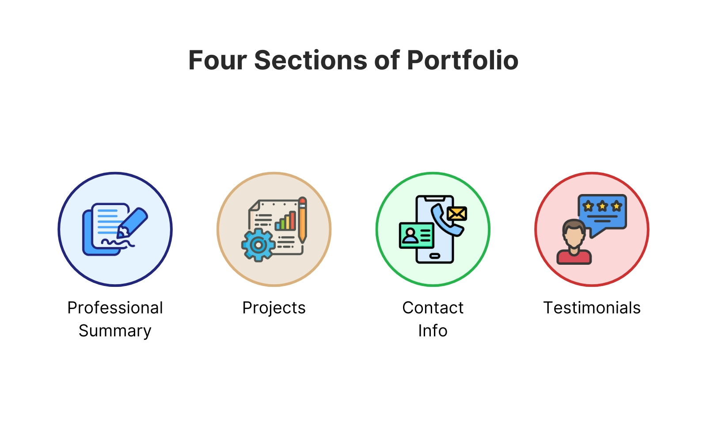
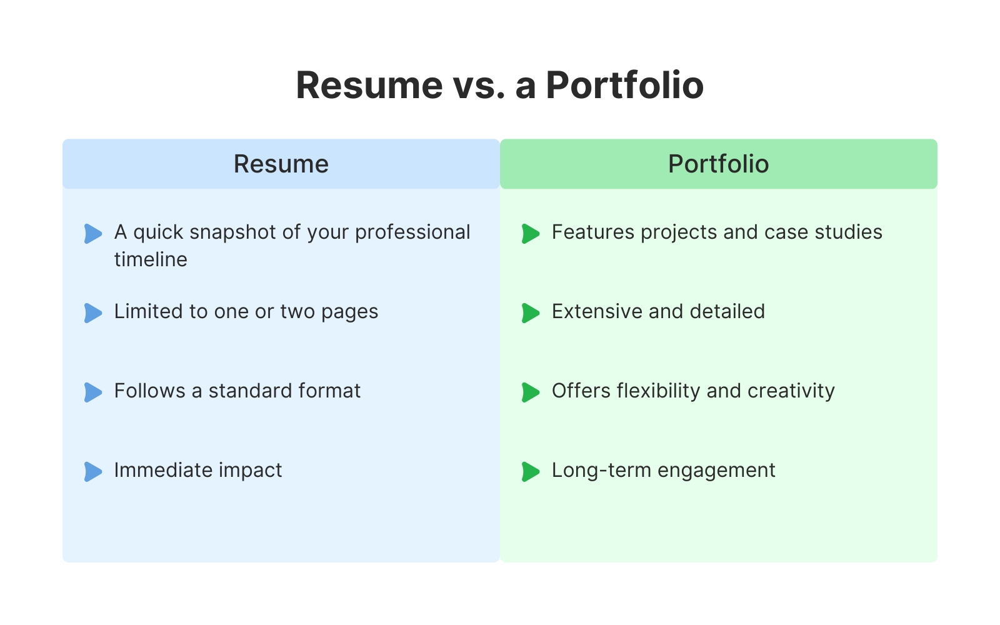
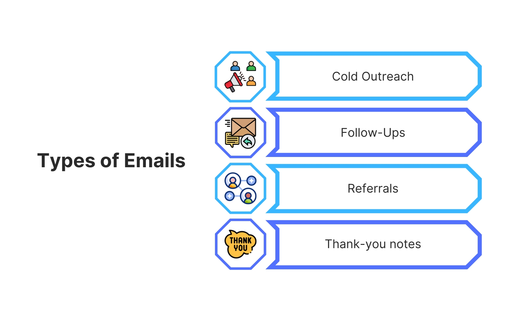
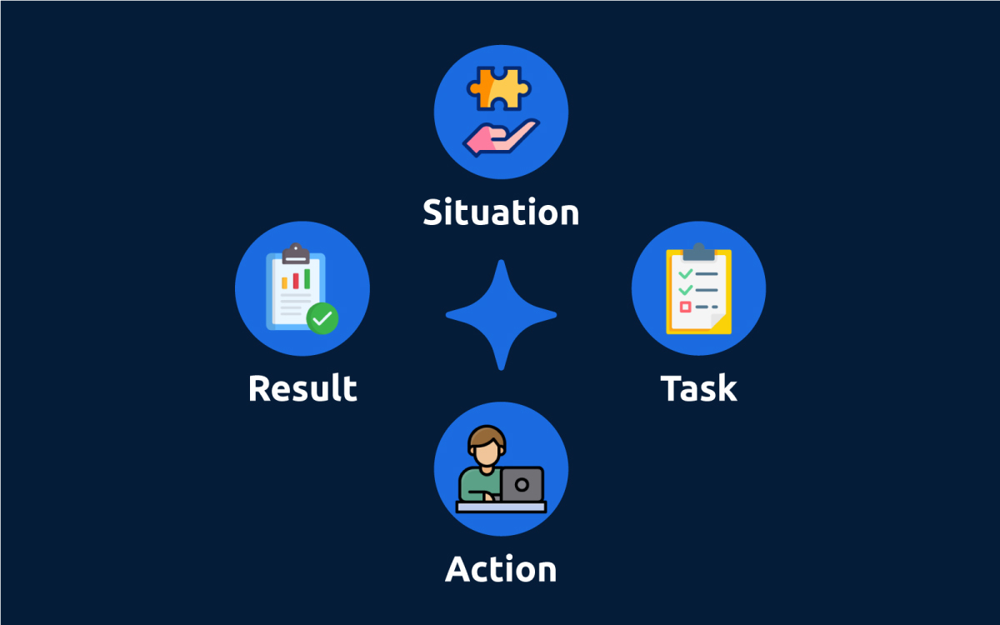

# Appendix (Chapter 16) — AI for Your Career

*Last reviewed: September 2026. Platform menus (LinkedIn, Upwork, Fiverr — a professional networking site and two freelance-work marketplaces) and chatbot (a chat-style AI assistant you type to) features change often; the prompt patterns and the honesty rules in this appendix do not.*

The rest of this book teaches you how AI systems work and how to build them. This appendix is about using them for yourself: to write a stronger resume, portfolio, cover letter and LinkedIn profile, to send better networking messages, to find and filter jobs, and to rehearse interviews. It is practical — mostly **prompt patterns** (reusable fill-in-the-blanks instructions for an AI model) you can copy, fill in, and iterate on (improve over several rounds) — and it has one rule that sits above every other: **the AI may improve how you say things; it may never change what is true.**

Prompting technique itself (role, context, few-shot examples — a handful of worked examples placed in the prompt to show the model what you want — iteration, fixing bad outputs) is taught in [Chapter 5](../05-prompt-engineering/README.md). Here we apply it to career documents.

**What you'll learn**

- How to treat a chatbot as a writing partner without letting it invent your history (the *fact sheet* method, with a runnable checker)
- One master prompt pattern that works for every career document
- Portfolio: the four core sections, project write-ups with challenge → solution → result, bullet expansion, a consistent voice
- Resume: how it differs from a portfolio, section-by-section prompts, bullet templates, tailoring to a job description and applicant tracking systems (with a runnable keyword-gap script — a small program you can execute yourself)
- Cover letters: structure, company-specific drafts, keeping your own voice, length and common mistakes
- Networking and job-search emails: cold outreach, follow-ups, referrals, thank-you notes, informational interviews
- LinkedIn: headline, About, Experience, Featured, Skills, media and links, staying active
- Freelancing: choosing marketplaces, proposals that win, link hubs and personal sites
- Job-hunt automation and keywords (search optimisation) across portfolio, resume and LinkedIn
- Interview preparation: technical practice, behavioural answers with STAR (Situation, Task, Action, Result — explained in §16.10), follow-up and reflection
- Personal brand, consistency across platforms, reputation management, and keeping everything current
- The ethics: fabrication, disclosure, privacy, and interview rules

**Prerequisites.** None beyond access to any chat assistant (ChatGPT, Claude, Gemini, Copilot…). The two scripts in [`code/`](code/) run offline (no internet or paid service needed) with the book's Python environment (the Python interpreter plus the libraries the book installs).

---

## 16.1 Ground rules: a writing partner, not an author

### What it is

A chat assistant is a **large language model (LLM)** — a model trained on huge amounts of text to predict likely next words, which lets it write fluent, context-aware prose ([Chapter 4](../04-large-language-models/README.md)). Because it is built on the **transformer** architecture ([Chapter 3](../03-transformers-and-embeddings/README.md)), it takes in your whole request and the conversation so far at once, so it can use details you gave earlier in the same chat. It does not remember other chats unless the product has a memory feature (a setting that saves facts about you between conversations), and very long chats can exceed what it can take in — its **context window**, the maximum amount of text it can read at once — so paste your fact sheet again when you start a new document.

For career writing it plays four roles:

| Role | What you ask for | Example |
|---|---|---|
| **Brainstormer** | Options when you are stuck | "Give me five ways to open my portfolio's About page." |
| **Editor** | Grammar, structure, tone | "Tighten this paragraph; keep every fact." |
| **Rewriter** | Alternatives aimed at a reader | "Rephrase this for a hiring manager in fintech." |
| **Coach** | Critique and practice | "Act as an interviewer and grill me on this project." |

A **prompt** is the instruction you give the model. **Prompt engineering** is shaping that instruction — adding context, facts, audience, format and limits — so the output fits your purpose. A vague prompt ("write a bio for a developer") gets a generic bio; the same prompt with your languages, years, target industry and length gets something close to usable.

### Why it matters

Career documents are short, high-stakes, and must be tailored again and again. AI makes the tailoring cheap. But an LLM has no idea what you actually did. When details are missing it fills the gap with *plausible* details — a team size, a percentage, a tool you never used. That is **hallucination** ([Chapter 4](../04-large-language-models/README.md)), and on a resume it becomes a false claim with your name on it.

### How it works: the fact-sheet method

1. **Write a fact sheet first** — a private list of true, checkable facts: roles, dates, tools, projects, and every number you can defend (with where it came from).
2. **Give the model only those facts**, and tell it not to add any. Ask it to write `[ASK ME]` where something is missing.
3. **Check the draft against the fact sheet.** Every number, tool, title and employer in the output must trace back to it.
4. **Edit into your own voice.** Read it aloud; if you would not say it in an interview, change it.

The script below automates step 3 with a simple rule (it uses regular expressions — compact text patterns such as "any run of digits" — to pull out numbers and names): any number or capitalised name in the draft that is not in your fact sheet is flagged.

```python
# code/claim_check.py (core)
def build_prompt(facts, task, audience, limit):
    """The master pattern: role + context + facts + task + constraints + format."""
    fact_lines = "\n".join(f"- {a}" for a in facts["achievements"])
    return ("You are an experienced technical recruiter and editor.\n"
            f"Context: I am a {facts['role']} with {facts['years']} years at "
            f"{facts['employer']}. Tools: {', '.join(facts['tools'])}.\n"
            f"Verified achievements (use ONLY these facts):\n{fact_lines}\n"
            f"Task: {task}\nAudience: {audience}\nLength: {limit}\n"
            "Rules: do not invent numbers, tools, titles or employers. "
            "If something is missing, write [ASK ME] instead of guessing.")

def check_draft(draft, facts):
    numbers, names = allowed_tokens(facts)          # everything in the fact sheet
    problems = []
    for n in re.findall(r"\d+(?:\.\d+)?%?", draft):
        if n not in numbers:
            problems.append(f"number '{n}' is not in your fact sheet")
    for m in re.finditer(r"(?<![.!?]\s)(?<!^)\b([A-Z][A-Za-z+#]+)", draft):
        if m.group(1).lower() not in names:
            problems.append(f"name/tool '{m.group(1)}' is not in your fact sheet")
    return problems
# ... a FakeLLM returns a draft that embellishes on purpose
```

Output (the prompt part is abbreviated):

```
DRAFT: Data Analyst with 2 years of experience who automated weekly reporting (6 hours to 1 hour) and built a Tableau dashboard for 40 ward managers. Led a team of 5 and cut hospital costs by 18% using Snowflake and Power BI.

5 unverified claim(s):
 - number '5' is not in your fact sheet
 - number '18%' is not in your fact sheet
 - name/tool 'Snowflake' is not in your fact sheet
 - name/tool 'Power' is not in your fact sheet
 - name/tool 'BI' is not in your fact sheet
Verdict: REWRITE before using
```

The first sentence is fine — every detail traces to the fact sheet. The second sentence is invented. That is exactly the failure you must catch by hand even without a script. (The checker is deliberately simple: it reports "Power BI" as two unknown words and would miss an invented claim with no number or capitalised name, such as "led the team" — so it supports your own reading rather than replacing it.) (The `FakeLLM` in the script is a stand-in that returns a fixed draft, so the example runs without calling a real model.) With a real API (application programming interface — the web endpoint a program calls to use the model) the same prompt is sent like this (needs an API key, a secret password-like string that identifies your account and is billed for usage — not run; see [Chapter 6](../06-building-llm-apps-in-python/README.md)):

```python
import anthropic
client = anthropic.Anthropic()                    # reads ANTHROPIC_API_KEY
msg = client.messages.create(
    model="claude-sonnet-5-5",                      # a mid-size model is plenty for short drafts; ids change, check the docs
    max_tokens=300,
    messages=[{"role": "user", "content": prompt}],
)
draft = msg.content[0].text
```

### Common mistakes

- Pasting a one-line request and accepting the first answer.
- Letting the model "estimate" a metric you never measured.
- Pasting other people's personal data (a manager's email, a client's figures under NDA — a non-disclosure agreement, a contract promising to keep information confidential) into a consumer chatbot. Check the tool's data settings and strip what you do not need.

### Self-check

1. Why does an LLM invent a team size? → It predicts plausible text; if the fact is missing, a plausible number fits the pattern.
2. What is a fact sheet? → Your private list of true, checkable facts that every draft must trace back to.
3. What should the model write when information is missing? → A placeholder such as `[ASK ME]`, not a guess.

### TL;DR

AI improves wording; you own the facts. Facts in → draft out → check every claim → rewrite in your voice.

---

## 16.2 The master prompt pattern

### What it is

One template that works for every career document. Fill the six slots; drop the ones that do not apply.

| Slot | Question it answers | Example |
|---|---|---|
| **Role** | Who should the model act as? | "Act as a senior recruiter for data roles." |
| **Context** | Who are you, what is the situation? | "I'm a junior analyst moving from retail into healthcare." |
| **Facts** | What is true? | Bullet list from your fact sheet |
| **Task** | What exactly to produce? | "Write a LinkedIn headline." |
| **Constraints** | Audience, tone, length, must/must-not | "Under 220 characters, no buzzwords, no invented numbers." |
| **Format** | Shape of the output | "Give 5 options as a numbered list." |

### How it works

1. **Draft with the template.** Ask for several versions — comparing three is faster than perfecting one.
2. **Iterate with short follow-ups**: "shorter", "more formal", "lead with the result", "merge option 2's opening with option 4's ending".
3. **Keep a prompt bank.** Save prompts that worked (a text file or notes app). Next time you only swap the facts.
4. **Get a human read.** A friend, mentor or colleague catches tone problems and gaps the model cannot know about.

### TL;DR

Role, context, facts, task, constraints, format — then iterate in small steps and save what works.

---

## 16.3 Portfolio: sections, project stories, polish

### What it is

A **portfolio** is a curated showcase of your work — usually a website, sometimes a PDF or a GitHub profile (GitHub is a website that hosts code repositories, i.e. project folders tracked with the version-control tool Git) — that *shows* what you can do rather than listing it. Most strong portfolios rest on four sections.


*Figure — The four core portfolio sections (course diagram)*

| Section | Purpose | What goes in | Prompt pattern |
|---|---|---|---|
| **Professional summary** | Who you are in 2–3 sentences | Role or core skill, a distinctive focus, a human tone | "From these facts, write three 40-word summaries for a backend (server-side) developer focused on payments systems." |
| **Projects** | Proof of ability | Title and context, *your* part, results and numbers, tools | "Turn these notes into 4 scannable bullets: problem, my part, result, stack." |
| **Testimonials** | Social proof from others | Short quotes with name and role, **used with permission** | "Here is what my former lead wrote to me; suggest a 2-sentence excerpt that keeps her exact meaning." |
| **Contact** | Make it easy to reach you | Professional email, LinkedIn, GitHub, optional booking link (a page where people pick a meeting slot) | "Write a two-line closing inviting recruiters to get in touch." |

A note on testimonials: a testimonial must come from the named person. Never ask an AI to *create* a quote and attribute it to someone — that is fabrication. Use AI only to help you *request* one ("draft a short, polite message asking my former manager for a two-sentence recommendation about the migration project") or to suggest an excerpt the person then approves.

### How it works: project write-ups

The strongest project descriptions follow **challenge → solution → result**, then translate numbers into **impact**:

1. **Challenge** — what problem existed and why it mattered. *"Support tickets waited two days for a first reply."*
2. **Solution** — what *you* did, with tools. *"I built a triage classifier in scikit-learn that routed tickets to the right queue."* (A **classifier** is a model that sorts inputs into categories; scikit-learn is a popular Python machine-learning library.)
3. **Result** — a measured outcome. *"First-reply time fell to 6 hours."*
4. **Impact** — what the number meant to people or the business. *"Customers got answers the same day, and the team stopped weekend catch-up shifts."*
5. **Link to a bigger goal** — cost, growth, reliability, reputation, where true.

Useful prompts:

- "Here are my rough notes on the ticket-triage project. Write one paragraph covering the challenge and my solution, for a non-technical reader."
- "Rewrite this result so it explains why it mattered to customers, in two sentences. Keep the numbers exactly."
- "I saved about 15 hours a week for my team. Suggest two ways to phrase the impact without exaggerating."

### How it works: polishing

- **Bullets from paragraphs** — "Split this paragraph into three bullets on scope, team and deadline." Then the reverse when you need depth: "Expand each bullet into two sentences: what I did and what changed."
- **Action verbs** — start bullets with verbs like *built, led, reduced, automated, shipped*.
- **Consistent voice** — pick first person ("I built…") or third person ("Priya built…") and keep it everywhere. Ask: "Check these three sections for mixed person, mixed tense and uneven bullet length; list the fixes."
- **A mini style guide** — a short list of your choices (person, tense, date format, how you write tool names, heading style) that you paste into future prompts.

### Practice exercises

1. **Portfolio introduction.** Prompt: "Write a 50-word portfolio introduction. I am a [role] with [N] years in [focus]. Tone: [friendly/formal]. Mention why I care about [specialty]." Generate three, then combine the best parts.
2. **Bullets → paragraphs.** Take three of your real bullets and prompt: "Expand each into three sentences: the action, the method or tools, and the result." Check that each paragraph answers *what, how, why it mattered*, then adjust tone ("more formal", "focus on business impact").

### Common mistakes

- Listing duties ("responsible for testing") instead of outcomes.
- Metrics without meaning — "improved performance by 30%" of what, for whom?
- Showing every project; three to six strong ones beat twenty weak ones.

### Self-check

1. Name the four core sections. → Summary, projects, testimonials, contact.
2. What turns a metric into an impact statement? → Saying who benefited and how (time, money, satisfaction, reliability).
3. Can AI write a testimonial for you? → It can help you request or trim one; the words and permission must come from the real person.

### TL;DR

Four sections; every project told as challenge → solution → result → impact; one consistent voice; real testimonials only.

---

## 16.4 Resume: concise, tailored, keyword-aware

### What it is

A **resume** (CV in many countries) is a one- or two-page summary of your work history, skills and achievements. It and the portfolio do different jobs.


*Figure — Resume vs portfolio at a glance (course diagram)*

| | Resume | Portfolio |
|---|---|---|
| Purpose | Quick snapshot: do you meet the bar? | Proof: can you really do it? |
| Length | 1–2 pages, very selective | As deep as needed per project |
| Format | Conventional (contact, summary, experience, education, skills) | Flexible, creative layout |
| Reading time | Seconds on a first pass | Explored at the reader's pace |
| Best for | Applications, networking events | Interviews, client pitches, email signature link |

The resume earns you a closer look; the portfolio is the evidence that converts that look into an interview. Use both.

### How it works: section prompts

| Section | Goal | Prompt pattern (your facts in brackets) |
|---|---|---|
| **Summary** | Who you are and what you want, 2–3 sentences | "Write a 3-sentence summary for a [role] with [N] years in [domain], strongest in [skills]. Target: [job type]." |
| **Skills** | Top technical and people skills | "From my experience below, pick the 8 skills most relevant to [job title]. Group into languages, tools, practices." |
| **Experience** | Achievements per role | "Turn these notes about my [title] role into 4 bullets: action verb first, one number each where I gave one." |
| **Education** | Degree, certificates, relevant courses | "One line for my [degree] from [university], [year], plus the two courses most relevant to [role]." |

### Bullet templates

- **Achievement:** "For a [job title], write bullets about [one project]: what I did and the measured result I give you." → *"Cut monthly cloud spend by 22% by right-sizing idle compute and adding autoscaling."* (Right-sizing = moving to smaller rented servers that still fit the load; **autoscaling** = automatically adding or removing servers as traffic rises and falls.)
- **Hard + soft skill together:** "Write 3 bullets showing my [technical skill] and my [soft skill, e.g. mentoring]." → *"Mentored two new hires through their first on-call rotation while leading the migration to Kubernetes."* (On-call = taking turns being the person paged when production breaks; Kubernetes = a widely used system for running and scaling containerised applications.)
- **Problem solved:** "Describe how I fixed [problem] at [company]: issue, action, outcome — one line." → *"Replaced a manual invoice-matching step with a Python script, reducing errors from ~40 to ~5 per month."*

(The numbers above are illustrations; yours must come from your fact sheet.)

### How it works: tailoring to a job

An **applicant tracking system (ATS)** is software employers use to receive, store and search applications (Workday, Greenhouse, Lever, iCIMS are common examples). Recruiters often search or filter candidates by keywords, and human reviewers also scan for the job's terms. How much automatic ranking happens varies by employer and product, so the safe goal is simple: a resume that is easy to parse — for software to read and split into fields such as name, jobs and skills — (plain headings, no text inside images) and that uses the job's own words *for skills you really have*.

1. **Keep a base resume** with everything true you might ever want to include.
2. **Extract the job's keywords.** Paste the job description and ask: "List the 10–15 skills, tools and qualities this posting emphasises, most important first."
3. **Find the gap.** Compare with your resume (by hand or with the script below).
4. **For each missing keyword ask: is it true for me?** If yes, add it naturally where it belongs. If no, leave it out — or, if it matters, plan to learn it.
5. **Tailor with a prompt**: "Here is my base resume and the job. Reorder and reword to emphasise [themes]. Do not add any skill or number that is not already in my resume."
6. **Review every change**, then save a named version per application (e.g. `resume-backend-fintech.pdf`).

```python
# code/keyword_gap.py (core)
def keywords(text, top=15):
    t = normalise(text)
    found = [p for p in PHRASES if p in t]          # multi-word terms first
    for p in found:
        t = t.replace(p, " ")
    words = re.findall(r"[a-z][a-z0-9+#.]*[a-z0-9+#]|[a-z]", t)
    counts = Counter(w for w in words if w not in STOP and len(w) > 2)
    singles = [w for w, _ in counts.most_common(top)]
    return found + singles[: max(0, top - len(found))]

def gap_report(job, resume, top=15):
    r = normalise(resume)
    keys = keywords(job, top)
    matched = [k for k in keys
               if re.search(r"(?<![a-z])" + re.escape(k) + r"(?![a-z])", r)]
    missing = [k for k in keys if k not in matched]
    return {"keywords": keys, "matched": matched, "missing": missing,
            "coverage": round(100 * len(matched) / len(keys), 1)}
```

Output:

```
Job keywords : data pipelines, rest apis, unit testing, code review, ci/cd, stakeholder communication, python, aws, postgresql, backend, docker, kafka
In resume    : rest apis, unit testing, code review, python, aws, postgresql, docker
Not in resume: data pipelines, ci/cd, stakeholder communication, backend, kafka
Coverage     : 58.3%
Next step    : for each missing term, ask 'Is this true for me?' Only true ones get added, in your own words.
```

(The script's *coverage* is simply the percentage of the job's keywords found in your resume. In the sample output, REST APIs are web interfaces programs call over HTTP; Docker packages software into portable containers; AWS is Amazon's cloud platform; PostgreSQL is an open-source database; Kafka is a system for streaming high volumes of event messages between services.)

If you really set up the GitHub Actions pipeline (GitHub's built-in automation that runs jobs such as tests on every code change) at your last job, "CI/CD" — continuous integration / continuous delivery, automatically testing every change and shipping it once it passes — belongs on the resume. If you have never touched Kafka, it does not — "a plus" in a posting is not a requirement.

### Common mistakes

- **Keyword stuffing** — cramming in search terms to game a filter: long lists of terms, or white-on-white text. Humans notice, and it reads as dishonest.
- Letting the model "upgrade" your title or scope ("contributed to" becoming "led").
- One generic resume for every job.
- Not checking dates and titles match your LinkedIn and portfolio.

### Self-check

1. Resume vs portfolio in one line? → Resume = fast snapshot; portfolio = detailed proof.
2. What is an ATS? → Software that stores and searches applications; recruiters filter by keywords in it.
3. The posting wants Kafka; you have never used it. What do you do? → Leave it out; optionally learn it and mention it only once it is true.

### TL;DR

Base resume + tailored versions; job keywords only where true; bullets = verb + action + result; verify every AI edit.

---

## 16.5 Cover letters

### What it is

A **cover letter** is a short letter sent with your application that explains why *this* job at *this* company, and why you. It is often the first sample of your writing an employer sees.

### Why it matters

- It shows you researched the company — a generic letter signals low effort.
- It is the one place to explain a career change, a gap, or an unusual path in a positive way.
- It reveals communication skill and personality, which can decide between equally qualified candidates.
- Errors in it suggest carelessness.

### How it works: structure

1. **Header** — name, email, phone, LinkedIn or portfolio link.
2. **Greeting** — a named person where possible ("Dear Ms. Okafor"); search the company site or LinkedIn for the hiring manager.
3. **Opening** — the role, and one or two sharp reasons you fit; optionally a specific thing about the company you respect.
4. **Body (1–2 paragraphs)** — one or two short stories from your work that match the job's main needs.
5. **Closing** — restate interest, invite a conversation, thank them.
6. **Sign-off** — your name, plus a portfolio link if it is not in the header.

Aim for roughly **250–350 words**; readers skim.

### How it works: prompting

1. **Research first.** Collect the company's stated values, a recent product or project, and the job's top requirements. The model cannot know what the company announced last month unless you paste it in.
2. **Draft**: "Write a cover letter for a [role] at [company]. Their values: [pasted]. Job priorities: [pasted]. My matching facts: [fact sheet]. Tone: [match the company — formal for a bank, warmer for a startup (a young, fast-growing company)]. 300 words."
3. **Inject yourself**: "Add a short paragraph about [a real experience, e.g. volunteering as a coding tutor] and link it to their mission." Then read it and ask *does this sound like me?*
4. **Adjust in small steps**: "Make paragraph two more enthusiastic but still professional." "Cut to two paragraphs without losing the migration story."
5. **Customise per job** — tone (corporate vs startup), length, and which projects you highlight ("Emphasise my SQL and dashboard work; this role is reporting-heavy"). (SQL is the standard language for querying databases; a dashboard is a page of live charts and numbers.)
6. **Proofread** — let the model do a grammar pass, then have a human read it.

### Common mistakes

| Mistake | Better |
|---|---|
| "To Whom It May Concern" | A named person, or at least "Dear [Team] Hiring Team" |
| Unrelated hobbies and life story | Only details that connect to the role or company |
| Claiming qualities ("passionate team player") | Showing them with a specific example |
| Same letter to every company | One paragraph that could only be written for this company |
| No proofreading | AI grammar pass **and** a human read |
| AI-sounding filler ("I am thrilled to leverage my synergies…") | Plain, specific sentences |

### Self-check

1. Ideal length? → About 250–350 words.
2. What can a cover letter do that a resume cannot? → Explain motivation, career changes or gaps, and show voice and fit.
3. Why paste company research into the prompt? → The model may not know recent or specific facts; without them it writes generic flattery.

### TL;DR

Header → greeting → hook → one or two matching stories → call to action. Research in, specifics out, your voice on top.

---

## 16.6 Networking and job-search emails

### What it is

Four kinds of email drive most job-search networking.


*Figure — The four common job-search email types (course diagram)*

| Type | When | Must contain |
|---|---|---|
| **Cold outreach** | Contacting someone you do not know: recruiter, hiring manager, potential mentor | Short clear subject; who you are; why *them* (something specific about their work); one clear, small request |
| **Follow-up** | After applying (no reply in 1–2 weeks) or after meeting someone | Reminder of the last contact; purpose; polite, no pressure |
| **Referral** | Someone suggested you contact a person, or you ask a mutual contact to recommend you | Name the referrer first; why you fit; thanks to both |
| **Thank-you** | After an interview, advice, or an introduction | Thanks; one specific thing you discussed; offer to help or stay in touch |

### How it works: structure with AI help

1. **Subject line** — short (aim for under about 60 characters so it is not cut off on most screens), specific. Prompt: "Suggest 5 subject lines for an email asking a data engineer at [company] for a 15-minute chat about their team's migration to dbt." (dbt is a popular tool for writing and testing data transformations in SQL.) Then: "Make these less formal." Pick one yourself — the model cannot know real open rates (the share of recipients who actually open an email), so treat any "this one will perform best" answer as a guess.
2. **Opening (1–2 sentences)** — who you are and why you are writing, from the reader's point of view. "Write a two-sentence opener to [name] that mentions her conference talk on [topic] and says why I'm writing."
3. **Body** — at most two short paragraphs; one ask.
4. **Closing** — a clear call to action ("Would a 15-minute call next week work?") and sincere thanks.
5. **Keep it short** — two or three brief paragraphs; busy inboxes skim.

### Prompt templates

- **Informational interview** (an informal chat to learn about someone's job or field, not a job interview)**:** "Help me write a short, friendly-professional email to [name], [title] at [company]. I'm a [your status] interested in [topic]. Mention [specific thing about their work]. Request a short (about 15 minutes) chat on how they got into [field]."
- **Application follow-up:** "Write a brief follow-up to the hiring manager at [company] about my [position] application sent on [date]. Restate interest, name one skill I bring ([skill]), offer more information. Polite, not pushy."
- **Thank-you after an interview:** "Write a thank-you email to [name] after my [position] interview. Mention our discussion about [specific topic], show enthusiasm for next steps, offer to send anything else they need." Send it within about 24 hours.
- **Referral:** "Write a short email to the hiring manager at [company]. [Referrer], who works on their [team], suggested I contact them about the [role]. Include my two most relevant facts: [facts]."
- **LinkedIn connection note:** "Write a connection note under 200 characters to [name] mentioning [shared event or interest]." (In 2026 LinkedIn allows about 200 characters on free accounts and 300 on Premium — its paid subscription — and free accounts can add only a limited number of personalised notes per month; check the current limits.)

### Common mistakes

| Pitfall | Why it hurts | Fix |
|---|---|---|
| **Tone mismatch** | Too casual reads as unprofessional; too stiff reads as cold | Match the recipient (startup founder vs corporate HR, i.e. human resources); ask the model for "friendlier" or "more formal" and choose |
| **Grammar and typos** | Signals carelessness | Proofread; read aloud; use a grammar checker as a second pass |
| **Robotic AI phrasing** | Formulaic lines make the email feel mass-produced and reduce trust | Add a real detail in your own words; replace stock phrases; ask for "more personal, less formal" versions |
| **Following up too soon or too often** | Feels pushy | Wait about a week; one or two polite follow-ups at most |
| **Mass-sending one template** | Recipients recognise it | Every email needs at least one sentence only this person could receive |

### Self-check

1. Four email types? → Cold outreach, follow-up, referral, thank-you.
2. What goes first in a referral email? → The name of the person who referred you.
3. How soon should an interview thank-you go out? → Within about 24 hours.

### TL;DR

Short subject, reader-centred opening, one ask, clear close, real personal detail. Templates speed you up; specifics get replies.

---

## 16.7 LinkedIn

### What it is

LinkedIn is a professional network and, in practice, a public portfolio page that ranks well in search engines (it tends to appear near the top when someone searches your name). It serves three purposes: **networking** (connecting with peers, mentors, groups and companies), **job hunting** (job listings, applying with your profile, and recruiters searching for candidates), and **personal branding** (posts, articles, and a Featured section that pins your best work). Unlike a resume, it can be updated any time and hold links, documents and media.

### How it works: the five key sections

| Section | Job | Tips | Prompt pattern |
|---|---|---|---|
| **Headline** (up to 220 characters) | The line under your name, shown in search results | Role + specialty + value, using words recruiters search for; readable, not a keyword pile | "Give 5 headline options for a frontend developer focused on accessibility and design systems. Under 120 characters each." (Frontend = the part of an app users see in the browser; accessibility = making it usable by people with disabilities; design system = a shared library of UI components and style rules.) |
| **About** (up to 2,600 characters) | Your story: what you do, how, what next | Hook in the first two lines (only they show before "see more"); two or three real achievements; some personality | "From these facts, draft a warm, first-person About section: what I do, two results, what I'm looking for. 200 words." |
| **Experience** | Roles with outcomes | Bullets, results over duties, numbers you can defend | "Turn these notes on my product manager role into 3 bullets on research, launch and metrics. Use only my numbers." |
| **Featured** | Pinned work at the top | Only your best; mix formats (article, repo i.e. code repository, demo video, PDF case study); a short caption each | "Write a 1-sentence caption for my Featured case study on reducing checkout drop-off." |
| **Skills & endorsements** | Lets search match you; endorsements add proof | Put the most relevant skills first; be specific ("Agile project management", i.e. working in short, iterative cycles, not "management"); ask real colleagues to endorse skills they saw | "Suggest 10 specific skills a cloud engineer with AWS, Kubernetes and Terraform (a tool that creates cloud infrastructure from configuration files) should list, most searched first." Then keep only the true ones. |

### How it works: links and media

- **Featured** — add links, documents (PDF case studies, slides) or media; give each a clear title and a one-line takeaway; put the strongest item first. Menus move between app versions: look for *Add profile section* or the edit pencil on the section.
- **Projects** — name, your contribution, tools, a result, a link, and teammates if relevant.
- **Personal website** — say what visitors will find there; a custom domain (your own web address, such as `yourname.dev`) looks polished; keep it current.
- **GitHub** — link a handful of representative repositories, each with a clear README (the front-page text file of a repository: what it does, how to run it, your role).
- **Do:** high-quality media, a short story per item, best first. **Don't:** dozens of links, empty descriptions, stale projects.

### How it works: staying current and active

1. **Audit every few months** (or after a big project): copy your sections into the chat and ask, "Review this for clarity and consistency. What looks outdated or missing for a [field] professional?" Treat its "latest trends" remarks as hints to verify, not facts.
2. **Engage** — thoughtful comments on posts in your field; share what you built or learned.
3. **Connect with a note** — mention why (a shared event, a talk you liked).
4. **Join groups and events** relevant to your field.
5. **Post about finished work**: "Draft a short LinkedIn post announcing my [project], its main result, and asking designers for feedback." Edit it until it sounds like you.

### Common mistakes

- Headline that is only a job title ("Software Engineer at X").
- About section written in stiff third person, or pure buzzwords.
- Dates and titles that disagree with your resume.
- Collecting connections without ever talking to them.

### Self-check

1. Why does the first line of About matter most? → Only the opening lines show before the reader clicks to expand.
2. What makes a good Featured item? → Your best, most relevant work with a one-line takeaway.
3. How should you treat AI-suggested skills? → As a checklist: keep the ones that are true, discard the rest.

### TL;DR

Keyword-aware headline, human About, outcome bullets, a few pinned best pieces, true skills — and regular audits and activity.

---

## 16.8 Freelancing: marketplaces, proposals, link hubs

### What it is

Freelance **marketplaces** connect independent workers with clients. They differ in audience: **Upwork** (clients post jobs, freelancers send proposals), **Fiverr** (freelancers list fixed-price "gigs" that buyers pick), **Toptal** (a screened network aimed at senior talent), plus niche sites for design, writing or specific tech. Pick the one whose clients and project types match your skills.

### How it works: proposals that convert

1. **Read like the client.** "Analyse this job post. List the client's main problem, the outcome they want, and any unstated worries." Answer *those*, not your life story.
2. **Hook in the first line** — address their need directly. "Write three opening sentences for a proposal to speed up a slow Shopify store." (Shopify is a popular hosted platform for online shops.)
3. **Show only relevant proof** — one or two similar projects with results. "Turn these bullets from my past ad campaign into a 3-sentence mini case study."
4. **Give a short plan** — 3–4 steps (e.g. audit → fix the biggest bottlenecks, the slowest steps that limit everything else → measure → iterate). "Outline a plan for this redesign in under 120 words."
5. **Say why you** — one distinctive strength.
6. **End with a call to action** — "Happy to do a 15-minute call to review your current setup."

### How it works: researching the market

You can ask a model what top profiles in your category usually emphasise, and to summarise common elements of strong bios. But a chatbot **cannot see live marketplace data** unless it has a browsing tool (a built-in ability to fetch web pages), and its training data — the text it learned from — may be old. For rates and demand, look at real profiles and job posts on the platform, or paste a set of job posts into the chat and ask it to find recurring requirements and keywords — then build your profile around what clients actually ask for.

### How it works: one link for everything

- A **link-in-bio page** (Linktree and similar services) gives one URL (web address) that lists your profiles: Upwork, Fiverr, portfolio, GitHub, LinkedIn. Use descriptive labels ("See my case studies", "Hire me on Upwork"), keep the list short, and order by importance. Put it in your email signature and social bios.
- A **personal website** gives more room: case studies, testimonials, a blog, and a chance to be found by search engines. Keep branding (colours, fonts, photo, bio) consistent with your other profiles and lead with your niche.
- Prompts: "Write a 100-word homepage intro for a full-stack developer (one who works on both the browser side and the server side) specialising in e-commerce performance." "Describe my three services in one sentence each, focusing on the client's benefit." "Suggest five short call-to-action buttons for my site."

### Common mistakes

- Copy-paste proposals that ignore the client's post.
- Listing every skill instead of the relevant ones.
- Trusting a chatbot's "average rate" for your category without checking live data.
- Ignoring the platform's costs: marketplaces take a service fee from what you earn, and some (Upwork, for example) also charge credits to send proposals. Read the current fee page before you price your work.

### TL;DR

Client's problem first, relevant proof, a short plan, a clear next step. Research on real listings; one link hub to tie your profiles together.

---

## 16.9 Job-hunt automation and search keywords

### What it is

Two uses of AI that save hours: **filtering** job listings against your criteria, and choosing **keywords** — the words recruiters and search engines use — so people find you. **SEO (search engine optimisation)** is the practice of wording content so search tools rank it for the right queries; here it applies to your portfolio, resume and LinkedIn.

### How it works: filtering listings

A plain chatbot does not search the web for live postings unless it has a browsing tool; it works on what you give it.

1. **Collect postings** — copy the text of the listings you found (or export them if the job board allows) into one document.
2. **Filter**: "Here are 20 postings. Which require Python and SQL? Show title, company and location as a table."
3. **Narrow**: "Of those, which mention remote work and a salary of at least [amount]?"
4. **Match to you**: "My background: [fact sheet summary]; I want [remote, data-heavy, healthcare]. Score each role 1–10 for fit and explain the score in one line."
5. **Summarise the top three**: requirements, salary range if stated, culture signals.
6. **Verify** — open the real posting before you apply; check it is current and that the model did not misread requirements.

A fit score from a model is a rough sorting aid, not a judgement — it can miss a dealbreaker hidden in the text.

### How it works: keywords

1. **List your terms** — role titles ("data analyst"), tools ("Power BI" — Microsoft's dashboard tool —, "dbt"), methods ("A/B testing", comparing two versions on randomly split users), and broad skills ("stakeholder management").
2. **Ask for more**: "List 10 terms recruiters search for when hiring a mid-level React and TypeScript developer." (React is a JavaScript library for building web interfaces; TypeScript is JavaScript with type checking.) Narrow by level, industry or methodology; run it twice and keep terms that appear consistently.
3. **Cross-check with real postings** — if several current job ads use the term, it matters. A model's "trending skills for this year" list reflects its training data, which may be out of date.
4. **Place them where they count** — portfolio titles, headings and first sentences; resume skills and summary; LinkedIn headline, About and Experience; job titles with a specialty where accurate ("Software Engineer — Backend").
5. **Be specific** — "Scrum" (a common Agile method built on fixed-length sprints) or "Agile project management" rather than "management"; group related skills together.
6. **Keep it readable** — a natural sentence ("Built a React and Node.js checkout that loads 40% faster" — Node.js runs JavaScript on servers) beats a keyword list; stuffing hurts with humans and with search.
7. **Refresh** every few months as the language of your field changes — but only with terms that are true for you.

### Self-check

1. Can a plain chatbot find live job postings? → Not unless it has a browsing or search tool; paste the listings in.
2. Where should your top keywords go on LinkedIn? → Headline, About, Experience (and Skills).
3. How do you validate a "trending" keyword? → Check that multiple current job postings use it.

### TL;DR

Paste listings in, filter and score, then verify. Choose keywords from real postings, place them in high-value spots, keep sentences natural.

---

## 16.10 Interview preparation

### What it is

Using a chatbot as a practice partner: it can play the interviewer, set problems at your level, critique your answers and explain alternatives — at any hour, as many times as you like.

### How it works: technical practice

1. **Set the scene**: "You are interviewing me for an entry-level Python job. Set one problem I can finish in 30 minutes, on lists and dictionaries. Don't show the solution until I ask."
2. **Cover the core topics** — patterns such as two pointers, sliding windows and recursion; algorithms like binary search, sorting and dynamic programming; and the structures they run on — arrays, hash maps, stacks, queues, trees and graphs. "Give me a medium tree problem that needs depth-first search, with a sample input and expected output."

   > **Key term — the classic interview toolkit:** *Two pointers* walks two indexes through a list (often from both ends) instead of nesting loops; a *sliding window* keeps a moving range of items and updates it one step at a time; *recursion* is a function calling itself on a smaller piece of the problem. *Binary search* finds an item in a sorted list by halving the range each step; *dynamic programming* solves a problem by storing answers to overlapping sub-problems so each is computed once. A *hash map* (dictionary) looks values up by key in about constant time; a *stack* is last-in-first-out and a *queue* first-in-first-out; *trees* and *graphs* are nodes joined by links, and *depth-first search* explores one branch fully before backing up.
3. **Debugging drills**: "Give me a short function with one subtle bug. I'll find it; then show the fix."
4. **Discuss after solving**: "My solution is O(n²). Is there an O(n log n) or O(n) approach? Compare time and space." (This is **Big-O notation**: how running time or memory grows as the input size n grows — O(n²) means doubling the input roughly quadruples the work.)
5. **Scenario questions** (system design and troubleshooting): "Act as a senior engineer. Our API's latency (the time one request takes from start to finish) tripled after a release — ask me how I'd find the bottleneck, one question at a time." "Traffic to our web app spikes 10× on sale days; interview me on how I'd scale it." (For the building blocks these questions assume — latency, throughput, caching, load balancing — see [System Design Fundamentals](../../../system-design-patterns/modules/00-system-design-fundamentals/README.md); for AI-specific design interviews, see [Chapter 13](../13-ai-system-design-and-genai-products/README.md).)
6. **Mix in soft skills**: "During the scaling discussion, sometimes ask how I'd explain the change to non-technical stakeholders (the people affected by or deciding on the work)."

Practice tips: set a real timer; **talk through your reasoning out loud** (interviewers score the thinking, not just the code); keep a log of where you got stuck and ask for explanations of those gaps; include some hard problems, not only easy ones. And check the model's answers — it can be wrong about complexity or produce buggy code, so run the code.

### How it works: behavioural answers with STAR

Behavioural questions ("Tell me about a time you…") test how you work with people and handle problems. The **STAR** method structures an answer:


*Figure — The STAR structure for behavioural answers (course diagram)*

| Step | Content | Example |
|---|---|---|
| **Situation** | Context in one or two sentences | "Two weeks before a client launch, our payment provider changed its API." |
| **Task** | Your responsibility | "I owned the integration and had to keep the launch date." |
| **Action** | What *you* did (most of the answer) | "I split the work into two parallel streams, wrote contract tests (automated checks that the API still sends and accepts the agreed data shapes) against the new API, and gave the client daily status notes." |
| **Result** | Outcome, measured if possible, plus what you learned | "We launched on time with zero payment failures in the first month; we now run contract tests for every provider." |

Choose stories that match the job (collaboration-heavy role → a collaboration story). Prepare 6–8 stories that can flex across common questions (conflict, failure, leadership, tight deadline, ambiguity).

With AI:

- "Here is my STAR answer about a difficult stakeholder. Critique clarity and length; point out where the Action is vague."
- "Rewrite it under 200 words and end on the result." / "Make it more conversational but still professional."
- Then **check that it still describes what really happened**, and put back the specific details the rewrite smoothed away.

### How it works: after the interview

1. **Thank-you email within 24 hours** — two or three short paragraphs, one specific reference to the conversation, a brief restatement of fit, an offer to answer further questions.
2. **Reflect while it is fresh** — what went well, which questions surprised you, where your explanation was unclear, technical or behavioural gaps.
3. **Plan** — pick one or two things to improve; ask the model for practice questions on exactly those ("Give me five behavioural questions about handling scope creep" — a project's requirements slowly growing beyond what was agreed).
4. **Ask for feedback** from the recruiter, or a mentor, where possible.
5. **Track progress** across interviews and adjust your preparation.

### Ethics note

Practising with AI is fine. Using AI *during* a live interview or a take-home test without permission is a different matter: many employers forbid it, and some explicitly ask candidates not to use AI in applications. If the rules are unclear, ask. Being caught misrepresenting your ability usually ends the process — and passing that way puts you in a job you cannot yet do.

### Self-check

1. What does STAR stand for? → Situation, Task, Action, Result.
2. Which STAR part should be longest? → Action — what *you* did.
3. Why speak aloud while practising? → Interviewers assess your reasoning; saying it builds clarity.

### TL;DR

Role-play problems at your level, time yourself, think aloud, verify AI answers. STAR for stories. Thank-you within a day, then reflect and target your weak spots.

---

## 16.11 Personal brand, consistency, reputation

### What it is

Your **personal brand** is what people consistently associate with you professionally — your focus, values and way of working — as seen across every place they find you.

### How it works: brand voice

1. **Name your values** — "Suggest ten adjectives that fit a data engineer who cares about reliability, clear documentation and mentoring." Keep the three or four that are really you.
2. **Write a brand statement** — "Using these words, write three one-line brand statements I could adapt for a LinkedIn headline." Adjust tone ("friendlier, still professional").
3. **Stay authentic**:
   - Include challenges and lessons, not only wins.
   - Replace vague claims with evidence: not "passionate about open source" but "merged 30 pull requests into two open-source libraries this year" (if true). (A **pull request** is a proposed code change submitted for review; **open source** means the code is public and anyone may use and improve it.)
   - Highlight what makes you different — for example, a teacher turned developer who writes unusually clear docs.
   - Edit AI output until it sounds like you; generic polish is forgettable.

### How it works: consistency across platforms

Recruiters check several places. Make them tell one story.

| Platform | Keep aligned |
|---|---|
| **LinkedIn** | Headline and About echo your portfolio bio; Featured shows the same flagship projects; endorsed skills match those you emphasise |
| **GitHub** | Repository (project folder) names match portfolio project names; READMEs describe the goal and your part; pin the projects your LinkedIn mentions |
| **Website / blog** | Same photo, colours and bio; links to LinkedIn and GitHub and back |
| **Everywhere** | Same dates, titles and numbers — "three years leading an Agile team" must match your work history |

Prompt: "Here are my LinkedIn About, GitHub bio and website intro. List any contradictions in dates, titles or claims, and any differences in tone."

### How it works: reputation management

1. **Monitor** — set alerts on your name and project names (Google Alerts is one free option); check comments, issues and messages on your platforms.
2. **Classify** — positive, neutral, question or complaint.
3. **Respond promptly and politely** — if you need time, say so and follow up.
4. **Use AI for a calm first draft**: "Draft a friendly reply to a user who liked my library but said the docs are thin. Thank them and say what I'll add." / "Draft a short, empathetic reply to someone who found my app's signup confusing. Under 80 words, no defensiveness."
5. **Personalise, own mistakes, keep it short**, and when you fix a public issue, post a short note so others see the resolution.

### How it works: growing your reach

- **Thought leadership** — share what you know: a blog (your site or a platform like Medium) for long posts, LinkedIn posts for shorter ones. Plan one or two pieces a month: project write-ups, lessons learned, commentary on your field. Use AI for outlines and editing ("Suggest an outline for a 600-word post on what I learned migrating to PostgreSQL 16" (a popular open-source database)), but the experience and opinions must be yours. Reply to comments.
- **Collaboration** — partner with people whose skills complement yours (developer + designer), co-write posts, run a joint webinar (an online live talk), guest on a podcast. "Draft a short email inviting a UX (user experience) designer I met at a meetup to co-write a post on accessible forms."
- **Events and communities** — meetups (small local in-person gatherings), conferences (offer a talk), and field-specific Slack or Discord groups (online group-chat communities) where you answer questions.
- Networking works when it is mutual: offer help, not just requests.

### TL;DR

A few true values, expressed consistently everywhere; evidence over adjectives; calm, prompt, honest responses in public; share what you learn.

---

## 16.12 Keeping it current, and a checklist

### How it works: scheduled audits

1. **Pick a rhythm** — monthly if your work changes fast, otherwise quarterly — and put it in your calendar.
2. **Content check**: "Review my portfolio homepage and About text for clarity, consistency and anything that sounds dated."
3. **Structure check**: "Here is my site's page list and navigation. Suggest how to make my recent analytics (data-analysis) projects easier to find."
4. **Broken links** — use a link-checker tool or browser extension; a chatbot cannot click links, but it can spot suspicious ones in a pasted list (renamed services, old URL formats).
5. **Stale content** — update old roles and skills; replace "in progress" with final outcomes; refresh metrics and screenshots; archive projects that no longer represent you.
6. **Change gradually** and keep a small log of what you changed, so you can see what improved responses.

### How it works: tracking your field

Ask a model to summarise emerging roles, skills or tools in your field — then **confirm with current sources**: job boards, company engineering blogs, industry reports. Model knowledge has a cutoff (a **knowledge cutoff**: the date after which its training data contains nothing) and is not live; salary comparisons from a model are broad impressions at best. Follow trends that match your goals, not all of them, and when you pick up a new skill, add a line to your portfolio about why and how you used it.

### Quick checklist

| Area | Done when… |
|---|---|
| **Fact sheet** | All roles, dates, tools, projects and numbers written down with sources |
| **Portfolio** | Summary; 3–6 projects told as challenge → solution → result; real testimonials with permission; clear contact |
| **Resume** | Base version plus tailored copies; keywords only where true; dates match everything else |
| **Cover letters** | Researched, specific paragraph per company; 250–350 words; proofread by a human |
| **Emails** | Templates for outreach, follow-up, referral, thank-you — each personalised before sending |
| **LinkedIn** | Headline, About, Experience outcomes, Featured best work, true skills |
| **Freelance** | Profile matches portfolio; proposal template that starts from the client's problem; one link hub |
| **Interviews** | Timed technical practice; 6–8 STAR stories; thank-you within 24 h; reflection notes |
| **Maintenance** | Calendar audits; link check; trends verified against real postings |

### Next steps

- Keep a **prompt bank** of what worked, and try new assistant features (file upload, code review, voice practice) as they appear.
- Practise different prompt types — brainstorming, style editing, fact-checking your own claims.
- Show drafts to people; fold their feedback into your next prompts.
- Keep learning your field (courses, certificates, projects), and show in your portfolio how you adapt — including how you use AI responsibly in your work.
- Build real relationships: meetups, forums, open-source contributions.

---

## 16.13 Ethics and honesty (read this twice)

| Rule | Why |
|---|---|
| **Never fabricate** experience, employers, titles, dates, degrees, certifications, metrics, or testimonials | It is dishonest; background checks, reference calls and technical interviews expose it; offers can be withdrawn and employment ended for falsified applications |
| **Don't inflate scope** ("helped with" ≠ "led") | Interviewers ask follow-ups; you must be able to defend every line in detail |
| **Numbers need a source** | If you cannot explain how a number was measured, soften it ("roughly halved") or drop it |
| **Follow each employer's AI rules** | Some forbid AI in applications, take-homes or live interviews; ask when unclear |
| **Protect privacy** | Don't paste confidential employer data, client figures under NDA, or others' contact details into consumer tools; check data-use settings |
| **Keep it your voice** | Heavily generic AI text reads as low effort and can erode trust in outreach |
| **Watch for bias** (systematic unfairness toward some groups) | Models can reproduce stereotypes (e.g. gendered wording, assumptions about age or background); review tone and word choice |
| **Don't rely on AI "detectors" or "ATS scores"** | Both (tools claiming to spot AI-written text, and match scores some ATS tools show) are unreliable signals; write clearly for humans |

A useful test before you send anything: *could I explain every sentence in this document, with specifics, to the person who will read it?* If not, rewrite it.

---

## Chapter TL;DR

- **Fact sheet first**; give the model only true facts, ask for `[ASK ME]` placeholders, check every number and name (the `claim_check.py` idea), then rewrite in your voice.
- **Master prompt**: role, context, facts, task, constraints, format; ask for several versions; iterate in small steps; keep a prompt bank.
- **Portfolio**: summary, projects, testimonials (real, with permission), contact; projects as challenge → solution → result → impact; one consistent voice.
- **Resume**: quick snapshot vs portfolio's proof; section prompts; verb + action + result bullets; tailor per job using its keywords **only where true** (`keyword_gap.py`).
- **Cover letter**: header, named greeting, hook, one or two matching stories, call to action; 250–350 words; research in, specifics out.
- **Emails**: cold outreach, follow-up, referral, thank-you; short subject, one ask, a personal detail; thank-you within 24 hours.
- **LinkedIn**: headline (≤220 chars), About (≤2,600 chars, strong first lines), outcome bullets, Featured best work, true skills; audit and stay active.
- **Freelance**: client's problem first, relevant proof, short plan, call to action; research on live listings; one link hub.
- **Automation & keywords**: paste listings to filter and score, then verify; keywords from real postings, placed naturally.
- **Interviews**: timed practice, think aloud, verify AI answers; STAR stories; reflect and target weak spots; no undisclosed AI during interviews.
- **Brand**: true values, consistent across platforms, evidence over adjectives, calm public responses, share what you learn.
- **Above all**: AI changes how you say it, never what is true.
