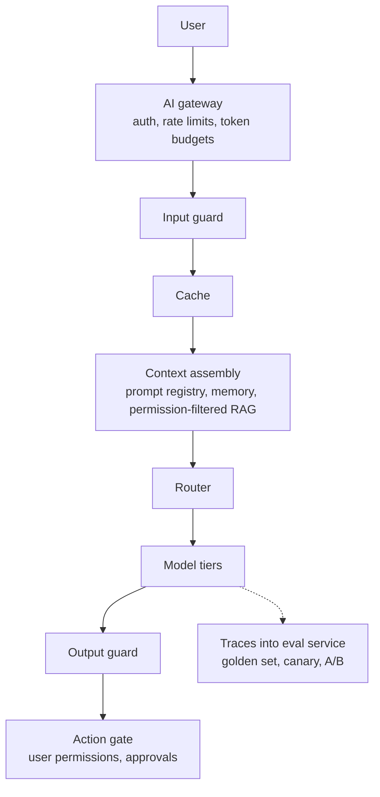

# AI & GenAI Handbook — Interview Edition

## How to use this edition
This is the night-before-the-interview version of the 16-chapter *AI & GenAI Handbook*: every chapter compressed to definitions, numbers, likely questions and traps. Nothing here is new — every fact comes from the full book (facts dated September 2026; model names, prices and regulatory dates move, so re-check them before quoting).

- **Each chapter has the same six blocks:** Must-know (one-line definitions) · Key facts & numbers (tables and formulas) · Code to remember (only where interviewers ask you to write it) · In the interview (likely Q → short A) · Gotchas (mistake → correct idea) · TL;DR.
- **Revision in 30 minutes:** read the Top 25 below, then every chapter's TL;DR, then the Last-minute checklist.
- **Revision in 3 hours:** read chapters 3, 4, 7, 8, 9, 11, 12 and 13 in full — they carry the formulas and the system-design framework. Chapter 14 turns each case study into five lines (three for the model-centric Part II cases); say them aloud against a clock.
- **Drill rule:** cover the answer, say it aloud, and count it right only if the *deciding variable* or core mechanism came out without peeking.
- **Where the big tables are:** attention/transformer math (Ch 3), KV cache and GPU memory sizing (Ch 4, Ch 11), RAG stages and metrics (Ch 7), fine-tuning vs RAG (Ch 8), agent patterns (Ch 9), TTFT/TPOT serving metrics (Ch 11), guardrail layers and EU AI Act timeline (Ch 12), the seven-step design framework (Ch 13), case summaries (Ch 14), decision cheat sheets and red flags (Ch 15).
- Glossary (book Ch 15.7) is omitted: terms are defined in each Must-know list.

## Top 25 questions across the book
| # | Question | One-line answer | Ch |
|---|---|---|---|
| 1 | What is a rational agent? | Picks the action that maximises expected performance given its percepts; specify the task with PEAS. | 1 |
| 2 | BFS, DFS or A\*? | BFS fewest steps, big memory; DFS little memory, no guarantees; A\* (f = g + h) optimal with admissible h, memory-hungry. | 2 |
| 3 | What is a token and why care? | BPE subword (~4 English chars); context, latency and price are all counted in tokens. | 3 |
| 4 | Write attention and explain √d_k. | softmax(QKᵀ/√d_k)·V; scaling keeps score variance ≈ 1 so softmax doesn't saturate. | 3 |
| 5 | Encoder vs decoder vs encoder-decoder? | BERT understands (bidirectional), GPT generates (causal), T5/Whisper transform (cross-attention). | 3 |
| 6 | How is an LLM trained end to end? | Next-token pretraining → SFT → RLHF or DPO → RL on verifiable rewards for reasoning. | 4 |
| 7 | What did Chinchilla show? | ~20 tokens per parameter is compute-optimal; C ≈ 6ND; teams over-train small models to cut serving cost. | 4 |
| 8 | Temperature vs top-p? | Temperature reshapes logits; top-p keeps the smallest set with cumulative prob ≥ p; neither guarantees determinism. | 4 |
| 9 | Why do LLMs hallucinate? | Trained for plausible text and rewarded for guessing; ground, cite, allow abstention, verify. | 4, 12 |
| 10 | What is the KV cache and what does it cost? | Stored K/V of past tokens; 2 × layers × KV heads × head_dim × bytes per token × users × context — usually the concurrency limit. | 4, 11 |
| 11 | How do you get reliable JSON? | Schema-constrained structured outputs or strict tools, then validate values; else validate-and-retry. | 5, 6 |
| 12 | Walk through the tool-use loop. | Schema'd tools → model requests → runtime validates, authorises, runs → result by id → repeat until done, with a step cap. | 6, 9 |
| 13 | Which API errors do you retry? | 429, 5xx, timeouts with exponential backoff + jitter and retry-after; never 400/401/403; idempotent side effects. | 6 |
| 14 | What is MCP? | Open JSON-RPC protocol: servers expose tools, resources, prompts; M×N integrations → M+N; servers run with your permissions. | 6 |
| 15 | Describe a RAG pipeline. | Ingest (parse, chunk, embed, index with ACLs) → rewrite → hybrid retrieve → rerank → cited generation → post-check. | 7 |
| 16 | Why hybrid retrieval? | BM25 catches IDs and exact terms, vectors catch paraphrase; fuse by rank with RRF (k = 60), rerank with a cross-encoder. | 7 |
| 17 | Where are permissions enforced in RAG? | Inside retrieval (and tools), with current ACLs, fail closed — never in the prompt or after generation. | 7, 12 |
| 18 | RAG or fine-tuning? | Missing/changing/private facts → RAG; format/tone/skill → prompt then fine-tune; too expensive → tuned small model + router. | 8 |
| 19 | How do you evaluate outputs with no single right answer? | Pyramid: programmatic checks → calibrated LLM judge (κ vs humans) → experts, over a versioned golden set run on every change. | 8 |
| 20 | Agent or workflow? | Can you draw the flowchart at design time? Yes → workflow; agent only for the runtime-discovered part, bounded. | 9 |
| 21 | How do you make an agent with real permissions safe? | Model proposes, runtime decides: user-scoped least privilege, consequence tiers, action gate, human approval for irreversible actions. | 9 |
| 22 | TTFT vs TPOT? | TTFT = queue + prefill (compute-bound); TPOT = decode per token (bandwidth-bound); E2E ≈ TTFT + TPOT × (n − 1). | 11 |
| 23 | In what order do you cut inference cost? | Avoid work (cache, route, trim) → run faster (batching, prefix cache, speculative) → shrink (quantise, distil). | 11, 15 |
| 24 | What guardrail layers would you ship? | Input gate → hardened least-privilege assembly → output gate → action gate, plus CI red-teaming and kill switches. | 12 |
| 25 | Outline an AI system design interview. | Frame 3 · success 5 · data 5 · model 5 · serving 12 · keep it working 8 · failures & cost 5 · slack 2 minutes. | 13, 14 |

## 1. The World of AI
What AI is, the rational-agent view, history, narrow vs general, the AI family tree, myths and real-world constraints.

### Must-know
- **Rational agent** — perceives via sensors, acts via actuators, picks the action with the best *expected* performance given what it knows (rational ≠ all-knowing).
- **Four definitions** — thinking/acting × humanly/rationally; engineering mainstream = *acting rationally*.
- **PEAS** — Performance, Environment, Actuators, Sensors: specify any task before choosing a technique.
- **Environment properties** — observable?, single/multi-agent, deterministic/stochastic, episodic/sequential, static/dynamic, discrete/continuous, known/unknown rules.
- **Value alignment problem** — the objective you give a machine may differ from what you really want (vacuum rewarded for "dirt sucked" dumps and re-sucks dirt).
- **Turing test** — measures imitation, not usefulness or understanding; **ELIZA effect** = attributing understanding to human-looking output; **Chinese Room** (Searle) = symbol manipulation ≠ understanding.
- **Family tree** — AI ⊃ ML ⊃ DL ⊃ GenAI ⊃ LLMs; **agentic AI** = LLMs in a plan–act–observe loop with tools.
- **Symbolic vs statistical** — hand-written rules (transparent, brittle) vs learned parameters (handles messy input, hard to explain); real products combine both.
- **Narrow AI** — everything deployed today; **AGI** — hypothetical, no agreed definition; foundation models are broad but not reliable at everything.
- **Hallucination** — fluent, confident, false output.

### Key facts & numbers
| Year | Milestone |
|---|---|
| 1943 / 1950 | McCulloch–Pitts neuron / Turing's imitation game |
| 1956 | Dartmouth workshop names the field |
| ~1974–80, ~1987–93 | Two AI winters (combinatorial explosion; brittle expert systems, Lisp-machine collapse 1987) |
| 1986 | Backprop popularised (Rumelhart, Hinton, Williams) |
| 1997 | Deep Blue beats Kasparov (search, not learning) |
| 2012 | AlexNet: ~15% vs ~26% top-5 error on ImageNet (data + GPUs + tricks) |
| 2016 | AlphaGo beats Lee Sedol 4–1 (deep nets + tree search) |
| 2017 | Transformer ("Attention Is All You Need") |
| 2020 | GPT-3 (175B params); AlphaFold 2 at CASP14 |
| 30 Nov 2022 | ChatGPT (~100M users in ~2 months) |
| 2023→ | Multimodal, reasoning models (2024), tool-using agents |

| Constraint | Practical response |
|---|---|
| Data | Audit first; collect production feedback |
| Cost | Pilot small; smallest model that meets quality |
| Maintenance / drift | Budget as ongoing cost; monitor continuously |
| Latency | Stream, shorten outputs, cache, smaller models |
| Reliability | Evaluate, fallbacks, human in the loop for high stakes |
| ROI | Define a concrete metric up front |
| Security / regulation | Threat-model, restrict tools, audit logs (EU AI Act in force Aug 2024) |

### In the interview
**Q:** Define AI. **A:** Building systems that act intelligently; the working view is the rational agent that maximises an expected performance measure, specified with PEAS.

**Q:** Why not use the Turing test as the definition? **A:** It rewards imitation and tricks; a calculator is superhuman at arithmetic but fails it.

**Q:** What caused the AI winters? **A:** Results fell short of predictions (combinatorial explosion, brittle expert systems) and funding was cut.

**Q:** Why did deep learning take off in 2012, not 1990? **A:** Large labelled data (ImageNet), GPU compute and better training tricks arrived together.

**Q:** Is ChatGPT AGI? **A:** Under most definitions no — broad and general-purpose, but with clear failure modes.

**Q:** Is a rules engine AI? **A:** Yes (symbolic AI), but not ML. RL is a branch of ML; deep RL combines it with DL.

**Q:** When should you not use AI? **A:** When a simple rule does the job, errors are unacceptable and uncheckable, there is no data/eval, or cost per request exceeds value.

**Q:** Why do agents fail more than single calls? **A:** Errors compound across steps.

**Q:** How do you vet an AI claim? **A:** Check date, primary source, benchmark/baseline/metric, possible test leakage, independent confirmation.

### Gotchas
- "AI" is not one technology → name the technique ("gradient-boosted classifier", "an LLM").
- Fluency = understanding → fluent text is good pattern modelling, not grounded knowledge.
- GenAI for tabular prediction → classic ML is usually cheaper and more accurate.
- Deep learning replaced everything → search, logic, optimisation and classic ML still run much of industry.
- Budgeting only for the build → running, monitoring and retraining cost more over time.

### TL;DR
AI = rational agents; describe the task with PEAS first. Progress came from ideas + data + compute; all deployed AI is narrow. Plan for data, cost, latency, reliability and ROI from day one.

## 2. Classical AI and Search
Problem formulation, uninformed and informed search (A\*), local search, minimax/alpha-beta, MCTS, CSPs.

### Must-know
- **Problem formulation** — states, initial state, actions, transition model, goal test, action cost. Algorithms differ only in *which frontier node they expand next*.
- **Reached/closed set** — without it, search loops between states forever.
- **BFS** (FIFO queue) — fewest steps, O(bᵈ) memory; optimal only with equal step costs.
- **DFS** (stack) — O(b·m) memory, not complete or optimal. **IDDFS** — BFS guarantees with DFS memory (re-expanding shallow levels is a small constant factor).
- **UCS = Dijkstra** — priority queue on g; optimal for positive costs; fails with negative edges (use Bellman–Ford).
- **A\*** — f = g + h. **Admissible** h (never overestimates) → optimal; **consistent** h (triangle inequality) → graph search never reopens a node. h = 0 → Dijkstra.
- **Greedy best-first** — f = h: fast, not optimal. **Weighted A\*** — f = g + w·h, bounded suboptimality.
- **Local search** — keeps one state; hill climbing (stuck on local optima, ridges, plateaus), random restarts, **simulated annealing** (accept worse move with prob e^(−Δ/T)), **genetic algorithms** (selection, crossover, mutation). Not complete.
- **Minimax** — MAX takes max, MIN takes min. **Alpha-beta** — same answer, prunes with α/β bounds; best case O(b^(m/2)) ≈ twice the depth.
- **Horizon effect** — evaluating mid-capture; fixed with quiescence search. **Expectiminimax** for dice (chance nodes average).
- **MCTS** — selection (UCB1), expansion, simulation, back-propagation; play the **most-visited** move. **UCB1** = w/n + c·√(ln N / n), c ≈ 1.4.
- **AlphaGo** — MCTS + policy network + value network, supervised + self-play RL; AlphaGo Zero removed human data.
- **CSP** — variables + domains + constraints; backtracking with **MRV** ("fail first"), forward checking, **AC-3** arc consistency.

### Key facts & numbers
| Algorithm | Frontier | Complete | Optimal | Time | Space |
|---|---|---|---|---|---|
| BFS | FIFO | Yes | Equal costs | O(bᵈ) | O(bᵈ) |
| UCS | PQ on g | Yes (cost ≥ ε) | Yes | O(b^(1+⌊C\*/ε⌋)) | same |
| DFS | Stack | No | No | O(bᵐ) | O(b·m) |
| IDDFS | Stack, growing ℓ | Yes | Equal costs | O(bᵈ) | O(b·d) |
| Bidirectional BFS | 2 queues | Yes | Equal costs | O(b^(d/2)) | O(b^(d/2)) |
| A\* | PQ on g+h | Yes | Admissible/consistent h | depends on h | keeps all nodes (main weakness → IDA\*, SMA\*) |

| | Alpha-beta | MCTS |
|---|---|---|
| Needs eval function | Yes | No (play-outs) or value net |
| Large branching (Go b≈250) | Poor | Good |
| Exact | Yes to its depth | Statistical, converges |

- Grid heuristics: 4-connected → **Manhattan**; 8-connected → **octile/Chebyshev** (Manhattan becomes inadmissible).
- 20-queens: naive backtracking ~200,000 assignments vs MRV + forward checking 145.

### Code to remember
```python
def astar(start, goal, nbrs, h):
    pq, g, parent = [(h(start), 0, start)], {start: 0}, {start: None}
    while pq:
        f, gc, n = heapq.heappop(pq)
        if n == goal: return path(parent, n)       # test on POP, not push
        if gc > g[n]: continue                      # stale entry
        for m, c in nbrs(n):
            if gc + c < g.get(m, inf):
                g[m], parent[m] = gc + c, n
                heapq.heappush(pq, (gc + c + h(m), gc + c, m))
```

### In the interview
**Q:** BFS vs DFS vs IDDFS vs UCS? **A:** BFS fewest steps, big memory; DFS small memory, no guarantees; IDDFS gets both for equal costs; UCS is cheapest path for positive costs.

**Q:** When is A\* optimal? **A:** With admissible h (tree search) or consistent h (graph search).

**Q:** A\*'s main weakness? **A:** Memory — it stores every generated node; use IDA\*/SMA\*.

**Q:** Does alpha-beta change the result? **A:** No, only the work; good move ordering makes cut-offs happen sooner.

**Q:** What does temperature do in simulated annealing? **A:** Controls how often worse moves are accepted — high explores, low exploits; cool too fast and it becomes hill climbing.

**Q:** Why MCTS for Go? **A:** Huge branching and no good hand-written evaluation; MCTS grows the tree selectively and is anytime.

**Q:** What does c in UCB1 control? **A:** The exploration–exploitation balance.

**Q:** Grid pathfinding design? **A:** A\* with Manhattan, parent pointers, closed set, PQ on g + h with a tie-breaker.

### Gotchas
- Goal-test UCS/A\* on generation → test when **popped**, or you may return a costlier path.
- BFS on weighted graphs → not cheapest; use UCS.
- Manhattan with diagonal moves → inadmissible; use octile/Chebyshev.
- Recursive DFS on deep graphs → Python recursion limit (~1,000); use an explicit stack.
- Store full paths in the frontier → store parent pointers.
- MCTS: pick final move by win rate on few visits → use visit counts.
- Report one lucky local-search run → run several seeds.

### TL;DR
Search = formulate, then expand from a frontier. A\* (g + h, admissible h) is the workhorse; alpha-beta for two-player games; MCTS + learned networks for huge games; local search when only the final state matters.

## 3. Transformers and Embeddings
Tokens, embeddings, positional encoding, self-attention, multi-head attention, the block, causal masking, encoder vs decoder.

### Must-know
- **Token** — subword unit; ~**4 English characters** each. Limits, latency and price are all in tokens.
- **BPE** — start from bytes/characters, repeatedly merge the most frequent adjacent pair until the target vocab size; nothing is out-of-vocabulary. **WordPiece** (BERT, `##` continuation) and **Unigram/SentencePiece** (T5) are alternatives.
- **Use the model's own tokenizer** — token IDs from one model mean nothing to another.
- **Embedding** — dense learned vector; the embedding layer is a lookup table of shape vocab × d_model. Closeness = meaning.
- **Cosine similarity** — angle only; on normalised vectors it equals the dot product (vector DBs exploit this).
- **Static vs contextual** — word2vec/GloVe: one vector per word; transformer hidden states: one per occurrence ("river bank" vs "bank loan").
- **Positional encoding** — attention is permutation-invariant, so order must be injected: sinusoidal (2017), learned absolute (BERT, GPT-2 — hard length cap), **RoPE** (rotates Q and K; relative distance; most modern LLMs), ALiBi (distance penalty).
- **Self-attention** — project each token to Q (what I look for), K (how I advertise), V (what I pass on); weights = softmax per query row.
- **Multi-head** — several narrow heads in parallel, concatenated and mixed by **W_O**; cost ≈ one full-width head.
- **GQA / MQA** — share K/V across groups / all heads to shrink the KV cache (Llama 2 70B, Llama 3, Mistral use GQA).
- **Block** — x + Attn(LN(x)), then x + FFN(LN(x)) (pre-norm; often RMSNorm; SwiGLU FFN). Attention mixes tokens; FFN works per token.
- **Causal mask** — set future scores to **−∞ before softmax**; trains every position in one pass.
- **MoE** — several expert FFNs, a router picks a few per token: more parameters at similar per-token compute.

### Key facts & numbers
| Formula / quantity | Value |
|---|---|
| Attention | softmax(Q·Kᵀ / √d_k) · V |
| Why √d_k | keeps score variance ≈ 1 so softmax doesn't saturate |
| Attention cost | O(T²·d) time, O(T²) score memory per head |
| RNN cost per layer | O(T·d²), T sequential steps |
| Attention params | ≈ 4·d_model² (Q, K, V, O) |
| FFN params | ≈ 8·d² (hidden 4·d; SwiGLU uses ≈ 8/3·d with 3 matrices) |
| Params per block | ≈ **12·d²**, ~⅔ in FFN |
| GPT-3 check | 12 × 12,288² × 96 ≈ 174B (advertised 175B) |
| Cosine | a·b / (‖a‖‖b‖), range −1…1 |
| Embedding storage | 1M docs × 3,072 floats × 4 B ≈ 12 GB |

| Tokenizer | Vocab |
|---|---|
| GPT-2 byte-level BPE | 50,257 |
| Llama 1/2 SentencePiece BPE | 32K |
| Llama 3 | ~128K |
| BERT WordPiece | ≈30K |

| | Encoder-only | Decoder-only | Encoder-decoder |
|---|---|---|---|
| Attention | Bidirectional | Causal | Bi + causal + cross-attention |
| Objective | Masked LM (~15% hidden) | Next token | Span corruption / denoising |
| Best at | Classification, NER, embeddings, reranking | Generation; everything at scale | Translation, summarisation, speech |
| Examples | BERT (110M/340M), RoBERTa | GPT, Claude, Llama | T5, BART, Whisper |

### Code to remember
```python
def attention(Q, K, V, causal=True):
    d_k = Q.shape[-1]
    scores = Q @ K.T / np.sqrt(d_k)                 # (T, T)
    if causal:
        scores = np.where(np.tril(np.ones_like(scores)) == 1, scores, -np.inf)
    w = np.exp(scores - scores.max(-1, keepdims=True))
    w /= w.sum(-1, keepdims=True)                   # softmax per query row
    return w @ V
```

### In the interview
**Q:** How does BPE work and why subwords? **A:** Merge most-frequent pairs until vocab size; common words stay whole, rare ones split — no unknown tokens, handles typos and code.

**Q:** Why do LLMs struggle to count letters? **A:** They see token IDs, not characters.

**Q:** Why do non-English prompts cost more? **A:** English-heavy tokenizers split other scripts into more tokens.

**Q:** Why did GPT-2 cap at 1,024 tokens? **A:** Learned absolute positions — no embedding row for position 1,025.

**Q:** Explain self-attention. **A:** Q·K dot products, scaled by √d_k, softmaxed per row, weight the values; any two positions connect in one step, in parallel, but O(T²).

**Q:** MQA vs GQA? **A:** MQA shares one K/V for all heads (smallest cache, some quality loss); GQA shares per group (middle ground).

**Q:** Why residuals and pre-LN? **A:** Residuals give easy gradient flow (layers learn updates); pre-LN is more stable for deep stacks.

**Q:** Is the causal mask needed at inference? **A:** During prefill yes; when decoding one new token against a KV cache there is no future to hide.

**Q:** Which model for semantic-search embeddings? **A:** Usually an encoder-based embedding model — cheaper and trained for it.

### Gotchas
- Budget in words/characters → limits and prices are in tokens.
- Compare vectors from different embedding models → each has its own space; re-embed on switch.
- Raw dot product on unnormalised vectors → biased to long vectors.
- Similar embeddings = same meaning → "drug is safe" / "not safe" can be close; use hybrid search for exact IDs.
- Forget √d_k, softmax on wrong axis, mask with 0 or after softmax → all break attention.
- Attention weights = explanation → they show information flow, not *why*.
- "GPT uses the encoder" → GPT is decoder-only.
- Big LLM for high-volume classification → a small fine-tuned encoder is far cheaper.

### TL;DR
Text → subword tokens → embeddings (+ positions, RoPE) → N blocks of softmax(QKᵀ/√d_k)V + FFN with residuals → next-token logits. ≈12·d² params per block; GQA shrinks the KV cache; LLMs are decoder-only.

## 4. Large Language Models
Next-token prediction, pretraining and scaling laws, SFT/RLHF/DPO, decoding, context windows, prefill/decode, limits, reasoning, multimodal, open vs closed.

### Must-know
- **LLM** — giant decoder-only transformer trained to predict the next token; stateless, generates one token at a time, priced per token, sometimes confidently wrong.
- **Self-supervised training** — targets are inputs shifted by one; loss = cross-entropy; the causal mask makes every position a training example.
- **Perplexity** — e^(average cross-entropy); lower is better; "effective number of choices".
- **Scaling laws** — loss falls as a power law in N (params), D (tokens), C (compute); each constant gain needs a *multiplicative* compute increase.
- **Chinchilla** — compute-optimal ≈ **20 tokens per parameter**; in practice small models are **over-trained** (Llama 3 8B on 15T) because inference cost dominates.
- **Base → assistant** — pretrain → **SFT** (imitate good conversations) → preference tuning (**RLHF**: reward model + PPO + KL penalty; or **DPO**: simple loss on chosen/rejected pairs) → **RLVR** (verifiable rewards) for reasoning.
- **Post-training shapes behaviour, not knowledge**; side effects: **sycophancy**, verbosity.
- **Decoding** — greedy (argmax), beam (k best sequences), temperature (divide logits by T), top-k (fixed count), **top-p** (smallest set with cumulative prob ≥ p).
- **Stateless** — the app assembles context each call; windows ≈1M tokens on 2026 flagships but finite, costly and imperfectly used ("Lost in the Middle", 2023).
- **Prefill vs decode** — prefill processes the prompt in parallel (compute-bound → **TTFT**); decode is sequential (memory-bandwidth-bound → **TPOT**); **KV cache** stores past K/V to avoid recomputation.
- **Reasoning models** — spend "thinking" tokens before answering, trained with RL on checkable problems; knob = thinking budget / effort. Not for high-volume simple tasks.
- **Multimodal** — encoders turn images/audio into token-like vectors the LLM attends over.
- **Open-weight ≠ open-source** — weights released, usually not data/code.

### Key facts & numbers
| Formula | Meaning |
|---|---|
| C ≈ 6·N·D | Training FLOPs (≈2 forward + 4 backward per param per token) |
| D ≈ 20·N | Chinchilla compute-optimal |
| KV bytes/token = 2 × layers × KV heads × head_dim × bytes | e.g. 2×40×8×128×2 = 160 KiB |

| Model | Params | Tokens |
|---|---|---|
| GPT-3 (2020) | 175B | ~300B |
| Chinchilla (2022) | 70B | 1.4T (beat a 280B model on 300B) |
| Llama 2 (2023) | 7–70B | 2T |
| Llama 3 (2024) | 8–405B | 15T+ |

| | RLHF | DPO | RLVR |
|---|---|---|---|
| Reward model | Yes | No | No (verifier) |
| Complexity | High (several models, unstable RL) | Low | Medium |
| Data | Rankings | Preference pairs | Checkable problems |
| Use | Frontier chat | Open models | Math, code, reasoning |

| Task | Decoding |
|---|---|
| Extraction, classification, code | T = 0 / low (or model default for reasoning models) |
| Chat | Provider default (T ≈ 0.7–1 + top-p) |
| Creative | T ≈ 1 |
| Translation (seq2seq) | Beam search |

| Limit | Mitigation |
|---|---|
| Hallucination | Retrieval + citations, allow "I don't know", verification, human review |
| Knowledge cutoff | Retrieval, web search, give current date |
| No private data | Authorised retrieval/tools with access control |
| Reasoning brittleness | Reasoning mode, calculator/code tools |
| Non-determinism | Low T, semantic tests, validators |
| Prompt injection | Label untrusted content, least-privilege tools, output checks |

| | Closed API | Open-weight |
|---|---|---|
| Quality | Usually frontier | Gap narrowed 2024–25 |
| Data control | Goes to vendor | On-prem / on-device |
| Customisation | Prompting, some fine-tuning | Full FT, LoRA, quantisation |
| Cost | Per token, no idle | Hardware; cheap at steady high volume |
| Versioning | Vendor retires models | Pin forever |

Dated landscape (Sep 2026): GPT-5 Aug 2025; Claude 4 May 2025, Claude 5 generation 2026 (1M context except Haiku 4.5 at 200K); Gemini 3 Nov 2025; Llama 4 (MoE) Apr 2025; DeepSeek-R1 Jan 2025 (MIT); Qwen3 Apr 2025. Some newest models reject `temperature`/`top_p` — control via prompt, structured output and effort.

### In the interview
**Q:** How is an LLM trained? **A:** Next-token prediction with cross-entropy over trillions of tokens, then SFT and preference tuning.

**Q:** Why 6ND? **A:** ~2 FLOPs per param per token forward, ~4 backward.

**Q:** Why over-train small models? **A:** Inference cost over the model's lifetime dominates training cost.

**Q:** Why the KL penalty in RLHF? **A:** Stops drift into reward-model exploits (reward hacking) and keeps language quality.

**Q:** Why is DPO popular? **A:** Stable, cheap, no reward model to train or hold in memory.

**Q:** Top-k vs top-p? **A:** Fixed count vs count adapted to model confidence.

**Q:** Is T = 0 deterministic? **A:** Nearly — batching and GPU floating-point can still change outputs; validate and cache.

**Q:** 200K window — why not put everything in? **A:** Cost, latency and missed evidence in long contexts; retrieve and summarise deliberately.

**Q:** Slow first token vs slow stream? **A:** Slow first token = prefill/queueing (long prompt); slow stream = decode (model size, load, batch).

**Q:** Why does GQA matter? **A:** Fewer KV heads → smaller cache → more concurrent users, less memory traffic.

### Gotchas
- LLM retrieves stored sentences → it generates; hence novel text and false facts.
- Lower loss = better product → usefulness depends on post-training and task fit.
- More parameters always better → only if data/compute keep up.
- Alignment adds knowledge → it shapes behaviour; knowledge is from pretraining.
- Tune temperature and top-p together → change one and measure.
- Beam search for chat → generic text at k× cost.

### TL;DR
Decoder-only, next-token, C ≈ 6ND, ~20 tokens/param. Pretrain → SFT → RLHF/DPO → RLVR. Prefill → TTFT, decode → TPOT, KV cache trades memory for speed. Treat the model as a stateless, sampled, per-token-priced component that needs grounding and validation.

## 5. Prompt Engineering
Prompts as specifications: anatomy, few-shot, system prompts, delimiters, structured output, chain-of-thought, self-consistency, chaining, ReAct, troubleshooting, evaluation.

### Must-know
- **Anatomy** — role + task (clear verb) + context/audience + constraints + format + examples; explain the *reason* behind rules so the model generalises intent.
- **Long documents first, question last**; separate instructions from data with **delimiters / XML tags**, refer to them by name, escape untrusted content.
- **Zero-shot first**; add **few-shot** (diverse, tagged examples) when format or judgement is off. Examples beat instructions when they conflict.
- **System prompt** — stable role, rules, output conventions; per-request data goes in the user message. A role shifts tone/priorities, **it does not add knowledge**.
- **Structured output** — show the schema, validate every response, retry with the exact validation error (capped) and a fallback; prefer native structured-output mode (constrained decoding) but still validate business rules in code.
- **Chain-of-thought** — reason before answering, reasoning and answer in separate tags/fields; with reasoning models set *effort* rather than scripting steps. Written reasoning may not be faithful.
- **Self-consistency** — sample n reasoning paths, majority-vote the short final answer; n× cost; useless for open-ended outputs.
- **Prompt chaining** — narrow steps with checks between them: easier to debug and test, slightly slower.
- **ReAct** — Thought → Action → Observation loop grounded in tool results; bound the loop, never execute model output blindly.
- **Iterative loop** — draft → evaluate → change one or two things → compare → save; version-control prompts, re-test on model change.

### Key facts & numbers
| Pitfall | Fix |
|---|---|
| Vague ask | Verb, audience, format, length, example |
| Overloaded prompt | Split into a chain |
| Hallucination | "Answer only from `<documents>`; else say not found"; quote first; retrieval |
| Overlong context | Retrieve relevant chunks, docs first, summarise history |
| Conflicting rules | Remove; state priority |
| Examples over-copied | Diversify or describe the pattern |
| Format drift | Structured outputs + validate + retry |
| Stale knowledge | Supply current info and the date |
| Prompt injection | Tag/escape untrusted text, least-privilege tools, validate outputs |

| | Zero-shot | Few-shot |
|---|---|---|
| Cost | Short | Examples paid every call (caching helps) |
| Consistency | Depends on instructions | Much higher |
| Risk | Misread task | Over-copying surface pattern |

### Code to remember
```text
<documents>{docs}</documents>
Answer using only the documents. Quote the supporting passage first.
If the answer isn't there, reply "Not found in the provided documents."
Question: {q}
```

### In the interview
**Q:** What makes a good prompt? **A:** Role, precise task, context/audience, constraints, format, an example; delimiters for data; iterate against a test set, not by feel.

**Q:** Biggest single improvement to a weak prompt? **A:** Usually context plus an explicit output format.

**Q:** How do you get reliable JSON? **A:** Schema + example in prompt, native structured outputs, validate, retry with the error, fallback.

**Q:** When use self-consistency? **A:** Short, checkable answers where errors scatter; not for essays or high-volume low-stakes tasks.

**Q:** How do you reduce hallucination via prompting? **A:** Ground in provided sources, require quotes, allow "not found".

**Q:** How do you evaluate a prompt? **A:** Success criteria → held-out test set → automatic graders + LLM judge + humans; track accuracy, format validity, tokens and latency; re-run on every model upgrade.

**Q:** System vs user message? **A:** System = stable rules and role; user = per-request data.

### Gotchas
- ALL-CAPS "YOU MUST" → modern models over-apply shouted rules; phrase normally.
- "You are a world-class lawyer" → adds tone, not reliability.
- "Respond in JSON" is enough → the rare failure breaks production; validate.
- Enums in the prompt but not the validator → drift slips through.
- Tune on the same three examples you test on → overfit prompt.
- Parse answers out of free-form reasoning → use dedicated tags/fields.

### TL;DR
Write prompts as specifications, separate data from instructions, validate structured output, chain and ground when needed, and evaluate prompt versions on a test set.

## 6. Building LLM Apps in Python
The API call, streaming, structured output, the tool-use loop, token cost, retries, caching, conversation memory and MCP.

### Must-know
- **Stateless API** — request = model + system + messages + output cap (+ tools); response = content **blocks** + **stop reason** + **usage**. Keys stay server-side; model id in config.
- **Stop reason** — `max_tokens`/`length` means truncated; `tool_use` means run tools; `end_turn` means done.
- **Streaming** — for chat UX (perceived latency); **buffer** when output must be checked first (regulated answers, JSON to parse, citations) — you can't take back streamed words.
- **Structured output levels** — prompt-only (no guarantee) → **JSON mode** (syntax only) → **structured outputs** (schema-constrained decoding) → **strict tool use**. Shape can be guaranteed, truth cannot.
- **Tool-use loop** — describe tools with JSON Schema → model emits tool-call blocks → your code validates args, runs with least privilege → returns results **by id** (errors too) → loop until `end_turn`, with step cap, timeouts, approval for side effects. The model never executes code.
- **Cost** = tokens in × price in + tokens out × price out; tool definitions, system prompt and whole history count as input **every call**; measure **cost per completed task**.
- **Retries** — fail fast on 400/401/403/404; retry 408/409/429/5xx/529 and connection errors with capped **exponential backoff + jitter**, honour `retry-after`; make side effects **idempotent** (idempotency keys).
- **Prompt caching** — provider stores the KV state of an exact **prefix**; stable content first (tools, system, docs, examples), variable last; verify with usage fields.
- **Response caching** — exact (hash of model+prompt+params) or semantic (embedding similarity); key on model version, prompt version and **permission scope**.
- **Memory** — you own it: keep system prompt, recent turns verbatim, summary of older turns, durable fact store, under a token budget.
- **MCP** — open JSON-RPC protocol; host runs one client per server; servers expose **tools** (model-controlled), **resources** (app-controlled, URI, read-only), **prompts** (user-controlled). Turns M×N integrations into M+N.

### Key facts & numbers
| Field | Anthropic Messages | OpenAI Responses | Chat Completions |
|---|---|---|---|
| System | `system` | `instructions` | system/developer message |
| Output cap | `max_tokens` (required) | `max_output_tokens` | `max_completion_tokens` |
| Stop strings | `stop_sequences` | — | `stop` |
| State | resend history | `previous_response_id` / conversations | resend history |

| Prompt caching (Sep 2026) | Value |
|---|---|
| Anthropic cache write | 1.25× input (5-min TTL), 2× (1-hour) |
| Anthropic cache read | 0.1× most models (0.05× Opus 5.5, 0.025× Fable 5.1) |
| Break-even | 2 requests in window: 1.25 + 0.1 = 1.35 vs 2.0 |
| OpenAI | Automatic for prompts ≥ 1,024 tokens; cached input 0.1× on newest models |
| Example | 3,000-token cached prefix cut bill 47% |

| Memory strategy | Trade-off |
|---|---|
| Full history | Simple; cost grows each turn |
| Sliding window | Bounded; forgets early facts |
| Summary + window | Keeps gist; summaries distort |
| Fact memory | Precise, persistent; privacy duties |
| Retrieval memory | Scales; more moving parts |

MCP facts: transports **stdio** (local) and **Streamable HTTP** (remote, OAuth); the 2026-07-28 revision made it **stateless** (no handshake, version in every request) and deprecated **sampling**; clients can request user input via **elicitation**.

### Code to remember
```python
while True:
    r = client.messages.create(model=M, max_tokens=1024, tools=TOOLS, messages=msgs)
    msgs.append({"role": "assistant", "content": r.content})   # keep the tool_use
    if r.stop_reason != "tool_use": break
    results = [{"type": "tool_result", "tool_use_id": b.id,
                "content": run_tool(b.name, validate(b.input))}
               for b in r.content if b.type == "tool_use"]
    msgs.append({"role": "user", "content": results})          # all results, one message
    steps += 1; assert steps < MAX_STEPS
```

### In the interview
**Q:** Describe an LLM API call. **A:** Stateless: model, system, history, output cap in; blocks, stop reason, usage out; check stop reason, log usage.

**Q:** JSON mode vs structured outputs? **A:** JSON mode guarantees syntax; structured outputs guarantee the schema; content can still be wrong.

**Q:** How do you stop a runaway tool loop? **A:** Max steps, max tokens/cost per task, per-tool timeouts, detect repeated identical calls.

**Q:** Why is tool output a security risk? **A:** It's untrusted text in the prompt — prompt injection; defend with permissions, confirmation, isolation.

**Q:** Why jitter? **A:** Avoid synchronised retry waves; don't retry in several layers (retry storm).

**Q:** What rate limits exist besides RPM? **A:** Input and output tokens per minute, per model.

**Q:** Why did prompt caching not hit? **A:** A timestamp/ID in the prefix, reordered tools, switched model, or prefix below the minimum cacheable length.

**Q:** Danger of semantic caching? **A:** "Cancel my order" ≈ "cancel my subscription"; cross-user leakage without permission-scoped keys.

**Q:** Tools vs resources in MCP? **A:** Tools are model-invoked actions; resources are app-controlled read-only data by URI.

**Q:** When not to use MCP? **A:** One app with a couple of internal functions — call directly.

### Gotchas
- Read `content` as a string → it's a list of typed blocks.
- Drop the assistant tool_use message, or split parallel results → API rejects results.
- Pass model-written strings into SQL/shell → validate types and ranges.
- Retry a non-idempotent "send email" → duplicates.
- Stream JSON into a parser expecting a full document → buffer.
- Trim history between a tool call and its result, or drop the system prompt → broken context.
- Install untrusted MCP servers → **tool poisoning**, rug-pull tool changes; scope access, require consent.

### TL;DR
Stateless call → check stop reason → validate structured output → bounded tool loop with least privilege → backoff with jitter → stable prefix for caching → you own memory → MCP to share integrations, treating servers as code with your permissions.

## 7. Embeddings, Vector Databases and RAG
RAG = search your documents, then answer from what you found: ANN indexes, vector DBs, ingestion, the request path, hybrid + rerank, grounding, permissions, evaluation.

### Must-know
- **RAG is two systems** — retrieval and generation; evaluate them separately. A cited answer is not necessarily a correct one; "hallucination" is often evidence never retrieved.
- **Encoder compatibility** — query and index must use the same encoder version; an upgrade means re-embed and rebuild with rollback.
- **ANN** — approximate nearest neighbour trades a little recall for speed/memory. **HNSW** (graph; M, efSearch) is the default; **IVF** (clusters; nprobe; needs retraining); **PQ** compresses for billions of vectors, re-rank exactly. Missed neighbours never reach later stages.
- **Vector DB** = ANN index + metadata filtering *during* search + updates/deletes + replication/backups. It is a **rebuildable derived artefact**, not the source of truth. Prefer what you already run (pgvector, OpenSearch) until measurements say otherwise.
- **Chunking** — structure-aware, a few hundred tokens (start ~300–500) with overlap and **breadcrumbs**; tune on a dev set. **Contextual retrieval** prefixes chunks with where they sit. **Small-to-big** — match small chunks, give the generator the parent section.
- **Hybrid search** — BM25 (identifiers, codes, names) + vectors (paraphrase, concepts) in parallel, fused with **RRF** by rank (score scales don't matter).
- **Bi-encoder vs cross-encoder** — bi-encoder encodes query and doc separately (precomputable, ANN); **cross-encoder reranker** reads the pair together (more accurate, slower) → top handful from ~50 candidates.
- **HyDE** — embed a model-written hypothetical answer to search with; never cite it.
- **Grounding layers** — evidence-only instructions over labelled chunks → structured claim–source citations that must resolve → per-claim support check (NLI / validated judge) → designed refusal path.
- **Permissions are an invariant** — enforced **inside retrieval** (lexical and ANN), fail-closed, with a separate permission-sync feed; never post-generation filtering.
- **Deletion contract** — tombstone → indexes → caches → verify, with lag SLOs.

### Key facts & numbers
**RAG pipeline stages**
| Stage | What happens | Budget |
|---|---|---|
| Ingest (offline) | Parse → chunk → enrich metadata/ACLs → embed → index; incremental sync + reconciliation | lag SLOs |
| 1. Query processing | Rewrite follow-ups, classify, route (small model) | 100–200 ms |
| 2. Retrieve | Hybrid BM25 + ANN with filters/permissions, RRF → ~50 | 10–50 ms |
| 3. Rerank + assemble | Cross-encoder → top few; dedupe, label, budget context | 50–100 ms |
| 4. Generate | Evidence-only instructions, per-claim citations, streamed | TTFT well under 2 s |
| 5. Post-check | Citation resolve, support check, refusal/fallback | sync for high stakes |

**RAG metrics**
| Metric | Measures |
|---|---|
| Recall@k | Answer chunk reached top-k / final context (retrieval) |
| Precision@k, MRR, nDCG | Relevance and rank of hits |
| Faithfulness | Every claim supported by context (per-claim NLI/judge) |
| Answer relevance | Addresses the question asked |
| Answer correctness | Matches reference key facts |
| Refusal correctness | Abstains on unanswerable — and only those |
| Permission leaks | Must be **zero** (probes) |

| Diagnosis | Retrieval | Answer | Fix area |
|---|---|---|---|
| Generation problem | Right chunks present | Wrong | Instructions, model, ordering |
| Retrieval problem | Chunks missing | Any | k, fusion, encoder, chunking |
| Corpus gap | Chunks don't exist | Invented | Ingestion; refusal should fire |
| Product problem | Fine | User unhappy | Inspect the rewriter |

| Index | Memory | Knob | Updates |
|---|---|---|---|
| Flat | Vectors | — (exact) | Trivial |
| HNSW | High (graph) | M, efSearch | Inserts OK, deletes awkward |
| IVF | Vectors + centroids | nprobe | Periodic retraining |
| IVF-PQ | Very low | nprobe + re-rank | Retrain codebooks |

- RRF(d) = Σ 1 / (k + rank), **k = 60**.
- Memory: 10M × 1,024 float32 ≈ **41 GB raw** (plus graph and replicas).
- Chunk trade-off: small (~100–300) precise but loses context; large (~1,000+) blurred and noisy.

### Code to remember
```python
def rrf(ranked_lists, k=60):
    scores = defaultdict(float)
    for lst in ranked_lists:
        for rank, doc in enumerate(lst, start=1):
            scores[doc] += 1 / (k + rank)
    return sorted(scores, key=scores.get, reverse=True)
```

### In the interview
**Q:** Walk through a RAG request. **A:** Rewrite/route → hybrid retrieval with permission filters → rerank and budget context → generate with citations → post-check with a designed fallback; each stage evaluated separately.

**Q:** Why hybrid? **A:** BM25 catches identifiers, vectors catch paraphrase; RRF fuses by rank.

**Q:** Is the reranker worth it? **A:** Measure on the golden set; sharper context also cuts tokens; rerank conditionally on latency-critical paths.

**Q:** IVF vs HNSW? **A:** IVF cheaper memory, easy sharding, needs retraining; HNSW best recall/latency in memory, higher memory.

**Q:** Why is post-filtering dangerous? **A:** Selective filters empty results, and late filtering can let restricted text reach the model.

**Q:** How do you pick chunk size? **A:** Sweep size/overlap on a dev set, confirm on held-out, read recall and answer quality.

**Q:** Citation is real but the sentence misrepresents it — which layer catches it? **A:** The per-claim support check.

**Q:** What breaks at 10× corpus? **A:** Precision and memory — re-tune k, filters, capacity; the shape holds.

**Q:** When would you pick a dedicated vector DB? **A:** Measured filter-heavy ANN at a scale/update rate the existing store can't meet.

### Gotchas
- Query index A with encoder B, or edit docs without re-embedding → silent garbage.
- Top cosine = answer present → use a threshold or reranker.
- ANN latency without recall → meaningless.
- Add raw BM25 and cosine scores → incompatible scales; use RRF.
- Fill the context window "because it fits" → noise, cost, lost evidence.
- Sync content but not permission changes; shared semantic cache across users → leaks.
- One embedding per whole document; fixed char splits through tables → poor retrieval.

### TL;DR
Parse and chunk well → hybrid retrieval with in-search permission filters → RRF → cross-encoder rerank → budgeted, cited generation → per-claim checks and refusals. Measure recall@k and faithfulness separately; zero permission leaks.

## 8. Prompting vs Fine-Tuning vs RAG, and LLM Evaluation
Choosing an adaptation method, LoRA/QLoRA, tuning data, the evaluation pyramid, LLM-as-judge, metrics, online evaluation and guardrail suites.

### Must-know
- **Rule of thumb** — prompting is the baseline; **RAG adds knowledge** (fresh, private, permissioned); **fine-tuning changes behaviour** (format, tone, skill, cost). They stack; none replaces authorisation, validation or monitoring.
- **Order** — strong prompt + eval set first → RAG for fact failures → tune if format/tone/task errors survive → for cost, benchmark a tuned small model vs an untuned small one.
- **LoRA** — freeze W, learn ΔW = **B·A** with rank r (A: r×k, B: d×r, **B initialised to 0** so training starts at the base model); scale α/r. Adapters are MBs, swappable, mergeable (zero added latency).
- **QLoRA** — frozen base quantised to 4-bit **NF4** + LoRA adapters → single-GPU budgets.
- **Tuning data** — SFT (instruction, ideal response), preference (prompt, chosen, rejected: RLHF/DPO), **distillation** (teacher outputs → small student). Scrub PII, hold out test data, re-check safety after tuning.
- **Evaluation-driven development** — define criteria before building.
- **Evaluation pyramid** — programmatic checks (base) → calibrated **LLM judge** (middle) → human review (top), over a versioned, growing **golden set** run like CI on every prompt/model/retrieval change.
- **Judge validation** — compare with human labels; **Cohen's κ** = (p_o − p_e)/(1 − p_e). Pin the judge version.
- **Judge biases** — position (judge both orders), verbosity (concision rubric), self-preference (different family), leniency/drift (anchored rubric, pinned version).
- **Online evaluation** — task outcomes + validated behavioural signals (regeneration, abandonment, escalation) + feedback, segmented; promote by **A/B**, protect with **canaries**; safety regressions block regardless.
- **Guardrail suites** — harmful requests, **over-refusal** (XSTest), jailbreaks, prompt injection, data leakage, format/policy — hard gates, never averaged with quality.
- **Benchmark contamination** — public test items leak into training; prefer private, product-specific sets.

### Key facts & numbers
**Fine-tuning vs RAG decision**
| Observed problem | Start with | Escalate to |
|---|---|---|
| Wrong/outdated facts, "doesn't know our policy" | RAG (fix sources + retrieval) | Chunking, hybrid + rerank |
| Private / per-user data | RAG with access control | Never weights |
| Wrong format / schema / length | Prompt + examples, structured output, validation | Fine-tune if errors persist |
| Wrong tone/style | Prompt with examples | Fine-tune for consistent voice |
| Can't do the task | Better prompt, stronger model | Fine-tune on task data |
| Too expensive/slow at volume | Smaller existing model | Fine-tune/distil a small specialist |
| Tuned model invents policy | Check evidence path, grounding | More tuning won't keep policy current |

| | Full FT | LoRA | QLoRA |
|---|---|---|---|
| Trainable params | 100% | ~0.1–3% | ~0.1–3% |
| Memory, 7B (excl. activations) | ~108 GB (~16 B/param) | ~14 GB | ~4 GB |
| Artefact | Full checkpoint (GBs) | Adapter (MBs) | Adapter |
| Forgetting risk | Higher | Lower | Lower |

- LoRA on 4096×4096 at r = 8: **65K** trainable vs **16.8M**.
- κ example: 86% raw agreement, 70/30 split → p_e = 0.58 → κ ≈ **0.67** ("substantial", 0.61–0.80).

| Metric | Good for | Limit |
|---|---|---|
| Exact match / token F1 | Short answers, extractive QA | Penalises paraphrase / rewards overlap |
| BLEU / ROUGE | Translation / summarisation benchmarks | Poor for open-ended quality |
| BERTScore | Paraphrase-tolerant | Can't verify facts |
| pass@k | Code (unit tests) | Needs good tests |
| Faithfulness, relevance | RAG | Needs validated judge/NLI |
| Refusal correctness | Safety, RAG | Needs unanswerable + benign-scary items |
| Latency, cost per task | Everything | Per category, under load |

Tools: promptfoo, DeepEval, OpenAI Evals (CI); RAGAS, TruLens (RAG); LangSmith, Braintrust, Phoenix, Langfuse, Weave (tracing); lm-eval-harness, HELM, Inspect (benchmarks); LMArena (Bradley–Terry/Elo votes).

### In the interview
**Q:** Fine-tune or RAG? **A:** Diagnose the failure: facts/fresh/private → RAG; format/tone/skill/cost → tune; start with prompt + evals; combine when justified.

**Q:** Does RAG eliminate hallucination? **A:** No — it reduces it; add grounding instructions, citations and claim checks.

**Q:** Explain LoRA. **A:** Frozen W plus trainable low-rank BA, B = 0 at start; tiny, swappable, mergeable; QLoRA adds a 4-bit base.

**Q:** When full fine-tuning? **A:** Large distribution shift, abundant data/compute, adapters plateau below target.

**Q:** Where does training data come from? **A:** Permitted, scrubbed logs, well-rated conversations, reviewer corrections, screened synthetic pairs from a stronger model.

**Q:** How do you trust an LLM judge? **A:** Validate against human labels (κ), anchored rubric, pinned version, both orders, different model family.

**Q:** Golden set size? **A:** Commonly hundreds — enough per intent/edge case for meaningful comparisons, cheap enough to run every change; grow with incidents.

**Q:** Ratings flat but complaints rising? **A:** Ratings are self-selected; cross-check regeneration/abandonment and review random samples.

### Gotchas
- Fine-tune "to teach our documents" that change monthly and have permissions → use RAG.
- Tune before a prompt baseline and eval set exist → can't tell if it helped.
- Huge LoRA rank on a few hundred examples → overfitting; forget activation memory when sizing.
- Evaluate the adapter only on the new task → miss regressions; compare to a pinned base.
- Single average score; 2-point win on 50 items with no confidence interval → report per category with uncertainty.
- Only test harmful refusals → also test over-refusal; red-team continuously, not once.

### TL;DR
Prompt first, RAG for knowledge, fine-tune (LoRA/QLoRA) for behaviour and cost. Evaluate with a pyramid over a versioned golden set, validate judges with κ, A/B and canary online, and gate on safety suites.

## 9. AI Agents
Agents vs workflows, the ReAct loop, tool calling, guardrails and approvals, planning, memory, multi-agent patterns, MCP/A2A, evaluation, the autonomy ladder.

### Must-know
- **Agent** = LLM + tools + memory + loop. The **model proposes, the runtime decides and acts**. Test: who picks the next step — code at design time (**workflow**) or the model at run time (**agent**)? Drawable flowchart → workflow.
- **Use an agent only for the open-ended part**; intake and post-processing stay plain code.
- **Loop** — reason → act → observe; bound steps, tokens, dollars, time and actions; detect repeats; tool exceptions become observations; on exhaustion snapshot, summarise and escalate. Verify completion against world state, not "I'm done".
- **Compounding** — 0.95¹⁰ ≈ **0.60**, so verify intermediate results. Input grows ~n²/2 because history is resent each call.
- **Tools** — name + description + JSON Schema; few, task-shaped, coarse tools; business rules **inside the tool**, not the prompt. Idempotency key derived from the **logical operation** (not random per retry).
- **Action gate** — schema → authorisation (*this user*, *this action*, *this object*) → business rules → risk tier → idempotency → audit. Injection can make the model *propose*; the gate still decides.
- **Least privilege** — per-task, user-scoped credentials; answer "not found" for other users' objects.
- **Human approval** — for irreversible/high-stakes actions; show the consequence ("Refund $60 to order A-102"), freeze the call between approval and execution.
- **Memory tiers** — window → structured compaction (decisions, constraints, failures, open questions) → scratchpad with pointers → governed long-term memory (visible, editable, deletable) → **durable task state** for crash-safe resume. **Memory poisoning** = persistent prompt injection.
- **Multi-agent** — default to one agent; split only for isolation, parallelism or specialisation, with handoff contracts (task, minimal context, tool scope, budget, report schema). Fan-out cuts wall-clock time, not compute.
- **MCP** connects agents to tools; **A2A** (Google, Apr 2025; Linux Foundation Jun 2025; "agent cards") connects agents to agents. Neither replaces guardrails.
- **Evaluate trajectories** in a sandbox whose tools also fail; success next to cost per finished task; **pass^k** (all k succeed) for customer-facing agents.

### Key facts & numbers
**Agent patterns**
| Pattern | Idea | Trade-off |
|---|---|---|
| ReAct | One step at a time from latest observation | Adapts; many calls, can drift |
| Plan-and-execute | Planner writes plan, executor runs, re-plan on failure | Fewer calls; plan may be wrong |
| ReWOO | Plan all calls with placeholders, one solver call | Very few calls; can't react mid-way |
| Reflection / Reflexion | Critique and retry / store verbal lesson per failure | Needs a real success signal |
| Tree of Thoughts | Explore and back up | Good for puzzles; costly |
| Orchestrator-workers | Lead splits, delegates, integrates structured reports | Research, multi-file review |
| Pipeline of agentic stages | Fixed sequence of bounded agents | Support, document processing |
| Handoff / router | Triage transfers whole conversation | Service desks |
| Producer-reviewer | Draft ↔ critique vs rubric, fixed rounds | Writing, code, translation |

| Consequence tier | Example | Control |
|---|---|---|
| Read | Look up order | Authorised, rate-limited, logged |
| Reversible write | Case note, draft | Logged, undo path |
| Consequential write | Refund within cap | Policy in tool, sampled review |
| Irreversible / high-stakes | Refund above cap, delete, send externally | **Human approval, always** |

| Autonomy level | Behaviour |
|---|---|
| 0 Single call / workflow | No runtime decisions |
| 1 Router | Model picks a branch |
| 2 Assistant | Model picks tools, human confirms writes |
| 3 Bounded autonomy | Acts within caps; high risk gated |
| 4 Audited autonomy | Long jobs reviewed after (coding agents opening PRs) |
| 5 Open-ended | Not advisable in production |

| Failure mode | Fix |
|---|---|
| Thrashing loop | Budgets, repeat detection, escalate with state |
| Hallucinated tool/args | Schema validation, strict mode, readable errors |
| Wrong tool | Fewer, clearer tools; tool-choice evals |
| Premature "done" | Verify against world state |
| Context rot | Curate, structured compaction, scratchpads |
| Injection / memory poisoning | Action gate, least privilege, governed memory |
| Cost blow-up | Per-task caps, routing, alerts |
| Double side effects | Durable state + idempotency keys |

- pass@k = at least one of k succeeds; **pass^k** = C(c,k)/C(n,k), all k succeed (τ-bench, 2024).
- Timeline: ReAct 2022 → AutoGPT 2023 → function calling Jun 2023 → MCP Nov 2024 → Claude Code / Codex / A2A 2025 → Agentic AI Foundation Dec 2025.
- Design order: goal/budgets → split (workflow/RAG/agent) → tools & tiers → identity → loop bounds → memory/state → guardrails → eval (pass^k) → autonomy ladder → observability & cost.

### In the interview
**Q:** What is an agent? **A:** An LLM in a loop with tools and memory; the model proposes, the runtime validates and runs, until the goal is verified or a limit stops it.

**Q:** Is a chatbot with search an agent? **A:** Only if the model decides whether/what to search over several steps; one fixed search is a RAG workflow.

**Q:** How do you make an agent with real permissions safe? **A:** Authority in the runtime: user-scoped least-privilege credentials, consequence tiers, an action gate, targeted human approval.

**Q:** Would a bigger model fix compounding errors? **A:** It raises per-step reliability, never to 100%; bounds, checkpoints and approvals give reliability.

**Q:** Expected 8 steps, reached 40? **A:** Thrashing — the budget should stop it: snapshot, escalate, flag the trace.

**Q:** Why not give it direct database access? **A:** Policy must live where the model can't argue with it — task-shaped tools make it code.

**Q:** 90% in sandbox, 70% in production? **A:** Distribution gap: harvest failing traces; check timeouts, data freshness, real permission denials.

**Q:** How do you roll it out? **A:** Per tier: suggest → approved → bounded → audited, promoted on evidence, demoted on regression; budgets and kill switches always on.

**Q:** One dashboard metric? **A:** Tasks finished without a human *next to* cost per finished task, with action-rate alarms.

### Gotchas
- Calling every LLM feature an agent, or building one for the whole product when only 30–40% of cases are open-ended → agent only for that part.
- Every tool "just in case" / general shell/SQL tool → bigger action space, more failure.
- Safety in the system prompt ("never …") → put it in the runtime.
- Random idempotency key per retry → protects nothing.
- Agent grades its own homework → need tests or a validated judge.
- Narrative compaction loses failures → keep a "what didn't work" list.
- Automatic long-term memory writes → consent; never secrets.
- Grade only final answers with never-failing replica tools → grade trajectories in a failing sandbox.

### TL;DR
Agent = LLM + tools + memory + bounded loop; model proposes, runtime gates. Least privilege, consequence tiers, idempotency, durable state, trajectory evals with pass^k, and autonomy earned per tier.

## 10. Generative Models Beyond Text
VAEs, GANs, diffusion, CLIP and text-to-image, audio and speech, video, multimodal models, evaluation (FID) and provenance.

### Must-know
- **VAE** — encoder outputs a Gaussian N(μ, σ²); **reparameterisation** z = μ + σε lets gradients flow; loss = reconstruction + **KL** to N(0, I) (keeps the latent smooth). Blurry alone; today the compressor inside latent diffusion.
- **GAN** — generator vs discriminator minimax; fast, sharp; unstable; **mode collapse** (few outputs that fool D). Fixes: Wasserstein loss + gradient penalty, spectral norm, minibatch discrimination. **Non-saturating loss** −log D(G(z)) gives G gradient early.
- **Diffusion** — fixed forward noising with closed form x_t = √ᾱ_t·x₀ + √(1−ᾱ_t)·ε; a U-Net or **DiT** predicts ε with MSE given x_t and the timestep; sample by iterative denoising from pure noise. Stable, high quality/diversity, slow.
- **Speed-ups** — DDIM/ODE samplers, latent space, flow matching, distillation: ~1,000 steps → 1–50.
- **CLIP** — contrastively aligns text and image embeddings; CLIP score = cosine of the two.
- **Classifier-free guidance** — ε̂ = ε_∅ + s(ε_c − ε_∅): higher s → prompt adherence up, diversity down, too high = over-saturated. Negative prompt replaces ∅.
- **Stable Diffusion** = VAE (512×512 → 64×64×4 latent, ~48× fewer numbers) + text encoder + U-Net with **cross-attention** to prompt, 20–50 steps.
- **Audio** — log-Mel spectrogram → transformer; **Whisper** ASR (encoder-decoder) scored by **WER**; TTS via spectrogram + vocoder or **codec tokens + LM** (few-second voice cloning), scored by **MOS**.
- **Video** — diffusion transformers over spacetime patches; temporal consistency is the hard part. Deepfakes via shared-encoder autoencoders.
- **Multimodal LLMs** — vision encoder (CLIP-like) → projector into token space → LLM attends over image + text tokens; natively multimodal models train on interleaved tokens and can generate them. Images cost tokens and can carry prompt injection.

### Key facts & numbers
| Family | Speed | Quality | Diversity | Example |
|---|---|---|---|---|
| VAE | Fast | Blurry | Good | SD's image compressor |
| GAN | Fast | Very sharp | Mode collapse | StyleGAN |
| Autoregressive | Slow (per token) | High | Good | DALL·E 1, VALL-E, GPT-4o images |
| Diffusion / flow | Slow w/o tricks | Very high | Good | Stable Diffusion, Imagen, Sora-style |

| Metric | Measures | Better |
|---|---|---|
| FID | Distance between real/generated Inception-v3 feature Gaussians | Lower (sample-size sensitive) |
| Inception Score | Confident + varied classes | Higher (dated) |
| Precision / recall | Fidelity / coverage | Higher |
| CLIP score | Prompt alignment | Higher |
| WER / MOS | ASR accuracy / TTS naturalness | Lower / higher |

Safeguards: input/output safety classifiers, likeness/impersonation refusals, invisible watermarks (**SynthID**), **C2PA** provenance, visible labels, licensed data, red-teaming, takedown/appeals. Laws: EU AI Act Art. 50 (transparency), US TAKE IT DOWN Act.

### In the interview
**Q:** What is a VAE and why the KL term? **A:** Encoder to a Gaussian, reparameterised sample, decoder; KL keeps the latent smooth so random samples decode to sensible data.

**Q:** Explain mode collapse. **A:** Generator covers only a few outputs that fool D — sharp but low diversity.

**Q:** How do diffusion models work? **A:** Learn to predict added noise at every step; generate by denoising from pure noise.

**Q:** Why are they slow and how is it fixed? **A:** One network call per step; DDIM/ODE samplers, latent space, distillation to few steps.

**Q:** How does Stable Diffusion turn text into an image? **A:** Text encoder → U-Net denoiser with cross-attention in VAE latent space with CFG → VAE decoder.

**Q:** Why latent space? **A:** ~48× fewer numbers per step; VAE preserves perceptual detail.

**Q:** GAN or diffusion for a new product? **A:** Diffusion for quality and text control; one-step GAN or distilled diffusion when latency is critical.

**Q:** How evaluate an image generator? **A:** FID, precision/recall, CLIP score at fixed sample sizes; then human side-by-side on a hard prompt suite; humans decide launches.

**Q:** Safeguards for an image generator? **A:** Classifiers, likeness refusals, watermark + C2PA, labels, red-teaming, takedown — detection alone is not enough.

### Gotchas
- Forget the reparameterisation trick → no gradients.
- Noise schedule never reaches pure noise, or no timestep input → sampler mismatch.
- Mix x₀/ε/v parameterisations with the wrong sampler.
- Crank guidance to force adherence → harsh, repetitive images.
- Compare FID across different sample sizes/extractors; optimise CLIP score alone.
- Assume image understanding is as reliable as text → counting, small text, spatial reasoning fail.

### TL;DR
VAE (smooth, blurry), GAN (sharp, collapse), autoregressive (tokens), diffusion (best, slow). Text-to-image = latent diffusion + CLIP/text encoder + cross-attention + CFG. Measure FID + human eval; ship watermarks and provenance.

## 11. LLM Serving and Inference
Prefill vs decode, latency metrics, KV cache, continuous batching, PagedAttention, quantisation, distillation, speculative decoding, GPU sizing, parallelism, caching, routing, cost and observability.

### Must-know
- **Latency and cost are token-shaped** — count tokens in and out first; chat history is re-sent every turn.
- **Prefill** — whole prompt in parallel, **compute-bound**, sets **TTFT**. **Decode** — one token per step, **memory-bandwidth-bound** at small batch (every step re-reads all weights, ~2 FLOPs per weight), sets **TPOT**. Batching uses the idle compute.
- **Goodput** — requests/s that *meet* latency targets; what actually matters. Measure p50/p95/p99 under realistic load.
- **KV cache** — store each layer's K and V for past tokens so each decode step computes only the newest; usually the **real concurrency limit**, not the weights. Shrink with GQA/MQA, 8-bit KV, shorter contexts, paging, CPU offload.
- **Continuous batching** — schedule per decode step; refill a slot the moment a sequence ends (vLLM, SGLang, TensorRT-LLM "in-flight"). Cost: per-user tokens/s dips; long prefills stall decode → **chunked prefill** + batch caps (`max_num_seqs`).
- **PagedAttention** (vLLM) — KV cache in small on-demand blocks instead of max-length slabs: less fragmentation, shared prefix blocks, more users. It stops waste; it doesn't create memory.
- **Quantisation** — int8/FP8 near-lossless; int4 via **GPTQ** (error-compensating, calibration set) or **AWQ** (protect salient channels); SmoothQuant for W8A8; GGUF k-quants for llama.cpp. Savings are memory; speed depends on kernels/batch. Always re-run task evals (perplexity hides task loss).
- **Distillation** — teacher outputs on real traffic → fine-tune a small student → eval gate → route with escalation.
- **Speculative decoding** — draft proposes k tokens; target verifies all in one pass; accept with prob **min(1, p/q)**, else resample from residual max(0, p−q) → **exactly the target distribution**.
- **Parallelism** — replicas scale throughput; **tensor parallel** splits each layer within a node (all-reduce per layer, NVLink); **pipeline parallel** splits layers across nodes (capacity, not speed); expert parallel for MoE.
- **MoE memory** — all experts in memory: Mixtral 8×7B ≈ 47B params in memory, ~13B used per token.
- **Caching layers** — exact response (normalised request + tenant + versions), semantic (thresholded, scoped), **prefix** (inside engine/provider). Scoping before hit rate.
- **Routing vs cascade** — router decides up front (one call, misroutes silently); cascade escalates on a failed check (needs a verifier, pays twice on hard requests). Watch **escalation rate**.
- **Streaming** — perceived latency and early cancellation (must reach the GPU to save money); buffer a sentence for output checks.

### Key facts & numbers
**Serving metrics**
| Metric | Meaning | Chat target (illustrative) |
|---|---|---|
| TTFT | Send → first token (queue + prefill + network) | < 0.5–1 s |
| TPOT ≈ ITL | Gap between output tokens | 20–50 ms (20–50 tok/s) |
| E2E | ≈ TTFT + TPOT × (n − 1) | Depends on length |
| Throughput | Total tokens/s | Maximise under SLO |
| Goodput | Requests/s meeting SLO | What matters |

**KV-cache & GPU memory sizing**
| Formula | |
|---|---|
| KV bytes/token | **2 × layers × KV heads × head_dim × bytes** |
| KV total | concurrent seqs × tokens/seq × KV bytes/token |
| Weights | params × bytes (fp16 2, int8/fp8 1, int4 ≈ 0.5 + scales) |
| GPU memory | weights + KV + overhead (vLLM default util 0.9) |

| Model | KV/token | 4K sequence |
|---|---|---|
| Llama-2-7B (MHA, 32 heads) | 512 KiB | 2.0 GiB |
| Llama-3-8B (GQA, 8 KV heads) | 128 KiB | 0.5 GiB |
| Llama-3-70B (GQA, 80 layers) | 320 KiB | 1.25 GiB |

| Llama-3-70B setup | Weights | Concurrent 4K seqs |
|---|---|---|
| fp16, 2×80 GB | 141.2 GB (2.8 GB left) | **2** — fits but useless |
| fp16, 4×80 GB | 141.2 GB | 109 |
| int8, 2×80 GB | 70.6 GB | 54 |
| int4, 1×80 GB | 35.3 GB | 27 |

- Speculative: expected tokens per target pass = (1 − α^(k+1)) / (1 − α).
- Batch APIs (Anthropic, OpenAI): **50%** of standard price for work that can wait hours.
- Engines: vLLM (PagedAttention), TensorRT-LLM, SGLang (RadixAttention), TGI (maintenance mode since Dec 2025), llama.cpp/Ollama (GGUF, local).

**Cost anchors** (chapter's illustrative numbers): large model $3/M in, $12/M out; small ~10× cheaper; one chat turn ≈ 1 cent; self-hosted node $3–4/h at a measured 2,500 output tok/s.

**5M-DAU capstone:** 20% use × 4 interactions = 4M/day (~150/s peak), 2,500 in / 300 out → naive **$44,400/day (~$16.2M/yr)**, $0.044 per active user-day. Route 75% to small model → $14,430; prefix caching → $10,042; 15% result cache → **$8,536/day (−80.8%)**. Self-hosting the small path: 14 nodes ≈ $1,008/day vs $1,970 hosted → ~$351K/yr before people costs.

| Hosted API wins | Self-host wins |
|---|---|
| Low/spiky volume | High, steady volume |
| Need frontier quality | Small/open model passes evals |
| No inference team | Infra team; control of versions/latency |

### Code to remember
```python
def kv_bytes_per_token(layers, kv_heads, head_dim, bytes_=2):
    return 2 * layers * kv_heads * head_dim * bytes_      # K and V

def concurrent_seqs(params, bpp, n_gpu, gpu_gb, ctx, kv_tok, util=0.9):
    free = n_gpu * gpu_gb * 1e9 * util - params * bpp     # after weights
    return int(free / kv_tok // ctx)
```

### In the interview
**Q:** Why is decode memory-bound? **A:** Each step reads every weight but does ~2 FLOPs per weight per sequence; the GPU computes faster than it streams weights until the batch is large.

**Q:** How cut TTFT for a RAG app? **A:** Fewer/shorter chunks, prefix caching, chunked prefill, smaller model or more GPUs per replica.

**Q:** Why does the KV cache limit batch size? **A:** Each sequence needs its own cache; when memory runs out the engine queues or pre-empts.

**Q:** Does 70B fit on 2×80 GB? **A:** At fp16 barely (2 users); 4 GPUs with TP gives ~109; int8 on 2 gives ~54.

**Q:** Weight-only vs W8A8? **A:** Weight-only saves memory/bandwidth; W8A8 also uses int8 maths, helps when compute-bound.

**Q:** Does speculative decoding change quality? **A:** No — the acceptance rule preserves the target distribution; gains depend on acceptance rate and load.

**Q:** TP vs PP? **A:** TP splits layers' matrices in a node over NVLink and lowers latency; PP splits layers across nodes for capacity; replicas for throughput. For 70B: TP=4 in a node, then replicas.

**Q:** Prefix-cache hit rate halved overnight? **A:** Someone put a per-request field near the top of the prompt; fix structure, add a test asserting cache hits.

**Q:** How estimate cost? **A:** Per unit tokens → price → × volume → decision; state assumptions; make the conclusion survive a 2× error.

**Q:** What do you monitor? **A:** TTFT/TPOT percentiles, KV-cache usage, tokens and $ per request/feature/tenant/model, cache and escalation rates, sampled quality per path.

### Gotchas
- Size GPUs for weights only → forget KV cache (128K context = 32× the cache of 4K).
- Params × 4 bytes → serving is 16-bit or lower; GB vs GiB differs 7%.
- KV cache ≠ response cache.
- Compare engines at batch size 1; unlimited batch growth breaks TPOT.
- int4 = 4× faster → savings are memory; calibrate on data like your traffic.
- 8-way TP of a small model → slower than one GPU; don't TP across nodes.
- Splitting traffic across models lowers prefix-cache hit rates.
- Total cost with no per-unit number → always produce the naive number first.

### TL;DR
Prefill → TTFT (compute), decode → TPOT (bandwidth). KV = 2·L·H_kv·d·bytes per token × users × context — the real limit. Continuous batching + PagedAttention + quantisation + speculative decoding; cache, route, and price per unit before volume.

## 12. Safety, Ethics and Governance
Hallucination, bias, prompt injection, privacy, guardrail gates, misuse, alignment, red-teaming, copyright, energy, the EU AI Act and NIST AI RMF.

### Must-know
- **Root cause** — instructions and data share one channel, so **the model is never the security boundary**. Design so a fooled model can do little damage; enforce what matters in code.
- **Hallucination** — trained for plausible text and rewarded for guessing. Ground + cite, allow abstention, low temperature for facts, tools, groundedness checks, human review for high stakes; never let generated text make binding commitments without checking the system of record.
- **Bias** — from historical labels, under-representation, **proxies**, text stereotypes. Removing the sensitive column doesn't remove proxies. Measure per-group error/selection rates, equal-opportunity gap, counterfactual swaps, BBQ; document in a model card with an appeal path.
- **Direct injection** — attacker is the user (abuse controls, screening). **Indirect injection** — hidden in pages/emails/docs/tool output/image text; **the user is the victim**; dangerous once tools exist.
- **Injection defences** — tag third-party content as data, least-privilege context and tools, screening as a signal, **action gate** in trusted code (allowlist, argument validation, user's real permissions, human approval for irreversible/external actions). Assume the system prompt leaks. Don't auto-render model-produced URLs/images (exfiltration channel).
- **Smarter model ≠ safer** — capability is not resistance to manipulation.
- **Privacy** — minimise what reaches the model, redact PII before logging and third-party calls, permission-filtered retrieval, tenant-scoped caches, no-training vendor terms, test for **memorisation** (Carlini 2021 extracted GPT-2 training data).
- **Guardrail layers** — input gate → hardened assembly → output gate → action gate; per-category thresholds as **versioned config**, measured for misses *and* over-refusal; choose fail-open vs fail-closed per risk.
- **Misuse** — AI-text detectors are unreliable, never proof about people; use watermarks/C2PA and labels; consent checks for voice cloning.
- **Alignment** — SFT → RLHF / Constitutional AI (RLAIF) / DPO: a tendency, not a boundary.
- **Red-teaming** — continuous, in CI; attack-success and over-refusal rates; incidents become regression tests; kill switch per feature.
- **Copyright** — unsettled, jurisdiction-specific; US requires human authorship (*Thaler v. Perlmutter*, upheld Mar 2025, cert denied Mar 2026).
- **NIST AI RMF** — Govern, Map, Measure, Manage (voluntary). US = sector regulators + state laws.

### Key facts & numbers
**Safety / guardrail layers**
| Layer | Checks | Tools |
|---|---|---|
| Input gate | Moderation categories, injection signals, PII redaction, rate limits, reputation | Llama Guard, OpenAI moderation, Azure Content Safety, regex |
| Hardened assembly | Provenance tags, least-privilege context | Your code |
| Output gate | Policy classifiers, PII leaks, groundedness/citations, format | Classifiers, validators, graders |
| Action gate | Tool allowlist, argument validation, authorisation, approval | Your code |
| Around it | Red-team suite in CI, kill switches, monitoring | — |

**EU AI Act risk tiers**
| Tier | Examples | Obligations |
|---|---|---|
| Prohibited | Social scoring, harmful manipulation, untargeted face scraping, emotion recognition at work/school, most real-time public biometric ID | Banned |
| High risk | Hiring, credit, education, critical infrastructure, law enforcement, justice; safety components of regulated products | Risk mgmt, data governance, docs, logging, **human oversight**, robustness, conformity assessment, registration |
| Transparency | Chatbots, deepfakes, generated content | Disclose AI; label/mark synthetic content |
| Minimal | Spam filters, games | None (voluntary codes) |

**EU AI Act timeline**
| Date | What applies |
|---|---|
| 1 Aug 2024 | Entered into force |
| 2 Feb 2025 | Prohibitions + AI-literacy duty |
| 2 Aug 2025 | GPAI model duties (docs, copyright policy, training-content summary; systemic risk > 10²⁵ FLOPs → evals, incident reporting, cybersecurity) |
| 27 Jul 2026 | Digital Omnibus on AI (Reg. 2026/1744) in force — postpones high-risk dates |
| 2 Dec 2026 | New bans on non-consensual intimate imagery / CSAM generation; Art. 50 marking deadline for generative systems placed on market before 2 Aug 2026 |
| 2 Dec 2027 | High-risk obligations for stand-alone Annex III systems (hiring, credit, education…) |
| 2 Aug 2028 | High-risk obligations for AI in Annex I products (medical devices, machinery) |

- Max fines: **€35M or 7%** of global turnover for prohibited practices. Verify the consolidated text — dates keep moving.

| Fairness metric | Question |
|---|---|
| Selection-rate ratio | Four-fifths rule flags < 0.8 |
| Equal opportunity | TPR gap among the qualified |
| Per-group error | Accuracy similar across groups? |
| Counterfactual | Swap only the name/pronoun — does output change? |

### In the interview
**Q:** How do you handle safety for an LLM feature that takes actions? **A:** Assume manipulation; input screening, data tagging and least-privilege context, output checks with a buffered stream, an action gate with approvals, versioned thresholds, CI red-teaming and kill switches.

**Q:** Why do models hallucinate and how do you reduce it? **A:** Trained for plausibility and rewarded for guessing; ground, cite, allow abstention, verify, human review.

**Q:** Bot told a user to ignore the refund policy — injection or error? **A:** Irrelevant in the moment: the action gate enforces refunds. Afterwards, inspect context to fix, and add a permanent red-team test.

**Q:** Can't we just use a smarter model? **A:** No — keep the trust boundary architectural.

**Q:** How much latency do checks add? **A:** Classifiers ms, model verification hundreds of ms, humans much longer; budget them; early rejection can pay for itself.

**Q:** How do you know the bot is fair? **A:** Per-group quality and refusal rates, counterfactual tests, segment monitoring, documented metric choice.

**Q:** A CV-screening model in the EU — which tier, from when? **A:** High risk (Annex III employment), from 2 Dec 2027 after the Omnibus.

**Q:** Regulator asks how decisions are made? **A:** Point to documentation: intended use, data, evals, decision logs, oversight and appeal procedures.

### Gotchas
- "The system prompt says not to" → not a defence.
- RAG eliminates hallucination → models still misread or embellish.
- Input filter only → outputs can still violate policy.
- One global threshold; not measuring false positives → over-refusal drives users away.
- Guardrail service down → silent fail-open; decide per risk.
- Broad agent credentials "for convenience" → injection becomes damage.
- Treat an AI-text detector score as proof → unreliable.

### TL;DR
The model is not the boundary: layer input, assembly, output and action gates, measure both harm and over-refusal, red-team continuously. EU AI Act is risk-tiered (bans Feb 2025, GPAI Aug 2025, high-risk Dec 2027/Aug 2028) — classify, document, oversee.

## 13. AI System Design and GenAI Products
The interview forms, what changes when a system learns, the seven-step framework, requirements, build vs buy, reference architecture, LLMOps, cost modelling and archetype products.

### Must-know
- **Five interview forms** — known ML product · GenAI product · bolt AI onto a product (does it need AI at all?) · design an agent · review an AI design (diagnose before redesigning).
- **Three families** — **predictive** (scores → funnel, features, metrics), **generative** (content → context, token cost, eval, safety), **agentic** (actions → tools, permissions, limits). Known steps → workflow beats agent.
- **What changes when a system learns** — correctness isn't binary (add quality metrics); the code isn't the behaviour (version prompts/models, golden-set gate); compute isn't cheap (20M req/day × $0.005 = $100K/day → budget); failures are silent (`200 OK` with an invented citation → permissions outside the model, output checks, fallback).
- **Requirements** — functional = what it **reads** and what it may **do**; NFRs as numbers: p95 TTFT and completion, quality metric + how measured, $/unit, safety, scale, privacy/residency, availability (degraded mode).
- **Build vs buy** — hosted API behind your own gateway first → RAG for facts → fine-tune for a measured behaviour gap → self-host for control, residency or high steady volume. Idle GPUs cost the same as busy ones.
- **Reference architecture spine** — gateway → input guard → cache → context assembly (prompt registry + memory + permission-filtered RAG) → router → model → output guard → action gate, with traces feeding an eval service.
- **Gateway** — auth, per-tenant rate limits and token budgets, audit, provider abstraction: a security device *and* spending control.
- **LLMOps** — version prompts/router/models like code; golden set with per-slice metrics, refusal and permission probes and a **cost check** → shadow → stable-hash **canary** with auto-rollback → **A/B** → full rollout. Incidents become permanent regression cases; run the golden set nightly against live endpoints to catch silent provider updates.
- **Cost model** — unit → price → volume → decision; chat history grows **quadratically**; levers: routing, caching, shorter outputs, summarisation; weights = params × bytes; vectors = chunks × dims × 4. Survive a 2× error.



### Key facts & numbers
**AI system design framework (45 min)**
| Step (min) | Question | GenAI twist |
|---|---|---|
| 1. Frame (3) | Family, known design, scope | Name the archetype |
| 2. Success (5) | Quality, latency, scale, cost targets | TTFT vs full answer; $ per conversation/resolved task |
| 3. Data (5) | Sources, labels, freshness | Corpus + permissions; thumbs-up is feedback, not a label |
| 4. Model (5) | Simplest baseline, upgrade condition | Prompt → + RAG → fine-tune; workflow → agent → multi-agent |
| 5. Serving (12) | Online/offline, caches, models, failure | Context assembly, router, guards, streaming |
| 6. Keep it working (8) | Logging, evaluation, safe release | Golden set, shadow, canary, A/B |
| 7. Failures & cost (5) | Top risks + unit cost × volume | Hallucination, injection, leakage, token bill |
| Slack (2) | Follow-ups | — |

| Requirement | Example (assumed) | Shapes |
|---|---|---|
| Latency | p95 TTFT < 1 s; completion < 5 s; inline code < 300 ms | Streaming, model size, precompute |
| Quality | ≥ 50% resolution; groundedness ≥ 95% | RAG, rerank, verification |
| Cost | ≤ $0.10/conversation; ≤ $2/seat/month | Routing, caching |
| Privacy | No training on customer data; EU stays in EU | Provider, regional/self-hosted |
| Availability | Degrade to search or human handoff | Fallback providers |

| Archetype | Extreme | Signature decision |
|---|---|---|
| ChatGPT-style assistant | State on a stateless model at consumer scale | Three state stores; routing + caching essential |
| Code assistant | ~200–400 ms completion budget | Split FIM completion (small model, acceptance + retained-code rate) from chat |
| AI search | Seconds added to a ms system | Additive, optional lane with trigger + cache |
| Text-to-image | ~10 GPU-seconds/request | Async jobs, queues, utilisation, gates both sides |
| SaaS platform | Many features, many tenants | Tenant isolation invariant; cost per feature per tenant; "ask my pipeline" = text-to-query, not RAG |

| LLMOps practice | Watch out for |
|---|---|
| Golden set | Overfitting; keep a hidden holdout |
| LLM judge | Length/position/self-preference bias; calibrate |
| Canary | Too small for rare harms |
| A/B | Sample size, novelty, segments |

### In the interview
**Q:** Where do you start? **A:** Identify the form and family, confirm depth, announce the seven-step plan with time budget.

**Q:** Build vs buy? **A:** Hosted model behind our gateway, prove quality on evals; RAG for facts, fine-tune for measured behaviour gaps, self-host when steady volume or residency justifies ops cost.

**Q:** Draw the architecture. **A:** Gateway, input guard, cache, context assembly with versioned prompt and permission-filtered RAG, router, model, output guard, action gate, traces into evals.

**Q:** How do you ship a prompt change safely? **A:** Golden set per slice + cost gate → shadow → canary with auto-rollback → A/B.

**Q:** The provider silently updated the model? **A:** Pin versions; nightly golden-set runs against the live endpoint.

**Q:** Why split a code assistant into two products? **A:** Inline completion needs 200–400 ms (small FIM model, heuristic context); chat tolerates seconds and frontier models.

**Q:** How do you cost it? **A:** Tokens per unit → price → volume → decision, with the biggest assumption flagged and a 2× sensitivity check.

### Gotchas
- 20 minutes on requirements, none on evaluation and cost → follow the time budget, adapt to redirects.
- "Low latency" with no percentile/load; quality goal with no measurement method.
- Permission checks in the prompt → put them in retriever and tools.
- Semantic cache keyed on question text alone → cross-user leaks.
- No trace of prompt version and documents per answer → can't debug.
- Treating a 10-turn chat as 10 single turns; pricing only input tokens.
- Raw thumbs-up straight into training → curate; keep eval data separate.
- Pre-training a foundation model from scratch in a GenAI interview.

### TL;DR
Frame 3 · success 5 · data 5 · model 5 · serving 12 · keep working 8 · failures & cost 5. One spine (gateway → guards → context/RAG → router → model → output guard → action gate → evals), re-weighted per archetype, priced per unit.

## 14. AI Case Studies
Twelve worked 45-minute cases. Part I (product-centric): legal research, meeting assistant, text-to-image at scale, coding agent, critiquing a design — five lines each. Part II (model-centric): email completion, translation, captioning, GAN faces, high-res synthesis, personalised headshots, text-to-video — three lines each.

### Must-know
- **The clock** — 8 frame+success / 5 data / 5 model / 12 architecture / 8 loop+eval / 5 failures+cost / 2 slack; an **exit sentence** per phase.
- **Protect the clock** — announce the plan in minute one; timebox aloud; park side topics in one sentence.
- **Recognition move** — name the known system by minute two (enterprise RAG, async GPU jobs, bounded agent loop…).
- **Architecture is done** when every arrow carries three labels: how long, how much, what happens if it breaks.
- **Interviewer moves** — redirect → keep your numbers; stress → fallback + alarm; depth → two levels, offer a third; disagreement → name the deciding variable.
- **Repeating patterns** — spend the flexible budget (usually latency) on the binding risk; every output links to its evidence; fail closed where harm is irreversible; production feedback becomes the eval suite; itemise cost per unit before multiplying.

### Key facts & numbers
**Case 1 — Legal research assistant** (enterprise RAG, maximum stakes)
1. Primary metric attorney-verified usefulness; **binding negatives**: fabricated citations measured at zero, unsupported claims, two-way refusal correctness.
2. Relaxed ~30 s latency spent on **synchronous per-claim verification**; deterministic citation-existence check.
3. Data: citation graph + treatment metadata (overruled? jurisdiction) shapes retrieval; fine-tuning can't carry treatment status.
4. Control: unresolvable citations **cannot render**; refusal is a product; fail closed. Fallback = research pointers.
5. Follow-ups: invented citation → was it in context? (generator vs verifier bug); "5 s not 30" → fast tier returns checked pointers, verified synthesis async — never weaken checks.

**Case 2 — AI meeting assistant** (live lane + async workflow + archive RAG)
1. One data path, three speeds: streaming ASR (ms), queued recap **workflow** (minutes), RAG over the archive (seconds).
2. Metrics: WER + speaker attribution, summary edit rate, Q&A faithfulness; guardrail: wrong-owner action items, privacy incidents.
3. ACLs from meeting policy bound retrieval, delivery and synthesis ("in meetings you can access"); every item links to its transcript moment.
4. Deletion propagates to derived data (tombstone-and-propagate); comb-shaped load (meetings end on the hour) → queue. **ASR is the bill.**
5. Workflow not agent (steps are enumerable); extract decisions as records at ingest; multi-company calls → copy semantics per tenant.

**Case 3 — Text-to-image at scale** (async GPU job pipeline)
1. Envelope first: **23.1 req/s → 231 busy GPUs → $22K–$48K/day**; ~10 GPU-seconds per request; 500K requests × 4 images = 2M images/day.
2. Async jobs; **priority queues** are pricing, autoscaling signal and UX at once; utilisation is the business.
3. Two safety gates, both fail closed: prompt gate before GPU, image gate before access (likeness detection); DLQ for failures.
4. Primary metric images kept per session; guardrails wait time by tier, safety incidents; free labels = pick/upscale/regenerate.
5. Follow-ups: free tier 80% → halve steps (~93 GPUs ≈ $8,900/day), night shifting, quotas; 3× GPU model → 694 GPUs ≈ $66,700/day → paid tier; storage → hot/cold, delete unpicked.

**Case 4 — Autonomous coding agent** (bounded loop)
1. Tests inside the loop, CI outside, humans at the end; primary metric **PR merge rate**; guardrails reviewer burden, CI failure, revert rate.
2. Hardened sandbox, **no credentials**, allowlisted egress, protected tests; the repo is **untrusted input**.
3. Durable state: repo index + plan file + task state; exhaustion yields a **draft PR** with findings.
4. Trust instrumented per ticket class (merge/revert/burden) and widened as numbers earn it; **reviewer throughput is the real bottleneck**.
5. Follow-ups: wrong problem → ask questions first, humans review the plan; 30-min CI → test-impact analysis in loop; $40/merged PR → attribute, route, cache, restrict ticket types.

**Case 5 — Critiquing a design** (form 5 review)
1. Review in **severity order**: (1) violated invariants — security, permissions, money; (2) missing loops — evals, feedback; (3) reliability gaps — fallbacks, stale indexes; (4) economics — routing, caching, budgets; (5) quality — rerank, hybrid, rewriting.
2. Every finding: consequence, evidence, uncertainty, fix. Never lead with favourite tools.
3. The most interesting flaw is not necessarily the most urgent; a bad enough quality problem can become a blocker.
4. Deliver in a level tone without blaming the author.
5. End with a sequenced plan: **blockers / week one / later**.

**Part II — model-centric cases** (the model choice is the design)

**Case 6 — Email sentence completion** (small LM, keystroke budget)
1. Keystroke every ~200 ms → ~100 ms p90 budget; ~5×10¹⁰ requests/day → small distilled LM, client-side trimming, debounce, drop stale replies, per-draft KV cache.
2. Metrics together: **acceptance + trigger rate + characters saved**; beam search + confidence threshold is the product knob (toy: threshold 0.05 → 0.30 = trigger 60% → 44%, acceptance 37% → 47%).
3. Per-user n-gram blend for habits; memorisation defences on email training data; never suggest gendered pronouns or attribute guesses; silent by default.

**Case 7 — Machine translation** (multilingual encoder-decoder)
1. 100 languages = 9,900 directed pairs → **one multilingual model with a target-language tag** (zero-shot pairs), distilled students for top pairs; shared subword vocabulary.
2. Low-resource: mined bitext + **back-translation** (synthetic source, real target). Serve: language ID → segment + protect placeholders → segment cache (key includes model version) → batched beam search → quality estimation.
3. Evaluate **per pair**: chrF/COMET + human MQM; BLEU can't tell a paraphrase from a meaning flip (toy: 0.31 vs 0.29); gender and negation suites.

**Case 8 — Image captioning / alt text** (encoder + bridge + LM)
1. Frozen image encoder (ViT/CLIP) + small bridge + pretrained LM (BLIP-2 pattern); human captions + filtered/bootstrapped web alt text; async at upload.
2. **Grounding rerank** with detector/OCR; hallucination measured with **CHAIR** (toy: 0.25 → 0.00); CIDEr/SPICE/CLIPScore for regressions, screen-reader users decide.
3. Attribute policy outside the model: no gender/race/age guesses, no naming people; OCR text is untrusted input.

**Case 9 — Face generation with GANs** (StyleGAN)
1. Mapping network z → w, per-layer styles, noise inputs; consented, aligned, identity-deduplicated data; R1, EMA, ADA stabilise training.
2. Watch **coverage, FID + precision/recall**, not losses (toy: a blurry smear had the best raw FD); **mode collapse** drops whole groups; truncation ψ trades diversity for quality.
3. ~6 busy GPUs for 10M faces/day; face-embedding **near-duplicate filter** vs training identities; watermark + C2PA; KYC against fake profiles.

**Case 10 — High-resolution image synthesis** (latents and cascades)
1. Never generate pixels: f = 8 latent = **48× fewer numbers**; 2× side = 4× tokens = **16× attention**.
2. Options: latent diffusion (DiT), cascaded super-resolution (Imagen/CDM), VQ tokens + transformer (VQGAN); generate at trained resolution, upscale only kept images.
3. High-res data, aspect buckets, size/crop conditioning (SDXL); the autoencoder caps detail → gate it; evaluate on crops (FID is blind to detail).

**Case 11 — Personalised headshots** (per-user fine-tuning)
1. **DreamBooth + LoRA** (rare token, prior preservation) for likeness vs **zero-shot identity encoder** (IP-Adapter/InstantID) for instant previews.
2. Photo QC + same-person check before GPU; queued training jobs with checkpoints; multi-LoRA serving on a shared base; over-generate and select by ArcFace similarity. ~$0.60 training + $0.20 inference per user (illustrative).
3. Biometric consent (GDPR special category, BIPA), liveness selfie, verified deletion cascade; fairness of likeness by group. Toy: prior loss cuts drift 1.18 → 0.52; too strong (λ = 25) doubles identity error.

**Case 12 — Text-to-video** (latent video diffusion)
1. 5 s 720p ≈ **108,000 latent tokens** (26× an image); factorised spatial + temporal attention ~30× cheaper than full, grows 2× (not 4×) with length.
2. Inflate a T2I model with temporal layers or a spacetime DiT; recaption filtered, scene-split video; frames denoised **jointly** (independent frames flicker).
3. Async multi-GPU jobs: previews first, gang scheduling, checkpoints, idempotent billing; ~694 GPUs / $0.25 per clip at 200k clips/day (illustrative); FVD/VBench + humans; fail-closed gates, provenance.

| | Legal | Meetings | Text-to-image | Coding agent |
|---|---|---|---|---|
| Family | Generative RAG | Generative, 3 regimes | Generative async GPU | Agentic |
| Latency | ~30 s | ms / min / s | s (paid p90) to ~1 min (free) | min–hours |
| Dominant cost | Licensed content + verification | Transcription | GPU utilisation | Model calls + reviewer time |
| Signature control | Unresolvable citations can't render | ACL-bounded synthesis | Two fail-closed gates | Sandbox + CI + human review |

| | Email | Translation | Captioning | GAN faces | High-res | Headshots | Video |
|---|---|---|---|---|---|---|---|
| Model | Small distilled LM | Multilingual enc-dec | Encoder + bridge + LM | StyleGAN | Latent diffusion + upscaler | Diffusion + per-user LoRA | Latent video diffusion |
| Latency | ~100 ms | ~300 ms / batch | Async | Tens of ms | Seconds | Minutes–1 h | Minutes |
| Binding risk | Offensive / attribute guesses | Critical errors per pair | Hallucinated objects | Memorised identities | Artefacts, cost | Someone else's face | Real-person likeness |
| Signature control | Silent-by-default gate | Per-pair gates + QE | Policy outside model | Near-duplicate filter | Autoencoder gate | Same-person check + deletion | Previews + fail-closed gate |

### In the interview
**Q:** Why not fine-tune on all case law? **A:** Knowledge vs behaviour, and law changes; retrieval carries treatment status, frozen weights can't be checked.

**Q:** A firm demands on-prem? **A:** Architecture survives; licensed feeds, shared eval loop and ops fragment.

**Q:** Why not one agent for the post-meeting flow? **A:** Steps are enumerable — a workflow is cheaper, faster, testable.

**Q:** Live translation now required? **A:** New streaming model in the real-time lane; async pipeline untouched because regimes were separated.

**Q:** How set a free-tier wait promise? **A:** Serve paid first at peak, compute the p90 wait leftover capacity can honour, promise with margin.

**Q:** Celebrity likenesses with no name typed? **A:** Image gate's job — likeness detection, red-team, hashes, explicit policy.

**Q:** Product wants twice as many completions? **A:** Lower the threshold only with the curve shown — more suggestions are mostly wrong ones; acceptance falls faster than characters saved rises.

**Q:** Why not pivot every translation through English? **A:** Two hops double latency, compound errors and lose what English doesn't mark (formality); fine as a fallback for rare pairs.

**Q:** Why a GAN rather than diffusion for faces? **A:** One forward pass and a steerable latent space in one narrow domain; switch to diffusion when users want free-text control or more diversity.

**Q:** Every generated person looks like the user? **A:** Prior drift — add or strengthen the prior-preservation loss, and check it per model version.

**Q:** Why not generate video frame by frame? **A:** Independent frames flicker and objects morph; frames must be denoised jointly with temporal layers.

**Q:** Why would teams trust a coding agent? **A:** Draft-PR only, full traces, published merge/revert/burden per ticket class, autonomy widened by evidence.

### Gotchas
- Spending the clock evenly → the 12-minute architecture and 8-minute loop are where grades come from.
- Buying speed by weakening verification → sell speed as a tier.
- One agent where steps are enumerable → workflow.
- No envelope math before architecture for GPU-heavy products.
- Critique that opens with favourite tools instead of invariants.
- Reporting acceptance without trigger rate (completion) or BLEU without human/COMET checks (translation).
- Judging a GAN by its losses, or high-res output by downsampled FID.
- Keeping users' face photos "to improve the model" without separate biometric opt-in.

### TL;DR
Run the clock, recognise the system, spend latency on the binding risk, link every output to evidence, fail closed on irreversible harm, turn feedback into evals, cost per unit first. For model-centric cases: the model family follows from latency and data, compress before you generate, prefer sampling-time knobs to retraining, and keep must-never-happen policy outside the model.

## 15. Rapid Review, Future Trends (Glossary skipped)
The book's decision cheat sheets and red flags, compressed; its 52-question bank feeds the Top 25 above.

### Must-know
Sentence shape to practise: *"The deciding variable here is X; ours is Y, so I'd choose Z, which costs us W."*
- **Family?** — outputs scores → predictive; content → generative; tool calls → agentic. Name the dominant one first.
- **Workflow or agent?** — can you draw the flowchart at design time? Yes → workflow; agent only for the runtime-discovered part, bounded.
- **Build or API?** — does quality come from your proprietary data? Predictive usually trains; generative starts on a hosted API.
- **Prompt, RAG or fine-tune?** — missing/stale/private facts → RAG; format/tone/skill → prompt then fine-tune; good but too costly → smaller fine-tuned model + router.
- **Batch / online / streaming?** — inputs known in advance → batch precompute; only at request time → online; events trigger → streaming; huge catalogue + fresh context → hybrid.
- **Serving-optimisation order** — **avoid work** (cache, route, trim context) → **execute faster** (batching, KV/prefix cache, speculative) → **shrink the model** (quantise, distil). Measure the bottleneck first.
- **API or self-host?** — sustained token volume vs fleet cost at realistic utilisation, gated by governance and team.
- **Sync or async?** — generation time vs user patience; long jobs → persistent job queue with priorities and progress.
- **Retrieval?** — query shape: IDs → keyword; paraphrase → vector; default hybrid + RRF + cross-encoder when needed.
- **Permissions** — the one sheet with no trade-off: **below the model**, in retrieval and tools, fail closed.
- **Grounding** — scales with stakes: resolvable citations + sampling (low) → mandatory pre-release checks, refuse/escalate (high).
- **Evaluation layer** — code can assert → programmatic; judgement at scale → calibrated judge; high stakes/new failures → experts.
- **Shipping** — offline eval → shadow → sticky canary/A/B with a named rollback metric → ramp; agents climb the autonomy ladder per tier.
- **Retraining** — driven by measured decay and adversarial pressure; a drift alarm triggers investigation, not an automatic retrain.

### Key facts & numbers
| Red flag | Say instead |
|---|---|
| "LLM orders the feed" | Ranking model trained on interaction logs; LLMs help offline (features, labels) |
| "Pretrain our own model first" | Prompt hosted model → RAG → tune a compact model only on a named failure |
| Agent with no limits + admin creds | Caps on steps/spend/time/actions, risk tiers, approval gates |
| Requirements without numbers | ">50% resolved; TTFT < 1 s; cost/conversation < 10% of human" |
| Diagram stops at the response | Logs → evals → retrain → safe rollout, with frequencies |
| Model calls treated as free | Cost per request × volume, aloud |
| "Fine-tune hallucinations away" | Retrieval, resolvable citations, per-claim checks, designed refusal |
| "Permissions are in the prompt" | Filters in retrieval, user-scoped tool creds, action gates |
| No evaluation plan | Golden set in CI; named online promotion metrics |
| Multi-agent by default | One agent unless isolation, parallelism or specialised tools |
| Brand names as architecture | Component + deciding variable, product as an example |
| Assuming failures raise errors | Wrong answers return 200 — name the silent failure and its alarm |

| Moment | Move |
|---|---|
| Question lands | Classify family; name a known system |
| ~Min 2 | Ask depth: modelling or system |
| ~Min 8 | Success metrics with numbers; out of scope |
| Middle | Skeleton with latency/cost budget on each arrow |
| Every choice | Deciding variable first, then its cost |
| ~Min 38 | Close the loop: logs → evals → retrain → rollout |
| Closing | Top failure modes + alarms; unit cost × volume |

Trends (2026): bounded autonomy for agents; longer reasoning, tool-grounded answers, multimodal by default, small on-device specialists, MoE/quantisation/hybrid attention–SSM efficiency; AI fluency inside existing jobs (the stand-alone "prompt engineer" title rarely stuck); quantum ML speed-ups unproven (NIST post-quantum standards 2024).

### In the interview
**Q:** What is the pass mark in drilling? **A:** Naming the deciding variable without a hint — label delay, input- vs output-heavy tokens, action risk, query shape, stakes.

**Q:** Meta-flags across the hour? **A:** Pair every choice with its cost unprompted; treat follow-ups as invitations to describe fallbacks; describe what the user experiences during waits, errors and refusals.

### Gotchas
- Memorised answers collapse when the scenario changes → re-derive from the deciding variable.
- Brand-first architecture → component-first.
- Treating defaults as rules → exceptions matter as much as defaults.

### TL;DR
Every AI design choice has a deciding variable; say it, pick, state the cost. Permissions below the model; avoid work before speeding it up before shrinking the model.

## 16. Appendix: AI for Your Career
Using AI as a writing partner (not an author) for portfolio, resume, cover letters, emails, LinkedIn, freelancing and interview prep.

### Must-know
- **Fact-sheet method** — write true, checkable facts first; give the model only those; ask for `[ASK ME]` where missing; check every number/name against the sheet; rewrite in your voice.
- **Master prompt** — role, context, facts, task, constraints, format; ask for several versions; iterate in small steps; keep a prompt bank.
- **Portfolio** — summary, projects, testimonials (real, with permission), contact; projects as **challenge → solution → result → impact**.
- **Resume** — base + tailored versions; bullets = **verb + action + measured result**; job keywords only where true.
- **Cover letter** — header, named greeting, hook, one or two matching stories, call to action; **250–350 words**.
- **Emails** — short subject, reader-centred opening, one ask, personal detail; thank-you within **24 hours**.
- **LinkedIn** — headline ≤ 220 chars, About ≤ 2,600 chars with strong first lines, outcome bullets, Featured work, true skills.
- **Interviews** — timed role-play at your level, think aloud, verify AI answers, **STAR** stories; no undisclosed AI during interviews.

### Key facts & numbers
| Artefact | Shape |
|---|---|
| Project story | Challenge → solution → result → impact |
| Resume bullet | Verb + action + result |
| Cover letter | 250–350 words |
| Freelance proposal | Client's problem → relevant proof → short plan → next step |
| Behavioural answer | STAR |

### In the interview
**Q:** "Tell me about a project." **A:** STAR, with a number you can defend from your fact sheet.

**Q:** Did you use AI to write your resume? **A:** Honestly: for wording, from a verified fact sheet; every claim is mine and checkable.

### Gotchas
- Letting AI invent numbers, tools or titles → only facts from the sheet.
- Keyword stuffing → keywords only where true, in natural sentences.
- Fabricated testimonials → real, with permission.

### TL;DR
AI changes how you say it, never what is true.

## Last-minute checklist
- [ ] Classify the question: predictive, generative or agentic — and name the known system it resembles.
- [ ] Announce the seven-step plan in minute one; exit sentence per phase.
- [ ] Requirements as numbers: p95 TTFT, completion time, quality metric + how measured, $ per unit, scale, residency.
- [ ] Say "the deciding variable is X" before every choice, then its cost.
- [ ] Tokens: ~4 chars; price = in × p_in + out × p_out; history resent every call (grows quadratically).
- [ ] Attention = softmax(QKᵀ/√d_k)V, O(T²); ≈12·d² params per block; GQA shrinks the KV cache.
- [ ] C ≈ 6ND; Chinchilla ≈ 20 tokens/param; pretrain → SFT → RLHF/DPO → RLVR.
- [ ] KV bytes/token = 2 × L × H_kv × d_head × bytes; 70B fp16 on 2×80 GB serves ~2 users, on 4×80 GB ~109.
- [ ] Prefill → TTFT (compute); decode → TPOT (bandwidth); continuous batching + PagedAttention.
- [ ] Optimisation order: avoid work → run faster → shrink the model; always re-run task evals.
- [ ] Prompt → RAG for knowledge → fine-tune (LoRA/QLoRA) for behaviour or cost.
- [ ] RAG: hybrid + RRF + cross-encoder; recall@k and faithfulness measured separately; refusal is a feature.
- [ ] Permissions live below the model — retrieval and tools, fail closed; caches scoped by tenant and permission.
- [ ] Agents: model proposes, runtime gates; bounded loop; idempotency keys; durable state; pass^k.
- [ ] Workflow if the flowchart is drawable; one agent before many.
- [ ] Safety: input → assembly → output → action gates; measure harm *and* over-refusal; injection is structural.
- [ ] EU AI Act: bans Feb 2025, GPAI Aug 2025, high-risk Dec 2027 (Annex III) / Aug 2028 (Annex I); fines to €35M / 7%.
- [ ] Evaluation pyramid over a versioned golden set; judge validated with κ; shadow → canary → A/B.
- [ ] Close the loop on the diagram: logs → evals → retraining/prompt changes → safe rollout.
- [ ] Cost: naive number first, then price each lever with a stated assumption; survive a 2× error.
- [ ] Name silent failures (200 OK with a wrong answer) and the alarm that catches each.
- [ ] Describe what the user sees during waits, errors and refusals.
