# Designing Data-Intensive Applications — Capstone Projects

## How to use this book

A **capstone** is a project big enough to force you to use several ideas from the notes together, but small enough that one person can finish it. Every brief in this book asks you to build a piece of data-system *internals* — a storage engine, a replication protocol, a consensus log, a stream processor — rather than an app that merely *uses* a database. Reading about LSM-trees, quorums or watermarks teaches you the vocabulary; building one teaches you why the design looks the way it does, because you hit the same walls the original authors hit.

**How to pick one.** Start from the project map below. If you are new to systems programming, take two or three Beginner projects in order: they are single-process programs that make one idea concrete (an append-only log, a Bloom filter, a vector clock). Intermediate projects add a second machine, a crash, or a real broker such as Kafka. Advanced projects combine several mechanisms (consensus *plus* partitioning *plus* transactions) and need a fault-injection test harness to prove they work. Many projects reuse an earlier one — for example the LSM-tree (Project 11) becomes the storage layer of the Dynamo-style store (Project 26) — so the map lists those dependencies.

**How to use a brief.** Read *What it is*, *The problem it solves* and *Requirements* first, then sketch your own design before reading *The architecture*. Build the **Milestones** in order: each has a "done when" check you can turn into an automated test. Only then read *Deep dive: the hard parts* again — it will make far more sense once you have tripped over one of them. Finish with the **Stretch goals** if you want to go further, and rehearse the **In the interview** questions out loud.

**Using these projects in interviews.** Each project's *In the interview* section is built for rehearsal. Lead with the **30-second answer**: what you built, the key design decision and why, the hardest problem and how you solved it, and one concrete number. Make sure you can explain every entry in **Key terms** in plain words, because interviewers probe vocabulary first. Practise the Q&As out loud until the answers come without notes, then replace the target numbers with your own measurements from the build — latency percentiles, data sizes, throughput, test counts and crash-loop runs. Finally, be ready for the two follow-ups that always come: "what would you change at 10x?" and "what breaks first?"

**Colour coding.** In the PDF, the sections that frame the problem (*What it is*, *The problem it solves*, *Real-world examples*, *Requirements*) share one accent colour, the design sections (*The architecture*, *Deep dive*) another, and the review sections (*Trade-offs*, *In the interview*, *Self-check*, *TL;DR*) a third, so you can flip to the part you need.

**Level legend.**

| Level | What it means | Typical size |
|---|---|---|
| Beginner | One process, one core idea, files or PostgreSQL only | 1–2 weekends |
| Intermediate | Several processes or a crash-recovery story, maybe Kafka | 1–3 weeks |
| Advanced | Distributed protocol plus fault injection and a correctness checker | 3–6 weeks |

**Stack.** The briefs assume **Java 25** or **Python 3.14** (Go is a fine alternative for the networked projects), **PostgreSQL** where a real relational database is needed, and **Apache Kafka** (current version, KRaft mode) where a real log broker is needed. Docker Compose is the easiest way to run several nodes on one laptop.

**A note on honesty.** These briefs describe *what* to build and *why*. They deliberately contain no finished code — you write it. Real-world examples cite the paper, documentation or engineering post they come from, so you can check the details yourself.

## Project map

| # | Project | Level | Time | Prerequisites (chapters) |
|---|---|---|---|---|
| 1 | Bitcask-style log KV store | Beginner | 1 weekend | Ch 3 |
| 2 | SSTable file format with Bloom filter | Beginner | 1 weekend | Ch 3 |
| 3 | Tail-latency percentile monitor | Beginner | 1 weekend | Ch 1 |
| 4 | One dataset, three data models | Beginner | 1–2 weekends | Ch 2 |
| 5 | Schema evolution lab (Avro and Protobuf) | Beginner | 1–2 weekends | Ch 4 |
| 6 | Isolation anomaly lab on PostgreSQL | Beginner | 1 weekend | Ch 7 |
| 7 | Lamport and vector clock simulator | Beginner | 1 weekend | Ch 5, Ch 8, Ch 9 |
| 8 | Phi accrual failure detector | Beginner | 1 weekend | Ch 8 |
| 9 | Unix-style batch log analyser | Beginner | 1 weekend | Ch 10 |
| 10 | Event-sourced ledger with projections | Beginner | 1–2 weekends | Ch 11, Ch 12 |
| 11 | LSM-tree storage engine | Intermediate | 2–3 weeks | Ch 3, Projects 1–2 |
| 12 | B-tree page store with WAL | Intermediate | 2–3 weeks | Ch 3, Ch 7 |
| 13 | Column store with vectorised aggregation | Intermediate | 2 weeks | Ch 3 |
| 14 | Inverted-index search engine | Intermediate | 2 weeks | Ch 3, Ch 6 |
| 15 | Leader-follower replication with failover | Intermediate | 2–3 weeks | Ch 5, Ch 8 |
| 16 | Multi-leader replication with conflict resolution | Intermediate | 2 weeks | Ch 5, Project 7 |
| 17 | Consistent-hash partitioning and rebalancing | Intermediate | 2 weeks | Ch 6 |
| 18 | Local versus global secondary indexes | Intermediate | 2 weeks | Ch 6 |
| 19 | MVCC snapshot-isolation engine | Intermediate | 2–3 weeks | Ch 7, Project 6 |
| 20 | Two-phase commit coordinator | Intermediate | 2 weeks | Ch 7, Ch 9 |
| 21 | Log-based message broker | Intermediate | 2–3 weeks | Ch 11 |
| 22 | CDC pipeline: PostgreSQL to Kafka | Intermediate | 2 weeks | Ch 11, Ch 4 |
| 23 | Transactional outbox and idempotent consumers | Intermediate | 2 weeks | Ch 11, Ch 12 |
| 24 | MapReduce engine with sort-merge joins | Intermediate | 2–3 weeks | Ch 10, Project 9 |
| 25 | Pregel-style graph processing | Intermediate | 2 weeks | Ch 10 |
| 26 | Dynamo-style leaderless quorum store | Advanced | 4–5 weeks | Ch 5, Ch 6, Projects 7, 17 |
| 27 | Raft replicated log | Advanced | 4–6 weeks | Ch 8, Ch 9 |
| 28 | Lock service with leases and fencing tokens | Advanced | 3–4 weeks | Ch 8, Ch 9, Project 27 |
| 29 | Serializable Snapshot Isolation engine | Advanced | 3–4 weeks | Ch 7, Project 19 |
| 30 | Percolator-style distributed transactions | Advanced | 4 weeks | Ch 7, Ch 9, Project 19 |
| 31 | Hybrid logical clocks and commit wait | Advanced | 3 weeks | Ch 8, Ch 9, Project 7 |
| 32 | SWIM gossip membership | Advanced | 3 weeks | Ch 8, Project 8 |
| 33 | Jepsen-style chaos harness and linearizability checker | Advanced | 4 weeks | Ch 8, Ch 9 |
| 34 | CRDT collaborative text editor | Advanced | 4–5 weeks | Ch 5, Ch 12, Project 7 |
| 35 | Stream processor with event-time windows | Advanced | 4 weeks | Ch 11, Project 21 |
| 36 | Exactly-once stateful stream joins | Advanced | 4–5 weeks | Ch 11, Project 35 |
| 37 | Unbundled database: rebuildable derived views | Advanced | 3–4 weeks | Ch 11, Ch 12, Project 22 |
| 38 | Multi-Raft partitioned KV database | Advanced | 6 weeks | Ch 5, Ch 6, Ch 9, Projects 11, 27 |
| 39 | End-to-end integrity auditor | Advanced | 3 weeks | Ch 12, Project 26 |
| 40 | Bigtable-style wide-column store | Advanced | 5–6 weeks | Ch 3, Ch 6, Projects 11, 28 |

## 1. Bitcask-style log KV store

**Level:** Beginner · **Time:** 1 weekend · **Prerequisites:** Ch 3

### What it is
A key-value store that never overwrites data in place. Every `put(key, value)` is appended to the end of a data file (an **append-only log**), and an in-memory **hash index** — a hash map from each key to the byte offset of its latest record — tells reads exactly where to seek. Deletes append a special **tombstone** record. When the file grows too big, a background **compaction** pass rewrites only the newest version of each key into a fresh file.

### The problem it solves
Random writes to disk are slow and crash-unsafe: a power cut halfway through overwriting a record leaves a half-old, half-new mess. Appending is sequential (fast on both spinning disks and SSDs) and a crash can only damage the very last record, which a checksum can detect and discard. The hash index gives one disk seek per read. The price is that all keys must fit in RAM, and range queries ("all keys between a and f") are impossible because a hash map has no order.

### Real-world examples
- Riak's default storage backend was Bitcask, described in the short design note [Bitcask: A Log-Structured Hash Table for Fast Key/Value Data](https://riak.com/assets/bitcask-intro.pdf) (Sheehy and Smith, Basho). Your project follows that paper closely.
- The open-source Erlang implementation lives at [basho/bitcask](https://github.com/basho/bitcask) and includes the "hint file" idea used in Milestone 4.

### Requirements
**Functional**
- `put`, `get`, `delete`, and `keys` over a TCP or command-line interface.
- Segment files: the active file is closed at a size limit (say 64 MB) and a new one starts.
- Compaction and merge of closed segments, running while reads and writes continue.
- Crash recovery: on restart, rebuild the hash index from the files.

**Non-functional**
- Write throughput at least 50,000 small puts per second on a laptop SSD with batched `fsync`.
- Point-read latency under 1 ms at the 99th percentile (p99) when the OS page cache is warm.
- Recovery of a 1 GB data directory in under 10 seconds using hint files.

### The architecture
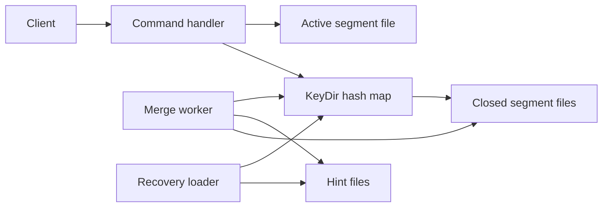
- **Command handler** parses requests and routes them.
- **KeyDir** is the in-memory hash map: key → (file id, offset, size, timestamp).
- **Active segment file** is the only file being written. Everything else is immutable.
- **Merge worker** reads closed segments, keeps live records, writes a new compacted segment plus a **hint file** (a compact list of key → offset so startup does not need to read every value).
- **Recovery loader** rebuilds the KeyDir at startup from hint files, falling back to scanning data files.

### Data model
| Field | Type | Purpose |
|---|---|---|
| crc | uint32 | Checksum of the rest of the record |
| timestamp | uint64 | Write time, for debugging and merge ordering |
| key_size, value_size | uint32 | Lengths so the reader knows how much to read |
| key, value | bytes | Payload. A tombstone uses a reserved marker value |

### Tech stack
| Component | Choice | Why |
|---|---|---|
| Language | Python 3.14 or Java 25 | Java's `FileChannel` gives positional reads, Python's `os.pread` does the same |
| Checksum | CRC32 | Fast, built into both standard libraries |
| Interface | Plain TCP line protocol | Easy to drive with `nc` and a load-test script |

### Milestones
1. **Single file store.** Append records, keep the KeyDir, serve `get`. *Done when* a restart rebuilds the index and returns the same values.
2. **Tombstones and segments.** *Done when* deleted keys stay deleted after restart and files roll over at the size limit.
3. **Merge.** Compact closed segments in the background. *Done when* disk usage drops after overwriting the same 1,000 keys 100 times, with no read errors during the merge.
4. **Hint files.** *Done when* startup on 1 GB of data is at least 5x faster than a full scan.
5. **Crash safety.** *Done when* killing the process with `SIGKILL` mid-write and restarting never returns a corrupted value (the torn tail record is detected by CRC and skipped).

### Deep dive: the hard parts
- **Durability versus speed.** `fsync` (the system call that forces the OS to flush a file's buffered writes to the physical disk) after every write makes data durable but caps you at a few hundred to a few thousand writes per second. Batch several writes per `fsync` ("group commit") and document what can be lost on a crash. Make the choice a configuration flag.
- **Atomic swap after merge.** Readers may hold an offset into an old segment while merge produces a new one. Update each KeyDir entry only if it still points at the old location (a compare-and-set), then delete the old file only after no reader can reference it.
- **Torn writes.** A crash can leave half a record at the end of the active file. Recovery must stop at the first record whose CRC fails and truncate the file there.

### Testing strategy
Property-based tests (Hypothesis in Python, jqwik in Java) that run random sequences of put/get/delete against both your store and a plain dictionary and compare results, including across simulated restarts. A crash test that kills the process at random points in a loop.

### Trade-offs, scaling and failure modes
All keys must fit in memory — with 100 million 20-byte keys plus about 30 bytes of metadata each you need roughly 5 GB of RAM. No range scans. Merge doubles disk I/O temporarily. Scaling past one machine means partitioning keys (Project 17) and replicating (Project 15).

### Stretch goals
- Add a range-scan API by replacing the hash map with a sorted map, then notice you have half-built an LSM-tree (Project 11).
- Expose metrics: live versus dead bytes per segment to choose merge victims.

### Skills practised
- Log-structured storage and hash indexes — [Ch 3 — Storage and Retrieval](../chapters/03-storage-and-retrieval/README.md)
- Crash recovery and durability vocabulary — [Ch 1 — Reliable, Scalable, Maintainable](../chapters/01-reliable-scalable-maintainable/README.md)

### In the interview
**30-second answer:** I built a Bitcask-style key-value store: every put, including deletes as tombstones, is appended to a log file, and an in-memory hash map called the KeyDir points each key at the byte offset of its newest record. I chose append-only because sequential writes are fast and a crash can only tear the last record, which a CRC detects and recovery truncates. The hard part was compaction running alongside live traffic, which I solved by writing merged segments plus hint files and updating KeyDir entries with a compare-and-set. With batched fsync it sustains around 50,000 puts per second, and hint files rebuild the index for 1 GB of data in a few seconds.

**Key terms to know:**
- **Append-only log** — a file you only ever add to the end of. Every write and delete in this store goes there, never overwriting earlier bytes.
- **Hash index (KeyDir)** — an in-memory map from key to (file, offset, size). It makes reads a single seek but requires every key to fit in RAM.
- **Segment** — one data file in a sequence. The active segment takes writes and is closed at 64 MB, after which it is immutable.
- **Tombstone** — a special record meaning "this key was deleted". It must survive until compaction is sure no older value exists.
- **Compaction / merge** — rewriting only the latest live record of each key from closed segments into new files, to reclaim disk space.
- **Hint file** — a compact key-to-offset list written next to a merged segment so startup does not have to read every value.
- **fsync and group commit** — fsync forces buffered writes to the physical disk. Group commit shares one fsync among many writes, trading a small loss window for throughput.
- **Torn write and CRC** — a crash can leave a half-written record. A checksum stored with each record lets recovery spot it and truncate the file there.

**Q:** Why is an append-only design faster than updating in place?

**A:** Appends are sequential writes, which both spinning disks and SSDs handle far better than random writes. Crash recovery is also simpler: since nothing is overwritten, only the very last record can be damaged, and the CRC tells you exactly where valid data ends.

**Q:** What is the biggest limitation of a hash index?

**A:** Every key must fit in memory, because the KeyDir holds one entry per key. With 100 million keys at about 50 bytes each that is roughly 5 GB of RAM. It also cannot do range queries, because a hash map has no key order.

**Q:** How do you reclaim space, and how do you do it without stopping reads?

**A:** A background merge reads closed segments, keeps only the newest record per key and writes a fresh segment plus hint file. For each key it updates the KeyDir with a compare-and-set, only if the entry still points at the old location, so a newer write that arrived during the merge is not overwritten. Old files are deleted only once no reader can still hold an offset into them.

**Q:** Why fsync in batches instead of after every write?

**A:** An fsync per write caps throughput at a few hundred to a few thousand writes per second, because each one waits for the device. Group commit acknowledges a batch after one fsync, so throughput rises sharply. The cost is that if writes are acknowledged before their batch's fsync completes, they could be lost on power failure, so I made it a configuration flag and documented the window.

**Q:** What happens if the process is killed halfway through a write?

**A:** The tail of the active file may hold a partial record. On restart the recovery loader scans records, verifies each CRC, stops at the first one that fails and truncates the file there. Earlier records are untouched because they were never rewritten, so no acknowledged and synced write is lost.

**Q:** How long does recovery take, and how did you make it faster?

**A:** Without hints, recovery reads every record in every file to rebuild the KeyDir, which is proportional to total data size. Hint files store only keys and offsets for merged segments, so startup reads far fewer bytes. My target was at least 5x faster than a full scan on 1 GB.

**Q:** What changes at 10x the key count, and what breaks first?

**A:** RAM breaks first, because the KeyDir grows linearly with the number of keys. Next is merge I/O, since compaction temporarily doubles disk traffic. Beyond one machine you partition keys across nodes (Project 17) and replicate them (Project 15), or switch to a sorted structure such as an LSM-tree that does not need every key in memory.

**Q:** How did you prove the store is correct?

**A:** Property-based tests ran random put, get and delete sequences against the store and a plain dictionary and compared every result, including across simulated restarts. A crash loop killed the process with SIGKILL at random points and checked that no corrupted value was ever returned.

**Common mistakes in answers:**
- Saying deletes "remove the record". Nothing is removed in place: a tombstone is appended, and space is reclaimed only by compaction.
- Claiming the store supports range scans. A hash index has no order, so ranges need a sorted structure such as SSTables (Project 2).
- Forgetting the durability trade-off: with group commit, "acknowledged" does not mean "on disk" unless sync-per-write is enabled.

### TL;DR
Append every write, remember where each key's latest record lives, and compact in the background — the simplest durable storage engine, and the seed of every log-structured design.

## 2. SSTable file format with Bloom filter

**Level:** Beginner · **Time:** 1 weekend · **Prerequisites:** Ch 3

### What it is
A library that writes and reads **SSTables** (Sorted String Tables): immutable files whose records are sorted by key, split into fixed-size **data blocks**, followed by a **sparse index** (the first key of each block and its offset) and a **Bloom filter** — a compact bit array that can say "this key is definitely not here" or "this key might be here".

### The problem it solves
Project 1 needed every key in RAM. Sorting the file means you only need one index entry per block (say every 4 KB), because you can binary-search the sparse index and then scan one block. The Bloom filter avoids reading a file at all for keys it does not contain, which matters when a read must check many files, as an LSM-tree does.

### Real-world examples
- The SSTable name and layout come from Google's [Bigtable paper](https://research.google/pubs/bigtable-a-distributed-storage-system-for-structured-data/) (OSDI 2006).
- [LevelDB](https://github.com/google/leveldb) and [RocksDB](https://rocksdb.org/) use block-based tables with an index block and optional per-file Bloom filters, the same structure you build here.

### Requirements
**Functional**
- `SSTableWriter.add(key, value)` accepting keys in strictly increasing order, then `finish()`.
- `SSTableReader.get(key)` and `scan(start, end)` iterators.
- Per-block compression (optional) and per-block CRC.
- Bloom filter with configurable bits per key.

**Non-functional**
- With 10 bits per key the measured false-positive rate is about 1% (the theoretical value for an optimal number of hash functions).
- A point lookup reads at most one data block from disk when the index is cached.
- Writing 1 million records completes in under 5 seconds.

### The architecture
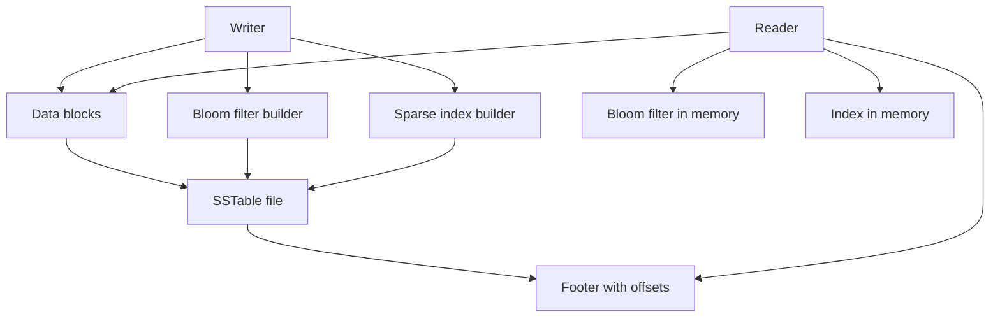
- **Data blocks** hold sorted key-value records, each block about 4 KB.
- **Sparse index** maps the first key of each block to its offset.
- **Bloom filter builder** sets k bits per key using k hash functions (derive them from two hashes, the Kirsch-Mitzenmacher trick).
- **Footer** is a fixed-size trailer at the end of the file holding the offsets of the index and filter, plus a magic number to detect wrong files.

### Data model
| Section | Contents |
|---|---|
| Data block | records of key length, value length, key, value, then a CRC |
| Filter block | bit array plus the number of hash functions |
| Index block | (first key, block offset, block size) per data block |
| Footer | index offset, filter offset, format version, magic |

### Tech stack
- **Java 25** (`ByteBuffer`, `MappedByteBuffer` for reads) or **Python 3.14** (`struct`, `mmap`).
- **xxHash or MurmurHash3** for Bloom hashing: fast, well-distributed, non-cryptographic.
- **zstd or LZ4** for optional block compression.

### Milestones
1. **Writer and full-scan reader.** *Done when* writing then scanning returns all records in order.
2. **Sparse index and point lookup.** *Done when* `get` touches exactly one data block (count reads).
3. **Bloom filter.** *Done when* an experiment with 1 million absent keys shows a false-positive rate within 0.3 percentage points of the formula.
4. **Range scan and corruption detection.** *Done when* flipping a byte in a block makes the reader raise a checksum error instead of returning bad data.

### Deep dive: the hard parts
- **Sizing the filter.** For n keys and m bits, the best number of hash functions is about (m/n)·ln 2. Measure, do not trust: plot false-positive rate against bits per key.
- **Prefix compression.** Adjacent sorted keys share prefixes (`user:1001`, `user:1002`). Storing only the differing suffix with periodic "restart points" shrinks blocks a lot, but binary search inside a block must then jump to restart points first.
- **Format versioning.** Put a version in the footer from day one so later readers can still open old files — the same evolution thinking as Chapter 4.

### Testing strategy
Round-trip tests with random keys, boundary tests (empty table, one key, key exactly at a block boundary), corruption tests, and a statistical test for the filter.

### Trade-offs, scaling and failure modes
Bigger blocks mean a smaller index but more bytes read per lookup. More filter bits mean fewer wasted reads but more memory. SSTables are immutable — updates require a new file, which is why they need an LSM-tree around them.

### Stretch goals
- Partitioned filters, or a filter per block.
- A cuckoo filter or ribbon filter and a comparison of memory per key.

### Skills practised
- SSTables, sparse indexes and Bloom filters — [Ch 3 — Storage and Retrieval](../chapters/03-storage-and-retrieval/README.md)
- Binary format design and versioning — [Ch 4 — Encoding and Evolution](../chapters/04-encoding-and-evolution/README.md)

### In the interview
**30-second answer:** I built an SSTable library: immutable files of key-sorted records split into about 4 KB data blocks, followed by a sparse index, a Bloom filter and a fixed-size footer. Because keys are sorted, I only need one index entry per block, and a point lookup reads at most one data block once the index is cached. The hardest part was sizing the Bloom filter, so I measured false-positive rate against bits per key instead of trusting the formula. At 10 bits per key my measured false-positive rate was about 1%, and every block carries a CRC so corruption raises an error rather than returning bad data.

**Key terms to know:**
- **SSTable** — Sorted String Table, an immutable file of records sorted by key. It is the on-disk unit of every LSM-tree.
- **Data block** — a chunk of about 4 KB of sorted records, the unit read from disk, compressed and checksummed.
- **Sparse index** — the first key and offset of each block, not of every key. Binary search finds the one block that could hold a key.
- **Bloom filter** — a bit array set by k hash functions per key. It answers "definitely absent" or "maybe present", never a false negative.
- **False-positive rate** — how often the filter says "maybe" for an absent key, costing a wasted block read. It falls as bits per key rise.
- **Footer** — a fixed-size trailer at a known position holding the index and filter offsets, a format version and a magic number.
- **Prefix compression with restart points** — store only the part of a key that differs from the previous one, with periodic full keys so search can jump in.
- **Format versioning** — a version number in the footer so newer readers can still open old files, the Chapter 4 evolution idea.

**Q:** Why can an SSTable use a sparse index?

**A:** Keys are sorted, so if you know the first key of each block you know the only block that could contain any given key. Binary search over block start keys finds it, then you scan inside one block. That needs one entry per 4 KB block instead of one per key.

**Q:** Can a Bloom filter give a false negative?

**A:** No. Adding a key only sets bits to 1 and nothing ever clears them, so every bit for an added key is still set when you query it. It can give false positives, when other keys happened to set all k bits.

**Q:** How do you choose the number of hash functions and bits?

**A:** For n keys and m bits, the optimal number of hash functions is about (m/n) times ln 2, which is about 7 for 10 bits per key and gives roughly 1% false positives. I derived k hashes from two base hashes (the Kirsch-Mitzenmacher trick) to keep it cheap, then plotted measured rate against bits per key.

**Q:** What does the footer do?

**A:** It sits at a known position, the end of the file, and points to the index and filter blocks. A reader opens the file by reading the footer first, so it never has to scan the file. The magic number catches someone opening the wrong file, and the version supports format evolution.

**Q:** Bigger or smaller blocks?

**A:** Bigger blocks mean a smaller index and better compression but more bytes read and decompressed per point lookup. Smaller blocks make point reads cheaper but grow the index. Around 4 KB matches the page size and is a common default, and range-heavy workloads often use larger blocks.

**Q:** Why are SSTables immutable, and how do you update a key?

**A:** Immutability means no locking for readers, easy caching and simple crash safety, since a file is either fully written or ignored. To update you write a new SSTable with the new value and let reads prefer the newer file. That is exactly what an LSM-tree (Project 11) organises.

**Q:** What happens if a byte on disk is flipped?

**A:** Each block has a CRC computed at write time. The reader recomputes it on load and raises a checksum error on mismatch instead of returning wrong data. I tested this by flipping a byte in a block and asserting the error.

**Q:** How did you test the filter statistically, and what breaks at 100x data?

**A:** I inserted 1 million keys, queried 1 million absent keys and checked the false-positive rate was within 0.3 percentage points of the formula. At 100x keys, the filters and indexes for many files no longer fit in memory, so you partition filters and cache only the parts in use, which is what RocksDB's partitioned filters do.

**Common mistakes in answers:**
- Saying a Bloom filter "stores the keys". It stores only bits, so it cannot list or return keys and cannot delete them.
- Claiming a sparse index works on unsorted data. It relies entirely on sort order.
- Ignoring that the filter helps only point lookups, not range scans.

### TL;DR
Sorted, immutable, block-structured files with a tiny index and a probabilistic "definitely not here" filter — the building block of every LSM-tree.

## 3. Tail-latency percentile monitor

**Level:** Beginner · **Time:** 1 weekend · **Prerequisites:** Ch 1

### What it is
A small service that receives request timings from applications and reports **percentiles** — p50 (median), p95, p99, p99.9 — over sliding time windows, using a mergeable histogram so that many servers' numbers can be combined correctly.

### The problem it solves
The mean is a poor summary of latency: if 99 requests take 20 ms and one takes 3 seconds, the mean is about 50 ms, yet one user in a hundred waited 3 seconds. Chapter 1 argues that **tail latency** (high percentiles) is what users feel, especially when one page fans out to many backends and is as slow as the slowest. A common bug is averaging percentiles across servers, which is mathematically meaningless — you must merge the underlying distributions.

### Real-world examples
- Google's [The Tail at Scale](https://research.google/pubs/the-tail-at-scale/) (Dean and Barroso, CACM 2013) shows how fan-out amplifies rare slow responses.
- [HdrHistogram](https://github.com/HdrHistogram/HdrHistogram) records values into log-linear buckets with fixed relative precision. [t-digest](https://github.com/tdunning/t-digest) is an alternative sketch with high accuracy at the extremes.

### Requirements
**Functional**
- Ingest endpoint taking (service, endpoint, duration in microseconds, timestamp).
- Query p50, p95, p99, p99.9 and max for the last 1, 5 and 60 minutes.
- Merge histograms across hosts.
- Simple text or HTML dashboard.

**Non-functional**
- Percentile error below 1% relative (choose histogram precision to guarantee it).
- Ingest 100,000 samples per second on one core.
- Memory bounded: under 50 KB per (endpoint, minute) histogram.

### The architecture
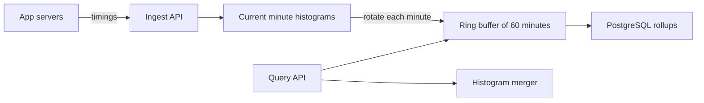
- **Ingest API** batches samples to cut per-request overhead.
- **Current minute histograms** are one histogram per (service, endpoint).
- **Ring buffer** keeps the last 60 one-minute histograms. A 5-minute window merges five of them.
- **Histogram merger** adds bucket counts — the reason histograms are mergeable and percentiles are not.
- **PostgreSQL rollups** store per-minute histograms as `bytea` for longer history.

### Data model
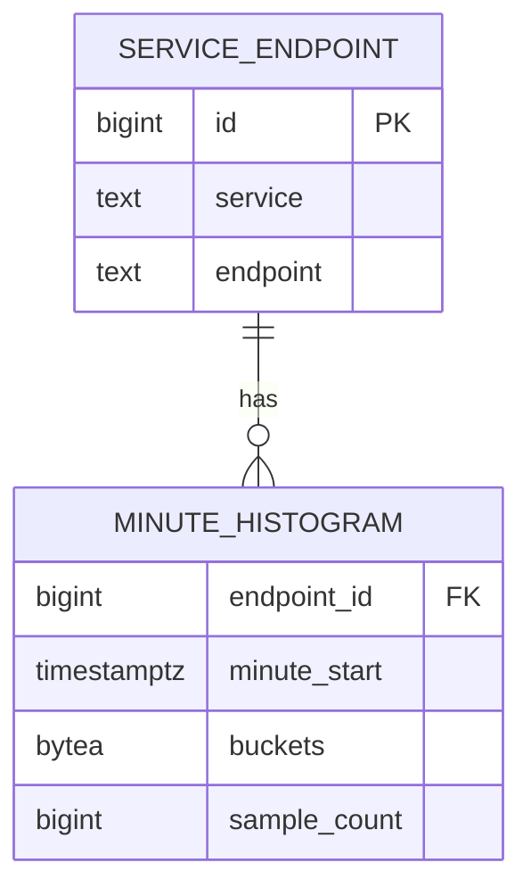

### Tech stack
| Component | Choice | Why |
|---|---|---|
| Service | Python 3.14 (asyncio) or Java 25 (virtual threads) | Simple concurrent ingest |
| Histogram | Your own log-linear buckets, then compare with HdrHistogram | Learn how it works, then validate |
| Storage | PostgreSQL | `bytea` blobs plus a time index |
| Load generator | Script producing a log-normal plus rare-spike distribution | Realistic tails |

### Milestones
1. **Exact baseline.** Store every sample, sort, compute percentiles. *Done when* results match a reference implementation.
2. **Log-linear histogram.** *Done when* every reported percentile is within 1% of the exact baseline on 10 million samples.
3. **Windows and merging.** *Done when* p99 over three hosts computed by merging equals p99 of the combined raw data (within error), and you can show that averaging per-host p99s gives a different, wrong answer.
4. **Persistence and dashboard.** *Done when* an hour of history survives a restart.

### Deep dive: the hard parts
- **Bucket design.** Equal-width buckets waste space at low values and lose precision at high ones. Log-linear buckets keep a fixed number of sub-buckets per power of two, giving constant *relative* error.
- **Coordinated omission.** If a load generator waits for each response before sending the next, a stall hides all the requests that *should* have been sent during the stall. Record intended start times, not actual send times, to avoid under-reporting the tail.
- **Window edges.** Minute-boundary rotation must be atomic so no sample is counted twice or lost.

### Testing strategy
Compare against exact percentiles on synthetic distributions (uniform, log-normal, bimodal). Unit-test merge associativity: merge(A, merge(B, C)) equals merge(merge(A, B), C).

### Trade-offs, scaling and failure modes
Higher precision means more buckets and memory. Sketches like t-digest use less memory but give probabilistic error. At larger scale, ship histograms from each host every few seconds instead of raw samples.

### Stretch goals
- Service-level objective alerts ("p99 over 300 ms for 5 minutes").
- A fan-out simulator showing how p99 of the whole page grows with the number of backends.

### Skills practised
- Percentiles, tail latency and describing load — [Ch 1 — Reliable, Scalable, Maintainable](../chapters/01-reliable-scalable-maintainable/README.md)
- Derived, mergeable aggregates — [Ch 11 — Stream Processing](../chapters/11-stream-processing/README.md)

### In the interview
**30-second answer:** I built a latency monitor that ingests request timings and reports p50, p95, p99, p99.9 and max over 1, 5 and 60 minute windows. The key decision was to store mergeable log-linear histograms per endpoint per minute instead of raw samples or pre-computed percentiles, because histograms can be added bucket by bucket across hosts and minutes. The hardest lesson was that you cannot average percentiles, which I proved by showing averaged per-host p99s give a different, wrong answer. Each histogram stays under 50 KB and reported percentiles were within 1% of the exact values on 10 million samples.

**Key terms to know:**
- **Percentile** — the value below which a given share of samples fall. p99 is the latency that 99% of requests beat.
- **Tail latency** — the high percentiles (p99, p99.9) that a minority of users feel. It is what the monitor reports instead of the mean.
- **Fan-out amplification** — when one page calls many backends, it is as slow as the slowest, so rare slow calls become common slow pages.
- **Log-linear histogram** — buckets grouped by power of two with a fixed number of sub-buckets in each, giving constant relative error.
- **Mergeable aggregate** — a summary where merge(A, B) equals the summary of the combined data. Histograms are, percentiles are not.
- **Coordinated omission** — a load-generator bug where it waits for slow responses and so never records the requests that should have been sent during the stall.
- **Sliding window and ring buffer** — the last 60 one-minute histograms in a circular array. A 5-minute window merges five of them.
- **Sketch (t-digest)** — a compact approximate summary, smaller than a histogram but with probabilistic error.

**Q:** Why not report mean latency?

**A:** The mean hides the tail. If 99 requests take 20 ms and one takes 3 seconds, the mean is about 50 ms, which describes nobody. Users feel the slow requests, and with fan-out a single page often hits at least one slow backend.

**Q:** Can you average p99 across servers?

**A:** No. Percentiles are not additive, so the average of per-host p99s is not the p99 of all requests. You merge the underlying histograms by adding bucket counts and compute the percentile from the merged distribution.

**Q:** Why log-linear buckets rather than equal-width buckets?

**A:** Equal-width buckets waste space at low values and lose precision at high ones. Log-linear buckets keep a fixed number of sub-buckets per power of two, so the error is a constant percentage of the value. Choosing the number of sub-buckets is how I guaranteed under 1% relative error.

**Q:** What is coordinated omission and how do you avoid it?

**A:** If a load generator waits for each response before sending the next, a 2-second stall hides all the requests that would have been sent and delayed during it, so the tail looks better than reality. You avoid it by recording latency from the intended send time on a fixed schedule, not the actual send time.

**Q:** How do you make minute rotation correct?

**A:** The swap from the current-minute histogram into the ring buffer must be atomic, so every sample lands in exactly one minute. I swapped a reference to a fresh histogram under a short lock, so no sample was counted twice or lost.

**Q:** What changes at 100x the number of hosts?

**A:** Shipping raw samples would overwhelm the ingest API first. Instead each host keeps its own histograms and ships them every few seconds, and the central service only merges. Merge cost depends on bucket count, not traffic, so it scales well.

**Q:** Histogram or t-digest?

**A:** A fixed log-linear histogram gives a guaranteed relative error and exact, simple merges, at the cost of more memory. A t-digest uses less memory and is accurate at the extremes but its error is probabilistic. I chose histograms because the requirement was a guaranteed 1% bound.

**Q:** How did you prove it works?

**A:** I compared every percentile against an exact sort-based baseline on uniform, log-normal and bimodal data. I unit-tested that merging is associative, and showed that merging three hosts' histograms matched p99 of the combined raw data within error.

**Common mistakes in answers:**
- Averaging or summing percentiles across hosts or time windows. Only the underlying distributions can be combined.
- Treating p99 as "the worst case". It ignores the slowest 1%, which is why p99.9 and max are also reported.
- Forgetting coordinated omission when quoting benchmark numbers.

### TL;DR
Measure latency as mergeable histograms and report high percentiles — the honest way to describe performance from Chapter 1.

## 4. One dataset, three data models

**Level:** Beginner · **Time:** 1–2 weekends · **Prerequisites:** Ch 2

### What it is
A small "professional profile" application (people, jobs, schools, skills, who-knows-whom) whose data is stored three ways in PostgreSQL: **relational** (normalised tables and joins), **document** (one `jsonb` document per person), and **graph** (a vertices table and an edges table queried with recursive SQL). You run the same five questions against all three and compare query complexity, speed and how each model copes with change.

### The problem it solves
Chapter 2's central claim is that the data model shapes what is easy and what is painful. Reading the argument is not the same as feeling it. This project makes you write the "find friends-of-friends who worked at the same company" query three times and see why graphs, documents and tables each won somewhere.

### Real-world examples
- PostgreSQL documents its [JSON types and jsonb operators](https://www.postgresql.org/docs/current/datatype-json.html), including GIN indexing, which lets one database play the document role.
- [Recursive common table expressions](https://www.postgresql.org/docs/current/queries-with.html) (`WITH RECURSIVE`) are how you express graph traversals in plain SQL — the same approach Chapter 2 uses to compare with Cypher.

### Requirements
**Functional**
- Load the same synthetic dataset (10,000 people, 50,000 edges) into all three schemas.
- Five queries in each model: fetch a full profile, list people at a company, two-hop friend search, "everyone who lives within a region tree" (region contains region), and a schema change (add a "pronouns" field).
- A report table comparing lines of SQL, runtime and indexes used.

**Non-functional**
- Each query under 100 ms on the dataset with appropriate indexes.
- The loader is idempotent (safe to run twice).

### The architecture
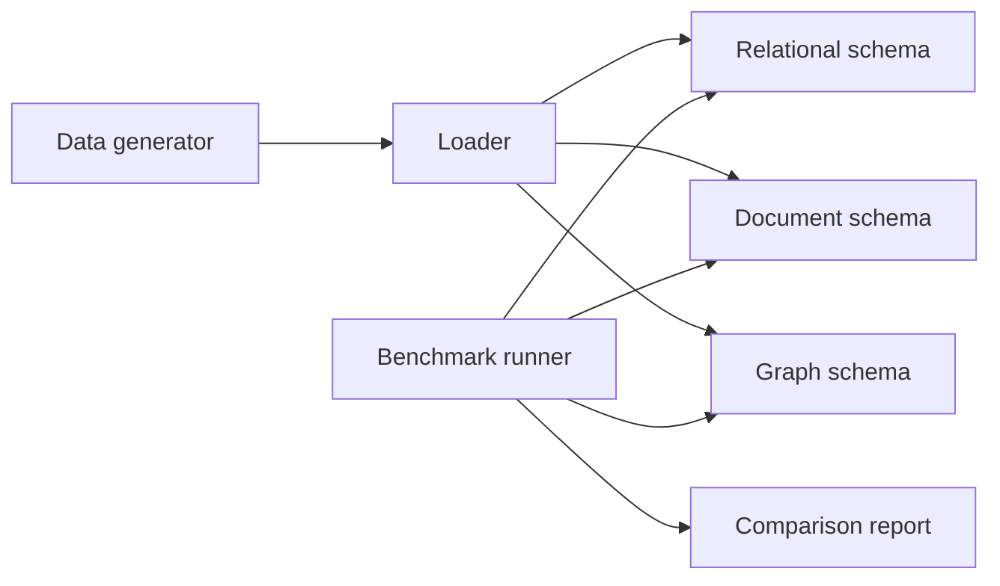
- **Data generator** produces one canonical in-memory dataset so all three models hold identical facts.
- **Loader** maps it into each schema inside one transaction per model.
- **Benchmark runner** runs each query with `EXPLAIN (ANALYZE, BUFFERS)` and records timings.

### Data model
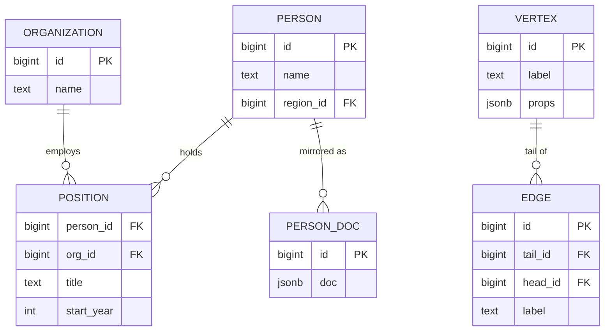

### Tech stack
- **PostgreSQL** (examples run on 14+) for all three models — one engine isolates the *model* as the variable.
- **Python 3.14** with `psycopg` for loading and benchmarking.
- Optionally **Neo4j** (current version) to compare a Cypher query with your recursive CTE.

### Milestones
1. **Relational.** *Done when* all five queries return correct results with foreign keys and indexes.
2. **Document.** *Done when* the profile query is a single-row fetch and you have written the "people at company X" query using a GIN index on `jsonb`.
3. **Graph.** *Done when* the two-hop and region-containment queries work via `WITH RECURSIVE` with a cycle guard.
4. **Change and report.** Add the new field in each model. *Done when* the report shows which needed a migration, which was schema-on-read, and the timings.

### Deep dive: the hard parts
- **Many-to-one in documents.** Storing the company name inside each person's document duplicates it. Renaming a company now means updating thousands of documents — the normalisation argument in practice.
- **Recursive queries without runaway.** A cycle in the friends graph makes naive recursion loop forever. Track visited ids in an array column and stop on repeats, or use PostgreSQL 14's `CYCLE` clause.
- **Schema-on-read versus schema-on-write.** Adding a field to `jsonb` needs no `ALTER TABLE`, but every reader must now handle documents with and without it.

### Testing strategy
For each query, assert all three models return the same set of ids. Run the loader twice and check row counts are unchanged.

### Trade-offs, scaling and failure modes
Documents win for self-contained, read-whole records (locality). Relational wins for many-to-many relationships and ad hoc joins. Graphs win for variable-length traversals. Large documents rewrite entirely on small updates.

### Stretch goals
- Implement a tiny Datalog-style rule evaluator over the edge table.
- Add a triple-store view (subject, predicate, object) and query it.

### Skills practised
- Relational, document and graph models — [Ch 2 — Data Models and Query Languages](../chapters/02-data-models-and-query-languages/README.md)
- Indexes and query plans — [Ch 3 — Storage and Retrieval](../chapters/03-storage-and-retrieval/README.md)

### In the interview
**30-second answer:** I stored one "professional profile" dataset, 10,000 people and 50,000 edges, three ways in a single PostgreSQL database: normalised tables, one jsonb document per person, and a vertices-and-edges graph queried with recursive SQL. Using one engine made the data model the only variable, so I could compare lines of SQL, runtime and indexes for the same five queries. The hardest queries were the region-containment and friend-of-friend traversals, where I needed a cycle guard to stop the recursion looping forever. Every query ran under 100 ms with the right indexes, and a test asserted all three models returned identical id sets.

**Key terms to know:**
- **Relational model** — normalised tables linked by foreign keys and joined at query time. Here: person, organisation and position tables.
- **Document model** — self-contained JSON trees, here one jsonb row per person. Great for "load the whole profile" queries.
- **Graph model** — vertices and edges with labels, here two tables traversed with recursive SQL.
- **Normalisation** — storing each fact once and referring to it by id. Renaming a company is one update instead of thousands.
- **Many-to-one and many-to-many** — relationships the relational model handles with joins and documents handle poorly.
- **Schema-on-read vs schema-on-write** — jsonb accepts any shape and readers interpret it, while tables enforce structure at write time.
- **Recursive CTE** — WITH RECURSIVE, which repeatedly joins the edge table to walk paths of unknown length.
- **GIN index** — PostgreSQL's inverted index type, used here to search inside jsonb documents.

**Q:** When would you choose a document model?

**A:** When records are mostly loaded whole, are tree-shaped and have few many-to-many relationships, such as a résumé or an order with its line items. You get locality, since one read fetches everything. It hurts when you need joins or need to update shared data like a company name.

**Q:** What is schema-on-read?

**A:** The database accepts any structure and the reading code interprets it, so the schema exists only implicitly in the application. Adding a "pronouns" field needed no ALTER TABLE in jsonb, but every reader must handle documents with and without it.

**Q:** How do you query a graph in SQL?

**A:** With a recursive CTE that starts from seed vertices and repeatedly joins the edge table to find the next hop. You must guard against cycles, either by carrying an array of visited ids or with PostgreSQL 14's CYCLE clause.

**Q:** What went wrong with company names in the document model?

**A:** Each person's document embedded the company name, which duplicates it. Renaming one company meant rewriting every employee's document, which is the normalisation argument in practice. Storing a company id instead brings back joins, which documents do poorly.

**Q:** Which model won which query?

**A:** The document model won the full-profile fetch, a single-row read. The relational model won "people at company X" and ad hoc joins. The graph model won variable-length traversals such as friends of friends and region containment, where the depth is not known in advance.

**Q:** Which model coped best with the schema change?

**A:** jsonb needed no migration but pushed the work to readers. The relational model needed an ALTER TABLE adding a nullable column, which in PostgreSQL 11+ is a fast metadata-only change when there is no default or a constant default. The graph model stored properties in jsonb, so it behaved like the document model.

**Q:** What changes at 100x the data?

**A:** Large documents become expensive because any small update rewrites the whole document. Deep graph traversals explode in fan-out, so a two-hop query can touch a huge share of the graph. A dedicated graph database or pre-computed adjacency becomes worth it at that point.

**Q:** How did you check correctness?

**A:** For each query I asserted all three models returned the same set of ids. I ran the loader twice and checked row counts were unchanged, proving it was idempotent. EXPLAIN (ANALYZE, BUFFERS) confirmed which indexes each query used.

**Common mistakes in answers:**
- Saying document databases are "schemaless". The schema still exists, just enforced by readers instead of the database.
- Claiming SQL cannot query graphs. Recursive CTEs can, they are just more verbose than a graph query language like Cypher.
- Ignoring update cost: documents are cheap to read whole but expensive to change in shared parts.

### TL;DR
Store the same facts three ways and feel why each model exists — the fastest route to really understanding Chapter 2.

## 5. Schema evolution lab (Avro and Protobuf)

**Level:** Beginner · **Time:** 1–2 weekends · **Prerequisites:** Ch 4

### What it is
A test bench that encodes the same records with JSON, Protocol Buffers and Apache Avro, then evolves the schema through ten realistic changes (add a field, remove one, rename one, change a type...) and automatically checks **backward compatibility** (new code reads old data) and **forward compatibility** (old code reads new data) for every pair of versions. It ends with a small compatibility-checker CLI.

### The problem it solves
In a rolling deployment, old and new versions of a service run at the same time and read each other's messages and stored records. One careless schema change — reusing a Protobuf field number, or adding an Avro field without a default — breaks production in ways unit tests miss. Chapter 4 explains the rules. This lab turns them into executable checks.

### Real-world examples
- The [Avro specification](https://avro.apache.org/docs/) defines schema resolution between a writer's schema and a reader's schema.
- The [Protocol Buffers language guide (proto3)](https://protobuf.dev/programming-guides/proto3/) explains field numbers, reserved fields and unknown-field handling.
- Confluent's [schema evolution and compatibility docs](https://docs.confluent.io/platform/current/schema-registry/fundamentals/schema-evolution.html) describe the BACKWARD, FORWARD and FULL modes used by its Schema Registry.

### Requirements
**Functional**
- A version chain of at least ten schema versions for a `User` record in both Protobuf and Avro.
- A matrix test: for every (writer version, reader version) pair, encode with the writer and decode with the reader, recording success, data loss or failure.
- A size comparison of JSON, Protobuf and Avro for 100,000 records.
- A CLI `compat-check old.avsc new.avsc` that prints which compatibility modes hold.

**Non-functional**
- The matrix runs in under 30 seconds.
- Results are a Markdown table that you commit alongside the code.

### The architecture
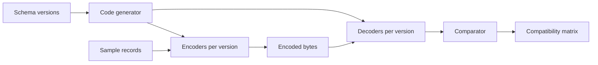
- **Schema versions** are `.proto` and `.avsc` files, v1 to v10.
- **Code generator** runs `protoc` and Avro tools (or uses Avro's generic records in Python).
- **Comparator** checks that fields the reader knows about survived, and records unknown-field preservation.

### Data model
| Version | Change | Expected Avro result | Expected Protobuf result |
|---|---|---|---|
| v2 | add optional `email` with default | compatible both ways | compatible both ways |
| v3 | add required field without default | old data unreadable by new reader | n/a (proto3 has no required) |
| v4 | rename field | breaks unless alias used | safe, names are not on the wire |
| v5 | reuse a deleted field number | n/a | silent corruption |

(Fill in the rest from your own experiments — predicting first, then running, is the point.)

### Tech stack
| Component | Choice | Why |
|---|---|---|
| Language | Java 25 (best Avro and Protobuf tooling) or Python 3.14 | Both have official libraries |
| Avro | Apache Avro (current version) | Writer and reader schema resolution |
| Protobuf | `protoc` plus language runtime | Tag-number encoding |
| Registry (stretch) | Confluent Schema Registry with Kafka | Real-world enforcement |

### Milestones
1. **Encode and size.** *Done when* you have a table of bytes per record for JSON, Protobuf and Avro, and can explain why Avro is smallest (no field tags in the data).
2. **Protobuf matrix.** *Done when* all ten versions are tested and the field-number reuse case is shown corrupting data.
3. **Avro matrix.** *Done when* the defaults and alias cases behave as predicted.
4. **Checker CLI.** *Done when* it flags at least the four classic breaking changes.

### Deep dive: the hard parts
- **Avro needs the writer's schema.** Avro bytes carry no field names or tags, so a reader cannot decode them without knowing the exact schema that wrote them. Files embed it in a header, and Kafka setups prefix each message with a schema id looked up in a registry.
- **Unknown-field preservation.** If old code reads a record with a new field, modifies it and writes it back, does the new field survive? Protobuf preserves unknown fields in current versions. Plain object mapping in your own code often drops them — test it.
- **Type changes.** Widening `int32` to `int64` is safe in one direction only. Write tests that encode a value larger than 2^31 and read it with the old schema.

### Testing strategy
The matrix itself is the test suite. Add a round-trip property test: decode(encode(x)) equals x for random records at every version.

### Trade-offs, scaling and failure modes
JSON is self-describing and human-readable but large and vague about numbers. Protobuf is compact and robust to renames but depends on careful field-number discipline. Avro is the most compact and great for dynamically generated schemas (for example, from database tables) but needs schema distribution.

### Stretch goals
- Run Schema Registry with Kafka and watch it reject an incompatible schema.
- Generate Avro schemas automatically from PostgreSQL table definitions.

### Skills practised
- Encoding formats and compatibility — [Ch 4 — Encoding and Evolution](../chapters/04-encoding-and-evolution/README.md)
- Message brokers and schemas in logs — [Ch 11 — Stream Processing](../chapters/11-stream-processing/README.md)

### In the interview
**30-second answer:** I built a schema evolution lab that encodes a User record in JSON, Protocol Buffers and Avro, evolves the schema through ten versions, and tests every writer-reader version pair for backward and forward compatibility. The key insight is that Protobuf identifies fields by number while Avro carries no field identifiers at all, so Avro must resolve the writer's schema against the reader's. The most striking result was showing that reusing a deleted Protobuf field number silently corrupts data instead of failing. The full matrix runs in under 30 seconds and ends in a compat-check CLI that flags the four classic breaking changes.

**Key terms to know:**
- **Backward compatibility** — new code can read data written by old code. Needed as soon as new readers see stored or in-flight old data.
- **Forward compatibility** — old code can read data written by new code. Needed during rolling upgrades when old instances still run.
- **Field number (tag)** — Protobuf's on-the-wire identity for a field. Names are not encoded, so renames are safe but reuse is dangerous.
- **Writer's and reader's schema** — Avro decodes using the exact schema that wrote the data and maps it onto the reader's schema by field name.
- **Default value** — what Avro fills in when the reader expects a field the writer did not write. Missing defaults break compatibility.
- **Unknown fields** — fields a reader's schema does not know. Current Protobuf runtimes preserve them so a read-modify-write does not drop them.
- **Schema registry** — a service that stores schemas by id and rejects incompatible changes. Kafka messages carry the id.
- **Rolling upgrade** — deploying a new version node by node, so old and new code run side by side.

**Q:** Why can Protobuf fields be renamed safely?

**A:** Only the field number and wire type are encoded. The name exists only in the .proto file and generated code, so changing it does not change any bytes on the wire.

**Q:** How does an Avro reader know the writer's schema?

**A:** It has to be supplied. Avro container files embed it in the header, RPC connections negotiate it, and Kafka setups prefix each message with a schema id that the reader looks up in a schema registry.

**Q:** Why is Avro the smallest encoding?

**A:** Avro writes values back to back in schema order with no field names or tags. JSON repeats every field name as text, and Protobuf writes a tag before each field. The cost is that Avro bytes are meaningless without the writer's schema.

**Q:** What change is never safe?

**A:** Reusing a Protobuf field number, because old data with a different meaning for that number decodes as the new field, silently. In Avro, adding a field with no default breaks backward compatibility, because new readers cannot fill it in for old records. Use reserved numbers in Protobuf and defaults in Avro.

**Q:** Is changing int32 to int64 safe?

**A:** Only in one direction. In Protobuf, int32 and int64 share the same varint encoding, so new code reads old data fine. Old code reading a value larger than 2^31 truncates it silently. I wrote a test that encodes such a value and reads it with the old schema.

**Q:** What happens if old code reads a record with a new field and writes it back?

**A:** Current Protobuf runtimes keep unknown fields and re-emit them, so the new field survives. But if your own code maps the message to a plain object and back, the field is usually dropped. I tested this explicitly because it causes silent data loss during rolling upgrades.

**Q:** How does this scale to many teams and Kafka topics?

**A:** Manual review breaks first. A schema registry with a compatibility mode per topic (BACKWARD, FORWARD or FULL) rejects incompatible schemas at registration time, so producers cannot publish breaking changes. My CLI performs the same check locally in CI.

**Q:** How did you test it?

**A:** The matrix itself is the test suite: for every writer and reader pair it encodes, decodes and records success, data loss or failure, compared with my predictions. I also ran round-trip property tests so decode(encode(x)) equals x for random records at every version.

**Common mistakes in answers:**
- Mixing up the directions: backward means new readers handle old data, forward means old readers handle new data.
- Saying Avro needs no schema at read time. It needs the writer's exact schema to decode anything.
- Assuming renaming is unsafe in Protobuf or safe in Avro. It is the opposite unless Avro aliases are used.

### TL;DR
Turn Chapter 4's compatibility rules into an automated matrix so you can prove, not hope, that a schema change is safe for rolling upgrades.

## 6. Isolation anomaly lab on PostgreSQL

**Level:** Beginner · **Time:** 1 weekend · **Prerequisites:** Ch 7

### What it is
A scripted test harness that opens two (or three) concurrent PostgreSQL sessions, interleaves their statements in a precise order, and shows which **anomalies** — dirty reads, non-repeatable reads, lost updates, write skew, phantoms — occur at each **isolation level** (Read Committed, Repeatable Read, Serializable). Each anomaly is a small "story" such as two doctors going off call at once.

### The problem it solves
Isolation levels are where most developers' mental models are weakest. Their names differ between databases, and the SQL standard's definitions do not match what engines actually do. Running real interleavings against a real database is the only reliable way to learn what your database protects you from.

### Real-world examples
- PostgreSQL's [Transaction Isolation chapter](https://www.postgresql.org/docs/current/transaction-iso.html) documents that Repeatable Read is implemented as snapshot isolation and Serializable as Serializable Snapshot Isolation (SSI).
- [Hermitage](https://github.com/ept/hermitage) is an open-source catalogue of such tests across many databases. Write yours from scratch first, then compare.

### Requirements
**Functional**
- A tiny DSL or YAML file per scenario: steps like `T1: BEGIN`, `T2: UPDATE ...`, `T1: SELECT ...`, with expected outcomes per isolation level.
- A runner that executes steps in order on separate connections, detects blocking (a statement waiting on a lock), and continues the other session.
- At least eight scenarios: dirty write, dirty read, read skew, lost update, write skew, phantom, read-only transaction anomaly, and a fixed version of each.
- A results table: scenario × isolation level → anomaly / prevented by blocking / prevented by abort.

**Non-functional**
- Each scenario runs in under 2 seconds, deterministic across runs.

### The architecture
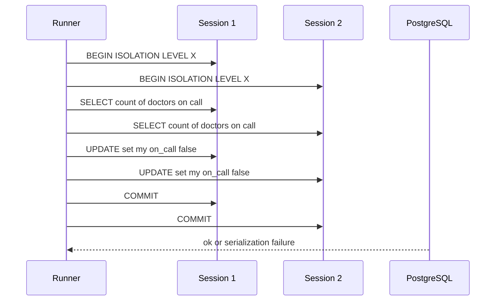
The **runner** drives each session from its own thread so it can notice when a statement blocks (use a short timeout) and move on. The diagram shows the write-skew story: both transactions read "two doctors on call", both remove themselves, and under snapshot isolation both commit.

### Data model
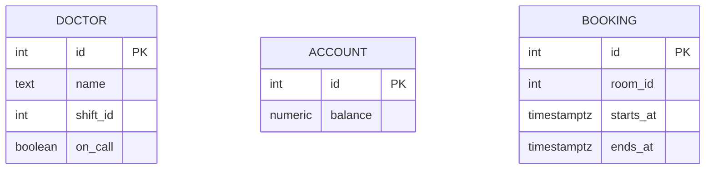

### Tech stack
- **PostgreSQL** in Docker, examples valid on 14+.
- **Python 3.14** with `psycopg` and threads, or **Java 25** with JDBC and virtual threads.
- YAML for scenario files so they are easy to read and share.

### Milestones
1. **Two-session runner with blocking detection.** *Done when* a lock wait is reported as "blocked" rather than hanging the harness.
2. **Classic anomalies.** *Done when* dirty read, lost update and read skew scenarios produce the expected table.
3. **Write skew and phantoms.** *Done when* the doctors and meeting-room stories commit wrongly under Repeatable Read and fail with SQLSTATE `40001` under Serializable.
4. **Fixes.** *Done when* each anomaly has a passing variant using `SELECT ... FOR UPDATE`, an atomic `UPDATE ... SET x = x + 1`, a constraint, or Serializable with retry.

### Deep dive: the hard parts
- **PostgreSQL never shows dirty reads.** Read Uncommitted behaves as Read Committed. Your table should show this, and explain it.
- **Lost update under Repeatable Read.** PostgreSQL detects concurrent updates to the same row in Repeatable Read and aborts the second with a serialization error — stronger than many other engines. Compare with what Chapter 7 says generally.
- **Retries are mandatory.** Serializable transactions can abort at commit time. Your fixed scenarios need a retry loop, and that loop must restart the *whole* transaction, including the reads.

### Testing strategy
The harness is a test framework: run all scenarios in CI against a PostgreSQL container and fail if any observed outcome differs from expectations.

### Trade-offs, scaling and failure modes
Stronger isolation costs more aborts and retries under contention. Explicit locks (`FOR UPDATE`) are cheap and predictable but easy to forget. Materialising conflicts (adding rows just to lock them) works but pollutes the schema.

### Stretch goals
- Run the same scenarios against MySQL or another engine and compare.
- Add a three-transaction read-only anomaly and explain why it needs SSI to prevent.

### Skills practised
- Isolation levels and anomalies — [Ch 7 — Transactions](../chapters/07-transactions/README.md)
- Precise vocabulary — [Ch 13 — Glossary](../chapters/13-glossary/README.md)

### In the interview
**30-second answer:** I built a harness that drives two or three PostgreSQL sessions through precisely interleaved statements from YAML scenarios, and records which anomalies happen at Read Committed, Repeatable Read and Serializable. The key design choice was running each session on its own thread with a short timeout, so a statement waiting on a lock is reported as "blocked" instead of hanging the run. The most instructive result was write skew: the two-doctors story commits wrongly under Repeatable Read and fails with SQLSTATE 40001 under Serializable. All eight scenarios run deterministically in under 2 seconds each and in CI against a PostgreSQL container.

**Key terms to know:**
- **Isolation level** — how much concurrent transactions can see of each other. PostgreSQL offers Read Committed, Repeatable Read and Serializable.
- **Dirty read / dirty write** — reading or overwriting another transaction's uncommitted data. PostgreSQL prevents both at every level.
- **Read skew (non-repeatable read)** — seeing different parts of the database at different moments, so totals do not add up.
- **Lost update** — two read-modify-write cycles race and one overwrites the other. Fixed with atomic UPDATE, FOR UPDATE or conflict detection.
- **Write skew** — two transactions read the same data, then write different rows, together breaking an invariant. The doctors-on-call story.
- **Phantom** — a write by one transaction changes the result of another's search query, such as a new overlapping room booking.
- **Snapshot isolation** — each transaction reads a consistent snapshot. PostgreSQL's Repeatable Read is implemented this way.
- **Serialization failure (40001)** — the error Serializable raises when it cannot guarantee a serial order. The application must retry.

**Q:** What is write skew?

**A:** Two transactions read the same data, make decisions based on it, and write to different rows, together breaking an invariant that each alone preserved. In my scenario both doctors see two on call, each removes themselves, and nobody is left on call.

**Q:** Does snapshot isolation prevent write skew?

**A:** No. Each transaction sees a consistent snapshot, but neither sees the other's write, and because they update different rows there is no write-write conflict to detect. You need Serializable, explicit locks with SELECT ... FOR UPDATE, or a materialised conflict row.

**Q:** Why does PostgreSQL never show a dirty read?

**A:** PostgreSQL accepts READ UNCOMMITTED but runs it as Read Committed, because its MVCC design never exposes uncommitted row versions. My results table shows this and explains it rather than reporting a missing anomaly as a bug.

**Q:** What does PostgreSQL do about lost updates under Repeatable Read?

**A:** If a transaction tries to update a row that a concurrent transaction updated and committed after the first one's snapshot, PostgreSQL aborts it with "could not serialize access due to concurrent update". That is stronger than many engines, where Repeatable Read lets the lost update through.

**Q:** How do you fix each anomaly without Serializable?

**A:** Lost update: an atomic UPDATE ... SET x = x + 1, or SELECT ... FOR UPDATE before modifying. Write skew: lock the rows the decision depended on with FOR UPDATE. Phantoms on bookings: an exclusion constraint, or materialise the conflict by locking a row per room and time slot.

**Q:** What must application code do under Serializable?

**A:** Catch serialization failures (SQLSTATE 40001) and retry the entire transaction from BEGIN, including its reads, because the decision was made on data that may now be different. Retrying only the failed statement is wrong.

**Q:** How did you make the harness deterministic?

**A:** Each step runs on a named session in a fixed order. A step that does not return within a short timeout is marked blocked, and the runner continues with the other session, then collects the blocked result later. With no randomness in scheduling, every run gives the same table.

**Q:** What changes under heavy contention?

**A:** Stronger isolation turns anomalies into aborts and lock waits. Under Serializable with hot rows the abort rate climbs, so retries multiply load. Keeping transactions short and touching hot rows last reduces conflicts.

**Q:** How would you extend it to another database?

**A:** The YAML scenarios are engine-neutral, so you swap the driver and expected outcomes. Running them on MySQL shows different behaviour: InnoDB's Repeatable Read uses locking reads for UPDATE, so some anomalies appear or disappear differently.

**Common mistakes in answers:**
- Assuming the SQL standard names mean the same thing everywhere. PostgreSQL's Repeatable Read is snapshot isolation, and other engines differ.
- Saying snapshot isolation is serializable. It allows write skew.
- Retrying only the failed statement instead of the whole transaction after a serialization failure.

### TL;DR
Script real interleavings against PostgreSQL and build a truth table of anomalies by isolation level — the cure for vague isolation intuition.

## 7. Lamport and vector clock simulator

**Level:** Beginner · **Time:** 1 weekend · **Prerequisites:** Ch 5, Ch 8, Ch 9

### What it is
A discrete-event simulator of a few processes that send messages over a network with random delays, plus implementations of **Lamport clocks** (a single counter that gives a total order consistent with causality) and **vector clocks** (one counter per process, which can tell whether two events are causally ordered or **concurrent**). A visualiser draws space-time diagrams.

### The problem it solves
Wall-clock time cannot order events across machines: clocks drift and jump (Chapter 8). Systems instead need logical time. Lamport clocks give an order but cannot detect concurrency. Vector clocks can, which is what leaderless databases use to keep "siblings" (concurrent versions) instead of silently losing a write.

### Real-world examples
- Leslie Lamport's paper [Time, Clocks, and the Ordering of Events in a Distributed System](https://lamport.azurewebsites.net/pubs/time-clocks.pdf) (1978) introduced logical clocks.
- Amazon's [Dynamo paper](https://www.allthingsdistributed.com/files/amazon-dynamo-sosp2007.pdf) (SOSP 2007) used vector clocks to detect conflicting versions.
- Riak documents its [causal context](https://docs.riak.com/riak/kv/latest/learn/concepts/causal-context/index.html), evolved from vector clocks to dotted version vectors.

### Requirements
**Functional**
- Simulate N processes with local events, sends and receives. Delays drawn from a configurable distribution, including reordering.
- Lamport and vector clock implementations, attached to every event.
- A `happened_before(a, b)` and `concurrent(a, b)` API.
- Space-time diagram output (SVG or a mermaid sequence diagram).
- A replicated register demo: clients write to random replicas, and vector clocks detect concurrent writes as siblings.

**Non-functional**
- Deterministic replays from a random seed.
- Simulate 10,000 events in under a second.

### The architecture
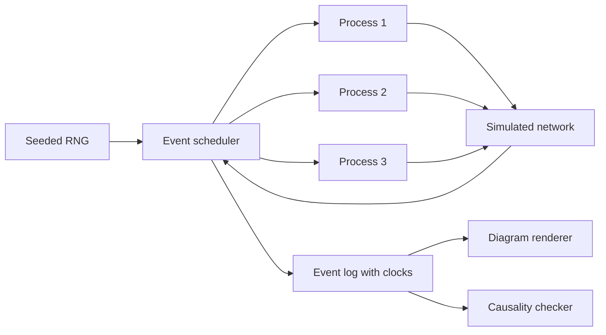
- **Event scheduler** is a priority queue of (simulated time, event) — the heart of any discrete-event simulation.
- **Simulated network** decides delay, drop and duplication.
- **Causality checker** computes the true happens-before relation from the event log by graph reachability and compares it with what the clocks claim.

### Data model
| Type | Fields |
|---|---|
| Event | id, process, kind (local, send, receive), msg_id, lamport, vector |
| Message | id, from, to, payload, sent_at, deliver_at, sender clocks |
| VersionedValue | value, vector clock (for the register demo) |

### Tech stack
- **Python 3.14** (fast to write, `heapq` scheduler) or **Java 25** (`PriorityQueue`, records for events).
- Output as SVG or a mermaid sequence diagram text.

### Milestones
1. **Scheduler and network.** *Done when* the same seed gives the same event log twice.
2. **Lamport clocks.** *Done when* for every pair where a happened-before b, L(a) < L(b), and you can show a pair of concurrent events with different Lamport values (proving the converse fails).
3. **Vector clocks.** *Done when* the checker agrees with vector-clock comparisons for every pair of events across 1,000 random runs.
4. **Replicated register.** *Done when* concurrent writes produce siblings and a later write that "saw" both siblings replaces them.

### Deep dive: the hard parts
- **Comparison rules.** V(a) ≤ V(b) element-wise and not equal means a happened before b. If neither ≤ holds, they are concurrent. Getting "equal" right matters.
- **Clock growth.** Vector clocks grow with the number of writers. Dynamo bounded them by truncation, which can create false conflicts. Measure the size growth in your register demo.
- **Total order from Lamport.** Ties are broken by process id, giving a total order that respects causality — the basis for some total-order broadcast designs (Chapter 9).

### Testing strategy
Property tests against the reachability oracle. Edge cases: messages to self, duplicated messages, a process that never communicates.

### Trade-offs, scaling and failure modes
Lamport clocks are one integer but cannot detect concurrency. Vector clocks detect it but cost O(N) space. Hybrid logical clocks (Project 31) add physical time for human-meaningful timestamps.

### Stretch goals
- Implement dotted version vectors and show they avoid sibling explosion.
- Add a version-vector-based anti-entropy exchange between two replicas.

### Skills practised
- Happens-before and concurrent writes — [Ch 5 — Replication](../chapters/05-replication/README.md)
- Unreliable clocks — [Ch 8 — The Trouble with Distributed Systems](../chapters/08-trouble-with-distributed-systems/README.md)
- Ordering and causality — [Ch 9 — Consistency and Consensus](../chapters/09-consistency-and-consensus/README.md)

### In the interview
**30-second answer:** I built a seeded discrete-event simulator of processes exchanging messages with random delays, and attached Lamport and vector clocks to every event. The key design choice was a causality oracle that computes the true happens-before relation by graph reachability, so I could test what each clock claims against ground truth. The hardest part was the replicated register demo, where vector clocks detect concurrent writes as siblings and a later write that saw both replaces them. Vector-clock comparisons agreed with the oracle on every pair of events across 1,000 random runs, and the same seed always reproduces the same event log.

**Key terms to know:**
- **Happens-before** — event a happens before b if they are on the same process in order, or a is a send and b its receive, or a chain of these links them.
- **Concurrent events** — neither happens before the other. Neither could have known about the other.
- **Lamport clock** — one counter per process, incremented per event and set to max(local, received) + 1. Consistent with causality but cannot detect concurrency.
- **Vector clock** — one counter per process. Comparing element-wise tells you before, after, equal or concurrent.
- **Version vector** — the same idea attached to a stored value in a database, used to detect conflicting writes.
- **Siblings** — concurrent versions of one key kept side by side for the application to merge.
- **Total order by Lamport** — Lamport time with ties broken by process id, which respects causality.
- **Discrete-event simulation** — a priority queue of (simulated time, event) that makes runs deterministic from a seed.

**Q:** Why can't you use timestamps to order writes on different machines?

**A:** Clocks drift and can jump backwards after NTP synchronisation, so a later event can get an earlier timestamp. Last-write-wins then silently discards the write that actually happened later.

**Q:** What can a vector clock tell you that a Lamport clock cannot?

**A:** Whether two events are concurrent. If a happened before b then L(a) < L(b), but the converse fails: L(a) < L(b) does not imply a happened before b. Vector clocks give an exact test in both directions.

**Q:** What are the comparison rules for vector clocks?

**A:** V(a) is before V(b) if every entry of V(a) is less than or equal to the matching entry of V(b) and at least one is strictly less. If neither is before the other and they are not equal, the events are concurrent. Handling the equal case correctly was a common bug.

**Q:** How does a database use this?

**A:** It stores a version vector with each value. When a client writes with the context it read, the database discards versions that context has seen and keeps concurrent ones as siblings. My register demo showed this: a write that saw both siblings replaced them.

**Q:** What is the cost of vector clocks?

**A:** Size grows with the number of writers, O(N) per value. Dynamo truncated old entries to bound it, which can create false conflicts. Dotted version vectors reduce sibling explosion when many clients write through a few servers.

**Q:** How did you prove Lamport clocks cannot detect concurrency?

**A:** The checker found pairs of events that the oracle says are concurrent but that have different Lamport values. That one counterexample is enough to show L(a) < L(b) does not imply causality.

**Q:** How would this scale to 1,000 processes?

**A:** Vector clocks would hold 1,000 entries per event, which is costly to store and send. Real systems use version vectors per replica rather than per client, or hybrid logical clocks (Project 31) when they only need a causally consistent timestamp, not concurrency detection.

**Q:** How did you test edge cases?

**A:** Property tests against the reachability oracle over random seeds, plus targeted cases: messages to self, duplicated messages, reordered messages, and a process that never communicates. Determinism was tested by running the same seed twice and diffing the logs.

**Common mistakes in answers:**
- Claiming Lamport timestamps reveal causality in both directions. They only guarantee causal order implies smaller timestamps.
- Calling concurrent events "simultaneous". Concurrent means neither knew of the other, regardless of wall-clock time.
- Using wall-clock last-write-wins and calling it conflict resolution. It silently loses data.

### TL;DR
Simulate messages, attach logical clocks, and check them against true causality — the clearest way to understand happens-before and concurrency.

## 8. Phi accrual failure detector

**Level:** Beginner · **Time:** 1 weekend · **Prerequisites:** Ch 8

### What it is
A heartbeat-based **failure detector**: each node periodically sends "I am alive" messages, and the monitor computes a suspicion level **φ (phi)** from the statistical distribution of past heartbeat gaps, instead of a fixed timeout. Roughly, if you declare the node dead at φ = 1 there is about a 10% chance you are wrong, at φ = 2 about 1%, and so on (φ is a base-10 logarithm). You compare it against fixed-timeout detection under realistic network jitter.

### The problem it solves
Chapter 8 explains that in an asynchronous network you cannot tell a dead node from a slow one. Short timeouts cause false alarms (and needless, risky failovers). Long timeouts mean slow recovery. An adaptive detector learns the normal jitter of each link and tunes itself.

### Real-world examples
- Akka documents its [phi accrual failure detector](https://doc.akka.io/docs/akka/current/typed/failure-detector.html), including how the threshold maps to detection time.
- Apache Cassandra's gossip layer uses a phi accrual detector, implemented in [FailureDetector.java](https://github.com/apache/cassandra/blob/trunk/src/java/org/apache/cassandra/gms/FailureDetector.java).
- Both are based on Hayashibara et al., "The φ Accrual Failure Detector" (SRDS 2004).

### Requirements
**Functional**
- Heartbeat sender and receiver over UDP.
- Sliding window of the last 1,000 inter-arrival times per node, with mean and standard deviation.
- φ computed on demand using a normal (or exponential) distribution model.
- A network-chaos proxy that adds delay, jitter, packet loss and pauses.
- A comparison harness: fixed timeout versus φ threshold, reporting false positives and detection time.

**Non-functional**
- Computing φ costs O(1) per query.
- Detect a crashed node within 3 seconds at a heartbeat interval of 500 ms with less than one false positive per hour under 50 ms jitter.

### The architecture
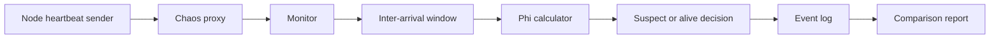
- **Chaos proxy** injects the conditions that make failure detection hard, including "stop-the-world" pauses that mimic garbage collection.
- **Inter-arrival window** keeps running sums so mean and variance update in O(1).
- **Phi calculator** returns −log10 of the probability that a heartbeat would still arrive after the elapsed time.

### Data model
| Item | Fields |
|---|---|
| Heartbeat | node id, sequence number, send timestamp |
| Window | ring buffer of gaps, sum, sum of squares |
| Decision event | node id, time, φ, verdict, ground truth |

### Tech stack
- **Java 25** (`DatagramChannel`, virtual threads) or **Python 3.14** (asyncio UDP).
- **Linux `tc netem`** in Docker as an alternative to your own chaos proxy.
- Plotting with matplotlib to draw φ over time.

### Milestones
1. **Heartbeats and fixed timeout.** *Done when* killing a sender is detected and logged.
2. **Phi calculation.** *Done when* φ stays below 1 during normal operation and rises steadily after a crash.
3. **Chaos.** *Done when* you have a chart showing false positives for timeouts of 1 s, 2 s, 5 s versus φ thresholds of 3, 8, 12 under the same jitter trace.
4. **GC-pause scenario.** *Done when* a 2-second pause triggers suspicion and recovery is recorded when heartbeats resume.

### Deep dive: the hard parts
- **Distribution choice.** Heartbeat gaps are not truly normal. A normal model reacts sharply to small delays when variance is tiny. Akka adds a minimum standard deviation and an "acceptable heartbeat pause" to soften this.
- **Bootstrapping.** With no history, φ is meaningless. Seed the window with a few assumed gaps.
- **Suspicion is not death.** The detector only produces a probability. What you *do* with it — removing a node, failing over a leader — needs a separate, careful decision (see fencing in Project 28).

### Testing strategy
Replay recorded traces of arrival times so tests are deterministic. Unit-test φ against hand-computed values.

### Trade-offs, scaling and failure modes
Lower thresholds detect faster but misfire more. All-to-all heartbeats cost O(N²) messages, which is why large clusters gossip (Project 32). A one-way network partition can make A suspect B while B sees A fine.

### Stretch goals
- Add indirect probing ("ask a third node to ping") as in SWIM.
- Feed φ into a leader-election simulation and count unnecessary failovers.

### Skills practised
- Timeouts, unbounded delays and process pauses — [Ch 8 — The Trouble with Distributed Systems](../chapters/08-trouble-with-distributed-systems/README.md)
- Failover risks — [Ch 5 — Replication](../chapters/05-replication/README.md)

### In the interview
**30-second answer:** I built a phi accrual failure detector: nodes send UDP heartbeats, the monitor keeps a sliding window of the last 1,000 gaps, and computes a suspicion level phi from how unlikely the current silence is given that history. I chose this over a fixed timeout because it adapts to each link's normal jitter. The hardest part was a chaos proxy that adds delay, jitter, loss and garbage-collection-style pauses, so I could compare false positives fairly on the same trace. My target was detecting a crash within 3 seconds at a 500 ms heartbeat interval with under one false positive per hour under 50 ms jitter.

**Key terms to know:**
- **Failure detector** — a component that decides whether a remote node is alive. In an asynchronous network it can only suspect, never know.
- **Heartbeat** — a periodic "I am alive" message. The detector learns from the gaps between them.
- **Phi (φ)** — minus log10 of the probability that a heartbeat would still arrive after the current silence. φ = 1 means about a 10% chance of being wrong, φ = 2 about 1%.
- **Inter-arrival window** — the last N gaps with running sum and sum of squares, so mean and variance update in O(1).
- **Fixed timeout** — declare dead after T seconds of silence. Simple, but either slow or trigger-happy.
- **False positive** — declaring a healthy node dead. It causes needless and risky failovers.
- **Process pause** — a stop-the-world pause, for example garbage collection, that silences a healthy node.
- **Asynchronous network** — one with no upper bound on delay, which is why slow and dead are indistinguishable.

**Q:** Why not just use a short timeout?

**A:** Network delay and process pauses are unbounded, so a short timeout declares healthy nodes dead. That triggers failovers that add load and can cascade, and a long timeout means slow recovery after a real crash.

**Q:** What does φ represent?

**A:** A suspicion level on a log scale: how unlikely the current silence is, given the observed distribution of heartbeat gaps. If you convict at φ = 8, the chance the node is actually alive is about 10^-8 under the model.

**Q:** Can a failure detector be perfect?

**A:** Not in an asynchronous network. A dead node and a very slow one look identical from outside, so every detector trades detection speed against false positives.

**Q:** Why does a normal distribution misbehave, and how did you fix it?

**A:** With very regular heartbeats the standard deviation becomes tiny, so a small delay produces a huge φ. Following Akka, I added a minimum standard deviation and an acceptable heartbeat pause, which soften the reaction to small hiccups.

**Q:** How do you handle a brand-new node with no history?

**A:** φ is meaningless without data, so I seeded the window with a few assumed gaps around the configured heartbeat interval. Real samples replace them as heartbeats arrive.

**Q:** What happens during a 2-second GC pause?

**A:** Heartbeats stop, φ rises and the node becomes suspected. When heartbeats resume φ drops and the node is marked alive again. The point is that suspicion is only a probability: what you do with it, such as failing over a leader, needs a separate decision and fencing (Project 28).

**Q:** What breaks at 1,000 nodes?

**A:** All-to-all heartbeats cost O(N²) messages, which is about a million streams. Large clusters switch to gossip-based membership like SWIM (Project 32), where each node probes one random peer per period.

**Q:** How did you test it deterministically?

**A:** I recorded heartbeat arrival traces and replayed them, so tests do not depend on real timing. I unit-tested φ against hand-computed values and ran timeouts of 1, 2 and 5 seconds against φ thresholds of 3, 8 and 12 on the same jitter trace.

**Common mistakes in answers:**
- Saying φ tells you a node is dead. It only measures suspicion, and acting on it needs fencing.
- Believing a long enough timeout makes detection reliable. Delays have no upper bound.
- Ignoring asymmetric partitions, where A suspects B while B still hears A.

### TL;DR
Replace a fixed timeout with a statistical suspicion level learned from heartbeat history — Chapter 8's "you can't tell slow from dead" made practical.

## 9. Unix-style batch log analyser

**Level:** Beginner · **Time:** 1 weekend · **Prerequisites:** Ch 10

### What it is
A set of small composable command-line tools — `parse`, `filter`, `sortx` (external sort), `groupcount`, `topk`, `join` — that read and write newline-delimited records on standard input and output, so you can answer "the five most-visited URLs" over 10 GB of web-server logs with a pipeline. The key piece is an **external merge sort**: sort chunks that fit in memory, write them to disk, then merge.

### The problem it solves
Chapter 10 starts with the Unix philosophy because it already contains the ideas of MapReduce: immutable inputs, small single-purpose programs, a uniform interface, and sorting as the way to group data larger than memory. Building the tools yourself shows why sort-based grouping scales when an in-memory hash map would not.

### Real-world examples
- GNU [sort](https://www.gnu.org/software/coreutils/manual/html_node/sort-invocation.html) spills to temporary files and merges, which is why `sort | uniq -c` works on files larger than RAM.
- Adam Drake's post [Command-line Tools can be 235x Faster than your Hadoop Cluster](https://adamdrake.com/command-line-tools-can-be-235x-faster-than-your-hadoop-cluster.html) shows a pipeline on one machine beating a cluster on a moderate dataset.

### Requirements
**Functional**
- `parse` converts Apache or nginx combined-log lines to tab-separated fields.
- `sortx` sorts by chosen fields with a memory limit, spilling sorted runs to disk.
- `groupcount` counts runs of equal keys in sorted input (like `uniq -c`).
- `topk` keeps the k largest with a heap.
- `join` performs a sort-merge join of two sorted inputs on a key.

**Non-functional**
- `sortx` handles 10x more data than its memory limit.
- Throughput within 3x of GNU `sort` on the same input.
- Each tool streams: memory independent of input size, except `sortx` (bounded by its limit).

### The architecture
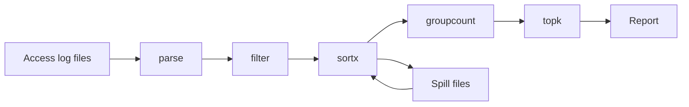
- **parse** and **filter** are stateless line-by-line transforms (the "map" side).
- **sortx** buffers up to the memory limit, sorts, writes a run, and finally does a k-way merge with a heap.
- **groupcount** relies on sorted input so it only remembers the current key — the "reduce" side.

### Data model
| Record | Fields (tab-separated) |
|---|---|
| Parsed hit | ip, timestamp, method, url, status, bytes, user_agent |
| Count | key, count |
| User dimension (for join) | ip, country, org |

### Tech stack
- **Python 3.14** (generators, `heapq.merge`) for clarity, or **Java 25** for speed.
- Plain text files and pipes, no frameworks.

### Milestones
1. **parse, filter, groupcount, topk.** *Done when* the pipeline matches an equivalent `awk | sort | uniq -c | sort -rn | head` on a 100 MB file.
2. **External sort.** *Done when* sorting 5 GB with a 500 MB limit produces output identical to GNU sort.
3. **Sort-merge join.** *Done when* joining hits to a user table gives correct per-country counts.
4. **Benchmark.** *Done when* you have a timing table and a profile showing where the time goes (parsing, I/O, comparison).

### Deep dive: the hard parts
- **K-way merge efficiency.** With many runs, use a heap of (current record, run index). Too many runs exhaust file handles, so merge in multiple passes.
- **Locale and byte order.** Sorting by Unicode collation versus raw bytes gives different orders. Joins and groupings only work if every tool agrees, so fix one comparison rule.
- **Skew.** If one URL dominates, sorting is fine but a later hash-based stage would overload one bucket. Note this for Project 24.

### Testing strategy
Golden-file tests comparing your pipeline to GNU tools. Property test: `sortx` output is a sorted permutation of input.

### Trade-offs, scaling and failure modes
One machine is limited by disk throughput. A crash mid-sort means rerunning from the start, which is fine because inputs are immutable — the same reasoning MapReduce uses for retries.

### Stretch goals
- Parallel `sortx` using multiple cores for run generation.
- A tiny "distributed" version that splits input across two processes and merges.

### Skills practised
- Unix philosophy, sorting versus in-memory aggregation — [Ch 10 — Batch Processing](../chapters/10-batch-processing/README.md)
- Sorted files and merging — [Ch 3 — Storage and Retrieval](../chapters/03-storage-and-retrieval/README.md)

### In the interview
**30-second answer:** I built a set of small Unix-style tools (parse, filter, sortx, groupcount, topk and join) that stream tab-separated records through pipes to answer questions like "top five URLs" over 10 GB of logs. The key piece is sortx, an external merge sort that sorts memory-sized chunks, spills them as sorted runs and then k-way merges them with a heap. The hardest parts were merging many runs without running out of file handles, and making every tool agree on one byte-order comparison. sortx sorted 5 GB with a 500 MB limit and produced output identical to GNU sort.

**Key terms to know:**
- **Unix philosophy** — small programs that do one thing, connected through a uniform interface (lines on stdin and stdout).
- **External merge sort** — sort chunks that fit in memory, write them as runs, then merge the runs. Lets you sort data far larger than RAM.
- **Sorted run (spill file)** — one sorted chunk written to disk during the first phase.
- **K-way merge** — merging k sorted inputs with a heap of (current record, run index), taking the smallest each time.
- **Sort-based grouping** — once data is sorted, equal keys are adjacent, so groupcount only remembers the current key.
- **Sort-merge join** — sort both inputs by the join key and walk them together.
- **Top-k with a heap** — keep a heap of size k so memory stays constant regardless of input size.
- **Collation / byte order** — the comparison rule for sorting. All tools must use the same one or grouping and joins break.

**Q:** Why sort rather than use a hash map to count?

**A:** A hash map must fit in memory. Sorting works on disk with sequential I/O, so grouping scales to data much larger than RAM, and once sorted, equal keys sit next to each other and can be counted in one pass.

**Q:** What makes Unix pipelines composable?

**A:** A uniform interface, lines of text on stdin and stdout, and programs that read input and write output without side effects on their input. Any tool can feed any other, and you can insert, remove or debug stages easily.

**Q:** How do you join two big files without a database?

**A:** Sort both by the join key and walk them together, advancing whichever side has the smaller key and emitting matches when keys are equal. Memory stays small because only the current group of equal keys is held.

**Q:** What happens with thousands of sorted runs?

**A:** Opening them all exhausts file handles and makes the heap large. You merge in multiple passes, for example 100 runs at a time into bigger runs, then merge those. Each pass is sequential I/O, so it stays efficient.

**Q:** Why did locale matter?

**A:** Unicode collation and raw byte order sort strings differently. If sortx sorts one way and join compares another, matching keys are missed. I fixed one comparison rule, raw bytes, across all tools, which is also what LC_ALL=C does for GNU tools.

**Q:** What happens if the sort crashes halfway?

**A:** You rerun it from the start. Inputs are immutable, so a rerun produces the same result, and that is the same reasoning MapReduce uses to retry failed tasks.

**Q:** What breaks at 100x data?

**A:** One machine's disk throughput is the ceiling. The next step is splitting input across machines and partitioning by key, which is MapReduce (Project 24). Skew also matters: a sort handles a dominant key fine, but a later hash-partitioned stage would overload one bucket.

**Q:** How did you test it?

**A:** Golden-file tests against an equivalent awk, sort, uniq and head pipeline. A property test checked sortx output is a sorted permutation of its input. A profile showed whether time went to parsing, I/O or comparisons.

**Common mistakes in answers:**
- Saying sorting is "too slow" for big data. External sort uses sequential I/O and is how big data is grouped.
- Forgetting that every stage must agree on the sort order and key format.
- Assuming you need a cluster. Adam Drake showed one machine with pipes beating a Hadoop cluster on a moderate dataset.

### TL;DR
Build sort, group and join as streaming Unix tools to see that MapReduce is "Unix pipes plus a distributed filesystem".

## 10. Event-sourced ledger with projections

**Level:** Beginner · **Time:** 1–2 weekends · **Prerequisites:** Ch 11, Ch 12

### What it is
A small bank-account service where the source of truth is an append-only table of **events** (`AccountOpened`, `MoneyDeposited`, `MoneyWithdrawn`, `TransferInitiated`) in PostgreSQL. Current balances, statements and fraud flags are **projections** (also called read models): derived tables built by replaying the events. You can delete a projection and rebuild it from scratch at any time.

### The problem it solves
In a normal CRUD design, an `UPDATE balance = 90` destroys the information about *why* the balance changed. Event sourcing keeps the full history, makes auditing natural, and lets you create new views of old data later. Chapter 11 also points out the costs: you need to version events, rebuild views and handle commands that must be validated against current state.

### Real-world examples
- Martin Fowler's [Event Sourcing](https://martinfowler.com/eaaDev/EventSourcing.html) article describes the pattern and its replay and temporal-query benefits.
- [EventStoreDB](https://github.com/eventstore/eventstore) is a database built specifically for event streams with optimistic concurrency per stream.

### Requirements
**Functional**
- Commands: open account, deposit, withdraw, transfer. Withdraw must not overdraw.
- Each command appends events with an expected stream version (**optimistic concurrency**: fail if someone else appended first).
- Projections: current balance, monthly statement, "large withdrawals" alert list.
- `rebuild <projection>` replays all events.
- Temporal query: "what was the balance on 1 March?"

**Non-functional**
- Append latency under 10 ms p99.
- Rebuild 1 million events in under 60 seconds.
- Projections eventually consistent within 1 second.

### The architecture
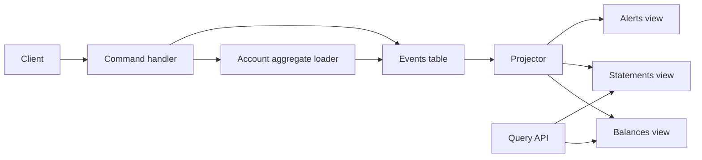
- **Command handler** loads an account by replaying its events (the **aggregate**), validates the command, and appends new events.
- **Events table** is append-only. A unique constraint on (stream_id, version) gives optimistic concurrency for free.
- **Projector** reads events in global order from its last checkpoint and updates views idempotently.

### Data model
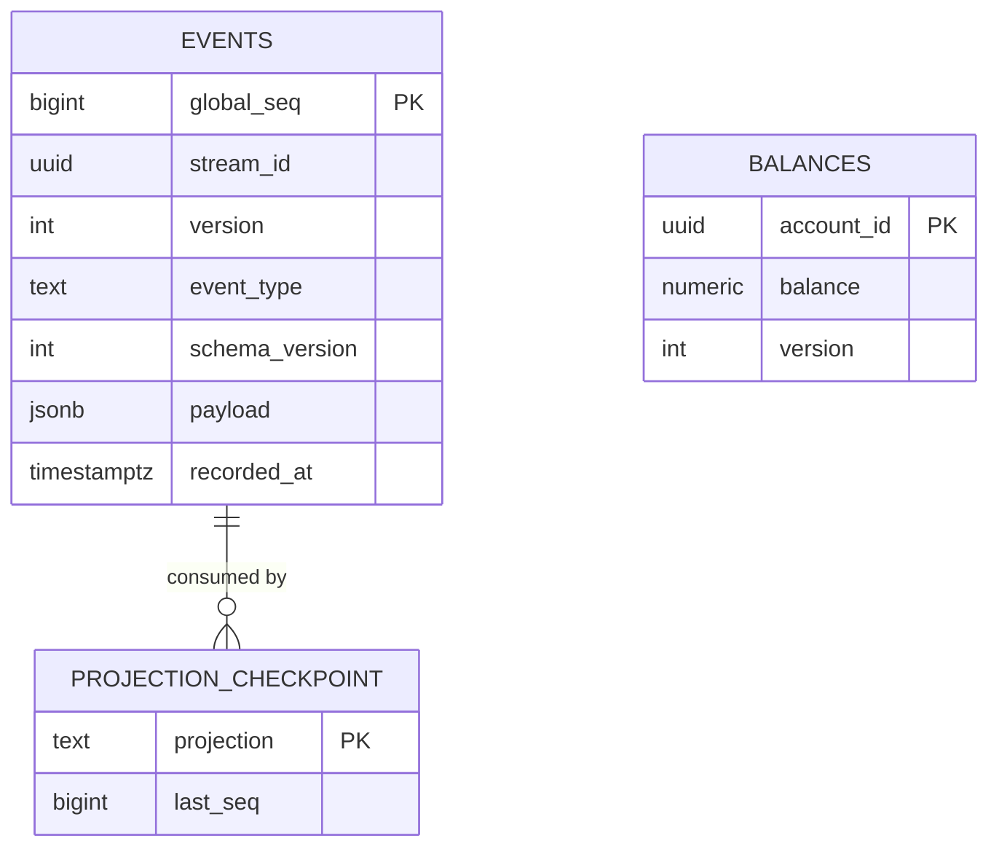

### Tech stack
| Component | Choice | Why |
|---|---|---|
| Store | PostgreSQL | Transactions, unique constraints, `jsonb` |
| Service | Java 25 with Spring Boot 4.1.1, or Python 3.14 with FastAPI | Familiar web stacks |
| Projector | Polling loop on `global_seq` | Simple and reliable to start |

### Milestones
1. **Append and replay.** *Done when* concurrent withdrawals on one account never overdraw (one gets a version conflict and retries).
2. **Balance projection with checkpoint.** *Done when* killing the projector mid-run and restarting produces the same balances (idempotent updates).
3. **Rebuild and temporal query.** *Done when* dropping and rebuilding projections yields identical tables and historical balances are correct.
4. **Event versioning.** Change `MoneyDeposited` to add a currency. *Done when* old events are upcast (converted on read) to the new shape.

### Deep dive: the hard parts
- **Gaps in the global sequence.** PostgreSQL sequences can have gaps, and a transaction with a lower number may commit after one with a higher number. A projector that advances its checkpoint too eagerly can skip an event forever. Read only events older than a small safety lag, or track in-flight transactions.
- **Command versus event.** A command can be rejected. An event is a fact that already happened and must never be rejected by consumers.
- **Snapshots.** Replaying 10,000 events per command is slow. Periodically store a snapshot of aggregate state with its version.

### Testing strategy
Given-when-then tests: given past events, when a command, then expected new events or an error. Rebuild-equivalence test comparing live and rebuilt projections.

### Trade-offs, scaling and failure modes
Read models lag behind writes, so a user may not see their own deposit immediately — fix with read-your-writes by waiting for the projector to reach the command's sequence number. Deleting personal data (for privacy law) from an immutable log needs crypto-shredding or rewriting.

### Stretch goals
- Publish events to Kafka and run projections as consumers.
- Add a `Transfer` saga across two accounts.

### Skills practised
- Event sourcing and immutable logs — [Ch 11 — Stream Processing](../chapters/11-stream-processing/README.md)
- Derived data and unbundling — [Ch 12 — The Future of Data Systems](../chapters/12-future-of-data-systems/README.md)
- Optimistic concurrency — [Ch 7 — Transactions](../chapters/07-transactions/README.md)

### In the interview
**30-second answer:** I built a bank-account service where the source of truth is an append-only events table in PostgreSQL, and balances, statements and fraud alerts are projections rebuilt by replaying those events. The key design choice was optimistic concurrency per account: a unique constraint on (stream_id, version) makes two concurrent appends at the same version conflict, so overdrafts cannot happen without locks. The hardest bug was gaps in the global sequence, where a lower sequence number can commit after a higher one and a projector can skip it forever. Rebuilding projections from 1 million events took under 60 seconds and produced identical tables.

**Key terms to know:**
- **Event sourcing** — storing every change as an immutable event and deriving current state by replaying them.
- **Event vs command** — a command is a request that can be rejected, an event is a fact that already happened and must never be rejected.
- **Aggregate** — the account state rebuilt from its own event stream to validate a command.
- **Optimistic concurrency** — append with an expected version and fail if someone else appended first. Enforced here by a unique constraint.
- **Projection (read model)** — a derived table built from events, which can be dropped and rebuilt.
- **Checkpoint** — the last global sequence a projector has processed, stored so it can resume after a crash.
- **Upcasting** — converting old event versions to the new shape when reading, instead of rewriting history.
- **Snapshot** — saved aggregate state at a version, so commands do not replay thousands of events.

**Q:** What is the difference between event sourcing and change data capture?

**A:** Event sourcing records application-level intent, such as MoneyWithdrawn, as the source of truth. CDC extracts low-level row changes from a database that is still mutable. Event sourcing captures why, CDC captures what changed.

**Q:** How do you enforce "no overdraft" without locks?

**A:** Load the account by replaying its events at version v, check the balance, and append the new event with version v + 1. If another withdrawal appended v + 1 first, the unique constraint fails and the command reloads and retries, so two withdrawals can never both pass the check on stale state.

**Q:** What is a projection?

**A:** A read-optimised view derived from the event log, such as current balances. It can be dropped and rebuilt deterministically by replaying events from the start.

**Q:** Why can a projector skip events, and how did you fix it?

**A:** PostgreSQL sequences are assigned at insert time but transactions commit in any order. A projector that sees event 101 committed while 100 is still in flight may advance its checkpoint past 100 and never read it. I only read events older than a small safety lag, and you can alternatively track in-flight transactions.

**Q:** How do you handle a user who cannot see their own deposit?

**A:** Projections are eventually consistent, so they lag writes. The command returns the global sequence number of its event, and a read waits until the projection's checkpoint reaches that number. That gives read-your-writes without making projections synchronous.

**Q:** How do you change an event's shape?

**A:** Old events are never rewritten. Each has a schema_version, and the reader upcasts old versions to the new shape on load, for example adding a default currency to old MoneyDeposited events.

**Q:** What changes at 100x events?

**A:** Replaying a busy account's history per command gets slow, so you add snapshots. Full projection rebuilds take longer, so you rebuild a new version alongside the old one and switch. Publishing events to Kafka lets many projections consume independently.

**Q:** How do you delete personal data from an immutable log?

**A:** Either rewrite the log without that data, or use crypto-shredding: encrypt each person's data with their own key and delete the key, which makes their events unreadable. This matters for privacy laws like GDPR.

**Q:** How did you test it?

**A:** Given-when-then tests: given past events, when a command runs, then expect specific new events or an error. A rebuild-equivalence test compared live and rebuilt projections, and killing the projector mid-run must still produce the same balances.

**Common mistakes in answers:**
- Treating events as commands that consumers may reject. Events are facts.
- Saying event sourcing gives strong consistency for reads. Projections lag unless you wait for a sequence number.
- Assuming the global sequence has no gaps or commits in order.

### TL;DR
Make the append-only event log the truth and every table a rebuildable view — Chapter 11's event-sourcing ideas on a single PostgreSQL database.

## 11. LSM-tree storage engine

**Level:** Intermediate · **Time:** 2–3 weeks · **Prerequisites:** Ch 3, Projects 1–2

### What it is
A complete **log-structured merge-tree** (LSM-tree) key-value engine. Writes go to a **write-ahead log** (WAL, an append-only file used only for crash recovery) and to an in-memory sorted **memtable**. When the memtable is full it is flushed as an SSTable (Project 2). Reads check the memtable, then SSTables from newest to oldest, skipping files via Bloom filters. A background **compaction** process merges SSTables to drop overwritten values and tombstones.

### The problem it solves
Project 1 needed all keys in RAM and could not do range scans. A B-tree (Project 12) supports both but performs random in-place writes. The LSM-tree turns all writes into sequential I/O and supports ranges, at the cost of read and space amplification that compaction must keep in check. It is the dominant design for write-heavy stores.

### Real-world examples
- O'Neil et al., [The Log-Structured Merge-Tree](https://www.cs.umb.edu/~poneil/lsmtree.pdf) (1996), the original paper.
- [RocksDB](https://rocksdb.org/) (from Facebook, based on LevelDB) is embedded in many systems. LinkedIn's [FollowFeed](https://www.linkedin.com/blog/engineering/feed/followfeed-linkedin-s-feed-made-faster-and-smarter) stores timelines in RocksDB.
- Cassandra and HBase use the same memtable plus SSTable design, as described in the [Bigtable paper](https://research.google/pubs/bigtable-a-distributed-storage-system-for-structured-data/).

### Requirements
**Functional**
- `put`, `get`, `delete`, `scan(start, end)`, plus atomic `write_batch`.
- WAL with group commit, memtable (skip list or balanced tree), flush to Level 0.
- Leveled compaction: L0 files overlap, L1+ files are non-overlapping and each level is about 10x larger.
- Manifest file recording which SSTables belong to which level, updated atomically.
- Snapshots: a reader can pin a sequence number and see a consistent view.

**Non-functional**
- Sustain 100,000 random 100-byte writes per second.
- Point reads p99 under 2 ms with 10 GB of data and a warm block cache.
- Write amplification (bytes written to disk divided by bytes written by the user) measured and reported, target under 20 with leveled compaction.

### The architecture
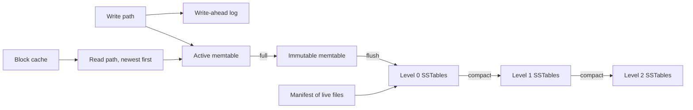
- **Read path** checks the active memtable, then the immutable one, then L0 files newest first, then one file per deeper level, stopping at the first version found.
- **Active memtable** takes writes. When full it becomes **immutable** and a new one starts, so flushing does not block writers.
- **Levels** organise SSTables. Each compaction picks one file from level n and the overlapping files in level n+1, merges them, and writes new files to level n+1.
- **Manifest** is itself a small log of "add file / remove file" edits, so the set of live files survives crashes.
- **Block cache** keeps recently used data blocks in memory (LRU).

### Data model
| Structure | Key fields |
|---|---|
| Internal key | user key, sequence number, kind (put or delete) |
| WAL record | CRC, length, batch of internal keys and values |
| Manifest edit | add or remove file, level, smallest and largest key |
| SSTable | from Project 2, with internal keys |

Internal keys sort by user key ascending, then sequence number *descending*, so the newest version is found first.

### Tech stack
| Component | Choice | Why |
|---|---|---|
| Engine | Java 25 or Go | Threads for background compaction, good byte handling |
| Memtable | Concurrent skip list (`ConcurrentSkipListMap` in Java) | Sorted, lock-free reads |
| Benchmarks | Your own harness modelled on `db_bench` | Compare against RocksDB |
| Python option | Python 3.14 for a teaching version | Slower but clear |

### Milestones
1. **WAL and memtable.** *Done when* a `SIGKILL` loses no acknowledged writes (with sync on) and recovery replays the WAL.
2. **Flush and multi-file reads.** *Done when* reads merge memtable and many L0 files correctly, including tombstones hiding older values.
3. **Leveled compaction and manifest.** *Done when* overwriting 1 million keys 10 times keeps disk usage bounded and recovery after a crash during compaction is correct.
4. **Iterators and snapshots.** *Done when* a scan opened before a batch of writes never sees them.
5. **Measure amplification.** *Done when* you report write, read and space amplification for leveled versus size-tiered compaction on the same workload.

### Deep dive: the hard parts
- **The merging iterator.** A range scan merges iterators over the memtable and every relevant SSTable with a heap, skips older versions of the same key, hides keys shadowed by tombstones and ignores versions newer than the snapshot. Most LSM bugs live here.
- **Dropping tombstones safely.** A tombstone can only be discarded when compaction reaches the bottom level for that key range. Dropping it earlier lets an older value in a lower level "resurrect".
- **Write stalls.** If flushes and compactions fall behind, L0 accumulates files and reads slow down. Real engines throttle writers when L0 grows past a threshold — implement and graph it.
- **Crash during compaction.** New files are written, then the manifest edit is appended. Only after the edit is durable may old files be deleted. Orphaned files at startup are garbage-collected.

### Testing strategy
Model-based testing against an in-memory sorted map, with random crashes injected between operations. A long-running stress test with concurrent readers, writers and compaction. Compare checksums of full scans before and after compaction.

### Trade-offs, scaling and failure modes
Leveled compaction gives low space and read amplification but high write amplification. Size-tiered compaction writes less but uses more space and more files per read. Bloom filters fix point reads but not range scans. SSD wear is driven by write amplification.

### Stretch goals
- Key-value separation (store large values in a separate log, as in WiscKey).
- Universal or tiered compaction and a tuning advisor.
- Per-key TTL that compaction honours.

### Skills practised
- LSM-trees, SSTables, compaction strategies — [Ch 3 — Storage and Retrieval](../chapters/03-storage-and-retrieval/README.md)
- Snapshots as a basis for isolation — [Ch 7 — Transactions](../chapters/07-transactions/README.md)

### In the interview
**30-second answer:** I built an LSM-tree key-value engine: writes go to a write-ahead log and an in-memory skip-list memtable, full memtables are flushed as SSTables, and background leveled compaction merges them into levels about 10x larger each. I chose this design because every disk write is sequential, which suits write-heavy workloads. The hardest parts were the merging iterator, which must hide older versions, tombstones and anything newer than the reader's snapshot, and crash safety during compaction, which I solved with an atomic manifest. I measured and reported write amplification, targeting under 20 with leveled compaction while sustaining around 100,000 random writes per second.

**Key terms to know:**
- **Memtable** — the sorted in-memory buffer (a concurrent skip list) that takes writes. When full it becomes immutable and is flushed.
- **Write-ahead log (WAL)** — an append-only file of every write, used only to rebuild the memtable after a crash.
- **SSTable** — an immutable sorted file (Project 2). Flushes and compactions produce them.
- **Leveled compaction** — L0 files may overlap, L1 and deeper hold non-overlapping files, each level about 10x larger.
- **Size-tiered compaction** — merge several similar-sized files together. Less rewriting, more space and more files per read.
- **Write, read and space amplification** — bytes written to disk per user byte, files touched per read, and disk used per live byte.
- **Tombstone** — a delete marker that hides older values until compaction reaches the bottom level.
- **Manifest** — a log of add-file and remove-file edits recording which SSTables are live, updated atomically.
- **Sequence number and snapshot** — every write gets a sequence number. A reader pins one and ignores anything newer.

**Q:** Why are LSM-trees good for writes?

**A:** All disk writes are sequential: WAL appends, memtable flushes and compaction outputs. Sequential I/O is much faster than random in-place updates, so throughput is high. The price is extra rewriting during compaction.

**Q:** How does a read find the latest value?

**A:** It checks the active memtable, the immutable memtable, then L0 files newest first, then at most one file per deeper level. Bloom filters skip files that cannot hold the key. The first version found wins, and a tombstone means "deleted".

**Q:** Why do internal keys sort sequence numbers descending?

**A:** Internal keys are (user key, sequence number, kind). Sorting the sequence descending puts the newest version of a key first, so a lookup or iterator finds the latest visible version without scanning all of them.

**Q:** What goes wrong if compaction falls behind?

**A:** L0 accumulates files, every read has to check more of them, and disk fills with obsolete data. Real engines throttle or stall writers when L0 passes a threshold so compaction can catch up. I implemented and graphed these write stalls.

**Q:** Leveled versus size-tiered?

**A:** Leveled keeps one sorted run per level for cheaper reads and less space, at the cost of rewriting data more often, so higher write amplification. Size-tiered rewrites less but keeps more overlapping files, so reads and space suffer. I measured both on the same workload.

**Q:** When can a tombstone be dropped?

**A:** Only when compaction reaches the bottom level for that key range, or when no older version exists below. Dropping it earlier lets an older value in a lower level resurrect, which is one of the classic LSM bugs.

**Q:** What happens if the process crashes during compaction?

**A:** New files are written first, then the manifest edit is appended and synced, and only then are old files deleted. On restart the manifest is the source of truth, so orphaned new files from an unfinished compaction are just garbage-collected.

**Q:** What changes at 10x data?

**A:** More levels means more write amplification and more SSD wear. Bloom filters and index blocks no longer fit in memory, so the block cache matters more. Large values are expensive to rewrite during compaction, which is why designs like WiscKey separate values into their own log.

**Q:** How did you prove it correct?

**A:** Model-based tests ran random operations against the engine and an in-memory sorted map, with crashes injected between operations. A stress test ran readers, writers and compaction together, and I compared checksums of full scans before and after compaction.

**Common mistakes in answers:**
- Saying LSM-trees have no write amplification because they only append. Compaction rewrites data many times.
- Claiming Bloom filters speed up range scans. They only help point lookups.
- Deleting old SSTables before the manifest edit is durable, which can lose data on crash.

### TL;DR
Memtable plus WAL plus levels of SSTables plus compaction — build the write-optimised engine behind RocksDB, Cassandra and HBase and measure its amplification trade-offs.

## 12. B-tree page store with WAL

**Level:** Intermediate · **Time:** 2–3 weeks · **Prerequisites:** Ch 3, Ch 7

### What it is
A disk-based **B+ tree** — a balanced tree of fixed-size **pages** (say 4 KB) where interior pages hold keys and child pointers and leaf pages hold key-value pairs linked left-to-right — with a **buffer pool** (an in-memory cache of pages) and a **write-ahead log** that makes page updates crash-safe. Recovery replays the log after a crash, following the "redo" half of the ARIES approach.

### The problem it solves
B-trees are the standard index in relational databases. They update data in place, which makes reads predictable (one path from root to leaf) but makes crashes dangerous: a page split modifies several pages, and a crash halfway leaves the tree corrupt. The WAL solves this by recording intent before touching pages.

### Real-world examples
- PostgreSQL's [WAL introduction](https://www.postgresql.org/docs/current/wal-intro.html) explains why logging changes before writing data pages enables recovery and fewer disk writes.
- PostgreSQL's [B-tree index implementation docs](https://www.postgresql.org/docs/current/btree.html) and [page layout docs](https://www.postgresql.org/docs/current/storage-page-layout.html) show real page headers and item pointers.
- The [SQLite file format](https://www.sqlite.org/fileformat.html) documents its B-tree pages and its rollback journal and WAL modes in detail.

### Requirements
**Functional**
- `insert`, `get`, `delete`, `range_scan` on a single file of 4 KB pages.
- Page splits and (optionally) merges, with the root changing as the tree grows.
- Buffer pool with a fixed number of frames, pin counts and LRU or clock eviction.
- WAL: every page modification is logged with a **log sequence number** (LSN) before the page may be written to disk.
- Checkpoints, and recovery that redoes logged changes newer than each page's LSN.

**Non-functional**
- A lookup touches at most `height` pages (height is 3–4 for millions of keys).
- 20,000 random inserts per second with group commit.
- Survives `SIGKILL` at any point without losing acknowledged inserts or corrupting the tree.

### The architecture
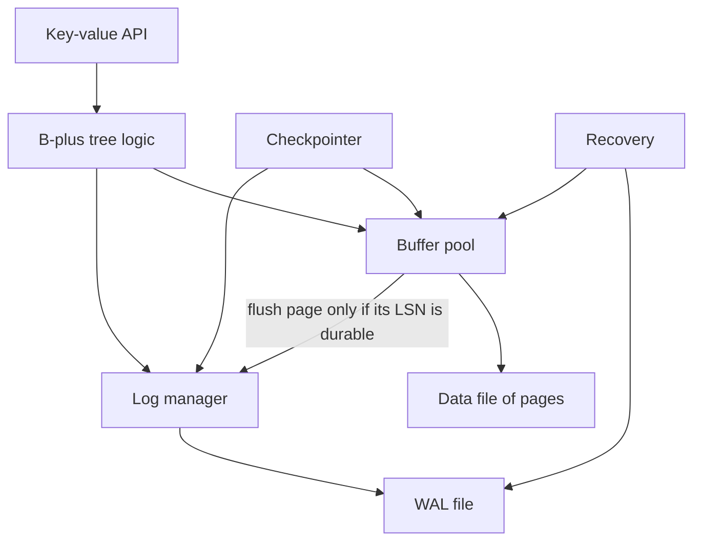
- **B-plus tree logic** finds leaves, splits full pages and updates parents.
- **Buffer pool** keeps hot pages in memory, tracks which are dirty, and writes them back on eviction.
- **Log manager** appends log records and forces the log to disk on commit. The **WAL rule** — never write a dirty page before the log record describing its latest change is on disk — is enforced here.
- **Checkpointer** periodically flushes dirty pages and records the point from which recovery must start.

### Data model
| Structure | Fields |
|---|---|
| Page header | page id, page type (leaf or interior), page LSN, key count, right sibling |
| Leaf cell | key length, key, value length, value |
| Interior cell | key, child page id |
| Log record | LSN, transaction id, page id, kind, redo bytes (physical or logical) |
| Checkpoint record | dirty page table, active transactions |

### Tech stack
- **Java 25** (`FileChannel`, `ByteBuffer` slices per frame) or **Go**.
- **Python 3.14** is workable for a teaching version with small data.
- A fault-injecting file wrapper that can drop unflushed writes to simulate power loss.

### Milestones
1. **In-memory B+ tree over page objects.** *Done when* random insert/delete tests keep all invariants (sorted keys, balanced height, half-full pages if merging).
2. **Paged file and buffer pool.** *Done when* the tree works with a pool of 64 frames over a 1 GB file.
3. **WAL and redo recovery.** *Done when* a crash test that kills the process randomly 1,000 times never yields a corrupt tree or lost committed key.
4. **Checkpoints.** *Done when* recovery time is bounded regardless of total log size.
5. **Concurrency.** *Done when* readers and writers run in parallel using latch crabbing (hold a child's latch before releasing the parent's).

### Deep dive: the hard parts
- **Torn pages.** A 4 KB page write may be only partly on disk after power loss. PostgreSQL handles this by logging a full page image the first time a page is modified after a checkpoint. Implement the same and measure the extra log volume.
- **Splits are multi-page changes.** Splitting a leaf touches the leaf, its new sibling and the parent. Log all three changes so redo restores a consistent tree.
- **Latches versus locks.** **Latches** are short-held mutexes protecting in-memory page structures. **Locks** protect logical data for transactions. Do not confuse them, and never hold a latch while waiting on I/O for another page if you can avoid it.

### Testing strategy
Invariant checker that walks the whole tree. Crash-loop harness with a fault-injecting file layer. Concurrency stress tests run under thread sanitiser equivalents or many random seeds.

### Trade-offs, scaling and failure modes
B-trees give fast, predictable reads and natural range scans but write each changed page in full (write amplification), and leave fragmentation after deletes. Compared with Project 11, compare write throughput and read latency on identical workloads.

### Stretch goals
- Undo logging and transactions with rollback (full ARIES).
- Copy-on-write B-tree (like LMDB) instead of WAL, and compare.
- Prefix compression and suffix truncation in interior pages.

### Skills practised
- B-trees, WAL, crash safety — [Ch 3 — Storage and Retrieval](../chapters/03-storage-and-retrieval/README.md)
- Atomicity and durability — [Ch 7 — Transactions](../chapters/07-transactions/README.md)

### In the interview
**30-second answer:** I built a disk-based B+ tree of 4 KB pages with a buffer pool and a write-ahead log, using redo recovery in the style of ARIES. The central rule I enforced is the WAL rule: a dirty page can only be written to disk once the log record describing its latest change is durable. The hardest part was page splits, which change three pages at once, so I logged all three changes and added full-page images to survive torn pages. A crash loop that killed the process 1,000 times never left a corrupt tree or lost a committed key, and lookups touch at most the tree height, three or four pages.

**Key terms to know:**
- **B+ tree** — a balanced tree of fixed-size pages. Interior pages hold keys and child pointers, leaves hold key-value pairs linked left to right.
- **Page split** — when a page is full, half its entries move to a new sibling and a separator key goes up to the parent.
- **Buffer pool** — a fixed set of in-memory frames caching pages, with pin counts, dirty flags and LRU or clock eviction.
- **Write-ahead log (WAL)** — a log of every change, forced to disk before the changed page may be written.
- **Log sequence number (LSN)** — the position of a log record. Each page stores the LSN of its latest change.
- **Redo recovery** — after a crash, replay log records newer than each page's LSN.
- **Checkpoint** — flushing dirty pages and recording where recovery must start, so recovery time is bounded.
- **Torn page and full-page image** — a 4 KB write can be half on disk after power loss. Logging the whole page the first time it changes after a checkpoint fixes it.
- **Latch vs lock** — a latch is a short mutex on an in-memory page, a lock protects logical data for a transaction.

**Q:** What is the WAL rule?

**A:** A modified page may only be written to disk after the log records describing that change are durable. Then, whatever state the page is in after a crash, recovery can redo the change from the log.

**Q:** Why is a B-tree's depth small?

**A:** The branching factor is high: a 4 KB page holds hundreds of child pointers. With a branching factor of 500, four levels address over 60 billion keys, so a lookup reads only a handful of pages.

**Q:** How does redo recovery decide what to replay?

**A:** It starts from the last checkpoint and reads log records forward. For each record it compares the record's LSN with the page's stored LSN, and only reapplies the change if the page is older. That makes redo idempotent, safe to run twice.

**Q:** Why do splits need special care?

**A:** A leaf split modifies the full leaf, its new sibling and the parent. If a crash leaves only some of those on disk, the tree is inconsistent. Logging all three before any page is written lets redo restore a consistent tree.

**Q:** What is a torn page and how did you handle it?

**A:** Power loss can leave a 4 KB page partly old and partly new, and redo cannot apply a change to a garbled page. Like PostgreSQL, I log a full page image the first time a page is modified after each checkpoint, and measured how much extra log volume that costs.

**Q:** How do readers and writers run concurrently?

**A:** With latch crabbing: take a child's latch before releasing the parent's, and release ancestors early once a node is known to be safe from splitting. Latches are short and never held while waiting for unrelated I/O if you can avoid it.

**Q:** B-tree or LSM for a read-heavy workload?

**A:** Usually a B-tree, because each key lives in exactly one place and a lookup follows one root-to-leaf path with predictable latency. LSM-trees win for write-heavy workloads. I compared both on identical workloads.

**Q:** What changes at 10x data?

**A:** The working set no longer fits in the buffer pool, so random reads hit disk and eviction policy matters. Checkpoints write more dirty pages at once, causing I/O spikes, so you spread them out. Random page writes and fragmentation after deletes become the main costs.

**Q:** How did you test it?

**A:** An invariant checker walks the whole tree: sorted keys, equal leaf depth and correct parent separators. A crash-loop harness used a fault-injecting file layer that drops unflushed writes to simulate power loss.

**Common mistakes in answers:**
- Saying the WAL is written after the data page. The log must be durable first.
- Confusing latches with transaction locks.
- Claiming B-trees have no write amplification. Changing one byte rewrites a whole page.

### TL;DR
Fixed-size pages, a buffer pool, and a write-ahead log with redo recovery — the in-place update engine behind PostgreSQL and SQLite.

## 13. Column store with vectorised aggregation

**Level:** Intermediate · **Time:** 2 weeks · **Prerequisites:** Ch 3

### What it is
An analytics engine that stores each column of a table in its own file, compresses columns with **run-length encoding** (store "value, count" for repeated runs), **dictionary encoding** (replace strings with small integer codes) and **bitmaps** (one bit per row per distinct value), and runs `SELECT SUM(x) WHERE y = ... GROUP BY z` queries by processing columns in batches of a few thousand values at a time (**vectorised execution**).

### The problem it solves
Analytical queries read few columns but many rows. A row store must read every column of every row, wasting I/O. Storing columns separately lets the engine read only what it needs, and similar values next to each other compress extremely well. Chapter 3 explains this split between OLTP (transaction processing) and OLAP (analytics).

### Real-world examples
- [Apache Parquet](https://parquet.apache.org/docs/) is an open columnar file format with row groups, column chunks, dictionary and run-length encodings.
- [DuckDB](https://duckdb.org/why_duckdb) is an embedded analytical database using columnar, vectorised execution.
- [ClickHouse](https://clickhouse.com/docs/en/intro) is a columnar OLAP database that explains why column orientation speeds up analytics.

### Requirements
**Functional**
- Import CSV into a columnar table split into **row groups** (for example 1 million rows each).
- Per-column encodings chosen automatically: plain, dictionary, run-length, bit-packed.
- Min/max statistics per column chunk ("zone maps") to skip row groups.
- Query operators: scan, filter, project, hash aggregate, sort, limit.
- A tiny SQL subset or a builder API.

**Non-functional**
- Scan-and-sum a 100-million-row integer column in under 1 second on a laptop (multithreaded).
- Compression ratio at least 5x on a sorted, low-cardinality column.

### The architecture
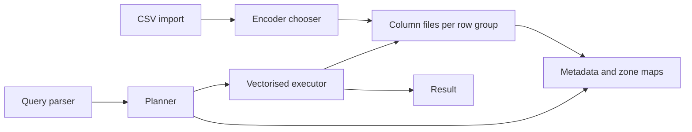
- **Encoder chooser** samples each chunk and picks the encoding with the smallest output.
- **Metadata and zone maps** let the planner skip row groups whose min/max cannot match the filter.
- **Vectorised executor** passes batches (vectors) between operators so each operator runs a tight loop over primitive arrays, which keeps the CPU cache warm and lets the compiler use SIMD instructions.

### Data model
| Item | Contents |
|---|---|
| Table metadata | columns, types, row group list, sort key |
| Column chunk | encoding, compressed bytes, null bitmap, min, max, distinct estimate |
| Dictionary page | code to value array |
| Batch | selection vector plus column vectors of up to 2,048 values |

### Tech stack
| Component | Choice | Why |
|---|---|---|
| Engine | Java 25 (Vector API incubator for SIMD) or Go | Tight loops over arrays |
| Python option | Python 3.14 with NumPy | Vectorisation via array ops |
| Reference | DuckDB or PostgreSQL | Check results and compare speed |

### Milestones
1. **Plain columnar files and full scan.** *Done when* `SUM` and `COUNT` match PostgreSQL on the same data.
2. **Encodings.** *Done when* a table of compression ratios per column and encoding is produced.
3. **Operate on compressed data.** *Done when* filters on dictionary codes and run-length runs work without decompressing to strings.
4. **Vectorised operators and zone maps.** *Done when* a selective filter skips at least 90% of row groups on a sorted column and you show the speedup.
5. **Group-by.** *Done when* a hash aggregate over a dictionary-encoded column runs using codes as array indexes.

### Deep dive: the hard parts
- **Sort order matters.** Sorting rows by the most filtered column makes run-length encoding and zone maps powerful for that column, but only the first sort key benefits fully. Chapter 3 mentions storing several sort orders, as C-Store and Vertica did.
- **Late materialisation.** Apply filters to produce a selection vector of row positions first, and only fetch the other columns for qualifying rows.
- **Writes are hard.** Inserting into sorted compressed columns is expensive. Buffer inserts in a row-oriented in-memory store and periodically merge into new column files — LSM thinking again.

### Testing strategy
Differential testing: generate random queries, run them on your engine and on DuckDB or PostgreSQL, compare results. Encoding round-trip property tests.

### Trade-offs, scaling and failure modes
Column stores are poor for point lookups and single-row updates. Very wide `SELECT *` queries lose the I/O advantage. Memory for hash aggregates can blow up with high-cardinality group keys — spill to disk.

### Stretch goals
- Bitmap indexes with compressed bitmaps (Roaring-style) and AND/OR across predicates.
- Materialised aggregates (a data cube) for common queries.
- Read and write real Parquet files.

### Skills practised
- Column-oriented storage, compression, data warehousing — [Ch 3 — Storage and Retrieval](../chapters/03-storage-and-retrieval/README.md)
- Batch processing of analytics data — [Ch 10 — Batch Processing](../chapters/10-batch-processing/README.md)

### In the interview
**30-second answer:** I built a column store that splits imported CSV data into row groups, stores each column separately with automatically chosen plain, dictionary, run-length or bit-packed encoding, and runs filter, group-by and aggregate queries over batches of up to 2,048 values. Column orientation was the key decision, because analytical queries read few columns but many rows. The hardest parts were operating directly on compressed data and using zone maps and late materialisation so most row groups were never touched. A selective filter on a sorted column skipped over 90% of row groups, and a sorted low-cardinality column compressed more than 5x.

**Key terms to know:**
- **OLTP vs OLAP** — transaction processing touches few rows by key, analytics scans many rows but few columns.
- **Column-oriented storage** — each column in its own file so queries read only the columns they need.
- **Row group / column chunk** — a horizontal slice of rows (say 1 million), and one column's data within it.
- **Dictionary encoding** — replace repeated strings with small integer codes plus a lookup table.
- **Run-length encoding (RLE)** — store (value, count) for runs of equal values. Excellent on sorted columns.
- **Zone map** — min and max per column chunk, letting the planner skip chunks that cannot match a filter.
- **Vectorised execution** — operators pass arrays of values, so each runs a tight loop that is cache-friendly and SIMD-friendly.
- **Late materialisation** — filter first to get a selection vector of matching rows, then fetch other columns only for those rows.

**Q:** Why are column stores faster for analytics?

**A:** Queries read only the columns they need, values of one type next to each other compress very well, and processing contiguous arrays uses CPU caches and SIMD efficiently. A row store would read every column of every row.

**Q:** What is a zone map?

**A:** Per-chunk minimum and maximum values. If a filter asks for x > 1000 and a chunk's max is 900, the chunk is skipped without reading it. They are most powerful on the sort key.

**Q:** Why does sort order matter so much?

**A:** Sorting by a column makes its equal values contiguous, so RLE becomes tiny and zone maps become precise. Only the first sort key benefits fully, which is why C-Store and Vertica kept several copies sorted differently.

**Q:** How can you filter without decompressing?

**A:** With dictionary encoding you translate the predicate, for example country = 'FR', into its code once and compare integers. With RLE you test each run once instead of each row. Group-by can use dictionary codes directly as array indexes.

**Q:** How do column stores handle writes?

**A:** Badly in place, because inserting into sorted compressed columns means rewriting them. They buffer inserts in a row-oriented in-memory store and periodically merge into new column files in bulk, which is the LSM idea again.

**Q:** What is vectorised execution and why is it fast?

**A:** Instead of passing one row at a time through operators, each operator processes a batch of a few thousand values in a tight loop. That removes per-row function-call overhead, keeps data in CPU cache and lets the compiler use SIMD instructions.

**Q:** What breaks at 100x data or with high-cardinality keys?

**A:** Hash aggregates over a high-cardinality group key can exceed memory, so they must spill partitions to disk. Single-machine scan bandwidth becomes the limit, so you parallelise across cores and then partition across machines. Very wide SELECT * queries also lose the I/O advantage.

**Q:** When is a column store a bad choice?

**A:** For point lookups and single-row updates, because one logical row is spread across many files. Fetching or changing one row touches every column.

**Q:** How did you test correctness?

**A:** Differential testing: generate random queries, run them on my engine and on DuckDB or PostgreSQL, and compare results. Encoding round-trip property tests checked decode(encode(x)) equals x for every encoding.

**Common mistakes in answers:**
- Saying column stores are just "faster databases". They are slower for OLTP-style point reads and updates.
- Confusing a column store with a wide-column store like Bigtable, which is row-oriented within column families.
- Ignoring that compression depends heavily on sort order and cardinality.

### TL;DR
Store columns separately, compress them cleverly and process them in vectors — the design behind Parquet, DuckDB and ClickHouse.

## 14. Inverted-index search engine

**Level:** Intermediate · **Time:** 2 weeks · **Prerequisites:** Ch 3, Ch 6

### What it is
A full-text search engine for a collection of documents (for example Wikipedia abstracts). It tokenises text, builds an **inverted index** (a map from each term to a **posting list** — the sorted list of document ids containing it, with positions), ranks results with BM25, supports phrase and fuzzy queries, and is organised as immutable **segments** that are merged in the background — the same log-structured idea as Project 11 applied to search.

### The problem it solves
A B-tree or hash index answers "find rows where key equals X". Search needs "find documents containing these words, roughly, ranked by relevance". Chapter 3 introduces full-text and fuzzy indexes. Chapter 6 shows how such indexes are partitioned (by document) across machines.

### Real-world examples
- [Apache Lucene](https://lucene.apache.org/) is the library behind Elasticsearch and Solr, built from immutable segments merged over time.
- Elastic's article [Elasticsearch from the Bottom Up](https://www.elastic.co/blog/found-elasticsearch-from-the-bottom-up) walks through inverted indexes, segments and shards.

### Requirements
**Functional**
- Analyse text: lowercase, split on non-letters, optional stemming and stop words.
- Index documents into in-memory buffers, flushed as immutable segments.
- Query types: term, boolean AND/OR/NOT, phrase (using positions), prefix, and fuzzy (edit distance up to 2).
- BM25 ranking with top-k results.
- Deletes via a per-segment "deleted docs" bitmap, purged at merge time.

**Non-functional**
- Index 1 million short documents in under 5 minutes.
- p99 query latency under 50 ms for two-term AND queries.
- New documents become searchable within 1 second (near-real-time refresh).

### The architecture
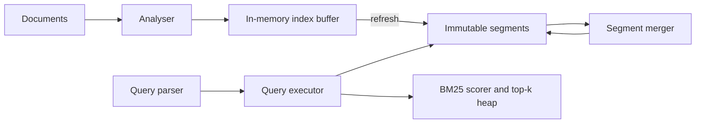
- **Analyser** turns text into terms. Index and query must use the same analyser or matches fail.
- **Immutable segments** each contain a term dictionary, posting lists, positions and stored fields.
- **Segment merger** combines small segments into bigger ones and drops deleted documents.
- **Query executor** intersects posting lists by walking them in parallel (leapfrogging with skip pointers).

### Data model
| Structure | Contents |
|---|---|
| Term dictionary | sorted terms, each with document frequency and posting offset |
| Posting list | delta-encoded doc ids, term frequencies, positions |
| Stored fields | original document by doc id |
| Segment metadata | doc count, deleted bitmap, generation number |

### Tech stack
- **Java 25** (natural fit, and you can compare with Lucene) or **Python 3.14** for a smaller corpus.
- Variable-byte or frame-of-reference encoding for posting lists.
- A finite-state automaton or a sorted array with binary search for the term dictionary.

### Milestones
1. **Single-segment index and term queries.** *Done when* results match a brute-force scan.
2. **Boolean and phrase queries.** *Done when* phrase queries use positions and match exactly.
3. **Segments, refresh and merge.** *Done when* indexing continues during merges and deletes disappear after merge.
4. **Ranking and fuzzy search.** *Done when* BM25 orders results sensibly and "databse" finds "database" via a Levenshtein automaton or n-gram candidate generation.
5. **Sharding.** *Done when* two index shards are queried in parallel and results merged by score.

### Deep dive: the hard parts
- **Fast intersection.** Two posting lists of millions of entries must be intersected without reading every entry. Skip pointers let you jump ahead to the next candidate doc id.
- **Global statistics with shards.** BM25 uses document frequency. Each shard only knows its own, so scores differ across shards. Either accept it or do a pre-query to gather global stats.
- **Fuzzy matching cost.** Enumerating all terms within edit distance 2 is expensive. Intersecting the term dictionary with a Levenshtein automaton keeps it tractable.

### Testing strategy
Brute-force oracle over a small corpus for every query type. Relevance sanity tests with hand-labelled queries. Merge correctness: search results identical before and after merging.

### Trade-offs, scaling and failure modes
More segments mean faster refresh but slower queries. Document-partitioned (local) indexes need scatter-gather queries. Term-partitioned (global) indexes make writes touch many shards — see Project 18.

### Stretch goals
- Faceted counts (group results by category).
- Index from a Kafka topic fed by CDC (Project 22).

### Skills practised
- Full-text and fuzzy indexes, segments — [Ch 3 — Storage and Retrieval](../chapters/03-storage-and-retrieval/README.md)
- Partitioning secondary indexes — [Ch 6 — Partitioning](../chapters/06-partitioning/README.md)

### In the interview
**30-second answer:** I built a mini Lucene: documents are analysed into terms, indexed into an in-memory buffer, and flushed as immutable segments, each with a term dictionary and delta-encoded posting lists with positions. I chose immutable segments merged in the background, the same log-structured idea as an LSM-tree, so indexing never blocks queries and deletes are just bitmap entries. The hardest parts were fast posting-list intersection with skip pointers and fuzzy search with edit distance up to 2. My targets were new documents searchable within 1 second and two-term AND queries under 50 ms at p99, with BM25 ranking and two shards merged by score.

**Key terms to know:**
- **Inverted index** — a map from each term to the documents that contain it, so queries look up terms instead of scanning documents.
- **Posting list** — the sorted doc ids for one term, with term frequencies and positions, delta-encoded to compress.
- **Analyser** — the pipeline that lowercases, splits, stems and removes stop words. Indexing and querying must use the same one.
- **Segment** — an immutable mini-index. New documents create new segments and a merger combines them.
- **Near-real-time refresh** — flushing the buffer into a searchable segment frequently, here within 1 second.
- **BM25** — a relevance score based on term frequency, inverse document frequency and document length.
- **Skip pointers** — shortcuts in a posting list so intersection can jump ahead instead of reading every entry.
- **Levenshtein automaton** — a state machine accepting all strings within edit distance k, intersected with the term dictionary for fuzzy search.
- **Document-partitioned shard** — each shard indexes its own documents, so queries scatter to all shards.

**Q:** What is an inverted index?

**A:** A mapping from each term to the list of documents, and positions, that contain it. A query for "distributed database" looks up two posting lists and intersects them, instead of scanning every document.

**Q:** Why are search segments immutable?

**A:** They can be cached, compressed and read without locks. Updates create new segments, deletes set bits in a per-segment deleted-docs bitmap, and merging cleans up, which is the LSM idea applied to search.

**Q:** How do you intersect two long posting lists quickly?

**A:** Walk both sorted lists together, always advancing the one with the smaller doc id. Skip pointers let you jump ahead to the next candidate instead of reading every entry, so an AND of a rare and a common term costs roughly the size of the rare list.

**Q:** How do phrase queries work?

**A:** Positions are stored per term per document. For "data systems", find documents containing both terms, then check that some position of "systems" is exactly one more than a position of "data".

**Q:** How do you run a query across shards?

**A:** Scatter it to every shard, have each return its own top-k with scores, and merge into a global top-k with a heap. Latency is set by the slowest shard, which is the tail amplification from Project 3.

**Q:** Why do scores differ between shards?

**A:** BM25 uses document frequency, and each shard only knows its own. A rare term on one shard looks common on another, so scores are not quite comparable. You either accept it or run a pre-query that collects global statistics.

**Q:** What is the trade-off in refresh frequency?

**A:** Frequent refreshes make new documents searchable sooner but create many small segments, and every query must search all of them. The merger keeps the segment count down at the cost of background I/O.

**Q:** What changes at 100x documents?

**A:** One machine cannot hold the index, so you add document-partitioned shards and replicas. Merges of huge segments become I/O-heavy and need throttling. A term-partitioned global index would make reads cheaper but writes touch many shards (Project 18).

**Q:** How did you test it?

**A:** A brute-force oracle scanned every document of a small corpus for each query type and compared results. I checked search results were identical before and after merging, and ran relevance sanity checks with hand-labelled queries.

**Common mistakes in answers:**
- Saying a B-tree index can serve full-text search well. It finds exact keys or prefixes, not words inside text ranked by relevance.
- Forgetting that indexing and querying must use the same analyser.
- Thinking deletes remove documents immediately. They are masked by a bitmap until a merge.

### TL;DR
Tokenise, invert, segment, merge and rank — a mini Lucene that shows how log-structured ideas power full-text search.

## 15. Leader-follower replication with failover

**Level:** Intermediate · **Time:** 2–3 weeks · **Prerequisites:** Ch 5, Ch 8

### What it is
A replicated key-value service with one **leader** (accepts writes) and several **followers** (apply the leader's **replication log** and serve reads). It supports synchronous and asynchronous followers, catch-up for new followers from a snapshot plus log, and automatic **failover** (promoting a follower when the leader dies) with epoch numbers to stop an old leader from accepting writes.

### The problem it solves
A single node is a single point of failure and a throughput ceiling for reads. Replication gives availability and read scaling, but Chapter 5 shows the traps: lost writes on failover with async replication, two nodes both believing they are leader (**split brain**), and stale reads from lagging followers.

### Real-world examples
- PostgreSQL [log-shipping and streaming replication](https://www.postgresql.org/docs/current/warm-standby.html) is the canonical leader-follower design (primary and standbys).
- GitHub's [October 21 post-incident analysis](https://github.blog/news-insights/company-news/oct21-post-incident-analysis/) describes how a 43-second network partition triggered a cross-data-centre MySQL failover, leaving some writes on the old primary that never reached the new one and had to be reconciled manually.

### Requirements
**Functional**
- Leader appends each write to a log with a monotonically increasing **log position**, then ships entries to followers.
- Configurable: fully async, one synchronous follower ("semi-synchronous"), or all synchronous.
- Follower catch-up: new followers load a snapshot taken at a known log position, then stream the rest.
- Failure detection (reuse Project 8), election of the most up-to-date follower, and epoch-based fencing.
- Clients discover the current leader via a small config service or by redirect.

**Non-functional**
- Replication lag under 100 ms on a local network at 5,000 writes per second.
- Failover completes within 10 seconds of leader death.
- With one synchronous follower, zero acknowledged writes lost on single-node failure.

### The architecture
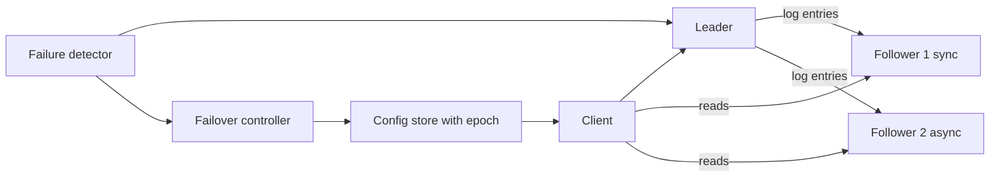
- **Leader** owns the log and the epoch number. It acknowledges a write after its own fsync plus any required synchronous follower acks.
- **Followers** apply entries in order and report their applied position.
- **Failover controller** watches the detector, chooses the follower with the highest position, increments the epoch and records it in the **config store**. Any node seeing a higher epoch steps down.

### Data model
| Item | Fields |
|---|---|
| Log entry | epoch, position, key, value or tombstone |
| Follower state | node id, applied position, last heartbeat |
| Config record | epoch, leader id, member list |
| Snapshot | position, compacted key-value pairs |

### Tech stack
| Component | Choice | Why |
|---|---|---|
| Nodes | Java 25 or Go | Long-lived network services |
| Storage | Project 1 or 11 engine, or RocksDB | Reuse your work |
| Transport | gRPC streaming or plain TCP | Ordered streams |
| Config store | etcd or a single PostgreSQL row with compare-and-set | Atomic epoch increment |

### Milestones
1. **Async log shipping.** *Done when* followers converge to the leader's state after a burst of writes.
2. **Synchronous mode and lag metrics.** *Done when* you can show lost writes in async mode after killing the leader and none in sync mode.
3. **Snapshot catch-up.** *Done when* a brand-new follower joins a store with 10 million keys without stopping writes.
4. **Failover with epochs.** *Done when* an old leader that wakes up after a pause has its writes rejected and steps down.
5. **Read-your-writes.** *Done when* clients that send their last write position to a follower only get answers once the follower has caught up to it.

### Deep dive: the hard parts
- **Choosing the new leader.** With async replication the most up-to-date follower may still miss writes. Those writes are lost, or must be reconciled. Make this visible in metrics rather than hiding it.
- **Old leader comes back.** It may have writes no follower has. A simple design discards them (truncate the log to the new leader's history). Keeping them means reconciling by hand — the painful path GitHub took in 2018, replaying the stranded writes from MySQL binary logs.
- **Fencing.** Epoch numbers must be checked by *every* receiver of a write (followers and storage), not just by the old leader itself, because a paused process cannot be trusted to check the time.

### Testing strategy
A Docker Compose cluster plus a fault-injection script (kill, pause with `SIGSTOP`, partition with `iptables`). After each scenario, check: every acknowledged write in sync mode survives, and no two leaders acknowledge writes in the same epoch.

### Trade-offs, scaling and failure modes
Synchronous replication protects data but stalls writes when a follower is slow. Async is fast but loses recent writes on failover. Too-short failover timeouts cause unnecessary failovers. Followers scale reads only if clients tolerate lag.

### Stretch goals
- Chain replication as an alternative topology.
- Logical (row-based) versus statement-based log format, and why statements with `NOW()` break replicas.

### Skills practised
- Leaders and followers, replication lag, failover — [Ch 5 — Replication](../chapters/05-replication/README.md)
- Fencing and process pauses — [Ch 8 — The Trouble with Distributed Systems](../chapters/08-trouble-with-distributed-systems/README.md)

### In the interview
**30-second answer:** I built a leader-follower replicated key-value service: the leader appends each write to a log with an increasing position and streams it to followers, which apply it in order and serve reads. It supports fully asynchronous, semi-synchronous and fully synchronous followers, snapshot catch-up for new followers, and automatic failover fenced by epoch numbers. The hardest part was failover safety: choosing the most up-to-date follower, and making every node reject writes stamped with an old epoch so a paused old leader cannot cause split brain. With one synchronous follower, killing the leader lost zero acknowledged writes, and failover completed within 10 seconds.

**Key terms to know:**
- **Leader and followers** — one node accepts writes and ships its replication log, the others replay it and serve reads.
- **Replication log position** — a monotonically increasing index of each write, used to measure lag and pick a new leader.
- **Synchronous vs asynchronous replication** — whether the leader waits for a follower's ack before acknowledging the client.
- **Semi-synchronous** — exactly one follower is synchronous, so at least two nodes have every acknowledged write.
- **Replication lag** — how far a follower's applied position trails the leader's.
- **Failover** — promoting a follower when the leader dies, then redirecting clients.
- **Split brain** — two nodes both believing they are leader and accepting writes.
- **Epoch (fencing)** — a number incremented on each failover. Every receiver rejects requests with an older epoch.
- **Read-your-writes** — a user always sees their own earlier writes, even when reading from a follower.

**Q:** What happens to un-replicated writes when an async leader fails?

**A:** Writes acknowledged by the leader but not yet shipped are lost when a follower is promoted. If the old leader rejoins, its extra writes conflict with the new leader's history, and the simple safe choice is to truncate them.

**Q:** How do you prevent split brain?

**A:** Store a monotonically increasing epoch in a consensus-backed config store, increment it on every failover, and have every node and storage layer reject requests carrying an older epoch. A paused old leader cannot be trusted to check its own status, so receivers must check.

**Q:** How do you give read-your-writes with followers?

**A:** Return the log position of each write to the client, and have a follower serve that client's read only once it has applied at least that position. Otherwise route the read to the leader.

**Q:** Synchronous or asynchronous replication?

**A:** Synchronous protects every acknowledged write but stalls writes if a follower is slow or down. Asynchronous is fast but loses recent writes on failover. Semi-synchronous, one sync follower, is the usual compromise: no loss on single-node failure without waiting for everyone.

**Q:** How does a new follower join without stopping writes?

**A:** Take a consistent snapshot at a known log position, copy it to the follower, then stream log entries from that position onward. Because the snapshot is tied to a position, nothing is missed or applied twice.

**Q:** What happens if the failover timeout is too short?

**A:** A load spike or GC pause makes the leader look dead, triggering an unnecessary failover. That adds load and can lose async writes, so it can make an incident worse. Timeouts must balance recovery time against false failovers.

**Q:** What breaks at 10x write load?

**A:** The single leader is the write ceiling, since every write goes through it. Followers fall further behind, increasing stale reads and potential loss on failover. Scaling writes means partitioning the keyspace with a leader per partition (Projects 17 and 38).

**Q:** What did the GitHub incident teach?

**A:** In 2018 a 43-second network partition triggered a cross-data-centre MySQL failover, leaving some writes on the old primary that never reached the new one. They had to reconcile them by hand, which shows why lost or divergent writes must be visible in metrics.

**Q:** How did you test it?

**A:** Docker Compose plus a fault script that kills nodes, pauses them with SIGSTOP and partitions them with iptables. After each run I checked that every acknowledged write in sync mode survived and no two leaders acknowledged writes in the same epoch.

**Common mistakes in answers:**
- Saying followers can always serve reads safely. They lag, so reads can be stale without position tracking.
- Trusting the old leader to notice it was demoted. Fencing must happen at the receivers.
- Claiming async replication with failover loses no data.

### TL;DR
One writer, an ordered log, followers that replay it, and epoch-fenced failover — build it to feel every trap Chapter 5 warns about.

## 16. Multi-leader replication with conflict resolution

**Level:** Intermediate · **Time:** 2 weeks · **Prerequisites:** Ch 5, Project 7

### What it is
A replicated notes or calendar store where two or three "data centres" (or offline clients) each accept writes locally and replicate to each other asynchronously. Because the same record can change in two places at once, the system must **detect conflicts** using version vectors (Project 7) and **resolve** them with pluggable strategies: last-write-wins (LWW), keep-both siblings, or a custom merge function.

### The problem it solves
A single leader forces every write to cross the world to one data centre and stops writes during network partitions. Multi-leader setups (and offline-capable apps) keep writes local, but convert the hard problem into conflict resolution. Chapter 5 shows that LWW silently loses data and that topology (all-to-all, star, ring) affects ordering.

### Real-world examples
- CouchDB's [replication and conflict model](https://docs.couchdb.org/en/stable/replication/conflicts.html) keeps conflicting revisions, picks a deterministic winner, and lets applications resolve the rest.
- Amazon's [Dynamo paper](https://www.allthingsdistributed.com/files/amazon-dynamo-sosp2007.pdf) discusses the shopping-cart example where merging versions can resurrect deleted items.

### Requirements
**Functional**
- Three replicas, each accepting reads and writes on documents of JSON fields.
- Asynchronous replication of changes with version vectors.
- Conflict detection: concurrent versions identified, not overwritten.
- Strategies per collection: LWW by timestamp, siblings returned to the client, or per-field merge (for example union of tags, max of counters).
- Replication topologies: all-to-all and ring, with loop prevention.

**Non-functional**
- Local write latency under 5 ms regardless of inter-replica latency (simulate 100 ms).
- All replicas converge within 2 seconds after writes stop and the network heals.

### The architecture
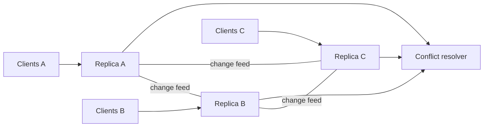
- Each **replica** stores documents with their version vector and publishes a change feed.
- **Change feed** consumers on other replicas apply remote changes, comparing vectors: newer replaces older, concurrent goes to the resolver.
- **Conflict resolver** applies the collection's strategy deterministically so every replica reaches the same result.

### Data model
```mermaid
erDiagram
  DOCUMENT ||--o{ SIBLING : "may have"
  DOCUMENT {
    text collection
    text doc_id PK
    jsonb body
    jsonb version_vector
    timestamptz hlc_ts
  }
  SIBLING {
    text doc_id FK
    jsonb body
    jsonb version_vector
  }
  REPLICATION_CURSOR {
    text from_replica PK
    bigint last_seq
  }
```

### Tech stack
- **PostgreSQL** per replica (or the Project 1/11 engine) to store documents.
- **Python 3.14** or **Java 25** replication agents.
- **Toxiproxy** or `tc netem` to add latency and partitions.

### Milestones
1. **Replication without conflicts.** *Done when* writes to disjoint documents converge.
2. **Detection.** *Done when* concurrent edits during a partition produce siblings with incomparable vectors.
3. **Resolution strategies.** *Done when* LWW, siblings and custom merge each converge, and a test shows LWW losing an edit.
4. **Topologies.** *Done when* a ring topology converges and loop prevention (tagging changes with the replicas they have passed) avoids infinite forwarding.

### Deep dive: the hard parts
- **Causality across topologies.** In all-to-all replication an update can arrive before the insert it depends on. Version vectors detect this. Buffer the update until its dependencies are present.
- **Deterministic merges.** A merge must give the same result on every replica regardless of arrival order (commutative and associative). Union and max are safe. "Append both strings" is not, unless you sort.
- **Deletes.** A delete concurrent with an update needs a tombstone with its own version vector, or the update resurrects the document.

### Testing strategy
Randomised partition schedules, then heal and assert all replicas hold identical documents. Track every client write and report which were lost under LWW.

### Trade-offs, scaling and failure modes
Multi-leader gives low-latency local writes and partition tolerance, but conflicts are unavoidable and constraints (like unique usernames) cannot be enforced locally. Many systems avoid conflicts by routing each record to a "home" leader.

### Stretch goals
- Replace custom merges with CRDTs (preview of Project 34).
- Show a conflict-avoidance strategy: per-user home region.

### Skills practised
- Multi-leader replication, conflict handling — [Ch 5 — Replication](../chapters/05-replication/README.md)
- Convergence and integrity — [Ch 12 — The Future of Data Systems](../chapters/12-future-of-data-systems/README.md)

### In the interview
**30-second answer:** I built a three-replica document store where every replica accepts writes locally and replicates asynchronously to the others through change feeds. Each document carries a version vector, so a replica can tell whether a remote change is newer, older or concurrent, and concurrent ones go to a pluggable resolver: last-write-wins, keep-both siblings, or a per-field merge. The hardest parts were making merges deterministic regardless of arrival order and handling deletes that race with updates. Local writes stayed under 5 ms with 100 ms simulated inter-replica latency, all replicas converged within 2 seconds after healing, and a test proved LWW losing an edit.

**Key terms to know:**
- **Multi-leader replication** — several nodes accept writes and replicate to each other asynchronously.
- **Write conflict** — two replicas change the same record concurrently, without either seeing the other's change.
- **Version vector** — per-replica counters on each document. If neither vector dominates, the writes were concurrent.
- **Last-write-wins (LWW)** — keep the version with the highest timestamp and discard the other. Simple but loses data.
- **Siblings** — keeping all concurrent versions and letting the client resolve them.
- **Deterministic merge** — a merge that is commutative and associative, so every replica gets the same result in any order.
- **Replication topology** — all-to-all, ring or star. Affects how many hops a change takes and whether it can loop.
- **Tombstone with version** — a delete record carrying its own vector, so a concurrent update cannot silently resurrect it.
- **Convergence** — all replicas holding identical data once writes stop and messages are delivered.

**Q:** Why is last-write-wins dangerous?

**A:** It picks one of two concurrent writes by timestamp and silently discards the other. With clock skew it can even make the older write win. My test tracked every client write and showed edits disappearing under LWW.

**Q:** How do you detect a conflict?

**A:** Compare version vectors. If one is less than or equal to the other in every entry, it is older and can be replaced. If neither dominates, the writes were concurrent, which is a conflict.

**Q:** When is multi-leader worth it?

**A:** For multi-data-centre deployments needing local write latency, offline-capable clients, and collaborative editing, where you can accept and resolve conflicts. If you cannot tolerate conflicts, a single leader is simpler.

**Q:** What makes a merge function safe?

**A:** It must give the same result on every replica regardless of the order changes arrive, so it must be commutative and associative, and ideally idempotent. Union of tags and max of counters are safe. Appending two strings is not, unless you sort them first.

**Q:** How do you stop changes looping forever in a ring?

**A:** Tag each change with the replicas it has already passed through, or its origin replica and sequence, and drop changes a replica has already applied. Version vectors also make re-applying an already-seen change a no-op.

**Q:** What goes wrong with all-to-all topologies?

**A:** Messages can overtake each other, so an update can arrive before the insert it depends on. Version vectors detect that a dependency is missing, and the replica buffers the update until the insert arrives.

**Q:** How do you handle a delete that races an update?

**A:** Store the delete as a tombstone with its own version vector. If the delete and update are concurrent, the resolver sees both and applies a rule. Without the tombstone, the update would recreate the document.

**Q:** What cannot be enforced locally?

**A:** Global constraints such as unique usernames or a non-negative balance, because two replicas can each accept a write that is valid locally but invalid together. Many systems avoid this by giving each record a "home" leader that handles all its writes.

**Q:** How did you test convergence?

**A:** Randomised partition schedules with concurrent writes, then heal the network and assert all replicas hold byte-identical documents. A ledger of client writes reported exactly which ones LWW lost.

**Common mistakes in answers:**
- Using wall-clock timestamps to detect conflicts. Timestamps order writes but cannot tell you they were concurrent.
- Assuming conflicts are rare enough to ignore. Any partition guarantees them.
- Writing merge functions whose result depends on arrival order.

### TL;DR
Let every replica accept writes, detect concurrency with version vectors, and merge deterministically — and see exactly why LWW loses data.

## 17. Consistent-hash partitioning and rebalancing

**Level:** Intermediate · **Time:** 2 weeks · **Prerequisites:** Ch 6

### What it is
A partitioned key-value cluster that spreads keys over nodes using **consistent hashing**: nodes and keys are hashed onto a ring, and each key belongs to the next node clockwise. Each physical node owns many **virtual nodes** (vnodes) to even out load. When nodes join or leave, only the affected key ranges move, and a **rebalancer** streams them while the cluster stays online. You also implement and compare the "fixed number of partitions" approach.

### The problem it solves
`hash(key) mod N` reshuffles almost every key when N changes, which would mean moving nearly all data. Chapter 6 compares strategies for assigning partitions to nodes so that adding a node moves only a fair share of data, and discusses how requests find the right node.

### Real-world examples
- Karger et al., [Consistent Hashing and Random Trees](https://www.cs.princeton.edu/courses/archive/fall09/cos518/papers/chash.pdf) (STOC 1997), the original paper.
- DataStax documents [Cassandra's consistent hashing and vnodes](https://docs.datastax.com/en/cassandra-oss/3.x/cassandra/architecture/archDataDistributeHashing.html).
- Lamping and Veach's [Jump Consistent Hash](https://arxiv.org/abs/1406.2294) gives a memory-free alternative when nodes are numbered.

### Requirements
**Functional**
- Hash ring with configurable vnodes per node and replication factor (each key stored on the next R distinct physical nodes).
- Routing: any node can forward a request to the owner, or a client library routes directly.
- Join, leave and replace operations that compute moved ranges and stream them.
- Alternative mode: fixed 1,024 partitions assigned to nodes by a coordinator.
- Load metrics: keys and requests per node, standard deviation.

**Non-functional**
- With 128 vnodes per node, key-count imbalance across 10 nodes under 10%.
- Adding an eleventh node moves about 1/11 of the data, with no failed requests during the move.
- Routing decision under 10 microseconds.

### The architecture
```mermaid
flowchart LR
  CL["Client library"] --> RT["Routing table"]
  RT --> N1["Node 1"]
  RT --> N2["Node 2"]
  RT --> N3["Node 3"]
  CO["Membership coordinator"] --> RT
  CO --> RB["Rebalancer"]
  RB -->|"stream ranges"| N1
  RB -->|"stream ranges"| N2
  RB -->|"stream ranges"| N3
```
- **Routing table** is a sorted array of (token, node) pairs, searched by binary search.
- **Membership coordinator** owns the authoritative ring and versions it (in etcd or a PostgreSQL row).
- **Rebalancer** plans transfers: for each moved range, copy a snapshot, then forward writes that arrive during the copy, then flip ownership.

### Data model
| Item | Fields |
|---|---|
| Ring version | version number, list of (token, node id) |
| Transfer | range start, range end, from node, to node, state (copying, catching up, done) |
| Node stats | node id, key count, bytes, ops per second |

### Tech stack
| Component | Choice | Why |
|---|---|---|
| Nodes | Go or Java 25 | Concurrent networking |
| Storage | Your LSM (Project 11) or RocksDB | Range iteration for streaming |
| Hash | MurmurHash3 or xxHash 64-bit | Uniform, fast |
| Metadata | etcd | Watches for ring changes |

### Milestones
1. **Static ring and routing.** *Done when* keys are distributed and a histogram of keys per node is produced for 1, 16 and 256 vnodes.
2. **Replication factor.** *Done when* each key is written to R distinct physical nodes even when vnodes of the same node are adjacent.
3. **Online join.** *Done when* adding a node under steady load moves the expected fraction of keys with zero errors and reads stay correct during the move.
4. **Fixed-partition mode.** *Done when* you can compare data moved and metadata size between the two approaches.
5. **Hot key handling.** *Done when* a skewed workload (one celebrity key) is detected and mitigated by key salting for writes.

### Deep dive: the hard parts
- **Ownership handover.** During a move, writes must go to both old and new owner (or be forwarded) until the switch, otherwise writes made during the copy are lost. Version the ring and reject requests stamped with an old version.
- **Vnode count trade-off.** More vnodes give better balance and spread recovery load across many nodes, but enlarge metadata and the number of small transfers.
- **Hash partitioning kills range scans.** Keys adjacent in order land on random nodes. Chapter 6's compound-key idea (hash the first part, sort by the rest) brings back scans within one partition key.

### Testing strategy
Statistical tests of balance. A linearizable-ish check during rebalancing: a writer increments known keys and a verifier confirms no acknowledged write disappears. Chaos: kill the destination mid-transfer and verify the transfer restarts.

### Trade-offs, scaling and failure modes
Consistent hashing adapts automatically but random token placement can be uneven. Fixed partitions are simple and predictable but their count must be chosen up front. Automatic rebalancing plus a too-eager failure detector can cause cascading moves — many systems require a human to approve.

### Stretch goals
- Bounded-load consistent hashing.
- Rendezvous (highest random weight) hashing comparison.

### Skills practised
- Partitioning by hash, rebalancing, request routing — [Ch 6 — Partitioning](../chapters/06-partitioning/README.md)
- Replication across partitions — [Ch 5 — Replication](../chapters/05-replication/README.md)

### In the interview
**30-second answer:** I built a partitioned key-value cluster that places nodes and keys on a hash ring with consistent hashing, giving each physical node many virtual nodes, and stores each key on the next R distinct physical nodes. The key decision was that adding or removing a node moves only the ranges next to its tokens, unlike hash mod N, which reshuffles nearly everything. The hardest part was ownership handover during a move: snapshot, forward writes that arrive during the copy, then flip ownership with a versioned ring. With 128 vnodes per node imbalance across 10 nodes stayed under 10%, and adding an eleventh node moved about 1/11 of the data with no failed requests.

**Key terms to know:**
- **Consistent hashing** — nodes and keys hashed onto a ring, each key owned by the next node clockwise. Membership changes move only nearby ranges.
- **Virtual node (vnode)** — one physical node owning many ring positions, for smoother balance and spread-out recovery.
- **Token** — a position on the ring. The routing table is a sorted array of (token, node).
- **Replication factor (R)** — each key stored on the next R distinct physical nodes.
- **Rebalancing** — moving ranges when nodes join or leave, here by streaming while the cluster stays online.
- **Fixed partitions** — a set number of partitions (here 1,024) assigned to nodes by a coordinator, moved whole.
- **Ring version** — a version number for the ownership map, so requests routed with an old map are rejected.
- **Hot key / skew** — one key or range taking a disproportionate share of load. Mitigated here by salting.
- **Request routing** — how a request reaches the owner: any node forwards, a routing tier, or a client with the map.

**Q:** Why not use hash mod N?

**A:** Changing N changes the owner of almost every key. Going from 10 to 11 nodes would move about 10/11 of the data instead of about 1/11.

**Q:** What do virtual nodes buy you?

**A:** More even load, because many small ranges average out random placement. When a node fails or joins, its load is shared across many nodes instead of one neighbour. The cost is a bigger routing table and more, smaller transfers.

**Q:** How do clients find the right node?

**A:** Either any node forwards to the owner, a routing tier does it, or the client caches the partition map from a coordination service like etcd and watches for changes. I supported forwarding and a client library doing binary search on tokens.

**Q:** How do you avoid losing writes during a move?

**A:** Copy a snapshot of the range to the new owner, forward or double-write updates that arrive during the copy, then flip ownership in a new ring version. Requests stamped with the old version are rejected and retried against the new owner.

**Q:** How do you make sure R replicas are on different machines?

**A:** Walk clockwise from the key's token and skip tokens belonging to physical nodes already chosen, until you have R distinct nodes. Otherwise two vnodes of one machine could hold both copies.

**Q:** Consistent hashing or fixed partitions?

**A:** Consistent hashing adapts automatically to any node count but random tokens can be uneven. Fixed partitions are simple and predictable, and moving a whole partition is easy, but the count must be chosen up front. Too few limits growth, too many adds overhead.

**Q:** What does hash partitioning cost you?

**A:** Range scans, because adjacent keys land on random nodes. A compound key that hashes only the first part and sorts by the rest keeps scans possible within one partition key.

**Q:** How do you handle a celebrity hot key?

**A:** Hashing cannot spread one key. I detected the hot key and salted it for writes, appending a small random suffix so writes spread over several partitions. Reads must then gather all salted variants, so this only pays for very hot keys.

**Q:** What fails at scale, and how did you test it?

**A:** Automatic rebalancing combined with an eager failure detector can trigger cascading moves, which is why many systems ask a human to approve them. I tested balance statistically, ran a writer incrementing known keys during rebalancing with a verifier checking no acknowledged write disappeared, and killed the destination mid-transfer to check it restarts.

**Common mistakes in answers:**
- Saying consistent hashing balances load perfectly. Without vnodes it is quite uneven.
- Forgetting that vnodes of the same machine can be adjacent when choosing replicas.
- Ignoring writes that arrive during a range transfer.

### TL;DR
Hash keys onto a ring with many vnodes, move only the ranges that change, and hand over ownership carefully — Chapter 6 rebalancing made real.

## 18. Local versus global secondary indexes

**Level:** Intermediate · **Time:** 2 weeks · **Prerequisites:** Ch 6

### What it is
A partitioned "used-car listings" store (partitioned by listing id) with secondary indexes on `colour` and `make`, built two ways: **local** (document-partitioned — each partition indexes only its own listings, so queries scatter to all partitions) and **global** (term-partitioned — the index is itself partitioned by the indexed value, so a query hits one index partition, but a write may update several). You benchmark both and implement asynchronous global index maintenance.

### The problem it solves
Primary-key lookups are easy to route. "All red cars" is not, because red cars live on every partition. Chapter 6 lays out exactly these two options and their read/write trade-off. This project measures it.

### Real-world examples
- Amazon DynamoDB's [global secondary indexes](https://docs.aws.amazon.com/amazondynamodb/latest/developerguide/GSI.html) are partitioned separately from the base table and updated asynchronously, so reads from them are eventually consistent.
- Elasticsearch [documents and indices](https://www.elastic.co/guide/en/elasticsearch/reference/current/documents-indices.html) uses document-partitioned shards, each holding a local index, and queries fan out to all shards.

### Requirements
**Functional**
- Base table partitioned into 8 partitions by hash of listing id.
- Local index mode: each partition maintains `colour → ids` for its own rows. Query = scatter-gather.
- Global index mode: index partitions by hash of the term. Each base write emits index updates to the term's partition.
- Asynchronous global index updates via a queue (or Kafka topic), with a lag metric.
- Index backfill when an index is created on existing data.

**Non-functional**
- Measure p50 and p99 query latency for both modes at 8 and 32 partitions with one slow partition (+50 ms).
- Index lag under 1 second in async mode at 2,000 writes per second.

### The architecture
```mermaid
flowchart LR
  W["Writer"] --> BP["Base partitions"]
  BP -->|"local mode"| LI["Local index per partition"]
  BP -->|"global mode"| Q["Index update queue"]
  Q --> GI["Global index partitions"]
  RQ["Query router"] -->|"scatter"| LI
  RQ -->|"single lookup"| GI
  GI -->|"fetch rows"| BP
```
- **Base partitions** hold listings.
- **Local index** updates synchronously in the same partition, so it is always consistent with that partition.
- **Index update queue** decouples base writes from global index writes, which live on other machines.
- **Query router** chooses scatter-gather or a direct index lookup followed by fetching rows.

### Data model
```mermaid
erDiagram
  LISTING ||--o{ INDEX_ENTRY : "indexed by"
  LISTING {
    bigint listing_id PK
    text make
    text colour
    int price
    int partition_no
  }
  INDEX_ENTRY {
    text index_name
    text term
    bigint listing_id FK
    int index_partition
  }
```

### Tech stack
- **Java 25** or **Go** for partition servers. **Python 3.14** is fine for the router and benchmarks.
- Storage: PostgreSQL schema per partition (simple) or your Project 11 engine.
- **Kafka** for the async index topic, keyed by term.

### Milestones
1. **Partitioned base table and local index.** *Done when* scatter-gather returns correct results.
2. **Tail latency experiment.** *Done when* you show p99 rising with partition count and with one slow partition (tail amplification from Project 3).
3. **Global index synchronous.** *Done when* writes update index partitions in the same request and queries hit one partition.
4. **Global index async with backfill.** *Done when* lag is measured, a stale read is demonstrated, and backfill builds an index on 1 million existing rows while writes continue.

### Deep dive: the hard parts
- **Old values.** Changing a car from red to blue must delete the "red" entry and add the "blue" one, possibly on two different index partitions. If the async consumer processes these out of order you get stale entries. Order index updates per base key, or include the base version and reject older ones.
- **Backfill races.** While scanning existing rows, new writes arrive. Start consuming the change stream *before* the scan and apply both idempotently using versions, the same trick as CDC snapshots (Project 22).
- **Reading a global index then the base row.** The index may point to a row that no longer matches. Re-check the predicate after fetching.

### Testing strategy
Consistency checker that periodically rebuilds the index from base data and diffs it with the maintained index. Latency benchmarks under controlled slow-partition injection.

### Trade-offs, scaling and failure modes
Local indexes: cheap writes, expensive reads (fan-out, tail latency). Global indexes: cheap reads, writes touch several partitions and are usually async (stale reads). Distributed transactions could make global indexes consistent but cost latency (Project 20).

### Stretch goals
- Covering indexes that store the projected columns to skip the base fetch.
- Partition the global index by range of term to support prefix queries.

### Skills practised
- Secondary indexes in partitioned systems — [Ch 6 — Partitioning](../chapters/06-partitioning/README.md)
- Asynchronous derived data — [Ch 11 — Stream Processing](../chapters/11-stream-processing/README.md)

### In the interview
**30-second answer:** I built a used-car listings store partitioned by listing id across 8 partitions, with secondary indexes on colour and make implemented two ways: local, where each partition indexes its own rows and queries scatter to all partitions, and global, where the index is partitioned by term and updated through an asynchronous queue. The key result was the read/write trade-off: local indexes make writes cheap but reads fan out, global indexes make reads one lookup but writes touch other partitions. The hardest part was keeping the async global index correct when a car changes colour and when backfilling an index while writes continue. I measured index lag under 1 second at 2,000 writes per second.

**Key terms to know:**
- **Secondary index** — an index on a non-key attribute, such as colour, that cannot be routed by the partition key.
- **Local (document-partitioned) index** — each partition indexes only its own rows. Queries must scatter to all partitions.
- **Global (term-partitioned) index** — the index is partitioned by the indexed value, so "red" lives on one index partition.
- **Scatter-gather** — sending a query to every partition and merging the results.
- **Tail latency amplification** — a scatter query waits for the slowest partition, so p99 grows with partition count.
- **Asynchronous index maintenance** — base writes emit index updates to a queue applied later, giving stale index reads.
- **Backfill** — building an index over existing data while new writes keep arriving.
- **Index lag** — how far the global index trails the base table.

**Q:** What is the downside of a document-partitioned index?

**A:** Reads must query every partition and wait for the slowest one, so tail latency grows with partition count. I showed p99 rising from 8 to 32 partitions and jumping when one partition had an extra 50 ms.

**Q:** Why are global indexes usually updated asynchronously?

**A:** A single base write may need to update index partitions on other machines, for example removing "red" and adding "blue". Making that atomic needs a distributed transaction, which adds latency and fails when any participant is down.

**Q:** How do you build an index on existing data online?

**A:** Start consuming the change stream before scanning, then scan the existing rows, and apply both idempotently using row versions so the newer one wins. That is the same trick CDC snapshots use (Project 22).

**Q:** What goes wrong when a car changes colour?

**A:** The update must delete the "red" entry and add the "blue" one, possibly on two index partitions. If an async consumer applies them out of order you get stale entries. I ordered index updates per base key and stored the base version so older updates are rejected.

**Q:** Why re-check the predicate after an index lookup?

**A:** A lagging global index may point to a row that no longer matches, for example a car that is now blue. After fetching the base row you re-check colour = red and drop mismatches.

**Q:** Which would you choose for a read-heavy search page?

**A:** A global index, because each query hits one index partition and avoids the fan-out tail. You accept eventual consistency on the index, as DynamoDB does with its global secondary indexes. For write-heavy data or when reads must be consistent with writes, local indexes are simpler.

**Q:** What breaks at 100x partitions?

**A:** Local index queries degrade badly, since fan-out to hundreds of partitions makes some partition slow almost every time. Global indexes then win for reads, but a popular term like "black" becomes a hot index partition, which you split by range or salt.

**Q:** How did you verify correctness?

**A:** A consistency checker periodically rebuilt the index from base data and diffed it against the maintained index. Latency benchmarks injected a controlled slow partition to measure tail effects.

**Common mistakes in answers:**
- Claiming global indexes are strictly better. They move cost to writes and are usually stale.
- Forgetting to remove the old index entry when an indexed value changes.
- Backfilling by scanning first and only then subscribing to changes, which loses writes in between.

### TL;DR
Index locally and scatter reads, or index globally and scatter writes — measure both and learn the core trade-off of partitioned secondary indexes.

## 19. MVCC snapshot-isolation engine

**Level:** Intermediate · **Time:** 2–3 weeks · **Prerequisites:** Ch 7, Project 6

### What it is
A transactional in-memory (optionally persistent) key-value store using **multi-version concurrency control** (MVCC): every write creates a new version of a row tagged with the creating transaction's id, and each transaction reads a consistent **snapshot** — it sees only versions committed before it started. Writers do not block readers, and readers do not block writers. Write-write conflicts are detected with **first-committer-wins**. A **vacuum** process garbage-collects versions no snapshot can see.

### The problem it solves
Locking every row a transaction reads makes long reports block updates. Snapshot isolation lets backups and analytics run on a consistent view while writes continue. Chapter 7 explains the visibility rules. Implementing them shows why PostgreSQL needs vacuuming and how write skew slips through.

### Real-world examples
- PostgreSQL's [MVCC introduction](https://www.postgresql.org/docs/current/mvcc-intro.html) describes snapshots and why reading never blocks writing.
- CockroachDB documents its MVCC-based [transaction layer](https://www.cockroachlabs.com/docs/stable/architecture/transaction-layer) with timestamps on every version.

### Requirements
**Functional**
- `begin`, `get`, `put`, `delete`, `scan`, `commit`, `abort`.
- Snapshot visibility: a version is visible if its creator committed before the snapshot was taken and it was not deleted by a transaction also committed before then.
- First-committer-wins: if two transactions update the same key, the later committer aborts.
- Read-only transactions never abort.
- Vacuum removes versions older than the oldest active snapshot.

**Non-functional**
- 200,000 single-key transactions per second in memory on 8 cores.
- Version chains bounded under steady load with vacuum running.
- No reads blocked by writes (measure lock waits: zero on the read path).

### The architecture
```mermaid
flowchart LR
  TX["Transaction API"] --> TM["Transaction manager"]
  TM --> CL["Commit log of statuses"]
  TX --> VS["Version store"]
  VS --> VC["Visibility checker"]
  VC --> CL
  VC --> SN["Snapshot"]
  VAC["Vacuum"] --> VS
  VAC --> TM
```
- **Transaction manager** hands out transaction ids and snapshots (the set of transactions in progress when the snapshot was taken, plus a high-water mark).
- **Commit log** records each transaction's status: in progress, committed or aborted.
- **Version store** keeps a chain of versions per key, each with `created_by` and `deleted_by` transaction ids.
- **Visibility checker** applies the rules. **Vacuum** finds the oldest active snapshot (the "xmin horizon") and drops dead versions.

### Data model
| Item | Fields |
|---|---|
| Version | key, value, created_by txid, deleted_by txid or none, next version pointer |
| Snapshot | xmin (oldest active), xmax (next txid), in-progress set |
| Transaction | txid, status, write set, snapshot |

### Tech stack
- **Java 25** (`ConcurrentHashMap` of version chains, virtual threads for workers) or **Go**.
- Persistence (optional): write-ahead log of committed write sets, then reuse Project 11.
- **Python 3.14** works for a single-threaded teaching version with a simulated scheduler.

### Milestones
1. **Versions and snapshots.** *Done when* the Project 6 read-skew scenario cannot happen on your engine.
2. **Write conflict detection.** *Done when* lost-update scenarios abort the second committer.
3. **Vacuum.** *Done when* a long-running read transaction prevents cleanup (show growth) and finishing it lets vacuum reclaim versions.
4. **Write skew demonstration.** *Done when* the doctors-on-call scenario commits both transactions — proving SI is not serializable (fixed in Project 29).
5. **Persistence.** *Done when* committed transactions survive a crash and in-progress ones do not.

### Deep dive: the hard parts
- **Commit atomicity.** A transaction's writes must become visible all at once. Marking status "committed" in the commit log in one step is the trick: the versions were already there, just invisible.
- **Snapshot of in-progress transactions.** A transaction with a smaller id that has not committed when you start must remain invisible to you even after it commits. That is why snapshots record the in-progress set, not just a number.
- **Long transactions hurt everyone.** One open snapshot pins all versions created after it, causing bloat and slower chain walks. Add a metric and an alarm, as PostgreSQL operators do.

### Testing strategy
Run all Project 6 scenarios against your engine. Randomised concurrent workloads with an invariant (sum of balances constant across transfers), plus a history checker that verifies each read saw a consistent snapshot.

### Trade-offs, scaling and failure modes
MVCC trades storage and garbage collection for concurrency. First-committer-wins aborts under hot keys. SI permits write skew. Transaction id wraparound (32-bit ids in PostgreSQL) needs freezing old versions.

### Stretch goals
- Timestamp-based MVCC (versions keyed by commit timestamp) as used by many distributed databases.
- Secondary indexes that point to version chains.

### Skills practised
- Snapshot isolation and MVCC — [Ch 7 — Transactions](../chapters/07-transactions/README.md)
- Storage engine internals — [Ch 3 — Storage and Retrieval](../chapters/03-storage-and-retrieval/README.md)

### In the interview
**30-second answer:** I built an in-memory key-value store with multi-version concurrency control: every write creates a new version tagged with its transaction id, and each transaction reads a consistent snapshot of versions committed before it began. Readers never block writers and writers never block readers, while write-write conflicts are resolved with first-committer-wins. The hardest parts were the visibility rules, especially keeping transactions that were in progress at snapshot time invisible, and vacuum, which can only remove versions older than the oldest active snapshot. My target was 200,000 single-key transactions per second on 8 cores, and the doctors scenario demonstrated that snapshot isolation still allows write skew.

**Key terms to know:**
- **MVCC** — keeping several versions of each row so transactions can read old versions while new ones are written.
- **Snapshot** — the set of committed transactions a reader can see: everything below xmin, nothing at or above xmax, minus the in-progress set.
- **Visibility rule** — a version is visible if its creator committed before the snapshot and its deleter did not.
- **First-committer-wins** — if two concurrent transactions write the same key, the second to commit aborts.
- **Commit log (status table)** — one entry per transaction: in progress, committed or aborted. Flipping it makes all writes visible at once.
- **Vacuum** — garbage collection of versions no active snapshot can see.
- **xmin horizon** — the oldest snapshot still active. Nothing newer than it can be vacuumed.
- **Write skew** — two transactions read overlapping data and write different keys, breaking an invariant. SI allows it.
- **Transaction id wraparound** — 32-bit ids eventually wrap, so old versions must be "frozen".

**Q:** How do MVCC readers avoid blocking?

**A:** They read the version that matches their snapshot, which may be older than the latest one. They never wait for a writer to finish, because the writer's new version is simply invisible to them until it commits.

**Q:** What anomaly does snapshot isolation still allow?

**A:** Write skew, including phantoms that cause write skew, because concurrent transactions do not see each other's writes to different keys and no write-write conflict is detected. My doctors-on-call test committed both transactions.

**Q:** Why does PostgreSQL need vacuum?

**A:** Updates and deletes leave old row versions behind. Vacuum removes those that no active snapshot can still see and makes the space reusable. Without it, tables bloat and version chains get long.

**Q:** How do you make a transaction's writes appear atomically?

**A:** The versions are written early but are invisible while the transaction is "in progress". Commit is a single update of its status in the commit log, so every reader sees either all or none of its writes.

**Q:** Why does a snapshot need the in-progress set and not just a number?

**A:** A transaction with a smaller id may still be running when you start. If it commits later, it must remain invisible to you, otherwise your snapshot changes under you. Recording which transactions were in progress makes that rule checkable.

**Q:** How does a long-running transaction hurt everyone?

**A:** Its snapshot holds back the xmin horizon, so vacuum cannot remove any version created after it started. Version chains grow, reads walk longer chains and storage bloats. I showed growth while a long read was open and reclamation after it finished.

**Q:** What happens under a hot key?

**A:** First-committer-wins means many concurrent writers to the same key abort and retry, so throughput collapses on that key. Atomic increments or partitioning the counter help.

**Q:** How do you make it durable?

**A:** Write each committed transaction's write set to a write-ahead log and fsync before acknowledging the commit. On recovery, replay committed write sets and ignore transactions with no commit record.

**Q:** How did you test it?

**A:** I ran every Project 6 scenario against my engine. Randomised concurrent bank transfers checked that the total balance stayed constant, and a history checker verified each read saw a consistent snapshot.

**Common mistakes in answers:**
- Calling snapshot isolation serializable. It allows write skew.
- Saying MVCC needs no locks at all. Writers still conflict with writers.
- Forgetting the cost: storage overhead, vacuum and long-transaction bloat.

### TL;DR
Never overwrite, always version, and decide visibility per snapshot — build the concurrency control at the heart of PostgreSQL and most modern databases.

## 20. Two-phase commit coordinator

**Level:** Intermediate · **Time:** 2 weeks · **Prerequisites:** Ch 7, Ch 9

### What it is
A transaction coordinator that atomically commits a money transfer spanning two separate PostgreSQL databases using **two-phase commit** (2PC). In phase one the coordinator asks each participant to **prepare** (make the change durable and promise to commit if told to). If all vote yes, it writes a commit decision to its own log and in phase two tells everyone to commit. The project focuses on what happens when anything crashes between the steps.

### The problem it solves
A transaction inside one database is atomic. Across two databases, a crash between "debit A" and "credit B" loses money. 2PC guarantees all-or-nothing across nodes. Chapter 9 also explains its weakness: if the coordinator dies after participants prepare, they are stuck **in doubt**, holding locks, until it returns.

### Real-world examples
- PostgreSQL implements the participant side with [PREPARE TRANSACTION](https://www.postgresql.org/docs/current/sql-prepare-transaction.html), `COMMIT PREPARED` and the `pg_prepared_xacts` view, and warns against leaving prepared transactions open.
- Google's [Spanner paper](https://research.google/pubs/spanner-googles-globally-distributed-database-2/) runs 2PC across Paxos groups so that the coordinator itself is replicated and does not block on a single machine.

### Requirements
**Functional**
- Coordinator API: `begin_global`, `enlist(participant, sql)`, `commit`, `abort`.
- Durable coordinator log (in its own PostgreSQL database or a local WAL) recording each global transaction's state.
- Recovery: on restart, the coordinator finishes in-flight transactions based on its log. Participants list prepared transactions and ask the coordinator for the outcome.
- Presumed abort: if there is no commit record, the answer is abort.
- Admin tool to list and manually resolve in-doubt transactions.

**Non-functional**
- Commit latency measured versus single-database transactions (expect at least two extra round trips and fsyncs).
- Zero atomicity violations across 10,000 transfers with random crashes.

### The architecture
```mermaid
sequenceDiagram
  participant App
  participant Co as Coordinator
  participant A as Bank DB A
  participant B as Bank DB B
  App->>Co: commit transfer
  Co->>A: PREPARE TRANSACTION
  Co->>B: PREPARE TRANSACTION
  A-->>Co: yes
  B-->>Co: yes
  Co->>Co: write COMMIT to log and fsync
  Co->>A: COMMIT PREPARED
  Co->>B: COMMIT PREPARED
  Co-->>App: committed
```
The **commit point** is the moment the coordinator's commit record is durable. Before it, any failure means abort. After it, the coordinator must keep retrying phase two forever until every participant commits.

### Data model
```mermaid
erDiagram
  GLOBAL_TXN ||--|{ PARTICIPANT_BRANCH : "has"
  GLOBAL_TXN {
    uuid gtid PK
    text state
    timestamptz created_at
    timestamptz decided_at
  }
  PARTICIPANT_BRANCH {
    uuid gtid FK
    text participant
    text branch_id
    text vote
    text outcome_sent
  }
```

### Tech stack
| Component | Choice | Why |
|---|---|---|
| Participants | Two PostgreSQL instances with `max_prepared_transactions` above 0 | Real prepare support |
| Coordinator | Java 25 or Python 3.14 | Clear state machine |
| Fault injection | Crash hooks between every step | Exercise recovery |

### Milestones
1. **Happy path.** *Done when* transfers commit atomically and balances sum to a constant.
2. **Abort path.** *Done when* a participant voting no (for example, insufficient funds) aborts both.
3. **Coordinator crash recovery.** *Done when* crashing at each of the six critical points and restarting leaves no in-doubt transaction and no partial transfer.
4. **Participant crash.** *Done when* a participant restarted after preparing still has the prepared transaction and completes it.
5. **Blocking demonstration.** *Done when* you show a prepared transaction holding a row lock that blocks other work while the coordinator is down.

### Deep dive: the hard parts
- **The point of no return.** A participant that voted yes can no longer abort on its own, even after a timeout, because the coordinator might have decided commit. That is why 2PC blocks.
- **Idempotent phase two.** The coordinator may resend `COMMIT PREPARED` after a crash. Participants must treat "already committed" as success.
- **Heuristic decisions.** Operators sometimes force-resolve in-doubt transactions. If they guess wrong, atomicity breaks. Log such actions loudly.

### Testing strategy
Deterministic crash points via injectable hooks, run in a loop. Invariant checker after every scenario: total money constant, no rows in `pg_prepared_xacts` after recovery.

### Trade-offs, scaling and failure modes
2PC gives atomicity but adds latency, holds locks across network round trips and blocks on coordinator failure. Alternatives: replicate the coordinator with consensus (Spanner), Percolator-style designs (Project 30), or avoid cross-database atomicity using the outbox and idempotency (Project 23).

### Stretch goals
- Replicate the coordinator log with Raft (Project 27) to remove the blocking single point.
- Implement the XA interface through JDBC for Java participants.

### Skills practised
- Atomic commit and 2PC — [Ch 9 — Consistency and Consensus](../chapters/09-consistency-and-consensus/README.md)
- Atomicity and durability — [Ch 7 — Transactions](../chapters/07-transactions/README.md)

### In the interview
**30-second answer:** I built a two-phase commit coordinator that atomically commits money transfers across two separate PostgreSQL databases using PREPARE TRANSACTION and COMMIT PREPARED. The key design point is the commit point: the moment the coordinator's commit record is durable in its log, after which commit must eventually happen everywhere. The hardest part was recovery: crashing at each of six critical points and making both the coordinator and participants finish or roll back correctly, using presumed abort. Across 10,000 transfers with random crashes there were zero atomicity violations, and I also demonstrated the blocking problem with a prepared transaction holding row locks while the coordinator was down.

**Key terms to know:**
- **Atomic commit** — all participants commit or all abort, even across separate databases.
- **Two-phase commit (2PC)** — phase one asks every participant to prepare and vote, phase two broadcasts the decision.
- **Prepare** — a participant makes its changes durable and promises it can commit if told to. After voting yes it cannot abort alone.
- **Coordinator log** — the durable record of each global transaction's state and decision.
- **Commit point** — the coordinator's commit record reaching disk. Before it, failure means abort, after it, commit.
- **In-doubt transaction** — a prepared transaction whose outcome the participant does not know yet. It holds locks while waiting.
- **Presumed abort** — if the coordinator has no commit record for a transaction, the answer is abort.
- **Heuristic decision** — an operator forcing an in-doubt transaction to commit or abort, risking atomicity.

**Q:** Why does 2PC block?

**A:** After voting yes, a participant cannot decide on its own, because the coordinator might already have decided commit. If the coordinator crashes before sending the outcome, the participant must wait, still holding its locks, until the coordinator recovers.

**Q:** What is the commit point?

**A:** The moment the coordinator durably records its commit decision. From then on, it must keep retrying phase two until every participant has committed, and no failure can turn it into an abort.

**Q:** How is 2PC different from consensus?

**A:** 2PC needs every participant to vote yes, and a single coordinator failure blocks it. Consensus needs only a majority to agree and keeps working if a minority fails. You can make 2PC non-blocking by replicating the coordinator with consensus, as Spanner does.

**Q:** Why must phase two be idempotent?

**A:** A recovering coordinator may resend COMMIT PREPARED for a transaction that already committed. Participants must treat "already committed" as success, otherwise recovery itself causes errors.

**Q:** What does presumed abort buy you?

**A:** The coordinator never has to force abort decisions to disk or remember aborted transactions. If it crashes before writing a commit record, every participant asking about that transaction gets "abort". It reduces log writes and makes recovery rules simple.

**Q:** What happens if a participant crashes after preparing?

**A:** The prepared transaction survives the restart, because PostgreSQL makes it durable and lists it in pg_prepared_xacts. On recovery the participant, or the coordinator's recovery job, looks up the outcome and finishes it.

**Q:** What is the latency and scaling cost?

**A:** Each transaction needs at least two extra round trips and extra fsyncs, and locks are held across those network round trips. With more participants the chance that one is slow or down grows, so throughput and availability both drop.

**Q:** What are the alternatives?

**A:** Replicate the coordinator with consensus (Spanner), store the decision in the data itself (Percolator, Project 30), or avoid cross-database atomicity with an outbox and idempotent consumers (Project 23).

**Q:** How did you test it?

**A:** Injectable crash hooks at every step, run in a loop. After each scenario an invariant checker verified total money was constant and pg_prepared_xacts was empty after recovery.

**Common mistakes in answers:**
- Saying a participant can abort after a timeout once it has voted yes. That breaks atomicity.
- Calling 2PC a consensus algorithm. It is atomic commit and is not fault-tolerant to coordinator failure.
- Forgetting that prepared transactions hold locks for as long as they are in doubt.

### TL;DR
Prepare, log the decision, then commit everywhere — and learn by crashing it why 2PC is atomic but blocking.

## 21. Log-based message broker

**Level:** Intermediate · **Time:** 2–3 weeks · **Prerequisites:** Ch 11

### What it is
A Kafka-like broker built from scratch: **topics** split into **partitions**, each partition an append-only log of segment files with an offset index. Producers append. Consumers read sequentially and commit their **offsets** (positions in the log). **Consumer groups** share a topic's partitions so each partition is read by one member. Old segments are deleted by retention time or compacted by key (**log compaction** keeps only the latest value per key).

### The problem it solves
Traditional queues (AMQP/JMS style) delete a message once acknowledged and deliver to whichever consumer is free, so ordering is lost and replay is impossible. A log-based broker keeps messages, preserves order within a partition, and lets a new consumer replay history from offset zero. Chapter 11 contrasts the two and shows why logs are the backbone of stream processing.

### Real-world examples
- The [Apache Kafka design documentation](https://kafka.apache.org/documentation/#design) explains the reliance on sequential disk I/O, the page cache and zero-copy transfer (sending file bytes straight from the OS cache to the network socket without copying them through the application), and [log compaction](https://kafka.apache.org/documentation/#compaction).
- Confluent's essay [It's Okay To Store Data In Apache Kafka](https://www.confluent.io/blog/okay-store-data-apache-kafka/) argues for logs as long-term storage, mentioning The New York Times' use of Kafka for its published content.

### Requirements
**Functional**
- Create topics with N partitions. Producers choose partitions by key hash or round-robin.
- Append with batching. Fetch by (partition, offset, max bytes).
- Segment files with sparse offset index (offset → file position) and time index.
- Consumer groups with a coordinator that assigns partitions and rebalances when members join or leave.
- Committed offsets stored in an internal compacted topic.
- Retention by time/size, and log compaction by key with tombstones.

**Non-functional**
- 200 MB per second sequential append on one SSD with batching.
- End-to-end latency under 10 ms p99 at moderate load.
- Consumer lag metric per partition.

### The architecture
```mermaid
flowchart LR
  P["Producers"] --> BR["Broker"]
  BR --> PL["Partition logs"]
  PL --> SEG["Segment files and indexes"]
  C1["Consumer A1"] --> BR
  C2["Consumer A2"] --> BR
  GC["Group coordinator"] --> C1
  GC --> C2
  GC --> OT["Offsets topic"]
  CLN["Cleaner thread"] --> SEG
```
- **Partition logs** are append-only, with the active segment open for writes and older segments read-only.
- **Group coordinator** tracks members by heartbeat, assigns partitions, and stores committed offsets.
- **Cleaner thread** deletes expired segments or compacts them.

### Data model
| Item | Fields |
|---|---|
| Record batch | base offset, record count, CRC, timestamp, records |
| Record | offset delta, key, value, headers |
| Offset index entry | relative offset, file position |
| Committed offset | group, topic, partition, offset |

### Tech stack
| Component | Choice | Why |
|---|---|---|
| Broker | Java 25 or Go | `FileChannel.transferTo` for zero-copy sends |
| Protocol | Length-prefixed binary over TCP | Batched, efficient |
| Benchmark | Compare with a real Kafka container | Reality check |

### Milestones
1. **Single partition log.** *Done when* producers append and consumers fetch from any offset, surviving restarts.
2. **Segments and indexes.** *Done when* fetching an old offset costs one index lookup and one file seek.
3. **Partitions and keys.** *Done when* all messages for a key arrive in order at one consumer.
4. **Consumer groups.** *Done when* killing a consumer reassigns its partitions within 10 seconds and processing resumes from the last committed offset.
5. **Retention and compaction.** *Done when* a compacted topic keeps only the latest value per key and tombstones eventually disappear.

### Deep dive: the hard parts
- **At-least-once versus at-most-once.** Commit offsets after processing and a crash causes reprocessing (duplicates). Commit before and a crash loses messages. Make both modes explicit.
- **Rebalancing.** During reassignment, two consumers might briefly process the same partition. Use a **generation id** per group membership and reject offset commits from stale generations — fencing again.
- **Page cache over application cache.** Letting the OS cache segments means a restarted broker is still fast and memory is not duplicated. Measure the difference.

### Testing strategy
Ordering tests per key. Crash tests for both commit modes counting duplicates and losses. Long soak test with segment rollover and compaction running.

### Trade-offs, scaling and failure modes
Ordering is only per partition. One slow message blocks its partition (head-of-line blocking). Partition count limits consumer parallelism. Single-node brokers lose data on disk failure — replicate partitions (leader-follower, Project 15) to fix.

### Stretch goals
- Partition replication with in-sync replicas and a high-water mark.
- Idempotent producer with sequence numbers to drop duplicate retries.

### Skills practised
- Log-based message brokers, consumer offsets, compaction — [Ch 11 — Stream Processing](../chapters/11-stream-processing/README.md)
- Partitioning and replication — [Ch 6 — Partitioning](../chapters/06-partitioning/README.md)

### In the interview
**30-second answer:** I built a Kafka-like broker from scratch: topics split into partitions, each an append-only log of segment files with a sparse offset index, consumers that track their own offsets, and consumer groups whose coordinator assigns partitions and rebalances when members change. The key decision was keeping messages after delivery, which preserves order per partition and lets any consumer replay history, unlike a traditional queue. The hardest parts were rebalancing safely, which I fenced with generation ids, and making at-least-once and at-most-once modes explicit. My target was 200 MB per second of batched sequential appends on one SSD, and a killed consumer's partitions were reassigned within 10 seconds.

**Key terms to know:**
- **Log-based broker** — messages are appended to a durable log and retained, and consumers read sequentially by offset.
- **Partition** — one ordered log within a topic. Order is guaranteed only within a partition, and keys pick the partition.
- **Offset** — a message's position in its partition. Consumers commit offsets to record progress.
- **Consumer group** — consumers sharing a topic, each partition read by exactly one member at a time.
- **Rebalance and generation id** — reassigning partitions when members change. The generation id fences commits from stale members.
- **Segment and offset index** — the log is split into files, each with a sparse index from offset to file position.
- **Retention vs log compaction** — delete old segments by time or size, or keep only the latest record per key.
- **At-least-once vs at-most-once** — commit after processing (duplicates possible) or before (losses possible).
- **Zero-copy** — sending file bytes from the page cache straight to the socket without copying through the application.

**Q:** How does a log broker differ from a traditional queue?

**A:** It retains messages and tracks per-consumer offsets, so order within a partition is kept and consumers can replay from any point. A traditional queue deletes messages on acknowledgement and hands them to whichever consumer is free, so order is lost and replay is impossible.

**Q:** What is log compaction?

**A:** Discarding older records for a key and keeping only the latest one. It turns the log into a durable snapshot of a key-value table, and a tombstone (null value) eventually removes the key entirely.

**Q:** How do you scale consumption?

**A:** Add partitions and add consumers to the group. Each partition is consumed by one member at a time, so the partition count is the upper limit on parallelism within a group.

**Q:** At-least-once or at-most-once?

**A:** Committing the offset after processing gives at-least-once: a crash before the commit means reprocessing and duplicates. Committing before processing gives at-most-once: a crash means skipped messages. Most systems choose at-least-once with idempotent consumers.

**Q:** How do you avoid two consumers processing one partition during a rebalance?

**A:** Every group membership round gets a generation id. A consumer that was removed but has not noticed still carries the old generation, and the coordinator rejects its offset commits. That is the same fencing idea as epochs and fencing tokens.

**Q:** Why rely on the OS page cache?

**A:** The kernel already caches file pages, so an application-level cache would duplicate memory. A restarted broker also keeps a warm cache, and zero-copy sends work straight from it. I measured the difference.

**Q:** What does one slow message do?

**A:** It blocks everything behind it in that partition, which is head-of-line blocking. You can only process a partition in order, so a poison message must be retried a few times and then moved to a dead-letter topic.

**Q:** What breaks at 10x traffic?

**A:** A single broker's disk and network are the limit, and a disk failure loses data. You spread partitions across brokers and replicate each partition with a leader and in-sync followers. Partition count must also be planned, since it caps consumer parallelism.

**Q:** How did you test it?

**A:** Per-key ordering tests, crash tests in both commit modes counting duplicates and losses, and a long soak test with segment rollover, retention and compaction running together.

**Common mistakes in answers:**
- Claiming Kafka guarantees global ordering. It orders only within a partition.
- Saying more consumers than partitions increases throughput. Extra consumers sit idle.
- Calling at-least-once delivery "exactly-once" without idempotent processing.

### TL;DR
Partitioned append-only logs, offsets and consumer groups — build Kafka's core and you understand the backbone of stream processing.

## 22. CDC pipeline: PostgreSQL to Kafka

**Level:** Intermediate · **Time:** 2 weeks · **Prerequisites:** Ch 11, Ch 4

### What it is
A **change data capture** (CDC) pipeline that reads every committed insert, update and delete from PostgreSQL's write-ahead log using **logical decoding**, publishes them as events to Kafka (via Debezium), and keeps two **derived systems** — a search index and a cache — in sync. You also build a minimal CDC reader yourself to understand what Debezium does under the hood.

### The problem it solves
Applications that write to the database *and* to a search index or cache (**dual writes**) suffer race conditions and partial failures: the two systems drift apart. CDC makes the database the single source of truth and feeds every other system from its ordered change log, as Chapter 11 recommends.

### Real-world examples
- PostgreSQL [logical decoding](https://www.postgresql.org/docs/current/logicaldecoding.html) exposes committed changes through replication slots and output plugins such as `pgoutput`.
- The [Debezium PostgreSQL connector](https://debezium.io/documentation/reference/stable/connectors/postgresql.html) performs an initial snapshot and then streams changes to Kafka.
- Shopify's [Capturing Every Change From Shopify's Sharded Monolith](https://shopify.engineering/capturing-every-change-shopify-sharded-monolith) describes choosing Debezium with Kafka Connect for CDC across 100+ MySQL shards.

### Requirements
**Functional**
- PostgreSQL with `wal_level=logical`, a publication and a replication slot.
- Debezium (Kafka Connect) streaming `products` and `orders` tables to Kafka topics, one per table, keyed by primary key.
- Consumers: one updates an OpenSearch or Elasticsearch index, one updates Redis, one writes an audit table.
- Initial snapshot plus streaming, with no gaps or duplicates that matter (idempotent sinks).
- Your own mini CDC reader in Python 3.14 using `psycopg` replication support, printing decoded changes.

**Non-functional**
- End-to-end lag (commit to index) under 2 seconds p99 at 1,000 changes per second.
- Survive restart of any component without losing changes.
- Monitor replication slot lag (retained WAL bytes) and alert before disk fills.

### The architecture
```mermaid
flowchart LR
  APP["Application"] --> PG["PostgreSQL"]
  PG -->|"WAL via replication slot"| DBZ["Debezium connector"]
  DBZ --> K["Kafka topics per table"]
  K --> S1["Search indexer"]
  K --> S2["Cache updater"]
  K --> S3["Audit writer"]
  S1 --> ES["Search index"]
  S2 --> RD["Redis"]
  S3 --> AUD["Audit table"]
  K --> SR["Schema registry"]
```
- **Replication slot** remembers how far the consumer has read, so PostgreSQL keeps WAL until it is consumed.
- **Debezium connector** decodes changes into before/after row images with source metadata (LSN, transaction id).
- **Sinks** apply changes idempotently using the primary key and the LSN as a version.
- **Schema registry** stores Avro or JSON schemas for event evolution (Project 5).

### Data model
| Event field | Meaning |
|---|---|
| before | Row before the change (needs `REPLICA IDENTITY FULL` for all columns) |
| after | Row after the change, null for delete |
| op | c (create), u (update), d (delete), r (snapshot read) |
| source.lsn | WAL position, monotonically increasing per database |
| ts_ms | Commit time |

### Tech stack
| Component | Choice | Why |
|---|---|---|
| Source | PostgreSQL (logical decoding, PostgreSQL 10+) | Built-in `pgoutput` plugin |
| Capture | Debezium on Kafka Connect (current version) | Snapshot plus streaming, offset tracking |
| Log | Kafka in KRaft mode | Durable ordered topics |
| Sinks | Java 25 or Python 3.14 consumers | Simple idempotent writers |

### Milestones
1. **Raw logical decoding.** *Done when* your Python reader prints inserts, updates and deletes from a slot and resumes from its confirmed LSN after restart.
2. **Debezium to Kafka.** *Done when* topics receive changes and the initial snapshot covers existing rows.
3. **Idempotent search sink.** *Done when* replaying the whole topic twice produces an identical index.
4. **Schema change.** *Done when* adding a column flows through to the index without restarting the sink.
5. **Operations.** *Done when* stopping the connector for 10 minutes shows slot lag growing and recovering, with an alert configured.

### Deep dive: the hard parts
- **Snapshot consistency.** The initial snapshot must line up with the point streaming starts from, otherwise changes during the snapshot are lost or doubled. Debezium exports a snapshot at the slot's starting LSN. Your own reader must do the same with `EXPORT_SNAPSHOT`.
- **Ordering and keys.** Kafka orders per partition. Keying by primary key keeps all changes to one row in order. Changes spanning rows (a transaction) are not grouped unless you add transaction metadata.
- **Slots can fill the disk.** An abandoned replication slot makes PostgreSQL retain WAL forever. PostgreSQL 13+ has `max_slot_wal_keep_size` to cap it.

### Testing strategy
Run a workload generator, then compare the source table with each derived store (row counts and checksums). Kill each component in turn mid-run and re-check.

### Trade-offs, scaling and failure modes
CDC is asynchronous: derived stores lag. It captures row changes, not business intent (contrast with event sourcing, Project 10). Large transactions arrive as bursts. TOASTed (large, out-of-line) unchanged columns may be missing from updates unless replica identity is full.

### Stretch goals
- Outbox pattern on top of CDC (Project 23).
- Rebuild a brand-new derived store from a compacted topic (Project 37).

### Skills practised
- Change data capture, derived data — [Ch 11 — Stream Processing](../chapters/11-stream-processing/README.md)
- Schema evolution in event streams — [Ch 4 — Encoding and Evolution](../chapters/04-encoding-and-evolution/README.md)
- Replication logs — [Ch 5 — Replication](../chapters/05-replication/README.md)

### In the interview
**30-second answer:** I built a change data capture pipeline that reads every committed insert, update and delete from PostgreSQL's write-ahead log through logical decoding and a replication slot, publishes them to Kafka with Debezium, and keeps a search index, a Redis cache and an audit table in sync. The key decision was replacing application dual writes with one ordered change log, so every derived store sees changes in commit order. The hardest parts were lining up the initial snapshot with the streaming start point and making sinks idempotent using the primary key and LSN. End-to-end lag stayed under 2 seconds p99 at 1,000 changes per second, and replaying a topic twice produced an identical index.

**Key terms to know:**
- **Change data capture (CDC)** — turning a database's committed changes into a stream of events for other systems.
- **Dual writes** — the application writing to the database and another store separately. Races and partial failures make them diverge.
- **Logical decoding** — PostgreSQL decoding its WAL into row-level changes, here with the pgoutput plugin.
- **Replication slot** — server-side bookmark of how far a consumer has read. PostgreSQL keeps WAL until the slot confirms it.
- **LSN** — log sequence number, the WAL position of a change. Monotonic per database, used as a version by sinks.
- **Initial snapshot** — copying existing rows before streaming, aligned with the slot's start LSN so nothing is missed or doubled.
- **Idempotent sink** — applying an event twice has the same effect as once, here via upserts keyed by primary key and LSN.
- **Replica identity** — what PostgreSQL logs as the "before" image. FULL logs all columns.
- **Derived data** — stores computed from the source of truth that can be rebuilt from the log.

**Q:** Why not write to the database and the search index from the application?

**A:** Dual writes race and partially fail. Two concurrent updates can reach the two stores in different orders, and a crash between the writes leaves one store updated and the other not. CDC derives all writes from one ordered log, so stores converge.

**Q:** How does CDC read changes from PostgreSQL?

**A:** Through logical decoding of the WAL via a replication slot, which tracks the consumer's confirmed position. Only committed changes are emitted, in commit order.

**Q:** How do sinks handle redelivery?

**A:** They upsert by primary key and store the source LSN as a version, ignoring any event with an LSN older than the one already applied. Replaying the whole topic then has no effect.

**Q:** How do you take the initial snapshot without gaps or duplicates?

**A:** Create the slot and export a snapshot at the slot's starting LSN, read existing rows from that exact snapshot, then stream from the slot. Debezium does this automatically, and my own reader used EXPORT_SNAPSHOT to do the same.

**Q:** What is the danger of a replication slot?

**A:** If the consumer stops, the slot makes PostgreSQL keep WAL forever and the disk fills. I monitored retained WAL bytes and alerted, and PostgreSQL 13+ can cap it with max_slot_wal_keep_size, at the cost of invalidating the slot.

**Q:** How is ordering preserved?

**A:** Topics are keyed by primary key, so all changes to one row land in one Kafka partition in order. Changes spanning several rows in one transaction are not grouped unless you add transaction metadata.

**Q:** CDC or event sourcing?

**A:** CDC captures row changes, what changed, from a mutable database and needs no application change. Event sourcing records business intent, why, as the source of truth. CDC is easier to retrofit, events carry more meaning.

**Q:** What changes at 10x write volume?

**A:** A single slot and connector become the bottleneck, and large transactions arrive as bursts. You add Kafka partitions and parallel sinks, and at very large scale capture per shard, as Shopify did across 100+ MySQL shards.

**Q:** How did you test it?

**A:** A workload generator wrote to PostgreSQL, then I compared row counts and checksums between the source and each derived store. I killed each component in turn mid-run and re-checked, and stopped the connector for 10 minutes to watch slot lag grow and recover.

**Common mistakes in answers:**
- Saying CDC is synchronous. Derived stores always lag the source.
- Forgetting to monitor replication slots, which can fill the database disk.
- Taking the snapshot and starting the stream at unrelated points.

### TL;DR
Tap PostgreSQL's WAL with logical decoding and Debezium, stream changes through Kafka, and keep every derived store in sync from one ordered log.

## 23. Transactional outbox and idempotent consumers

**Level:** Intermediate · **Time:** 2 weeks · **Prerequisites:** Ch 11, Ch 12

### What it is
An order service that must both update its database and publish an `OrderPlaced` event. Instead of writing to Kafka directly, it inserts the event into an **outbox table** in the *same* database transaction as the order. A relay (polling publisher or Debezium's outbox router) moves outbox rows to Kafka. Downstream, a payment service consumes events **idempotently** — processing each event's effect exactly once even if it is delivered several times — by recording processed message ids in the same transaction as its own state change.

### The problem it solves
"Update database, then send message" fails if the process crashes in between (message lost) or if sending succeeds but the commit fails (phantom message). Chapter 12 argues for the **end-to-end argument**: exactly-once *effects* come from idempotence and unique request ids carried through the whole pipeline, not from any single component.

### Real-world examples
- Chris Richardson's [Transactional outbox pattern](https://microservices.io/patterns/data/transactional-outbox.html) describes the pattern and its relay options.
- Debezium's [Outbox Event Router](https://debezium.io/documentation/reference/stable/transformations/outbox-event-router.html) routes outbox-table changes to topics using CDC.
- Saltzer, Reed and Clark's [End-to-End Arguments in System Design](https://web.mit.edu/Saltzer/www/publications/endtoend/endtoend.pdf) (1984) is the classic paper behind Chapter 12's reasoning.

### Requirements
**Functional**
- Order service: `POST /orders` with a client-supplied idempotency key. Inserts order, outbox row and idempotency record in one transaction.
- Relay mode 1: polling publisher using `SELECT ... FOR UPDATE SKIP LOCKED`. Mode 2: Debezium outbox router.
- Payment service consumes `OrderPlaced`, charges a fake payment provider, records `processed_messages(message_id)` in the same transaction.
- Retries with backoff, and a dead-letter topic for poison messages.

**Non-functional**
- Zero lost or duplicated charges across 100,000 orders with random crashes of every component.
- Outbox-to-Kafka latency under 500 ms p99 (polling) and under 2 seconds (CDC).

### The architecture
```mermaid
flowchart LR
  C["Client"] -->|"idempotency key"| OS["Order service"]
  OS --> ODB["Orders DB with outbox table"]
  ODB --> RL["Relay"]
  RL --> K["Kafka order-events"]
  K --> PS["Payment service"]
  PS --> PDB["Payments DB with processed ids"]
  PS --> PROV["Payment provider stub"]
  K --> DLQ["Dead-letter topic"]
```
- **Order service** never talks to Kafka directly, so its only atomic unit is the database transaction.
- **Relay** publishes at least once, so duplicates are expected downstream.
- **Payment service** deduplicates by message id and passes its own idempotency key to the provider, carrying the end-to-end id all the way.

### Data model
```mermaid
erDiagram
  ORDERS ||--|| OUTBOX : "emits"
  ORDERS {
    uuid order_id PK
    text idempotency_key UK
    numeric amount
    text status
  }
  OUTBOX {
    bigint id PK
    uuid aggregate_id FK
    text event_type
    jsonb payload
    timestamptz created_at
    timestamptz published_at
  }
  PROCESSED_MESSAGES {
    uuid message_id PK
    timestamptz processed_at
  }
```

### Tech stack
| Component | Choice | Why |
|---|---|---|
| Services | Java 25 with Spring Boot 4.1.1 (Spring Framework 7) | Mature transaction and Kafka support |
| Databases | PostgreSQL | `SKIP LOCKED`, logical decoding |
| Broker | Kafka | Durable, ordered per key |
| CDC relay | Debezium outbox router | Push-based, no polling load |

### Milestones
1. **Outbox write.** *Done when* every committed order has exactly one outbox row and aborted orders have none.
2. **Polling relay.** *Done when* multiple relay instances publish without double-processing the same row at once (`SKIP LOCKED`).
3. **Idempotent consumer.** *Done when* replaying the entire topic causes zero additional charges.
4. **Client idempotency.** *Done when* resubmitting the same order request returns the original order instead of creating a second.
5. **Chaos run.** *Done when* random kills of every process over 100,000 orders produce an exact ledger match between orders and charges.

### Deep dive: the hard parts
- **Ordering in the polling relay.** Two transactions can commit out of id order, so a relay reading "id greater than last" can skip a row. Either mark rows as published individually (and accept unordered delivery) or use CDC, which follows commit order.
- **The external side effect.** The fake provider call is outside the payment database transaction. If you charge then crash before recording, a retry charges again — unless the provider supports an idempotency key, which is why real payment APIs do.
- **Outbox cleanup.** Delete published rows in batches, or partition the table by day and drop old partitions, to avoid bloat.

### Testing strategy
Fault-injection at every boundary (after DB commit, before publish, after publish, before consumer commit). A reconciliation job that compares orders and charges by id.

### Trade-offs, scaling and failure modes
Outbox adds a table write per business operation and some latency. Polling adds DB load. CDC adds infrastructure. Consumers must keep dedup records for as long as redelivery is possible.

### Stretch goals
- Saga with compensating actions (refund on shipping failure).
- Kafka transactions for consume-process-produce stages and a comparison with database-based dedup.

### Skills practised
- Exactly-once processing and idempotence — [Ch 11 — Stream Processing](../chapters/11-stream-processing/README.md)
- End-to-end argument, operation identifiers — [Ch 12 — The Future of Data Systems](../chapters/12-future-of-data-systems/README.md)
- Atomic transactions — [Ch 7 — Transactions](../chapters/07-transactions/README.md)

### In the interview
**30-second answer:** I built an order service that inserts the order and an OrderPlaced event into an outbox table in the same database transaction, with a relay that publishes outbox rows to Kafka, and a payment service that consumes them idempotently. The key decision was never talking to Kafka from the order transaction, so the only atomic unit is the database commit, and duplicates are handled downstream by recording processed message ids in the same transaction as the state change. The hardest part was the external payment call, which I made safe by passing an idempotency key to the provider. Across 100,000 orders with random kills of every component, orders and charges matched exactly.

**Key terms to know:**
- **Transactional outbox** — writing an event row in the same transaction as the business change, so both commit or neither does.
- **Relay** — the process moving outbox rows to Kafka, by polling or by CDC. It publishes at least once.
- **SKIP LOCKED** — a PostgreSQL clause that lets several relay instances claim different rows without blocking each other.
- **Idempotent consumer** — processing a message twice has the effect of processing it once, here via a processed_messages table.
- **Idempotency key** — a client-supplied unique id so a retried request returns the original result instead of repeating it.
- **End-to-end argument** — exactly-once effects come from ids carried through the whole pipeline, not from one component.
- **Dead-letter topic** — where poison messages go after repeated failures, so they do not block a partition.
- **Exactly-once effect** — the observable result happens once, even though delivery may happen several times.

**Q:** Why not publish to Kafka inside the database transaction?

**A:** Kafka is not part of the database transaction. If you publish then the commit fails, you have sent a phantom event, and if you commit then crash before publishing, the event is lost.

**Q:** Is "exactly-once delivery" possible?

**A:** In practice delivery is at least once, because a sender that does not get an ack must retry. Exactly-once effects come from idempotent processing keyed by a unique message or request id.

**Q:** How do you dedupe in the consumer?

**A:** Insert the message id into processed_messages in the same transaction as the state change. A duplicate hits the primary key, so the transaction does nothing, and both records commit or neither does.

**Q:** Why does the polling relay risk skipping rows?

**A:** Outbox ids are assigned at insert time, but transactions commit in any order. A relay reading "id greater than the last one I published" can pass an id whose transaction commits later and never see it. Either mark rows published individually and accept unordered delivery, or use CDC, which follows commit order.

**Q:** What about the call to the payment provider?

**A:** It sits outside the payment database transaction. If you charge then crash before recording, the retry charges again, unless the provider deduplicates by an idempotency key. That is why real payment APIs accept one, and I passed the message id through.

**Q:** Polling relay or CDC relay?

**A:** Polling is simple and needs no extra infrastructure but adds database load and latency. CDC with Debezium's outbox router pushes changes in commit order with no polling, at the cost of running Kafka Connect. My targets were 500 ms p99 for polling and under 2 seconds for CDC.

**Q:** How long must you keep dedup records?

**A:** For as long as redelivery is possible, which is at least the topic retention plus retry windows. Delete them too early and a replay causes duplicate effects.

**Q:** What changes at 10x order volume?

**A:** The outbox table and processed_messages table grow quickly, so you delete published rows in batches or partition by day and drop old partitions. Relays scale with SKIP LOCKED or by moving to CDC.

**Q:** How did you test it?

**A:** Fault injection at every boundary: after the database commit, before and after publishing, before the consumer commit. A reconciliation job compared orders and charges by id and had to find an exact match.

**Common mistakes in answers:**
- Claiming Kafka's exactly-once feature covers the database write and external calls. It covers Kafka-to-Kafka processing only.
- Deduplicating in memory, which forgets everything on restart.
- Recording the processed id in a separate transaction from the state change.

### TL;DR
Write events in the same transaction as state, relay them at least once, and make consumers idempotent — the practical route to exactly-once effects.

## 24. MapReduce engine with sort-merge joins

**Level:** Intermediate · **Time:** 2–3 weeks · **Prerequisites:** Ch 10, Project 9

### What it is
A small distributed batch framework: a **master** splits input files into tasks, **workers** run user-supplied `map` functions that emit key-value pairs, the framework **partitions** those pairs by key hash and **sorts** them (the **shuffle**), and workers run `reduce` over each key's values. Failed tasks are re-executed. On top, you implement sort-merge joins, broadcast hash joins and skew handling.

### The problem it solves
Project 9 handled big data on one machine. MapReduce spreads the same sort-based idea over many machines with automatic retry, so jobs complete despite failures. Chapter 10 explains its key properties: immutable input, deterministic tasks that can be safely retried, and materialised intermediate state.

### Real-world examples
- Dean and Ghemawat, [MapReduce: Simplified Data Processing on Large Clusters](https://research.google/pubs/mapreduce-simplified-data-processing-on-large-clusters/) (OSDI 2004).
- The [Hadoop MapReduce tutorial](https://hadoop.apache.org/docs/stable/hadoop-mapreduce-client/hadoop-mapreduce-client-core/MapReduceTutorial.html) documents mappers, combiners, partitioners and reducers in the open-source implementation.

### Requirements
**Functional**
- Master with task queue, worker registration and heartbeats.
- Map tasks over input splits, writing R partitioned and sorted output files locally.
- Reduce tasks fetch their partition from every map output, merge-sort, and call `reduce`.
- Re-execution of failed or slow tasks (speculative execution for stragglers).
- Combiner support (pre-aggregation on the map side).
- Joins: reduce-side sort-merge join, map-side broadcast hash join, and skew-aware join for hot keys.

**Non-functional**
- Word count over 10 GB with 4 workers at least 3x faster than 1 worker.
- A job completes correctly if any one worker is killed at any time.
- Output is deterministic regardless of retries.

### The architecture
```mermaid
flowchart TD
  IN["Input files"] --> M["Master"]
  M --> W1["Map worker 1"]
  M --> W2["Map worker 2"]
  W1 --> P1["Partitioned sorted spill files"]
  W2 --> P2["Partitioned sorted spill files"]
  P1 --> R1["Reduce worker 1"]
  P2 --> R1
  P1 --> R2["Reduce worker 2"]
  P2 --> R2
  R1 --> OUT["Output files"]
  R2 --> OUT
```
- **Master** tracks every task's state (idle, running, done) and reassigns tasks from workers that miss heartbeats.
- **Map workers** write one sorted file per reduce partition.
- **Reduce workers** fetch and merge their partition from all map outputs, then write output to a temporary file and atomically rename it on success.

### Data model
| Item | Fields |
|---|---|
| Task | id, type (map or reduce), input split or partition, state, attempt, worker |
| Intermediate file | map task id, partition number, path, size |
| Job config | mapper, reducer, combiner, number of reducers, partitioner |

### Tech stack
- **Go** (the classic choice for this exercise, good RPC) or **Java 25**. **Python 3.14** works with multiprocessing on one machine.
- Shared filesystem: a local directory, MinIO (S3-compatible) or HDFS.
- gRPC or plain HTTP for master-worker communication.

### Milestones
1. **Local sequential MapReduce.** *Done when* word count matches Project 9's output.
2. **Distributed workers.** *Done when* 4 workers process a job and speed up.
3. **Fault tolerance.** *Done when* killing workers at random during map and reduce phases still produces identical output.
4. **Joins.** *Done when* a user-activity table joined with a user table gives correct results via sort-merge, and a broadcast hash join is faster for a small table.
5. **Skew.** *Done when* a hot key that makes one reducer 10x slower is detected by sampling and split across reducers.

### Deep dive: the hard parts
- **Atomic task output.** A retried or speculative task may run twice. Write to a temporary name and rename on completion. The master accepts only the first completion.
- **Secondary sort for joins.** To join, emit both tables' records keyed by user id and tagged by source, then sort so the user record arrives first for each key. The reducer then streams activity records without buffering.
- **Determinism.** Retries are only safe if map and reduce are deterministic and side-effect-free. A mapper calling a random function or an external API breaks this.

### Testing strategy
Compare outputs with a single-process reference implementation. Kill and pause workers in a test loop. Property test: output equals reference for random inputs and random failure schedules.

### Trade-offs, scaling and failure modes
Materialising every intermediate result to disk makes MapReduce robust but slow for multi-stage pipelines, which is why dataflow engines (Spark, Flink) pipeline stages and keep data in memory. Stragglers dominate job time without speculation.

### Stretch goals
- Chain jobs into a workflow DAG with dependency tracking.
- A dataflow mode that pipelines map output to reducers without full materialisation.

### Skills practised
- MapReduce, shuffle, joins, skew — [Ch 10 — Batch Processing](../chapters/10-batch-processing/README.md)
- Partitioning by hash — [Ch 6 — Partitioning](../chapters/06-partitioning/README.md)

### In the interview
**30-second answer:** I built a small MapReduce framework: a master splits input into map tasks, workers run user map functions and write one sorted, partitioned file per reducer, and reducers fetch their partition from every map output, merge-sort it and run reduce. Fault tolerance comes from immutable inputs and deterministic tasks, so a failed or slow task is simply re-run, with output written to a temporary file and atomically renamed. On top I built reduce-side sort-merge joins, broadcast hash joins and skew handling for hot keys. Word count over 10 GB ran at least 3x faster on 4 workers than on 1, and killing any worker at any time still gave identical output.

**Key terms to know:**
- **Map and reduce** — map turns each input record into key-value pairs, reduce processes all values for one key.
- **Shuffle** — partitioning map output by key hash, sorting it, and moving each partition to its reducer.
- **Combiner** — a map-side pre-aggregation, such as partial word counts, to shrink shuffle traffic.
- **Speculative execution** — running a backup copy of a straggling task and taking whichever finishes first.
- **Atomic task output** — write to a temporary name, rename on success. The master accepts only the first completion.
- **Reduce-side sort-merge join** — both inputs keyed by join key, the shuffle brings matches together, the reducer merges them.
- **Broadcast hash join** — load the small input into a hash table on every mapper, avoiding a shuffle of the big input.
- **Secondary sort** — ordering values within a key so, for example, the user record arrives before activity records.
- **Skew** — a hot key that overloads one reducer, handled by sampling and splitting that key across reducers.

**Q:** Why is MapReduce fault tolerant?

**A:** Inputs are immutable and tasks are deterministic, so any failed task can simply be re-run and produce the same output. Outputs are committed atomically by rename, so a half-written file never becomes visible.

**Q:** How does a reduce-side join work?

**A:** Both inputs emit records keyed by the join key and tagged with their source. The shuffle brings matching records to the same reducer, and a secondary sort puts the user record first, so the reducer can stream activity records without buffering them.

**Q:** When use a broadcast hash join?

**A:** When one side is small enough to fit in memory on every mapper. Each mapper loads it into a hash table and joins the big side as it reads it, so the big side never needs to be shuffled.

**Q:** What happens if the same task runs twice?

**A:** That happens with retries and speculative execution. Each attempt writes to its own temporary file and renames on completion, and the master records only the first successful completion, so output is never duplicated.

**Q:** Why must map and reduce be deterministic and side-effect free?

**A:** Retries are only safe if re-running gives the same output. A mapper that calls a random function or an external API could produce different results or repeat side effects on each attempt.

**Q:** How did you handle a hot key?

**A:** I sampled the input to find keys with far more records than average, then split that key's records across several reducers and sent the matching records from the other side to all of them. One reducer was 10x slower before the fix.

**Q:** Why do Spark and Flink beat MapReduce for multi-stage jobs?

**A:** MapReduce writes every intermediate result to disk between jobs, which is robust but slow. Dataflow engines pipeline stages and keep data in memory, recomputing lost partitions from lineage instead of reading materialised files.

**Q:** What dominates job time at scale?

**A:** Stragglers: the job finishes only when the slowest task finishes, and at scale some machine is always slow. Speculative execution limits that. Shuffle network traffic is the other big cost, which combiners reduce.

**Q:** How did you test it?

**A:** I compared output with a single-process reference implementation, ran test loops that killed and paused workers at random, and used a property test: output equals the reference for random inputs and random failure schedules.

**Common mistakes in answers:**
- Saying MapReduce recovers by checkpointing. It recovers by re-running deterministic tasks on immutable input.
- Using a broadcast join when the "small" side does not fit in memory.
- Ignoring skew, which makes one reducer dominate the whole job.

### TL;DR
Map, partition, sort, reduce, retry — build the framework that turned Unix-pipe thinking into cluster-scale batch processing.

## 25. Pregel-style graph processing

**Level:** Intermediate · **Time:** 2 weeks · **Prerequisites:** Ch 10

### What it is
A graph processing engine using the **bulk synchronous parallel** (BSP) model: computation proceeds in **supersteps**. In each superstep every active vertex runs a user function that reads messages sent to it in the previous superstep, updates its own value and sends messages along its edges. A **barrier** separates supersteps. You run PageRank, single-source shortest paths and connected components on a partitioned graph with checkpoint-based fault tolerance.

### The problem it solves
Iterative graph algorithms in MapReduce re-read and re-shuffle the entire graph on every iteration. Chapter 10 describes how the Pregel model keeps vertex state in memory across iterations and only sends messages, which is far more efficient — but requires its own fault-tolerance story.

### Real-world examples
- Malewicz et al., [Pregel: A System for Large-Scale Graph Processing](https://research.google/pubs/pregel-a-system-for-large-scale-graph-processing/) (SIGMOD 2010).
- Apache Spark's [GraphX Pregel API](https://spark.apache.org/docs/latest/graphx-programming-guide.html) offers the same vertex-program model.
- [Apache Giraph](https://github.com/apache/giraph) is an open-source Pregel implementation on Hadoop.

### Requirements
**Functional**
- Load an edge list, partition vertices across workers by hash of vertex id.
- Vertex API: `compute(messages)`, `send(target, msg)`, `vote_to_halt()`.
- Message combiners (for example, sum for PageRank, min for shortest paths) to reduce network traffic.
- Aggregators (global values computed each superstep, like total rank change).
- Checkpoint vertex state every K supersteps. On worker failure, roll back all workers to the last checkpoint.

**Non-functional**
- PageRank on a graph of 10 million edges completes 20 iterations in under 2 minutes on 4 workers.
- Recovery from a killed worker without restarting the job from scratch.

### The architecture
```mermaid
flowchart LR
  MS["Master"] --> W1["Worker 1"]
  MS --> W2["Worker 2"]
  MS --> W3["Worker 3"]
  W1 ---|"messages"| W2
  W2 ---|"messages"| W3
  W1 ---|"messages"| W3
  W1 --> CK["Checkpoint store"]
  W2 --> CK
  W3 --> CK
  MS --> AG["Aggregators and barrier"]
```
- **Master** coordinates supersteps and the barrier, gathers aggregator values and decides when the job is finished (all vertices halted and no messages in flight).
- **Workers** own a partition of vertices, run `compute` for each active vertex and buffer outgoing messages per destination worker.
- **Checkpoint store** holds vertex values and pending messages at checkpoint supersteps.

### Data model
| Item | Fields |
|---|---|
| Vertex | id, value, out-edges, active flag |
| Message | target id, payload, superstep |
| Checkpoint | superstep, worker id, vertex states, inbox |

### Tech stack
- **Java 25** or **Go** for workers. **Python 3.14** with multiprocessing for a single-machine version.
- Datasets from the Stanford SNAP collection (for example a web graph).
- MinIO or local disk for checkpoints.

### Milestones
1. **Single-process BSP.** *Done when* PageRank matches a reference implementation (NetworkX) within 1e-6.
2. **Partitioned workers.** *Done when* 4 workers produce the same ranks and messages cross the network.
3. **Combiners and aggregators.** *Done when* message count drops measurably and convergence is detected with an aggregator.
4. **Fault tolerance.** *Done when* killing a worker mid-job rolls back to the last checkpoint and finishes with correct results.

### Deep dive: the hard parts
- **Barrier correctness.** A superstep only ends when every worker has finished computing *and* all its messages have been delivered. Count sent and received messages per worker to know the network is drained.
- **Partitioning and locality.** Hash partitioning spreads vertices randomly, so most messages cross the network. Graph-aware partitioning reduces traffic but is itself a hard problem.
- **Deterministic recovery.** Rolling back to a checkpoint and re-running only works if `compute` is deterministic given the same messages.

### Testing strategy
Compare results to NetworkX on small graphs for each algorithm. Fault-injection tests killing workers in different supersteps.

### Trade-offs, scaling and failure modes
BSP is simple to reason about but slow workers hold up every barrier. Whole-graph rollback is costly for large clusters. Graphs that fit in one machine's memory often run faster single-node — Chapter 10 makes this point too.

### Stretch goals
- Asynchronous execution without barriers and a comparison of convergence speed.
- Confined recovery: only recompute the failed partition by logging messages.

### Skills practised
- Graphs and iterative processing, the Pregel model — [Ch 10 — Batch Processing](../chapters/10-batch-processing/README.md)
- Graph data models — [Ch 2 — Data Models and Query Languages](../chapters/02-data-models-and-query-languages/README.md)

### In the interview
**30-second answer:** I built a Pregel-style graph engine using the bulk synchronous parallel model: vertices are hash-partitioned across workers, and in each superstep every active vertex reads its incoming messages, updates its value and sends messages along its edges, with a barrier between supersteps. I chose this over MapReduce because vertex state stays in memory across iterations and only messages move. The hardest parts were knowing when a superstep is truly finished and recovering from failures by rolling all workers back to a checkpoint. PageRank matched NetworkX within 1e-6, and killing a worker mid-job still finished with correct results.

**Key terms to know:**
- **Bulk synchronous parallel (BSP)** — computation in supersteps separated by global barriers.
- **Superstep** — one round in which every active vertex runs compute on the messages from the previous round.
- **Vertex program** — the user's compute function, "think like a vertex".
- **Barrier** — everyone waits until all workers finish and all messages are delivered before the next superstep.
- **Vote to halt** — a vertex becomes inactive until a new message wakes it. The job ends when all are halted and no messages are in flight.
- **Combiner** — merges messages to the same vertex before sending, such as summing PageRank contributions.
- **Aggregator** — a global value computed each superstep, such as total rank change, used to detect convergence.
- **Checkpoint and rollback** — saving vertex state and inboxes every K supersteps, and restoring all workers from it after a failure.

**Q:** Why is MapReduce bad for iterative graph algorithms?

**A:** Each iteration is a full job that reads, shuffles and rewrites the entire graph. BSP keeps vertex state in memory across iterations and only sends messages along edges, so each iteration costs roughly the number of messages.

**Q:** How does Pregel recover from failure?

**A:** It checkpoints all vertex values and pending messages every K supersteps. When a worker fails, every worker rolls back to the last checkpoint and re-runs from there, which is correct only if compute is deterministic.

**Q:** What is a combiner here?

**A:** A function that merges messages addressed to the same vertex before they are sent, like summing PageRank contributions or taking the minimum distance in shortest paths. It cuts network traffic, and it must be commutative and associative.

**Q:** How do you know a superstep is really over?

**A:** Every worker must have finished computing and every message must have been delivered. I counted messages sent and received per worker, and the master only releases the barrier when totals match, so no message is still in the network.

**Q:** How does PageRank map onto this model?

**A:** Each vertex holds its rank. Every superstep it sends rank divided by its out-degree to each neighbour, then sets its new rank to a damping term plus the damped sum of incoming messages. An aggregator tracks total change to stop when it converges.

**Q:** Why does hash partitioning hurt?

**A:** Random placement means most edges cross workers, so most messages travel over the network. Graph-aware partitioning keeps neighbours together and cuts traffic, but computing a good partition is itself a hard problem.

**Q:** What breaks at 10x graph size or workers?

**A:** Barriers make every superstep as slow as the slowest worker, and with more workers that tail gets worse. Whole-graph rollback also becomes expensive, which is why confined recovery logs messages and recomputes only the failed partition.

**Q:** When would you not use a distributed graph engine?

**A:** When the graph fits in one machine's memory. A single-node implementation often beats a cluster because it avoids network messages and barriers entirely.

**Q:** How did you test it?

**A:** I compared results with NetworkX for PageRank, shortest paths and connected components on small graphs, and killed workers in different supersteps to check recovery gave the same answers.

**Common mistakes in answers:**
- Saying Pregel recovers only the failed worker. Basic Pregel rolls back every worker to the checkpoint.
- Ending a superstep when computation finishes but messages are still in flight.
- Assuming a distributed graph engine is always faster than one big machine.

### TL;DR
Think like a vertex, exchange messages in supersteps, checkpoint for recovery — the Pregel model for iterative graph computation.

## 26. Dynamo-style leaderless quorum store

**Level:** Advanced · **Time:** 4–5 weeks · **Prerequisites:** Ch 5, Ch 6, Projects 7, 17

### What it is
A leaderless, partitioned, replicated key-value store in the style of Amazon's Dynamo and Cassandra. Any replica accepts reads and writes. A request goes to all N replicas of a key (chosen by consistent hashing, Project 17), and succeeds when W of them acknowledge a write or R respond to a read. Divergence is repaired three ways: **read repair** (fix stale replicas seen during a read), **hinted handoff** (a stand-in node stores writes for a down replica and passes them on later) and **anti-entropy** (background comparison of replicas using **Merkle trees**, hash trees that pinpoint differing key ranges).

### The problem it solves
Leader-based systems stop accepting writes for a partition during failover. Leaderless systems keep accepting writes whenever enough replicas are reachable, which suits always-writable use cases like shopping carts. Chapter 5 explains quorum math (W + R > N) and the many edge cases where quorums still return stale data.

### Real-world examples
- DeCandia et al., [Dynamo: Amazon's Highly Available Key-value Store](https://www.allthingsdistributed.com/files/amazon-dynamo-sosp2007.pdf) (SOSP 2007) introduced sloppy quorums, hinted handoff, vector clocks and Merkle-tree anti-entropy together.
- Apache Cassandra documents its [Dynamo-derived architecture](https://cassandra.apache.org/doc/latest/cassandra/architecture/dynamo.html), [hinted handoff](https://cassandra.apache.org/doc/latest/cassandra/managing/operating/hints.html) and [repair](https://cassandra.apache.org/doc/latest/cassandra/managing/operating/repair.html).
- Discord's [How Discord Stores Trillions of Messages](https://discord.com/blog/how-discord-stores-trillions-of-messages) describes operating a Cassandra cluster at 177 nodes and later migrating to ScyllaDB.

### Requirements
**Functional**
- Ring with N=3 replication. Coordinator is whichever node receives the request.
- Tunable consistency per request: W and R from 1 to N.
- Versioning with vector clocks or dotted version vectors. Concurrent versions returned as siblings.
- Read repair (synchronous on quorum reads), hinted handoff with **sloppy quorum** (counting acks from stand-in nodes outside the key's usual N replicas when those are unreachable), and Merkle-tree anti-entropy per key range.
- Membership and failure detection via gossip (simplified, or Project 32).

**Non-functional**
- Writes succeed with one replica down at W=2.
- p99 latency at W=2/R=2 under 10 ms on a local cluster.
- After a 10-minute partition heals, all replicas converge within 5 minutes via hints and anti-entropy.

### The architecture
```mermaid
flowchart LR
  C["Client"] --> CO["Coordinator node"]
  CO -->|"write to N replicas"| A["Replica A"]
  CO --> B["Replica B"]
  CO --> D["Replica C down"]
  CO -->|"hint for C"| H["Stand-in node with hint store"]
  H -->|"handoff when C returns"| D
  A ---|"Merkle tree exchange"| B
  CO -->|"read repair"| B
```
- **Coordinator** sends to the N preference-list nodes, waits for W or R, and merges versions.
- **Hint store** on a stand-in node keeps writes intended for an unreachable replica and replays them later.
- **Merkle tree exchange** compares hash trees per key range so only differing ranges are streamed.
- **Read repair** writes the newest version back to replicas that returned stale data.

### Data model
| Item | Fields |
|---|---|
| Stored value | key, list of (value, version vector), tombstone flag |
| Hint | target node, key, value, version, created at |
| Merkle tree | per range: leaf hashes of key buckets, inner hashes |
| Preference list | key range → ordered node list |

### Tech stack
| Component | Choice | Why |
|---|---|---|
| Nodes | Go or Java 25 | Concurrency and networking |
| Storage | Project 11 LSM or RocksDB | Range iteration for Merkle building |
| Transport | gRPC | Typed RPCs, deadlines |
| Harness | Docker Compose plus `tc` and `iptables` | Partitions and delays |

### Milestones
1. **Quorum reads and writes.** *Done when* tunable W and R work and you demonstrate a stale read with W=1, R=1.
2. **Versioning and siblings.** *Done when* concurrent writes during a partition return siblings, and a write with the merged context resolves them.
3. **Read repair.** *Done when* stale replicas are fixed after quorum reads.
4. **Hinted handoff and sloppy quorum.** *Done when* writes succeed while a preference-list node is down and reach it after recovery.
5. **Anti-entropy.** *Done when* a replica whose data directory was wiped is restored by Merkle comparison, streaming only differing ranges.

### Deep dive: the hard parts
- **Quorums are not linearizable.** Even with W + R > N, a write that succeeded on fewer than W nodes (and was reported failed) can still be read later, and concurrent reads can see different results. Sloppy quorums break the overlap guarantee entirely. Your harness should exhibit these cases.
- **Deletes and tombstones.** A deleted value must be a tombstone with a version, kept until all replicas have it. Purging too early lets anti-entropy resurrect the value from a replica that missed the delete. Cassandra's `gc_grace_seconds` exists for this reason.
- **Merkle trees on changing data.** Data changes while trees are being built. Build trees over a snapshot (LSM snapshots help) and accept that small differences will be fixed in the next round.

### Testing strategy
A Jepsen-style harness (or Project 33) recording histories under partitions. Convergence checker that compares full replica contents after healing. Counting lost writes per W/R/N configuration.

### Trade-offs, scaling and failure modes
High write availability and low latency, but only eventual consistency, sibling handling burdens clients, and repair costs I/O. Hints can pile up during long outages. Clock-based LWW (Cassandra's default) is simpler but loses concurrent writes.

### Stretch goals
- Speculative retry: send a read to an extra replica if the first is slow, to cut tail latency.
- Per-key CRDT values (counters, sets) instead of siblings.

### Skills practised
- Leaderless replication, quorums, sloppy quorums, read repair — [Ch 5 — Replication](../chapters/05-replication/README.md)
- Partitioning with consistent hashing — [Ch 6 — Partitioning](../chapters/06-partitioning/README.md)
- Failure detection under partitions — [Ch 8 — The Trouble with Distributed Systems](../chapters/08-trouble-with-distributed-systems/README.md)

### In the interview
**30-second answer:** I built a Dynamo-style leaderless key-value store: keys are placed on N=3 replicas by consistent hashing, any node can coordinate a request, and a write succeeds after W acknowledgements while a read waits for R responses, both tunable per request. Concurrent writes are detected with version vectors and kept as siblings. Divergence is repaired three ways: read repair, hinted handoff with sloppy quorums, and Merkle-tree anti-entropy. The hardest lesson was that quorums are not linearizable, so my harness deliberately exhibits stale reads even with W + R > N. Writes kept succeeding with one replica down at W=2, and after a 10-minute partition healed, replicas converged within 5 minutes.

**Key terms to know:**
- **Leaderless replication** — any replica accepts reads and writes, and the client or a coordinator talks to several replicas.
- **Quorum (N, W, R)** — N replicas per key, a write needs W acks, a read needs R replies. W + R > N makes read and write sets overlap.
- **Sloppy quorum** — counting acks from stand-in nodes outside the key's usual N replicas when those are unreachable.
- **Hinted handoff** — the stand-in stores the write with a hint and delivers it when the real replica returns.
- **Read repair** — during a read, writing the newest version back to replicas that returned stale data.
- **Anti-entropy with Merkle trees** — background comparison of hash trees per key range so only differing ranges are streamed.
- **Version vector and siblings** — detecting concurrent writes and keeping both values for the client to merge.
- **Tombstone and grace period** — deletes are versioned markers kept until every replica has them, like Cassandra's gc_grace_seconds.
- **Eventual consistency** — replicas converge once writes stop, but reads in between may be stale.

**Q:** Does W + R > N guarantee you read the latest write?

**A:** Usually, but not always. Sloppy quorums, concurrent writes, a write that failed overall but succeeded on some replicas, and a replica restored from stale data can all break it. Quorums alone are not linearizable.

**Q:** What is hinted handoff?

**A:** When a replica is unreachable, another node accepts the write on its behalf, stores it with a hint naming the intended replica, and delivers it when that replica comes back. It keeps writes available during short outages.

**Q:** Why Merkle trees for anti-entropy?

**A:** Two replicas compare root hashes first. If they match, the whole range matches and nothing else is sent. If not, they descend only into mismatched subtrees, so data transferred is proportional to the differences, not to the total data.

**Q:** How are concurrent writes handled?

**A:** Version vectors detect that neither write saw the other, and both values are kept as siblings. The next read returns both with a merged context, and a write using that context replaces them.

**Q:** How do you pick W and R?

**A:** W = R = 2 with N = 3 balances latency and freshness and tolerates one slow or down replica. W = 1 makes writes fast and highly available but reads more often stale. W = N makes writes fail when any replica is down. I demonstrated a stale read with W = 1, R = 1.

**Q:** Why are deletes tricky?

**A:** A delete must be a tombstone with a version, kept until all replicas have it. If you purge it too early, anti-entropy sees the old value on a replica that missed the delete and copies it back, so deleted data resurrects.

**Q:** What happens during a long outage?

**A:** Hints pile up on stand-in nodes and can fill their disks, so real systems cap hint storage time and fall back to anti-entropy. When the node returns, repair traffic competes with live traffic.

**Q:** Siblings or last-write-wins?

**A:** Siblings never lose a concurrent write but push merging onto the client. LWW, Cassandra's default, is simpler but silently drops one of two concurrent writes, and clock skew decides which.

**Q:** How did you test it?

**A:** A Jepsen-style harness recorded histories under partitions and counted lost writes for each N, W and R setting. A convergence checker compared full replica contents after healing, and I wiped a replica's data directory to prove Merkle repair restored only differing ranges.

**Common mistakes in answers:**
- Saying W + R > N gives strong consistency. It gives overlap, not linearizability.
- Forgetting that sloppy quorums break the overlap guarantee entirely.
- Purging tombstones before all replicas have seen them.

### TL;DR
Write to N, wait for W, read from R, then repair with read repair, hints and Merkle trees — build Dynamo and see exactly how far quorums go.

## 27. Raft replicated log

**Level:** Advanced · **Time:** 4–6 weeks · **Prerequisites:** Ch 8, Ch 9

### What it is
A full implementation of the **Raft** consensus algorithm: a cluster of (typically) 3 or 5 servers agrees on a single ordered log of commands, even if a minority crash or the network partitions. Raft elects a **leader** per **term** (a numbered election period), the leader replicates entries, and an entry is **committed** once stored on a majority. Each server applies committed entries to a **state machine** — here a key-value store — giving a **linearizable** replicated service (one that behaves as if there were a single copy of the data, with every operation taking effect at one instant between its start and finish).

### The problem it solves
Project 15's failover relied on an outside config store and could lose writes. Consensus solves leader election and log agreement inside the cluster with proven safety: no committed entry is ever lost or reordered while a majority survives. Chapter 9 shows that consensus is equivalent to total order broadcast and underpins linearizable storage, locks and membership.

### Real-world examples
- Ongaro and Ousterhout, [In Search of an Understandable Consensus Algorithm](https://raft.github.io/raft.pdf) (USENIX ATC 2014), the Raft paper. Figure 2 is your specification.
- [etcd's Raft library](https://github.com/etcd-io/raft) is a widely used production implementation, and etcd explains [why it exists](https://etcd.io/docs/v3.5/learning/why/) as a consistent store for Kubernetes and other systems.
- Lamport's [Paxos Made Simple](https://lamport.azurewebsites.net/pubs/paxos-simple.pdf) for comparison.

### Requirements
**Functional**
- Leader election with randomised timeouts. Votes only for candidates whose log is at least as up-to-date.
- Log replication with `AppendEntries` consistency check (previous index and term) and conflict truncation.
- Commit rule: only entries from the current term are committed by counting replicas.
- Persistence of current term, voted-for and the log before replying to RPCs.
- Snapshots and `InstallSnapshot` for log compaction.
- Linearizable reads (via read index or by committing a no-op), and client request deduplication by (client id, sequence number).
- Membership change (single-server additions and removals).

**Non-functional**
- Elect a new leader within 1 second of leader failure (election timeout 150–300 ms on a local network).
- 10,000 committed writes per second on 3 nodes with batching.
- Pass thousands of randomised fault-injection runs with zero safety violations.

### The architecture
```mermaid
stateDiagram-v2
  [*] --> Follower
  Follower --> Candidate: election timeout
  Candidate --> Candidate: split vote, new term
  Candidate --> Leader: majority votes
  Candidate --> Follower: sees higher term or current leader
  Leader --> Follower: sees higher term
```
```mermaid
flowchart LR
  CL["Client"] --> LD["Leader"]
  LD -->|"AppendEntries"| F1["Follower 1"]
  LD -->|"AppendEntries"| F2["Follower 2"]
  LD --> LOG["Persistent log"]
  LOG --> SM["Key-value state machine"]
  SM --> SNAP["Snapshots"]
```
- **State diagram**: every server is a follower, candidate or leader. Terms only increase, and seeing a higher term always demotes a server to follower.
- **Persistent log** is the WAL of the cluster. **State machine** applies committed entries in order. **Snapshots** let the log be truncated.

### Data model
| Item | Fields |
|---|---|
| Persistent state | current term, voted for, log entries |
| Log entry | index, term, command (key, value, client id, sequence) |
| Volatile state | commit index, last applied |
| Leader state | next index and match index per follower |
| Snapshot | last included index and term, state machine bytes |

### Tech stack
| Component | Choice | Why |
|---|---|---|
| Implementation | Go or Java 25 | Timers, goroutines or virtual threads |
| Transport | gRPC, or an in-process simulated network for tests | Deterministic testing |
| Storage | Append-only file with fsync, or Project 11 | Durable log |
| Testing | Deterministic simulator plus Jepsen-style harness (Project 33) | Finds rare interleavings |

### Milestones
1. **Election.** *Done when* exactly one leader per term emerges and a new one is elected after killing the leader, in 1,000 randomised runs.
2. **Replication.** *Done when* logs converge after followers miss entries and conflicting uncommitted entries are overwritten.
3. **Persistence.** *Done when* crash-restarting any subset of nodes never loses a committed entry.
4. **Key-value service with linearizable reads and dedup.** *Done when* Project 33's checker finds no violations under partitions.
5. **Snapshots and membership changes.** *Done when* logs stay bounded and a node can be added and removed live.

### Deep dive: the hard parts
- **Commit only current-term entries by counting.** An entry from an older term stored on a majority can still be overwritten (Figure 8 in the paper). Leaders must commit an entry from their own term first, which then commits earlier entries indirectly.
- **Stale leaders and reads.** A leader cut off by a partition does not know it was replaced. Serving reads from local state can return stale data. Confirm leadership with a heartbeat round (read index) before answering, or use leases with bounded clock drift.
- **Persistence ordering.** A vote or log append must be on disk *before* the RPC reply. Otherwise a crash and restart can lead to voting twice in one term — two leaders.
- **Liveness tuning.** Randomised timeouts avoid repeated split votes. PreVote and check-quorum extensions stop a partitioned node from disrupting the cluster with ever-higher terms when it rejoins.

### Testing strategy
A deterministic simulator controlling message delivery, drops, reordering and crashes from a seed, checking invariants after every step: election safety (one leader per term), log matching, leader completeness and state machine safety. Then black-box tests with real processes and network partitions.

### Trade-offs, scaling and failure modes
Consensus needs a majority, so a 5-node cluster tolerates 2 failures and a minority partition cannot make progress. Every write costs a round trip to a majority and an fsync. Throughput is limited by one leader — scale out with many Raft groups (Project 38).

### Stretch goals
- Leader leases for faster reads and an analysis of their clock assumptions.
- Pipelining and batching of `AppendEntries`, and measured throughput gains.
- Learners (non-voting members) for read scaling.

### Skills practised
- Consensus, total order broadcast, linearizability — [Ch 9 — Consistency and Consensus](../chapters/09-consistency-and-consensus/README.md)
- Timeouts, partitions, process pauses — [Ch 8 — The Trouble with Distributed Systems](../chapters/08-trouble-with-distributed-systems/README.md)
- Replication logs — [Ch 5 — Replication](../chapters/05-replication/README.md)

### In the interview
**30-second answer:** I implemented Raft: a cluster of 3 or 5 servers elects a leader per term with randomised timeouts, the leader replicates log entries with an AppendEntries consistency check, and an entry is committed once stored on a majority and then applied to a key-value state machine. That gives a linearizable service that survives a minority of failures without losing committed writes. The hardest parts were the subtle rules: persisting votes and log entries before replying, committing only current-term entries by counting, and confirming leadership before serving reads. A new leader was elected within 1 second of the old one dying, and thousands of randomised fault runs found zero safety violations.

**Key terms to know:**
- **Consensus** — getting several nodes to agree on a value, here the order of log entries, despite crashes.
- **Term** — a numbered election period. Terms only increase, and seeing a higher term turns any server into a follower.
- **Leader election** — a follower whose election timeout fires becomes a candidate and needs votes from a majority.
- **Up-to-date check** — a server only votes for a candidate whose log is at least as up-to-date as its own.
- **AppendEntries consistency check** — each entry is sent with the previous index and term, and a follower rejects it if they do not match.
- **Commit index** — the highest entry stored on a majority. Committed entries are applied to the state machine in order.
- **Linearizability** — the service behaves as if there were one copy and each operation took effect at one instant between start and end.
- **Read index / leader lease** — ways for a leader to confirm it is still leader before answering reads.
- **Snapshot and InstallSnapshot** — compacting the log into state machine bytes and sending them to lagging followers.

**Q:** How does Raft ensure a committed entry is never lost?

**A:** A commit needs a majority, and a candidate only wins if a majority votes for it, which they only do if its log is at least as up-to-date as theirs. Any two majorities overlap, so every new leader already contains every committed entry.

**Q:** Why are election timeouts randomised?

**A:** If all followers timed out together they would all become candidates, split the vote, and repeat. Random timeouts, here 150 to 300 ms, make it likely one server times out first and wins before others start.

**Q:** Can a Raft leader serve reads locally?

**A:** Only after confirming it is still leader, by a heartbeat round to a majority (read index), or under a time-based lease that assumes bounded clock drift. Otherwise a deposed leader cut off by a partition could serve stale data.

**Q:** How many failures can 5 nodes tolerate?

**A:** Two, because the remaining three are still a majority. A 4-node cluster also tolerates only one failure, which is why odd sizes are used.

**Q:** Why can't a leader commit an old-term entry just by counting replicas?

**A:** An entry from an earlier term stored on a majority can still be overwritten by a later leader, which is Figure 8 in the Raft paper. A leader first commits an entry from its own term, and that commits all earlier entries indirectly.

**Q:** Why must state be persisted before replying?

**A:** If a server votes, crashes before saving the vote, restarts and votes again in the same term, two candidates could each get a majority and you would have two leaders. Current term, voted-for and log entries must be fsynced before the RPC reply.

**Q:** How do you avoid applying a client's command twice?

**A:** Clients tag each request with (client id, sequence number). The state machine remembers the last sequence applied per client and returns the stored result for a duplicate, so a retry after a timeout does not apply the write twice.

**Q:** What limits throughput, and what changes at 10x load?

**A:** Every write needs a round trip to a majority and an fsync, and all writes go through one leader. Batching and pipelining AppendEntries help, but past one leader's capacity you split the keyspace into many Raft groups (Project 38).

**Q:** What problem do PreVote and check-quorum solve?

**A:** A partitioned node keeps timing out and raising its term. When it rejoins, its higher term forces the healthy leader to step down. PreVote makes it check it could win before incrementing its term, and check-quorum makes a leader that cannot reach a majority step down.

**Q:** How did you test it?

**A:** A deterministic simulator controlled message delivery, drops, reordering and crashes from a seed and checked election safety, log matching, leader completeness and state machine safety after every step. Then Project 33's checker ran against real processes with partitions.

**Common mistakes in answers:**
- Saying a minority partition can keep accepting writes. It cannot commit anything.
- Treating a leader's local state as always fresh for reads.
- Saying an entry is committed as soon as the leader writes it, before a majority stores it.

### TL;DR
Terms, majority votes and a replicated log with careful commit rules — implement Raft and you understand the core of etcd, Consul, CockroachDB and Kafka's KRaft.

## 28. Lock service with leases and fencing tokens

**Level:** Advanced · **Time:** 3–4 weeks · **Prerequisites:** Ch 8, Ch 9, Project 27

### What it is
A distributed lock service built on your Raft log (or on etcd). Clients acquire a lock as a **lease** — ownership that expires unless renewed — and each grant returns a **fencing token**: a number that increases with every grant. The protected storage service rejects any write carrying a token lower than the highest it has seen. You then demonstrate that leases *alone* are unsafe under process pauses and that fencing fixes it.

### The problem it solves
Chapter 8's key story: a client takes a lock, pauses for a long garbage collection, its lease expires, another client takes the lock, then the first client wakes up and writes, believing it still holds the lock. Corruption. Timeouts cannot prevent this because the paused process cannot notice time passing. Fencing tokens let the *resource* reject the stale writer.

### Real-world examples
- Burrows, [The Chubby Lock Service for Loosely-Coupled Distributed Systems](https://research.google/pubs/the-chubby-lock-service-for-loosely-coupled-distributed-systems/) (OSDI 2006), describes lock sequencers checked by servers.
- Kleppmann's blog post [How to do distributed locking](https://martin.kleppmann.com/2016/02/08/how-to-do-distributed-locking.html) explains the fencing-token argument using a Redis-based lock example.
- ZooKeeper's [recipes](https://zookeeper.apache.org/doc/current/recipes.html) show locks built from sequential ephemeral nodes, whose sequence numbers can serve as tokens.

### Requirements
**Functional**
- Lock API: `acquire(name, ttl) → (token, lease_id)`, `renew(lease_id)`, `release(lease_id)`, and a blocking `wait` with FIFO fairness.
- All state changes go through the replicated log, so the service survives a minority of failures.
- Tokens are the Raft log index of the grant (naturally monotonic) or a per-lock counter.
- Storage service (a file store or PostgreSQL-backed table) that checks tokens on every write.
- Pause injection in clients (`SIGSTOP` or sleep inside a critical section).

**Non-functional**
- Lease expiry detected and lock re-granted within TTL plus 1 second.
- No write with a stale token accepted across 10,000 randomised runs with pauses and partitions.
- Survive leader failover without granting the same lock to two clients in a way storage would accept.

### The architecture
```mermaid
sequenceDiagram
  participant C1 as Client 1
  participant L as Lock service
  participant C2 as Client 2
  participant S as Storage
  C1->>L: acquire lock
  L-->>C1: granted token 33
  Note over C1: long GC pause, lease expires
  C2->>L: acquire lock
  L-->>C2: granted token 34
  C2->>S: write with token 34
  S-->>C2: ok, max token now 34
  C1->>S: write with token 33
  S-->>C1: rejected, stale token
```
The **lock service** is a Raft state machine of locks, leases and waiters. The **storage** keeps the highest token seen per resource and rejects lower ones. Notice that the lock service cannot stop Client 1 — only the storage can.

### Data model
```mermaid
erDiagram
  LOCK ||--o| LEASE : "held by"
  LOCK {
    text name PK
    bigint last_token
    text holder_lease
  }
  LEASE {
    text lease_id PK
    text client_id
    bigint expires_at_ms
  }
  RESOURCE {
    text resource_id PK
    bigint max_token_seen
    bytea data
  }
```

### Tech stack
| Component | Choice | Why |
|---|---|---|
| Consensus | Your Project 27 Raft, or etcd leases plus revisions | Linearizable state |
| Service | Go or Java 25 | Timers, RPC |
| Storage | PostgreSQL table with a conditional `UPDATE ... WHERE max_token_seen < token` | Atomic token check |

### Milestones
1. **Lock state machine.** *Done when* acquire, renew, release and waiters work on a single node.
2. **Replicated.** *Done when* it runs on Raft and a leader failover preserves lock ownership.
3. **Lease expiry.** *Done when* expiry is driven by the leader's clock, and a new leader conservatively waits out the maximum lease time before granting expired locks.
4. **Unsafe demo.** *Done when* a storage service *without* token checks is corrupted by a paused client.
5. **Fencing.** *Done when* the same scenario with token checks rejects the stale write, across thousands of runs.

### Deep dive: the hard parts
- **Time on the server, durations on the client.** The lock service decides expiry using its own monotonic clock. Clients should treat their lease as shorter than the TTL (subtracting maximum drift and RPC time). Never compare wall-clock timestamps across machines.
- **Leader change and leases.** A new leader does not know exactly when the old one last renewed a lease. It must assume every lease was renewed just before failover and extend all deadlines by a full TTL.
- **The resource must cooperate.** Fencing only works if the storage checks tokens atomically. If the resource cannot (for example, a third-party API), you need idempotent operations or a different design.

### Testing strategy
Randomised runs with injected pauses, clock jumps on clients, partitions and leader kills, verifying with storage logs that accepted writes have strictly increasing tokens per resource and never overlap in time.

### Trade-offs, scaling and failure modes
Consensus-backed locks are correct but add latency to every acquire. Short TTLs mean fast failover but more renew traffic and false expiry under load. Lock services are not for high-throughput per-request locking. Use them for leader election and coarse-grained coordination.

### Stretch goals
- Leader election library on top (campaign, observe, resign).
- Compare with a Redis single-instance lock and explain which failure modes each handles.

### Skills practised
- Leases, process pauses, fencing tokens — [Ch 8 — The Trouble with Distributed Systems](../chapters/08-trouble-with-distributed-systems/README.md)
- Linearizable locks, coordination services — [Ch 9 — Consistency and Consensus](../chapters/09-consistency-and-consensus/README.md)

### In the interview
**30-second answer:** I built a distributed lock service on my Raft log: clients acquire a lock as a lease that expires unless renewed, and every grant returns a fencing token, a number that increases with each grant, such as the Raft log index. The protected storage keeps the highest token seen per resource and rejects any write with a lower one. The key lesson, which I demonstrated, is that leases alone are unsafe: a client paused by garbage collection wakes up after its lease expired and writes anyway, and only the resource can stop it. Across 10,000 randomised runs with pauses, partitions and leader kills, no write with a stale token was accepted.

**Key terms to know:**
- **Lease** — a lock that expires after a TTL unless renewed, so a crashed holder does not block others forever.
- **Fencing token** — a monotonically increasing number issued with each grant. The resource rejects lower tokens.
- **Process pause** — GC, VM migration or SIGSTOP stops a process without it noticing time passed.
- **Monotonic clock** — a clock that only moves forward and measures durations, used for expiry instead of wall-clock time.
- **Linearizable lock state** — lock grants go through consensus so all nodes agree who holds each lock generation.
- **Conservative lease takeover** — a new leader assumes every lease was just renewed and waits a full TTL before re-granting.
- **Coarse-grained coordination** — the right use for lock services: leader election and ownership, not per-request locking.
- **Conditional write** — UPDATE ... WHERE max_token_seen < token, which checks and records the token atomically.

**Q:** Why isn't a lease enough to protect a resource?

**A:** A client can check its lease, pause for a long GC, and resume after the lease expired and another client got the lock. It then writes believing it still holds the lock, and the lock service has no way to stop it.

**Q:** What is a fencing token?

**A:** A monotonically increasing number issued with each lock grant. The resource remembers the highest token it has seen and rejects operations carrying a lower one, so a stale holder's writes bounce.

**Q:** Why build locks on consensus?

**A:** So lock state survives node failures and only one client is granted a given lock generation, even across leader changes. Tokens from the Raft log index are naturally monotonic across failovers.

**Q:** How does the storage check the token safely?

**A:** In one atomic statement, for example an UPDATE that sets the data and max_token_seen only WHERE max_token_seen < the request's token, and returns the number of rows changed. A separate read-then-write would race.

**Q:** Who decides when a lease has expired?

**A:** The lock service, using its own monotonic clock. Clients should treat their lease as shorter than the TTL, subtracting clock drift and RPC time, and never compare wall-clock timestamps across machines.

**Q:** What happens to leases when the lock service's leader fails?

**A:** The new leader does not know exactly when each lease was last renewed. It assumes every lease was renewed just before the failover and extends all deadlines by a full TTL before granting expired locks to someone else.

**Q:** What if the resource cannot check tokens?

**A:** Then fencing is impossible and the lock alone cannot guarantee safety. You need idempotent operations, a resource-side compare-and-set, or a design that avoids exclusive access, which is why a third-party API is the hard case.

**Q:** Short TTL or long TTL?

**A:** Short TTLs give fast failover but more renew traffic and false expiry when a client is merely slow. Long TTLs are stable but leave a lock unusable for longer after a crash. Neither removes the need for fencing.

**Q:** How did you test it?

**A:** Randomised runs injected client pauses, client clock jumps, partitions and leader kills. From the storage log I verified accepted writes had strictly increasing tokens per resource and never overlapped, and I first showed a store without token checks being corrupted.

**Common mistakes in answers:**
- Believing the lock holder can check its lease right before writing and be safe. It can pause right after the check.
- Using wall-clock timestamps from clients to decide expiry.
- Thinking the lock service can revoke a client's access. Only the resource can enforce it.

### TL;DR
Grant leases through a replicated log, attach increasing fencing tokens, and make the resource reject stale tokens — the only safe way to use distributed locks.

## 29. Serializable Snapshot Isolation engine

**Level:** Advanced · **Time:** 3–4 weeks · **Prerequisites:** Ch 7, Project 19

### What it is
An extension of the MVCC engine (Project 19) that makes it fully **serializable** using **Serializable Snapshot Isolation** (SSI). Transactions still read snapshots without locking, but the engine tracks **read-write dependencies** — "transaction T1 read a version that T2 later overwrote" — and aborts a transaction when it detects the "dangerous structure" of two consecutive such dependencies that could form a cycle. You also implement two-phase locking (2PL) for comparison.

### The problem it solves
Snapshot isolation allows write skew (Project 6's doctors). Serial execution and 2PL prevent it but sacrifice concurrency: 2PL makes readers block writers. SSI is optimistic: it lets transactions proceed and aborts only those that might have produced a non-serializable result. Chapter 7 presents it as the most promising of the three approaches.

### Real-world examples
- Ports and Grittner, [Serializable Snapshot Isolation in PostgreSQL](https://www.vldb.org/pvldb/vol5/p1850_danrkports_vldb2012.pdf) (VLDB 2012), describes the production implementation, including predicate locks and the read-only optimisations. The [PostgreSQL wiki page on SSI](https://wiki.postgresql.org/wiki/SSI) has worked examples.
- CockroachDB's [Serializable, Lockless, Distributed](https://www.cockroachlabs.com/blog/serializable-lockless-distributed-isolation-cockroachdb/) explains a distributed, timestamp-based route to serializability.

### Requirements
**Functional**
- Three modes selectable per run: SI (Project 19), 2PL with shared and exclusive locks plus deadlock detection, SSI.
- SSI tracking: **SIREAD locks** (non-blocking markers recording what each transaction read, including key ranges for scans), rw-conflict edges between transactions, and the dangerous-structure check at commit.
- Retained conflict information for committed transactions until all overlapping transactions finish.
- Range scans with predicate tracking to catch phantoms.

**Non-functional**
- Zero serializability violations on randomised workloads (checked by a dependency-graph checker).
- Throughput and abort rate comparison of SI, 2PL and SSI on a read-heavy and a write-heavy benchmark.

### The architecture
```mermaid
flowchart LR
  TX["Transactions"] --> MV["MVCC store from Project 19"]
  TX --> SR["SIREAD lock table"]
  MV -->|"write over read version"| CD["Conflict detector"]
  SR --> CD
  CD --> G["rw-dependency graph"]
  G --> CM["Commit validator"]
  CM -->|"abort or commit"| TX
  CL["Cleaner"] --> SR
  CL --> G
```
- **SIREAD lock table** records keys and ranges each transaction read. It never blocks anyone.
- **Conflict detector** adds an rw-edge when a write hits a key some concurrent transaction read, or when a read sees a version newer than its snapshot was skipped.
- **Commit validator** aborts a transaction that has both an incoming and outgoing rw-edge to concurrent transactions (the pivot of a dangerous structure).
- **Cleaner** drops tracking data once no overlapping transaction remains.

### Data model
| Item | Fields |
|---|---|
| SIREAD entry | key or range, transaction id |
| rw-edge | reader txid, writer txid |
| Transaction | txid, snapshot, start, commit sequence, in-conflict flag, out-conflict flag |

### Tech stack
- **Java 25** or **Go**, building directly on Project 19.
- An **interval tree** or sorted map for range SIREAD locks.
- A history recorder and **cycle checker** (build the serialisation graph and search for cycles).

### Milestones
1. **2PL mode.** *Done when* write skew is prevented, and a deadlock between two transactions is detected and one is aborted.
2. **SIREAD tracking and rw-edges.** *Done when* the doctors scenario produces the expected edges in a debug view.
3. **Dangerous-structure abort.** *Done when* all Project 6 anomalies are prevented under SSI and read-only transactions in simple cases never abort.
4. **Phantoms via ranges.** *Done when* the meeting-room booking scenario (check for overlap, then insert) is serializable.
5. **Benchmark.** *Done when* you have a table of throughput and abort rate per mode per workload.

### Deep dive: the hard parts
- **False positives.** SSI detects possible cycles, not actual cycles, so it aborts some transactions that would have been fine. Measure how many, and how granularity (key versus page versus table) affects that.
- **Keeping data about committed transactions.** A transaction that committed can still be part of a dangerous structure with one still running. You must keep its read set and flags until all concurrent transactions finish, or you miss anomalies.
- **Phantoms.** A query "all bookings for room 7 between 12:00 and 13:00" must be protected against inserts that would match it. Range SIREAD locks (index-range locking in 2PL terms) give a coarse but safe answer.

### Testing strategy
Randomised concurrent workloads, record full histories, build the dependency serialisation graph and assert it is acyclic for SSI and 2PL. Show it can be cyclic for SI. Unit tests for each known anomaly.

### Trade-offs, scaling and failure modes
2PL: no false aborts from optimism, but blocking and deadlocks, and long reads stall writers. SSI: no blocking, but aborts under contention and extra memory for tracking. Both are serializable. Serial execution (one thread, stored procedures) is a third option when transactions are tiny and data fits in memory.

### Stretch goals
- Safe snapshots: read-only transactions that wait until no dangerous writer exists, then never abort.
- A distributed SSI sketch using timestamps.

### Skills practised
- Serializability, 2PL, SSI, phantoms — [Ch 7 — Transactions](../chapters/07-transactions/README.md)
- Ordering and dependency graphs — [Ch 9 — Consistency and Consensus](../chapters/09-consistency-and-consensus/README.md)

### In the interview
**30-second answer:** I extended my MVCC engine with Serializable Snapshot Isolation: transactions still read snapshots without locking, but the engine records what each one read with non-blocking SIREAD locks, tracks read-write dependencies between concurrent transactions, and aborts the pivot of any "dangerous structure" at commit. For comparison I also implemented two-phase locking with deadlock detection. The hardest parts were keeping conflict data for committed transactions until all overlapping ones finish, and range tracking to catch phantoms like overlapping room bookings. A dependency-graph checker found zero serializability violations under SSI and 2PL, and showed cycles under plain SI.

**Key terms to know:**
- **Serializability** — the result equals some serial order of the transactions. The strongest isolation level.
- **Two-phase locking (2PL)** — shared locks for reads and exclusive for writes, all held to commit. Readers block writers and vice versa.
- **Deadlock** — transactions each waiting for a lock the other holds. Detected by cycles in a waits-for graph and broken by aborting one.
- **Serializable Snapshot Isolation (SSI)** — optimistic: run on snapshots, track dependencies, abort only when a cycle might form.
- **rw-antidependency** — T1 read a version that a concurrent T2 overwrote, so T1 must come before T2 in any serial order.
- **SIREAD lock** — a non-blocking marker of what a transaction read, including key ranges.
- **Dangerous structure** — two consecutive rw-antidependencies T1 → T2 → T3 among concurrent transactions. T2 is the pivot.
- **Phantom / predicate lock** — a new row matching an earlier search. Range SIREAD locks catch it.
- **False positive abort** — SSI aborts on a possible cycle even when no real cycle exists.

**Q:** How does SSI differ from 2PL?

**A:** 2PL is pessimistic and blocks: readers take shared locks that stop writers until commit. SSI is optimistic and never blocks: it tracks read-write dependencies and aborts a transaction at commit if it might have broken serializability.

**Q:** What is the dangerous structure?

**A:** Two consecutive rw-antidependencies between concurrent transactions, T1 → T2 → T3, where T1 and T3 may be the same transaction. Every non-serializable history under snapshot isolation contains one, so aborting the pivot is enough.

**Q:** What must applications do with SSI?

**A:** Retry aborted transactions from the start, and keep transactions short to reduce conflicts and the amount of tracking data.

**Q:** Why must you keep data about committed transactions?

**A:** A committed transaction can still be part of a dangerous structure with one that is still running. If you dropped its read set and conflict flags at commit, you would miss anomalies, so they are kept until every overlapping transaction finishes.

**Q:** Why does SSI abort transactions that would have been fine?

**A:** It detects the dangerous structure, not a confirmed cycle, and tracking granularity can be coarse, such as a page or table instead of a key. Both cause false positives, and I measured how granularity affects the abort rate.

**Q:** How do you prevent phantoms?

**A:** Range scans record a range SIREAD lock, such as room 7 between 12:00 and 13:00. An insert into that range creates an rw-edge from the reader, so the booking scenario becomes serializable.

**Q:** Which performed better in your benchmark?

**A:** On read-heavy workloads SSI won because readers never wait. On write-heavy, high-contention workloads both suffer: 2PL from lock waits and deadlocks, SSI from aborts and retries. I reported throughput and abort rate per mode per workload.

**Q:** What is the third route to serializability?

**A:** Actual serial execution: run each transaction one after another on a single thread, usually as stored procedures over in-memory data. It works when transactions are tiny and fast, and it scales by partitioning.

**Q:** How did you test it?

**A:** I recorded full histories of randomised concurrent workloads, built the serialisation graph and asserted it was acyclic under SSI and 2PL, and showed cycles appear under SI. Unit tests covered each known anomaly.

**Common mistakes in answers:**
- Saying SSI takes locks that block. SIREAD locks never block.
- Claiming SSI only aborts genuinely non-serializable transactions. It has false positives.
- Forgetting that read-only transactions can also be part of an anomaly.

### TL;DR
Keep snapshots, track who read what others overwrote, and abort the pivot of any dangerous structure — serializability without blocking, as in PostgreSQL.

## 30. Percolator-style distributed transactions

**Level:** Advanced · **Time:** 4 weeks · **Prerequisites:** Ch 7, Ch 9, Project 19

### What it is
Cross-row, cross-partition snapshot-isolation transactions layered on top of a plain partitioned key-value store, following Google's **Percolator** design. A **timestamp oracle** hands out strictly increasing timestamps. Each transaction picks one written cell as its **primary**. At commit, it **prewrites** data and locks on all cells (the locks point to the primary), then commits by replacing the primary's lock with a write record. Other transactions finding a stale lock check the primary to decide whether to roll forward or roll back. There is no separate coordinator to lose.

### The problem it solves
2PC (Project 20) blocks if its coordinator dies. Percolator stores the commit decision *in the data itself* (the primary cell), so any client can resolve an abandoned transaction. It turns a non-transactional store (Bigtable) into a transactional one, which Chapter 7 and Chapter 9 explain is the hard part of distributed databases.

### Real-world examples
- Peng and Dabek, [Large-scale Incremental Processing Using Distributed Transactions and Notifications](https://research.google/pubs/large-scale-incremental-processing-using-distributed-transactions-and-notifications/) (OSDI 2010), the Percolator paper.
- TiKV's deep dive on [Percolator](https://tikv.org/deep-dive/distributed-transaction/percolator/) explains the column families (data, lock, write) used in a production implementation.

### Requirements
**Functional**
- Underlying store: a partitioned KV with single-row atomic compare-and-set (Project 17 cluster or a set of PostgreSQL shards).
- Timestamp oracle service issuing batches of timestamps, persisted so restarts never go backwards.
- Three column families per key: `data` (value at start ts), `lock` (start ts, primary key), `write` (commit ts → start ts).
- Reads at a start timestamp: if a lock with an earlier start ts exists, wait or resolve it. Otherwise read the latest `write` with commit ts ≤ start ts.
- Prewrite with write-conflict detection, commit primary then secondaries asynchronously, lock resolution and garbage collection.

**Non-functional**
- Snapshot isolation (no lost updates, consistent reads) verified by a history checker.
- Transactions survive client crashes at every step: no permanently stuck locks.
- Timestamp oracle sustains 100,000 timestamps per second via batching.

### The architecture
```mermaid
sequenceDiagram
  participant C as Client
  participant TSO as Timestamp oracle
  participant P as Shard with primary
  participant S as Shard with secondary
  C->>TSO: get start ts
  C->>P: prewrite primary, lock and data at start ts
  C->>S: prewrite secondary, lock points to primary
  C->>TSO: get commit ts
  C->>P: commit primary, write record, remove lock
  Note over C,P: commit point
  C->>S: commit secondary, async
```
The **commit point** is the atomic single-row update on the primary. A reader that finds a secondary lock looks at the primary: if committed, it rolls the secondary forward. If the primary's lock is expired and uncommitted, it rolls everything back.

### Data model
| Column family | Key | Value |
|---|---|---|
| data | (user key, start ts) | value bytes |
| lock | user key | start ts, primary key, TTL |
| write | (user key, commit ts) | start ts, kind (put or delete) |

### Tech stack
| Component | Choice | Why |
|---|---|---|
| Store | Project 17 cluster or PostgreSQL shards with row-level CAS | Single-row atomicity is all Percolator needs |
| TSO | Java 25 or Go service, ideally replicated via Raft | Single source of order |
| Client library | Same language | Holds most of the protocol logic |

### Milestones
1. **Timestamp oracle.** *Done when* timestamps are strictly increasing across restarts (persist a high-water mark ahead of what you hand out).
2. **Single-shard transactions.** *Done when* SI holds on one shard with the three column families.
3. **Multi-shard prewrite and commit.** *Done when* transfers between accounts on different shards keep total balance constant.
4. **Crash recovery via lock resolution.** *Done when* killing clients after prewrite or after primary commit never leaves permanent locks or half-applied transfers.
5. **Garbage collection.** *Done when* old versions below a safe point are removed without breaking running readers.

### Deep dive: the hard parts
- **Why the primary works.** The single-row CAS on the primary is the only atomic step. Every secondary's fate is derived from it, so there is never disagreement — this is consensus on the decision via the storage's own single-row linearizability.
- **Lock TTLs and slow clients.** A slow but alive client may have its locks rolled back by another reader. Its later commit of the primary must fail (CAS checks the lock is still its own).
- **The oracle is a bottleneck and single point of failure.** Batch timestamps, and replicate the oracle with Raft. Spanner avoids an oracle with TrueTime (Project 31).

### Testing strategy
Fault injection at every protocol step across thousands of runs. Bank-transfer invariant plus a snapshot-isolation checker over recorded histories (from Project 33).

### Trade-offs, scaling and failure modes
Many round trips per transaction (two timestamps, prewrite, commit), so latency is higher than single-node. Great for throughput-oriented workloads like incremental indexing, which is what Google used it for. Readers can stall on locks of crashed writers until TTL expiry.

### Stretch goals
- Async commit or one-phase commit optimisations for single-shard transactions.
- Notifications ("observers") that run when a column changes — the original Percolator use case.

### Skills practised
- Distributed snapshot isolation — [Ch 7 — Transactions](../chapters/07-transactions/README.md)
- Atomic commit, ordering, timestamps — [Ch 9 — Consistency and Consensus](../chapters/09-consistency-and-consensus/README.md)
- Partitioned stores — [Ch 6 — Partitioning](../chapters/06-partitioning/README.md)

### In the interview
**30-second answer:** I built Percolator-style cross-shard snapshot-isolation transactions on top of a plain partitioned key-value store that only offers single-row compare-and-set. A timestamp oracle hands out strictly increasing start and commit timestamps, each transaction picks one written cell as its primary, prewrites data and locks everywhere, then commits by atomically replacing the primary's lock with a write record. The key idea is that the commit decision lives in the data, so any reader that finds an abandoned lock can check the primary and roll forward or back, with no coordinator to lose. Killing clients after prewrite or after primary commit never left permanent locks or half-applied transfers.

**Key terms to know:**
- **Timestamp oracle (TSO)** — a service issuing strictly increasing timestamps, persisted so restarts never go backwards.
- **Start timestamp / commit timestamp** — the snapshot a transaction reads at, and the point its writes become visible.
- **Primary cell** — one written cell whose single-row state decides the fate of the whole transaction.
- **Prewrite** — writing data and a lock (pointing to the primary) on every cell, failing on write conflicts.
- **Commit point** — the atomic replacement of the primary's lock with a write record at the commit timestamp.
- **Column families data, lock and write** — data holds values at start ts, lock holds in-progress locks, write maps commit ts to start ts.
- **Lock resolution** — roll a stale secondary forward if its primary committed, or back if the primary's lock expired uncommitted.
- **Snapshot isolation** — reads see a consistent snapshot, and concurrent writes to the same cell conflict.

**Q:** How does Percolator avoid 2PC's blocking coordinator?

**A:** The commit decision lives in the primary cell, not in a coordinator's memory or log. Anyone encountering a lock can read the primary and roll the transaction forward or back, so a crashed client blocks others only until its lock TTL expires.

**Q:** What does the timestamp oracle provide?

**A:** A single global order of start and commit timestamps. Snapshot reads across shards need it to agree on which writes happened before which.

**Q:** What is the commit point?

**A:** The atomic single-row update on the primary that replaces its lock with a write record at the commit timestamp. Before it the transaction can be rolled back, after it every secondary must be rolled forward.

**Q:** How does a read work?

**A:** Read at the start timestamp. If a lock with an earlier start timestamp exists on the cell, wait or resolve it, because that transaction might commit before our snapshot. Otherwise find the latest write record with commit timestamp at most our start timestamp and read the data it points to.

**Q:** Why does the primary make this safe?

**A:** The single-row compare-and-set on the primary is the only atomic step, and every secondary's fate is derived from it. There is never disagreement because there is only one place the decision is recorded, using the store's own single-row linearizability.

**Q:** What happens to a slow but alive client?

**A:** Another reader may decide its lock has expired and roll it back. When the slow client later tries to commit the primary, its compare-and-set checks the lock is still its own and fails, so it aborts cleanly.

**Q:** Why do write conflicts abort during prewrite?

**A:** Prewrite fails if the cell has a write record newer than our start timestamp or any lock from another transaction. That is first-committer-wins, which prevents lost updates.

**Q:** What limits it at scale?

**A:** Each transaction needs two oracle calls plus prewrite and commit round trips, so latency is higher than single-node. The oracle is a bottleneck and single point of failure, so you batch timestamps and replicate it with Raft. Spanner avoids an oracle using TrueTime (Project 31).

**Q:** How did you test it?

**A:** Fault injection at every protocol step across thousands of runs, a bank-transfer invariant that total balance stays constant, and a snapshot-isolation checker over recorded histories from Project 33.

**Common mistakes in answers:**
- Saying Percolator gives serializability. It gives snapshot isolation and allows write skew.
- Thinking secondaries must be committed before the client returns. They are committed asynchronously after the primary.
- Ignoring the oracle as a single point of failure.

### TL;DR
Use a timestamp oracle and a primary cell as the commit record to get cross-shard snapshot-isolation transactions over a plain KV store — Percolator, as used by TiKV.

## 31. Hybrid logical clocks and commit wait

**Level:** Advanced · **Time:** 3 weeks · **Prerequisites:** Ch 8, Ch 9, Project 7

### What it is
A multi-node MVCC key-value store whose versions are stamped with **hybrid logical clock** (HLC) timestamps — a physical time component plus a logical counter, so timestamps stay close to wall-clock time but still respect causality. On top, you implement two ways of dealing with clock uncertainty: CockroachDB-style **uncertainty intervals** (a read that sees a value with a timestamp slightly in its "future" restarts at a higher timestamp) and Spanner-style **commit wait** (a writer waits out the clock error bound before acknowledging, so timestamps reflect real-time order).

### The problem it solves
Chapter 8 shows that clocks on different machines disagree, so "read at timestamp t" on one node may miss a write that actually happened earlier on another node with a slower clock. Chapter 9 defines **linearizability** (behaving as if there were one copy updated in real-time order). Using timestamps for MVCC across nodes therefore needs an explicit story for clock error — which this project makes measurable.

### Real-world examples
- Corbett et al., [Spanner: Google's Globally-Distributed Database](https://research.google/pubs/spanner-googles-globally-distributed-database-2/) (OSDI 2012) introduces TrueTime intervals and commit wait.
- Kulkarni et al., [Logical Physical Clocks and Consistent Snapshots in Globally Distributed Databases](https://cse.buffalo.edu/tech-reports/2014-04.pdf), the HLC paper.
- Cockroach Labs' [Living Without Atomic Clocks](https://www.cockroachlabs.com/blog/living-without-atomic-clocks/) explains HLC plus uncertainty restarts as an alternative to TrueTime.

### Requirements
**Functional**
- HLC implementation: `now()`, `update(received_ts)` on message receipt, comparison.
- Simulated clocks per node with configurable offset, drift and sudden jumps.
- Partitioned MVCC store (3+ nodes) with reads and writes at HLC timestamps.
- Mode A: uncertainty interval of max offset (say 250 ms) with read restarts.
- Mode B: TrueTime-like API returning [earliest, latest] and commit wait until earliest > commit ts.
- A detector for **stale reads** that violate real-time order (using the simulator's true time).

**Non-functional**
- HLC logical counter stays bounded under normal operation.
- Report latency added by commit wait as a function of clock uncertainty (1, 7, 50 ms).
- Zero real-time-order violations in either mode while clock error stays within the configured bound, and visible violations when it does not.

### The architecture
```mermaid
flowchart LR
  SIM["Simulated true time"] --> CK1["Node 1 clock"]
  SIM --> CK2["Node 2 clock"]
  CK1 --> H1["HLC 1"]
  CK2 --> H2["HLC 2"]
  H1 --> N1["MVCC node 1"]
  H2 --> N2["MVCC node 2"]
  CL["Clients"] --> N1
  CL --> N2
  N1 --> HIST["History with true times"]
  N2 --> HIST
  HIST --> CHK["Real-time order checker"]
```
- **Simulated true time** lets you know the real order of events, which real systems never can.
- **Node clocks** add offsets and drift. **HLC** wraps them.
- **Real-time order checker** flags any read that did not see a write which completed (in true time) before the read started.

### Data model
| Item | Fields |
|---|---|
| HLC timestamp | wall time (ms), logical counter |
| Version | key, value, HLC commit timestamp |
| Transaction | start ts, uncertainty limit (start + max offset), commit ts |
| History record | op, key, value, true start, true end, node |

### Tech stack
- **Go** or **Java 25** for nodes, with an injectable clock interface everywhere (never call the system clock directly).
- Deterministic simulation for most tests, and real processes with `faketime` or `chrony` offsets for a final check.

### Milestones
1. **HLC.** *Done when* property tests show HLC respects happens-before and stays within max offset of physical time.
2. **Naive timestamp MVCC.** *Done when* you demonstrate a stale read caused by clock skew between two nodes.
3. **Uncertainty restarts.** *Done when* the stale-read checker reports zero violations with skew below the bound, and you graph restart frequency versus skew.
4. **Commit wait.** *Done when* Mode B gives zero violations and you graph added write latency versus uncertainty.
5. **Bound violation.** *Done when* exceeding the configured offset produces violations and a node that detects excessive offset shuts itself down, as CockroachDB does.

### Deep dive: the hard parts
- **Why commit wait works.** If a write's timestamp is s and the writer waits until every clock is certainly past s, then any transaction starting afterwards gets a timestamp greater than s and sees the write. The cost is waiting roughly twice the uncertainty on every write.
- **Why uncertainty restarts work.** Instead of the writer waiting, the reader treats values within its uncertainty window as "maybe earlier than me" and moves its timestamp past them. Reads may restart, and the guarantee depends on the max offset never being exceeded.
- **The bound is an assumption.** Both schemes rely on a known maximum clock error. NTP gives no hard guarantee, so production systems monitor offsets and fail safe.

### Testing strategy
Deterministic simulation with thousands of seeds varying skew, drift and jumps. Report violations, restarts and latency distributions per mode.

### Trade-offs, scaling and failure modes
Commit wait: simple reads, slower writes, needs tight clock bounds (atomic clocks and GPS in Spanner). Uncertainty intervals: no special hardware, occasional read restarts, safety depends on configured offset. Timestamp oracles (Project 30) avoid clock assumptions but add a central round trip.

### Stretch goals
- Closed timestamps for follower reads (serve reads from followers at slightly old timestamps).
- Visualise HLC drift over time per node.

### Skills practised
- Unreliable clocks, confidence intervals — [Ch 8 — The Trouble with Distributed Systems](../chapters/08-trouble-with-distributed-systems/README.md)
- Linearizability, causal ordering — [Ch 9 — Consistency and Consensus](../chapters/09-consistency-and-consensus/README.md)
- Snapshot isolation with timestamps — [Ch 7 — Transactions](../chapters/07-transactions/README.md)

### In the interview
**30-second answer:** I built a multi-node MVCC store whose versions are stamped with hybrid logical clock timestamps, and a simulator with configurable clock offset, drift and jumps so I know the true order of events. On top I implemented two answers to clock uncertainty: CockroachDB-style uncertainty intervals, where a read that sees a value slightly in its future restarts at a higher timestamp, and Spanner-style commit wait, where a writer waits out the clock error bound before acknowledging. The hardest part was a real-time-order checker that proves stale reads disappear while skew stays inside the bound and reappear when it is exceeded. I graphed the latency commit wait adds at 1, 7 and 50 ms of uncertainty.

**Key terms to know:**
- **Clock skew and drift** — skew is the difference between two clocks, drift is how fast a clock gains or loses time.
- **Hybrid logical clock (HLC)** — a timestamp of (wall time, logical counter) that stays close to physical time but respects causality like a Lamport clock.
- **Linearizability / real-time order** — if a write completes before a read starts, the read must see it.
- **Stale read** — a read with a timestamp below an already-committed write, caused by a slow clock on the reader's node.
- **Uncertainty interval** — [start ts, start ts + max offset]. Values in it might have happened before the read in real time.
- **Read restart** — moving a transaction's timestamp above an uncertain value and retrying the read.
- **TrueTime** — Spanner's API returning an interval [earliest, latest] guaranteed to contain true time.
- **Commit wait** — after choosing commit timestamp s, waiting until TrueTime's earliest is past s before acknowledging.
- **Max offset** — the configured bound on clock error that both schemes rely on.

**Q:** Why can't you use NTP timestamps for transaction order?

**A:** Clock offsets mean a transaction that starts later on another node can get a smaller timestamp. A snapshot read at that timestamp then misses a write that had already committed, which violates real-time order. I demonstrated exactly this with two skewed nodes.

**Q:** What does Spanner's commit wait do?

**A:** The writer picks commit timestamp s and waits until every clock is certainly past s before acknowledging. Any transaction that starts after the acknowledgement therefore gets a timestamp greater than s and sees the write. The cost is roughly twice the uncertainty on every write.

**Q:** What is a hybrid logical clock?

**A:** A timestamp combining physical time with a logical counter. On each event it takes the max of its own value, the physical clock and any received timestamp, and bumps the counter on ties, so it tracks causality while staying within the max offset of real time.

**Q:** How do uncertainty restarts work?

**A:** A reader at timestamp t treats any value with a timestamp in (t, t + max offset] as possibly earlier than itself in real time. It moves its timestamp above that value and re-reads, so it cannot miss a write that really happened first. Reads may restart, but writers never wait.

**Q:** Commit wait or uncertainty intervals?

**A:** Commit wait gives simple reads but slower writes and needs a tight bound, which Spanner gets from GPS and atomic clocks, with uncertainty of a few milliseconds. Uncertainty intervals need no special hardware but cause occasional read restarts. Both are only as safe as the max offset assumption.

**Q:** What happens if clock error exceeds the bound?

**A:** Both schemes silently lose their guarantee and stale reads become possible, which my checker showed. Production systems monitor offsets and a node that detects excessive offset shuts itself down, as CockroachDB does, rather than serve wrong answers.

**Q:** How would a timestamp oracle compare?

**A:** A central oracle (Project 30) makes no clock assumptions at all because one service hands out every timestamp. The price is a round trip to it on every transaction and a component that must be highly available.

**Q:** What changes across continents?

**A:** Larger distances usually mean larger clock uncertainty, which directly increases commit wait or the restart window. You also pay cross-region round trips for consensus, so closed timestamps and follower reads become attractive for read-mostly data.

**Q:** How did you test it?

**A:** Deterministic simulation across thousands of seeds varying skew, drift and jumps, with an injectable clock everywhere so nothing called the system clock directly. I reported violations, restarts and latency distributions per mode.

**Common mistakes in answers:**
- Saying NTP keeps clocks "close enough" for ordering. It gives no hard bound.
- Thinking HLC alone gives linearizability. It gives causality, and real-time order still needs uncertainty handling.
- Believing commit wait makes reads wait. It delays the writer's acknowledgement.

### TL;DR
Stamp versions with HLCs and either wait out clock uncertainty or restart reads inside it — the two practical answers to "clocks lie" in distributed databases.

## 32. SWIM gossip membership

**Level:** Advanced · **Time:** 3 weeks · **Prerequisites:** Ch 8, Project 8

### What it is
A cluster membership service using the **SWIM** protocol: each node periodically pings one random peer. If no reply, it asks k other nodes to ping that peer indirectly. If still nothing, the peer is marked **suspect**, and only declared **dead** if the suspicion is not refuted in time. Membership changes spread by **gossip** — piggybacked on the ping messages — so every node learns about joins and failures in O(log N) rounds with constant per-node load.

### The problem it solves
Project 8's all-to-all heartbeats cost O(N²) messages. Large clusters (Cassandra, Consul, Serf) need every node to know who is alive without a central coordinator and without flooding the network. Chapter 8's lesson that you cannot reliably detect failure still applies, so SWIM adds suspicion and refutation to reduce false positives.

### Real-world examples
- Das, Gupta and Motivala, [SWIM: Scalable Weakly-consistent Infection-style Process Group Membership Protocol](https://www.cs.cornell.edu/projects/Quicksilver/public_pdfs/SWIM.pdf) (DSN 2002).
- HashiCorp's [memberlist](https://github.com/hashicorp/memberlist) is a Go library implementing SWIM with extensions, used by Consul and Serf.

### Requirements
**Functional**
- Join via seed nodes. Graceful leave.
- Protocol period loop: direct ping, indirect ping via k helpers, suspect, confirm dead.
- Incarnation numbers: a suspected node refutes by gossiping "alive" with a higher incarnation.
- Piggybacked gossip buffer, each update sent about λ·log N times.
- Periodic full-state sync with a random peer to repair missed gossip.
- Membership change events exposed to applications (for example to update a hash ring, Project 17).

**Non-functional**
- Constant messages per node per period regardless of N.
- With 100 nodes (in containers or simulated), a crashed node is known dead by all others within 10 protocol periods.
- False-positive rate near zero with 5% packet loss.

### The architecture
```mermaid
sequenceDiagram
  participant A as Node A
  participant B as Node B target
  participant C as Node C helper
  A->>B: ping plus gossip
  Note over A,B: no ack within timeout
  A->>C: ping-req for B
  C->>B: ping
  B-->>C: ack
  C-->>A: ack for B
  Note over A: B stays alive
```
Each **node** runs the same loop: pick a target from a shuffled list, ping it directly, fall back to **indirect probes** through helpers, and update membership. The **gossip buffer** attaches recent updates (alive, suspect, dead with incarnation) to every message.

### Data model
| Item | Fields |
|---|---|
| Member | id, address, state (alive, suspect, dead, left), incarnation, state change time |
| Gossip update | member id, state, incarnation, transmit count |
| Probe | target, sequence number, deadline, helpers asked |

### Tech stack
- **Go** (the natural choice, and you can compare with memberlist) or **Java 25**.
- UDP for probes and gossip, TCP for full-state sync.
- A simulated network for 1,000-node experiments, plus Docker for 20 real nodes.

### Milestones
1. **Join and direct probing.** *Done when* all nodes converge on the same member list.
2. **Indirect probes.** *Done when* a lossy link between A and B no longer makes A declare B dead.
3. **Suspicion and refutation.** *Done when* a briefly paused node is suspected, then refutes with a higher incarnation and stays in the cluster.
4. **Dissemination measurements.** *Done when* you plot rounds-to-full-knowledge against N and it grows logarithmically.
5. **Integration.** *Done when* membership events drive the hash ring of Project 17 or 26.

### Deep dive: the hard parts
- **Incarnation rules.** Only the node itself may increase its incarnation. Precedence: higher incarnation wins. At equal incarnation, suspect beats alive and dead beats both. Getting these rules wrong lets stale gossip resurrect dead nodes or kill live ones.
- **Gossip buffer sizing.** Each update must be sent enough times to reach everyone with high probability, but not forever. Prioritise least-transmitted updates when messages are size-limited.
- **Partitions.** Two halves of a partition each declare the other dead. When the partition heals, they must re-merge. Periodic full-state sync with nodes marked dead (or with seeds) handles this.

### Testing strategy
Simulation with packet loss, delays, pauses and partitions over 100–1,000 nodes. Metrics: detection time, false positives, message load per node, convergence time.

### Trade-offs, scaling and failure modes
Weakly consistent: different nodes briefly disagree on membership. Gossip gives scalability but not instant agreement — when you need agreement (who is the leader), use consensus. Slow nodes (overloaded CPU) can cause flapping. Lifeguard-style extensions adapt timeouts to local health.

### Stretch goals
- Lifeguard extensions: local health multiplier and dynamic suspicion timeouts.
- Encrypted gossip with a shared key.

### Skills practised
- Failure detection, partial failures — [Ch 8 — The Trouble with Distributed Systems](../chapters/08-trouble-with-distributed-systems/README.md)
- Membership and coordination — [Ch 9 — Consistency and Consensus](../chapters/09-consistency-and-consensus/README.md)
- Request routing via membership — [Ch 6 — Partitioning](../chapters/06-partitioning/README.md)

### In the interview
**30-second answer:** I built cluster membership with the SWIM protocol: each period a node pings one random peer, asks k helpers to ping it indirectly if there is no reply, marks it suspect if still silent, and declares it dead only if the suspicion is not refuted in time. Membership changes are piggybacked on the ping messages as gossip, so every node learns them in about log N rounds with constant per-node load. The hardest part was the incarnation-number rules that let a falsely suspected node refute the suspicion without stale gossip resurrecting dead nodes. With 100 nodes, a crashed node was known dead by everyone within 10 protocol periods, with near-zero false positives at 5% packet loss.

**Key terms to know:**
- **Membership protocol** — keeps every node's view of which nodes are in the cluster and alive.
- **Direct and indirect probe** — ping the target, and if no ack arrives, ask k other nodes to ping it on your behalf (ping-req).
- **Suspect state** — an intermediate state before dead, giving the node time to refute.
- **Incarnation number** — a counter only the node itself increments to refute suspicion. Higher incarnation wins.
- **Gossip (infection-style dissemination)** — piggybacking updates on regular messages so they spread like an epidemic.
- **Protocol period** — the fixed interval in which each node probes exactly one peer.
- **Full-state sync** — periodically exchanging whole member lists over TCP to repair missed gossip and heal partitions.
- **Weak consistency** — nodes can briefly disagree about membership.
- **Lifeguard** — extensions that adapt timeouts to a node's own health to reduce false positives.

**Q:** Why indirect pings?

**A:** A missing ack might be caused by the link between two nodes, not by the target. Asking several other nodes to probe it reduces false positives caused by one bad path.

**Q:** What are incarnation numbers for?

**A:** They let a falsely suspected node refute the suspicion with a newer, authoritative "I am alive" message. Only the node itself may increase its incarnation, so nobody else can fake a refutation.

**Q:** Why is gossip scalable?

**A:** Each node sends a constant number of messages per period regardless of cluster size, yet updates reach everyone in about log N rounds. All-to-all heartbeats would cost O(N²) messages.

**Q:** What are the precedence rules for conflicting updates?

**A:** Higher incarnation always wins. At equal incarnation, suspect overrides alive and dead overrides both. Getting this wrong lets stale gossip kill live nodes or bring dead ones back.

**Q:** How many times is each update gossiped?

**A:** About λ times log N, enough to reach everyone with high probability without sending it forever. When messages are size-limited, I prioritised the least-transmitted updates.

**Q:** What happens in a network partition?

**A:** Each half declares the other dead. When the partition heals, they would never talk again unless something reconnects them, so periodic full-state sync with nodes marked dead, or with seed nodes, re-merges the cluster.

**Q:** When is gossip membership not enough?

**A:** When you need agreement, such as exactly one leader or one owner of a lock. Gossip gives eventual, weakly consistent views, so those decisions need consensus (Projects 27 and 28).

**Q:** What breaks at 1,000 nodes or under load?

**A:** Detection time still grows only slowly, but overloaded nodes respond late and get suspected, causing flapping. Lifeguard-style local health multipliers make a struggling node slower to accuse others.

**Q:** How did you test it?

**A:** A simulated network of 100 to 1,000 nodes with packet loss, delays, pauses and partitions, measuring detection time, false positives, messages per node and convergence time. I plotted rounds to full knowledge against N and confirmed logarithmic growth.

**Common mistakes in answers:**
- Saying SWIM gives every node the same view at all times. It is weakly consistent.
- Letting any node increase another node's incarnation.
- Using gossip membership for leader election without consensus.

### TL;DR
Probe one random peer at a time, ask friends when in doubt, suspect before declaring dead, and gossip the news — scalable membership the SWIM way.

## 33. Jepsen-style chaos harness and linearizability checker

**Level:** Advanced · **Time:** 4 weeks · **Prerequisites:** Ch 8, Ch 9

### What it is
A testing framework for distributed databases. It runs concurrent clients against a cluster, injects faults (network partitions, process kills and pauses, clock skew) through a **nemesis**, records a **history** of every operation's invocation and completion, and then checks the history against a consistency model with a **linearizability checker** (a search for a single-copy order consistent with real time). You use it to test your own Projects 15, 26, 27 and 28, and real systems like etcd and PostgreSQL.

### The problem it solves
Distributed systems fail in rare interleavings that unit tests never hit. Chapter 9 defines linearizability precisely. Turning that definition into an automated checker, and pairing it with fault injection, is how many real database bugs have been found. Building it teaches the consistency models far better than reading definitions.

### Real-world examples
- [Jepsen](https://jepsen.io/) by Kyle Kingsbury has published analyses of many databases, and its [consistency models map](https://jepsen.io/consistency) defines each model and how they relate.
- [Knossos](https://github.com/jepsen-io/knossos) is Jepsen's linearizability checker. [Porcupine](https://github.com/anishathalye/porcupine) is a fast checker in Go.
- FoundationDB's [simulation testing](https://apple.github.io/foundationdb/testing.html) shows the deterministic-simulation alternative.

### Requirements
**Functional**
- Cluster control: start, stop, kill, pause (`SIGSTOP`), resume nodes in Docker containers.
- Nemesis: partitions (halves, majority ring, isolate leader) via `iptables`, clock skew via `faketime` or `date`, packet loss via `tc netem`.
- Workloads: single register (read, write, compare-and-set), bank transfers, append-only lists, sets.
- History format with :invoke, :ok, :fail and :info (unknown outcome) entries.
- Checkers: linearizable register (Wing and Gong search with pruning, or the P-compositionality trick per key), bank invariant, set completeness (no lost acknowledged adds).
- HTML report with a timeline of operations and the faults.

**Non-functional**
- Check 10,000-operation per-key histories in under a minute.
- Every test reproducible from a seed (workload and nemesis schedule).

### The architecture
```mermaid
flowchart LR
  CTRL["Test controller"] --> DB["Cluster under test"]
  CTRL --> NEM["Nemesis"]
  NEM --> DB
  CTRL --> W["Client workers"]
  W --> DB
  W --> HIST["History log"]
  NEM --> HIST
  HIST --> CHK["Checkers"]
  CHK --> REP["Report and timeline"]
```
- **Test controller** sets up the cluster, runs the workload and nemesis schedules, and tears down.
- **Client workers** record each operation's invocation and completion. Timeouts are recorded as indeterminate (:info), because the operation might have taken effect.
- **Checkers** read the history offline.

### Data model
| Item | Fields |
|---|---|
| History entry | index, process, type (invoke, ok, fail, info), function, key, value, wall time |
| Nemesis event | type, targets, start, end |
| Checker result | valid (true, false, unknown), anomalies, minimal failing sub-history |

### Tech stack
| Component | Choice | Why |
|---|---|---|
| Harness | Python 3.14 (asyncio clients) or Go | Simple process control |
| Cluster | Docker Compose, `iptables`, `tc` | Real network faults |
| Checker | Go or Java 25 for speed | Search is CPU-heavy |
| Targets | Your Raft KV, etcd, PostgreSQL with replicas | Real comparisons |

### Milestones
1. **History recording.** *Done when* a single-node KV run produces a well-formed history.
2. **Linearizability checker.** *Done when* it accepts all histories from a single-threaded store and rejects hand-crafted non-linearizable ones, returning a counterexample.
3. **Nemesis.** *Done when* partitions, kills and pauses are applied on schedule and logged in the history.
4. **Find a bug.** *Done when* the harness reports a violation in Project 15 async mode or Project 26 with W=1, R=1 — and none in Project 27.
5. **Report.** *Done when* an HTML timeline shows faults and the failing operations.

### Deep dive: the hard parts
- **Indeterminate operations.** A write that timed out may or may not have happened. The checker must consider both possibilities. Treating it as failed produces false alarms; treating it as succeeded misses bugs.
- **Search explosion.** Checking linearizability is NP-complete in general. Partition the history by key (each register is independent), prune states already visited (memoise the set of linearised ops plus model state), and keep concurrency windows small.
- **Clock skew in the harness.** Use a monotonic clock on the controller machine for history times, never the cluster nodes' clocks you are deliberately skewing.

### Testing strategy
Test the tester: generate histories from a known-correct model with random concurrency (all must pass), then mutate them (all mutated ones that break real-time order must fail).

### Trade-offs, scaling and failure modes
Black-box testing finds real bugs but cannot prove absence of bugs. Deterministic simulation explores more interleavings but requires designing the system for it. Checking weaker models (causal, snapshot isolation) needs different checkers, like Elle's cycle detection for transactions.

### Stretch goals
- A transactional checker based on dependency cycles (Elle-style) for Projects 19, 29 and 30.
- Deterministic simulation mode for your Raft implementation.

### Skills practised
- Linearizability and consistency models — [Ch 9 — Consistency and Consensus](../chapters/09-consistency-and-consensus/README.md)
- Faults, partitions, pauses, clocks — [Ch 8 — The Trouble with Distributed Systems](../chapters/08-trouble-with-distributed-systems/README.md)
- Isolation anomalies as testable properties — [Ch 7 — Transactions](../chapters/07-transactions/README.md)

### In the interview
**30-second answer:** I built a Jepsen-style test harness: concurrent clients run workloads against a cluster while a nemesis injects partitions, kills, pauses and clock skew, every operation's invocation and completion is recorded in a history, and checkers verify the history afterwards. The core is a linearizability checker that searches for a single-copy order consistent with real time, with pruning and per-key partitioning to keep the search tractable. The hardest part was indeterminate operations: a timed-out write may or may not have happened, and the checker must consider both. It found violations in Project 15's async mode and Project 26 at W=1, R=1, and none in my Raft store.

**Key terms to know:**
- **History** — the log of operations with invoke, ok, fail and info (unknown outcome) entries and their times.
- **Nemesis** — the fault injector: partitions via iptables, kills, SIGSTOP pauses, clock skew, packet loss.
- **Linearizability** — there is one total order of operations, consistent with real time, in which every read returns the latest write.
- **Indeterminate operation (:info)** — a request whose outcome is unknown, usually a timeout. It may take effect any time after invocation.
- **Linearizability checking** — a search for a valid order. NP-complete in general, so you prune and split by key.
- **P-compositionality** — linearizability is local, so each key can be checked independently.
- **Consistency model** — a rule about which histories are allowed, from linearizable down to eventual.
- **Deterministic simulation** — running the system in a controlled simulator from a seed, an alternative to black-box testing.

**Q:** What does it mean for a history to be linearizable?

**A:** There is a single total order of all operations, consistent with real time, so if one operation finished before another started it comes first, in which every read returns the value of the latest preceding write. Concurrent operations may be ordered either way.

**Q:** How do you treat a timed-out write?

**A:** As indeterminate. It may have taken effect at any point after its invocation, or never, so the checker considers both. Treating it as failed causes false alarms, treating it as succeeded misses bugs.

**Q:** Why inject pauses as well as kills?

**A:** A killed process restarts clean, but a paused process comes back with stale beliefs, for example that it is still leader or still holds a lock. That exposes fencing bugs that clean crashes never trigger.

**Q:** How do you make checking fast enough?

**A:** Split the history by key, since each register is independent, then search with memoisation of (set of linearised operations, model state) to prune repeated states. Keeping concurrency windows small also limits the branching.

**Q:** Which clock do you use for history timestamps?

**A:** A monotonic clock on the controller machine. The cluster nodes' clocks are being deliberately skewed, so using them would corrupt the real-time order the checker depends on.

**Q:** How do you test the tester?

**A:** Generate histories from a known-correct model with random concurrency, which must all pass, then mutate them to break real-time order, which must all fail. The checker also returns a minimal failing sub-history as a counterexample.

**Q:** What can't this approach do?

**A:** Black-box testing can find bugs but never prove their absence, because it only explores the interleavings that happened. Deterministic simulation explores far more but requires designing the system for it, as FoundationDB did.

**Q:** How would you check transactional databases?

**A:** Linearizability is for single objects. For transactions you check isolation levels such as snapshot isolation or serializability by building a dependency graph from the history and looking for cycles, which is what Elle does.

**Q:** How do you reproduce a failure?

**A:** Every run is driven by a seed that fixes the workload and nemesis schedule, and the HTML timeline shows the faults next to the failing operations. Real network timing still varies, so you rerun a seed several times.

**Common mistakes in answers:**
- Confusing linearizability with serializability. One is about single objects in real time, the other about transactions.
- Recording timeouts as failures.
- Timestamping events with the skewed nodes' clocks.

### TL;DR
Record histories under injected faults and search for a legal single-copy order — the Jepsen method, built yourself and pointed at your own databases.

## 34. CRDT collaborative text editor

**Level:** Advanced · **Time:** 4–5 weeks · **Prerequisites:** Ch 5, Ch 12, Project 7

### What it is
A real-time collaborative text editor where every user edits a local replica, works offline, and syncs with others through a relay server. Convergence is guaranteed by **CRDTs** (conflict-free replicated data types — data structures whose concurrent updates always merge to the same result regardless of order). You build counters and sets first, then a **sequence CRDT** for text (RGA-style: every character gets a unique id and inserts reference the id of the character they follow), plus causal delivery and garbage collection.

### The problem it solves
Multi-leader replication (Project 16) needed hand-written merge functions and could still surprise users. For collaborative editing, the merge must preserve every user's intent and converge, even after hours offline. Chapter 5 introduces automatic conflict resolution with CRDTs, and Chapter 12 points toward local-first, client-side data as a direction for data systems.

### Real-world examples
- [crdt.tech](https://crdt.tech/) collects papers and implementations. Shapiro et al., [Conflict-free Replicated Data Types](https://inria.hal.science/inria-00609399) (SSS 2011), formalises them.
- [Automerge](https://automerge.org/) and [Yjs](https://github.com/yjs/yjs) are production CRDT libraries for collaborative apps. Ink and Switch's [Local-first software](https://www.inkandswitch.com/local-first/) essay explains the motivation.
- Figma's [How Figma's multiplayer technology works](https://www.figma.com/blog/how-figmas-multiplayer-technology-works/) describes a design inspired by CRDTs but simplified by having a central server.

### Requirements
**Functional**
- State-based or operation-based CRDTs: G-Counter, PN-Counter, OR-Set (observed-remove set), LWW-Register.
- Sequence CRDT for text: insert and delete with unique ids (replica id, counter), tombstones for deletes.
- Causal delivery: an operation is applied only after the operations it depends on (vector clocks from Project 7).
- WebSocket relay server that stores the operation log (in PostgreSQL) and forwards operations.
- Offline editing with later sync, and a browser UI (React 19) or terminal UI.

**Non-functional**
- Local edits apply in under 1 ms. Remote edits visible within 200 ms over the relay.
- Convergence: all replicas byte-identical after sync in 100% of randomised tests.
- Document of 100,000 characters with 1 million operations loads in under 2 seconds.

### The architecture
```mermaid
flowchart LR
  U1["Editor replica 1"] --> RL["Relay server"]
  U2["Editor replica 2"] --> RL
  U3["Offline replica 3"] -.->|"sync later"| RL
  RL --> OPS["Operation log in PostgreSQL"]
  U1 --> CB1["Causal buffer"]
  CB1 --> CR1["Sequence CRDT"]
  CR1 --> UI1["Text view"]
```
- **Editor replicas** apply local edits immediately to their CRDT and send operations.
- **Causal buffer** holds remote operations until their dependencies have arrived.
- **Relay server** is not an authority — it only stores and forwards. Any replica could sync peer-to-peer instead.
- **Operation log** lets late joiners catch up, and is compacted into snapshots.

### Data model
```mermaid
erDiagram
  DOCUMENT ||--o{ OPERATION : "has"
  DOCUMENT ||--o{ SNAPSHOT : "compacted into"
  DOCUMENT {
    uuid doc_id PK
    text title
  }
  OPERATION {
    uuid doc_id FK
    text replica_id
    bigint counter
    jsonb deps
    jsonb op
  }
  SNAPSHOT {
    uuid doc_id FK
    jsonb version_vector
    bytea state
  }
```

### Tech stack
| Component | Choice | Why |
|---|---|---|
| CRDT core | TypeScript in the browser, or Java 25 / Python 3.14 for a terminal client | Runs on the client |
| UI | React 19 | Collaborative text view |
| Relay | Node 24 or Java 25 WebSocket server | Simple fan-out |
| Storage | PostgreSQL | Durable op log and snapshots |

### Milestones
1. **Counters and sets.** *Done when* property tests show merge is commutative, associative and idempotent, and an OR-Set handles add-remove-add correctly.
2. **Sequence CRDT.** *Done when* two replicas typing concurrently at the same position converge, with a deterministic tie-break by replica id.
3. **Causal delivery and relay.** *Done when* three replicas with randomised network delays always converge.
4. **Offline and persistence.** *Done when* a replica edits offline for 1,000 operations and merges cleanly on reconnect.
5. **Compaction and performance.** *Done when* tombstones are garbage-collected once all replicas have seen the deletes, and load time meets the target.

### Deep dive: the hard parts
- **Interleaving.** Two users typing words at the same position can see their characters interleaved letter by letter in some CRDTs. RGA's ordering keeps runs together better than naive designs. Test with realistic typing traces, not just single characters.
- **Tombstone garbage collection.** Deleted characters must stay as tombstones while any replica might reference them. Removing them safely requires knowing every replica has seen the delete — a causal stability condition that is hard with replicas that might come back after weeks offline.
- **Metadata overhead.** Each character carries an id. Store runs of consecutive inserts by the same replica compactly, as Yjs and Automerge do, or memory explodes.

### Testing strategy
Randomised fuzzing: N replicas apply random edits, exchange operations in random orders with duplicates and delays, then assert identical text. Unit tests for the CRDT algebraic properties. Replay real editing traces for performance.

### Trade-offs, scaling and failure modes
CRDTs guarantee convergence but not that the merged result is what users wanted (two people fixing the same typo differently). Metadata grows with history. Some invariants (a unique username, a non-negative balance) cannot be maintained without coordination.

### Stretch goals
- Rich text (bold, links) with mark CRDTs.
- Peer-to-peer sync without the relay.
- Compare your editor's memory use with Yjs on the same trace.

### Skills practised
- Automatic conflict resolution, multi-leader and offline clients — [Ch 5 — Replication](../chapters/05-replication/README.md)
- Causality and ordering — [Ch 9 — Consistency and Consensus](../chapters/09-consistency-and-consensus/README.md)
- Client-side state as derived data — [Ch 12 — The Future of Data Systems](../chapters/12-future-of-data-systems/README.md)

### In the interview
**30-second answer:** I built a collaborative text editor where every user edits a local replica, can work offline, and syncs through a relay server, with convergence guaranteed by CRDTs. I started with counters and an observed-remove set, then built an RGA-style sequence CRDT where every character has a unique (replica id, counter) id and inserts reference the character they follow. The hardest parts were causal delivery, garbage-collecting tombstones only once every replica has seen a delete, and keeping per-character metadata small. Replicas were byte-identical after sync in 100% of randomised tests, and local edits applied in under 1 ms.

**Key terms to know:**
- **CRDT** — a conflict-free replicated data type whose concurrent updates always merge to the same result in any order.
- **Commutative, associative, idempotent merge** — order, grouping and duplicates do not change the result. Required for convergence.
- **State-based vs operation-based CRDT** — ship whole states and merge them, or ship operations that must be delivered causally.
- **G-Counter / PN-Counter** — per-replica counters for increments only, or a pair of them to allow decrements.
- **OR-Set (observed-remove set)** — each add gets a unique tag and remove deletes only observed tags, so add wins over a concurrent remove.
- **Sequence CRDT (RGA)** — characters with unique ids referencing their predecessor. Concurrent inserts at one spot are ordered deterministically.
- **Tombstone** — a deleted character kept as a hidden marker because other operations may still reference it.
- **Causal delivery** — an operation is applied only after the operations it depends on, using vector clocks.
- **Local-first** — data lives primarily on the client and works offline, with the server as a relay.

**Q:** What properties must a CRDT merge have?

**A:** It must be commutative, associative and idempotent, so replicas converge regardless of the order or duplication of updates. My property tests checked all three for every type.

**Q:** How does a sequence CRDT handle concurrent inserts at the same spot?

**A:** Each character has a unique id and references its predecessor. When two inserts share a predecessor, they are ordered by a deterministic rule such as the higher (counter, replica id) first, so every replica produces the same order.

**Q:** What can CRDTs not do?

**A:** Enforce invariants that need global agreement, such as a unique username or a balance that never goes negative. They also guarantee convergence, not that the merged result is what users wanted, like two people fixing the same typo differently.

**Q:** Why do deletes leave tombstones?

**A:** Another replica may concurrently insert a character after the one you deleted, referencing its id. If the deleted character were gone, that insert would have nowhere to attach.

**Q:** When can tombstones be removed?

**A:** Only once every replica has seen the delete, so no future operation can reference it. That causal stability condition is hard to know when replicas can come back after weeks offline, which is why many systems compact only with a known set of replicas.

**Q:** Why is causal delivery needed?

**A:** Operation-based CRDTs assume an operation's dependencies were applied first, for example a delete of a character must come after its insert. The causal buffer holds remote operations until their vector clock dependencies have arrived.

**Q:** How did you keep memory under control?

**A:** Storing a full id per character explodes memory. Like Yjs and Automerge, I stored runs of consecutive inserts by the same replica as one item with a starting id and length, and compacted the operation log into snapshots.

**Q:** What is the interleaving problem?

**A:** When two users type words at the same position concurrently, some CRDTs interleave the letters, mixing "abc" and "xyz" into "axbycz". RGA keeps each run together better, and I tested with realistic typing traces, not just single characters.

**Q:** How did you test convergence?

**A:** Randomised fuzzing: N replicas apply random edits, exchange operations in random orders with duplicates and delays, and must end with identical text. Real editing traces were replayed to check load time and memory.

**Common mistakes in answers:**
- Saying CRDTs resolve conflicts "correctly". They resolve them deterministically, which is not always what users meant.
- Claiming the relay server is the authority. It only stores and forwards.
- Garbage-collecting tombstones as soon as the local replica deletes.

### TL;DR
Give every edit a unique id, deliver causally and merge with order-independent rules — a local-first collaborative editor built on CRDTs.

## 35. Stream processor with event-time windows

**Level:** Advanced · **Time:** 4 weeks · **Prerequisites:** Ch 11, Project 21

### What it is
A stream processing engine that reads click events from Kafka, assigns them to **windows** by **event time** (when the event happened on the user's device, not when it reached the server), and emits per-window aggregates. **Watermarks** — the processor's estimate that "no more events older than time t will arrive" — decide when a window can be emitted. Late events after the watermark are handled by **allowed lateness** (update the result) or sent to a side output.

### The problem it solves
Events arrive out of order: mobile clients go offline, networks delay, consumers restart. Grouping by processing time gives wrong answers whenever the system lags. Chapter 11 explains event time, stragglers, and the window types (tumbling, hopping, sliding, session). This project implements them.

### Real-world examples
- Akidau et al., [The Dataflow Model](https://www.vldb.org/pvldb/vol8/p1792-Akidau.pdf) (VLDB 2015) defines windowing, watermarks, triggers and accumulation modes. Also listed on [Google Research](https://research.google/pubs/the-dataflow-model-a-practical-approach-to-balancing-correctness-latency-and-cost-in-massive-scale-unbounded-out-of-order-data-processing/).
- Apache Flink's documentation on [timely stream processing](https://nightlies.apache.org/flink/flink-docs-stable/docs/concepts/time/) explains event time and watermark propagation across parallel operators.

### Requirements
**Functional**
- Source: Kafka topic with events containing an event timestamp, partitioned by user id.
- Window assigners: tumbling (fixed, non-overlapping), hopping (fixed, overlapping), session (gap-based, per key).
- Aggregations: count, sum, distinct count (HyperLogLog), top-k.
- Watermark generation per source partition (max seen event time minus bounded out-of-orderness), merged as the minimum across partitions.
- Triggers: on watermark, early (speculative) firings, and late firings within allowed lateness.
- Sink: results to PostgreSQL with upsert by (window, key).

**Non-functional**
- Handle 100,000 events per second on one machine.
- Results identical to a batch recomputation over the same events (for events within lateness).
- End-to-end latency of window results under 2 seconds after the watermark passes.

### The architecture
```mermaid
flowchart TD
  K["Kafka partitions"] --> SRC["Source with per-partition watermarks"]
  SRC --> KB["Key by user"]
  KB --> WA["Window assigner"]
  WA --> ST["Window state store"]
  WM["Watermark tracker"] --> TR["Trigger"]
  ST --> TR
  TR --> OUT["Results sink"]
  TR --> LATE["Late side output"]
  SRC --> WM
```
- **Source** reads each partition and generates watermarks from event timestamps.
- **Watermark tracker** takes the minimum across inputs: one slow partition holds back everyone, which is correct but can stall progress (idle partitions need special handling).
- **Window state store** holds partial aggregates per (key, window).
- **Trigger** fires windows when the watermark passes their end, plus early and late firings.

### Data model
| Item | Fields |
|---|---|
| Event | user id, event type, event time, ingest time |
| Window | key, start, end |
| Window state | aggregate value, last fired, is final |
| Result row | window start, window end, key, value, firing kind (early, on time, late) |

### Tech stack
| Component | Choice | Why |
|---|---|---|
| Engine | Java 25 or Go | Long-running, stateful |
| Input | Kafka (current version) | Partitioned, replayable |
| State | In-memory map, then RocksDB | Spill large state |
| Reference | Flink job on the same data | Cross-check |
| Sink | PostgreSQL with `INSERT ... ON CONFLICT` | Idempotent upserts |

### Milestones
1. **Processing-time windows.** *Done when* you can show wrong counts after pausing the consumer for a minute.
2. **Event-time tumbling windows with watermarks.** *Done when* results match batch recomputation for in-order and moderately out-of-order data.
3. **Late data.** *Done when* allowed lateness updates results and events beyond it go to the side output.
4. **Hopping and session windows.** *Done when* session windows merge correctly when a late event bridges two sessions.
5. **Idle partitions.** *Done when* an idle source partition no longer stalls the watermark forever (idle timeout).

### Deep dive: the hard parts
- **Choosing the watermark delay.** Too small and many events are late. Too large and results are delayed. Measure the distribution of lateness in your input and choose a percentile.
- **Session window merging.** A late event can join two existing sessions into one, so windows must be mergeable and their state combinable.
- **Whose clock?** Device clocks can be wrong. Chapter 11 suggests logging three timestamps (device event time, device send time, server receive time) to estimate device offset.

### Testing strategy
Generate events with known out-of-order distributions and compare streaming results with a batch query over the same data in PostgreSQL. Replay tests: reprocessing a topic from the start gives the same results.

### Trade-offs, scaling and failure modes
Completeness versus latency is the fundamental trade-off. Large windows or many keys mean large state — spill to RocksDB and checkpoint (Project 36). A malformed event with a far-future timestamp can push a naive watermark forward and make everything late, so clamp timestamps.

### Stretch goals
- Retractions: emit corrections that undo earlier speculative results.
- Stream-SQL front-end for windowed group-bys.

### Skills practised
- Event time, windows, watermarks, stragglers — [Ch 11 — Stream Processing](../chapters/11-stream-processing/README.md)
- Unreliable clocks — [Ch 8 — The Trouble with Distributed Systems](../chapters/08-trouble-with-distributed-systems/README.md)
- Batch versus stream equivalence — [Ch 10 — Batch Processing](../chapters/10-batch-processing/README.md)

### In the interview
**30-second answer:** I built a stream processor that reads click events from Kafka, assigns them to tumbling, hopping and session windows by event time, and emits per-window aggregates to PostgreSQL with idempotent upserts. Watermarks, the processor's estimate that no older events will arrive, decide when a window fires, and late events are either applied within an allowed-lateness period or sent to a side output. The hardest parts were choosing the watermark delay, merging session windows when a late event bridges two sessions, and stopping an idle partition from stalling the watermark forever. Results matched a batch recomputation over the same events, at a target of 100,000 events per second on one machine.

**Key terms to know:**
- **Event time vs processing time** — when the event happened on the device, versus when the system sees it.
- **Window** — a time bucket for aggregation: tumbling (fixed, non-overlapping), hopping (fixed, overlapping) or session (gap-based, per key).
- **Watermark** — an assertion that no more events earlier than time t are expected, so windows ending before t can fire.
- **Bounded out-of-orderness** — watermark = max event time seen minus a fixed delay.
- **Allowed lateness** — how long after the watermark a window keeps accepting late events and re-emitting results.
- **Side output** — a separate stream for events too late to include.
- **Trigger** — when a window emits: on watermark, early speculative firings, or late firings.
- **Idle partition** — a source partition with no events, which would hold the minimum watermark back forever without a timeout.
- **Straggler** — an event that arrives much later than its event time.

**Q:** Event time versus processing time?

**A:** Event time is when the event happened, processing time is when the system sees it. Windows by processing time give wrong answers whenever there is lag, a consumer restart or a replay. I showed wrong counts after pausing the consumer for a minute.

**Q:** What is a watermark?

**A:** A timestamp asserting that no more events earlier than it are expected, so windows ending before it can be finalised. It is a heuristic, which is why late data handling is still needed.

**Q:** How do you handle events after the watermark?

**A:** Update results within an allowed-lateness period, emitting a corrected value, and send anything later to a side output, or drop it. The sink upserts by (window, key) so corrections replace earlier results.

**Q:** How did you choose the watermark delay?

**A:** Too small and many events arrive late, too large and results are delayed. I measured the distribution of lateness in the input and chose a high percentile of it. That trade-off between completeness and latency is the fundamental one in stream processing.

**Q:** Why is the watermark the minimum across partitions?

**A:** Each partition may be at a different point in event time, and the operator cannot finalise a window until every input has passed it. One slow partition holds everyone back, which is correct, but an idle one needs a timeout so it is ignored.

**Q:** Why are session windows hard?

**A:** A session is defined by a gap of inactivity, so a late event can fall between two existing sessions and join them into one. Window state must be mergeable, combining the two partial aggregates.

**Q:** What happens with a malformed far-future timestamp?

**A:** A naive watermark jumps forward to it, and every subsequent normal event looks late. I clamped event timestamps to a plausible range relative to ingest time.

**Q:** What breaks at 10x events or keys?

**A:** Window state grows with keys times open windows, which overflows memory. You spill state to RocksDB, checkpoint it (Project 36), and scale out by partitioning on the key.

**Q:** How did you prove correctness?

**A:** I generated events with known out-of-order distributions and compared streaming results with a batch GROUP BY over the same data in PostgreSQL. Reprocessing the topic from the start had to give the same results.

**Common mistakes in answers:**
- Treating the watermark as a guarantee. It is an estimate, and late data still happens.
- Windowing by arrival time and calling it real-time analytics.
- Forgetting that device clocks can be wrong. Logging device event time, device send time and server receive time lets you estimate the offset.

### TL;DR
Assign events to windows by when they happened, close windows with watermarks, and handle the stragglers explicitly — the core of correct stream processing.

## 36. Exactly-once stateful stream joins

**Level:** Advanced · **Time:** 4–5 weeks · **Prerequisites:** Ch 11, Project 35

### What it is
A stateful stream processor that performs the three join types from Chapter 11 — **stream-stream** (match ad impressions with clicks within 1 hour), **stream-table** (enrich orders with the latest customer record from a CDC stream), and **table-table** (maintain a materialised view of two changelogs) — with local state stores and **exactly-once** results. Exactly-once is achieved by periodic **checkpoints** of operator state aligned with input offsets (Chandy-Lamport-style barriers) plus transactional or idempotent output.

### The problem it solves
Joins in streams need state, and state must survive crashes without double counting or losing events. Chapter 11 discusses microbatching, checkpointing, atomic commit and idempotence as routes to "effectively once" processing. This project implements checkpoint barriers and compares them with Kafka transactions.

### Real-world examples
- Carbone et al., [Lightweight Asynchronous Snapshots for Distributed Dataflows](https://arxiv.org/abs/1506.08603) (2015) describes the barrier-based checkpointing used by Apache Flink. Flink's [stateful stream processing docs](https://nightlies.apache.org/flink/flink-docs-stable/docs/concepts/stateful-stream-processing/) explain barriers and state backends.
- [Kafka Streams](https://kafka.apache.org/documentation/streams/) offers KStream-KTable joins backed by changelog topics. Confluent's [Exactly-once Semantics Are Possible](https://www.confluent.io/blog/exactly-once-semantics-are-possible-heres-how-apache-kafka-does-it/) explains idempotent producers and transactions.

### Requirements
**Functional**
- Stream-stream windowed join with buffered state on both sides and expiry after the window.
- Stream-table join: consume the customer CDC topic into a local table (compacted topic as backing changelog), enrich each order.
- Table-table join: maintain a joined view updated on changes to either side.
- Checkpoints: barriers injected at sources flow through operators. Each operator snapshots state when it has received barriers on all inputs. Source offsets stored with the checkpoint.
- Recovery: restore all operators from the last complete checkpoint and rewind sources.
- Exactly-once sink via Kafka transactions (commit output on checkpoint completion) or idempotent upserts.

**Non-functional**
- No duplicate or missing join results across 1,000 crash-and-recover cycles.
- Checkpoint every 10 seconds with less than 10% throughput impact.
- State of 10 million customers fits via RocksDB-backed store.

### The architecture
```mermaid
flowchart LR
  IMP["Impressions topic"] --> J1["Stream-stream join"]
  CLK["Clicks topic"] --> J1
  ORD["Orders topic"] --> J2["Stream-table join"]
  CUS["Customers CDC topic"] --> TB["Customer table state"]
  TB --> J2
  J1 --> SK["Transactional sink"]
  J2 --> SK
  CO["Checkpoint coordinator"] -->|"barriers"| IMP
  CO -->|"barriers"| ORD
  J1 --> SS["Snapshot storage"]
  J2 --> SS
  TB --> SS
```
- **Join operators** keep keyed state in a local store.
- **Checkpoint coordinator** starts a checkpoint by injecting numbered barriers into every source. Operators **align** barriers from all inputs, snapshot state asynchronously, and acknowledge.
- **Transactional sink** pre-commits output per checkpoint and commits only when the checkpoint completes (a two-phase commit between the processor and Kafka).

### Data model
| Item | Fields |
|---|---|
| Join buffer entry | key, side (left or right), event, event time |
| Table state | key, latest row, version (source LSN) |
| Checkpoint metadata | id, source offsets per partition, state handles per operator, status |
| Output transaction | checkpoint id, transactional id, state (open, pre-committed, committed) |

### Tech stack
| Component | Choice | Why |
|---|---|---|
| Engine | Java 25 (extend Project 35) | RocksDB Java bindings, Kafka client transactions |
| Input and output | Kafka with transactions | Atomic consume-process-produce |
| State | RocksDB | Large keyed state with snapshots |
| Snapshot store | MinIO (S3-compatible) | Durable checkpoint files |
| Comparison | Kafka Streams app doing the same joins | Real-world baseline |

### Milestones
1. **Stream-table enrichment.** *Done when* orders are enriched with the customer version that was current at processing time and a customer update is reflected immediately.
2. **Windowed stream-stream join.** *Done when* clicks match impressions within the window, and state for expired windows is removed.
3. **Barrier checkpoints.** *Done when* snapshots are consistent: restored state plus rewound offsets reproduce identical subsequent output.
4. **Exactly-once sink.** *Done when* consumers reading with `read_committed` see no duplicates across crash loops.
5. **Benchmark.** *Done when* you report throughput and latency with checkpoints at 1, 10 and 60 seconds.

### Deep dive: the hard parts
- **Barrier alignment.** An operator with two inputs must stop consuming from the input whose barrier arrived first until the other barrier arrives, or its snapshot mixes pre- and post-checkpoint data. Alignment adds latency under skew. Unaligned checkpoints store in-flight data instead.
- **Time-dependence of stream-table joins.** Which customer version should an order join with? Processing-time joins are nondeterministic on replay. Versioned tables joined by event time make results reproducible — Chapter 11's "slowly changing dimension" problem.
- **Zombie producers.** A restarted task and its stalled predecessor might both write. Kafka transactional ids with epochs fence the old producer — the same fencing idea as Project 28.

### Testing strategy
Crash-loop harness killing random operators at random moments. Compare the final output set with a batch join over the same input (exact match). Inspect checkpoint consistency by restoring into a debug job.

### Trade-offs, scaling and failure modes
Exactly-once costs latency (output visible only after checkpoints commit) and complexity. Idempotent sinks are simpler when the sink supports upserts. Large state slows checkpoints — incremental RocksDB snapshots help. External side effects (sending emails) are not covered by checkpoints.

### Stretch goals
- Incremental checkpoints uploading only new SSTables.
- Rescaling: redistribute keyed state across more parallel instances from a checkpoint.

### Skills practised
- Stream joins, fault tolerance, exactly-once — [Ch 11 — Stream Processing](../chapters/11-stream-processing/README.md)
- Atomic commit and fencing — [Ch 9 — Consistency and Consensus](../chapters/09-consistency-and-consensus/README.md)
- Embedded storage engines — [Ch 3 — Storage and Retrieval](../chapters/03-storage-and-retrieval/README.md)

### In the interview
**30-second answer:** I built a stateful stream processor that performs the three stream join types: stream-stream (impressions joined with clicks within an hour), stream-table (orders enriched from a customer CDC stream) and table-table (a materialised join of two changelogs), with keyed state in RocksDB. Exactly-once results come from Chandy-Lamport-style checkpoint barriers that snapshot all operator state together with source offsets, plus a transactional Kafka sink that commits output only when a checkpoint completes. The hardest parts were barrier alignment on two-input operators and fencing zombie producers after restarts. Across 1,000 crash-and-recover cycles there were no duplicate or missing join results, with checkpoints every 10 seconds.

**Key terms to know:**
- **Stream-stream join** — both sides buffered in state within a time window, so a click can find its impression.
- **Stream-table join** — each event is enriched from a local copy of a table kept current by a changelog.
- **Table-table join** — a materialised view of two changelogs updated whenever either side changes.
- **Checkpoint barrier** — a marker injected into every source that splits the stream into before and after a checkpoint.
- **Barrier alignment** — a multi-input operator waits for the barrier on all inputs before snapshotting.
- **Consistent cut** — a global snapshot where state and offsets match, so restoring and rewinding reproduces the same output.
- **Transactional sink** — output is pre-committed per checkpoint and committed only when it completes, a two-phase commit with Kafka.
- **Zombie producer fencing** — Kafka transactional ids carry an epoch, so a restarted task fences off its stalled predecessor.
- **Exactly-once (effectively once)** — every input affects the output exactly once despite failures and replays.

**Q:** What are the three stream join types?

**A:** Stream-stream joins two event streams within a window, buffering both sides. Stream-table enriches events with a local copy of a table kept up to date by a changelog. Table-table maintains a materialised join of two changelogs.

**Q:** How do checkpoint barriers give consistent snapshots?

**A:** Barriers split each stream into before and after. Each operator snapshots its state once it has seen the barrier on all inputs, so the global snapshot corresponds to one consistent cut, and the source offsets stored with it say exactly where to resume.

**Q:** How is output made exactly-once?

**A:** By committing output transactionally together with the checkpoint, so consumers reading with read_committed only see output from completed checkpoints. Or by idempotent writes keyed so a replay overwrites rather than duplicates.

**Q:** What does barrier alignment cost?

**A:** An operator with two inputs must stop consuming the input whose barrier arrived first until the other arrives, otherwise its snapshot mixes pre- and post-checkpoint data. Under skew that adds latency and backpressure. Unaligned checkpoints avoid the wait by storing in-flight data in the snapshot.

**Q:** Which customer version should an order join with?

**A:** In a processing-time join it is whatever version is current when the order is processed, which is nondeterministic on replay. Joining by event time against a versioned table makes results reproducible. This is the slowly changing dimension problem.

**Q:** What is a zombie producer?

**A:** A task that was declared dead and replaced but is actually still running, for example after a long pause. Both could write output. Kafka gives each transactional id an epoch, and initialising a new producer with that id fences the old one, so its writes are rejected.

**Q:** What is the cost of exactly-once?

**A:** Output only becomes visible when a checkpoint commits, so latency is at least the checkpoint interval. Large state makes checkpoints slower. I benchmarked throughput and latency with 1, 10 and 60 second intervals.

**Q:** What does exactly-once not cover?

**A:** External side effects such as sending an email or calling an API. Replaying from a checkpoint would repeat them, so they need their own idempotency keys or deduplication.

**Q:** What changes at 10x state?

**A:** State of 10 million or more customers no longer fits in memory, so it lives in RocksDB on local disk. Full snapshots become slow, so incremental checkpoints upload only new SSTables. Rescaling means redistributing keyed state from a checkpoint.

**Q:** How did you test it?

**A:** A crash-loop harness killed random operators at random moments, and the final output set was compared with a batch join over the same input, requiring an exact match. Restoring a checkpoint into a debug job checked its consistency.

**Common mistakes in answers:**
- Saying exactly-once means each message is delivered once. It means its effect on state and output appears once.
- Snapshotting operators at independent times without barriers.
- Forgetting to expire stream-stream join state after the window, which grows state forever.

### TL;DR
Keep join state locally, snapshot it with aligned barriers, and commit output with the checkpoint — exactly-once stateful stream joins, Flink-style.

## 37. Unbundled database: rebuildable derived views

**Level:** Advanced · **Time:** 3–4 weeks · **Prerequisites:** Ch 11, Ch 12, Project 22

### What it is
A system that "turns the database inside out": the source of truth is a set of Kafka topics (fed by CDC from PostgreSQL and by event-sourced services). Multiple **derived views** — a search index, a Redis cache, a reporting table and a graph of user relationships — are maintained by stream processors. The key feature is **reprocessing**: you can deploy a new version of a view by building it from the full history alongside the old one, then switch traffic, with no downtime (the **Kappa architecture**).

### The problem it solves
Chapter 12 argues that a data system is really many specialised stores kept in sync, and that doing this with logs and derived views is more robust than distributed transactions. It also argues that reprocessing historical data is the safest way to evolve schemas and fix bugs in derived data. This project tests both claims end to end.

### Real-world examples
- Jay Kreps, [Questioning the Lambda Architecture](https://www.oreilly.com/radar/questioning-the-lambda-architecture/) (O'Reilly Radar, 2014), proposes reprocessing by replaying a log instead of maintaining separate batch and stream code paths.
- Confluent's [It's Okay To Store Data In Apache Kafka](https://www.confluent.io/blog/okay-store-data-apache-kafka/) discusses using retained, compacted topics as the source for rebuilding views.
- Kafka's [log compaction](https://kafka.apache.org/documentation/#compaction) is what makes keeping "full history per key" affordable.

### Requirements
**Functional**
- Source topics: CDC from PostgreSQL (Project 22) plus domain events (Project 10), retained indefinitely or compacted.
- At least three view builders: search index, Redis cache, reporting table, each recording its input offsets.
- Blue-green view deployment: build view v2 from offset zero in parallel with v1, compare, then switch the read alias.
- Read-your-writes across views: writes return the source offset, and queries can wait until a view has processed it.
- Lineage metadata: which topics, which code version, which offsets produced each view.

**Non-functional**
- Rebuild a view from 50 million events in under 1 hour.
- Switching versions causes zero failed reads.
- Steady-state view lag under 1 second.

### The architecture
```mermaid
flowchart LR
  PG["PostgreSQL"] --> CDC["CDC connector"]
  SVC["Event-sourced services"] --> K["Kafka source topics"]
  CDC --> K
  K --> V1["View builder v1"]
  K --> V2["View builder v2 rebuilding"]
  V1 --> S1["Search index v1"]
  V2 --> S2["Search index v2"]
  K --> VC["Cache builder"]
  VC --> RD["Redis"]
  ALIAS["Read alias router"] --> S1
  ALIAS -.->|"switch after verify"| S2
  REG["Lineage registry"] --> V1
  REG --> V2
```
- **Source topics** are the system of record for derived data.
- **View builders** are deterministic consumers. Two versions can run side by side because each keeps its own offsets.
- **Read alias router** points queries at the active version and switches atomically.
- **Lineage registry** records inputs and code versions so any view can be explained and rebuilt.

### Data model
```mermaid
erDiagram
  VIEW_VERSION ||--o{ VIEW_OFFSET : "tracks"
  VIEW_VERSION {
    text view_name
    int version PK
    text code_hash
    text status
    timestamptz started_at
  }
  VIEW_OFFSET {
    int version FK
    text topic
    int partition_no
    bigint committed_offset
  }
  READ_ALIAS {
    text view_name PK
    int active_version
  }
```

### Tech stack
| Component | Choice | Why |
|---|---|---|
| Log | Kafka with long retention and compaction | Replayable source |
| CDC | Debezium | From Project 22 |
| Builders | Java 25 (Kafka Streams) or Python 3.14 consumers | Deterministic transforms |
| Views | OpenSearch, Redis, PostgreSQL | Specialised stores |
| Registry | PostgreSQL | Small, transactional metadata |

### Milestones
1. **Views from the log.** *Done when* three views are built from Kafka and stay within lag targets.
2. **Full rebuild.** *Done when* dropping a view and rebuilding from offset zero gives identical content (checksummed).
3. **Blue-green deploy.** *Done when* v2 with a changed schema builds alongside v1, a diff report shows expected differences, and the alias switch has zero failed reads.
4. **Read-your-writes.** *Done when* an API write followed by a search reliably finds the new item by waiting for the offset.
5. **Lineage.** *Done when* any document in any view can be traced to source offsets and code version.

### Deep dive: the hard parts
- **Determinism.** Rebuilt views only match if builders are deterministic: no wall-clock time, no random ids, no lookups against mutable external services during processing.
- **Retention versus rebuildability.** Infinite retention costs storage. Compacted topics keep the latest per key but lose history needed for some views (for example "how many times did prices change"). Decide per topic and document it.
- **Cross-view consistency.** A user may see an item in search but not yet in the cache. Exposing offsets lets clients choose consistency per request, the "unbundled" replacement for transactions across stores.

### Testing strategy
Rebuild-equivalence tests in CI on a sample topic. Chaos test killing builders during rebuild. Diff tooling comparing old and new view versions.

### Trade-offs, scaling and failure modes
Derived views are eventually consistent. Rebuilds need spare capacity. Deleting personal data must reach the source log (tombstones and compaction) and every view. Ordering is only per partition, so views relying on cross-key ordering need careful design.

### Stretch goals
- Data-quality checks comparing views with the source on a schedule (Project 39).
- A "time travel" view rebuilt as of any past offset.

### Skills practised
- Unbundling databases, derived data, reprocessing — [Ch 12 — The Future of Data Systems](../chapters/12-future-of-data-systems/README.md)
- CDC, log compaction, stream-table duality — [Ch 11 — Stream Processing](../chapters/11-stream-processing/README.md)
- Batch reprocessing — [Ch 10 — Batch Processing](../chapters/10-batch-processing/README.md)

### In the interview
**30-second answer:** I built an "unbundled database" where Kafka topics fed by CDC and event-sourced services are the source of truth, and a search index, a Redis cache and a reporting table are derived views maintained by deterministic stream processors. The key feature is reprocessing: a new view version is built from offset zero alongside the old one, compared, and then the read alias is switched with no downtime, which is the Kappa architecture. The hardest parts were keeping builders deterministic so rebuilds match, and giving clients read-your-writes across views by waiting for offsets. A full rebuild produced checksum-identical content, and the version switch caused zero failed reads.

**Key terms to know:**
- **Unbundling the database** — replacing one database's built-in indexes and caches with separate specialised stores fed from a log.
- **System of record vs derived data** — the log is the truth, every view is computed from it and can be rebuilt.
- **Kappa architecture** — one streaming code path, with reprocessing done by replaying the retained log.
- **Lambda architecture** — the older alternative with separate batch and stream code paths.
- **Blue-green view deployment** — build v2 next to v1, verify, then switch reads atomically.
- **Read alias** — a pointer telling queries which view version is active.
- **Deterministic builder** — no wall-clock time, random ids or external lookups, so replay gives identical output.
- **Log compaction and retention** — keeping the latest value per key, or everything, which decides what can be rebuilt.
- **Lineage** — which topics, offsets and code version produced each view.

**Q:** What is the Kappa architecture?

**A:** Using a single stream-processing code path for everything, with reprocessing done by replaying the retained log into a new view version. It replaces Lambda's separate batch and streaming implementations of the same logic.

**Q:** Why prefer derived views over distributed transactions across stores?

**A:** The log gives a single order that every view applies deterministically, failures are handled by replay rather than by atomic commit, and views stay loosely coupled. A slow search index does not block writes to the cache.

**Q:** How do you evolve a derived view's schema safely?

**A:** Build the new version from the log alongside the old, verify it with a diff report, then switch reads atomically through the alias. If something is wrong, you switch back and the old view is still there.

**Q:** Why must builders be deterministic?

**A:** A rebuilt view only matches if the same input always produces the same output. Calling the wall clock, generating random ids or looking up a mutable external service during processing makes each rebuild different.

**Q:** How do you give read-your-writes across views?

**A:** Each write returns the source offset it was stored at. A query can wait until the view's committed offset passes that value, so the client sees its own write. That replaces cross-store transactions with explicit per-request consistency.

**Q:** Infinite retention or compaction?

**A:** Infinite retention lets you rebuild any view but costs storage. Compaction keeps the latest value per key, which is enough for current-state views but loses history needed for questions like "how many times did the price change". I decided per topic and documented it.

**Q:** How do you delete personal data?

**A:** The deletion must reach the source log, as a tombstone that compaction eventually applies, and every derived view. Lineage metadata tells you which views hold data from which topics.

**Q:** What breaks at 10x data?

**A:** Rebuild time grows with history, so the one-hour rebuild target needs more parallelism (more partitions and builder instances) and spare capacity. Ordering is only per partition, so views that depend on cross-key order need careful design.

**Q:** How did you test it?

**A:** Rebuild-equivalence tests in CI checksummed a view built live against one rebuilt from offset zero. A chaos test killed builders during rebuilds, and diff tooling compared old and new versions before switching.

**Common mistakes in answers:**
- Saying derived views are always consistent with each other. A user may see an item in search before the cache.
- Assuming you can rebuild anything from a compacted topic. History is lost.
- Using non-deterministic logic in builders and expecting identical rebuilds.

### TL;DR
Make the log the source of truth, treat every store as a rebuildable view, and deploy view changes by replaying history — Chapter 12's unbundled database in practice.

## 38. Multi-Raft partitioned KV database

**Level:** Advanced · **Time:** 6 weeks · **Prerequisites:** Ch 5, Ch 6, Ch 9, Projects 11, 27

### What it is
A horizontally scalable, strongly consistent key-value database. The key space is split into **ranges** (contiguous key intervals of up to, say, 64 MB). Each range is replicated by its own Raft group of three replicas spread across nodes — hence **Multi-Raft**. Ranges split when they grow, merge when they shrink, and are moved between nodes by a placement driver to balance load. All replicas store data in your LSM engine (Project 11).

### The problem it solves
One Raft group (Project 27) is consistent but limited by one leader's throughput and one machine's disk. Partitioning (Chapter 6) scales but on its own gives no consistency per partition. Combining them — consensus per partition — is the architecture of modern distributed SQL databases, and forces you to solve range splits, leader balancing and routing together.

### Real-world examples
- Cockroach Labs' [Scaling Raft](https://www.cockroachlabs.com/blog/scaling-raft/) explains coalesced heartbeats across thousands of Raft groups, and their [replication layer docs](https://www.cockroachlabs.com/docs/stable/architecture/replication-layer) describe ranges and leaseholders.
- TiKV's [Multi-Raft deep dive](https://tikv.org/deep-dive/scalability/multi-raft/) explains regions, splits and the placement driver.

### Requirements
**Functional**
- Range descriptors (start key, end key, replica set, epoch) stored in a meta range that is itself Raft-replicated.
- Routing: clients cache range descriptors and retry on "range moved" errors.
- Range split when size exceeds a threshold, executed as a Raft command so all replicas split atomically.
- Replica rebalancing: add a replica on a new node (snapshot plus log), then remove an old one.
- Leader balancing so no node leads too many ranges.
- Linearizable gets and puts per key. Cross-range transactions optional (reuse Project 30).

**Non-functional**
- Throughput scales near-linearly from 3 to 9 nodes on a uniform workload.
- Range split or move causes no client-visible errors beyond retries.
- Survive any single node failure with no data loss and recovery of all ranges within 10 seconds.

### The architecture
```mermaid
flowchart TD
  CL["Client with range cache"] --> N1["Node 1"]
  CL --> N2["Node 2"]
  CL --> N3["Node 3"]
  N1 --> RG1["Raft group range a to m"]
  N2 --> RG1
  N3 --> RG1
  N1 --> RG2["Raft group range m to z"]
  N2 --> RG2
  N3 --> RG2
  RG1 --> LSM["Shared LSM engine per node"]
  RG2 --> LSM
  PD["Placement driver"] --> N1
  PD --> N2
  PD --> N3
  META["Meta range"] --> PD
```
- **Nodes** host many replicas of many ranges, sharing one storage engine and one network transport.
- **Raft groups** each order writes for one range. Heartbeats between the same pair of nodes are batched.
- **Placement driver** collects per-range size and load statistics and issues split, move and leader-transfer commands.
- **Meta range** maps key ranges to replica sets — the routing table, itself consistent.

### Data model
| Item | Fields |
|---|---|
| Range descriptor | range id, start key, end key, replicas, generation |
| Replica state | range id, Raft hard state, applied index, log |
| Storage key | range-local prefix plus user key plus version |
| Node stats | node id, ranges, leaders, disk, QPS |

### Tech stack
| Component | Choice | Why |
|---|---|---|
| Consensus | Your Project 27 Raft or etcd's raft library | Per-range groups |
| Storage | Your Project 11 LSM or RocksDB | One engine per node |
| Language | Go or Java 25 | Concurrency at scale |
| Testing | Project 33 harness | Linearizability under faults |

### Milestones
1. **Static ranges.** *Done when* 3 fixed ranges each run their own Raft group on 3 nodes with correct routing.
2. **Meta range and client cache.** *Done when* clients recover from stale routing via retries.
3. **Splits.** *Done when* a growing range splits automatically and both halves remain linearizable.
4. **Rebalancing.** *Done when* adding 3 nodes redistributes replicas and leaders evenly under load.
5. **Fault tolerance.** *Done when* Project 33 finds no violations with node kills and partitions during splits and moves.

### Deep dive: the hard parts
- **Split atomicity.** The split is one Raft command on the parent range. After it applies, the right half becomes a new Raft group with the same replicas. Requests in flight with the old descriptor must be rejected via the generation number.
- **Resource sharing.** Thousands of groups each with their own timers and heartbeats overwhelm a node. Batch heartbeats per node pair, quiesce idle ranges, and share a single write batch for the storage engine.
- **Moving a replica safely.** Add the new replica first (as a non-voting learner catching up via snapshot), promote it, then remove the old one, so the group never drops below a majority.

### Testing strategy
Jepsen-style runs (Project 33) with splits and moves forced during partitions. Invariant checks: ranges tile the key space with no gaps or overlaps, every range has exactly the configured number of voters.

### Trade-offs, scaling and failure modes
Strong consistency per range costs a consensus round per write. Hot keys still overload one range's leader — splitting by load helps only if the hot spot is not a single key. Cross-range transactions add 2PC-like overhead.

### Stretch goals
- Leaseholder reads without a Raft round trip, with clock-based leases (Project 31).
- Follower reads at slightly stale timestamps for read scaling.
- Load-based splitting.

### Skills practised
- Partitioning, rebalancing, request routing — [Ch 6 — Partitioning](../chapters/06-partitioning/README.md)
- Consensus per partition — [Ch 9 — Consistency and Consensus](../chapters/09-consistency-and-consensus/README.md)
- Replication membership changes — [Ch 5 — Replication](../chapters/05-replication/README.md)

### In the interview
**30-second answer:** I built a horizontally scalable, strongly consistent key-value database by splitting the key space into ranges of up to about 64 MB, each replicated by its own three-replica Raft group, which is Multi-Raft. Range descriptors live in a Raft-replicated meta range that clients cache, and a placement driver splits, moves and rebalances ranges and leaders. The hardest parts were making splits atomic as a single Raft command, moving replicas without ever dropping below a majority, and sharing resources across thousands of groups. Throughput scaled close to linearly from 3 to 9 nodes, and with any single node killed every range recovered within 10 seconds without data loss.

**Key terms to know:**
- **Range (region)** — a contiguous key interval, the unit of replication and movement.
- **Multi-Raft** — one Raft group per range, many groups per node, sharing storage and transport.
- **Range descriptor and generation** — start key, end key, replicas and a version number that changes on every split or move.
- **Meta range** — a Raft-replicated range mapping key ranges to replica sets, the consistent routing table.
- **Placement driver** — collects size and load statistics and issues split, move and leader-transfer commands.
- **Range split** — executed as one Raft command on the parent, after which the right half becomes a new group.
- **Learner** — a non-voting replica that catches up from a snapshot before being promoted to voter.
- **Leader balancing** — spreading Raft leaders so no node handles too many writes.
- **Heartbeat coalescing and quiescing** — batching heartbeats per node pair and silencing idle ranges.

**Q:** Why one Raft group per range instead of one for the whole database?

**A:** One group's leader handles every write and becomes a bottleneck, and one machine's disk limits size. Many groups spread leadership and data across all nodes while each range stays strongly consistent on its own.

**Q:** How do clients find the right range?

**A:** They cache range descriptors read from the consistent meta range. If a node replies "wrong range" or "range moved", the client refreshes from the meta range and retries.

**Q:** How do you move a replica without losing safety?

**A:** Add the new replica as a non-voting learner, let it catch up from a snapshot plus log, promote it to voter, then remove the old one, one membership change at a time. The group never drops below a majority of healthy voters.

**Q:** How does a split stay atomic?

**A:** The split is one Raft command on the parent range, so every replica applies it at the same log position. After it applies, the right half starts a new Raft group with the same replicas, and requests carrying the old descriptor generation are rejected.

**Q:** What happens with thousands of ranges per node?

**A:** Each group's timers, heartbeats and fsyncs would overwhelm the node. I batched heartbeats per node pair, quiesced idle ranges so they send nothing, and shared one storage engine and write batch across all groups.

**Q:** How are hot spots handled?

**A:** Load-based splitting divides a busy range so its load spreads across leaders. It does not help if the hotspot is a single key, which still lands on one range's leader.

**Q:** What about transactions across ranges?

**A:** Single-key operations are linearizable within one range. Multi-range transactions need an atomic commit protocol on top, such as Percolator-style transactions (Project 30), which adds 2PC-like latency.

**Q:** How do you scale reads?

**A:** By default reads go through the leaseholder or leader to stay linearizable. Leader leases avoid a Raft round trip per read but rely on bounded clock drift, and follower reads at slightly stale timestamps add read capacity.

**Q:** How did you test it?

**A:** Jepsen-style runs from Project 33 forced splits and moves during partitions and node kills, with no linearizability violations allowed. Invariant checks verified ranges tile the key space with no gaps or overlaps and every range has exactly the configured number of voters.

**Common mistakes in answers:**
- Saying more nodes make one hot key faster. A single key still lives on one range.
- Removing the old replica before the new one has caught up.
- Forgetting that routing metadata itself must be consistent and replicated.

### TL;DR
Split keys into ranges, give each range its own Raft group, and let a placement driver split and move them — the Multi-Raft architecture behind CockroachDB and TiKV.

## 39. End-to-end integrity auditor

**Level:** Advanced · **Time:** 3 weeks · **Prerequisites:** Ch 12, Project 26

### What it is
An auditing service that continuously verifies that data is not silently corrupted or lost as it flows through a pipeline: PostgreSQL → CDC → Kafka → derived stores (Projects 22 and 37), and across replicas (Project 26). It computes checksums at the source, carries them end to end, compares **Merkle tree** summaries between source and each derived store, detects and localises differences down to individual keys, and repairs them by replaying from the log.

### The problem it solves
Chapter 12 argues for "trust, but verify": hardware, software and humans all corrupt data in ways that each component's local checks miss. Only an **end-to-end check** — computed at the origin and verified at the final destination — catches errors introduced anywhere in between. Most systems never check, so corruption is found by customers.

### Real-world examples
- Saltzer, Reed and Clark, [End-to-End Arguments in System Design](https://web.mit.edu/Saltzer/www/publications/endtoend/endtoend.pdf) (1984).
- Amazon S3 documents [checking object integrity](https://docs.aws.amazon.com/AmazonS3/latest/userguide/checking-object-integrity.html) with client-supplied checksums verified on upload and download.
- Cassandra's [repair](https://cassandra.apache.org/doc/latest/cassandra/managing/operating/repair.html) builds Merkle trees per token range to find inconsistent replicas.

### Requirements
**Functional**
- Source-side checksum per row (stable hash over a canonical encoding) stored as a column or computed on read.
- Derived stores keep the source checksum and source version with each item.
- Merkle trees per key range over source and each derived store, recomputed incrementally.
- Comparison scheduler: top-down tree comparison, then key-level diff for mismatched leaves.
- Classification of each difference: missing, extra, stale version, corrupted (same version, different checksum).
- Repair: re-emit the source rows into the pipeline or patch the store directly, with an audit log.
- Fault injector that flips bytes, drops messages and duplicates events to prove detection.

**Non-functional**
- Audit 100 million rows in under 1 hour without slowing the source by more than 5%.
- Detect 100% of injected faults within one audit cycle.
- Report false positives caused by in-flight lag separately (not as corruption).

### The architecture
```mermaid
flowchart LR
  SRC["PostgreSQL source"] --> PIPE["CDC and Kafka pipeline"]
  PIPE --> D1["Search index"]
  PIPE --> D2["Cache"]
  PIPE --> D3["Replica store"]
  MS["Merkle builder source"] --> SRC
  MD["Merkle builders derived"] --> D1
  MD --> D2
  MD --> D3
  MS --> CMP["Comparator"]
  MD --> CMP
  CMP --> CLS["Difference classifier"]
  CLS --> REP["Repair via replay"]
  REP --> PIPE
  CLS --> AUD["Audit log and alerts"]
```
- **Merkle builders** hash rows into buckets by key hash, then into a tree. The source builder reads from a consistent snapshot (Repeatable Read) so it is not confused by concurrent writes.
- **Comparator** walks trees top-down and descends only into mismatched subtrees.
- **Difference classifier** waits for lag (compares source versions with the pipeline's processed offset) before calling something corruption.
- **Repair** prefers replaying source rows through the normal pipeline, so fixes follow the same code path as normal writes.

### Data model
```mermaid
erDiagram
  AUDIT_RUN ||--o{ DIFFERENCE : "finds"
  AUDIT_RUN {
    bigint run_id PK
    text target_store
    timestamptz started_at
    bigint source_snapshot_lsn
    text status
  }
  DIFFERENCE {
    bigint run_id FK
    text row_key
    text kind
    text source_checksum
    text target_checksum
    boolean repaired
  }
  MERKLE_NODE {
    text store
    int level
    int bucket
    text hash
  }
```

### Tech stack
| Component | Choice | Why |
|---|---|---|
| Auditor | Python 3.14 or Java 25 | Parallel scans |
| Hash | xxHash for buckets, SHA-256 for row checksums | Speed and robustness |
| Source | PostgreSQL with a checksum column or trigger | Origin of truth |
| Pipeline | Projects 22 and 37 | Real targets |

### Milestones
1. **Row checksums end to end.** *Done when* every derived item carries the source checksum and version.
2. **Full-scan diff.** *Done when* a naive full comparison finds all injected faults in a 1-million-row table.
3. **Merkle trees.** *Done when* comparison transfers under 1% of data when fewer than 0.1% of rows differ.
4. **Lag-aware classification.** *Done when* running during heavy writes reports zero corruption false positives.
5. **Repair.** *Done when* all detected differences are repaired by replay and the next audit is clean.

### Deep dive: the hard parts
- **Canonical encoding.** The same logical row must hash identically everywhere, but stores reformat data (timestamps, numeric precision, JSON key order). Define one canonical encoding and implement it in every builder.
- **Moving targets.** Source and derived stores change during the audit. Compare against a source snapshot at a known LSN, and only flag differences for rows whose source version is older than the pipeline's processed position.
- **Auditing the auditor.** A bug in the checksum code could hide corruption. Use fault injection to prove each fault class is caught, every release.

### Testing strategy
Fault-injection matrix (bit flip at rest, dropped message, duplicated message, reordered update, stale replica) × target store, each expected to be detected and classified correctly. Performance tests on large tables.

### Trade-offs, scaling and failure modes
Frequent audits catch problems sooner but cost I/O. Tree granularity trades comparison precision against memory. Auditing personal data must respect deletions — a deleted row should be absent everywhere, which is itself a useful check.

### Stretch goals
- Signed, hash-chained audit log so tampering is detectable.
- Continuous incremental auditing driven by the CDC stream.

### Skills practised
- End-to-end argument, trust but verify, data integrity — [Ch 12 — The Future of Data Systems](../chapters/12-future-of-data-systems/README.md)
- Anti-entropy with Merkle trees — [Ch 5 — Replication](../chapters/05-replication/README.md)
- CDC and derived data — [Ch 11 — Stream Processing](../chapters/11-stream-processing/README.md)

### In the interview
**30-second answer:** I built an auditor that continuously verifies data is not silently lost or corrupted as it flows from PostgreSQL through CDC and Kafka to derived stores and replicas. Each row gets a checksum over a canonical encoding at the source, which derived stores carry along with the source version, and Merkle trees per key range let the auditor find mismatches by comparing hashes top-down and descending only into differing subtrees. The hardest part was separating real corruption from in-flight lag, which I solved by comparing against a source snapshot at a known LSN. It detected 100% of injected faults in one audit cycle with zero false corruption alarms during heavy writes.

**Key terms to know:**
- **End-to-end argument** — only a check computed at the origin and verified at the final destination catches errors introduced anywhere between.
- **Trust, but verify** — assume components can corrupt data and check continuously instead of hoping.
- **Row checksum** — a stable hash over a canonical encoding of a row, carried end to end.
- **Canonical encoding** — one agreed byte representation, so the same logical row hashes identically in every store.
- **Merkle tree** — a tree of hashes where each parent hashes its children, so equal roots mean equal data.
- **Difference classes** — missing, extra, stale version, or corrupted (same version, different checksum).
- **Lag-aware comparison** — only flag rows whose source version is older than the pipeline's processed position.
- **Repair by replay** — re-emit source rows through the normal pipeline so fixes use the normal code path.

**Q:** Why aren't TCP checksums and disk ECC enough?

**A:** They protect individual hops, the network link or the disk sector. Bugs in application code, serializers, replication or human operations can still corrupt data, and only an end-to-end check catches that.

**Q:** How do Merkle trees make comparison cheap?

**A:** Matching root hashes mean the whole range matches. Only mismatched subtrees are explored, so data transferred is proportional to the differences. My target was under 1% of data transferred when fewer than 0.1% of rows differ.

**Q:** How do you avoid false alarms from replication lag?

**A:** Read the source from a consistent snapshot at a known LSN, and only report differences for rows whose source change the pipeline should already have processed. Anything newer is in flight, not corrupt.

**Q:** Why do you need a canonical encoding?

**A:** Stores reformat data: timestamps lose precision, numerics change scale, JSON keys are reordered. If each store hashed its native format, every row would mismatch, so every builder serialises the same canonical form before hashing.

**Q:** Why repair by replay instead of patching the store directly?

**A:** Replaying source rows sends the fix through the same code path as normal writes, so it is consistent with how every other row was produced. Direct patches are allowed but logged, because they bypass the pipeline.

**Q:** How do you classify a difference?

**A:** Missing means the target lacks the key, extra means the source lacks it, stale means the target has an older version, and corrupted means the same version with a different checksum. Each class suggests a different cause and fix.

**Q:** How often should you audit?

**A:** Frequent audits catch problems sooner but cost I/O on the source and stores. I targeted auditing 100 million rows in under an hour while slowing the source by less than 5%, and incremental Merkle updates driven by CDC reduce the cost further.

**Q:** How do you know the auditor itself works?

**A:** A fault injector flips bytes at rest, drops, duplicates and reorders messages, and makes a replica stale. Every release must detect and correctly classify every fault class, because a bug in checksum code could otherwise hide corruption.

**Q:** What changes at 100x data?

**A:** Full scans become too slow, so trees are updated incrementally from the change stream and audits run per range in parallel. Tree granularity becomes a memory versus precision trade-off.

**Common mistakes in answers:**
- Assuming each component's local checks add up to end-to-end integrity.
- Calling every mismatch corruption without accounting for lag.
- Hashing different serialisations of the same row in different stores.

### TL;DR
Checksum at the origin, compare Merkle summaries everywhere downstream, and repair by replay — Chapter 12's "trust, but verify" as a running service.

## 40. Bigtable-style wide-column store

**Level:** Advanced · **Time:** 5–6 weeks · **Prerequisites:** Ch 3, Ch 6, Projects 11, 28

### What it is
A distributed **wide-column store** modelled on Google's Bigtable: a sparse, sorted map from (row key, column family:qualifier, timestamp) to value. Tables are split into **tablets** (row ranges), each served by one **tablet server** using an LSM-tree (Project 11) whose SSTables and commit log live on shared storage. A **master** assigns tablets to servers and uses a lock service (Project 28) to track live servers, so a tablet can be reassigned quickly when its server dies.

### The problem it solves
This is the capstone that ties together storage engines (Chapter 3), partitioning by key range (Chapter 6) and coordination (Chapters 8 and 9). It shows a different replication strategy from the others: data durability comes from replicated shared storage, while serving is single-owner per tablet, made safe by locks. Many systems (HBase, Cassandra's data model, Cloud Bigtable) descend from it.

### Real-world examples
- Chang et al., [Bigtable: A Distributed Storage System for Structured Data](https://research.google/pubs/bigtable-a-distributed-storage-system-for-structured-data/) (OSDI 2006).
- The [Apache HBase reference guide](https://hbase.apache.org/book.html) documents an open-source design based on it: regions, region servers, HFiles, and a write-ahead log on HDFS.
- Burrows, [The Chubby Lock Service](https://research.google/pubs/the-chubby-lock-service-for-loosely-coupled-distributed-systems/) is the coordination service Bigtable relies on.

### Requirements
**Functional**
- Data model: rows sorted by key, column families declared per table, arbitrary qualifiers, multiple timestamped versions per cell, garbage collection by version count or age.
- Single-row atomic read-modify-write (check-and-put).
- Tablets split by size. Master assigns tablets, monitors tablet servers via lock-service sessions, reassigns on failure.
- Tablet server: memtable plus shared commit log plus SSTables on shared storage (MinIO or a replicated filesystem), with minor and major compactions.
- Metadata table (itself tablets) mapping row ranges to servers, cached by clients.
- Scans across tablet boundaries.

**Non-functional**
- Reassign tablets of a failed server within 15 seconds.
- 50,000 writes per second across 3 tablet servers.
- Scans of 1 million rows stream at more than 100 MB per second.

### The architecture
```mermaid
flowchart TD
  CL["Client library with metadata cache"] --> TS1["Tablet server 1"]
  CL --> TS2["Tablet server 2"]
  CL --> META["Metadata tablets"]
  MA["Master"] --> TS1
  MA --> TS2
  MA --> LK["Lock service"]
  TS1 --> LK
  TS2 --> LK
  TS1 --> SS["Shared storage SSTables and logs"]
  TS2 --> SS
```
- **Client library** finds tablets through the metadata table and talks directly to tablet servers. The master is not on the data path.
- **Tablet servers** hold an exclusive lock per server session. If a server loses its lock (session expired), it must stop serving immediately.
- **Master** acquires a master lock, scans the lock directory to find live servers, and assigns unassigned tablets.
- **Shared storage** keeps SSTables and the commit log replicated, so any server can take over a tablet by replaying the log from the last flush point.

### Data model
| Concept | Description |
|---|---|
| Cell key | row key, column family, qualifier, timestamp (descending) |
| Tablet | table, start row, end row, SSTable list, log replay point |
| Metadata row | key = table plus end row, value = tablet location and files |
| Server session | lock file in lock service, session id, expiry |

### Tech stack
| Component | Choice | Why |
|---|---|---|
| Servers | Java 25 or Go | Reuse Project 11 engine |
| Shared storage | MinIO (S3-compatible) | Immutable SSTables suit object storage |
| Commit log | Replicated via your Raft (Project 27) or a Kafka topic | Durable, ordered |
| Coordination | Project 28 lock service or etcd | Server liveness and master election |

### Milestones
1. **Single tablet server.** *Done when* the full data model (families, qualifiers, versions, GC) works on one LSM.
2. **Shared storage and commit log.** *Done when* a different server can load a tablet and replay its log after the original dies.
3. **Master and lock service.** *Done when* killing a tablet server causes reassignment of its tablets within 15 seconds, and a server that loses its session stops serving.
4. **Splits and metadata.** *Done when* growing tablets split and clients follow the metadata to find the halves.
5. **Scale test.** *Done when* throughput grows with servers and Project 33 confirms single-row operations are linearizable under failures.

### Deep dive: the hard parts
- **Single owner, safely.** Only one server may serve a tablet. Lock-service sessions plus fencing (servers check their session before each commit-log append, and the log rejects stale epochs) prevent a paused server from accepting writes after reassignment.
- **Commit log per server, not per tablet.** Bigtable shares one log per server to keep writes sequential. On recovery, the log must be sorted by tablet so each new owner replays only its entries — a nice batch-processing sub-problem.
- **Locality groups and compaction.** Grouping column families into separate SSTables lets scans skip unneeded families, but compaction policies must then run per group.

### Testing strategy
Fault injection (kill and pause tablet servers, partition master) with Project 33's checker for single-row linearizability. Long-running scan-consistency tests during splits.

### Trade-offs, scaling and failure modes
Single-owner tablets give strong per-row consistency without per-write consensus, but a tablet is unavailable during reassignment. Shared storage must itself be highly available. The master is a single point for assignment but not for reads and writes. Hot rows still hot-spot one server.

### Stretch goals
- Coprocessors (server-side filters and aggregations).
- Asynchronous cross-cluster replication for disaster recovery.

### Skills practised
- SSTables, LSM-trees, compaction — [Ch 3 — Storage and Retrieval](../chapters/03-storage-and-retrieval/README.md)
- Key-range partitioning and rebalancing — [Ch 6 — Partitioning](../chapters/06-partitioning/README.md)
- Locks, leases and coordination — [Ch 9 — Consistency and Consensus](../chapters/09-consistency-and-consensus/README.md)

### In the interview
**30-second answer:** I built a Bigtable-style wide-column store: a sparse sorted map from (row, column family:qualifier, timestamp) to value, split into row-range tablets, each served by exactly one tablet server running my LSM engine, with SSTables and the commit log on replicated shared storage. Durability comes from shared storage, while single ownership comes from a lock service: a tablet server that loses its session must stop serving, and the master reassigns its tablets. The hardest part was making single ownership safe when a server pauses, which I solved with session checks and epoch fencing on the commit log. A failed server's tablets were reassigned within 15 seconds, and single-row operations stayed linearizable.

**Key terms to know:**
- **Wide-column store** — rows sorted by key, with column families and arbitrary qualifiers, and timestamped versions per cell.
- **Tablet** — a contiguous range of rows, the unit of assignment and splitting.
- **Tablet server** — serves a set of tablets using a memtable, commit log and SSTables.
- **Master** — assigns tablets to servers and reassigns them on failure. It is not on the data path.
- **Lock-service session** — each server holds a lock while its session is alive, and the master watches these locks.
- **Shared storage** — replicated storage holding SSTables and logs, so any server can recover a tablet.
- **Commit log per server** — one log shared by all a server's tablets for sequential writes, sorted by tablet during recovery.
- **Minor and major compaction** — flushing the memtable to an SSTable, and merging all SSTables into one while dropping deleted data.
- **Metadata table** — tablets mapping row ranges to servers, cached by clients.
- **Locality group** — column families stored in separate SSTables so scans can skip unneeded ones.

**Q:** How does Bigtable make data durable if each tablet has one server?

**A:** The commit log and SSTables live on replicated shared storage, not on the server's local disk. Another server can recover the tablet by loading its SSTables and replaying the log from the last flush point.

**Q:** What role does the lock service play?

**A:** It tracks live tablet servers and elects a single master. A server that loses its lock, because its session expired, must stop serving, which prevents two servers owning the same tablet.

**Q:** Why partition by key range rather than hash?

**A:** Range partitioning keeps rows sorted, so scans over row-key prefixes are efficient. The risk is hot spots for sequential keys such as timestamps, which you avoid by designing row keys, for example prefixing with a hashed or reversed id.

**Q:** How do you prevent a paused server from writing after reassignment?

**A:** Servers check their session before each commit-log append, and the log rejects appends from a stale epoch. A paused server cannot reliably notice its session expired, so the log must enforce it, which is fencing again.

**Q:** Why one commit log per server instead of per tablet?

**A:** One log keeps writes sequential and reduces the number of files and fsyncs. The cost is on recovery: the log is sorted by tablet so each new owner reads only its own entries, a small batch-processing job.

**Q:** How does single ownership compare with per-write consensus?

**A:** Single-owner tablets give strong per-row consistency without a consensus round on every write, so writes are cheap. The trade-off is that a tablet is unavailable during reassignment, whereas a Raft group (Project 38) fails over within its own group.

**Q:** Is the master a single point of failure?

**A:** For assignment, yes, but not for reads and writes, because clients find tablets through the metadata table and talk directly to tablet servers. A new master is elected through the lock service and rebuilds assignments by scanning live servers.

**Q:** What changes at 10x data or traffic?

**A:** Tablets split by size and spread over more servers, so throughput grows with servers. Shared storage must scale and stay highly available. A single hot row still overloads one server, because a row is never split.

**Q:** How did you test it?

**A:** Fault injection killed and paused tablet servers and partitioned the master, with Project 33's checker confirming single-row operations stayed linearizable. Long-running scans ran during splits to check consistency.

**Common mistakes in answers:**
- Saying Bigtable replicates each tablet across servers. Durability comes from shared storage, serving is single-owner.
- Putting the master on the read and write path.
- Confusing a wide-column store with a column-oriented analytics store.

### TL;DR
Sorted sparse maps split into tablets, served by LSM-based servers over shared storage, coordinated by locks — Bigtable, the ancestor of HBase and many wide-column stores.

## Appendix: Concepts you need

Every technical term, acronym, algorithm, library and tool named in the 40 project briefs above is listed here alphabetically, with a short plain-English definition, the projects that use it, and a link to the chapter of these notes that teaches it. Networking, caching, queueing and other general system-design ideas are explained in more depth in [System Design Fundamentals](../chapters/00a-system-design-fundamentals/README.md); the book's own [Glossary](../chapters/13-glossary/README.md) covers the rest of the vocabulary.

### 0–9

- **2PC (two-phase commit)** — A protocol where a coordinator first asks every participant to prepare (promise it can commit), then tells all of them to commit or all to abort, so a transaction spanning several databases is all-or-nothing. Used in projects 20, 30, 36, 38. ([Ch 9](../chapters/09-consistency-and-consensus/README.md))
- **2PL (two-phase locking)** — A way to get serializable transactions: readers take shared locks and writers take exclusive locks, and every lock is held until the transaction ends. Used in project 29. ([Ch 7](../chapters/07-transactions/README.md))

### A

- **Abort** — Cancelling a transaction so none of its writes take effect. Used in projects 6, 19, 20, 23, 29, 30. ([Ch 7](../chapters/07-transactions/README.md))
- **Acknowledged write** — A write the system has told the client succeeded; durability tests check that no acknowledged write is ever lost. Used in projects 1, 11, 12, 15, 17, 21, 33. ([Ch 5](../chapters/05-replication/README.md))
- **Ad hoc query** — A one-off query written on the spot rather than planned in advance. Used in project 4. ([Ch 3](../chapters/03-storage-and-retrieval/README.md))
- **Aggregate (event sourcing)** — In event sourcing, one business entity (such as an account) whose current state is rebuilt by replaying its own events; commands are validated against it. Used in projects 3, 10, 13, 35. ([Ch 11](../chapters/11-stream-processing/README.md))
- **Aggregator (Pregel)** — A global value (like total rank change) that every vertex contributes to in a superstep and the master combines. Used in project 25. ([Ch 10](../chapters/10-batch-processing/README.md))
- **Akka** — A Java/Scala toolkit for actor-based concurrent and distributed programs; it ships a phi accrual failure detector. Used in project 8. ([Ch 8](../chapters/08-trouble-with-distributed-systems/README.md))
- **Alias (Avro)** — An alternative name listed in an Avro schema so a renamed field can still be matched with data written under the old name. Used in project 5. ([Ch 4](../chapters/04-encoding-and-evolution/README.md))
- **Allowed lateness** — How long after the watermark a window still accepts late events and updates its result. Used in project 35. ([Ch 11](../chapters/11-stream-processing/README.md))
- **Analyser** — The text pipeline of a search engine (lower-case, split into words, drop stop words, stem) applied identically to documents and queries. Used in project 14. ([Ch 3](../chapters/03-storage-and-retrieval/README.md))
- **Anomaly (isolation)** — A wrong result caused by concurrent transactions interfering, such as a dirty read, lost update or write skew. Used in projects 6, 19, 29, 33. ([Ch 7](../chapters/07-transactions/README.md))
- **Anti-entropy** — A background process that compares replicas and copies over whatever one of them is missing. Used in projects 7, 26, 39. ([Ch 5](../chapters/05-replication/README.md))
- **Apache / nginx access log** — Text log files web servers write, one line per request (IP, time, URL, status, size, user agent). Used in project 9. ([Ch 10](../chapters/10-batch-processing/README.md))
- **Apache (projects)** — The Apache Software Foundation hosts many open-source data tools (Kafka, Flink, Avro, Cassandra, Lucene, HBase); "Apache X" is just the project's full name. Used in projects 5, 8, 9, 13, 14, 21, 25, 26, 35, 36, 37, 40. ([Ch 10](../chapters/10-batch-processing/README.md))
- **API** — Application programming interface: the operations a component offers for other code to call. Used in projects 1, 3, 7, 13, 20, 24, 25, 28, 31, 36, 37. ([Ch 4](../chapters/04-encoding-and-evolution/README.md))
- **AppendEntries** — The Raft RPC a leader uses to replicate log entries (and as a heartbeat); followers reject it unless the previous entry's index and term match. Used in project 27. ([Ch 9](../chapters/09-consistency-and-consensus/README.md))
- **Append-only log** — A file you only ever add to the end of, never overwrite; the basis of log-structured storage, WALs and Kafka. Used in projects 1, 10, 11, 21, 27, 33. ([Ch 3](../chapters/03-storage-and-retrieval/README.md))
- **ARIES** — The classic database recovery algorithm (analysis, redo, undo) built on a write-ahead log and log sequence numbers. Used in project 12. ([Ch 3](../chapters/03-storage-and-retrieval/README.md))
- **Associativity / commutativity / idempotence (merge)** — Properties that make merging order-independent: grouping doesn't matter, order doesn't matter, and merging the same thing twice changes nothing. Used in projects 3, 16, 25, 34. ([Ch 5](../chapters/05-replication/README.md))
- **Asynchronous network** — A network that gives no bound on how long a message may take, so you can never tell a slow node from a dead one. Used in project 8. ([Ch 8](../chapters/08-trouble-with-distributed-systems/README.md))
- **Asynchronous replication** — The leader confirms a write without waiting for followers; fast, but recent writes can be lost if the leader dies. Used in projects 15, 16, 18, 26. ([Ch 5](../chapters/05-replication/README.md))
- **asyncio** — Python's standard library for single-threaded concurrency with an event loop and async/await. Used in projects 3, 8, 33. ([Ch 8](../chapters/08-trouble-with-distributed-systems/README.md))
- **At-least-once / at-most-once** — Delivery guarantees: at-least-once may repeat a message after a failure; at-most-once may lose it but never repeats it. Used in projects 21, 23. ([Ch 11](../chapters/11-stream-processing/README.md))
- **Atomicity** — All of an operation's changes happen, or none do; nothing half-finished is ever visible. Used in projects 1, 3, 6, 11, 12, 15, 18, 19, 20, 23, 24, 28, 30, 31, 36, 37, 38, 40. ([Ch 7](../chapters/07-transactions/README.md))
- **Atomic rename** — Writing output to a temporary file and renaming it into place in one step, so readers see either nothing or the complete file. Used in project 24. ([Ch 10](../chapters/10-batch-processing/README.md))
- **Audit table / audit log** — A record of what changed, when and why, kept so problems can be traced and verified later. Used in projects 10, 22, 39. ([Ch 12](../chapters/12-future-of-data-systems/README.md))
- **Automerge / Yjs** — Open-source CRDT libraries used to build collaborative, offline-capable applications. Used in project 34. ([Ch 5](../chapters/05-replication/README.md))
- **Avro** — Apache Avro: a compact binary encoding that needs the writer's schema to decode and resolves it against the reader's schema by field name. Used in projects 5, 22. ([Ch 4](../chapters/04-encoding-and-evolution/README.md))
- **awk / sort / uniq / head** — Classic Unix text tools: awk extracts fields, sort orders lines, uniq -c counts repeated lines, head keeps the first few. Used in project 9. ([Ch 10](../chapters/10-batch-processing/README.md))

### B

- **Backfill** — Building an index (or view) over data that already existed before the index was created, while new writes keep arriving. Used in project 18. ([Ch 6](../chapters/06-partitioning/README.md))
- **Backoff** — Waiting before retrying, usually longer after each failure, so retries don't overload a struggling system. Used in project 23. ([Ch 8](../chapters/08-trouble-with-distributed-systems/README.md))
- **Backward compatibility** — New code can read data written by old code. Used in project 5. ([Ch 4](../chapters/04-encoding-and-evolution/README.md))
- **Barrier alignment** — In checkpointing, an operator with several inputs waits until the checkpoint barrier has arrived on all of them before snapshotting its state. Used in project 36. ([Ch 11](../chapters/11-stream-processing/README.md))
- **Barrier (Pregel / BSP)** — A synchronisation point where every worker must finish the current step before any starts the next. Used in project 25. ([Ch 10](../chapters/10-batch-processing/README.md))
- **Batching** — Grouping many small operations into one larger one (one network call, one fsync) to raise throughput at a small latency cost. Used in projects 1, 3, 9, 11, 13, 21, 23, 24, 25, 27, 30, 35, 36, 37, 38, 40. ([Ch 1](../chapters/01-reliable-scalable-maintainable/README.md))
- **Benchmark** — A repeatable experiment that measures performance (throughput, latency) under a defined workload. Used in projects 3, 4, 9, 11, 18, 21, 29, 36. ([Ch 1](../chapters/01-reliable-scalable-maintainable/README.md))
- **Bigtable** — Google's distributed sorted map from (row, column, timestamp) to value, built from tablets, SSTables and a lock service; the model for HBase. Used in projects 2, 11, 13, 30, 40. ([Ch 3](../chapters/03-storage-and-retrieval/README.md))
- **Binary log (MySQL binlog)** — MySQL's replication log of changes, which can be replayed or read for CDC. Used in project 15. ([Ch 5](../chapters/05-replication/README.md))
- **Binary search** — Finding an item in sorted data by repeatedly halving the range to look in. Used in projects 2, 14, 17. ([Ch 3](../chapters/03-storage-and-retrieval/README.md))
- **Bit flip** — A stored or transmitted bit changing from 0 to 1 or back, silently corrupting data. Used in projects 2, 39. ([Ch 12](../chapters/12-future-of-data-systems/README.md))
- **Bitmap** — A sequence of bits, one per row (or item), marking which rows have some property; compresses well and allows fast AND/OR. Used in projects 13, 14. ([Ch 3](../chapters/03-storage-and-retrieval/README.md))
- **Bloom filter** — A small bit array that answers "definitely not present" or "possibly present", used to skip files that can't contain a key. Used in projects 2, 11. ([Ch 3](../chapters/03-storage-and-retrieval/README.md))
- **Blue-green deployment** — Running the new version alongside the old one, checking it, then switching traffic over in one step (and back if needed). Used in project 37. ([Ch 12](../chapters/12-future-of-data-systems/README.md))
- **BM25** — A standard formula for ranking search results by how often query words appear in a document, adjusted for word rarity and document length. Used in project 14. ([Ch 3](../chapters/03-storage-and-retrieval/README.md))
- **Bounded-load / jump / rendezvous hashing** — Variants of consistent hashing: bounded-load caps each node's share, jump hash needs no memory for numbered nodes, rendezvous (highest random weight) picks the node with the highest hash score. Used in project 17. ([Ch 6](../chapters/06-partitioning/README.md))
- **Bounded out-of-orderness** — A watermark strategy assuming events arrive at most some fixed time late: watermark = latest event time seen minus that delay. Used in project 35. ([Ch 11](../chapters/11-stream-processing/README.md))
- **Broadcast hash join** — Joining a big dataset with a small one by loading the small one into an in-memory hash table on every worker. Used in project 24. ([Ch 10](../chapters/10-batch-processing/README.md))
- **BSP (bulk synchronous parallel)** — A model where computation proceeds in rounds (supersteps) of local work plus message exchange, separated by barriers. Used in project 25. ([Ch 10](../chapters/10-batch-processing/README.md))
- **B+ tree** — A balanced tree of fixed-size pages where interior pages guide the search and leaf pages hold the keys and values, linked for range scans. Used in project 12. ([Ch 3](../chapters/03-storage-and-retrieval/README.md))
- **Buffer pool** — A database's in-memory cache of disk pages, tracking which are dirty and writing them back on eviction. Used in project 12. ([Ch 3](../chapters/03-storage-and-retrieval/README.md))
- **bytea** — PostgreSQL's column type for raw binary data. Used in project 3. ([Ch 7](../chapters/07-transactions/README.md))
- **ByteBuffer / MappedByteBuffer** — Java classes for working with raw bytes; a MappedByteBuffer exposes a file mapped into memory. Used in projects 2, 12. ([Ch 3](../chapters/03-storage-and-retrieval/README.md))

### C

- **Cache** — A faster copy of frequently used data kept close to where it is needed, such as in memory. Used in projects 1, 2, 11, 12, 13, 14, 17, 21, 22, 37, 38, 40. ([Ch 1](../chapters/01-reliable-scalable-maintainable/README.md))
- **Canonical encoding** — One agreed byte representation of a value (field order, number format, time zone) so the same data always hashes identically. Used in project 39. ([Ch 12](../chapters/12-future-of-data-systems/README.md))
- **CAS (compare-and-set)** — An atomic operation that changes a value only if it still equals what you expect, otherwise fails. Used in projects 1, 15, 28, 30, 33. ([Ch 7](../chapters/07-transactions/README.md))
- **Cassandra** — Apache Cassandra: a leaderless, Dynamo-style database with a wide-column data model and LSM-tree storage. Used in projects 8, 11, 17, 26, 32, 39, 40. ([Ch 5](../chapters/05-replication/README.md))
- **Causal delivery** — Applying an operation only after every operation it depends on has been applied. Used in project 34. ([Ch 5](../chapters/05-replication/README.md))
- **CDC (change data capture)** — Reading a database's log of committed changes and publishing them so other systems can apply the same changes in order. Used in projects 10, 14, 18, 22, 23, 36, 37, 39. ([Ch 11](../chapters/11-stream-processing/README.md))
- **Change feed / changelog** — A stream of every change made to some data, which consumers can follow or replay. Used in projects 16, 36. ([Ch 11](../chapters/11-stream-processing/README.md))
- **Chaos testing / fault injection** — Deliberately killing processes, cutting networks or skewing clocks during tests to prove the system copes. Used in projects 8, 15, 17, 20, 23, 25, 27, 30, 33, 37, 39, 40. ([Ch 8](../chapters/08-trouble-with-distributed-systems/README.md))
- **Check-and-put** — A single-row atomic operation that writes only if a stated condition on the row still holds. Used in project 40. ([Ch 7](../chapters/07-transactions/README.md))
- **Checkpoint** — A saved snapshot of state and progress (log position, offsets) so work can resume from there after a crash. Used in projects 10, 12, 24, 25, 35, 36. ([Ch 11](../chapters/11-stream-processing/README.md))
- **Checkpoint barrier** — A marker injected into all input streams; when an operator has seen it, it snapshots its state, producing a consistent checkpoint of the whole job. Used in project 36. ([Ch 11](../chapters/11-stream-processing/README.md))
- **Check-quorum / PreVote** — Raft extensions that stop a node cut off by a partition from disrupting the cluster with ever-higher terms when it rejoins. Used in project 27. ([Ch 9](../chapters/09-consistency-and-consensus/README.md))
- **Checksum / CRC** — A short code computed from bytes and stored with them; recomputing it later reveals corruption. CRC32 is a common fast checksum. Used in projects 1, 2, 11, 21, 22, 37, 39. ([Ch 3](../chapters/03-storage-and-retrieval/README.md))
- **chrony / faketime** — Tools for clock control in tests: chrony is an NTP daemon whose offsets you can tune; faketime makes one process see a fake time. Used in projects 31, 33. ([Ch 8](../chapters/08-trouble-with-distributed-systems/README.md))
- **Chubby** — Google's lock service, used by Bigtable for master election and tracking live servers. Used in projects 28, 40. ([Ch 9](../chapters/09-consistency-and-consensus/README.md))
- **CI (continuous integration)** — Automatically building and testing every code change on a server. Used in projects 5, 6, 37. ([Ch 1](../chapters/01-reliable-scalable-maintainable/README.md))
- **ClickHouse / DuckDB** — Column-oriented analytical databases: ClickHouse is a distributed server, DuckDB an embedded library. Used in project 13. ([Ch 3](../chapters/03-storage-and-retrieval/README.md))
- **CLI (command-line interface)** — A program you run by typing commands and arguments in a terminal. Used in project 5. ([Ch 10](../chapters/10-batch-processing/README.md))
- **Clock drift / clock skew** — Drift is a clock running too fast or slow; skew is how far two machines' clocks disagree at one moment. Used in projects 7, 16, 22, 26, 27, 28, 31, 33, 38. ([Ch 8](../chapters/08-trouble-with-distributed-systems/README.md))
- **Closed timestamps / follower reads** — Letting followers serve reads at a slightly old timestamp that the leader promises will never receive new writes. Used in projects 31, 38. ([Ch 9](../chapters/09-consistency-and-consensus/README.md))
- **Cluster** — A group of machines working together as one system. Used in projects 8, 9, 15, 17, 24, 25, 26, 27, 30, 32, 33, 40. ([Ch 6](../chapters/06-partitioning/README.md))
- **Coalesced heartbeats / quiescing** — Multi-Raft optimisations: send one heartbeat per node pair instead of per group, and put idle groups to sleep. Used in project 38. ([Ch 9](../chapters/09-consistency-and-consensus/README.md))
- **Coarse-grained coordination** — Using a lock service for rare, important decisions (who is leader, who owns a tablet), not for every request. Used in project 28. ([Ch 9](../chapters/09-consistency-and-consensus/README.md))
- **CockroachDB** — A distributed SQL database built on Multi-Raft ranges, hybrid logical clocks and serializable transactions. Used in projects 19, 27, 29, 31, 38. ([Ch 9](../chapters/09-consistency-and-consensus/README.md))
- **Code generation (schemas)** — Producing classes from a schema file automatically, as protoc does for Protocol Buffers. Used in project 5. ([Ch 4](../chapters/04-encoding-and-evolution/README.md))
- **Column family** — In Bigtable-style stores, a named group of columns stored together; in Percolator, separate families hold data, locks and commit records. Used in projects 13, 30, 40. ([Ch 3](../chapters/03-storage-and-retrieval/README.md))
- **Column-oriented storage** — Storing each column's values together instead of each row's, so analytic queries read only the columns they need. Used in projects 13, 40. ([Ch 3](../chapters/03-storage-and-retrieval/README.md))
- **Combiner** — A pre-aggregation step run on the sending side (e.g., summing counts before the shuffle) to cut network traffic. Used in projects 24, 25. ([Ch 10](../chapters/10-batch-processing/README.md))
- **Command (event sourcing)** — A request to change state that can still be rejected; once validated it produces events, which are facts. Used in project 10. ([Ch 11](../chapters/11-stream-processing/README.md))
- **Commit** — Making a transaction's changes permanent and visible. Used in projects 1, 5, 6, 10, 11, 12, 19, 20, 21, 22, 23, 24, 27, 29, 30, 31, 36, 37, 38, 40. ([Ch 7](../chapters/07-transactions/README.md))
- **Commit index** — In Raft, the highest log position known to be stored on a majority and therefore safe to apply. Used in project 27. ([Ch 9](../chapters/09-consistency-and-consensus/README.md))
- **Commit log (status table)** — A record of each transaction's status (in progress, committed, aborted); in Bigtable, the per-server write-ahead log. Used in projects 19, 40. ([Ch 7](../chapters/07-transactions/README.md))
- **Commit point** — The single moment a distributed transaction's decision becomes durable; before it the transaction can abort, after it it must commit. Used in projects 20, 30. ([Ch 9](../chapters/09-consistency-and-consensus/README.md))
- **Commit wait** — Spanner's technique: a writer waits out the clock uncertainty before acknowledging, so timestamps match real-time order. Used in project 31. ([Ch 8](../chapters/08-trouble-with-distributed-systems/README.md))
- **Compaction / merge** — Rewriting log or SSTable files to keep only the newest value per key and drop deleted data, reclaiming space. Used in projects 1, 2, 3, 5, 7, 9, 11, 12, 13, 14, 15, 16, 21, 22, 24, 25, 26, 27, 32, 34, 35, 36, 37, 38, 40. ([Ch 3](../chapters/03-storage-and-retrieval/README.md))
- **Compensating action / saga** — A saga is a multi-step business process without a distributed transaction; if a later step fails, earlier steps are undone by compensating actions (e.g., a refund). Used in projects 10, 23. ([Ch 12](../chapters/12-future-of-data-systems/README.md))
- **Compression (zstd, LZ4)** — Encoding data in fewer bytes; zstd and LZ4 are fast general-purpose compressors. Used in projects 2, 12, 13, 14. ([Ch 3](../chapters/03-storage-and-retrieval/README.md))
- **Concurrency** — Several operations in progress at overlapping times, possibly interfering. Used in projects 3, 6, 7, 10, 11, 12, 16, 17, 19, 22, 26, 29, 30, 33, 34, 38, 39. ([Ch 7](../chapters/07-transactions/README.md))
- **Concurrent events** — Two events where neither happened before the other — neither knew about the other. Used in projects 7, 16, 26, 30, 39. ([Ch 5](../chapters/05-replication/README.md))
- **Conditional write** — A write that only succeeds if a condition holds (e.g., the stored token is lower), done atomically by the storage. Used in project 28. ([Ch 8](../chapters/08-trouble-with-distributed-systems/README.md))
- **Confluent Schema Registry** — A service that stores versioned schemas (Avro, Protobuf, JSON) for Kafka topics and rejects incompatible changes. Used in projects 5, 22. ([Ch 4](../chapters/04-encoding-and-evolution/README.md))
- **Consensus** — Getting several nodes to agree on a value or sequence of values even when some crash; Raft and Paxos solve it. Used in projects 7, 15, 20, 27, 28, 29, 30, 31, 32, 33, 34, 36, 38, 40. ([Ch 9](../chapters/09-consistency-and-consensus/README.md))
- **Conservative lease takeover** — A new lock-service leader assumes every lease was just renewed and waits a full lease period before re-granting. Used in project 28. ([Ch 8](../chapters/08-trouble-with-distributed-systems/README.md))
- **Consistency model** — A precise definition of which results reads may return under concurrency and replication (linearizable, causal, eventual...). Used in project 33. ([Ch 9](../chapters/09-consistency-and-consensus/README.md))
- **Consistent cut** — A snapshot of a distributed computation that never includes the effect of a message without its cause. Used in project 36. ([Ch 11](../chapters/11-stream-processing/README.md))
- **Consistent hashing** — Placing nodes and keys on a hash ring so each key belongs to the next node; adding a node moves only a small share of keys. Used in projects 17, 26. ([Ch 6](../chapters/06-partitioning/README.md))
- **Consumer group** — A set of consumers sharing a topic's partitions so each partition is processed by exactly one member. Used in project 21. ([Ch 11](../chapters/11-stream-processing/README.md))
- **Consumer lag** — How far a consumer (or replica, or view) is behind the newest data. Used in projects 21, 22, 35, 37. ([Ch 11](../chapters/11-stream-processing/README.md))
- **Container / Docker / Docker Compose** — Docker packages a program and its dependencies into an isolated container; Docker Compose starts several containers (a whole cluster) from one file. Used in projects 5, 6, 8, 15, 21, 26, 32, 33. ([Ch 8](../chapters/08-trouble-with-distributed-systems/README.md))
- **Convergence** — Replicas ending up with identical data once updates stop and messages are delivered. Used in projects 15, 16, 22, 25, 26, 27, 32, 34. ([Ch 5](../chapters/05-replication/README.md))
- **Coordinated omission** — A benchmarking error where the load generator waits for slow responses and so never records the requests it should have sent meanwhile, hiding tail latency. Used in project 3. ([Ch 1](../chapters/01-reliable-scalable-maintainable/README.md))
- **Coordinator** — The node that drives a multi-node operation: the 2PC decision-maker, the quorum request router, or the group coordinator in a broker. Used in projects 17, 20, 21, 26, 30, 32, 36. ([Ch 9](../chapters/09-consistency-and-consensus/README.md))
- **Coordinator log** — The durable record where a 2PC coordinator writes each global transaction's state and decision, so it can finish them after a crash. Used in project 20. ([Ch 9](../chapters/09-consistency-and-consensus/README.md))
- **Coprocessor** — Code that runs inside a storage server (filters, aggregations) so less data crosses the network. Used in project 40. ([Ch 3](../chapters/03-storage-and-retrieval/README.md))
- **Copy-on-write** — Never modifying data in place: write a changed copy and switch a pointer to it. Used in project 12. ([Ch 3](../chapters/03-storage-and-retrieval/README.md))
- **CouchDB** — A document database with multi-leader replication that keeps conflicting revisions for the application to resolve. Used in project 16. ([Ch 5](../chapters/05-replication/README.md))
- **Crash loop / crash test** — Repeatedly killing and restarting a process at random points to prove recovery never loses or corrupts data. Used in projects 1, 12, 21, 36. ([Ch 1](../chapters/01-reliable-scalable-maintainable/README.md))
- **Crash recovery** — Bringing a store back to a correct state after a crash, typically by replaying a log. Used in projects 1, 8, 11, 12, 15, 17, 19, 20, 25, 26, 30, 36, 38, 40. ([Ch 3](../chapters/03-storage-and-retrieval/README.md))
- **CRDT** — Conflict-free replicated data type: a data structure whose concurrent updates always merge to the same result, whatever the order. Used in projects 26, 34. ([Ch 5](../chapters/05-replication/README.md))
- **CRUD** — Create, read, update, delete: the four basic data operations of most applications. Used in project 10. ([Ch 2](../chapters/02-data-models-and-query-languages/README.md))
- **Crypto-shredding** — Deleting personal data from an immutable log by encrypting it per person and destroying the key. Used in project 10. ([Ch 11](../chapters/11-stream-processing/README.md))
- **CSV** — Comma-separated values: a plain-text table format. Used in project 13. ([Ch 4](../chapters/04-encoding-and-evolution/README.md))
- **Cuckoo / ribbon filter** — Alternatives to Bloom filters that use less memory per key or support deletion. Used in project 2. ([Ch 3](../chapters/03-storage-and-retrieval/README.md))
- **Cypher / Neo4j** — Neo4j is a graph database; Cypher is its declarative query language for matching graph patterns. Used in project 4. ([Ch 2](../chapters/02-data-models-and-query-languages/README.md))

### D

- **Dangerous structure (SSI)** — Two consecutive read-write dependencies between concurrent transactions; SSI aborts one transaction when it sees this pattern because it could form a cycle. Used in project 29. ([Ch 7](../chapters/07-transactions/README.md))
- **Data block** — A fixed-size chunk (e.g., 4 KB) of sorted records inside an SSTable, read and cached as a unit. Used in projects 2, 11. ([Ch 3](../chapters/03-storage-and-retrieval/README.md))
- **Dataflow model (Beam)** — Google's 2015 framework for windowing, watermarks, triggers and accumulation that Apache Beam implements. Used in project 35. ([Ch 11](../chapters/11-stream-processing/README.md))
- **Data model** — How data is organised for the programmer: tables, documents or graphs. Used in all 40 projects. ([Ch 2](../chapters/02-data-models-and-query-languages/README.md))
- **Dead-letter topic** — A separate queue or topic where messages that keep failing are parked for inspection instead of blocking the stream. Used in projects 21, 23. ([Ch 11](../chapters/11-stream-processing/README.md))
- **Deadlock** — Two transactions each waiting for a lock the other holds; the database must abort one. Used in project 29. ([Ch 7](../chapters/07-transactions/README.md))
- **Debezium / Kafka Connect** — Debezium is an open-source CDC tool that reads database logs and publishes changes; it runs on Kafka Connect, Kafka's framework for moving data in and out. Used in projects 22, 23, 37. ([Ch 11](../chapters/11-stream-processing/README.md))
- **Default value** — The value a reader fills in when a field is missing from older data; required for safe Avro schema evolution. Used in project 5. ([Ch 4](../chapters/04-encoding-and-evolution/README.md))
- **Delta encoding** — Storing the difference from the previous value instead of the value itself, so sorted IDs become small numbers that compress well. Used in projects 14, 21. ([Ch 3](../chapters/03-storage-and-retrieval/README.md))
- **Derived data / derived view** — Data computed from a system of record (indexes, caches, read models) that can be rebuilt by reprocessing the source. Used in projects 2, 3, 10, 18, 22, 26, 30, 34, 37, 39. ([Ch 12](../chapters/12-future-of-data-systems/README.md))
- **Deterministic** — Always producing the same output from the same input — no randomness, wall-clock reads or external calls — so retries and replays are safe. Used in projects 6, 7, 8, 10, 16, 20, 24, 25, 27, 31, 33, 34, 37. ([Ch 10](../chapters/10-batch-processing/README.md))
- **Deterministic simulation** — Running a whole distributed system in one controlled process where a random seed decides every delay, crash and message order, so any bug can be replayed exactly. Used in projects 27, 31, 33. ([Ch 8](../chapters/08-trouble-with-distributed-systems/README.md))
- **Dictionary encoding** — Replacing repeated values (often strings) with small integer codes plus a lookup table. Used in project 13. ([Ch 3](../chapters/03-storage-and-retrieval/README.md))
- **Difference classes** — Sorting audit mismatches into kinds — missing, extra, stale version, corrupted — so each gets the right repair. Used in project 39. ([Ch 12](../chapters/12-future-of-data-systems/README.md))
- **Differential testing** — Running the same random inputs through your system and a trusted reference and comparing the outputs. Used in project 13. ([Ch 1](../chapters/01-reliable-scalable-maintainable/README.md))
- **Dirty page** — A page changed in memory but not yet written back to disk. Used in project 12. ([Ch 3](../chapters/03-storage-and-retrieval/README.md))
- **Dirty read / dirty write** — Seeing (dirty read) or overwriting (dirty write) another transaction's data before it commits. Used in project 6. ([Ch 7](../chapters/07-transactions/README.md))
- **Disaster recovery** — Being able to restore service after losing a whole site, usually via a copy in another region. Used in project 40. ([Ch 5](../chapters/05-replication/README.md))
- **Discord / Figma / Shopify** — Companies whose engineering write-ups are cited as real-world examples (Cassandra/ScyllaDB at Discord, CRDT-like multiplayer at Figma, Debezium CDC at Shopify). Used in projects 22, 26, 34. ([Ch 1](../chapters/01-reliable-scalable-maintainable/README.md))
- **Discrete-event simulation** — Simulating a system by processing timestamped events in order from a priority queue, jumping simulated time from event to event. Used in project 7. ([Ch 8](../chapters/08-trouble-with-distributed-systems/README.md))
- **Document frequency** — How many documents contain a term; rare terms get more weight in BM25. Used in project 14. ([Ch 3](../chapters/03-storage-and-retrieval/README.md))
- **Document model** — Storing each record as a self-contained nested document (like JSON), good for data read as a whole. Used in project 4. ([Ch 2](../chapters/02-data-models-and-query-languages/README.md))
- **Document-partitioned (local) index** — Each partition indexes only its own records, so writes stay local but queries must ask every partition. Used in projects 14, 18. ([Ch 6](../chapters/06-partitioning/README.md))
- **Dotted version vector** — A refinement of version vectors that tracks exactly which write created each sibling, avoiding sibling explosion. Used in projects 7, 26. ([Ch 5](../chapters/05-replication/README.md))
- **DSL (domain-specific language)** — A small language designed for one task, such as describing test scenarios. Used in project 6. ([Ch 2](../chapters/02-data-models-and-query-languages/README.md))
- **Dual writes** — An application writing the same change to two systems itself; crashes and races make them drift apart. Used in project 22. ([Ch 11](../chapters/11-stream-processing/README.md))
- **Dynamo** — Amazon's leaderless key-value store design (quorums, sloppy quorums, hinted handoff, vector clocks, Merkle trees) that inspired Cassandra and Riak. Used in projects 7, 16, 18, 26. ([Ch 5](../chapters/05-replication/README.md))
- **DynamoDB** — Amazon's managed key-value/document database, whose global secondary indexes are updated asynchronously. Used in project 18. ([Ch 6](../chapters/06-partitioning/README.md))

### E

- **Edit distance / Levenshtein automaton** — Edit distance counts single-letter changes between words; a Levenshtein automaton efficiently finds all dictionary words within a given distance, for fuzzy search. Used in project 14. ([Ch 3](../chapters/03-storage-and-retrieval/README.md))
- **Elasticsearch / OpenSearch** — Distributed search engines built on Lucene; OpenSearch is the open-source fork of Elasticsearch. Used in projects 14, 18, 22, 37. ([Ch 3](../chapters/03-storage-and-retrieval/README.md))
- **Election timeout (randomised)** — How long a Raft follower waits without hearing from a leader before starting an election; randomising it avoids repeated split votes. Used in project 27. ([Ch 9](../chapters/09-consistency-and-consensus/README.md))
- **Elle** — Jepsen's checker that finds transaction isolation anomalies by searching recorded histories for dependency cycles. Used in project 33. ([Ch 9](../chapters/09-consistency-and-consensus/README.md))
- **Encoding / decoding** — Turning in-memory data into bytes (encoding, serialization) and back (decoding). Used in projects 2, 5, 13, 14, 22, 39. ([Ch 4](../chapters/04-encoding-and-evolution/README.md))
- **End-to-end argument** — Some guarantees (no duplicates, no corruption) can only be fully ensured by the two ends of a process, not by layers in between. Used in projects 23, 39. ([Ch 12](../chapters/12-future-of-data-systems/README.md))
- **Epoch (fencing)** — A number that increases at every leader change; any message or write carrying an older epoch is rejected. Used in projects 15, 21, 36, 38, 40. ([Ch 5](../chapters/05-replication/README.md))
- **etcd** — An open-source, Raft-based key-value store for coordination data (leases, locks, configuration), used by Kubernetes. Used in projects 15, 17, 27, 28, 33, 38, 40. ([Ch 9](../chapters/09-consistency-and-consensus/README.md))
- **Event** — An immutable record of something that happened. Used in projects 7, 8, 10, 18, 19, 20, 21, 22, 23, 26, 31, 32, 33, 35, 36, 37, 39. ([Ch 11](../chapters/11-stream-processing/README.md))
- **Event sourcing** — Storing every change as an immutable event and deriving current state by replaying the events. Used in projects 10, 22, 37. ([Ch 11](../chapters/11-stream-processing/README.md))
- **EventStoreDB** — A database built for event-sourced streams, with optimistic concurrency per stream. Used in project 10. ([Ch 11](../chapters/11-stream-processing/README.md))
- **Event time / processing time** — When an event actually happened versus when the system processes it; they can differ by minutes or days. Used in projects 35, 36. ([Ch 11](../chapters/11-stream-processing/README.md))
- **Eventual consistency** — Replicas may disagree for a while but converge once updates stop. Used in projects 10, 18, 19, 20, 21, 26, 32, 33, 37. ([Ch 5](../chapters/05-replication/README.md))
- **Exactly-once (effectively once)** — Each input's effect appears once in the result even though the system may retry internally; achieved with checkpoints, transactions or idempotence. Used in projects 21, 23, 36. ([Ch 11](../chapters/11-stream-processing/README.md))
- **EXPLAIN ANALYZE** — A PostgreSQL command that runs a query and shows the plan it used, with timings and buffer usage. Used in project 4. ([Ch 2](../chapters/02-data-models-and-query-languages/README.md))
- **External merge sort** — Sorting data bigger than memory: sort memory-sized chunks into runs on disk, then merge the runs. Used in project 9. ([Ch 10](../chapters/10-batch-processing/README.md))

### F

- **Faceted search** — Showing counts of results per category (brand, colour) next to search results. Used in project 14. ([Ch 3](../chapters/03-storage-and-retrieval/README.md))
- **Failover** — Promoting a replica to leader when the old leader fails. Used in projects 8, 15, 26, 27, 28. ([Ch 5](../chapters/05-replication/README.md))
- **Failure detector** — A component that decides whether another node seems dead, usually from missing heartbeats. Used in projects 8, 17. ([Ch 8](../chapters/08-trouble-with-distributed-systems/README.md))
- **False positive** — Saying "yes" wrongly: a Bloom filter claiming a key might exist, a detector declaring a live node dead, or SSI aborting a safe transaction. Used in projects 2, 8, 29, 32, 39. ([Ch 8](../chapters/08-trouble-with-distributed-systems/README.md))
- **Fan-out** — One request turning into many (to many backends or partitions); the overall request is as slow as the slowest part. Used in projects 3, 4, 18, 34. ([Ch 1](../chapters/01-reliable-scalable-maintainable/README.md))
- **Fencing token** — A number that grows with every lock grant; the protected resource rejects writes carrying a lower number, stopping a paused former holder. Used in projects 8, 15, 21, 28, 33, 36, 40. ([Ch 8](../chapters/08-trouble-with-distributed-systems/README.md))
- **FIFO** — First in, first out: items are served in arrival order. Used in project 28. ([Ch 11](../chapters/11-stream-processing/README.md))
- **FileChannel** — Java's API for positional file reads and writes and for zero-copy transfers. Used in projects 1, 12, 21. ([Ch 3](../chapters/03-storage-and-retrieval/README.md))
- **First-committer-wins** — In snapshot isolation, when two transactions update the same row, the one that commits second is aborted. Used in projects 19, 30. ([Ch 7](../chapters/07-transactions/README.md))
- **Fixed partitions** — Creating many more partitions than nodes up front and moving whole partitions when nodes join or leave. Used in project 17. ([Ch 6](../chapters/06-partitioning/README.md))
- **Fixed timeout** — Declaring a node dead after a constant time without heartbeats — simple, but either slow or prone to false alarms. Used in project 8. ([Ch 8](../chapters/08-trouble-with-distributed-systems/README.md))
- **Flink** — Apache Flink: a stream processor with event-time windows, keyed state and barrier-based exactly-once checkpoints. Used in projects 24, 35, 36. ([Ch 11](../chapters/11-stream-processing/README.md))
- **Follower** — A replica that applies the leader's log and may serve reads. Used in projects 15, 21, 27, 31, 38. ([Ch 5](../chapters/05-replication/README.md))
- **Footer** — A fixed-size trailer at the end of a file that points to its index and filter blocks. Used in project 2. ([Ch 3](../chapters/03-storage-and-retrieval/README.md))
- **Format versioning** — Storing a version number in a file or message so future code knows how to read it. Used in project 2. ([Ch 4](../chapters/04-encoding-and-evolution/README.md))
- **Forward compatibility** — Old code can read data written by new code, ignoring what it doesn't understand. Used in project 5. ([Ch 4](../chapters/04-encoding-and-evolution/README.md))
- **FoundationDB** — A distributed transactional key-value store famous for its deterministic simulation testing. Used in project 33. ([Ch 9](../chapters/09-consistency-and-consensus/README.md))
- **Frame-of-reference / variable-byte encoding** — Ways to store lists of integers compactly: subtract a base value, or use fewer bytes for small numbers. Used in project 14. ([Ch 3](../chapters/03-storage-and-retrieval/README.md))
- **fsync / group commit** — fsync forces buffered writes onto the disk; group commit shares one fsync among many writes to raise throughput. Used in projects 1, 11, 12, 15, 19, 20, 27, 38, 40. ([Ch 3](../chapters/03-storage-and-retrieval/README.md))
- **Full-page image** — A copy of a whole page written to the log the first time it changes after a checkpoint, so a torn page can be restored. Used in project 12. ([Ch 3](../chapters/03-storage-and-retrieval/README.md))
- **Full-state sync** — Periodically exchanging the whole membership list with a random peer to repair gossip that was missed. Used in project 32. ([Ch 8](../chapters/08-trouble-with-distributed-systems/README.md))

### G

- **Garbage collection** — Reclaiming memory or old data versions no longer needed; in a JVM it can pause the program for seconds. Used in projects 8, 11, 15, 19, 28, 30, 34, 40. ([Ch 8](../chapters/08-trouble-with-distributed-systems/README.md))
- **G-Counter / PN-Counter** — CRDT counters: a G-Counter only increments (one counter per replica, summed); a PN-Counter pairs two of them to allow decrements. Used in project 34. ([Ch 5](../chapters/05-replication/README.md))
- **Generation id** — A number that increases every time group membership (or a range) changes, used to reject requests from stale members. Used in projects 21, 38. ([Ch 11](../chapters/11-stream-processing/README.md))
- **GIN index** — PostgreSQL's generalised inverted index, used to index the contents of jsonb documents, arrays and text. Used in project 4. ([Ch 3](../chapters/03-storage-and-retrieval/README.md))
- **GitHub** — The code-hosting service; its 2018 outage after a network partition is a well-known failover case study. Used in project 15. ([Ch 5](../chapters/05-replication/README.md))
- **Given-when-then test** — A test style: given past events, when a command arrives, then expect these new events (or an error). Used in project 10. ([Ch 11](../chapters/11-stream-processing/README.md))
- **Go** — A programming language from Google with lightweight goroutines, popular for networked infrastructure. Used in projects 2, 3, 9, 11, 12, 13, 15, 17, 18, 19, 20, 21, 24, 25, 26, 27, 28, 29, 30, 31, 32, 33, 35, 38, 40. ([Ch 1](../chapters/01-reliable-scalable-maintainable/README.md))
- **Golden-file test** — Comparing a program's output with a saved, known-correct output file. Used in project 9. ([Ch 1](../chapters/01-reliable-scalable-maintainable/README.md))
- **Gossip** — Nodes repeatedly passing news to random peers, so information spreads through a cluster in a logarithmic number of rounds. Used in projects 8, 26, 32. ([Ch 6](../chapters/06-partitioning/README.md))
- **Graph model** — Data as vertices (things) and edges (relationships), suited to highly connected data and variable-length traversals. Used in project 4. ([Ch 2](../chapters/02-data-models-and-query-languages/README.md))
- **gRPC** — Google's RPC framework using Protocol Buffers over HTTP/2, with streaming and deadlines. Used in projects 15, 24, 26, 27. ([Ch 4](../chapters/04-encoding-and-evolution/README.md))

### H

- **Hash function (xxHash, MurmurHash3, SHA-256)** — Functions that turn data into a fixed-size number; xxHash and MurmurHash3 are fast non-cryptographic hashes, SHA-256 is a cryptographic one. Used in projects 2, 17, 39. ([Ch 6](../chapters/06-partitioning/README.md))
- **Hash index** — An in-memory hash map from each key to where its value sits on disk. Used in projects 1, 14. ([Ch 3](../chapters/03-storage-and-retrieval/README.md))
- **Hash partitioning** — Choosing a record's partition from a hash of its key, which spreads load evenly but scatters key ranges. Used in projects 17, 18, 21, 24, 25, 39. ([Ch 6](../chapters/06-partitioning/README.md))
- **HBase** — An open-source Bigtable clone on HDFS, with regions, region servers and HFiles. Used in projects 11, 40. ([Ch 3](../chapters/03-storage-and-retrieval/README.md))
- **HDFS** — Hadoop Distributed File System: stores big files as replicated blocks across many machines. Used in projects 24, 40. ([Ch 10](../chapters/10-batch-processing/README.md))
- **HdrHistogram / t-digest** — Data structures for recording latency distributions compactly and computing percentiles accurately. Used in project 3. ([Ch 1](../chapters/01-reliable-scalable-maintainable/README.md))
- **Head-of-line blocking** — One slow item at the front of a queue holding up everything behind it. Used in project 21. ([Ch 1](../chapters/01-reliable-scalable-maintainable/README.md))
- **Heap (priority queue)** — A data structure that always gives you the smallest (or largest) item quickly; used for k-way merges, top-k and event schedulers. Used in projects 7, 9, 11, 14. ([Ch 10](../chapters/10-batch-processing/README.md))
- **Heartbeat** — A small periodic "I'm alive" message used to detect failures. Used in projects 8, 15, 21, 24, 27, 32, 38. ([Ch 8](../chapters/08-trouble-with-distributed-systems/README.md))
- **Hermitage** — An open-source catalogue of isolation-anomaly tests run against many databases. Used in project 6. ([Ch 7](../chapters/07-transactions/README.md))
- **Heuristic decision** — An operator forcing an in-doubt 2PC transaction to commit or abort by hand, which can break atomicity. Used in project 20. ([Ch 9](../chapters/09-consistency-and-consensus/README.md))
- **HFile / region server** — HBase's names for its SSTable files and for the servers that serve row ranges (regions). Used in project 40. ([Ch 3](../chapters/03-storage-and-retrieval/README.md))
- **High-water mark** — The highest position known to be safe (replicated, handed out or processed); nothing above it is exposed. Used in projects 19, 21, 30. ([Ch 11](../chapters/11-stream-processing/README.md))
- **Hinted handoff** — A stand-in node keeps writes meant for an unreachable replica and delivers them when it returns. Used in project 26. ([Ch 5](../chapters/05-replication/README.md))
- **Hint file** — In Bitcask, a compact key-to-offset list written beside a merged segment so startup needn't read every value. Used in project 1. ([Ch 3](../chapters/03-storage-and-retrieval/README.md))
- **Histogram** — Counts of values per bucket; histograms from many servers can be added together, unlike percentiles. Used in projects 3, 17. ([Ch 1](../chapters/01-reliable-scalable-maintainable/README.md))
- **History (Jepsen)** — The recorded list of every operation's start and finish (and result) during a test, checked afterwards against a consistency model. Used in projects 29, 30, 33. ([Ch 9](../chapters/09-consistency-and-consensus/README.md))
- **HLC (hybrid logical clock)** — A timestamp made of physical time plus a logical counter, staying close to wall-clock time while respecting causality. Used in projects 7, 31. ([Ch 8](../chapters/08-trouble-with-distributed-systems/README.md))
- **Hot key / skew** — One key or partition getting far more traffic than others, overloading the node that serves it. Used in projects 6, 17, 19, 24, 31, 33, 38, 40. ([Ch 6](../chapters/06-partitioning/README.md))
- **HTML** — The markup language of web pages, used here for test reports and dashboards. Used in projects 3, 33. ([Ch 4](../chapters/04-encoding-and-evolution/README.md))
- **HTTP** — The web's request/response protocol. Used in project 24. ([Ch 4](../chapters/04-encoding-and-evolution/README.md))
- **HyperLogLog** — A probabilistic sketch that estimates how many distinct items a stream contained using a few kilobytes. Used in project 35. ([Ch 11](../chapters/11-stream-processing/README.md))
- **Hypothesis / jqwik** — Property-based testing libraries for Python (Hypothesis) and Java (jqwik). Used in project 1. ([Ch 1](../chapters/01-reliable-scalable-maintainable/README.md))

### I

- **Idempotency key** — A unique ID the client attaches to a request so the server can recognise and ignore retries of it. Used in projects 23, 36. ([Ch 12](../chapters/12-future-of-data-systems/README.md))
- **Idempotent** — Safe to apply more than once: repeating it has the same effect as doing it once. Used in projects 4, 10, 12, 16, 18, 20, 21, 22, 23, 28, 34, 35, 36. ([Ch 11](../chapters/11-stream-processing/README.md))
- **Idempotent producer** — A Kafka producer that numbers its messages so the broker can drop duplicates caused by retries. Used in projects 21, 36. ([Ch 11](../chapters/11-stream-processing/README.md))
- **Idempotent sink** — An output that can safely receive the same change twice, for example by upserting by key and version. Used in projects 22, 35, 36. ([Ch 11](../chapters/11-stream-processing/README.md))
- **Immutable** — Never changed after being written. Used in projects 1, 2, 9, 10, 11, 14, 24, 40. ([Ch 3](../chapters/03-storage-and-retrieval/README.md))
- **Incarnation number** — In SWIM, a counter only a node itself may raise, used to refute rumours that it is dead or suspect. Used in project 32. ([Ch 8](../chapters/08-trouble-with-distributed-systems/README.md))
- **Incremental checkpoint** — A checkpoint that uploads only state changed since the previous one (e.g., new SSTables). Used in project 36. ([Ch 11](../chapters/11-stream-processing/README.md))
- **Indeterminate operation** — An operation whose outcome is unknown (it timed out); a checker must consider both "it happened" and "it didn't". Used in project 33. ([Ch 9](../chapters/09-consistency-and-consensus/README.md))
- **Index** — An extra data structure that makes finding records by some value fast, at the cost of slower writes. Used in projects 1, 2, 3, 4, 9, 11, 12, 13, 14, 15, 18, 19, 21, 22, 27, 28, 29, 30, 33, 37, 38. ([Ch 3](../chapters/03-storage-and-retrieval/README.md))
- **Index lag** — How far an asynchronously maintained index is behind the base data. Used in project 18. ([Ch 6](../chapters/06-partitioning/README.md))
- **Indirect probe** — In SWIM, asking other nodes to ping a target that didn't answer, to rule out a problem with just one link. Used in projects 8, 32. ([Ch 8](../chapters/08-trouble-with-distributed-systems/README.md))
- **In-doubt transaction** — A 2PC participant that has prepared and is waiting for the coordinator's decision, holding its locks. Used in project 20. ([Ch 9](../chapters/09-consistency-and-consensus/README.md))
- **Initial snapshot** — A full copy of existing data taken when a CDC pipeline or replica starts, before it follows the change stream. Used in projects 15, 22, 38. ([Ch 11](../chapters/11-stream-processing/README.md))
- **Injectable clock** — Code that reads time through an interface tests can control, instead of calling the system clock directly. Used in project 31. ([Ch 8](../chapters/08-trouble-with-distributed-systems/README.md))
- **In-sync replicas** — Kafka followers that are fully caught up with the leader and may take over without data loss. Used in project 21. ([Ch 11](../chapters/11-stream-processing/README.md))
- **Inter-arrival window** — The recent history of gaps between heartbeats, used to compute their mean and variance. Used in project 8. ([Ch 8](../chapters/08-trouble-with-distributed-systems/README.md))
- **Interval tree** — A data structure for quickly finding which stored ranges overlap a given range. Used in project 29. ([Ch 7](../chapters/07-transactions/README.md))
- **Invariant** — A rule that must always hold (e.g., total money is constant), checked after tests to detect bugs. Used in projects 6, 12, 19, 20, 27, 30, 33, 34, 38. ([Ch 7](../chapters/07-transactions/README.md))
- **Inverted index** — A map from each word to the list of documents that contain it — the core of full-text search. Used in projects 4, 14. ([Ch 3](../chapters/03-storage-and-retrieval/README.md))
- **iptables / tc netem** — Linux networking tools: iptables blocks traffic (to create partitions) and tc netem adds delay, jitter and packet loss. Used in projects 8, 15, 16, 26, 33. ([Ch 8](../chapters/08-trouble-with-distributed-systems/README.md))
- **Isolation level** — How strongly a database keeps concurrent transactions from seeing each other's effects (Read Committed, Repeatable Read, Serializable...). Used in projects 6, 29, 33. ([Ch 7](../chapters/07-transactions/README.md))

### J

- **Java** — A widely used programming language running on the JVM; Java 25 adds virtual threads and the Vector API. Used in projects 1, 2, 3, 5, 6, 7, 8, 9, 10, 11, 12, 13, 14, 15, 16, 17, 18, 19, 20, 21, 22, 23, 24, 25, 26, 27, 28, 29, 30, 31, 32, 33, 34, 35, 36, 37, 38, 39, 40. ([Ch 1](../chapters/01-reliable-scalable-maintainable/README.md))
- **JDBC** — Java's standard API for talking to SQL databases. Used in projects 6, 20. ([Ch 7](../chapters/07-transactions/README.md))
- **Jepsen** — Kyle Kingsbury's framework and analyses that test distributed databases under faults and check their histories for consistency violations. Used in projects 26, 27, 33, 38. ([Ch 9](../chapters/09-consistency-and-consensus/README.md))
- **JSON / jsonb** — JSON is a text format of nested objects and arrays; jsonb is PostgreSQL's indexed binary JSON column type. Used in projects 4, 5, 10, 16, 22, 39. ([Ch 4](../chapters/04-encoding-and-evolution/README.md))

### K

- **Kafka** — Apache Kafka: a partitioned, replicated, append-only log used as a message broker and event store. Used in projects 5, 10, 14, 18, 21, 22, 23, 27, 35, 36, 37, 39, 40. ([Ch 11](../chapters/11-stream-processing/README.md))
- **Kafka Streams** — A Java library for stream processing on Kafka, with state stores backed by changelog topics. Used in projects 36, 37. ([Ch 11](../chapters/11-stream-processing/README.md))
- **Kafka transactions** — Kafka's feature for atomically writing output and committing input offsets together, with producer epochs to fence zombies. Used in projects 23, 36. ([Ch 11](../chapters/11-stream-processing/README.md))
- **Kappa architecture** — Processing everything as streams and handling reprocessing by replaying the log, instead of keeping separate batch and stream code (lambda). Used in project 37. ([Ch 12](../chapters/12-future-of-data-systems/README.md))
- **Key salting** — Adding a random suffix to a hot key so its writes spread over several partitions (reads must then combine them). Used in project 17. ([Ch 6](../chapters/06-partitioning/README.md))
- **Key-value store** — A database that stores values by unique key, like a big persistent hash map. Used in projects 1, 2, 11, 12, 15, 17, 19, 21, 24, 26, 27, 30, 31, 33, 38. ([Ch 3](../chapters/03-storage-and-retrieval/README.md))
- **Kirsch-Mitzenmacher trick** — Deriving all k Bloom-filter hash functions from just two hash values. Used in project 2. ([Ch 3](../chapters/03-storage-and-retrieval/README.md))
- **Knossos / Porcupine** — Linearizability checkers: Knossos is Jepsen's (Clojure), Porcupine a fast one in Go. Used in project 33. ([Ch 9](../chapters/09-consistency-and-consensus/README.md))
- **Kubernetes** — A system for running containers across a cluster; it stores its state in etcd. Used in project 27. ([Ch 10](../chapters/10-batch-processing/README.md))
- **K-way merge** — Merging k sorted inputs into one sorted output, using a heap to pick the next smallest item. Used in project 9. ([Ch 10](../chapters/10-batch-processing/README.md))

### L

- **Lag-aware comparison** — Not flagging a difference as corruption while the pipeline simply hasn't processed that change yet. Used in project 39. ([Ch 12](../chapters/12-future-of-data-systems/README.md))
- **Lambda architecture** — Running a batch layer and a stream layer over the same data and merging their results. Used in project 37. ([Ch 12](../chapters/12-future-of-data-systems/README.md))
- **Lamport clock** — A counter attached to events that gives a total order consistent with causality, but cannot tell whether two events were concurrent. Used in projects 7, 27, 31, 36. ([Ch 9](../chapters/09-consistency-and-consensus/README.md))
- **Latch** — A short-lived lock protecting an in-memory structure (like a B-tree page) for a few microseconds; latch crabbing locks a child before releasing its parent. Used in project 12. ([Ch 3](../chapters/03-storage-and-retrieval/README.md))
- **Late materialisation** — In column stores, filtering on a few columns first and fetching other columns only for rows that qualify. Used in project 13. ([Ch 3](../chapters/03-storage-and-retrieval/README.md))
- **Latency** — How long one operation takes, start to finish. Used in projects 1, 3, 10, 12, 14, 16, 18, 20, 21, 23, 26, 28, 30, 31, 35, 36, 38. ([Ch 1](../chapters/01-reliable-scalable-maintainable/README.md))
- **Leader** — The replica allowed to accept writes and decide their order. Used in projects 7, 8, 15, 16, 21, 26, 27, 28, 32, 33, 34, 38. ([Ch 5](../chapters/05-replication/README.md))
- **Leader balancing** — Moving Raft leadership between replicas so no node leads too many groups. Used in project 38. ([Ch 9](../chapters/09-consistency-and-consensus/README.md))
- **Leader election** — Choosing a single leader among nodes, normally via consensus. Used in projects 8, 15, 27, 28, 32, 40. ([Ch 9](../chapters/09-consistency-and-consensus/README.md))
- **Leader lease / read index** — Two ways for a Raft leader to serve linearizable reads: confirm leadership with a heartbeat round first (read index), or rely on a time-bounded lease. Used in projects 27, 38. ([Ch 9](../chapters/09-consistency-and-consensus/README.md))
- **Leaderless replication** — Any replica accepts writes; clients use quorums of replicas for reads and writes. Used in projects 7, 26. ([Ch 5](../chapters/05-replication/README.md))
- **Leapfrogging** — Intersecting sorted lists by repeatedly jumping each one forward to the other's current value. Used in project 14. ([Ch 3](../chapters/03-storage-and-retrieval/README.md))
- **Learner** — A non-voting Raft member that receives the log (to catch up or serve reads) without counting toward the majority. Used in projects 27, 38. ([Ch 9](../chapters/09-consistency-and-consensus/README.md))
- **Lease** — A lock with an expiry time that must be renewed to keep it. Used in projects 27, 28, 38, 40. ([Ch 8](../chapters/08-trouble-with-distributed-systems/README.md))
- **Leveled / size-tiered compaction** — LSM merge strategies: leveled keeps non-overlapping levels each ~10x larger (less space, more rewriting); size-tiered merges files of similar size (less rewriting, more space). Used in project 11. ([Ch 3](../chapters/03-storage-and-retrieval/README.md))
- **Lifeguard** — HashiCorp's extensions to SWIM that adapt timeouts to a node's own health to reduce false positives. Used in project 32. ([Ch 8](../chapters/08-trouble-with-distributed-systems/README.md))
- **Lineage** — A record of which inputs, offsets and code version produced a dataset, so it can be explained and rebuilt. Used in projects 24, 37. ([Ch 12](../chapters/12-future-of-data-systems/README.md))
- **Linearizability** — Behaving as if there were one copy of the data and every operation took effect at a single instant between its start and end. Used in projects 17, 26, 27, 28, 30, 31, 33, 38, 40. ([Ch 9](../chapters/09-consistency-and-consensus/README.md))
- **Local-first software** — Apps where each user's device holds a full, editable copy of the data and syncs with others in the background. Used in project 34. ([Ch 5](../chapters/05-replication/README.md))
- **Locality group** — Bigtable's grouping of column families into separate files so scans can skip families they don't need. Used in project 40. ([Ch 3](../chapters/03-storage-and-retrieval/README.md))
- **Lock** — A mechanism that lets only one holder (or only readers) use something at a time. Used in projects 2, 3, 6, 10, 11, 12, 14, 19, 20, 23, 27, 28, 29, 30, 32, 33, 40. ([Ch 7](../chapters/07-transactions/README.md))
- **Lock resolution** — In Percolator, a reader that finds an abandoned lock checks the primary cell and rolls the transaction forward or back. Used in project 30. ([Ch 7](../chapters/07-transactions/README.md))
- **Lock service** — A consensus-backed service that hands out locks and leases (Chubby, ZooKeeper, etcd). Used in projects 28, 40. ([Ch 9](../chapters/09-consistency-and-consensus/README.md))
- **Lock-service session** — A client's live connection to a lock service, kept alive by heartbeats; if it expires, the client's locks are released. Used in projects 28, 40. ([Ch 9](../chapters/09-consistency-and-consensus/README.md))
- **Log compaction** — Keeping only the latest record per key in a log so it stays bounded but can still rebuild current state. Used in projects 21, 27, 37. ([Ch 11](../chapters/11-stream-processing/README.md))
- **Logical decoding / replication slot** — PostgreSQL's features for streaming committed row changes from the WAL (logical decoding) and remembering how far a consumer has read (replication slot). Used in projects 22, 23. ([Ch 11](../chapters/11-stream-processing/README.md))
- **Log-linear histogram** — A histogram whose buckets get wider as values grow, giving a fixed relative error at every scale. Used in project 3. ([Ch 1](../chapters/01-reliable-scalable-maintainable/README.md))
- **Log matching / leader completeness** — Raft safety properties: logs that agree at one position agree on everything before it, and a new leader always has every committed entry. Used in project 27. ([Ch 9](../chapters/09-consistency-and-consensus/README.md))
- **Log position / LSN** — A record's position in a log; PostgreSQL calls it the log sequence number (LSN). Used in projects 12, 15, 22, 36, 38, 39. ([Ch 5](../chapters/05-replication/README.md))
- **Lost update** — Two read-modify-write cycles overlapping so one silently overwrites the other's change. Used in projects 6, 19, 30. ([Ch 7](../chapters/07-transactions/README.md))
- **LRU** — Least recently used: evicting whichever cached item hasn't been used for the longest time. Used in projects 11, 12. ([Ch 3](../chapters/03-storage-and-retrieval/README.md))
- **LSM-tree** — Log-structured merge-tree: writes go to a log and an in-memory memtable, which is flushed to sorted files that are merged in the background. Used in projects 1, 2, 11, 12, 13, 14, 17, 26, 38, 40. ([Ch 3](../chapters/03-storage-and-retrieval/README.md))
- **Lucene** — The open-source search library behind Elasticsearch and Solr, built from immutable index segments. Used in project 14. ([Ch 3](../chapters/03-storage-and-retrieval/README.md))
- **LWW (last write wins)** — Resolving conflicts by keeping the value with the latest timestamp and discarding the rest — simple but loses writes. Used in projects 7, 16, 26, 34. ([Ch 5](../chapters/05-replication/README.md))

### M

- **Magic number** — A fixed byte pattern at a known place in a file that identifies the format and catches wrong or corrupt files. Used in project 2. ([Ch 3](../chapters/03-storage-and-retrieval/README.md))
- **Majority** — More than half the nodes; any two majorities overlap, which is why consensus and quorums use them. Used in projects 20, 27, 33, 38. ([Ch 9](../chapters/09-consistency-and-consensus/README.md))
- **Manifest** — A small log recording which SSTable files belong to which level, so the set of live files survives crashes. Used in project 11. ([Ch 3](../chapters/03-storage-and-retrieval/README.md))
- **MapReduce** — A batch model where map functions emit key-value pairs, the framework sorts and groups them by key (the shuffle), and reduce functions process each group. Used in projects 9, 24, 25. ([Ch 10](../chapters/10-batch-processing/README.md))
- **Markdown** — A plain-text formatting syntax that renders to HTML; this book is written in it. Used in project 5. ([Ch 1](../chapters/01-reliable-scalable-maintainable/README.md))
- **Master** — A coordinating node that assigns work (tasks, tablets, supersteps) to workers but usually isn't on the data path. Used in projects 24, 25, 40. ([Ch 10](../chapters/10-batch-processing/README.md))
- **Materialised view** — A stored, precomputed query result kept up to date as the source data changes. Used in projects 6, 13, 24, 36. ([Ch 3](../chapters/03-storage-and-retrieval/README.md))
- **Max offset** — The largest clock difference between nodes the system assumes; exceeding it can break correctness, so nodes that detect it shut down. Used in project 31. ([Ch 8](../chapters/08-trouble-with-distributed-systems/README.md))
- **Mean** — The arithmetic average; a poor summary of latency because a few slow requests hide in it. Used in projects 3, 8. ([Ch 1](../chapters/01-reliable-scalable-maintainable/README.md))
- **memberlist / Serf / Consul** — HashiCorp's SWIM-based membership library (memberlist) and the tools built on it (Serf, Consul). Used in projects 27, 32. ([Ch 8](../chapters/08-trouble-with-distributed-systems/README.md))
- **Membership change** — Adding or removing nodes from a consensus group while it keeps running safely. Used in projects 17, 27, 32, 38. ([Ch 9](../chapters/09-consistency-and-consensus/README.md))
- **Membership protocol** — How nodes learn which other nodes are currently in the cluster and alive. Used in projects 8, 17, 21, 26, 27, 32, 38. ([Ch 8](../chapters/08-trouble-with-distributed-systems/README.md))
- **Memtable** — The in-memory sorted buffer where an LSM-tree collects recent writes before flushing them to an SSTable. Used in projects 11, 40. ([Ch 3](../chapters/03-storage-and-retrieval/README.md))
- **Mergeable aggregate** — A summary (like a histogram or counter) that can be combined across servers or time windows and still be correct. Used in projects 3, 35. ([Ch 1](../chapters/01-reliable-scalable-maintainable/README.md))
- **Merkle tree** — A tree of hashes over key ranges; comparing two trees from the root down quickly finds the ranges whose data differs. Used in projects 26, 39. ([Ch 5](../chapters/05-replication/README.md))
- **Meta range / metadata table** — A special, replicated range or table that maps key ranges to the servers holding them — the routing table. Used in projects 38, 40. ([Ch 6](../chapters/06-partitioning/README.md))
- **Microservices / monolith** — A monolith is one big application deployed as a unit; microservices split it into many small, independently deployed services. Used in project 22. ([Ch 4](../chapters/04-encoding-and-evolution/README.md))
- **MinIO / Amazon S3** — Object storage: S3 is Amazon's cloud file store; MinIO is an open-source server with the same API. Used in projects 24, 25, 36, 39, 40. ([Ch 10](../chapters/10-batch-processing/README.md))
- **Minor / major compaction** — Bigtable's flush of a memtable to a new SSTable (minor) and full merge of all SSTables into one (major). Used in project 40. ([Ch 3](../chapters/03-storage-and-retrieval/README.md))
- **mmap** — Mapping a file into memory so it can be read like an array, with the OS loading pages on demand. Used in project 2. ([Ch 3](../chapters/03-storage-and-retrieval/README.md))
- **Model-based testing** — Running the same random operations against your system and a simple trusted model and comparing results. Used in project 11. ([Ch 1](../chapters/01-reliable-scalable-maintainable/README.md))
- **Monotonic clock** — A clock that only moves forward, used to measure durations; it can't be compared across machines. Used in projects 28, 33. ([Ch 8](../chapters/08-trouble-with-distributed-systems/README.md))
- **Multi-leader replication** — Several nodes accept writes and replicate to each other asynchronously, so conflicts must be resolved. Used in projects 16, 34. ([Ch 5](../chapters/05-replication/README.md))
- **Multi-Raft** — Running a separate Raft group per data range, so consensus scales out across many leaders. Used in project 38. ([Ch 9](../chapters/09-consistency-and-consensus/README.md))
- **MVCC** — Multi-version concurrency control: keeping several versions of each row so readers see a consistent snapshot without blocking writers. Used in projects 6, 19, 29, 31. ([Ch 7](../chapters/07-transactions/README.md))
- **MySQL** — A popular open-source relational database. Used in projects 6, 15, 22. ([Ch 5](../chapters/05-replication/README.md))

### N

- **Near-real-time refresh** — Making newly indexed documents searchable within about a second by opening a new small segment. Used in project 14. ([Ch 3](../chapters/03-storage-and-retrieval/README.md))
- **Nemesis** — In Jepsen-style testing, the component that injects faults (partitions, kills, pauses, clock skew) on a schedule. Used in project 33. ([Ch 9](../chapters/09-consistency-and-consensus/README.md))
- **Network partition** — A network fault that splits nodes into groups that can't reach each other while all keep running. Used in projects 8, 15, 16, 26, 27, 28, 32, 33, 38, 40. ([Ch 8](../chapters/08-trouble-with-distributed-systems/README.md))
- **NetworkX** — A Python library for graph algorithms, handy as a reference to check results. Used in project 25. ([Ch 10](../chapters/10-batch-processing/README.md))
- **N-gram** — A sequence of n characters (or words); indexing them supports fuzzy and partial matching. Used in project 14. ([Ch 3](../chapters/03-storage-and-retrieval/README.md))
- **Node.js** — A JavaScript runtime for servers. Used in project 34. ([Ch 4](../chapters/04-encoding-and-evolution/README.md))
- **No-op entry** — An empty Raft entry a new leader commits so earlier entries become committed and reads can be served safely. Used in project 27. ([Ch 9](../chapters/09-consistency-and-consensus/README.md))
- **Normalisation** — Storing each fact once and referring to it by ID, so updates happen in one place. Used in project 4. ([Ch 2](../chapters/02-data-models-and-query-languages/README.md))
- **NP-complete** — A class of problems with no known efficient general algorithm; checking linearizability is one, so checkers prune the search. Used in project 33. ([Ch 9](../chapters/09-consistency-and-consensus/README.md))
- **NTP** — Network Time Protocol: keeps computer clocks roughly in sync with time servers, with no hard error bound. Used in projects 7, 31. ([Ch 8](../chapters/08-trouble-with-distributed-systems/README.md))
- **NumPy** — Python's library for fast operations on numeric arrays. Used in project 13. ([Ch 3](../chapters/03-storage-and-retrieval/README.md))

### O

- **Object storage** — Storage for whole files ("objects") addressed by name over HTTP, like Amazon S3. Used in projects 24, 36, 40. ([Ch 10](../chapters/10-batch-processing/README.md))
- **Offset** — A position in a log or file; in Kafka, a message's sequence number within its partition. Used in projects 1, 2, 14, 21, 22, 31, 35, 36, 37, 39. ([Ch 11](../chapters/11-stream-processing/README.md))
- **OLTP / OLAP** — OLTP is many small reads and writes by users; OLAP is analytic queries scanning many rows. Used in project 13. ([Ch 3](../chapters/03-storage-and-retrieval/README.md))
- **Operation-based vs state-based CRDT** — Two CRDT styles: replicas exchange their whole state and merge it, or exchange individual operations delivered exactly once in causal order. Used in project 34. ([Ch 5](../chapters/05-replication/README.md))
- **Operation log** — An append-only record of edits that lets replicas catch up and late joiners replay history. Used in project 34. ([Ch 5](../chapters/05-replication/README.md))
- **Optimistic concurrency** — Letting transactions run without locks and checking for conflicts at commit (e.g., an expected version number), retrying on conflict. Used in projects 10, 29. ([Ch 7](../chapters/07-transactions/README.md))
- **OR-Set** — Observed-remove set CRDT: a remove deletes only the additions it has seen, so a concurrent re-add survives. Used in project 34. ([Ch 5](../chapters/05-replication/README.md))
- **OSDI / SOSP / VLDB / SIGMOD** — Leading academic conferences on systems and databases where many of the cited papers appeared. Used in projects 2, 7, 24, 25, 26, 28, 29, 30, 31, 35, 40. ([Ch 1](../chapters/01-reliable-scalable-maintainable/README.md))
- **OS page cache** — Memory the operating system uses to keep recently read file data, making repeat reads fast. Used in projects 1, 21. ([Ch 3](../chapters/03-storage-and-retrieval/README.md))
- **Outbox (transactional outbox)** — Writing an event into an outbox table in the same transaction as the business change, then relaying it to the broker, so neither can happen without the other. Used in projects 20, 22, 23. ([Ch 11](../chapters/11-stream-processing/README.md))

### P

- **p50 / p95 / p99 / p99.9** — Percentiles of latency: p99 is the time 99% of requests beat, so 1 in 100 is slower. Used in projects 1, 3, 10, 11, 14, 18, 21, 22, 23, 26. ([Ch 1](../chapters/01-reliable-scalable-maintainable/README.md))
- **Page** — A fixed-size block (often 4 KB) that disks and B-trees read and write as one unit. Used in project 12. ([Ch 3](../chapters/03-storage-and-retrieval/README.md))
- **PageRank** — An algorithm that scores graph vertices (web pages) by how many important vertices link to them; the classic Pregel example. Used in project 25. ([Ch 10](../chapters/10-batch-processing/README.md))
- **Page split** — When a full B-tree page is divided into two and the parent gains a pointer — a multi-page change that must be logged. Used in project 12. ([Ch 3](../chapters/03-storage-and-retrieval/README.md))
- **Parquet** — An open columnar file format with row groups, column chunks and per-column encodings. Used in project 13. ([Ch 3](../chapters/03-storage-and-retrieval/README.md))
- **Partition (shard)** — One slice of a dataset or log, stored and served independently so work can spread across machines. Used in projects 1, 2, 8, 9, 13, 14, 15, 16, 17, 18, 19, 21, 22, 23, 24, 25, 26, 27, 28, 29, 30, 31, 32, 33, 35, 36, 37, 38, 40. ([Ch 6](../chapters/06-partitioning/README.md))
- **Partition tolerance** — Continuing to operate (in some way) while the network is split. Used in project 16. ([Ch 9](../chapters/09-consistency-and-consensus/README.md))
- **Paxos** — The classic consensus algorithm; Raft solves the same problem in a more understandable way. Used in projects 20, 27. ([Ch 9](../chapters/09-consistency-and-consensus/README.md))
- **P-compositionality** — Checking linearizability separately for each independent key and combining the results, which shrinks the search enormously. Used in project 33. ([Ch 9](../chapters/09-consistency-and-consensus/README.md))
- **Percentile** — The value below which a given share of measurements fall (the 99th percentile is beaten by 99%). Used in projects 1, 3, 35. ([Ch 1](../chapters/01-reliable-scalable-maintainable/README.md))
- **Percolator** — Google's protocol for snapshot-isolation transactions over Bigtable, using a timestamp oracle and a primary lock as the commit record. Used in projects 20, 30, 38. ([Ch 7](../chapters/07-transactions/README.md))
- **Phantom** — A row inserted by one transaction that would have matched another transaction's earlier search, invalidating its decision. Used in projects 6, 19, 23, 29. ([Ch 7](../chapters/07-transactions/README.md))
- **Phi (φ) accrual failure detector** — A failure detector that outputs a suspicion level from the history of heartbeat gaps rather than a yes/no timeout. Used in project 8. ([Ch 8](../chapters/08-trouble-with-distributed-systems/README.md))
- **Pin count / clock eviction** — Buffer-pool mechanics: a pin count stops a page in use from being evicted; the clock algorithm approximates LRU cheaply. Used in project 12. ([Ch 3](../chapters/03-storage-and-retrieval/README.md))
- **Placement driver** — The component that decides where range replicas and leaders live and orders splits and moves to balance load. Used in project 38. ([Ch 6](../chapters/06-partitioning/README.md))
- **Poison message** — A message that crashes or fails its consumer every time it is processed. Used in projects 21, 23. ([Ch 11](../chapters/11-stream-processing/README.md))
- **Polling** — Repeatedly asking "anything new?" on a timer instead of being notified. Used in projects 6, 10, 23. ([Ch 11](../chapters/11-stream-processing/README.md))
- **PostgreSQL** — A widely used open-source relational database with MVCC, WAL, logical decoding and SSI. Used in projects 3, 4, 5, 6, 10, 12, 13, 15, 16, 17, 18, 19, 20, 22, 23, 28, 29, 30, 33, 34, 35, 37, 39. ([Ch 7](../chapters/07-transactions/README.md))
- **Posting list** — For one term, the sorted list of document IDs (and positions) where it appears. Used in project 14. ([Ch 3](../chapters/03-storage-and-retrieval/README.md))
- **Preference list** — In Dynamo, the ordered list of nodes responsible for storing a given key. Used in project 26. ([Ch 5](../chapters/05-replication/README.md))
- **Prefix compression / restart points** — Storing only the part of each sorted key that differs from the previous one, with full keys at periodic restart points so binary search still works. Used in projects 2, 12. ([Ch 3](../chapters/03-storage-and-retrieval/README.md))
- **Pregel** — Google's graph-processing system: each vertex runs a function per superstep and sends messages along its edges. Used in project 25. ([Ch 10](../chapters/10-batch-processing/README.md))
- **Prepare (2PC)** — The first 2PC phase: a participant makes its changes durable and promises it can commit. Used in project 20. ([Ch 9](../chapters/09-consistency-and-consensus/README.md))
- **Presumed abort** — A 2PC rule: if the coordinator has no commit record for a transaction, the answer is abort. Used in project 20. ([Ch 9](../chapters/09-consistency-and-consensus/README.md))
- **Prewrite** — Percolator's first phase: write data and lock on every cell, each lock pointing to the primary. Used in project 30. ([Ch 7](../chapters/07-transactions/README.md))
- **Primary cell / primary lock** — In Percolator, one chosen cell whose lock and commit record decide the fate of the whole transaction. Used in project 30. ([Ch 7](../chapters/07-transactions/README.md))
- **Process pause** — A process stopping unexpectedly (garbage collection, VM suspension, SIGSTOP) and later resuming unaware time passed. Used in projects 8, 15, 24, 27, 28, 32, 33, 36, 40. ([Ch 8](../chapters/08-trouble-with-distributed-systems/README.md))
- **Projection (read model)** — A table or view derived by replaying events, optimised for reading; it can be dropped and rebuilt. Used in project 10. ([Ch 11](../chapters/11-stream-processing/README.md))
- **Property-based testing** — Testing by generating many random inputs and checking that general rules (properties) always hold, instead of hand-picked examples. Used in projects 1, 5, 7, 9, 13, 24, 31, 34. ([Ch 1](../chapters/01-reliable-scalable-maintainable/README.md))
- **Protocol Buffers (Protobuf) / protoc** — Google's binary encoding format with numbered fields; protoc is its compiler that generates code from .proto files. Used in project 5. ([Ch 4](../chapters/04-encoding-and-evolution/README.md))
- **Protocol period** — The fixed interval in which a SWIM node probes one peer. Used in project 32. ([Ch 8](../chapters/08-trouble-with-distributed-systems/README.md))
- **psycopg** — The standard Python driver for PostgreSQL. Used in projects 4, 6, 22. ([Ch 7](../chapters/07-transactions/README.md))
- **Python** — A popular high-level programming language; Python 3.14 is the version assumed here. Used in projects 1, 2, 3, 4, 5, 6, 7, 8, 9, 10, 11, 12, 13, 14, 16, 18, 19, 20, 22, 24, 25, 33, 34, 37, 39. ([Ch 1](../chapters/01-reliable-scalable-maintainable/README.md))

### Q

- **Quorum (N, W, R)** — With N replicas, a write needs W acknowledgements and a read R responses; if W + R > N, read and write sets overlap. Used in projects 26, 27. ([Ch 5](../chapters/05-replication/README.md))

### R

- **Raft** — A consensus algorithm that elects a leader per term and replicates a log to a majority. Used in projects 20, 27, 28, 30, 33, 38, 40. ([Ch 9](../chapters/09-consistency-and-consensus/README.md))
- **RAM** — Main memory: fast but lost on power failure. Used in projects 1, 2, 9, 11. ([Ch 3](../chapters/03-storage-and-retrieval/README.md))
- **Range descriptor** — The metadata for one range: its key bounds, replicas and generation number. Used in project 38. ([Ch 6](../chapters/06-partitioning/README.md))
- **Range (region)** — A contiguous slice of the sorted key space handled as one unit for replication, splitting and moving. Used in projects 17, 26, 38. ([Ch 6](../chapters/06-partitioning/README.md))
- **Range scan** — Reading all keys between a start and end key in order. Used in projects 1, 2, 11, 12, 17, 26, 29. ([Ch 3](../chapters/03-storage-and-retrieval/README.md))
- **Range split** — Dividing a range that has grown too large into two, executed atomically through its Raft group. Used in projects 38, 40. ([Ch 6](../chapters/06-partitioning/README.md))
- **Read alias** — A pointer naming which version of a view serves queries, so traffic can switch versions in one step. Used in project 37. ([Ch 12](../chapters/12-future-of-data-systems/README.md))
- **Read committed / repeatable read / serializable** — SQL isolation level names, from weakest to strongest; their exact behaviour varies by database. Used in projects 6, 29, 39. ([Ch 7](../chapters/07-transactions/README.md))
- **Read repair** — When a read sees a stale replica, writing the newer value back to it. Used in project 26. ([Ch 5](../chapters/05-replication/README.md))
- **Read restart** — In CockroachDB-style MVCC, retrying a read at a higher timestamp when it sees a value inside its clock-uncertainty window. Used in project 31. ([Ch 8](../chapters/08-trouble-with-distributed-systems/README.md))
- **Read skew (non-repeatable read)** — Reading different parts of the data at different points in time within one transaction. Used in project 6. ([Ch 7](../chapters/07-transactions/README.md))
- **Read-your-writes** — A guarantee that you always see your own earlier writes, even when reading from a replica or derived view. Used in projects 10, 15, 37. ([Ch 5](../chapters/05-replication/README.md))
- **Rebalancing** — Moving partitions or group members between nodes so load is even after the cluster changes. Used in projects 17, 21, 38, 40. ([Ch 6](../chapters/06-partitioning/README.md))
- **Reconciliation job** — A periodic comparison of two related records (orders versus charges) to find and fix mismatches. Used in project 23. ([Ch 12](../chapters/12-future-of-data-systems/README.md))
- **Redis** — A popular in-memory key-value store, often used as a cache. Used in projects 22, 28, 37. ([Ch 1](../chapters/01-reliable-scalable-maintainable/README.md))
- **Redo recovery** — Replaying logged changes after a crash to bring pages up to date. Used in project 12. ([Ch 3](../chapters/03-storage-and-retrieval/README.md))
- **Relational model** — Data as tables of rows with keys, combined at query time with joins. Used in project 4. ([Ch 2](../chapters/02-data-models-and-query-languages/README.md))
- **Relay** — A process (or server) that forwards data onward, such as moving outbox rows to Kafka or passing CRDT operations between editors. Used in projects 23, 34. ([Ch 11](../chapters/11-stream-processing/README.md))
- **Repair by replay** — Fixing derived data by re-sending the correct source rows through the normal pipeline rather than patching by hand. Used in project 39. ([Ch 12](../chapters/12-future-of-data-systems/README.md))
- **Replica identity** — A PostgreSQL table setting that controls which old-row columns are included in logical-decoding change events. Used in project 22. ([Ch 11](../chapters/11-stream-processing/README.md))
- **Replication** — Keeping copies of the same data on several machines for durability, availability and read scaling. Used in projects 1, 7, 8, 15, 16, 17, 20, 21, 22, 26, 27, 28, 30, 34, 38, 39, 40. ([Ch 5](../chapters/05-replication/README.md))
- **Replication factor** — How many copies of each piece of data the system keeps. Used in project 17. ([Ch 5](../chapters/05-replication/README.md))
- **Replication lag** — The delay before a write on the leader appears on a follower. Used in project 15. ([Ch 5](../chapters/05-replication/README.md))
- **Replication log** — The ordered stream of changes a leader sends to its followers. Used in projects 15, 22, 27. ([Ch 5](../chapters/05-replication/README.md))
- **Replication topology** — Which leaders send changes to which: all-to-all, ring or star. Used in projects 15, 16. ([Ch 5](../chapters/05-replication/README.md))
- **Reprocessing / replay** — Running (possibly new) code over the full history of a log to rebuild or correct derived data. Used in projects 7, 8, 10, 11, 12, 15, 19, 21, 22, 23, 26, 34, 35, 36, 37, 39, 40. ([Ch 12](../chapters/12-future-of-data-systems/README.md))
- **Request routing** — Getting each request to the node that owns the relevant key or partition. Used in projects 16, 17, 32, 38. ([Ch 6](../chapters/06-partitioning/README.md))
- **Retention** — How long a log keeps old messages before deleting them. Used in projects 21, 23, 37. ([Ch 11](../chapters/11-stream-processing/README.md))
- **Retry** — Repeating a failed or timed-out request; safe only if the operation is idempotent or deduplicated. Used in projects 1, 2, 4, 6, 9, 10, 11, 12, 13, 14, 17, 19, 20, 21, 22, 23, 24, 26, 27, 29, 31, 35, 36, 38, 40. ([Ch 8](../chapters/08-trouble-with-distributed-systems/README.md))
- **Ring buffer** — A fixed-size circular array where new entries overwrite the oldest. Used in projects 3, 8. ([Ch 1](../chapters/01-reliable-scalable-maintainable/README.md))
- **Ring version** — A version number on the hash-ring layout so requests routed with an outdated layout can be rejected. Used in project 17. ([Ch 6](../chapters/06-partitioning/README.md))
- **RLE (run-length encoding)** — Compressing a run of repeated values as "value × count". Used in project 13. ([Ch 3](../chapters/03-storage-and-retrieval/README.md))
- **Roaring bitmap** — A compressed bitmap format that stays fast for AND/OR operations. Used in project 13. ([Ch 3](../chapters/03-storage-and-retrieval/README.md))
- **RocksDB / LevelDB** — Embeddable LSM-tree key-value storage libraries (LevelDB from Google, RocksDB from Facebook). Used in projects 2, 11, 15, 17, 26, 35, 36, 38. ([Ch 3](../chapters/03-storage-and-retrieval/README.md))
- **Rolling upgrade** — Upgrading nodes a few at a time so old and new versions run side by side and the service stays up. Used in project 5. ([Ch 4](../chapters/04-encoding-and-evolution/README.md))
- **Round trip** — A message going to another node and the reply coming back; each one adds network latency. Used in projects 20, 27, 30, 31, 38. ([Ch 8](../chapters/08-trouble-with-distributed-systems/README.md))
- **Row checksum** — A hash of one row's canonical encoding, carried through the pipeline to verify the row arrives intact. Used in project 39. ([Ch 12](../chapters/12-future-of-data-systems/README.md))
- **Row group / column chunk** — In columnar files, a horizontal slice of rows (row group) and that slice's data for one column (column chunk). Used in project 13. ([Ch 3](../chapters/03-storage-and-retrieval/README.md))
- **RPC** — Remote procedure call: calling a function on another machine over the network. Used in projects 5, 24, 27, 28. ([Ch 4](../chapters/04-encoding-and-evolution/README.md))
- **rw-antidependency (rw-conflict)** — Transaction T1 read a version that a concurrent T2 later overwrote; SSI tracks these edges to find dangerous structures. Used in project 29. ([Ch 7](../chapters/07-transactions/README.md))

### S

- **Scatter-gather** — Sending a query to every partition and combining the results; as slow as the slowest partition. Used in projects 14, 18. ([Ch 6](../chapters/06-partitioning/README.md))
- **Schema** — A formal description of the fields and types of some data. Used in projects 4, 5, 6, 10, 18, 22, 37. ([Ch 4](../chapters/04-encoding-and-evolution/README.md))
- **Schema evolution** — Changing a schema over time while keeping old and new data and code compatible. Used in projects 4, 5, 22. ([Ch 4](../chapters/04-encoding-and-evolution/README.md))
- **Schema-on-read / schema-on-write** — Whether structure is checked when data is written (relational tables) or only interpreted when read (JSON documents). Used in project 4. ([Ch 2](../chapters/02-data-models-and-query-languages/README.md))
- **ScyllaDB** — A Cassandra-compatible database rewritten in C++ for performance. Used in project 26. ([Ch 5](../chapters/05-replication/README.md))
- **Secondary index** — An index on a column other than the primary key, such as "colour" or "make". Used in projects 14, 18, 19. ([Ch 6](../chapters/06-partitioning/README.md))
- **Secondary sort** — Arranging values within each reduce group in a chosen order, e.g., so the user record arrives before its activity records. Used in project 24. ([Ch 10](../chapters/10-batch-processing/README.md))
- **Seed (random)** — A starting number for a random generator; reusing it reproduces the same "random" run exactly. Used in projects 1, 4, 7, 8, 12, 27, 31, 32, 33. ([Ch 8](../chapters/08-trouble-with-distributed-systems/README.md))
- **Segment** — One file in a sequence that together make up a log or index; closed segments are immutable. Used in projects 1, 14, 21. ([Ch 3](../chapters/03-storage-and-retrieval/README.md))
- **Semi-synchronous replication** — One follower is synchronous and the rest asynchronous, so every acknowledged write is on at least two nodes. Used in project 15. ([Ch 5](../chapters/05-replication/README.md))
- **Sequence CRDT (RGA)** — A CRDT for ordered lists or text where every character has a unique ID and inserts say which character they follow. Used in project 34. ([Ch 5](../chapters/05-replication/README.md))
- **Sequence number** — An increasing number attached to writes or messages to order them and detect duplicates. Used in projects 8, 10, 11, 12, 21, 22, 27, 28, 32. ([Ch 5](../chapters/05-replication/README.md))
- **Serializability** — Concurrent transactions produce the same result as if they ran one at a time in some order. Used in projects 6, 19, 29, 30, 33. ([Ch 7](../chapters/07-transactions/README.md))
- **Serialization failure (SQLSTATE 40001)** — The error PostgreSQL returns when it aborts a transaction to preserve isolation; the application must retry the whole transaction. Used in project 6. ([Ch 7](../chapters/07-transactions/README.md))
- **Session window** — A window that groups one key's events until a gap of inactivity, so its length varies. Used in project 35. ([Ch 11](../chapters/11-stream-processing/README.md))
- **Shared storage** — A replicated storage layer (like GFS or S3) that any server can read, so serving and durability are separated. Used in project 40. ([Ch 3](../chapters/03-storage-and-retrieval/README.md))
- **Siblings** — Several concurrent versions of one key kept side by side until a client merges them. Used in projects 7, 12, 16, 26. ([Ch 5](../chapters/05-replication/README.md))
- **Side output** — A separate output stream for events that don't fit the main path, such as data arriving after allowed lateness. Used in project 35. ([Ch 11](../chapters/11-stream-processing/README.md))
- **SIGKILL** — The Unix signal that ends a process instantly with no cleanup, used to simulate crashes. Used in projects 1, 11, 12. ([Ch 8](../chapters/08-trouble-with-distributed-systems/README.md))
- **Signed / hash-chained log** — A log where each entry includes a hash of the previous one (and may be signed), so tampering is detectable. Used in project 39. ([Ch 12](../chapters/12-future-of-data-systems/README.md))
- **SIMD / vectorised execution** — Processing batches of values in tight loops; SIMD CPU instructions handle several values per instruction. Used in project 13. ([Ch 3](../chapters/03-storage-and-retrieval/README.md))
- **Single point of failure** — A component whose failure brings the whole system down. Used in projects 15, 20, 30, 40. ([Ch 1](../chapters/01-reliable-scalable-maintainable/README.md))
- **SIREAD lock** — A non-blocking marker in SSI recording that a transaction read a key or range, used only to detect conflicts. Used in project 29. ([Ch 7](../chapters/07-transactions/README.md))
- **Skip list** — A sorted linked list with extra "express lane" pointers for fast search; a common memtable structure. Used in project 11. ([Ch 3](../chapters/03-storage-and-retrieval/README.md))
- **SKIP LOCKED** — A PostgreSQL option for SELECT ... FOR UPDATE that skips rows other transactions have locked, letting several workers share a queue table. Used in project 23. ([Ch 7](../chapters/07-transactions/README.md))
- **Skip pointers** — Shortcuts inside a posting list that let intersection jump ahead instead of reading every entry. Used in project 14. ([Ch 3](../chapters/03-storage-and-retrieval/README.md))
- **Sliding window** — A time window that moves continuously, such as "the last 5 minutes". Used in projects 3, 8. ([Ch 11](../chapters/11-stream-processing/README.md))
- **Sloppy quorum** — Counting acknowledgements from stand-in nodes when a key's usual replicas are unreachable; improves availability but breaks the overlap guarantee. Used in project 26. ([Ch 5](../chapters/05-replication/README.md))
- **Snapshot** — A consistent view or copy of data as of one moment. Used in projects 6, 10, 11, 15, 17, 18, 19, 21, 22, 26, 27, 29, 30, 31, 33, 34, 36, 38, 39. ([Ch 7](../chapters/07-transactions/README.md))
- **Snapshot and InstallSnapshot** — Raft compacts its log into a state snapshot; InstallSnapshot sends that snapshot to a follower too far behind to catch up from the log. Used in project 27. ([Ch 9](../chapters/09-consistency-and-consensus/README.md))
- **Snapshot isolation** — Each transaction reads from a consistent snapshot taken when it started; prevents most anomalies but allows write skew. Used in projects 6, 19, 29, 30, 31, 33. ([Ch 7](../chapters/07-transactions/README.md))
- **Soak / stress test** — Running a system under heavy or long load to expose leaks, slowdowns and rare bugs. Used in projects 11, 12, 21. ([Ch 1](../chapters/01-reliable-scalable-maintainable/README.md))
- **Solr** — An open-source search server built on Lucene. Used in project 14. ([Ch 3](../chapters/03-storage-and-retrieval/README.md))
- **Sorted run (spill file)** — A chunk of data sorted in memory and written to disk during an external sort. Used in projects 9, 11, 13, 35. ([Ch 10](../chapters/10-batch-processing/README.md))
- **Sort-merge join** — Joining two datasets by sorting both on the join key and walking through them together. Used in projects 9, 24. ([Ch 10](../chapters/10-batch-processing/README.md))
- **Spanner / TrueTime** — Google's globally distributed database; TrueTime is its clock API returning an interval guaranteed to contain the real time. Used in projects 20, 30, 31. ([Ch 8](../chapters/08-trouble-with-distributed-systems/README.md))
- **Spark** — Apache Spark: a distributed batch and microbatch engine that keeps intermediate data in memory. Used in projects 24, 25. ([Ch 10](../chapters/10-batch-processing/README.md))
- **Sparse index** — An index holding only some keys (e.g., the first key of each block), enough to jump to the right block. Used in projects 2, 21. ([Ch 3](../chapters/03-storage-and-retrieval/README.md))
- **Speculative execution** — Starting a duplicate of a slow task elsewhere and taking whichever finishes first. Used in projects 24, 26, 35. ([Ch 10](../chapters/10-batch-processing/README.md))
- **Speculative retry** — Sending a duplicate request to another replica if the first is slow, to cut tail latency. Used in project 26. ([Ch 5](../chapters/05-replication/README.md))
- **Split brain** — Two nodes both believing they are leader and both accepting writes. Used in project 15. ([Ch 5](../chapters/05-replication/README.md))
- **Spring Boot / FastAPI** — Popular web frameworks for Java (Spring Boot) and Python (FastAPI). Used in projects 10, 23. ([Ch 4](../chapters/04-encoding-and-evolution/README.md))
- **SQL** — The standard declarative query language of relational databases. Used in projects 4, 6, 13, 35, 38. ([Ch 2](../chapters/02-data-models-and-query-languages/README.md))
- **SQLite / LMDB** — Embedded databases: SQLite is a B-tree SQL database in a single file; LMDB is a copy-on-write B-tree key-value store. Used in project 12. ([Ch 3](../chapters/03-storage-and-retrieval/README.md))
- **SSD** — Solid-state drive: flash storage, fast but worn out by repeated writes. Used in projects 1, 11, 21. ([Ch 3](../chapters/03-storage-and-retrieval/README.md))
- **SSI (serializable snapshot isolation)** — An optimistic algorithm that adds conflict tracking to snapshot isolation and aborts transactions that could break serializability. Used in projects 6, 29. ([Ch 7](../chapters/07-transactions/README.md))
- **SSTable** — Sorted String Table: an immutable file of key-value pairs sorted by key, with a sparse index and often a Bloom filter. Used in projects 1, 2, 11, 36, 40. ([Ch 3](../chapters/03-storage-and-retrieval/README.md))
- **Stale read** — A read that returns an out-of-date value because it missed a more recent write. Used in projects 10, 15, 18, 21, 26, 27, 28, 30, 31, 32, 33, 38, 39, 40. ([Ch 5](../chapters/05-replication/README.md))
- **Standard deviation** — A measure of how spread out values are around their mean. Used in projects 8, 17. ([Ch 1](../chapters/01-reliable-scalable-maintainable/README.md))
- **Stanford SNAP** — Stanford's collection of real-world network datasets for graph experiments. Used in project 25. ([Ch 10](../chapters/10-batch-processing/README.md))
- **Start / commit timestamp** — The timestamp a transaction reads at (start) and the one its writes become visible at (commit). Used in projects 30, 31. ([Ch 7](../chapters/07-transactions/README.md))
- **Stateful stream processing** — Stream operators that remember data between events (window contents, join buffers), which must be checkpointed to survive crashes. Used in projects 35, 36. ([Ch 11](../chapters/11-stream-processing/README.md))
- **State machine** — A component whose state changes only by applying commands in order; feed every replica the same commands and they end in the same state. Used in projects 14, 20, 27, 28. ([Ch 9](../chapters/09-consistency-and-consensus/README.md))
- **Stop words / stemming** — Search preprocessing: drop very common words (stop words) and reduce words to a base form (stemming). Used in project 14. ([Ch 3](../chapters/03-storage-and-retrieval/README.md))
- **Straggler** — A task that runs far slower than its peers, or an event that arrives very late. Used in projects 24, 35. ([Ch 10](../chapters/10-batch-processing/README.md))
- **Stream-stream / stream-table / table-table join** — The three stream join types: matching events from two streams within a window, enriching events from a table, and maintaining a joined view of two changing tables. Used in projects 36, 37. ([Ch 11](../chapters/11-stream-processing/README.md))
- **Suffix truncation** — Keeping only enough of each separator key in interior B-tree pages to tell children apart. Used in project 12. ([Ch 3](../chapters/03-storage-and-retrieval/README.md))
- **Superstep** — One round of a Pregel/BSP computation: every active vertex processes messages and sends new ones. Used in project 25. ([Ch 10](../chapters/10-batch-processing/README.md))
- **Suspect state** — In SWIM, an intermediate status for a node that missed probes; it becomes dead only if the suspicion isn't refuted in time. Used in projects 8, 32. ([Ch 8](../chapters/08-trouble-with-distributed-systems/README.md))
- **SWIM** — A scalable membership protocol: probe a random peer, probe indirectly via others, mark it suspect, and spread news by gossip. Used in projects 8, 32. ([Ch 8](../chapters/08-trouble-with-distributed-systems/README.md))
- **Synchronous replication** — The leader waits for followers to confirm before acknowledging a write; safer but slower. Used in projects 10, 15, 18, 22, 25, 26. ([Ch 5](../chapters/05-replication/README.md))

### T

- **Tablet / tablet server** — In Bigtable, a contiguous range of rows (tablet) and the server currently responsible for serving it. Used in project 40. ([Ch 6](../chapters/06-partitioning/README.md))
- **Tail latency** — The latency of the slowest requests (high percentiles); fan-out makes it dominate user experience. Used in projects 1, 3, 14, 18, 25, 26. ([Ch 1](../chapters/01-reliable-scalable-maintainable/README.md))
- **TCP** — The internet protocol providing a reliable, ordered byte stream between two machines. Used in projects 1, 15, 21, 32, 39. ([Ch 8](../chapters/08-trouble-with-distributed-systems/README.md))
- **Temporal query** — A query about state at a past time ("what was the balance on 1 March?"), easy when all events are kept. Used in project 10. ([Ch 11](../chapters/11-stream-processing/README.md))
- **Term dictionary** — The sorted list of all terms in a search index, each pointing to its posting list. Used in project 14. ([Ch 3](../chapters/03-storage-and-retrieval/README.md))
- **Term-partitioned (global) index** — A secondary index partitioned by the indexed value, so a query hits one index partition but a write may update several. Used in projects 14, 18. ([Ch 6](../chapters/06-partitioning/README.md))
- **Term (Raft)** — A numbered election period in Raft; each term has at most one leader, and a higher term always wins. Used in projects 27, 38. ([Ch 9](../chapters/09-consistency-and-consensus/README.md))
- **Three-way merge / deterministic merge** — A merge rule that gives the same result on every replica whatever order updates arrive in. Used in projects 16, 34. ([Ch 5](../chapters/05-replication/README.md))
- **Throughput** — How much work a system completes per unit of time. Used in projects 1, 9, 11, 12, 15, 19, 20, 21, 27, 28, 29, 30, 36, 38, 40. ([Ch 1](../chapters/01-reliable-scalable-maintainable/README.md))
- **TiKV** — A distributed transactional key-value store using Multi-Raft regions and Percolator-style transactions. Used in projects 30, 38. ([Ch 9](../chapters/09-consistency-and-consensus/README.md))
- **Timeout** — Giving up on a response after a set time; it can't distinguish a dead node from a slow one. Used in projects 6, 8, 15, 20, 27, 28, 32, 33, 35. ([Ch 8](../chapters/08-trouble-with-distributed-systems/README.md))
- **Timestamp oracle (TSO)** — A service that hands out strictly increasing timestamps, giving a single source of order for transactions. Used in projects 30, 31. ([Ch 7](../chapters/07-transactions/README.md))
- **Time travel (data)** — Rebuilding or querying data as of any past log position. Used in project 37. ([Ch 12](../chapters/12-future-of-data-systems/README.md))
- **Tombstone** — A marker recording that a key was deleted, kept until it is safe to discard. Used in projects 1, 11, 15, 16, 21, 26, 34, 37. ([Ch 3](../chapters/03-storage-and-retrieval/README.md))
- **Tombstone grace period (gc_grace_seconds)** — How long tombstones are kept before purging, long enough for every replica to learn of the delete. Used in project 26. ([Ch 5](../chapters/05-replication/README.md))
- **Topic** — A named stream in a broker, split into partitions, that producers write to and consumers read from. Used in projects 5, 14, 18, 21, 22, 23, 35, 36, 37, 40. ([Ch 11](../chapters/11-stream-processing/README.md))
- **Top-k** — Finding the k largest (or most frequent) items, usually with a heap of size k. Used in projects 9, 14, 35. ([Ch 10](../chapters/10-batch-processing/README.md))
- **Torn write / torn page** — A write only partly on disk after a crash, leaving a half-old, half-new record or page. Used in projects 1, 12. ([Ch 3](../chapters/03-storage-and-retrieval/README.md))
- **Total order** — An ordering in which any two items can be compared to say which came first. Used in projects 7, 27, 33. ([Ch 9](../chapters/09-consistency-and-consensus/README.md))
- **Toxiproxy** — A TCP proxy for tests that injects latency, bandwidth limits and dropped connections. Used in project 16. ([Ch 8](../chapters/08-trouble-with-distributed-systems/README.md))
- **Transaction** — A group of reads and writes treated as one all-or-nothing unit with isolation from concurrent work. Used in projects 4, 6, 10, 11, 12, 13, 18, 19, 20, 22, 23, 29, 30, 31, 33, 36, 37, 38. ([Ch 7](../chapters/07-transactions/README.md))
- **Transactional sink** — An output that commits results only when a checkpoint completes, so a crash never leaves partial or duplicate output visible. Used in project 36. ([Ch 11](../chapters/11-stream-processing/README.md))
- **Transaction id wraparound** — PostgreSQL's 32-bit transaction IDs eventually run out and wrap around, so old row versions must be "frozen" first. Used in project 19. ([Ch 7](../chapters/07-transactions/README.md))
- **Triple-store** — A graph database storing facts as (subject, predicate, object) triples. Used in project 4. ([Ch 2](../chapters/02-data-models-and-query-languages/README.md))
- **Trust, but verify** — Chapter 12's principle: assume components work most of the time, but continuously check the data end to end. Used in project 39. ([Ch 12](../chapters/12-future-of-data-systems/README.md))
- **TTL (time to live)** — How long something (a lease, a lock, a cache entry, a key) stays valid before it expires. Used in projects 11, 28, 30. ([Ch 8](../chapters/08-trouble-with-distributed-systems/README.md))
- **Two-phase commit** — See 2PC. Used in projects 20, 36. ([Ch 9](../chapters/09-consistency-and-consensus/README.md))
- **TypeScript / React / WebSocket** — Front-end building blocks: TypeScript is typed JavaScript, React a UI library, and WebSocket a protocol for a long-lived two-way browser–server connection. Used in project 34. ([Ch 12](../chapters/12-future-of-data-systems/README.md))

### U

- **UDP** — A lightweight internet protocol that sends individual packets with no delivery or ordering guarantee. Used in projects 8, 32. ([Ch 8](../chapters/08-trouble-with-distributed-systems/README.md))
- **Unaligned checkpoint** — A checkpoint that saves in-flight messages instead of waiting for barrier alignment, lowering latency under skew. Used in project 36. ([Ch 11](../chapters/11-stream-processing/README.md))
- **Uncertainty interval** — The range of real times a clock reading might represent, given the maximum clock error. Used in project 31. ([Ch 8](../chapters/08-trouble-with-distributed-systems/README.md))
- **Unicode collation / byte order** — Rules for ordering text: language-aware collation versus raw byte comparison; every tool in a pipeline must use the same one. Used in project 9. ([Ch 10](../chapters/10-batch-processing/README.md))
- **Uniqueness constraint** — A database rule that no two rows may share a value in some column(s). Used in project 10. ([Ch 7](../chapters/07-transactions/README.md))
- **Unix philosophy / pipes** — Small programs that each do one thing, connected by pipes that feed one program's output into the next's input. Used in projects 9, 24. ([Ch 10](../chapters/10-batch-processing/README.md))
- **Unknown fields** — Fields in newer data that older code doesn't recognise; good formats preserve them when re-writing the record. Used in project 5. ([Ch 4](../chapters/04-encoding-and-evolution/README.md))
- **Upcasting** — Converting old-format events to the current format as they are read, so code handles only one shape. Used in project 10. ([Ch 11](../chapters/11-stream-processing/README.md))
- **Upsert** — Insert a row, or update it if it already exists (e.g., INSERT ... ON CONFLICT). Used in projects 22, 35, 36. ([Ch 7](../chapters/07-transactions/README.md))
- **Up-to-date check** — Raft's voting rule: grant a vote only to a candidate whose log is at least as current as your own. Used in projects 15, 27. ([Ch 9](../chapters/09-consistency-and-consensus/README.md))

### V

- **Vacuum / xmin horizon** — PostgreSQL's cleanup of row versions that no running transaction can see; the xmin horizon is the oldest snapshot still in use, below which versions can go. Used in project 19. ([Ch 7](../chapters/07-transactions/README.md))
- **Vector API** — Java's (incubating) API for writing SIMD code. Used in project 13. ([Ch 3](../chapters/03-storage-and-retrieval/README.md))
- **Vector clock / version vector** — One counter per replica attached to a value; comparing two vectors tells whether one version came before the other or they are concurrent. Used in projects 7, 16, 26, 34. ([Ch 5](../chapters/05-replication/README.md))
- **Vertex program** — In Pregel, the user function each vertex runs every superstep. Used in project 25. ([Ch 10](../chapters/10-batch-processing/README.md))
- **View builder** — A deterministic consumer that builds one derived view from source topics and records its offsets. Used in project 37. ([Ch 12](../chapters/12-future-of-data-systems/README.md))
- **Virtual node (vnode) / token** — Many points (tokens) per physical node on a hash ring, which evens out load and spreads recovery work. Used in project 17. ([Ch 6](../chapters/06-partitioning/README.md))
- **Virtual threads** — Lightweight Java threads that let you run thousands of blocking tasks cheaply. Used in projects 3, 6, 8, 19, 27. ([Ch 1](../chapters/01-reliable-scalable-maintainable/README.md))
- **Visibility rule** — The MVCC rule deciding which row versions a transaction's snapshot may see. Used in projects 19, 29. ([Ch 7](../chapters/07-transactions/README.md))
- **Vote to halt** — In Pregel, a vertex declaring it has no more work until a new message wakes it. Used in project 25. ([Ch 10](../chapters/10-batch-processing/README.md))

### W

- **WAL (write-ahead log)** — An append-only log of changes written and flushed before the data itself is changed, so a crash can be recovered by replaying it. Used in projects 11, 12, 19, 20, 22, 27, 40. ([Ch 3](../chapters/03-storage-and-retrieval/README.md))
- **Watermark** — A stream processor's estimate that no events older than time t are still to come, used to decide when a window is complete. Used in project 35. ([Ch 11](../chapters/11-stream-processing/README.md))
- **Weak consistency** — Different nodes may briefly see different states, converging over time. Used in project 32. ([Ch 5](../chapters/05-replication/README.md))
- **Wide-column store** — A Bigtable-style database: a sparse, sorted map from (row key, column family:qualifier, timestamp) to value. Used in projects 13, 40. ([Ch 3](../chapters/03-storage-and-retrieval/README.md))
- **Window (tumbling, hopping, session)** — Time buckets for stream aggregation: tumbling (fixed, non-overlapping), hopping (fixed, overlapping) and session (activity separated by gaps). Used in projects 1, 3, 8, 23, 31, 33, 35, 36. ([Ch 11](../chapters/11-stream-processing/README.md))
- **Wing and Gong algorithm** — The classic search algorithm for checking whether a history is linearizable. Used in project 33. ([Ch 9](../chapters/09-consistency-and-consensus/README.md))
- **WiscKey (key-value separation)** — Storing large values in a separate log so the LSM-tree holds only keys and pointers, cutting write amplification. Used in project 11. ([Ch 3](../chapters/03-storage-and-retrieval/README.md))
- **Workload generator / load generator** — A program that sends realistic traffic to a system so it can be measured or tested. Used in projects 3, 22. ([Ch 1](../chapters/01-reliable-scalable-maintainable/README.md))
- **Write amplification** — Bytes physically written to disk divided by bytes the user wrote; read and space amplification are the matching costs for reads and disk use. Used in projects 3, 11, 12, 14, 18. ([Ch 3](../chapters/03-storage-and-retrieval/README.md))
- **Write conflict** — Two concurrent writes changing the same data in incompatible ways. Used in projects 6, 7, 10, 15, 16, 19, 27, 29, 30, 32, 34, 35. ([Ch 5](../chapters/05-replication/README.md))
- **Write skew** — Two transactions read the same data, then update different rows, together breaking a rule each one checked (e.g., the last two doctors both going off call). Used in projects 6, 19, 29, 30. ([Ch 7](../chapters/07-transactions/README.md))
- **Write stall** — An LSM engine deliberately slowing writers because flushing and compaction have fallen behind. Used in project 11. ([Ch 3](../chapters/03-storage-and-retrieval/README.md))

### Y

- **YAML** — A human-readable text format for configuration and structured data. Used in project 6. ([Ch 1](../chapters/01-reliable-scalable-maintainable/README.md))

### Z

- **Zero-copy** — Sending file bytes straight from the OS page cache to the network socket without copying them through the application. Used in project 21. ([Ch 11](../chapters/11-stream-processing/README.md))
- **Zombie producer fencing** — Rejecting writes from an old instance of a task that was replaced but is still running, using an increasing epoch. Used in project 36. ([Ch 11](../chapters/11-stream-processing/README.md))
- **Zone map** — Min and max values stored per block or row group so queries can skip blocks that can't match. Used in project 13. ([Ch 3](../chapters/03-storage-and-retrieval/README.md))
- **ZooKeeper** — An open-source coordination service (locks, leader election, configuration) built on its own consensus protocol. Used in project 28. ([Ch 9](../chapters/09-consistency-and-consensus/README.md))
