# Designing Data-Intensive Applications — Capstone Projects

## How to use this book

A **capstone** is a project big enough to force you to use several ideas from the notes together, but small enough that one person can finish it. Every brief in this book asks you to build a piece of data-system *internals* — a storage engine, a replication protocol, a consensus log, a stream processor — rather than an app that merely *uses* a database. Reading about LSM-trees, quorums or watermarks teaches you the vocabulary; building one teaches you why the design looks the way it does, because you hit the same walls the original authors hit.

**How to pick one.** Start from the project map below. If you are new to systems programming, take two or three Beginner projects in order: they are single-process programs that make one idea concrete (an append-only log, a Bloom filter, a vector clock). Intermediate projects add a second machine, a crash, or a real broker such as Kafka. Advanced projects combine several mechanisms (consensus *plus* partitioning *plus* transactions) and need a fault-injection test harness to prove they work. Many projects reuse an earlier one — for example the LSM-tree (Project 11) becomes the storage layer of the Dynamo-style store (Project 26) — so the map lists those dependencies.

**How to use a brief.** Read *What it is*, *The problem it solves* and *Requirements* first, then sketch your own design before reading *The architecture*. Build the **Milestones** in order: each has a "done when" check you can turn into an automated test. Only then read *Deep dive: the hard parts* again — it will make far more sense once you have tripped over one of them. Finish with the **Stretch goals** if you want to go further, and rehearse the **In the interview** questions out loud.

**Colour coding.** In the PDF, the sections that frame the problem (*What it is*, *The problem it solves*, *Real-world examples*, *Requirements*) share one accent colour, the design sections (*The architecture*, *Deep dive*) another, and the review sections (*Trade-offs*, *In the interview*, *Self-check*, *TL;DR*) a third, so you can flip to the part you need.

**Level legend.**

| Level | What it means | Typical size |
|---|---|---|
| Beginner | One process, one core idea, files or PostgreSQL only | 1–2 weekends |
| Intermediate | Several processes or a crash-recovery story, maybe Kafka | 1–3 weeks |
| Advanced | Distributed protocol plus fault injection and a correctness checker | 3–6 weeks |

**Stack.** The briefs assume **Java 25** or **Python 3.14** (Go is a fine alternative for the networked projects), **PostgreSQL** where a real relational database is needed, and **Apache Kafka** (current version, KRaft mode) where a real log broker is needed. Docker Compose is the easiest way to run several nodes on one laptop.

**A note on honesty.** These briefs describe *what* to build and *why*. They deliberately contain no finished code — you write it. Real-world examples cite the paper, documentation or engineering post they come from, so you can check the details yourself.

## Project map

| # | Project | Level | Time | Prerequisites (chapters) |
|---|---|---|---|---|
| 1 | Bitcask-style log KV store | Beginner | 1 weekend | Ch 3 |
| 2 | SSTable file format with Bloom filter | Beginner | 1 weekend | Ch 3 |
| 3 | Tail-latency percentile monitor | Beginner | 1 weekend | Ch 1 |
| 4 | One dataset, three data models | Beginner | 1–2 weekends | Ch 2 |
| 5 | Schema evolution lab (Avro and Protobuf) | Beginner | 1–2 weekends | Ch 4 |
| 6 | Isolation anomaly lab on PostgreSQL | Beginner | 1 weekend | Ch 7 |
| 7 | Lamport and vector clock simulator | Beginner | 1 weekend | Ch 5, Ch 8, Ch 9 |
| 8 | Phi accrual failure detector | Beginner | 1 weekend | Ch 8 |
| 9 | Unix-style batch log analyser | Beginner | 1 weekend | Ch 10 |
| 10 | Event-sourced ledger with projections | Beginner | 1–2 weekends | Ch 11, Ch 12 |
| 11 | LSM-tree storage engine | Intermediate | 2–3 weeks | Ch 3, Projects 1–2 |
| 12 | B-tree page store with WAL | Intermediate | 2–3 weeks | Ch 3, Ch 7 |
| 13 | Column store with vectorised aggregation | Intermediate | 2 weeks | Ch 3 |
| 14 | Inverted-index search engine | Intermediate | 2 weeks | Ch 3, Ch 6 |
| 15 | Leader-follower replication with failover | Intermediate | 2–3 weeks | Ch 5, Ch 8 |
| 16 | Multi-leader replication with conflict resolution | Intermediate | 2 weeks | Ch 5, Project 7 |
| 17 | Consistent-hash partitioning and rebalancing | Intermediate | 2 weeks | Ch 6 |
| 18 | Local versus global secondary indexes | Intermediate | 2 weeks | Ch 6 |
| 19 | MVCC snapshot-isolation engine | Intermediate | 2–3 weeks | Ch 7, Project 6 |
| 20 | Two-phase commit coordinator | Intermediate | 2 weeks | Ch 7, Ch 9 |
| 21 | Log-based message broker | Intermediate | 2–3 weeks | Ch 11 |
| 22 | CDC pipeline: PostgreSQL to Kafka | Intermediate | 2 weeks | Ch 11, Ch 4 |
| 23 | Transactional outbox and idempotent consumers | Intermediate | 2 weeks | Ch 11, Ch 12 |
| 24 | MapReduce engine with sort-merge joins | Intermediate | 2–3 weeks | Ch 10, Project 9 |
| 25 | Pregel-style graph processing | Intermediate | 2 weeks | Ch 10 |
| 26 | Dynamo-style leaderless quorum store | Advanced | 4–5 weeks | Ch 5, Ch 6, Projects 7, 17 |
| 27 | Raft replicated log | Advanced | 4–6 weeks | Ch 8, Ch 9 |
| 28 | Lock service with leases and fencing tokens | Advanced | 3–4 weeks | Ch 8, Ch 9, Project 27 |
| 29 | Serializable Snapshot Isolation engine | Advanced | 3–4 weeks | Ch 7, Project 19 |
| 30 | Percolator-style distributed transactions | Advanced | 4 weeks | Ch 7, Ch 9, Project 19 |
| 31 | Hybrid logical clocks and commit wait | Advanced | 3 weeks | Ch 8, Ch 9, Project 7 |
| 32 | SWIM gossip membership | Advanced | 3 weeks | Ch 8, Project 8 |
| 33 | Jepsen-style chaos harness and linearizability checker | Advanced | 4 weeks | Ch 8, Ch 9 |
| 34 | CRDT collaborative text editor | Advanced | 4–5 weeks | Ch 5, Ch 12, Project 7 |
| 35 | Stream processor with event-time windows | Advanced | 4 weeks | Ch 11, Project 21 |
| 36 | Exactly-once stateful stream joins | Advanced | 4–5 weeks | Ch 11, Project 35 |
| 37 | Unbundled database: rebuildable derived views | Advanced | 3–4 weeks | Ch 11, Ch 12, Project 22 |
| 38 | Multi-Raft partitioned KV database | Advanced | 6 weeks | Ch 5, Ch 6, Ch 9, Projects 11, 27 |
| 39 | End-to-end integrity auditor | Advanced | 3 weeks | Ch 12, Project 26 |
| 40 | Bigtable-style wide-column store | Advanced | 5–6 weeks | Ch 3, Ch 6, Projects 11, 28 |

## 1. Bitcask-style log KV store

**Level:** Beginner · **Time:** 1 weekend · **Prerequisites:** Ch 3

### What it is
A key-value store that never overwrites data in place. Every `put(key, value)` is appended to the end of a data file (an **append-only log**), and an in-memory **hash index** — a hash map from each key to the byte offset of its latest record — tells reads exactly where to seek. Deletes append a special **tombstone** record. When the file grows too big, a background **compaction** pass rewrites only the newest version of each key into a fresh file.

### The problem it solves
Random writes to disk are slow and crash-unsafe: a power cut halfway through overwriting a record leaves a half-old, half-new mess. Appending is sequential (fast on both spinning disks and SSDs) and a crash can only damage the very last record, which a checksum can detect and discard. The hash index gives one disk seek per read. The price is that all keys must fit in RAM, and range queries ("all keys between a and f") are impossible because a hash map has no order.

### Real-world examples
- Riak's default storage backend was Bitcask, described in the short design note [Bitcask: A Log-Structured Hash Table for Fast Key/Value Data](https://riak.com/assets/bitcask-intro.pdf) (Sheehy and Smith, Basho). Your project follows that paper closely.
- The open-source Erlang implementation lives at [basho/bitcask](https://github.com/basho/bitcask) and includes the "hint file" idea used in Milestone 4.

### Requirements
**Functional**
- `put`, `get`, `delete`, and `keys` over a TCP or command-line interface.
- Segment files: the active file is closed at a size limit (say 64 MB) and a new one starts.
- Compaction and merge of closed segments, running while reads and writes continue.
- Crash recovery: on restart, rebuild the hash index from the files.

**Non-functional**
- Write throughput at least 50,000 small puts per second on a laptop SSD with batched `fsync`.
- Point-read latency under 1 ms at the 99th percentile (p99) when the OS page cache is warm.
- Recovery of a 1 GB data directory in under 10 seconds using hint files.

### The architecture
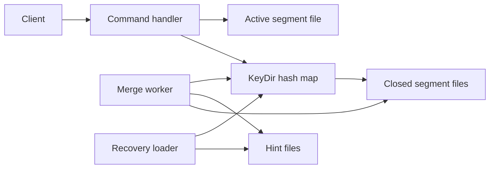
- **Command handler** parses requests and routes them.
- **KeyDir** is the in-memory hash map: key → (file id, offset, size, timestamp).
- **Active segment file** is the only file being written. Everything else is immutable.
- **Merge worker** reads closed segments, keeps live records, writes a new compacted segment plus a **hint file** (a compact list of key → offset so startup does not need to read every value).
- **Recovery loader** rebuilds the KeyDir at startup from hint files, falling back to scanning data files.

### Data model
| Field | Type | Purpose |
|---|---|---|
| crc | uint32 | Checksum of the rest of the record |
| timestamp | uint64 | Write time, for debugging and merge ordering |
| key_size, value_size | uint32 | Lengths so the reader knows how much to read |
| key, value | bytes | Payload. A tombstone uses a reserved marker value |

### Tech stack
| Component | Choice | Why |
|---|---|---|
| Language | Python 3.14 or Java 25 | Java's `FileChannel` gives positional reads, Python's `os.pread` does the same |
| Checksum | CRC32 | Fast, built into both standard libraries |
| Interface | Plain TCP line protocol | Easy to drive with `nc` and a load-test script |

### Milestones
1. **Single file store.** Append records, keep the KeyDir, serve `get`. *Done when* a restart rebuilds the index and returns the same values.
2. **Tombstones and segments.** *Done when* deleted keys stay deleted after restart and files roll over at the size limit.
3. **Merge.** Compact closed segments in the background. *Done when* disk usage drops after overwriting the same 1,000 keys 100 times, with no read errors during the merge.
4. **Hint files.** *Done when* startup on 1 GB of data is at least 5x faster than a full scan.
5. **Crash safety.** *Done when* killing the process with `SIGKILL` mid-write and restarting never returns a corrupted value (the torn tail record is detected by CRC and skipped).

### Deep dive: the hard parts
- **Durability versus speed.** `fsync` (the system call that forces the OS to flush a file's buffered writes to the physical disk) after every write makes data durable but caps you at a few hundred to a few thousand writes per second. Batch several writes per `fsync` ("group commit") and document what can be lost on a crash. Make the choice a configuration flag.
- **Atomic swap after merge.** Readers may hold an offset into an old segment while merge produces a new one. Update each KeyDir entry only if it still points at the old location (a compare-and-set), then delete the old file only after no reader can reference it.
- **Torn writes.** A crash can leave half a record at the end of the active file. Recovery must stop at the first record whose CRC fails and truncate the file there.

### Testing strategy
Property-based tests (Hypothesis in Python, jqwik in Java) that run random sequences of put/get/delete against both your store and a plain dictionary and compare results, including across simulated restarts. A crash test that kills the process at random points in a loop.

### Trade-offs, scaling and failure modes
All keys must fit in memory — with 100 million 20-byte keys plus about 30 bytes of metadata each you need roughly 5 GB of RAM. No range scans. Merge doubles disk I/O temporarily. Scaling past one machine means partitioning keys (Project 17) and replicating (Project 15).

### Stretch goals
- Add a range-scan API by replacing the hash map with a sorted map, then notice you have half-built an LSM-tree (Project 11).
- Expose metrics: live versus dead bytes per segment to choose merge victims.

### Skills practised
- Log-structured storage and hash indexes — [Ch 3 — Storage and Retrieval](../chapters/03-storage-and-retrieval/README.md)
- Crash recovery and durability vocabulary — [Ch 1 — Reliable, Scalable, Maintainable](../chapters/01-reliable-scalable-maintainable/README.md)

### In the interview
**Q:** Why is an append-only design faster than updating in place?
**A:** Appends are sequential writes, which disks and SSDs handle far better than random writes, and crash recovery is simpler because only the tail can be torn.

**Q:** What is the biggest limitation of a hash index?
**A:** The key set must fit in memory and you cannot do range queries because hash order is random.

**Q:** How do you reclaim space?
**A:** Compaction: rewrite only the latest value of each key from closed segments into a new file, then atomically switch the index and delete old files.

### TL;DR
Append every write, remember where each key's latest record lives, and compact in the background — the simplest durable storage engine, and the seed of every log-structured design.

## 2. SSTable file format with Bloom filter

**Level:** Beginner · **Time:** 1 weekend · **Prerequisites:** Ch 3

### What it is
A library that writes and reads **SSTables** (Sorted String Tables): immutable files whose records are sorted by key, split into fixed-size **data blocks**, followed by a **sparse index** (the first key of each block and its offset) and a **Bloom filter** — a compact bit array that can say "this key is definitely not here" or "this key might be here".

### The problem it solves
Project 1 needed every key in RAM. Sorting the file means you only need one index entry per block (say every 4 KB), because you can binary-search the sparse index and then scan one block. The Bloom filter avoids reading a file at all for keys it does not contain, which matters when a read must check many files, as an LSM-tree does.

### Real-world examples
- The SSTable name and layout come from Google's [Bigtable paper](https://research.google/pubs/bigtable-a-distributed-storage-system-for-structured-data/) (OSDI 2006).
- [LevelDB](https://github.com/google/leveldb) and [RocksDB](https://rocksdb.org/) use block-based tables with an index block and optional per-file Bloom filters, the same structure you build here.

### Requirements
**Functional**
- `SSTableWriter.add(key, value)` accepting keys in strictly increasing order, then `finish()`.
- `SSTableReader.get(key)` and `scan(start, end)` iterators.
- Per-block compression (optional) and per-block CRC.
- Bloom filter with configurable bits per key.

**Non-functional**
- With 10 bits per key the measured false-positive rate is about 1% (the theoretical value for an optimal number of hash functions).
- A point lookup reads at most one data block from disk when the index is cached.
- Writing 1 million records completes in under 5 seconds.

### The architecture
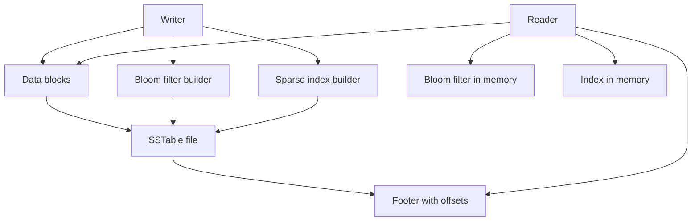
- **Data blocks** hold sorted key-value records, each block about 4 KB.
- **Sparse index** maps the first key of each block to its offset.
- **Bloom filter builder** sets k bits per key using k hash functions (derive them from two hashes, the Kirsch-Mitzenmacher trick).
- **Footer** is a fixed-size trailer at the end of the file holding the offsets of the index and filter, plus a magic number to detect wrong files.

### Data model
| Section | Contents |
|---|---|
| Data block | records of key length, value length, key, value, then a CRC |
| Filter block | bit array plus the number of hash functions |
| Index block | (first key, block offset, block size) per data block |
| Footer | index offset, filter offset, format version, magic |

### Tech stack
- **Java 25** (`ByteBuffer`, `MappedByteBuffer` for reads) or **Python 3.14** (`struct`, `mmap`).
- **xxHash or MurmurHash3** for Bloom hashing: fast, well-distributed, non-cryptographic.
- **zstd or LZ4** for optional block compression.

### Milestones
1. **Writer and full-scan reader.** *Done when* writing then scanning returns all records in order.
2. **Sparse index and point lookup.** *Done when* `get` touches exactly one data block (count reads).
3. **Bloom filter.** *Done when* an experiment with 1 million absent keys shows a false-positive rate within 0.3 percentage points of the formula.
4. **Range scan and corruption detection.** *Done when* flipping a byte in a block makes the reader raise a checksum error instead of returning bad data.

### Deep dive: the hard parts
- **Sizing the filter.** For n keys and m bits, the best number of hash functions is about (m/n)·ln 2. Measure, do not trust: plot false-positive rate against bits per key.
- **Prefix compression.** Adjacent sorted keys share prefixes (`user:1001`, `user:1002`). Storing only the differing suffix with periodic "restart points" shrinks blocks a lot, but binary search inside a block must then jump to restart points first.
- **Format versioning.** Put a version in the footer from day one so later readers can still open old files — the same evolution thinking as Chapter 4.

### Testing strategy
Round-trip tests with random keys, boundary tests (empty table, one key, key exactly at a block boundary), corruption tests, and a statistical test for the filter.

### Trade-offs, scaling and failure modes
Bigger blocks mean a smaller index but more bytes read per lookup. More filter bits mean fewer wasted reads but more memory. SSTables are immutable — updates require a new file, which is why they need an LSM-tree around them.

### Stretch goals
- Partitioned filters, or a filter per block.
- A cuckoo filter or ribbon filter and a comparison of memory per key.

### Skills practised
- SSTables, sparse indexes and Bloom filters — [Ch 3 — Storage and Retrieval](../chapters/03-storage-and-retrieval/README.md)
- Binary format design and versioning — [Ch 4 — Encoding and Evolution](../chapters/04-encoding-and-evolution/README.md)

### In the interview
**Q:** Why can an SSTable use a sparse index?
**A:** Keys are sorted, so knowing the first key of each block is enough to find the only block that could hold a key.

**Q:** Can a Bloom filter give a false negative?
**A:** No. Bits are only ever set, so if a key was added all its bits are 1. It can give false positives.

**Q:** What does the footer do?
**A:** It sits at a known position (end of file) and points to the index and filter, so a reader can open the file without scanning it.

### TL;DR
Sorted, immutable, block-structured files with a tiny index and a probabilistic "definitely not here" filter — the building block of every LSM-tree.

## 3. Tail-latency percentile monitor

**Level:** Beginner · **Time:** 1 weekend · **Prerequisites:** Ch 1

### What it is
A small service that receives request timings from applications and reports **percentiles** — p50 (median), p95, p99, p99.9 — over sliding time windows, using a mergeable histogram so that many servers' numbers can be combined correctly.

### The problem it solves
The mean is a poor summary of latency: if 99 requests take 20 ms and one takes 3 seconds, the mean is about 50 ms, yet one user in a hundred waited 3 seconds. Chapter 1 argues that **tail latency** (high percentiles) is what users feel, especially when one page fans out to many backends and is as slow as the slowest. A common bug is averaging percentiles across servers, which is mathematically meaningless — you must merge the underlying distributions.

### Real-world examples
- Google's [The Tail at Scale](https://research.google/pubs/the-tail-at-scale/) (Dean and Barroso, CACM 2013) shows how fan-out amplifies rare slow responses.
- [HdrHistogram](https://github.com/HdrHistogram/HdrHistogram) records values into log-linear buckets with fixed relative precision. [t-digest](https://github.com/tdunning/t-digest) is an alternative sketch with high accuracy at the extremes.

### Requirements
**Functional**
- Ingest endpoint taking (service, endpoint, duration in microseconds, timestamp).
- Query p50, p95, p99, p99.9 and max for the last 1, 5 and 60 minutes.
- Merge histograms across hosts.
- Simple text or HTML dashboard.

**Non-functional**
- Percentile error below 1% relative (choose histogram precision to guarantee it).
- Ingest 100,000 samples per second on one core.
- Memory bounded: under 50 KB per (endpoint, minute) histogram.

### The architecture
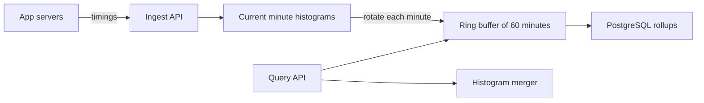
- **Ingest API** batches samples to cut per-request overhead.
- **Current minute histograms** are one histogram per (service, endpoint).
- **Ring buffer** keeps the last 60 one-minute histograms. A 5-minute window merges five of them.
- **Histogram merger** adds bucket counts — the reason histograms are mergeable and percentiles are not.
- **PostgreSQL rollups** store per-minute histograms as `bytea` for longer history.

### Data model
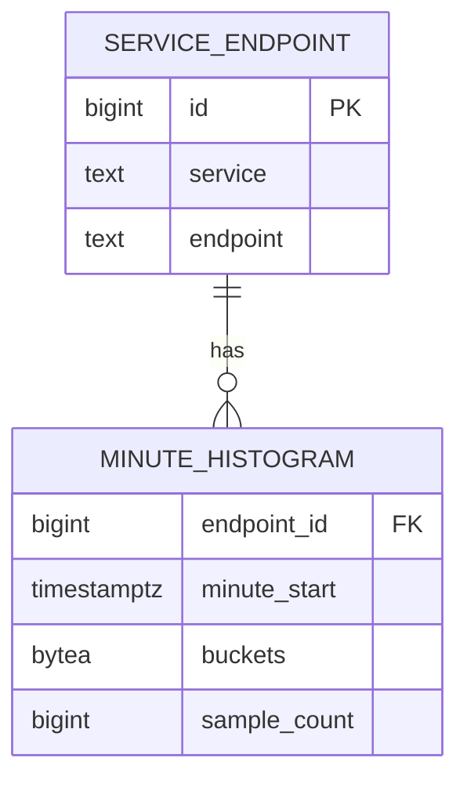

### Tech stack
| Component | Choice | Why |
|---|---|---|
| Service | Python 3.14 (asyncio) or Java 25 (virtual threads) | Simple concurrent ingest |
| Histogram | Your own log-linear buckets, then compare with HdrHistogram | Learn how it works, then validate |
| Storage | PostgreSQL | `bytea` blobs plus a time index |
| Load generator | Script producing a log-normal plus rare-spike distribution | Realistic tails |

### Milestones
1. **Exact baseline.** Store every sample, sort, compute percentiles. *Done when* results match a reference implementation.
2. **Log-linear histogram.** *Done when* every reported percentile is within 1% of the exact baseline on 10 million samples.
3. **Windows and merging.** *Done when* p99 over three hosts computed by merging equals p99 of the combined raw data (within error), and you can show that averaging per-host p99s gives a different, wrong answer.
4. **Persistence and dashboard.** *Done when* an hour of history survives a restart.

### Deep dive: the hard parts
- **Bucket design.** Equal-width buckets waste space at low values and lose precision at high ones. Log-linear buckets keep a fixed number of sub-buckets per power of two, giving constant *relative* error.
- **Coordinated omission.** If a load generator waits for each response before sending the next, a stall hides all the requests that *should* have been sent during the stall. Record intended start times, not actual send times, to avoid under-reporting the tail.
- **Window edges.** Minute-boundary rotation must be atomic so no sample is counted twice or lost.

### Testing strategy
Compare against exact percentiles on synthetic distributions (uniform, log-normal, bimodal). Unit-test merge associativity: merge(A, merge(B, C)) equals merge(merge(A, B), C).

### Trade-offs, scaling and failure modes
Higher precision means more buckets and memory. Sketches like t-digest use less memory but give probabilistic error. At larger scale, ship histograms from each host every few seconds instead of raw samples.

### Stretch goals
- Service-level objective alerts ("p99 over 300 ms for 5 minutes").
- A fan-out simulator showing how p99 of the whole page grows with the number of backends.

### Skills practised
- Percentiles, tail latency and describing load — [Ch 1 — Reliable, Scalable, Maintainable](../chapters/01-reliable-scalable-maintainable/README.md)
- Derived, mergeable aggregates — [Ch 11 — Stream Processing](../chapters/11-stream-processing/README.md)

### In the interview
**Q:** Why not report mean latency?
**A:** It hides the tail. A few very slow requests barely move the mean but ruin experience for those users, and fan-out makes them common.

**Q:** Can you average p99 across servers?
**A:** No. Percentiles are not additive. Merge the histograms and compute the percentile from the merged distribution.

**Q:** What is coordinated omission?
**A:** A measurement bug where the load generator slows down with the system and so never records the requests that would have waited the longest.

### TL;DR
Measure latency as mergeable histograms and report high percentiles — the honest way to describe performance from Chapter 1.

## 4. One dataset, three data models

**Level:** Beginner · **Time:** 1–2 weekends · **Prerequisites:** Ch 2

### What it is
A small "professional profile" application (people, jobs, schools, skills, who-knows-whom) whose data is stored three ways in PostgreSQL: **relational** (normalised tables and joins), **document** (one `jsonb` document per person), and **graph** (a vertices table and an edges table queried with recursive SQL). You run the same five questions against all three and compare query complexity, speed and how each model copes with change.

### The problem it solves
Chapter 2's central claim is that the data model shapes what is easy and what is painful. Reading the argument is not the same as feeling it. This project makes you write the "find friends-of-friends who worked at the same company" query three times and see why graphs, documents and tables each won somewhere.

### Real-world examples
- PostgreSQL documents its [JSON types and jsonb operators](https://www.postgresql.org/docs/current/datatype-json.html), including GIN indexing, which lets one database play the document role.
- [Recursive common table expressions](https://www.postgresql.org/docs/current/queries-with.html) (`WITH RECURSIVE`) are how you express graph traversals in plain SQL — the same approach Chapter 2 uses to compare with Cypher.

### Requirements
**Functional**
- Load the same synthetic dataset (10,000 people, 50,000 edges) into all three schemas.
- Five queries in each model: fetch a full profile, list people at a company, two-hop friend search, "everyone who lives within a region tree" (region contains region), and a schema change (add a "pronouns" field).
- A report table comparing lines of SQL, runtime and indexes used.

**Non-functional**
- Each query under 100 ms on the dataset with appropriate indexes.
- The loader is idempotent (safe to run twice).

### The architecture
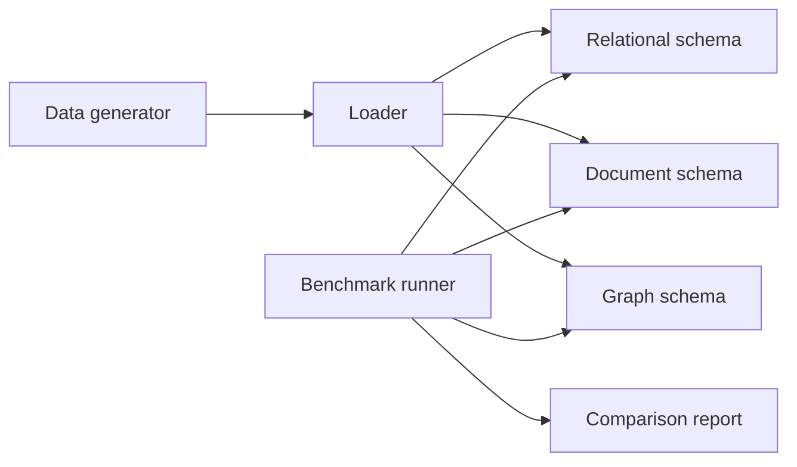
- **Data generator** produces one canonical in-memory dataset so all three models hold identical facts.
- **Loader** maps it into each schema inside one transaction per model.
- **Benchmark runner** runs each query with `EXPLAIN (ANALYZE, BUFFERS)` and records timings.

### Data model
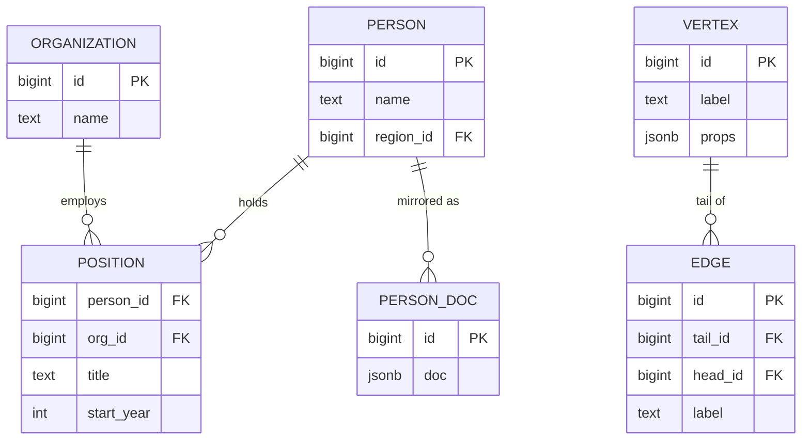

### Tech stack
- **PostgreSQL** (examples run on 14+) for all three models — one engine isolates the *model* as the variable.
- **Python 3.14** with `psycopg` for loading and benchmarking.
- Optionally **Neo4j** (current version) to compare a Cypher query with your recursive CTE.

### Milestones
1. **Relational.** *Done when* all five queries return correct results with foreign keys and indexes.
2. **Document.** *Done when* the profile query is a single-row fetch and you have written the "people at company X" query using a GIN index on `jsonb`.
3. **Graph.** *Done when* the two-hop and region-containment queries work via `WITH RECURSIVE` with a cycle guard.
4. **Change and report.** Add the new field in each model. *Done when* the report shows which needed a migration, which was schema-on-read, and the timings.

### Deep dive: the hard parts
- **Many-to-one in documents.** Storing the company name inside each person's document duplicates it. Renaming a company now means updating thousands of documents — the normalisation argument in practice.
- **Recursive queries without runaway.** A cycle in the friends graph makes naive recursion loop forever. Track visited ids in an array column and stop on repeats, or use PostgreSQL 14's `CYCLE` clause.
- **Schema-on-read versus schema-on-write.** Adding a field to `jsonb` needs no `ALTER TABLE`, but every reader must now handle documents with and without it.

### Testing strategy
For each query, assert all three models return the same set of ids. Run the loader twice and check row counts are unchanged.

### Trade-offs, scaling and failure modes
Documents win for self-contained, read-whole records (locality). Relational wins for many-to-many relationships and ad hoc joins. Graphs win for variable-length traversals. Large documents rewrite entirely on small updates.

### Stretch goals
- Implement a tiny Datalog-style rule evaluator over the edge table.
- Add a triple-store view (subject, predicate, object) and query it.

### Skills practised
- Relational, document and graph models — [Ch 2 — Data Models and Query Languages](../chapters/02-data-models-and-query-languages/README.md)
- Indexes and query plans — [Ch 3 — Storage and Retrieval](../chapters/03-storage-and-retrieval/README.md)

### In the interview
**Q:** When would you choose a document model?
**A:** When records are mostly loaded whole, have a tree shape and few many-to-many relationships — for example a résumé or an order with line items.

**Q:** What is schema-on-read?
**A:** The database accepts any structure, and the reading code interprets it. The schema exists, but only implicitly in the application.

**Q:** How do you query a graph in SQL?
**A:** With a recursive CTE that starts from seed vertices and repeatedly joins the edge table, guarding against cycles.

### TL;DR
Store the same facts three ways and feel why each model exists — the fastest route to really understanding Chapter 2.

## 5. Schema evolution lab (Avro and Protobuf)

**Level:** Beginner · **Time:** 1–2 weekends · **Prerequisites:** Ch 4

### What it is
A test bench that encodes the same records with JSON, Protocol Buffers and Apache Avro, then evolves the schema through ten realistic changes (add a field, remove one, rename one, change a type...) and automatically checks **backward compatibility** (new code reads old data) and **forward compatibility** (old code reads new data) for every pair of versions. It ends with a small compatibility-checker CLI.

### The problem it solves
In a rolling deployment, old and new versions of a service run at the same time and read each other's messages and stored records. One careless schema change — reusing a Protobuf field number, or adding an Avro field without a default — breaks production in ways unit tests miss. Chapter 4 explains the rules. This lab turns them into executable checks.

### Real-world examples
- The [Avro specification](https://avro.apache.org/docs/) defines schema resolution between a writer's schema and a reader's schema.
- The [Protocol Buffers language guide (proto3)](https://protobuf.dev/programming-guides/proto3/) explains field numbers, reserved fields and unknown-field handling.
- Confluent's [schema evolution and compatibility docs](https://docs.confluent.io/platform/current/schema-registry/fundamentals/schema-evolution.html) describe the BACKWARD, FORWARD and FULL modes used by its Schema Registry.

### Requirements
**Functional**
- A version chain of at least ten schema versions for a `User` record in both Protobuf and Avro.
- A matrix test: for every (writer version, reader version) pair, encode with the writer and decode with the reader, recording success, data loss or failure.
- A size comparison of JSON, Protobuf and Avro for 100,000 records.
- A CLI `compat-check old.avsc new.avsc` that prints which compatibility modes hold.

**Non-functional**
- The matrix runs in under 30 seconds.
- Results are a Markdown table that you commit alongside the code.

### The architecture
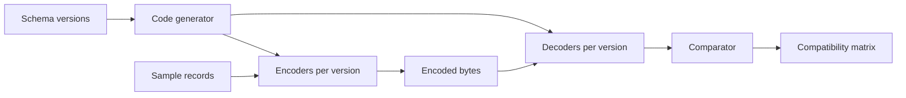
- **Schema versions** are `.proto` and `.avsc` files, v1 to v10.
- **Code generator** runs `protoc` and Avro tools (or uses Avro's generic records in Python).
- **Comparator** checks that fields the reader knows about survived, and records unknown-field preservation.

### Data model
| Version | Change | Expected Avro result | Expected Protobuf result |
|---|---|---|---|
| v2 | add optional `email` with default | compatible both ways | compatible both ways |
| v3 | add required field without default | old data unreadable by new reader | n/a (proto3 has no required) |
| v4 | rename field | breaks unless alias used | safe, names are not on the wire |
| v5 | reuse a deleted field number | n/a | silent corruption |

(Fill in the rest from your own experiments — predicting first, then running, is the point.)

### Tech stack
| Component | Choice | Why |
|---|---|---|
| Language | Java 25 (best Avro and Protobuf tooling) or Python 3.14 | Both have official libraries |
| Avro | Apache Avro (current version) | Writer and reader schema resolution |
| Protobuf | `protoc` plus language runtime | Tag-number encoding |
| Registry (stretch) | Confluent Schema Registry with Kafka | Real-world enforcement |

### Milestones
1. **Encode and size.** *Done when* you have a table of bytes per record for JSON, Protobuf and Avro, and can explain why Avro is smallest (no field tags in the data).
2. **Protobuf matrix.** *Done when* all ten versions are tested and the field-number reuse case is shown corrupting data.
3. **Avro matrix.** *Done when* the defaults and alias cases behave as predicted.
4. **Checker CLI.** *Done when* it flags at least the four classic breaking changes.

### Deep dive: the hard parts
- **Avro needs the writer's schema.** Avro bytes carry no field names or tags, so a reader cannot decode them without knowing the exact schema that wrote them. Files embed it in a header, and Kafka setups prefix each message with a schema id looked up in a registry.
- **Unknown-field preservation.** If old code reads a record with a new field, modifies it and writes it back, does the new field survive? Protobuf preserves unknown fields in current versions. Plain object mapping in your own code often drops them — test it.
- **Type changes.** Widening `int32` to `int64` is safe in one direction only. Write tests that encode a value larger than 2^31 and read it with the old schema.

### Testing strategy
The matrix itself is the test suite. Add a round-trip property test: decode(encode(x)) equals x for random records at every version.

### Trade-offs, scaling and failure modes
JSON is self-describing and human-readable but large and vague about numbers. Protobuf is compact and robust to renames but depends on careful field-number discipline. Avro is the most compact and great for dynamically generated schemas (for example, from database tables) but needs schema distribution.

### Stretch goals
- Run Schema Registry with Kafka and watch it reject an incompatible schema.
- Generate Avro schemas automatically from PostgreSQL table definitions.

### Skills practised
- Encoding formats and compatibility — [Ch 4 — Encoding and Evolution](../chapters/04-encoding-and-evolution/README.md)
- Message brokers and schemas in logs — [Ch 11 — Stream Processing](../chapters/11-stream-processing/README.md)

### In the interview
**Q:** Why can Protobuf fields be renamed safely?
**A:** Only the field number is encoded. The name lives only in the schema and generated code.

**Q:** How does an Avro reader know the writer's schema?
**A:** It must be supplied: in a file header, by version negotiation on a connection, or via a schema id looked up in a registry.

**Q:** What change is never safe?
**A:** Reusing a field number (Protobuf) or adding a field with no default that new readers require (Avro), because existing data can no longer be interpreted correctly.

### TL;DR
Turn Chapter 4's compatibility rules into an automated matrix so you can prove, not hope, that a schema change is safe for rolling upgrades.

## 6. Isolation anomaly lab on PostgreSQL

**Level:** Beginner · **Time:** 1 weekend · **Prerequisites:** Ch 7

### What it is
A scripted test harness that opens two (or three) concurrent PostgreSQL sessions, interleaves their statements in a precise order, and shows which **anomalies** — dirty reads, non-repeatable reads, lost updates, write skew, phantoms — occur at each **isolation level** (Read Committed, Repeatable Read, Serializable). Each anomaly is a small "story" such as two doctors going off call at once.

### The problem it solves
Isolation levels are where most developers' mental models are weakest. Their names differ between databases, and the SQL standard's definitions do not match what engines actually do. Running real interleavings against a real database is the only reliable way to learn what your database protects you from.

### Real-world examples
- PostgreSQL's [Transaction Isolation chapter](https://www.postgresql.org/docs/current/transaction-iso.html) documents that Repeatable Read is implemented as snapshot isolation and Serializable as Serializable Snapshot Isolation (SSI).
- [Hermitage](https://github.com/ept/hermitage) is an open-source catalogue of such tests across many databases. Write yours from scratch first, then compare.

### Requirements
**Functional**
- A tiny DSL or YAML file per scenario: steps like `T1: BEGIN`, `T2: UPDATE ...`, `T1: SELECT ...`, with expected outcomes per isolation level.
- A runner that executes steps in order on separate connections, detects blocking (a statement waiting on a lock), and continues the other session.
- At least eight scenarios: dirty write, dirty read, read skew, lost update, write skew, phantom, read-only transaction anomaly, and a fixed version of each.
- A results table: scenario × isolation level → anomaly / prevented by blocking / prevented by abort.

**Non-functional**
- Each scenario runs in under 2 seconds, deterministic across runs.

### The architecture
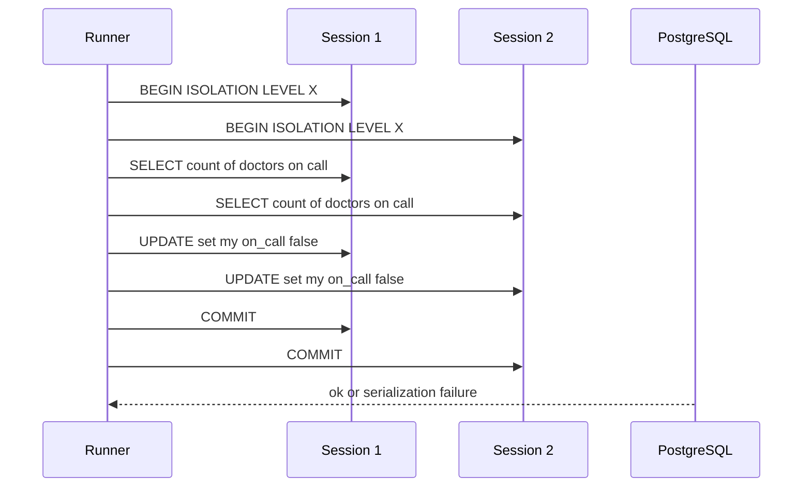
The **runner** drives each session from its own thread so it can notice when a statement blocks (use a short timeout) and move on. The diagram shows the write-skew story: both transactions read "two doctors on call", both remove themselves, and under snapshot isolation both commit.

### Data model
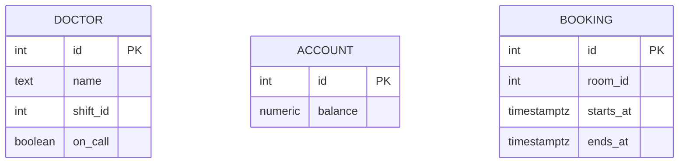

### Tech stack
- **PostgreSQL** in Docker, examples valid on 14+.
- **Python 3.14** with `psycopg` and threads, or **Java 25** with JDBC and virtual threads.
- YAML for scenario files so they are easy to read and share.

### Milestones
1. **Two-session runner with blocking detection.** *Done when* a lock wait is reported as "blocked" rather than hanging the harness.
2. **Classic anomalies.** *Done when* dirty read, lost update and read skew scenarios produce the expected table.
3. **Write skew and phantoms.** *Done when* the doctors and meeting-room stories commit wrongly under Repeatable Read and fail with SQLSTATE `40001` under Serializable.
4. **Fixes.** *Done when* each anomaly has a passing variant using `SELECT ... FOR UPDATE`, an atomic `UPDATE ... SET x = x + 1`, a constraint, or Serializable with retry.

### Deep dive: the hard parts
- **PostgreSQL never shows dirty reads.** Read Uncommitted behaves as Read Committed. Your table should show this, and explain it.
- **Lost update under Repeatable Read.** PostgreSQL detects concurrent updates to the same row in Repeatable Read and aborts the second with a serialization error — stronger than many other engines. Compare with what Chapter 7 says generally.
- **Retries are mandatory.** Serializable transactions can abort at commit time. Your fixed scenarios need a retry loop, and that loop must restart the *whole* transaction, including the reads.

### Testing strategy
The harness is a test framework: run all scenarios in CI against a PostgreSQL container and fail if any observed outcome differs from expectations.

### Trade-offs, scaling and failure modes
Stronger isolation costs more aborts and retries under contention. Explicit locks (`FOR UPDATE`) are cheap and predictable but easy to forget. Materialising conflicts (adding rows just to lock them) works but pollutes the schema.

### Stretch goals
- Run the same scenarios against MySQL or another engine and compare.
- Add a three-transaction read-only anomaly and explain why it needs SSI to prevent.

### Skills practised
- Isolation levels and anomalies — [Ch 7 — Transactions](../chapters/07-transactions/README.md)
- Precise vocabulary — [Ch 13 — Glossary](../chapters/13-glossary/README.md)

### In the interview
**Q:** What is write skew?
**A:** Two transactions read the same data, make decisions based on it, and write to *different* rows, together breaking an invariant that each alone preserved.

**Q:** Does snapshot isolation prevent write skew?
**A:** No. Each transaction sees a consistent snapshot, but neither sees the other's write. You need serializable isolation or explicit locking.

**Q:** What must application code do under Serializable?
**A:** Catch serialization failures and retry the entire transaction.

### TL;DR
Script real interleavings against PostgreSQL and build a truth table of anomalies by isolation level — the cure for vague isolation intuition.

## 7. Lamport and vector clock simulator

**Level:** Beginner · **Time:** 1 weekend · **Prerequisites:** Ch 5, Ch 8, Ch 9

### What it is
A discrete-event simulator of a few processes that send messages over a network with random delays, plus implementations of **Lamport clocks** (a single counter that gives a total order consistent with causality) and **vector clocks** (one counter per process, which can tell whether two events are causally ordered or **concurrent**). A visualiser draws space-time diagrams.

### The problem it solves
Wall-clock time cannot order events across machines: clocks drift and jump (Chapter 8). Systems instead need logical time. Lamport clocks give an order but cannot detect concurrency. Vector clocks can, which is what leaderless databases use to keep "siblings" (concurrent versions) instead of silently losing a write.

### Real-world examples
- Leslie Lamport's paper [Time, Clocks, and the Ordering of Events in a Distributed System](https://lamport.azurewebsites.net/pubs/time-clocks.pdf) (1978) introduced logical clocks.
- Amazon's [Dynamo paper](https://www.allthingsdistributed.com/files/amazon-dynamo-sosp2007.pdf) (SOSP 2007) used vector clocks to detect conflicting versions.
- Riak documents its [causal context](https://docs.riak.com/riak/kv/latest/learn/concepts/causal-context/index.html), evolved from vector clocks to dotted version vectors.

### Requirements
**Functional**
- Simulate N processes with local events, sends and receives. Delays drawn from a configurable distribution, including reordering.
- Lamport and vector clock implementations, attached to every event.
- A `happened_before(a, b)` and `concurrent(a, b)` API.
- Space-time diagram output (SVG or a mermaid sequence diagram).
- A replicated register demo: clients write to random replicas, and vector clocks detect concurrent writes as siblings.

**Non-functional**
- Deterministic replays from a random seed.
- Simulate 10,000 events in under a second.

### The architecture
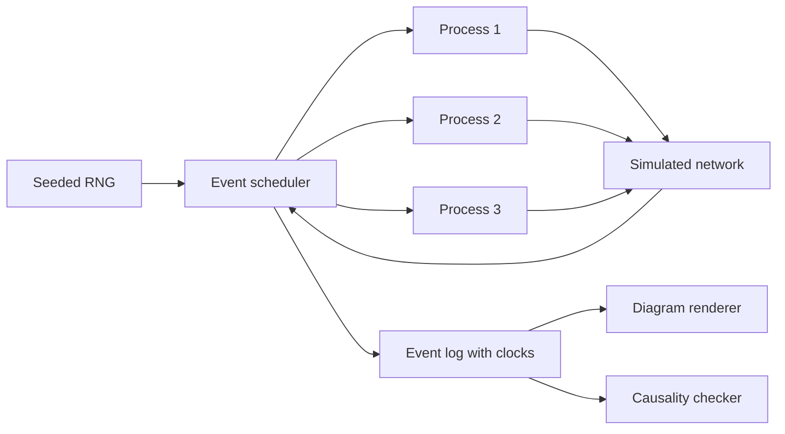
- **Event scheduler** is a priority queue of (simulated time, event) — the heart of any discrete-event simulation.
- **Simulated network** decides delay, drop and duplication.
- **Causality checker** computes the true happens-before relation from the event log by graph reachability and compares it with what the clocks claim.

### Data model
| Type | Fields |
|---|---|
| Event | id, process, kind (local, send, receive), msg_id, lamport, vector |
| Message | id, from, to, payload, sent_at, deliver_at, sender clocks |
| VersionedValue | value, vector clock (for the register demo) |

### Tech stack
- **Python 3.14** (fast to write, `heapq` scheduler) or **Java 25** (`PriorityQueue`, records for events).
- Output as SVG or a mermaid sequence diagram text.

### Milestones
1. **Scheduler and network.** *Done when* the same seed gives the same event log twice.
2. **Lamport clocks.** *Done when* for every pair where a happened-before b, L(a) < L(b), and you can show a pair of concurrent events with different Lamport values (proving the converse fails).
3. **Vector clocks.** *Done when* the checker agrees with vector-clock comparisons for every pair of events across 1,000 random runs.
4. **Replicated register.** *Done when* concurrent writes produce siblings and a later write that "saw" both siblings replaces them.

### Deep dive: the hard parts
- **Comparison rules.** V(a) ≤ V(b) element-wise and not equal means a happened before b. If neither ≤ holds, they are concurrent. Getting "equal" right matters.
- **Clock growth.** Vector clocks grow with the number of writers. Dynamo bounded them by truncation, which can create false conflicts. Measure the size growth in your register demo.
- **Total order from Lamport.** Ties are broken by process id, giving a total order that respects causality — the basis for some total-order broadcast designs (Chapter 9).

### Testing strategy
Property tests against the reachability oracle. Edge cases: messages to self, duplicated messages, a process that never communicates.

### Trade-offs, scaling and failure modes
Lamport clocks are one integer but cannot detect concurrency. Vector clocks detect it but cost O(N) space. Hybrid logical clocks (Project 31) add physical time for human-meaningful timestamps.

### Stretch goals
- Implement dotted version vectors and show they avoid sibling explosion.
- Add a version-vector-based anti-entropy exchange between two replicas.

### Skills practised
- Happens-before and concurrent writes — [Ch 5 — Replication](../chapters/05-replication/README.md)
- Unreliable clocks — [Ch 8 — The Trouble with Distributed Systems](../chapters/08-trouble-with-distributed-systems/README.md)
- Ordering and causality — [Ch 9 — Consistency and Consensus](../chapters/09-consistency-and-consensus/README.md)

### In the interview
**Q:** Why can't you use timestamps to order writes on different machines?
**A:** Clocks drift and can jump backwards after synchronisation, so a later event can get an earlier timestamp and last-write-wins silently discards data.

**Q:** What can a vector clock tell you that a Lamport clock cannot?
**A:** Whether two events are concurrent. With Lamport clocks, L(a) < L(b) does not imply a happened before b.

**Q:** How does a database use this?
**A:** It attaches a version vector to each value. On a write, it discards versions the writer has seen and keeps concurrent ones as siblings for the application to merge.

### TL;DR
Simulate messages, attach logical clocks, and check them against true causality — the clearest way to understand happens-before and concurrency.

## 8. Phi accrual failure detector

**Level:** Beginner · **Time:** 1 weekend · **Prerequisites:** Ch 8

### What it is
A heartbeat-based **failure detector**: each node periodically sends "I am alive" messages, and the monitor computes a suspicion level **φ (phi)** from the statistical distribution of past heartbeat gaps, instead of a fixed timeout. Roughly, if you declare the node dead at φ = 1 there is about a 10% chance you are wrong, at φ = 2 about 1%, and so on (φ is a base-10 logarithm). You compare it against fixed-timeout detection under realistic network jitter.

### The problem it solves
Chapter 8 explains that in an asynchronous network you cannot tell a dead node from a slow one. Short timeouts cause false alarms (and needless, risky failovers). Long timeouts mean slow recovery. An adaptive detector learns the normal jitter of each link and tunes itself.

### Real-world examples
- Akka documents its [phi accrual failure detector](https://doc.akka.io/docs/akka/current/typed/failure-detector.html), including how the threshold maps to detection time.
- Apache Cassandra's gossip layer uses a phi accrual detector, implemented in [FailureDetector.java](https://github.com/apache/cassandra/blob/trunk/src/java/org/apache/cassandra/gms/FailureDetector.java).
- Both are based on Hayashibara et al., "The φ Accrual Failure Detector" (SRDS 2004).

### Requirements
**Functional**
- Heartbeat sender and receiver over UDP.
- Sliding window of the last 1,000 inter-arrival times per node, with mean and standard deviation.
- φ computed on demand using a normal (or exponential) distribution model.
- A network-chaos proxy that adds delay, jitter, packet loss and pauses.
- A comparison harness: fixed timeout versus φ threshold, reporting false positives and detection time.

**Non-functional**
- Computing φ costs O(1) per query.
- Detect a crashed node within 3 seconds at a heartbeat interval of 500 ms with less than one false positive per hour under 50 ms jitter.

### The architecture
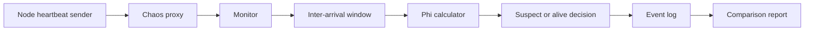
- **Chaos proxy** injects the conditions that make failure detection hard, including "stop-the-world" pauses that mimic garbage collection.
- **Inter-arrival window** keeps running sums so mean and variance update in O(1).
- **Phi calculator** returns −log10 of the probability that a heartbeat would still arrive after the elapsed time.

### Data model
| Item | Fields |
|---|---|
| Heartbeat | node id, sequence number, send timestamp |
| Window | ring buffer of gaps, sum, sum of squares |
| Decision event | node id, time, φ, verdict, ground truth |

### Tech stack
- **Java 25** (`DatagramChannel`, virtual threads) or **Python 3.14** (asyncio UDP).
- **Linux `tc netem`** in Docker as an alternative to your own chaos proxy.
- Plotting with matplotlib to draw φ over time.

### Milestones
1. **Heartbeats and fixed timeout.** *Done when* killing a sender is detected and logged.
2. **Phi calculation.** *Done when* φ stays below 1 during normal operation and rises steadily after a crash.
3. **Chaos.** *Done when* you have a chart showing false positives for timeouts of 1 s, 2 s, 5 s versus φ thresholds of 3, 8, 12 under the same jitter trace.
4. **GC-pause scenario.** *Done when* a 2-second pause triggers suspicion and recovery is recorded when heartbeats resume.

### Deep dive: the hard parts
- **Distribution choice.** Heartbeat gaps are not truly normal. A normal model reacts sharply to small delays when variance is tiny. Akka adds a minimum standard deviation and an "acceptable heartbeat pause" to soften this.
- **Bootstrapping.** With no history, φ is meaningless. Seed the window with a few assumed gaps.
- **Suspicion is not death.** The detector only produces a probability. What you *do* with it — removing a node, failing over a leader — needs a separate, careful decision (see fencing in Project 28).

### Testing strategy
Replay recorded traces of arrival times so tests are deterministic. Unit-test φ against hand-computed values.

### Trade-offs, scaling and failure modes
Lower thresholds detect faster but misfire more. All-to-all heartbeats cost O(N²) messages, which is why large clusters gossip (Project 32). A one-way network partition can make A suspect B while B sees A fine.

### Stretch goals
- Add indirect probing ("ask a third node to ping") as in SWIM.
- Feed φ into a leader-election simulation and count unnecessary failovers.

### Skills practised
- Timeouts, unbounded delays and process pauses — [Ch 8 — The Trouble with Distributed Systems](../chapters/08-trouble-with-distributed-systems/README.md)
- Failover risks — [Ch 5 — Replication](../chapters/05-replication/README.md)

### In the interview
**Q:** Why not just use a short timeout?
**A:** Network delay and process pauses are unbounded, so a short timeout declares healthy nodes dead, triggering failovers that add load and can cascade.

**Q:** What does φ represent?
**A:** A suspicion level on a log scale derived from how unlikely the current silence is, given the history of heartbeat gaps.

**Q:** Can a failure detector be perfect?
**A:** Not in an asynchronous network. It trades detection speed against false positives.

### TL;DR
Replace a fixed timeout with a statistical suspicion level learned from heartbeat history — Chapter 8's "you can't tell slow from dead" made practical.

## 9. Unix-style batch log analyser

**Level:** Beginner · **Time:** 1 weekend · **Prerequisites:** Ch 10

### What it is
A set of small composable command-line tools — `parse`, `filter`, `sortx` (external sort), `groupcount`, `topk`, `join` — that read and write newline-delimited records on standard input and output, so you can answer "the five most-visited URLs" over 10 GB of web-server logs with a pipeline. The key piece is an **external merge sort**: sort chunks that fit in memory, write them to disk, then merge.

### The problem it solves
Chapter 10 starts with the Unix philosophy because it already contains the ideas of MapReduce: immutable inputs, small single-purpose programs, a uniform interface, and sorting as the way to group data larger than memory. Building the tools yourself shows why sort-based grouping scales when an in-memory hash map would not.

### Real-world examples
- GNU [sort](https://www.gnu.org/software/coreutils/manual/html_node/sort-invocation.html) spills to temporary files and merges, which is why `sort | uniq -c` works on files larger than RAM.
- Adam Drake's post [Command-line Tools can be 235x Faster than your Hadoop Cluster](https://adamdrake.com/command-line-tools-can-be-235x-faster-than-your-hadoop-cluster.html) shows a pipeline on one machine beating a cluster on a moderate dataset.

### Requirements
**Functional**
- `parse` converts Apache or nginx combined-log lines to tab-separated fields.
- `sortx` sorts by chosen fields with a memory limit, spilling sorted runs to disk.
- `groupcount` counts runs of equal keys in sorted input (like `uniq -c`).
- `topk` keeps the k largest with a heap.
- `join` performs a sort-merge join of two sorted inputs on a key.

**Non-functional**
- `sortx` handles 10x more data than its memory limit.
- Throughput within 3x of GNU `sort` on the same input.
- Each tool streams: memory independent of input size, except `sortx` (bounded by its limit).

### The architecture
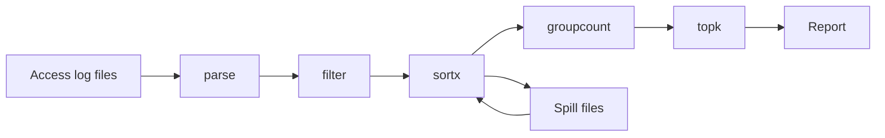
- **parse** and **filter** are stateless line-by-line transforms (the "map" side).
- **sortx** buffers up to the memory limit, sorts, writes a run, and finally does a k-way merge with a heap.
- **groupcount** relies on sorted input so it only remembers the current key — the "reduce" side.

### Data model
| Record | Fields (tab-separated) |
|---|---|
| Parsed hit | ip, timestamp, method, url, status, bytes, user_agent |
| Count | key, count |
| User dimension (for join) | ip, country, org |

### Tech stack
- **Python 3.14** (generators, `heapq.merge`) for clarity, or **Java 25** for speed.
- Plain text files and pipes, no frameworks.

### Milestones
1. **parse, filter, groupcount, topk.** *Done when* the pipeline matches an equivalent `awk | sort | uniq -c | sort -rn | head` on a 100 MB file.
2. **External sort.** *Done when* sorting 5 GB with a 500 MB limit produces output identical to GNU sort.
3. **Sort-merge join.** *Done when* joining hits to a user table gives correct per-country counts.
4. **Benchmark.** *Done when* you have a timing table and a profile showing where the time goes (parsing, I/O, comparison).

### Deep dive: the hard parts
- **K-way merge efficiency.** With many runs, use a heap of (current record, run index). Too many runs exhaust file handles, so merge in multiple passes.
- **Locale and byte order.** Sorting by Unicode collation versus raw bytes gives different orders. Joins and groupings only work if every tool agrees, so fix one comparison rule.
- **Skew.** If one URL dominates, sorting is fine but a later hash-based stage would overload one bucket. Note this for Project 24.

### Testing strategy
Golden-file tests comparing your pipeline to GNU tools. Property test: `sortx` output is a sorted permutation of input.

### Trade-offs, scaling and failure modes
One machine is limited by disk throughput. A crash mid-sort means rerunning from the start, which is fine because inputs are immutable — the same reasoning MapReduce uses for retries.

### Stretch goals
- Parallel `sortx` using multiple cores for run generation.
- A tiny "distributed" version that splits input across two processes and merges.

### Skills practised
- Unix philosophy, sorting versus in-memory aggregation — [Ch 10 — Batch Processing](../chapters/10-batch-processing/README.md)
- Sorted files and merging — [Ch 3 — Storage and Retrieval](../chapters/03-storage-and-retrieval/README.md)

### In the interview
**Q:** Why sort rather than use a hash map to count?
**A:** A hash map must fit in memory. Sorting works on disk with sequential I/O, so grouping scales to data much larger than RAM.

**Q:** What makes Unix pipelines composable?
**A:** A uniform interface (lines of text on stdin and stdout) and programs that do one thing without side effects on their input.

**Q:** How do you join two big files without a database?
**A:** Sort both by the join key and walk them together — a sort-merge join.

### TL;DR
Build sort, group and join as streaming Unix tools to see that MapReduce is "Unix pipes plus a distributed filesystem".

## 10. Event-sourced ledger with projections

**Level:** Beginner · **Time:** 1–2 weekends · **Prerequisites:** Ch 11, Ch 12

### What it is
A small bank-account service where the source of truth is an append-only table of **events** (`AccountOpened`, `MoneyDeposited`, `MoneyWithdrawn`, `TransferInitiated`) in PostgreSQL. Current balances, statements and fraud flags are **projections** (also called read models): derived tables built by replaying the events. You can delete a projection and rebuild it from scratch at any time.

### The problem it solves
In a normal CRUD design, an `UPDATE balance = 90` destroys the information about *why* the balance changed. Event sourcing keeps the full history, makes auditing natural, and lets you create new views of old data later. Chapter 11 also points out the costs: you need to version events, rebuild views and handle commands that must be validated against current state.

### Real-world examples
- Martin Fowler's [Event Sourcing](https://martinfowler.com/eaaDev/EventSourcing.html) article describes the pattern and its replay and temporal-query benefits.
- [EventStoreDB](https://github.com/eventstore/eventstore) is a database built specifically for event streams with optimistic concurrency per stream.

### Requirements
**Functional**
- Commands: open account, deposit, withdraw, transfer. Withdraw must not overdraw.
- Each command appends events with an expected stream version (**optimistic concurrency**: fail if someone else appended first).
- Projections: current balance, monthly statement, "large withdrawals" alert list.
- `rebuild <projection>` replays all events.
- Temporal query: "what was the balance on 1 March?"

**Non-functional**
- Append latency under 10 ms p99.
- Rebuild 1 million events in under 60 seconds.
- Projections eventually consistent within 1 second.

### The architecture
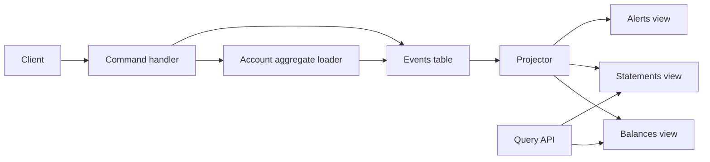
- **Command handler** loads an account by replaying its events (the **aggregate**), validates the command, and appends new events.
- **Events table** is append-only. A unique constraint on (stream_id, version) gives optimistic concurrency for free.
- **Projector** reads events in global order from its last checkpoint and updates views idempotently.

### Data model
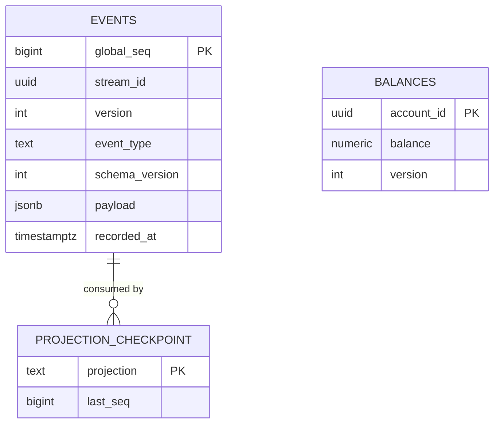

### Tech stack
| Component | Choice | Why |
|---|---|---|
| Store | PostgreSQL | Transactions, unique constraints, `jsonb` |
| Service | Java 25 with Spring Boot 4.1.1, or Python 3.14 with FastAPI | Familiar web stacks |
| Projector | Polling loop on `global_seq` | Simple and reliable to start |

### Milestones
1. **Append and replay.** *Done when* concurrent withdrawals on one account never overdraw (one gets a version conflict and retries).
2. **Balance projection with checkpoint.** *Done when* killing the projector mid-run and restarting produces the same balances (idempotent updates).
3. **Rebuild and temporal query.** *Done when* dropping and rebuilding projections yields identical tables and historical balances are correct.
4. **Event versioning.** Change `MoneyDeposited` to add a currency. *Done when* old events are upcast (converted on read) to the new shape.

### Deep dive: the hard parts
- **Gaps in the global sequence.** PostgreSQL sequences can have gaps, and a transaction with a lower number may commit after one with a higher number. A projector that advances its checkpoint too eagerly can skip an event forever. Read only events older than a small safety lag, or track in-flight transactions.
- **Command versus event.** A command can be rejected. An event is a fact that already happened and must never be rejected by consumers.
- **Snapshots.** Replaying 10,000 events per command is slow. Periodically store a snapshot of aggregate state with its version.

### Testing strategy
Given-when-then tests: given past events, when a command, then expected new events or an error. Rebuild-equivalence test comparing live and rebuilt projections.

### Trade-offs, scaling and failure modes
Read models lag behind writes, so a user may not see their own deposit immediately — fix with read-your-writes by waiting for the projector to reach the command's sequence number. Deleting personal data (for privacy law) from an immutable log needs crypto-shredding or rewriting.

### Stretch goals
- Publish events to Kafka and run projections as consumers.
- Add a `Transfer` saga across two accounts.

### Skills practised
- Event sourcing and immutable logs — [Ch 11 — Stream Processing](../chapters/11-stream-processing/README.md)
- Derived data and unbundling — [Ch 12 — The Future of Data Systems](../chapters/12-future-of-data-systems/README.md)
- Optimistic concurrency — [Ch 7 — Transactions](../chapters/07-transactions/README.md)

### In the interview
**Q:** What is the difference between event sourcing and change data capture?
**A:** Event sourcing records application-level intent as the source of truth. CDC extracts low-level row changes from a database that is still mutable.

**Q:** How do you enforce "no overdraft" without locks?
**A:** Load the account at version v, check the rule, append with expected version v. A concurrent writer causes a uniqueness violation and a retry.

**Q:** What is a projection?
**A:** A read-optimised view derived from the event log, which can be dropped and rebuilt deterministically.

### TL;DR
Make the append-only event log the truth and every table a rebuildable view — Chapter 11's event-sourcing ideas on a single PostgreSQL database.

## 11. LSM-tree storage engine

**Level:** Intermediate · **Time:** 2–3 weeks · **Prerequisites:** Ch 3, Projects 1–2

### What it is
A complete **log-structured merge-tree** (LSM-tree) key-value engine. Writes go to a **write-ahead log** (WAL, an append-only file used only for crash recovery) and to an in-memory sorted **memtable**. When the memtable is full it is flushed as an SSTable (Project 2). Reads check the memtable, then SSTables from newest to oldest, skipping files via Bloom filters. A background **compaction** process merges SSTables to drop overwritten values and tombstones.

### The problem it solves
Project 1 needed all keys in RAM and could not do range scans. A B-tree (Project 12) supports both but performs random in-place writes. The LSM-tree turns all writes into sequential I/O and supports ranges, at the cost of read and space amplification that compaction must keep in check. It is the dominant design for write-heavy stores.

### Real-world examples
- O'Neil et al., [The Log-Structured Merge-Tree](https://www.cs.umb.edu/~poneil/lsmtree.pdf) (1996), the original paper.
- [RocksDB](https://rocksdb.org/) (from Facebook, based on LevelDB) is embedded in many systems. LinkedIn's [FollowFeed](https://www.linkedin.com/blog/engineering/feed/followfeed-linkedin-s-feed-made-faster-and-smarter) stores timelines in RocksDB.
- Cassandra and HBase use the same memtable plus SSTable design, as described in the [Bigtable paper](https://research.google/pubs/bigtable-a-distributed-storage-system-for-structured-data/).

### Requirements
**Functional**
- `put`, `get`, `delete`, `scan(start, end)`, plus atomic `write_batch`.
- WAL with group commit, memtable (skip list or balanced tree), flush to Level 0.
- Leveled compaction: L0 files overlap, L1+ files are non-overlapping and each level is about 10x larger.
- Manifest file recording which SSTables belong to which level, updated atomically.
- Snapshots: a reader can pin a sequence number and see a consistent view.

**Non-functional**
- Sustain 100,000 random 100-byte writes per second.
- Point reads p99 under 2 ms with 10 GB of data and a warm block cache.
- Write amplification (bytes written to disk divided by bytes written by the user) measured and reported, target under 20 with leveled compaction.

### The architecture
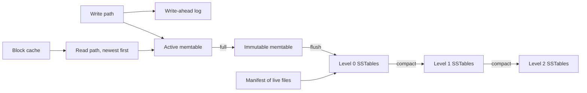
- **Read path** checks the active memtable, then the immutable one, then L0 files newest first, then one file per deeper level, stopping at the first version found.
- **Active memtable** takes writes. When full it becomes **immutable** and a new one starts, so flushing does not block writers.
- **Levels** organise SSTables. Each compaction picks one file from level n and the overlapping files in level n+1, merges them, and writes new files to level n+1.
- **Manifest** is itself a small log of "add file / remove file" edits, so the set of live files survives crashes.
- **Block cache** keeps recently used data blocks in memory (LRU).

### Data model
| Structure | Key fields |
|---|---|
| Internal key | user key, sequence number, kind (put or delete) |
| WAL record | CRC, length, batch of internal keys and values |
| Manifest edit | add or remove file, level, smallest and largest key |
| SSTable | from Project 2, with internal keys |

Internal keys sort by user key ascending, then sequence number *descending*, so the newest version is found first.

### Tech stack
| Component | Choice | Why |
|---|---|---|
| Engine | Java 25 or Go | Threads for background compaction, good byte handling |
| Memtable | Concurrent skip list (`ConcurrentSkipListMap` in Java) | Sorted, lock-free reads |
| Benchmarks | Your own harness modelled on `db_bench` | Compare against RocksDB |
| Python option | Python 3.14 for a teaching version | Slower but clear |

### Milestones
1. **WAL and memtable.** *Done when* a `SIGKILL` loses no acknowledged writes (with sync on) and recovery replays the WAL.
2. **Flush and multi-file reads.** *Done when* reads merge memtable and many L0 files correctly, including tombstones hiding older values.
3. **Leveled compaction and manifest.** *Done when* overwriting 1 million keys 10 times keeps disk usage bounded and recovery after a crash during compaction is correct.
4. **Iterators and snapshots.** *Done when* a scan opened before a batch of writes never sees them.
5. **Measure amplification.** *Done when* you report write, read and space amplification for leveled versus size-tiered compaction on the same workload.

### Deep dive: the hard parts
- **The merging iterator.** A range scan merges iterators over the memtable and every relevant SSTable with a heap, skips older versions of the same key, hides keys shadowed by tombstones and ignores versions newer than the snapshot. Most LSM bugs live here.
- **Dropping tombstones safely.** A tombstone can only be discarded when compaction reaches the bottom level for that key range. Dropping it earlier lets an older value in a lower level "resurrect".
- **Write stalls.** If flushes and compactions fall behind, L0 accumulates files and reads slow down. Real engines throttle writers when L0 grows past a threshold — implement and graph it.
- **Crash during compaction.** New files are written, then the manifest edit is appended. Only after the edit is durable may old files be deleted. Orphaned files at startup are garbage-collected.

### Testing strategy
Model-based testing against an in-memory sorted map, with random crashes injected between operations. A long-running stress test with concurrent readers, writers and compaction. Compare checksums of full scans before and after compaction.

### Trade-offs, scaling and failure modes
Leveled compaction gives low space and read amplification but high write amplification. Size-tiered compaction writes less but uses more space and more files per read. Bloom filters fix point reads but not range scans. SSD wear is driven by write amplification.

### Stretch goals
- Key-value separation (store large values in a separate log, as in WiscKey).
- Universal or tiered compaction and a tuning advisor.
- Per-key TTL that compaction honours.

### Skills practised
- LSM-trees, SSTables, compaction strategies — [Ch 3 — Storage and Retrieval](../chapters/03-storage-and-retrieval/README.md)
- Snapshots as a basis for isolation — [Ch 7 — Transactions](../chapters/07-transactions/README.md)

### In the interview
**Q:** Why are LSM-trees good for writes?
**A:** All disk writes are sequential — WAL appends, memtable flushes and compaction outputs — so throughput is high and SSDs wear less per byte than with random rewrites.

**Q:** How does a read find the latest value?
**A:** Memtable first, then SSTables newest to oldest, using Bloom filters to skip files. The first version found wins, and a tombstone means "deleted".

**Q:** What goes wrong if compaction falls behind?
**A:** Files pile up, reads must check more of them, and disk fills. Engines throttle writes to let compaction catch up.

**Q:** Leveled versus size-tiered?
**A:** Leveled keeps one sorted run per level for cheaper reads and less space, at the cost of more rewriting. Size-tiered rewrites less but reads and space suffer.

### TL;DR
Memtable plus WAL plus levels of SSTables plus compaction — build the write-optimised engine behind RocksDB, Cassandra and HBase and measure its amplification trade-offs.

## 12. B-tree page store with WAL

**Level:** Intermediate · **Time:** 2–3 weeks · **Prerequisites:** Ch 3, Ch 7

### What it is
A disk-based **B+ tree** — a balanced tree of fixed-size **pages** (say 4 KB) where interior pages hold keys and child pointers and leaf pages hold key-value pairs linked left-to-right — with a **buffer pool** (an in-memory cache of pages) and a **write-ahead log** that makes page updates crash-safe. Recovery replays the log after a crash, following the "redo" half of the ARIES approach.

### The problem it solves
B-trees are the standard index in relational databases. They update data in place, which makes reads predictable (one path from root to leaf) but makes crashes dangerous: a page split modifies several pages, and a crash halfway leaves the tree corrupt. The WAL solves this by recording intent before touching pages.

### Real-world examples
- PostgreSQL's [WAL introduction](https://www.postgresql.org/docs/current/wal-intro.html) explains why logging changes before writing data pages enables recovery and fewer disk writes.
- PostgreSQL's [B-tree index implementation docs](https://www.postgresql.org/docs/current/btree.html) and [page layout docs](https://www.postgresql.org/docs/current/storage-page-layout.html) show real page headers and item pointers.
- The [SQLite file format](https://www.sqlite.org/fileformat.html) documents its B-tree pages and its rollback journal and WAL modes in detail.

### Requirements
**Functional**
- `insert`, `get`, `delete`, `range_scan` on a single file of 4 KB pages.
- Page splits and (optionally) merges, with the root changing as the tree grows.
- Buffer pool with a fixed number of frames, pin counts and LRU or clock eviction.
- WAL: every page modification is logged with a **log sequence number** (LSN) before the page may be written to disk.
- Checkpoints, and recovery that redoes logged changes newer than each page's LSN.

**Non-functional**
- A lookup touches at most `height` pages (height is 3–4 for millions of keys).
- 20,000 random inserts per second with group commit.
- Survives `SIGKILL` at any point without losing acknowledged inserts or corrupting the tree.

### The architecture
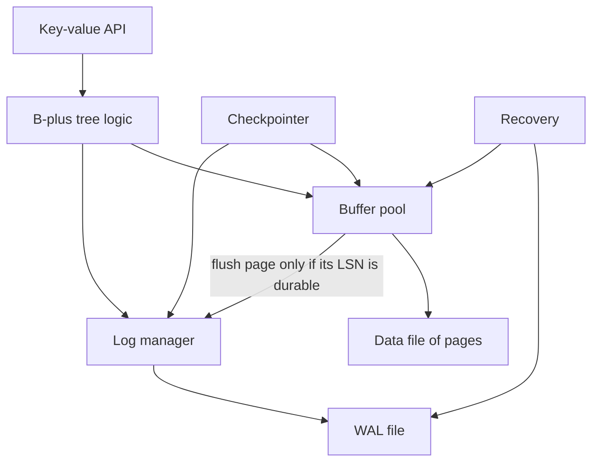
- **B-plus tree logic** finds leaves, splits full pages and updates parents.
- **Buffer pool** keeps hot pages in memory, tracks which are dirty, and writes them back on eviction.
- **Log manager** appends log records and forces the log to disk on commit. The **WAL rule** — never write a dirty page before the log record describing its latest change is on disk — is enforced here.
- **Checkpointer** periodically flushes dirty pages and records the point from which recovery must start.

### Data model
| Structure | Fields |
|---|---|
| Page header | page id, page type (leaf or interior), page LSN, key count, right sibling |
| Leaf cell | key length, key, value length, value |
| Interior cell | key, child page id |
| Log record | LSN, transaction id, page id, kind, redo bytes (physical or logical) |
| Checkpoint record | dirty page table, active transactions |

### Tech stack
- **Java 25** (`FileChannel`, `ByteBuffer` slices per frame) or **Go**.
- **Python 3.14** is workable for a teaching version with small data.
- A fault-injecting file wrapper that can drop unflushed writes to simulate power loss.

### Milestones
1. **In-memory B+ tree over page objects.** *Done when* random insert/delete tests keep all invariants (sorted keys, balanced height, half-full pages if merging).
2. **Paged file and buffer pool.** *Done when* the tree works with a pool of 64 frames over a 1 GB file.
3. **WAL and redo recovery.** *Done when* a crash test that kills the process randomly 1,000 times never yields a corrupt tree or lost committed key.
4. **Checkpoints.** *Done when* recovery time is bounded regardless of total log size.
5. **Concurrency.** *Done when* readers and writers run in parallel using latch crabbing (hold a child's latch before releasing the parent's).

### Deep dive: the hard parts
- **Torn pages.** A 4 KB page write may be only partly on disk after power loss. PostgreSQL handles this by logging a full page image the first time a page is modified after a checkpoint. Implement the same and measure the extra log volume.
- **Splits are multi-page changes.** Splitting a leaf touches the leaf, its new sibling and the parent. Log all three changes so redo restores a consistent tree.
- **Latches versus locks.** **Latches** are short-held mutexes protecting in-memory page structures. **Locks** protect logical data for transactions. Do not confuse them, and never hold a latch while waiting on I/O for another page if you can avoid it.

### Testing strategy
Invariant checker that walks the whole tree. Crash-loop harness with a fault-injecting file layer. Concurrency stress tests run under thread sanitiser equivalents or many random seeds.

### Trade-offs, scaling and failure modes
B-trees give fast, predictable reads and natural range scans but write each changed page in full (write amplification), and leave fragmentation after deletes. Compared with Project 11, compare write throughput and read latency on identical workloads.

### Stretch goals
- Undo logging and transactions with rollback (full ARIES).
- Copy-on-write B-tree (like LMDB) instead of WAL, and compare.
- Prefix compression and suffix truncation in interior pages.

### Skills practised
- B-trees, WAL, crash safety — [Ch 3 — Storage and Retrieval](../chapters/03-storage-and-retrieval/README.md)
- Atomicity and durability — [Ch 7 — Transactions](../chapters/07-transactions/README.md)

### In the interview
**Q:** What is the WAL rule?
**A:** A modified page may only be written to disk after the log records describing the change are durable, so recovery can always redo or undo it.

**Q:** Why is a B-tree's depth small?
**A:** High branching factor: a 4 KB page holds hundreds of child pointers, so four levels address billions of keys.

**Q:** B-tree or LSM for a read-heavy workload?
**A:** Usually B-tree, because each key lives in one place and lookups follow one root-to-leaf path.

### TL;DR
Fixed-size pages, a buffer pool, and a write-ahead log with redo recovery — the in-place update engine behind PostgreSQL and SQLite.

## 13. Column store with vectorised aggregation

**Level:** Intermediate · **Time:** 2 weeks · **Prerequisites:** Ch 3

### What it is
An analytics engine that stores each column of a table in its own file, compresses columns with **run-length encoding** (store "value, count" for repeated runs), **dictionary encoding** (replace strings with small integer codes) and **bitmaps** (one bit per row per distinct value), and runs `SELECT SUM(x) WHERE y = ... GROUP BY z` queries by processing columns in batches of a few thousand values at a time (**vectorised execution**).

### The problem it solves
Analytical queries read few columns but many rows. A row store must read every column of every row, wasting I/O. Storing columns separately lets the engine read only what it needs, and similar values next to each other compress extremely well. Chapter 3 explains this split between OLTP (transaction processing) and OLAP (analytics).

### Real-world examples
- [Apache Parquet](https://parquet.apache.org/docs/) is an open columnar file format with row groups, column chunks, dictionary and run-length encodings.
- [DuckDB](https://duckdb.org/why_duckdb) is an embedded analytical database using columnar, vectorised execution.
- [ClickHouse](https://clickhouse.com/docs/en/intro) is a columnar OLAP database that explains why column orientation speeds up analytics.

### Requirements
**Functional**
- Import CSV into a columnar table split into **row groups** (for example 1 million rows each).
- Per-column encodings chosen automatically: plain, dictionary, run-length, bit-packed.
- Min/max statistics per column chunk ("zone maps") to skip row groups.
- Query operators: scan, filter, project, hash aggregate, sort, limit.
- A tiny SQL subset or a builder API.

**Non-functional**
- Scan-and-sum a 100-million-row integer column in under 1 second on a laptop (multithreaded).
- Compression ratio at least 5x on a sorted, low-cardinality column.

### The architecture
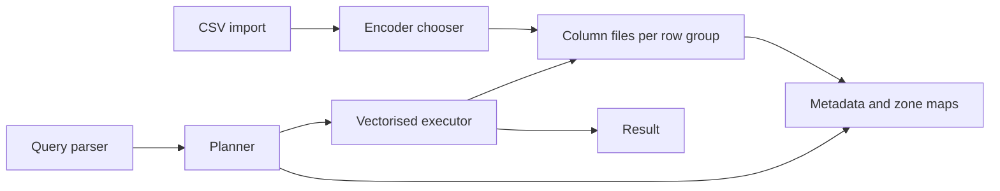
- **Encoder chooser** samples each chunk and picks the encoding with the smallest output.
- **Metadata and zone maps** let the planner skip row groups whose min/max cannot match the filter.
- **Vectorised executor** passes batches (vectors) between operators so each operator runs a tight loop over primitive arrays, which keeps the CPU cache warm and lets the compiler use SIMD instructions.

### Data model
| Item | Contents |
|---|---|
| Table metadata | columns, types, row group list, sort key |
| Column chunk | encoding, compressed bytes, null bitmap, min, max, distinct estimate |
| Dictionary page | code to value array |
| Batch | selection vector plus column vectors of up to 2,048 values |

### Tech stack
| Component | Choice | Why |
|---|---|---|
| Engine | Java 25 (Vector API incubator for SIMD) or Go | Tight loops over arrays |
| Python option | Python 3.14 with NumPy | Vectorisation via array ops |
| Reference | DuckDB or PostgreSQL | Check results and compare speed |

### Milestones
1. **Plain columnar files and full scan.** *Done when* `SUM` and `COUNT` match PostgreSQL on the same data.
2. **Encodings.** *Done when* a table of compression ratios per column and encoding is produced.
3. **Operate on compressed data.** *Done when* filters on dictionary codes and run-length runs work without decompressing to strings.
4. **Vectorised operators and zone maps.** *Done when* a selective filter skips at least 90% of row groups on a sorted column and you show the speedup.
5. **Group-by.** *Done when* a hash aggregate over a dictionary-encoded column runs using codes as array indexes.

### Deep dive: the hard parts
- **Sort order matters.** Sorting rows by the most filtered column makes run-length encoding and zone maps powerful for that column, but only the first sort key benefits fully. Chapter 3 mentions storing several sort orders, as C-Store and Vertica did.
- **Late materialisation.** Apply filters to produce a selection vector of row positions first, and only fetch the other columns for qualifying rows.
- **Writes are hard.** Inserting into sorted compressed columns is expensive. Buffer inserts in a row-oriented in-memory store and periodically merge into new column files — LSM thinking again.

### Testing strategy
Differential testing: generate random queries, run them on your engine and on DuckDB or PostgreSQL, compare results. Encoding round-trip property tests.

### Trade-offs, scaling and failure modes
Column stores are poor for point lookups and single-row updates. Very wide `SELECT *` queries lose the I/O advantage. Memory for hash aggregates can blow up with high-cardinality group keys — spill to disk.

### Stretch goals
- Bitmap indexes with compressed bitmaps (Roaring-style) and AND/OR across predicates.
- Materialised aggregates (a data cube) for common queries.
- Read and write real Parquet files.

### Skills practised
- Column-oriented storage, compression, data warehousing — [Ch 3 — Storage and Retrieval](../chapters/03-storage-and-retrieval/README.md)
- Batch processing of analytics data — [Ch 10 — Batch Processing](../chapters/10-batch-processing/README.md)

### In the interview
**Q:** Why are column stores faster for analytics?
**A:** Queries read only the needed columns, those columns compress well, and processing contiguous arrays of one type uses the CPU efficiently.

**Q:** What is a zone map?
**A:** Per-chunk min and max values that let the engine skip chunks that cannot satisfy a filter.

**Q:** How do column stores handle writes?
**A:** Usually by buffering in a write-optimised in-memory structure and merging into columnar files in bulk.

### TL;DR
Store columns separately, compress them cleverly and process them in vectors — the design behind Parquet, DuckDB and ClickHouse.

## 14. Inverted-index search engine

**Level:** Intermediate · **Time:** 2 weeks · **Prerequisites:** Ch 3, Ch 6

### What it is
A full-text search engine for a collection of documents (for example Wikipedia abstracts). It tokenises text, builds an **inverted index** (a map from each term to a **posting list** — the sorted list of document ids containing it, with positions), ranks results with BM25, supports phrase and fuzzy queries, and is organised as immutable **segments** that are merged in the background — the same log-structured idea as Project 11 applied to search.

### The problem it solves
A B-tree or hash index answers "find rows where key equals X". Search needs "find documents containing these words, roughly, ranked by relevance". Chapter 3 introduces full-text and fuzzy indexes. Chapter 6 shows how such indexes are partitioned (by document) across machines.

### Real-world examples
- [Apache Lucene](https://lucene.apache.org/) is the library behind Elasticsearch and Solr, built from immutable segments merged over time.
- Elastic's article [Elasticsearch from the Bottom Up](https://www.elastic.co/blog/found-elasticsearch-from-the-bottom-up) walks through inverted indexes, segments and shards.

### Requirements
**Functional**
- Analyse text: lowercase, split on non-letters, optional stemming and stop words.
- Index documents into in-memory buffers, flushed as immutable segments.
- Query types: term, boolean AND/OR/NOT, phrase (using positions), prefix, and fuzzy (edit distance up to 2).
- BM25 ranking with top-k results.
- Deletes via a per-segment "deleted docs" bitmap, purged at merge time.

**Non-functional**
- Index 1 million short documents in under 5 minutes.
- p99 query latency under 50 ms for two-term AND queries.
- New documents become searchable within 1 second (near-real-time refresh).

### The architecture
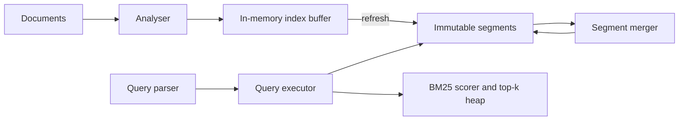
- **Analyser** turns text into terms. Index and query must use the same analyser or matches fail.
- **Immutable segments** each contain a term dictionary, posting lists, positions and stored fields.
- **Segment merger** combines small segments into bigger ones and drops deleted documents.
- **Query executor** intersects posting lists by walking them in parallel (leapfrogging with skip pointers).

### Data model
| Structure | Contents |
|---|---|
| Term dictionary | sorted terms, each with document frequency and posting offset |
| Posting list | delta-encoded doc ids, term frequencies, positions |
| Stored fields | original document by doc id |
| Segment metadata | doc count, deleted bitmap, generation number |

### Tech stack
- **Java 25** (natural fit, and you can compare with Lucene) or **Python 3.14** for a smaller corpus.
- Variable-byte or frame-of-reference encoding for posting lists.
- A finite-state automaton or a sorted array with binary search for the term dictionary.

### Milestones
1. **Single-segment index and term queries.** *Done when* results match a brute-force scan.
2. **Boolean and phrase queries.** *Done when* phrase queries use positions and match exactly.
3. **Segments, refresh and merge.** *Done when* indexing continues during merges and deletes disappear after merge.
4. **Ranking and fuzzy search.** *Done when* BM25 orders results sensibly and "databse" finds "database" via a Levenshtein automaton or n-gram candidate generation.
5. **Sharding.** *Done when* two index shards are queried in parallel and results merged by score.

### Deep dive: the hard parts
- **Fast intersection.** Two posting lists of millions of entries must be intersected without reading every entry. Skip pointers let you jump ahead to the next candidate doc id.
- **Global statistics with shards.** BM25 uses document frequency. Each shard only knows its own, so scores differ across shards. Either accept it or do a pre-query to gather global stats.
- **Fuzzy matching cost.** Enumerating all terms within edit distance 2 is expensive. Intersecting the term dictionary with a Levenshtein automaton keeps it tractable.

### Testing strategy
Brute-force oracle over a small corpus for every query type. Relevance sanity tests with hand-labelled queries. Merge correctness: search results identical before and after merging.

### Trade-offs, scaling and failure modes
More segments mean faster refresh but slower queries. Document-partitioned (local) indexes need scatter-gather queries. Term-partitioned (global) indexes make writes touch many shards — see Project 18.

### Stretch goals
- Faceted counts (group results by category).
- Index from a Kafka topic fed by CDC (Project 22).

### Skills practised
- Full-text and fuzzy indexes, segments — [Ch 3 — Storage and Retrieval](../chapters/03-storage-and-retrieval/README.md)
- Partitioning secondary indexes — [Ch 6 — Partitioning](../chapters/06-partitioning/README.md)

### In the interview
**Q:** What is an inverted index?
**A:** A mapping from each term to the list of documents (and positions) containing it, so queries look up terms instead of scanning documents.

**Q:** Why are search segments immutable?
**A:** They can be cached, compressed and read without locks. Updates create new segments and deletes mark bitmaps, and merging cleans up — the LSM idea.

**Q:** How do you run a query across shards?
**A:** Scatter it to every shard, have each return its top-k, and merge into a global top-k.

### TL;DR
Tokenise, invert, segment, merge and rank — a mini Lucene that shows how log-structured ideas power full-text search.

## 15. Leader-follower replication with failover

**Level:** Intermediate · **Time:** 2–3 weeks · **Prerequisites:** Ch 5, Ch 8

### What it is
A replicated key-value service with one **leader** (accepts writes) and several **followers** (apply the leader's **replication log** and serve reads). It supports synchronous and asynchronous followers, catch-up for new followers from a snapshot plus log, and automatic **failover** (promoting a follower when the leader dies) with epoch numbers to stop an old leader from accepting writes.

### The problem it solves
A single node is a single point of failure and a throughput ceiling for reads. Replication gives availability and read scaling, but Chapter 5 shows the traps: lost writes on failover with async replication, two nodes both believing they are leader (**split brain**), and stale reads from lagging followers.

### Real-world examples
- PostgreSQL [log-shipping and streaming replication](https://www.postgresql.org/docs/current/warm-standby.html) is the canonical leader-follower design (primary and standbys).
- GitHub's [October 21 post-incident analysis](https://github.blog/news-insights/company-news/oct21-post-incident-analysis/) describes how a 43-second network partition triggered a cross-data-centre MySQL failover, leaving some writes on the old primary that never reached the new one and had to be reconciled manually.

### Requirements
**Functional**
- Leader appends each write to a log with a monotonically increasing **log position**, then ships entries to followers.
- Configurable: fully async, one synchronous follower ("semi-synchronous"), or all synchronous.
- Follower catch-up: new followers load a snapshot taken at a known log position, then stream the rest.
- Failure detection (reuse Project 8), election of the most up-to-date follower, and epoch-based fencing.
- Clients discover the current leader via a small config service or by redirect.

**Non-functional**
- Replication lag under 100 ms on a local network at 5,000 writes per second.
- Failover completes within 10 seconds of leader death.
- With one synchronous follower, zero acknowledged writes lost on single-node failure.

### The architecture
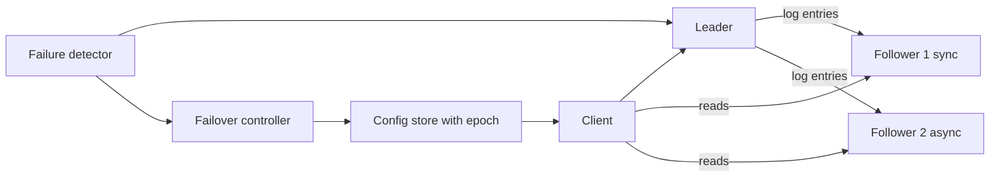
- **Leader** owns the log and the epoch number. It acknowledges a write after its own fsync plus any required synchronous follower acks.
- **Followers** apply entries in order and report their applied position.
- **Failover controller** watches the detector, chooses the follower with the highest position, increments the epoch and records it in the **config store**. Any node seeing a higher epoch steps down.

### Data model
| Item | Fields |
|---|---|
| Log entry | epoch, position, key, value or tombstone |
| Follower state | node id, applied position, last heartbeat |
| Config record | epoch, leader id, member list |
| Snapshot | position, compacted key-value pairs |

### Tech stack
| Component | Choice | Why |
|---|---|---|
| Nodes | Java 25 or Go | Long-lived network services |
| Storage | Project 1 or 11 engine, or RocksDB | Reuse your work |
| Transport | gRPC streaming or plain TCP | Ordered streams |
| Config store | etcd or a single PostgreSQL row with compare-and-set | Atomic epoch increment |

### Milestones
1. **Async log shipping.** *Done when* followers converge to the leader's state after a burst of writes.
2. **Synchronous mode and lag metrics.** *Done when* you can show lost writes in async mode after killing the leader and none in sync mode.
3. **Snapshot catch-up.** *Done when* a brand-new follower joins a store with 10 million keys without stopping writes.
4. **Failover with epochs.** *Done when* an old leader that wakes up after a pause has its writes rejected and steps down.
5. **Read-your-writes.** *Done when* clients that send their last write position to a follower only get answers once the follower has caught up to it.

### Deep dive: the hard parts
- **Choosing the new leader.** With async replication the most up-to-date follower may still miss writes. Those writes are lost, or must be reconciled. Make this visible in metrics rather than hiding it.
- **Old leader comes back.** It may have writes no follower has. A simple design discards them (truncate the log to the new leader's history). Keeping them means reconciling by hand — the painful path GitHub took in 2018, replaying the stranded writes from MySQL binary logs.
- **Fencing.** Epoch numbers must be checked by *every* receiver of a write (followers and storage), not just by the old leader itself, because a paused process cannot be trusted to check the time.

### Testing strategy
A Docker Compose cluster plus a fault-injection script (kill, pause with `SIGSTOP`, partition with `iptables`). After each scenario, check: every acknowledged write in sync mode survives, and no two leaders acknowledge writes in the same epoch.

### Trade-offs, scaling and failure modes
Synchronous replication protects data but stalls writes when a follower is slow. Async is fast but loses recent writes on failover. Too-short failover timeouts cause unnecessary failovers. Followers scale reads only if clients tolerate lag.

### Stretch goals
- Chain replication as an alternative topology.
- Logical (row-based) versus statement-based log format, and why statements with `NOW()` break replicas.

### Skills practised
- Leaders and followers, replication lag, failover — [Ch 5 — Replication](../chapters/05-replication/README.md)
- Fencing and process pauses — [Ch 8 — The Trouble with Distributed Systems](../chapters/08-trouble-with-distributed-systems/README.md)

### In the interview
**Q:** What happens to un-replicated writes when an async leader fails?
**A:** They are lost if a follower is promoted, and if the old leader rejoins its extra writes must be discarded.

**Q:** How do you prevent split brain?
**A:** Use a monotonically increasing epoch or term stored in a consensus-backed config, and have every node reject requests carrying an older epoch.

**Q:** How do you give read-your-writes with followers?
**A:** Track the log position of the user's last write and only read from a follower that has applied at least that position, or read from the leader.

### TL;DR
One writer, an ordered log, followers that replay it, and epoch-fenced failover — build it to feel every trap Chapter 5 warns about.

## 16. Multi-leader replication with conflict resolution

**Level:** Intermediate · **Time:** 2 weeks · **Prerequisites:** Ch 5, Project 7

### What it is
A replicated notes or calendar store where two or three "data centres" (or offline clients) each accept writes locally and replicate to each other asynchronously. Because the same record can change in two places at once, the system must **detect conflicts** using version vectors (Project 7) and **resolve** them with pluggable strategies: last-write-wins (LWW), keep-both siblings, or a custom merge function.

### The problem it solves
A single leader forces every write to cross the world to one data centre and stops writes during network partitions. Multi-leader setups (and offline-capable apps) keep writes local, but convert the hard problem into conflict resolution. Chapter 5 shows that LWW silently loses data and that topology (all-to-all, star, ring) affects ordering.

### Real-world examples
- CouchDB's [replication and conflict model](https://docs.couchdb.org/en/stable/replication/conflicts.html) keeps conflicting revisions, picks a deterministic winner, and lets applications resolve the rest.
- Amazon's [Dynamo paper](https://www.allthingsdistributed.com/files/amazon-dynamo-sosp2007.pdf) discusses the shopping-cart example where merging versions can resurrect deleted items.

### Requirements
**Functional**
- Three replicas, each accepting reads and writes on documents of JSON fields.
- Asynchronous replication of changes with version vectors.
- Conflict detection: concurrent versions identified, not overwritten.
- Strategies per collection: LWW by timestamp, siblings returned to the client, or per-field merge (for example union of tags, max of counters).
- Replication topologies: all-to-all and ring, with loop prevention.

**Non-functional**
- Local write latency under 5 ms regardless of inter-replica latency (simulate 100 ms).
- All replicas converge within 2 seconds after writes stop and the network heals.

### The architecture
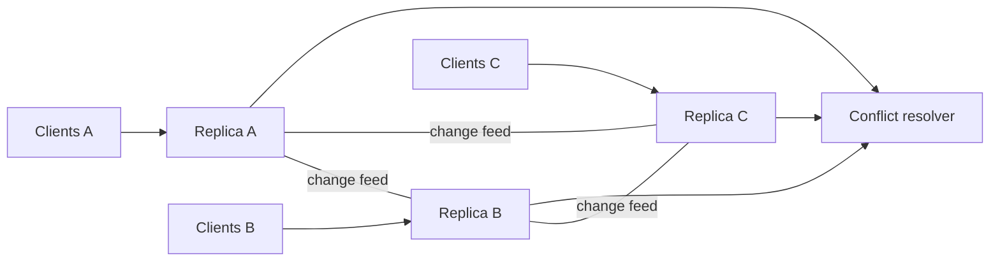
- Each **replica** stores documents with their version vector and publishes a change feed.
- **Change feed** consumers on other replicas apply remote changes, comparing vectors: newer replaces older, concurrent goes to the resolver.
- **Conflict resolver** applies the collection's strategy deterministically so every replica reaches the same result.

### Data model
```mermaid
erDiagram
  DOCUMENT ||--o{ SIBLING : "may have"
  DOCUMENT {
    text collection
    text doc_id PK
    jsonb body
    jsonb version_vector
    timestamptz hlc_ts
  }
  SIBLING {
    text doc_id FK
    jsonb body
    jsonb version_vector
  }
  REPLICATION_CURSOR {
    text from_replica PK
    bigint last_seq
  }
```

### Tech stack
- **PostgreSQL** per replica (or the Project 1/11 engine) to store documents.
- **Python 3.14** or **Java 25** replication agents.
- **Toxiproxy** or `tc netem` to add latency and partitions.

### Milestones
1. **Replication without conflicts.** *Done when* writes to disjoint documents converge.
2. **Detection.** *Done when* concurrent edits during a partition produce siblings with incomparable vectors.
3. **Resolution strategies.** *Done when* LWW, siblings and custom merge each converge, and a test shows LWW losing an edit.
4. **Topologies.** *Done when* a ring topology converges and loop prevention (tagging changes with the replicas they have passed) avoids infinite forwarding.

### Deep dive: the hard parts
- **Causality across topologies.** In all-to-all replication an update can arrive before the insert it depends on. Version vectors detect this. Buffer the update until its dependencies are present.
- **Deterministic merges.** A merge must give the same result on every replica regardless of arrival order (commutative and associative). Union and max are safe. "Append both strings" is not, unless you sort.
- **Deletes.** A delete concurrent with an update needs a tombstone with its own version vector, or the update resurrects the document.

### Testing strategy
Randomised partition schedules, then heal and assert all replicas hold identical documents. Track every client write and report which were lost under LWW.

### Trade-offs, scaling and failure modes
Multi-leader gives low-latency local writes and partition tolerance, but conflicts are unavoidable and constraints (like unique usernames) cannot be enforced locally. Many systems avoid conflicts by routing each record to a "home" leader.

### Stretch goals
- Replace custom merges with CRDTs (preview of Project 34).
- Show a conflict-avoidance strategy: per-user home region.

### Skills practised
- Multi-leader replication, conflict handling — [Ch 5 — Replication](../chapters/05-replication/README.md)
- Convergence and integrity — [Ch 12 — The Future of Data Systems](../chapters/12-future-of-data-systems/README.md)

### In the interview
**Q:** Why is last-write-wins dangerous?
**A:** It picks one of two concurrent writes by timestamp and silently discards the other, and clock skew can even make an older write win.

**Q:** How do you detect a conflict?
**A:** Compare version vectors. If neither dominates, the writes were concurrent.

**Q:** When is multi-leader worth it?
**A:** Multi-data-centre deployments needing local write latency, offline clients, and collaborative editing — where you can accept and resolve conflicts.

### TL;DR
Let every replica accept writes, detect concurrency with version vectors, and merge deterministically — and see exactly why LWW loses data.

## 17. Consistent-hash partitioning and rebalancing

**Level:** Intermediate · **Time:** 2 weeks · **Prerequisites:** Ch 6

### What it is
A partitioned key-value cluster that spreads keys over nodes using **consistent hashing**: nodes and keys are hashed onto a ring, and each key belongs to the next node clockwise. Each physical node owns many **virtual nodes** (vnodes) to even out load. When nodes join or leave, only the affected key ranges move, and a **rebalancer** streams them while the cluster stays online. You also implement and compare the "fixed number of partitions" approach.

### The problem it solves
`hash(key) mod N` reshuffles almost every key when N changes, which would mean moving nearly all data. Chapter 6 compares strategies for assigning partitions to nodes so that adding a node moves only a fair share of data, and discusses how requests find the right node.

### Real-world examples
- Karger et al., [Consistent Hashing and Random Trees](https://www.cs.princeton.edu/courses/archive/fall09/cos518/papers/chash.pdf) (STOC 1997), the original paper.
- DataStax documents [Cassandra's consistent hashing and vnodes](https://docs.datastax.com/en/cassandra-oss/3.x/cassandra/architecture/archDataDistributeHashing.html).
- Lamping and Veach's [Jump Consistent Hash](https://arxiv.org/abs/1406.2294) gives a memory-free alternative when nodes are numbered.

### Requirements
**Functional**
- Hash ring with configurable vnodes per node and replication factor (each key stored on the next R distinct physical nodes).
- Routing: any node can forward a request to the owner, or a client library routes directly.
- Join, leave and replace operations that compute moved ranges and stream them.
- Alternative mode: fixed 1,024 partitions assigned to nodes by a coordinator.
- Load metrics: keys and requests per node, standard deviation.

**Non-functional**
- With 128 vnodes per node, key-count imbalance across 10 nodes under 10%.
- Adding an eleventh node moves about 1/11 of the data, with no failed requests during the move.
- Routing decision under 10 microseconds.

### The architecture
```mermaid
flowchart LR
  CL["Client library"] --> RT["Routing table"]
  RT --> N1["Node 1"]
  RT --> N2["Node 2"]
  RT --> N3["Node 3"]
  CO["Membership coordinator"] --> RT
  CO --> RB["Rebalancer"]
  RB -->|"stream ranges"| N1
  RB -->|"stream ranges"| N2
  RB -->|"stream ranges"| N3
```
- **Routing table** is a sorted array of (token, node) pairs, searched by binary search.
- **Membership coordinator** owns the authoritative ring and versions it (in etcd or a PostgreSQL row).
- **Rebalancer** plans transfers: for each moved range, copy a snapshot, then forward writes that arrive during the copy, then flip ownership.

### Data model
| Item | Fields |
|---|---|
| Ring version | version number, list of (token, node id) |
| Transfer | range start, range end, from node, to node, state (copying, catching up, done) |
| Node stats | node id, key count, bytes, ops per second |

### Tech stack
| Component | Choice | Why |
|---|---|---|
| Nodes | Go or Java 25 | Concurrent networking |
| Storage | Your LSM (Project 11) or RocksDB | Range iteration for streaming |
| Hash | MurmurHash3 or xxHash 64-bit | Uniform, fast |
| Metadata | etcd | Watches for ring changes |

### Milestones
1. **Static ring and routing.** *Done when* keys are distributed and a histogram of keys per node is produced for 1, 16 and 256 vnodes.
2. **Replication factor.** *Done when* each key is written to R distinct physical nodes even when vnodes of the same node are adjacent.
3. **Online join.** *Done when* adding a node under steady load moves the expected fraction of keys with zero errors and reads stay correct during the move.
4. **Fixed-partition mode.** *Done when* you can compare data moved and metadata size between the two approaches.
5. **Hot key handling.** *Done when* a skewed workload (one celebrity key) is detected and mitigated by key salting for writes.

### Deep dive: the hard parts
- **Ownership handover.** During a move, writes must go to both old and new owner (or be forwarded) until the switch, otherwise writes made during the copy are lost. Version the ring and reject requests stamped with an old version.
- **Vnode count trade-off.** More vnodes give better balance and spread recovery load across many nodes, but enlarge metadata and the number of small transfers.
- **Hash partitioning kills range scans.** Keys adjacent in order land on random nodes. Chapter 6's compound-key idea (hash the first part, sort by the rest) brings back scans within one partition key.

### Testing strategy
Statistical tests of balance. A linearizable-ish check during rebalancing: a writer increments known keys and a verifier confirms no acknowledged write disappears. Chaos: kill the destination mid-transfer and verify the transfer restarts.

### Trade-offs, scaling and failure modes
Consistent hashing adapts automatically but random token placement can be uneven. Fixed partitions are simple and predictable but their count must be chosen up front. Automatic rebalancing plus a too-eager failure detector can cause cascading moves — many systems require a human to approve.

### Stretch goals
- Bounded-load consistent hashing.
- Rendezvous (highest random weight) hashing comparison.

### Skills practised
- Partitioning by hash, rebalancing, request routing — [Ch 6 — Partitioning](../chapters/06-partitioning/README.md)
- Replication across partitions — [Ch 5 — Replication](../chapters/05-replication/README.md)

### In the interview
**Q:** Why not use hash mod N?
**A:** Changing N changes the owner of almost every key, forcing a near-total data reshuffle.

**Q:** What do virtual nodes buy you?
**A:** More even load, and when a node fails its load spreads across many nodes rather than one neighbour.

**Q:** How do clients find the right node?
**A:** Either any node forwards, a routing tier does it, or the client caches the partition map from a coordination service.

### TL;DR
Hash keys onto a ring with many vnodes, move only the ranges that change, and hand over ownership carefully — Chapter 6 rebalancing made real.

## 18. Local versus global secondary indexes

**Level:** Intermediate · **Time:** 2 weeks · **Prerequisites:** Ch 6

### What it is
A partitioned "used-car listings" store (partitioned by listing id) with secondary indexes on `colour` and `make`, built two ways: **local** (document-partitioned — each partition indexes only its own listings, so queries scatter to all partitions) and **global** (term-partitioned — the index is itself partitioned by the indexed value, so a query hits one index partition, but a write may update several). You benchmark both and implement asynchronous global index maintenance.

### The problem it solves
Primary-key lookups are easy to route. "All red cars" is not, because red cars live on every partition. Chapter 6 lays out exactly these two options and their read/write trade-off. This project measures it.

### Real-world examples
- Amazon DynamoDB's [global secondary indexes](https://docs.aws.amazon.com/amazondynamodb/latest/developerguide/GSI.html) are partitioned separately from the base table and updated asynchronously, so reads from them are eventually consistent.
- Elasticsearch [documents and indices](https://www.elastic.co/guide/en/elasticsearch/reference/current/documents-indices.html) uses document-partitioned shards, each holding a local index, and queries fan out to all shards.

### Requirements
**Functional**
- Base table partitioned into 8 partitions by hash of listing id.
- Local index mode: each partition maintains `colour → ids` for its own rows. Query = scatter-gather.
- Global index mode: index partitions by hash of the term. Each base write emits index updates to the term's partition.
- Asynchronous global index updates via a queue (or Kafka topic), with a lag metric.
- Index backfill when an index is created on existing data.

**Non-functional**
- Measure p50 and p99 query latency for both modes at 8 and 32 partitions with one slow partition (+50 ms).
- Index lag under 1 second in async mode at 2,000 writes per second.

### The architecture
```mermaid
flowchart LR
  W["Writer"] --> BP["Base partitions"]
  BP -->|"local mode"| LI["Local index per partition"]
  BP -->|"global mode"| Q["Index update queue"]
  Q --> GI["Global index partitions"]
  RQ["Query router"] -->|"scatter"| LI
  RQ -->|"single lookup"| GI
  GI -->|"fetch rows"| BP
```
- **Base partitions** hold listings.
- **Local index** updates synchronously in the same partition, so it is always consistent with that partition.
- **Index update queue** decouples base writes from global index writes, which live on other machines.
- **Query router** chooses scatter-gather or a direct index lookup followed by fetching rows.

### Data model
```mermaid
erDiagram
  LISTING ||--o{ INDEX_ENTRY : "indexed by"
  LISTING {
    bigint listing_id PK
    text make
    text colour
    int price
    int partition_no
  }
  INDEX_ENTRY {
    text index_name
    text term
    bigint listing_id FK
    int index_partition
  }
```

### Tech stack
- **Java 25** or **Go** for partition servers. **Python 3.14** is fine for the router and benchmarks.
- Storage: PostgreSQL schema per partition (simple) or your Project 11 engine.
- **Kafka** for the async index topic, keyed by term.

### Milestones
1. **Partitioned base table and local index.** *Done when* scatter-gather returns correct results.
2. **Tail latency experiment.** *Done when* you show p99 rising with partition count and with one slow partition (tail amplification from Project 3).
3. **Global index synchronous.** *Done when* writes update index partitions in the same request and queries hit one partition.
4. **Global index async with backfill.** *Done when* lag is measured, a stale read is demonstrated, and backfill builds an index on 1 million existing rows while writes continue.

### Deep dive: the hard parts
- **Old values.** Changing a car from red to blue must delete the "red" entry and add the "blue" one, possibly on two different index partitions. If the async consumer processes these out of order you get stale entries. Order index updates per base key, or include the base version and reject older ones.
- **Backfill races.** While scanning existing rows, new writes arrive. Start consuming the change stream *before* the scan and apply both idempotently using versions, the same trick as CDC snapshots (Project 22).
- **Reading a global index then the base row.** The index may point to a row that no longer matches. Re-check the predicate after fetching.

### Testing strategy
Consistency checker that periodically rebuilds the index from base data and diffs it with the maintained index. Latency benchmarks under controlled slow-partition injection.

### Trade-offs, scaling and failure modes
Local indexes: cheap writes, expensive reads (fan-out, tail latency). Global indexes: cheap reads, writes touch several partitions and are usually async (stale reads). Distributed transactions could make global indexes consistent but cost latency (Project 20).

### Stretch goals
- Covering indexes that store the projected columns to skip the base fetch.
- Partition the global index by range of term to support prefix queries.

### Skills practised
- Secondary indexes in partitioned systems — [Ch 6 — Partitioning](../chapters/06-partitioning/README.md)
- Asynchronous derived data — [Ch 11 — Stream Processing](../chapters/11-stream-processing/README.md)

### In the interview
**Q:** What is the downside of a document-partitioned index?
**A:** Reads must query every partition and wait for the slowest, so tail latency grows with partition count.

**Q:** Why are global indexes usually updated asynchronously?
**A:** A single write may touch several index partitions on other nodes. Making that atomic needs a distributed transaction, which is slow and fragile.

**Q:** How do you build an index on existing data online?
**A:** Start capturing new changes, scan existing data, and merge the two idempotently using versions.

### TL;DR
Index locally and scatter reads, or index globally and scatter writes — measure both and learn the core trade-off of partitioned secondary indexes.

## 19. MVCC snapshot-isolation engine

**Level:** Intermediate · **Time:** 2–3 weeks · **Prerequisites:** Ch 7, Project 6

### What it is
A transactional in-memory (optionally persistent) key-value store using **multi-version concurrency control** (MVCC): every write creates a new version of a row tagged with the creating transaction's id, and each transaction reads a consistent **snapshot** — it sees only versions committed before it started. Writers do not block readers, and readers do not block writers. Write-write conflicts are detected with **first-committer-wins**. A **vacuum** process garbage-collects versions no snapshot can see.

### The problem it solves
Locking every row a transaction reads makes long reports block updates. Snapshot isolation lets backups and analytics run on a consistent view while writes continue. Chapter 7 explains the visibility rules. Implementing them shows why PostgreSQL needs vacuuming and how write skew slips through.

### Real-world examples
- PostgreSQL's [MVCC introduction](https://www.postgresql.org/docs/current/mvcc-intro.html) describes snapshots and why reading never blocks writing.
- CockroachDB documents its MVCC-based [transaction layer](https://www.cockroachlabs.com/docs/stable/architecture/transaction-layer) with timestamps on every version.

### Requirements
**Functional**
- `begin`, `get`, `put`, `delete`, `scan`, `commit`, `abort`.
- Snapshot visibility: a version is visible if its creator committed before the snapshot was taken and it was not deleted by a transaction also committed before then.
- First-committer-wins: if two transactions update the same key, the later committer aborts.
- Read-only transactions never abort.
- Vacuum removes versions older than the oldest active snapshot.

**Non-functional**
- 200,000 single-key transactions per second in memory on 8 cores.
- Version chains bounded under steady load with vacuum running.
- No reads blocked by writes (measure lock waits: zero on the read path).

### The architecture
```mermaid
flowchart LR
  TX["Transaction API"] --> TM["Transaction manager"]
  TM --> CL["Commit log of statuses"]
  TX --> VS["Version store"]
  VS --> VC["Visibility checker"]
  VC --> CL
  VC --> SN["Snapshot"]
  VAC["Vacuum"] --> VS
  VAC --> TM
```
- **Transaction manager** hands out transaction ids and snapshots (the set of transactions in progress when the snapshot was taken, plus a high-water mark).
- **Commit log** records each transaction's status: in progress, committed or aborted.
- **Version store** keeps a chain of versions per key, each with `created_by` and `deleted_by` transaction ids.
- **Visibility checker** applies the rules. **Vacuum** finds the oldest active snapshot (the "xmin horizon") and drops dead versions.

### Data model
| Item | Fields |
|---|---|
| Version | key, value, created_by txid, deleted_by txid or none, next version pointer |
| Snapshot | xmin (oldest active), xmax (next txid), in-progress set |
| Transaction | txid, status, write set, snapshot |

### Tech stack
- **Java 25** (`ConcurrentHashMap` of version chains, virtual threads for workers) or **Go**.
- Persistence (optional): write-ahead log of committed write sets, then reuse Project 11.
- **Python 3.14** works for a single-threaded teaching version with a simulated scheduler.

### Milestones
1. **Versions and snapshots.** *Done when* the Project 6 read-skew scenario cannot happen on your engine.
2. **Write conflict detection.** *Done when* lost-update scenarios abort the second committer.
3. **Vacuum.** *Done when* a long-running read transaction prevents cleanup (show growth) and finishing it lets vacuum reclaim versions.
4. **Write skew demonstration.** *Done when* the doctors-on-call scenario commits both transactions — proving SI is not serializable (fixed in Project 29).
5. **Persistence.** *Done when* committed transactions survive a crash and in-progress ones do not.

### Deep dive: the hard parts
- **Commit atomicity.** A transaction's writes must become visible all at once. Marking status "committed" in the commit log in one step is the trick: the versions were already there, just invisible.
- **Snapshot of in-progress transactions.** A transaction with a smaller id that has not committed when you start must remain invisible to you even after it commits. That is why snapshots record the in-progress set, not just a number.
- **Long transactions hurt everyone.** One open snapshot pins all versions created after it, causing bloat and slower chain walks. Add a metric and an alarm, as PostgreSQL operators do.

### Testing strategy
Run all Project 6 scenarios against your engine. Randomised concurrent workloads with an invariant (sum of balances constant across transfers), plus a history checker that verifies each read saw a consistent snapshot.

### Trade-offs, scaling and failure modes
MVCC trades storage and garbage collection for concurrency. First-committer-wins aborts under hot keys. SI permits write skew. Transaction id wraparound (32-bit ids in PostgreSQL) needs freezing old versions.

### Stretch goals
- Timestamp-based MVCC (versions keyed by commit timestamp) as used by many distributed databases.
- Secondary indexes that point to version chains.

### Skills practised
- Snapshot isolation and MVCC — [Ch 7 — Transactions](../chapters/07-transactions/README.md)
- Storage engine internals — [Ch 3 — Storage and Retrieval](../chapters/03-storage-and-retrieval/README.md)

### In the interview
**Q:** How do MVCC readers avoid blocking?
**A:** They read older versions that match their snapshot, so they never wait for a writer to finish.

**Q:** What anomaly does snapshot isolation still allow?
**A:** Write skew (and phantoms causing write skew), because concurrent transactions do not see each other's writes to different rows.

**Q:** Why does PostgreSQL need vacuum?
**A:** Updates leave old row versions behind. Vacuum removes those no active snapshot can still see.

### TL;DR
Never overwrite, always version, and decide visibility per snapshot — build the concurrency control at the heart of PostgreSQL and most modern databases.

## 20. Two-phase commit coordinator

**Level:** Intermediate · **Time:** 2 weeks · **Prerequisites:** Ch 7, Ch 9

### What it is
A transaction coordinator that atomically commits a money transfer spanning two separate PostgreSQL databases using **two-phase commit** (2PC). In phase one the coordinator asks each participant to **prepare** (make the change durable and promise to commit if told to). If all vote yes, it writes a commit decision to its own log and in phase two tells everyone to commit. The project focuses on what happens when anything crashes between the steps.

### The problem it solves
A transaction inside one database is atomic. Across two databases, a crash between "debit A" and "credit B" loses money. 2PC guarantees all-or-nothing across nodes. Chapter 9 also explains its weakness: if the coordinator dies after participants prepare, they are stuck **in doubt**, holding locks, until it returns.

### Real-world examples
- PostgreSQL implements the participant side with [PREPARE TRANSACTION](https://www.postgresql.org/docs/current/sql-prepare-transaction.html), `COMMIT PREPARED` and the `pg_prepared_xacts` view, and warns against leaving prepared transactions open.
- Google's [Spanner paper](https://research.google/pubs/spanner-googles-globally-distributed-database-2/) runs 2PC across Paxos groups so that the coordinator itself is replicated and does not block on a single machine.

### Requirements
**Functional**
- Coordinator API: `begin_global`, `enlist(participant, sql)`, `commit`, `abort`.
- Durable coordinator log (in its own PostgreSQL database or a local WAL) recording each global transaction's state.
- Recovery: on restart, the coordinator finishes in-flight transactions based on its log. Participants list prepared transactions and ask the coordinator for the outcome.
- Presumed abort: if there is no commit record, the answer is abort.
- Admin tool to list and manually resolve in-doubt transactions.

**Non-functional**
- Commit latency measured versus single-database transactions (expect at least two extra round trips and fsyncs).
- Zero atomicity violations across 10,000 transfers with random crashes.

### The architecture
```mermaid
sequenceDiagram
  participant App
  participant Co as Coordinator
  participant A as Bank DB A
  participant B as Bank DB B
  App->>Co: commit transfer
  Co->>A: PREPARE TRANSACTION
  Co->>B: PREPARE TRANSACTION
  A-->>Co: yes
  B-->>Co: yes
  Co->>Co: write COMMIT to log and fsync
  Co->>A: COMMIT PREPARED
  Co->>B: COMMIT PREPARED
  Co-->>App: committed
```
The **commit point** is the moment the coordinator's commit record is durable. Before it, any failure means abort. After it, the coordinator must keep retrying phase two forever until every participant commits.

### Data model
```mermaid
erDiagram
  GLOBAL_TXN ||--|{ PARTICIPANT_BRANCH : "has"
  GLOBAL_TXN {
    uuid gtid PK
    text state
    timestamptz created_at
    timestamptz decided_at
  }
  PARTICIPANT_BRANCH {
    uuid gtid FK
    text participant
    text branch_id
    text vote
    text outcome_sent
  }
```

### Tech stack
| Component | Choice | Why |
|---|---|---|
| Participants | Two PostgreSQL instances with `max_prepared_transactions` above 0 | Real prepare support |
| Coordinator | Java 25 or Python 3.14 | Clear state machine |
| Fault injection | Crash hooks between every step | Exercise recovery |

### Milestones
1. **Happy path.** *Done when* transfers commit atomically and balances sum to a constant.
2. **Abort path.** *Done when* a participant voting no (for example, insufficient funds) aborts both.
3. **Coordinator crash recovery.** *Done when* crashing at each of the six critical points and restarting leaves no in-doubt transaction and no partial transfer.
4. **Participant crash.** *Done when* a participant restarted after preparing still has the prepared transaction and completes it.
5. **Blocking demonstration.** *Done when* you show a prepared transaction holding a row lock that blocks other work while the coordinator is down.

### Deep dive: the hard parts
- **The point of no return.** A participant that voted yes can no longer abort on its own, even after a timeout, because the coordinator might have decided commit. That is why 2PC blocks.
- **Idempotent phase two.** The coordinator may resend `COMMIT PREPARED` after a crash. Participants must treat "already committed" as success.
- **Heuristic decisions.** Operators sometimes force-resolve in-doubt transactions. If they guess wrong, atomicity breaks. Log such actions loudly.

### Testing strategy
Deterministic crash points via injectable hooks, run in a loop. Invariant checker after every scenario: total money constant, no rows in `pg_prepared_xacts` after recovery.

### Trade-offs, scaling and failure modes
2PC gives atomicity but adds latency, holds locks across network round trips and blocks on coordinator failure. Alternatives: replicate the coordinator with consensus (Spanner), Percolator-style designs (Project 30), or avoid cross-database atomicity using the outbox and idempotency (Project 23).

### Stretch goals
- Replicate the coordinator log with Raft (Project 27) to remove the blocking single point.
- Implement the XA interface through JDBC for Java participants.

### Skills practised
- Atomic commit and 2PC — [Ch 9 — Consistency and Consensus](../chapters/09-consistency-and-consensus/README.md)
- Atomicity and durability — [Ch 7 — Transactions](../chapters/07-transactions/README.md)

### In the interview
**Q:** Why does 2PC block?
**A:** After voting yes, a participant cannot decide alone. If the coordinator crashes before telling it the outcome, it must wait, holding locks.

**Q:** What is the commit point?
**A:** When the coordinator durably records its commit decision. From then on, commit must eventually happen everywhere.

**Q:** How is 2PC different from consensus?
**A:** 2PC needs every participant to vote yes and is not fault-tolerant to coordinator failure. Consensus needs only a majority and keeps working if a minority fails.

### TL;DR
Prepare, log the decision, then commit everywhere — and learn by crashing it why 2PC is atomic but blocking.

## 21. Log-based message broker

**Level:** Intermediate · **Time:** 2–3 weeks · **Prerequisites:** Ch 11

### What it is
A Kafka-like broker built from scratch: **topics** split into **partitions**, each partition an append-only log of segment files with an offset index. Producers append. Consumers read sequentially and commit their **offsets** (positions in the log). **Consumer groups** share a topic's partitions so each partition is read by one member. Old segments are deleted by retention time or compacted by key (**log compaction** keeps only the latest value per key).

### The problem it solves
Traditional queues (AMQP/JMS style) delete a message once acknowledged and deliver to whichever consumer is free, so ordering is lost and replay is impossible. A log-based broker keeps messages, preserves order within a partition, and lets a new consumer replay history from offset zero. Chapter 11 contrasts the two and shows why logs are the backbone of stream processing.

### Real-world examples
- The [Apache Kafka design documentation](https://kafka.apache.org/documentation/#design) explains the reliance on sequential disk I/O, the page cache and zero-copy transfer (sending file bytes straight from the OS cache to the network socket without copying them through the application), and [log compaction](https://kafka.apache.org/documentation/#compaction).
- Confluent's essay [It's Okay To Store Data In Apache Kafka](https://www.confluent.io/blog/okay-store-data-apache-kafka/) argues for logs as long-term storage, mentioning The New York Times' use of Kafka for its published content.

### Requirements
**Functional**
- Create topics with N partitions. Producers choose partitions by key hash or round-robin.
- Append with batching. Fetch by (partition, offset, max bytes).
- Segment files with sparse offset index (offset → file position) and time index.
- Consumer groups with a coordinator that assigns partitions and rebalances when members join or leave.
- Committed offsets stored in an internal compacted topic.
- Retention by time/size, and log compaction by key with tombstones.

**Non-functional**
- 200 MB per second sequential append on one SSD with batching.
- End-to-end latency under 10 ms p99 at moderate load.
- Consumer lag metric per partition.

### The architecture
```mermaid
flowchart LR
  P["Producers"] --> BR["Broker"]
  BR --> PL["Partition logs"]
  PL --> SEG["Segment files and indexes"]
  C1["Consumer A1"] --> BR
  C2["Consumer A2"] --> BR
  GC["Group coordinator"] --> C1
  GC --> C2
  GC --> OT["Offsets topic"]
  CLN["Cleaner thread"] --> SEG
```
- **Partition logs** are append-only, with the active segment open for writes and older segments read-only.
- **Group coordinator** tracks members by heartbeat, assigns partitions, and stores committed offsets.
- **Cleaner thread** deletes expired segments or compacts them.

### Data model
| Item | Fields |
|---|---|
| Record batch | base offset, record count, CRC, timestamp, records |
| Record | offset delta, key, value, headers |
| Offset index entry | relative offset, file position |
| Committed offset | group, topic, partition, offset |

### Tech stack
| Component | Choice | Why |
|---|---|---|
| Broker | Java 25 or Go | `FileChannel.transferTo` for zero-copy sends |
| Protocol | Length-prefixed binary over TCP | Batched, efficient |
| Benchmark | Compare with a real Kafka container | Reality check |

### Milestones
1. **Single partition log.** *Done when* producers append and consumers fetch from any offset, surviving restarts.
2. **Segments and indexes.** *Done when* fetching an old offset costs one index lookup and one file seek.
3. **Partitions and keys.** *Done when* all messages for a key arrive in order at one consumer.
4. **Consumer groups.** *Done when* killing a consumer reassigns its partitions within 10 seconds and processing resumes from the last committed offset.
5. **Retention and compaction.** *Done when* a compacted topic keeps only the latest value per key and tombstones eventually disappear.

### Deep dive: the hard parts
- **At-least-once versus at-most-once.** Commit offsets after processing and a crash causes reprocessing (duplicates). Commit before and a crash loses messages. Make both modes explicit.
- **Rebalancing.** During reassignment, two consumers might briefly process the same partition. Use a **generation id** per group membership and reject offset commits from stale generations — fencing again.
- **Page cache over application cache.** Letting the OS cache segments means a restarted broker is still fast and memory is not duplicated. Measure the difference.

### Testing strategy
Ordering tests per key. Crash tests for both commit modes counting duplicates and losses. Long soak test with segment rollover and compaction running.

### Trade-offs, scaling and failure modes
Ordering is only per partition. One slow message blocks its partition (head-of-line blocking). Partition count limits consumer parallelism. Single-node brokers lose data on disk failure — replicate partitions (leader-follower, Project 15) to fix.

### Stretch goals
- Partition replication with in-sync replicas and a high-water mark.
- Idempotent producer with sequence numbers to drop duplicate retries.

### Skills practised
- Log-based message brokers, consumer offsets, compaction — [Ch 11 — Stream Processing](../chapters/11-stream-processing/README.md)
- Partitioning and replication — [Ch 6 — Partitioning](../chapters/06-partitioning/README.md)

### In the interview
**Q:** How does a log broker differ from a traditional queue?
**A:** It retains messages and tracks per-consumer offsets, so ordering per partition is kept and consumers can replay. Queues delete on ack and spread messages across consumers.

**Q:** What is log compaction?
**A:** Discarding older records for a key, keeping only the latest — turning the log into a durable snapshot of a key-value table.

**Q:** How do you scale consumption?
**A:** Add partitions and consumers in a group. Each partition is consumed by one member at a time.

### TL;DR
Partitioned append-only logs, offsets and consumer groups — build Kafka's core and you understand the backbone of stream processing.

## 22. CDC pipeline: PostgreSQL to Kafka

**Level:** Intermediate · **Time:** 2 weeks · **Prerequisites:** Ch 11, Ch 4

### What it is
A **change data capture** (CDC) pipeline that reads every committed insert, update and delete from PostgreSQL's write-ahead log using **logical decoding**, publishes them as events to Kafka (via Debezium), and keeps two **derived systems** — a search index and a cache — in sync. You also build a minimal CDC reader yourself to understand what Debezium does under the hood.

### The problem it solves
Applications that write to the database *and* to a search index or cache (**dual writes**) suffer race conditions and partial failures: the two systems drift apart. CDC makes the database the single source of truth and feeds every other system from its ordered change log, as Chapter 11 recommends.

### Real-world examples
- PostgreSQL [logical decoding](https://www.postgresql.org/docs/current/logicaldecoding.html) exposes committed changes through replication slots and output plugins such as `pgoutput`.
- The [Debezium PostgreSQL connector](https://debezium.io/documentation/reference/stable/connectors/postgresql.html) performs an initial snapshot and then streams changes to Kafka.
- Shopify's [Capturing Every Change From Shopify's Sharded Monolith](https://shopify.engineering/capturing-every-change-shopify-sharded-monolith) describes choosing Debezium with Kafka Connect for CDC across 100+ MySQL shards.

### Requirements
**Functional**
- PostgreSQL with `wal_level=logical`, a publication and a replication slot.
- Debezium (Kafka Connect) streaming `products` and `orders` tables to Kafka topics, one per table, keyed by primary key.
- Consumers: one updates an OpenSearch or Elasticsearch index, one updates Redis, one writes an audit table.
- Initial snapshot plus streaming, with no gaps or duplicates that matter (idempotent sinks).
- Your own mini CDC reader in Python 3.14 using `psycopg` replication support, printing decoded changes.

**Non-functional**
- End-to-end lag (commit to index) under 2 seconds p99 at 1,000 changes per second.
- Survive restart of any component without losing changes.
- Monitor replication slot lag (retained WAL bytes) and alert before disk fills.

### The architecture
```mermaid
flowchart LR
  APP["Application"] --> PG["PostgreSQL"]
  PG -->|"WAL via replication slot"| DBZ["Debezium connector"]
  DBZ --> K["Kafka topics per table"]
  K --> S1["Search indexer"]
  K --> S2["Cache updater"]
  K --> S3["Audit writer"]
  S1 --> ES["Search index"]
  S2 --> RD["Redis"]
  S3 --> AUD["Audit table"]
  K --> SR["Schema registry"]
```
- **Replication slot** remembers how far the consumer has read, so PostgreSQL keeps WAL until it is consumed.
- **Debezium connector** decodes changes into before/after row images with source metadata (LSN, transaction id).
- **Sinks** apply changes idempotently using the primary key and the LSN as a version.
- **Schema registry** stores Avro or JSON schemas for event evolution (Project 5).

### Data model
| Event field | Meaning |
|---|---|
| before | Row before the change (needs `REPLICA IDENTITY FULL` for all columns) |
| after | Row after the change, null for delete |
| op | c (create), u (update), d (delete), r (snapshot read) |
| source.lsn | WAL position, monotonically increasing per database |
| ts_ms | Commit time |

### Tech stack
| Component | Choice | Why |
|---|---|---|
| Source | PostgreSQL (logical decoding, PostgreSQL 10+) | Built-in `pgoutput` plugin |
| Capture | Debezium on Kafka Connect (current version) | Snapshot plus streaming, offset tracking |
| Log | Kafka in KRaft mode | Durable ordered topics |
| Sinks | Java 25 or Python 3.14 consumers | Simple idempotent writers |

### Milestones
1. **Raw logical decoding.** *Done when* your Python reader prints inserts, updates and deletes from a slot and resumes from its confirmed LSN after restart.
2. **Debezium to Kafka.** *Done when* topics receive changes and the initial snapshot covers existing rows.
3. **Idempotent search sink.** *Done when* replaying the whole topic twice produces an identical index.
4. **Schema change.** *Done when* adding a column flows through to the index without restarting the sink.
5. **Operations.** *Done when* stopping the connector for 10 minutes shows slot lag growing and recovering, with an alert configured.

### Deep dive: the hard parts
- **Snapshot consistency.** The initial snapshot must line up with the point streaming starts from, otherwise changes during the snapshot are lost or doubled. Debezium exports a snapshot at the slot's starting LSN. Your own reader must do the same with `EXPORT_SNAPSHOT`.
- **Ordering and keys.** Kafka orders per partition. Keying by primary key keeps all changes to one row in order. Changes spanning rows (a transaction) are not grouped unless you add transaction metadata.
- **Slots can fill the disk.** An abandoned replication slot makes PostgreSQL retain WAL forever. PostgreSQL 13+ has `max_slot_wal_keep_size` to cap it.

### Testing strategy
Run a workload generator, then compare the source table with each derived store (row counts and checksums). Kill each component in turn mid-run and re-check.

### Trade-offs, scaling and failure modes
CDC is asynchronous: derived stores lag. It captures row changes, not business intent (contrast with event sourcing, Project 10). Large transactions arrive as bursts. TOASTed (large, out-of-line) unchanged columns may be missing from updates unless replica identity is full.

### Stretch goals
- Outbox pattern on top of CDC (Project 23).
- Rebuild a brand-new derived store from a compacted topic (Project 37).

### Skills practised
- Change data capture, derived data — [Ch 11 — Stream Processing](../chapters/11-stream-processing/README.md)
- Schema evolution in event streams — [Ch 4 — Encoding and Evolution](../chapters/04-encoding-and-evolution/README.md)
- Replication logs — [Ch 5 — Replication](../chapters/05-replication/README.md)

### In the interview
**Q:** Why not write to the database and the search index from the application?
**A:** Dual writes race and partially fail, so the stores diverge. CDC derives all writes from one ordered log.

**Q:** How does CDC read changes from PostgreSQL?
**A:** Via logical decoding of the WAL through a replication slot, which tracks the consumer's position.

**Q:** How do sinks handle redelivery?
**A:** Upserts by primary key, with the source LSN as a version to ignore older events.

### TL;DR
Tap PostgreSQL's WAL with logical decoding and Debezium, stream changes through Kafka, and keep every derived store in sync from one ordered log.

## 23. Transactional outbox and idempotent consumers

**Level:** Intermediate · **Time:** 2 weeks · **Prerequisites:** Ch 11, Ch 12

### What it is
An order service that must both update its database and publish an `OrderPlaced` event. Instead of writing to Kafka directly, it inserts the event into an **outbox table** in the *same* database transaction as the order. A relay (polling publisher or Debezium's outbox router) moves outbox rows to Kafka. Downstream, a payment service consumes events **idempotently** — processing each event's effect exactly once even if it is delivered several times — by recording processed message ids in the same transaction as its own state change.

### The problem it solves
"Update database, then send message" fails if the process crashes in between (message lost) or if sending succeeds but the commit fails (phantom message). Chapter 12 argues for the **end-to-end argument**: exactly-once *effects* come from idempotence and unique request ids carried through the whole pipeline, not from any single component.

### Real-world examples
- Chris Richardson's [Transactional outbox pattern](https://microservices.io/patterns/data/transactional-outbox.html) describes the pattern and its relay options.
- Debezium's [Outbox Event Router](https://debezium.io/documentation/reference/stable/transformations/outbox-event-router.html) routes outbox-table changes to topics using CDC.
- Saltzer, Reed and Clark's [End-to-End Arguments in System Design](https://web.mit.edu/Saltzer/www/publications/endtoend/endtoend.pdf) (1984) is the classic paper behind Chapter 12's reasoning.

### Requirements
**Functional**
- Order service: `POST /orders` with a client-supplied idempotency key. Inserts order, outbox row and idempotency record in one transaction.
- Relay mode 1: polling publisher using `SELECT ... FOR UPDATE SKIP LOCKED`. Mode 2: Debezium outbox router.
- Payment service consumes `OrderPlaced`, charges a fake payment provider, records `processed_messages(message_id)` in the same transaction.
- Retries with backoff, and a dead-letter topic for poison messages.

**Non-functional**
- Zero lost or duplicated charges across 100,000 orders with random crashes of every component.
- Outbox-to-Kafka latency under 500 ms p99 (polling) and under 2 seconds (CDC).

### The architecture
```mermaid
flowchart LR
  C["Client"] -->|"idempotency key"| OS["Order service"]
  OS --> ODB["Orders DB with outbox table"]
  ODB --> RL["Relay"]
  RL --> K["Kafka order-events"]
  K --> PS["Payment service"]
  PS --> PDB["Payments DB with processed ids"]
  PS --> PROV["Payment provider stub"]
  K --> DLQ["Dead-letter topic"]
```
- **Order service** never talks to Kafka directly, so its only atomic unit is the database transaction.
- **Relay** publishes at least once, so duplicates are expected downstream.
- **Payment service** deduplicates by message id and passes its own idempotency key to the provider, carrying the end-to-end id all the way.

### Data model
```mermaid
erDiagram
  ORDERS ||--|| OUTBOX : "emits"
  ORDERS {
    uuid order_id PK
    text idempotency_key UK
    numeric amount
    text status
  }
  OUTBOX {
    bigint id PK
    uuid aggregate_id FK
    text event_type
    jsonb payload
    timestamptz created_at
    timestamptz published_at
  }
  PROCESSED_MESSAGES {
    uuid message_id PK
    timestamptz processed_at
  }
```

### Tech stack
| Component | Choice | Why |
|---|---|---|
| Services | Java 25 with Spring Boot 4.1.1 (Spring Framework 7) | Mature transaction and Kafka support |
| Databases | PostgreSQL | `SKIP LOCKED`, logical decoding |
| Broker | Kafka | Durable, ordered per key |
| CDC relay | Debezium outbox router | Push-based, no polling load |

### Milestones
1. **Outbox write.** *Done when* every committed order has exactly one outbox row and aborted orders have none.
2. **Polling relay.** *Done when* multiple relay instances publish without double-processing the same row at once (`SKIP LOCKED`).
3. **Idempotent consumer.** *Done when* replaying the entire topic causes zero additional charges.
4. **Client idempotency.** *Done when* resubmitting the same order request returns the original order instead of creating a second.
5. **Chaos run.** *Done when* random kills of every process over 100,000 orders produce an exact ledger match between orders and charges.

### Deep dive: the hard parts
- **Ordering in the polling relay.** Two transactions can commit out of id order, so a relay reading "id greater than last" can skip a row. Either mark rows as published individually (and accept unordered delivery) or use CDC, which follows commit order.
- **The external side effect.** The fake provider call is outside the payment database transaction. If you charge then crash before recording, a retry charges again — unless the provider supports an idempotency key, which is why real payment APIs do.
- **Outbox cleanup.** Delete published rows in batches, or partition the table by day and drop old partitions, to avoid bloat.

### Testing strategy
Fault-injection at every boundary (after DB commit, before publish, after publish, before consumer commit). A reconciliation job that compares orders and charges by id.

### Trade-offs, scaling and failure modes
Outbox adds a table write per business operation and some latency. Polling adds DB load. CDC adds infrastructure. Consumers must keep dedup records for as long as redelivery is possible.

### Stretch goals
- Saga with compensating actions (refund on shipping failure).
- Kafka transactions for consume-process-produce stages and a comparison with database-based dedup.

### Skills practised
- Exactly-once processing and idempotence — [Ch 11 — Stream Processing](../chapters/11-stream-processing/README.md)
- End-to-end argument, operation identifiers — [Ch 12 — The Future of Data Systems](../chapters/12-future-of-data-systems/README.md)
- Atomic transactions — [Ch 7 — Transactions](../chapters/07-transactions/README.md)

### In the interview
**Q:** Why not publish to Kafka inside the database transaction?
**A:** Kafka is not part of the transaction. Crashes between the two steps lose or invent messages.

**Q:** Is "exactly-once delivery" possible?
**A:** Delivery is at least once in practice. Exactly-once *effects* come from idempotent processing keyed by a unique message or request id.

**Q:** How do you dedupe in the consumer?
**A:** Insert the message id into a processed table in the same transaction as the state change, so both commit or neither does.

### TL;DR
Write events in the same transaction as state, relay them at least once, and make consumers idempotent — the practical route to exactly-once effects.

## 24. MapReduce engine with sort-merge joins

**Level:** Intermediate · **Time:** 2–3 weeks · **Prerequisites:** Ch 10, Project 9

### What it is
A small distributed batch framework: a **master** splits input files into tasks, **workers** run user-supplied `map` functions that emit key-value pairs, the framework **partitions** those pairs by key hash and **sorts** them (the **shuffle**), and workers run `reduce` over each key's values. Failed tasks are re-executed. On top, you implement sort-merge joins, broadcast hash joins and skew handling.

### The problem it solves
Project 9 handled big data on one machine. MapReduce spreads the same sort-based idea over many machines with automatic retry, so jobs complete despite failures. Chapter 10 explains its key properties: immutable input, deterministic tasks that can be safely retried, and materialised intermediate state.

### Real-world examples
- Dean and Ghemawat, [MapReduce: Simplified Data Processing on Large Clusters](https://research.google/pubs/mapreduce-simplified-data-processing-on-large-clusters/) (OSDI 2004).
- The [Hadoop MapReduce tutorial](https://hadoop.apache.org/docs/stable/hadoop-mapreduce-client/hadoop-mapreduce-client-core/MapReduceTutorial.html) documents mappers, combiners, partitioners and reducers in the open-source implementation.

### Requirements
**Functional**
- Master with task queue, worker registration and heartbeats.
- Map tasks over input splits, writing R partitioned and sorted output files locally.
- Reduce tasks fetch their partition from every map output, merge-sort, and call `reduce`.
- Re-execution of failed or slow tasks (speculative execution for stragglers).
- Combiner support (pre-aggregation on the map side).
- Joins: reduce-side sort-merge join, map-side broadcast hash join, and skew-aware join for hot keys.

**Non-functional**
- Word count over 10 GB with 4 workers at least 3x faster than 1 worker.
- A job completes correctly if any one worker is killed at any time.
- Output is deterministic regardless of retries.

### The architecture
```mermaid
flowchart TD
  IN["Input files"] --> M["Master"]
  M --> W1["Map worker 1"]
  M --> W2["Map worker 2"]
  W1 --> P1["Partitioned sorted spill files"]
  W2 --> P2["Partitioned sorted spill files"]
  P1 --> R1["Reduce worker 1"]
  P2 --> R1
  P1 --> R2["Reduce worker 2"]
  P2 --> R2
  R1 --> OUT["Output files"]
  R2 --> OUT
```
- **Master** tracks every task's state (idle, running, done) and reassigns tasks from workers that miss heartbeats.
- **Map workers** write one sorted file per reduce partition.
- **Reduce workers** fetch and merge their partition from all map outputs, then write output to a temporary file and atomically rename it on success.

### Data model
| Item | Fields |
|---|---|
| Task | id, type (map or reduce), input split or partition, state, attempt, worker |
| Intermediate file | map task id, partition number, path, size |
| Job config | mapper, reducer, combiner, number of reducers, partitioner |

### Tech stack
- **Go** (the classic choice for this exercise, good RPC) or **Java 25**. **Python 3.14** works with multiprocessing on one machine.
- Shared filesystem: a local directory, MinIO (S3-compatible) or HDFS.
- gRPC or plain HTTP for master-worker communication.

### Milestones
1. **Local sequential MapReduce.** *Done when* word count matches Project 9's output.
2. **Distributed workers.** *Done when* 4 workers process a job and speed up.
3. **Fault tolerance.** *Done when* killing workers at random during map and reduce phases still produces identical output.
4. **Joins.** *Done when* a user-activity table joined with a user table gives correct results via sort-merge, and a broadcast hash join is faster for a small table.
5. **Skew.** *Done when* a hot key that makes one reducer 10x slower is detected by sampling and split across reducers.

### Deep dive: the hard parts
- **Atomic task output.** A retried or speculative task may run twice. Write to a temporary name and rename on completion. The master accepts only the first completion.
- **Secondary sort for joins.** To join, emit both tables' records keyed by user id and tagged by source, then sort so the user record arrives first for each key. The reducer then streams activity records without buffering.
- **Determinism.** Retries are only safe if map and reduce are deterministic and side-effect-free. A mapper calling a random function or an external API breaks this.

### Testing strategy
Compare outputs with a single-process reference implementation. Kill and pause workers in a test loop. Property test: output equals reference for random inputs and random failure schedules.

### Trade-offs, scaling and failure modes
Materialising every intermediate result to disk makes MapReduce robust but slow for multi-stage pipelines, which is why dataflow engines (Spark, Flink) pipeline stages and keep data in memory. Stragglers dominate job time without speculation.

### Stretch goals
- Chain jobs into a workflow DAG with dependency tracking.
- A dataflow mode that pipelines map output to reducers without full materialisation.

### Skills practised
- MapReduce, shuffle, joins, skew — [Ch 10 — Batch Processing](../chapters/10-batch-processing/README.md)
- Partitioning by hash — [Ch 6 — Partitioning](../chapters/06-partitioning/README.md)

### In the interview
**Q:** Why is MapReduce fault tolerant?
**A:** Inputs are immutable and tasks are deterministic, so any failed task can simply be re-run, and outputs are committed atomically.

**Q:** How does a reduce-side join work?
**A:** Both inputs are keyed by the join key, the shuffle brings matching records to the same reducer sorted together, and the reducer merges them.

**Q:** When use a broadcast hash join?
**A:** When one side is small enough to load into memory on every mapper, avoiding the shuffle of the big side.

### TL;DR
Map, partition, sort, reduce, retry — build the framework that turned Unix-pipe thinking into cluster-scale batch processing.

## 25. Pregel-style graph processing

**Level:** Intermediate · **Time:** 2 weeks · **Prerequisites:** Ch 10

### What it is
A graph processing engine using the **bulk synchronous parallel** (BSP) model: computation proceeds in **supersteps**. In each superstep every active vertex runs a user function that reads messages sent to it in the previous superstep, updates its own value and sends messages along its edges. A **barrier** separates supersteps. You run PageRank, single-source shortest paths and connected components on a partitioned graph with checkpoint-based fault tolerance.

### The problem it solves
Iterative graph algorithms in MapReduce re-read and re-shuffle the entire graph on every iteration. Chapter 10 describes how the Pregel model keeps vertex state in memory across iterations and only sends messages, which is far more efficient — but requires its own fault-tolerance story.

### Real-world examples
- Malewicz et al., [Pregel: A System for Large-Scale Graph Processing](https://research.google/pubs/pregel-a-system-for-large-scale-graph-processing/) (SIGMOD 2010).
- Apache Spark's [GraphX Pregel API](https://spark.apache.org/docs/latest/graphx-programming-guide.html) offers the same vertex-program model.
- [Apache Giraph](https://github.com/apache/giraph) is an open-source Pregel implementation on Hadoop.

### Requirements
**Functional**
- Load an edge list, partition vertices across workers by hash of vertex id.
- Vertex API: `compute(messages)`, `send(target, msg)`, `vote_to_halt()`.
- Message combiners (for example, sum for PageRank, min for shortest paths) to reduce network traffic.
- Aggregators (global values computed each superstep, like total rank change).
- Checkpoint vertex state every K supersteps. On worker failure, roll back all workers to the last checkpoint.

**Non-functional**
- PageRank on a graph of 10 million edges completes 20 iterations in under 2 minutes on 4 workers.
- Recovery from a killed worker without restarting the job from scratch.

### The architecture
```mermaid
flowchart LR
  MS["Master"] --> W1["Worker 1"]
  MS --> W2["Worker 2"]
  MS --> W3["Worker 3"]
  W1 ---|"messages"| W2
  W2 ---|"messages"| W3
  W1 ---|"messages"| W3
  W1 --> CK["Checkpoint store"]
  W2 --> CK
  W3 --> CK
  MS --> AG["Aggregators and barrier"]
```
- **Master** coordinates supersteps and the barrier, gathers aggregator values and decides when the job is finished (all vertices halted and no messages in flight).
- **Workers** own a partition of vertices, run `compute` for each active vertex and buffer outgoing messages per destination worker.
- **Checkpoint store** holds vertex values and pending messages at checkpoint supersteps.

### Data model
| Item | Fields |
|---|---|
| Vertex | id, value, out-edges, active flag |
| Message | target id, payload, superstep |
| Checkpoint | superstep, worker id, vertex states, inbox |

### Tech stack
- **Java 25** or **Go** for workers. **Python 3.14** with multiprocessing for a single-machine version.
- Datasets from the Stanford SNAP collection (for example a web graph).
- MinIO or local disk for checkpoints.

### Milestones
1. **Single-process BSP.** *Done when* PageRank matches a reference implementation (NetworkX) within 1e-6.
2. **Partitioned workers.** *Done when* 4 workers produce the same ranks and messages cross the network.
3. **Combiners and aggregators.** *Done when* message count drops measurably and convergence is detected with an aggregator.
4. **Fault tolerance.** *Done when* killing a worker mid-job rolls back to the last checkpoint and finishes with correct results.

### Deep dive: the hard parts
- **Barrier correctness.** A superstep only ends when every worker has finished computing *and* all its messages have been delivered. Count sent and received messages per worker to know the network is drained.
- **Partitioning and locality.** Hash partitioning spreads vertices randomly, so most messages cross the network. Graph-aware partitioning reduces traffic but is itself a hard problem.
- **Deterministic recovery.** Rolling back to a checkpoint and re-running only works if `compute` is deterministic given the same messages.

### Testing strategy
Compare results to NetworkX on small graphs for each algorithm. Fault-injection tests killing workers in different supersteps.

### Trade-offs, scaling and failure modes
BSP is simple to reason about but slow workers hold up every barrier. Whole-graph rollback is costly for large clusters. Graphs that fit in one machine's memory often run faster single-node — Chapter 10 makes this point too.

### Stretch goals
- Asynchronous execution without barriers and a comparison of convergence speed.
- Confined recovery: only recompute the failed partition by logging messages.

### Skills practised
- Graphs and iterative processing, the Pregel model — [Ch 10 — Batch Processing](../chapters/10-batch-processing/README.md)
- Graph data models — [Ch 2 — Data Models and Query Languages](../chapters/02-data-models-and-query-languages/README.md)

### In the interview
**Q:** Why is MapReduce bad for iterative graph algorithms?
**A:** Each iteration rewrites and reshuffles the whole graph. BSP keeps vertex state in memory and only sends messages.

**Q:** How does Pregel recover from failure?
**A:** By periodically checkpointing all vertex state and rolling every worker back to the last checkpoint when one fails.

**Q:** What is a combiner here?
**A:** A function that merges messages to the same vertex before sending, like summing PageRank contributions.

### TL;DR
Think like a vertex, exchange messages in supersteps, checkpoint for recovery — the Pregel model for iterative graph computation.

## 26. Dynamo-style leaderless quorum store

**Level:** Advanced · **Time:** 4–5 weeks · **Prerequisites:** Ch 5, Ch 6, Projects 7, 17

### What it is
A leaderless, partitioned, replicated key-value store in the style of Amazon's Dynamo and Cassandra. Any replica accepts reads and writes. A request goes to all N replicas of a key (chosen by consistent hashing, Project 17), and succeeds when W of them acknowledge a write or R respond to a read. Divergence is repaired three ways: **read repair** (fix stale replicas seen during a read), **hinted handoff** (a stand-in node stores writes for a down replica and passes them on later) and **anti-entropy** (background comparison of replicas using **Merkle trees**, hash trees that pinpoint differing key ranges).

### The problem it solves
Leader-based systems stop accepting writes for a partition during failover. Leaderless systems keep accepting writes whenever enough replicas are reachable, which suits always-writable use cases like shopping carts. Chapter 5 explains quorum math (W + R > N) and the many edge cases where quorums still return stale data.

### Real-world examples
- DeCandia et al., [Dynamo: Amazon's Highly Available Key-value Store](https://www.allthingsdistributed.com/files/amazon-dynamo-sosp2007.pdf) (SOSP 2007) introduced sloppy quorums, hinted handoff, vector clocks and Merkle-tree anti-entropy together.
- Apache Cassandra documents its [Dynamo-derived architecture](https://cassandra.apache.org/doc/latest/cassandra/architecture/dynamo.html), [hinted handoff](https://cassandra.apache.org/doc/latest/cassandra/managing/operating/hints.html) and [repair](https://cassandra.apache.org/doc/latest/cassandra/managing/operating/repair.html).
- Discord's [How Discord Stores Trillions of Messages](https://discord.com/blog/how-discord-stores-trillions-of-messages) describes operating a Cassandra cluster at 177 nodes and later migrating to ScyllaDB.

### Requirements
**Functional**
- Ring with N=3 replication. Coordinator is whichever node receives the request.
- Tunable consistency per request: W and R from 1 to N.
- Versioning with vector clocks or dotted version vectors. Concurrent versions returned as siblings.
- Read repair (synchronous on quorum reads), hinted handoff with **sloppy quorum** (counting acks from stand-in nodes outside the key's usual N replicas when those are unreachable), and Merkle-tree anti-entropy per key range.
- Membership and failure detection via gossip (simplified, or Project 32).

**Non-functional**
- Writes succeed with one replica down at W=2.
- p99 latency at W=2/R=2 under 10 ms on a local cluster.
- After a 10-minute partition heals, all replicas converge within 5 minutes via hints and anti-entropy.

### The architecture
```mermaid
flowchart LR
  C["Client"] --> CO["Coordinator node"]
  CO -->|"write to N replicas"| A["Replica A"]
  CO --> B["Replica B"]
  CO --> D["Replica C down"]
  CO -->|"hint for C"| H["Stand-in node with hint store"]
  H -->|"handoff when C returns"| D
  A ---|"Merkle tree exchange"| B
  CO -->|"read repair"| B
```
- **Coordinator** sends to the N preference-list nodes, waits for W or R, and merges versions.
- **Hint store** on a stand-in node keeps writes intended for an unreachable replica and replays them later.
- **Merkle tree exchange** compares hash trees per key range so only differing ranges are streamed.
- **Read repair** writes the newest version back to replicas that returned stale data.

### Data model
| Item | Fields |
|---|---|
| Stored value | key, list of (value, version vector), tombstone flag |
| Hint | target node, key, value, version, created at |
| Merkle tree | per range: leaf hashes of key buckets, inner hashes |
| Preference list | key range → ordered node list |

### Tech stack
| Component | Choice | Why |
|---|---|---|
| Nodes | Go or Java 25 | Concurrency and networking |
| Storage | Project 11 LSM or RocksDB | Range iteration for Merkle building |
| Transport | gRPC | Typed RPCs, deadlines |
| Harness | Docker Compose plus `tc` and `iptables` | Partitions and delays |

### Milestones
1. **Quorum reads and writes.** *Done when* tunable W and R work and you demonstrate a stale read with W=1, R=1.
2. **Versioning and siblings.** *Done when* concurrent writes during a partition return siblings, and a write with the merged context resolves them.
3. **Read repair.** *Done when* stale replicas are fixed after quorum reads.
4. **Hinted handoff and sloppy quorum.** *Done when* writes succeed while a preference-list node is down and reach it after recovery.
5. **Anti-entropy.** *Done when* a replica whose data directory was wiped is restored by Merkle comparison, streaming only differing ranges.

### Deep dive: the hard parts
- **Quorums are not linearizable.** Even with W + R > N, a write that succeeded on fewer than W nodes (and was reported failed) can still be read later, and concurrent reads can see different results. Sloppy quorums break the overlap guarantee entirely. Your harness should exhibit these cases.
- **Deletes and tombstones.** A deleted value must be a tombstone with a version, kept until all replicas have it. Purging too early lets anti-entropy resurrect the value from a replica that missed the delete. Cassandra's `gc_grace_seconds` exists for this reason.
- **Merkle trees on changing data.** Data changes while trees are being built. Build trees over a snapshot (LSM snapshots help) and accept that small differences will be fixed in the next round.

### Testing strategy
A Jepsen-style harness (or Project 33) recording histories under partitions. Convergence checker that compares full replica contents after healing. Counting lost writes per W/R/N configuration.

### Trade-offs, scaling and failure modes
High write availability and low latency, but only eventual consistency, sibling handling burdens clients, and repair costs I/O. Hints can pile up during long outages. Clock-based LWW (Cassandra's default) is simpler but loses concurrent writes.

### Stretch goals
- Speculative retry: send a read to an extra replica if the first is slow, to cut tail latency.
- Per-key CRDT values (counters, sets) instead of siblings.

### Skills practised
- Leaderless replication, quorums, sloppy quorums, read repair — [Ch 5 — Replication](../chapters/05-replication/README.md)
- Partitioning with consistent hashing — [Ch 6 — Partitioning](../chapters/06-partitioning/README.md)
- Failure detection under partitions — [Ch 8 — The Trouble with Distributed Systems](../chapters/08-trouble-with-distributed-systems/README.md)

### In the interview
**Q:** Does W + R > N guarantee you read the latest write?
**A:** Usually, but not always: sloppy quorums, concurrent writes, failed writes that partly succeeded, and restored stale replicas can all break it. It is not linearizable.

**Q:** What is hinted handoff?
**A:** When a replica is unreachable, another node stores the write with a hint and delivers it when the replica comes back.

**Q:** Why Merkle trees for anti-entropy?
**A:** Comparing tree hashes top-down finds differing key ranges with little data transferred, instead of comparing every key.

**Q:** How are concurrent writes handled?
**A:** Version vectors detect concurrency, and both values are kept as siblings for the client or a merge function to resolve.

### TL;DR
Write to N, wait for W, read from R, then repair with read repair, hints and Merkle trees — build Dynamo and see exactly how far quorums go.

## 27. Raft replicated log

**Level:** Advanced · **Time:** 4–6 weeks · **Prerequisites:** Ch 8, Ch 9

### What it is
A full implementation of the **Raft** consensus algorithm: a cluster of (typically) 3 or 5 servers agrees on a single ordered log of commands, even if a minority crash or the network partitions. Raft elects a **leader** per **term** (a numbered election period), the leader replicates entries, and an entry is **committed** once stored on a majority. Each server applies committed entries to a **state machine** — here a key-value store — giving a **linearizable** replicated service (one that behaves as if there were a single copy of the data, with every operation taking effect at one instant between its start and finish).

### The problem it solves
Project 15's failover relied on an outside config store and could lose writes. Consensus solves leader election and log agreement inside the cluster with proven safety: no committed entry is ever lost or reordered while a majority survives. Chapter 9 shows that consensus is equivalent to total order broadcast and underpins linearizable storage, locks and membership.

### Real-world examples
- Ongaro and Ousterhout, [In Search of an Understandable Consensus Algorithm](https://raft.github.io/raft.pdf) (USENIX ATC 2014), the Raft paper. Figure 2 is your specification.
- [etcd's Raft library](https://github.com/etcd-io/raft) is a widely used production implementation, and etcd explains [why it exists](https://etcd.io/docs/v3.5/learning/why/) as a consistent store for Kubernetes and other systems.
- Lamport's [Paxos Made Simple](https://lamport.azurewebsites.net/pubs/paxos-simple.pdf) for comparison.

### Requirements
**Functional**
- Leader election with randomised timeouts. Votes only for candidates whose log is at least as up-to-date.
- Log replication with `AppendEntries` consistency check (previous index and term) and conflict truncation.
- Commit rule: only entries from the current term are committed by counting replicas.
- Persistence of current term, voted-for and the log before replying to RPCs.
- Snapshots and `InstallSnapshot` for log compaction.
- Linearizable reads (via read index or by committing a no-op), and client request deduplication by (client id, sequence number).
- Membership change (single-server additions and removals).

**Non-functional**
- Elect a new leader within 1 second of leader failure (election timeout 150–300 ms on a local network).
- 10,000 committed writes per second on 3 nodes with batching.
- Pass thousands of randomised fault-injection runs with zero safety violations.

### The architecture
```mermaid
stateDiagram-v2
  [*] --> Follower
  Follower --> Candidate: election timeout
  Candidate --> Candidate: split vote, new term
  Candidate --> Leader: majority votes
  Candidate --> Follower: sees higher term or current leader
  Leader --> Follower: sees higher term
```
```mermaid
flowchart LR
  CL["Client"] --> LD["Leader"]
  LD -->|"AppendEntries"| F1["Follower 1"]
  LD -->|"AppendEntries"| F2["Follower 2"]
  LD --> LOG["Persistent log"]
  LOG --> SM["Key-value state machine"]
  SM --> SNAP["Snapshots"]
```
- **State diagram**: every server is a follower, candidate or leader. Terms only increase, and seeing a higher term always demotes a server to follower.
- **Persistent log** is the WAL of the cluster. **State machine** applies committed entries in order. **Snapshots** let the log be truncated.

### Data model
| Item | Fields |
|---|---|
| Persistent state | current term, voted for, log entries |
| Log entry | index, term, command (key, value, client id, sequence) |
| Volatile state | commit index, last applied |
| Leader state | next index and match index per follower |
| Snapshot | last included index and term, state machine bytes |

### Tech stack
| Component | Choice | Why |
|---|---|---|
| Implementation | Go or Java 25 | Timers, goroutines or virtual threads |
| Transport | gRPC, or an in-process simulated network for tests | Deterministic testing |
| Storage | Append-only file with fsync, or Project 11 | Durable log |
| Testing | Deterministic simulator plus Jepsen-style harness (Project 33) | Finds rare interleavings |

### Milestones
1. **Election.** *Done when* exactly one leader per term emerges and a new one is elected after killing the leader, in 1,000 randomised runs.
2. **Replication.** *Done when* logs converge after followers miss entries and conflicting uncommitted entries are overwritten.
3. **Persistence.** *Done when* crash-restarting any subset of nodes never loses a committed entry.
4. **Key-value service with linearizable reads and dedup.** *Done when* Project 33's checker finds no violations under partitions.
5. **Snapshots and membership changes.** *Done when* logs stay bounded and a node can be added and removed live.

### Deep dive: the hard parts
- **Commit only current-term entries by counting.** An entry from an older term stored on a majority can still be overwritten (Figure 8 in the paper). Leaders must commit an entry from their own term first, which then commits earlier entries indirectly.
- **Stale leaders and reads.** A leader cut off by a partition does not know it was replaced. Serving reads from local state can return stale data. Confirm leadership with a heartbeat round (read index) before answering, or use leases with bounded clock drift.
- **Persistence ordering.** A vote or log append must be on disk *before* the RPC reply. Otherwise a crash and restart can lead to voting twice in one term — two leaders.
- **Liveness tuning.** Randomised timeouts avoid repeated split votes. PreVote and check-quorum extensions stop a partitioned node from disrupting the cluster with ever-higher terms when it rejoins.

### Testing strategy
A deterministic simulator controlling message delivery, drops, reordering and crashes from a seed, checking invariants after every step: election safety (one leader per term), log matching, leader completeness and state machine safety. Then black-box tests with real processes and network partitions.

### Trade-offs, scaling and failure modes
Consensus needs a majority, so a 5-node cluster tolerates 2 failures and a minority partition cannot make progress. Every write costs a round trip to a majority and an fsync. Throughput is limited by one leader — scale out with many Raft groups (Project 38).

### Stretch goals
- Leader leases for faster reads and an analysis of their clock assumptions.
- Pipelining and batching of `AppendEntries`, and measured throughput gains.
- Learners (non-voting members) for read scaling.

### Skills practised
- Consensus, total order broadcast, linearizability — [Ch 9 — Consistency and Consensus](../chapters/09-consistency-and-consensus/README.md)
- Timeouts, partitions, process pauses — [Ch 8 — The Trouble with Distributed Systems](../chapters/08-trouble-with-distributed-systems/README.md)
- Replication logs — [Ch 5 — Replication](../chapters/05-replication/README.md)

### In the interview
**Q:** How does Raft ensure a committed entry is never lost?
**A:** Commits need a majority, and a candidate only wins votes from a majority if its log is at least as up-to-date as theirs, so any new leader already contains every committed entry.

**Q:** Why are election timeouts randomised?
**A:** To make it unlikely that several followers become candidates at once and split the vote repeatedly.

**Q:** Can a Raft leader serve reads locally?
**A:** Only after confirming it is still leader (a heartbeat round) or under a time-based lease. Otherwise a deposed leader could serve stale data.

**Q:** How many failures can 5 nodes tolerate?
**A:** Two, because three nodes are still a majority.

### TL;DR
Terms, majority votes and a replicated log with careful commit rules — implement Raft and you understand the core of etcd, Consul, CockroachDB and Kafka's KRaft.

## 28. Lock service with leases and fencing tokens

**Level:** Advanced · **Time:** 3–4 weeks · **Prerequisites:** Ch 8, Ch 9, Project 27

### What it is
A distributed lock service built on your Raft log (or on etcd). Clients acquire a lock as a **lease** — ownership that expires unless renewed — and each grant returns a **fencing token**: a number that increases with every grant. The protected storage service rejects any write carrying a token lower than the highest it has seen. You then demonstrate that leases *alone* are unsafe under process pauses and that fencing fixes it.

### The problem it solves
Chapter 8's key story: a client takes a lock, pauses for a long garbage collection, its lease expires, another client takes the lock, then the first client wakes up and writes, believing it still holds the lock. Corruption. Timeouts cannot prevent this because the paused process cannot notice time passing. Fencing tokens let the *resource* reject the stale writer.

### Real-world examples
- Burrows, [The Chubby Lock Service for Loosely-Coupled Distributed Systems](https://research.google/pubs/the-chubby-lock-service-for-loosely-coupled-distributed-systems/) (OSDI 2006), describes lock sequencers checked by servers.
- Kleppmann's blog post [How to do distributed locking](https://martin.kleppmann.com/2016/02/08/how-to-do-distributed-locking.html) explains the fencing-token argument using a Redis-based lock example.
- ZooKeeper's [recipes](https://zookeeper.apache.org/doc/current/recipes.html) show locks built from sequential ephemeral nodes, whose sequence numbers can serve as tokens.

### Requirements
**Functional**
- Lock API: `acquire(name, ttl) → (token, lease_id)`, `renew(lease_id)`, `release(lease_id)`, and a blocking `wait` with FIFO fairness.
- All state changes go through the replicated log, so the service survives a minority of failures.
- Tokens are the Raft log index of the grant (naturally monotonic) or a per-lock counter.
- Storage service (a file store or PostgreSQL-backed table) that checks tokens on every write.
- Pause injection in clients (`SIGSTOP` or sleep inside a critical section).

**Non-functional**
- Lease expiry detected and lock re-granted within TTL plus 1 second.
- No write with a stale token accepted across 10,000 randomised runs with pauses and partitions.
- Survive leader failover without granting the same lock to two clients in a way storage would accept.

### The architecture
```mermaid
sequenceDiagram
  participant C1 as Client 1
  participant L as Lock service
  participant C2 as Client 2
  participant S as Storage
  C1->>L: acquire lock
  L-->>C1: granted token 33
  Note over C1: long GC pause, lease expires
  C2->>L: acquire lock
  L-->>C2: granted token 34
  C2->>S: write with token 34
  S-->>C2: ok, max token now 34
  C1->>S: write with token 33
  S-->>C1: rejected, stale token
```
The **lock service** is a Raft state machine of locks, leases and waiters. The **storage** keeps the highest token seen per resource and rejects lower ones. Notice that the lock service cannot stop Client 1 — only the storage can.

### Data model
```mermaid
erDiagram
  LOCK ||--o| LEASE : "held by"
  LOCK {
    text name PK
    bigint last_token
    text holder_lease
  }
  LEASE {
    text lease_id PK
    text client_id
    bigint expires_at_ms
  }
  RESOURCE {
    text resource_id PK
    bigint max_token_seen
    bytea data
  }
```

### Tech stack
| Component | Choice | Why |
|---|---|---|
| Consensus | Your Project 27 Raft, or etcd leases plus revisions | Linearizable state |
| Service | Go or Java 25 | Timers, RPC |
| Storage | PostgreSQL table with a conditional `UPDATE ... WHERE max_token_seen < token` | Atomic token check |

### Milestones
1. **Lock state machine.** *Done when* acquire, renew, release and waiters work on a single node.
2. **Replicated.** *Done when* it runs on Raft and a leader failover preserves lock ownership.
3. **Lease expiry.** *Done when* expiry is driven by the leader's clock, and a new leader conservatively waits out the maximum lease time before granting expired locks.
4. **Unsafe demo.** *Done when* a storage service *without* token checks is corrupted by a paused client.
5. **Fencing.** *Done when* the same scenario with token checks rejects the stale write, across thousands of runs.

### Deep dive: the hard parts
- **Time on the server, durations on the client.** The lock service decides expiry using its own monotonic clock. Clients should treat their lease as shorter than the TTL (subtracting maximum drift and RPC time). Never compare wall-clock timestamps across machines.
- **Leader change and leases.** A new leader does not know exactly when the old one last renewed a lease. It must assume every lease was renewed just before failover and extend all deadlines by a full TTL.
- **The resource must cooperate.** Fencing only works if the storage checks tokens atomically. If the resource cannot (for example, a third-party API), you need idempotent operations or a different design.

### Testing strategy
Randomised runs with injected pauses, clock jumps on clients, partitions and leader kills, verifying with storage logs that accepted writes have strictly increasing tokens per resource and never overlap in time.

### Trade-offs, scaling and failure modes
Consensus-backed locks are correct but add latency to every acquire. Short TTLs mean fast failover but more renew traffic and false expiry under load. Lock services are not for high-throughput per-request locking. Use them for leader election and coarse-grained coordination.

### Stretch goals
- Leader election library on top (campaign, observe, resign).
- Compare with a Redis single-instance lock and explain which failure modes each handles.

### Skills practised
- Leases, process pauses, fencing tokens — [Ch 8 — The Trouble with Distributed Systems](../chapters/08-trouble-with-distributed-systems/README.md)
- Linearizable locks, coordination services — [Ch 9 — Consistency and Consensus](../chapters/09-consistency-and-consensus/README.md)

### In the interview
**Q:** Why isn't a lease enough to protect a resource?
**A:** A client can pause after checking its lease and resume after it expired, then write while another client holds the lock.

**Q:** What is a fencing token?
**A:** A monotonically increasing number issued with each lock grant. The resource rejects operations with a token lower than one it has already seen.

**Q:** Why build locks on consensus?
**A:** So that lock state survives node failures and only one client can be granted a given lock generation, even across leader changes.

### TL;DR
Grant leases through a replicated log, attach increasing fencing tokens, and make the resource reject stale tokens — the only safe way to use distributed locks.

## 29. Serializable Snapshot Isolation engine

**Level:** Advanced · **Time:** 3–4 weeks · **Prerequisites:** Ch 7, Project 19

### What it is
An extension of the MVCC engine (Project 19) that makes it fully **serializable** using **Serializable Snapshot Isolation** (SSI). Transactions still read snapshots without locking, but the engine tracks **read-write dependencies** — "transaction T1 read a version that T2 later overwrote" — and aborts a transaction when it detects the "dangerous structure" of two consecutive such dependencies that could form a cycle. You also implement two-phase locking (2PL) for comparison.

### The problem it solves
Snapshot isolation allows write skew (Project 6's doctors). Serial execution and 2PL prevent it but sacrifice concurrency: 2PL makes readers block writers. SSI is optimistic: it lets transactions proceed and aborts only those that might have produced a non-serializable result. Chapter 7 presents it as the most promising of the three approaches.

### Real-world examples
- Ports and Grittner, [Serializable Snapshot Isolation in PostgreSQL](https://www.vldb.org/pvldb/vol5/p1850_danrkports_vldb2012.pdf) (VLDB 2012), describes the production implementation, including predicate locks and the read-only optimisations. The [PostgreSQL wiki page on SSI](https://wiki.postgresql.org/wiki/SSI) has worked examples.
- CockroachDB's [Serializable, Lockless, Distributed](https://www.cockroachlabs.com/blog/serializable-lockless-distributed-isolation-cockroachdb/) explains a distributed, timestamp-based route to serializability.

### Requirements
**Functional**
- Three modes selectable per run: SI (Project 19), 2PL with shared and exclusive locks plus deadlock detection, SSI.
- SSI tracking: **SIREAD locks** (non-blocking markers recording what each transaction read, including key ranges for scans), rw-conflict edges between transactions, and the dangerous-structure check at commit.
- Retained conflict information for committed transactions until all overlapping transactions finish.
- Range scans with predicate tracking to catch phantoms.

**Non-functional**
- Zero serializability violations on randomised workloads (checked by a dependency-graph checker).
- Throughput and abort rate comparison of SI, 2PL and SSI on a read-heavy and a write-heavy benchmark.

### The architecture
```mermaid
flowchart LR
  TX["Transactions"] --> MV["MVCC store from Project 19"]
  TX --> SR["SIREAD lock table"]
  MV -->|"write over read version"| CD["Conflict detector"]
  SR --> CD
  CD --> G["rw-dependency graph"]
  G --> CM["Commit validator"]
  CM -->|"abort or commit"| TX
  CL["Cleaner"] --> SR
  CL --> G
```
- **SIREAD lock table** records keys and ranges each transaction read. It never blocks anyone.
- **Conflict detector** adds an rw-edge when a write hits a key some concurrent transaction read, or when a read sees a version newer than its snapshot was skipped.
- **Commit validator** aborts a transaction that has both an incoming and outgoing rw-edge to concurrent transactions (the pivot of a dangerous structure).
- **Cleaner** drops tracking data once no overlapping transaction remains.

### Data model
| Item | Fields |
|---|---|
| SIREAD entry | key or range, transaction id |
| rw-edge | reader txid, writer txid |
| Transaction | txid, snapshot, start, commit sequence, in-conflict flag, out-conflict flag |

### Tech stack
- **Java 25** or **Go**, building directly on Project 19.
- An **interval tree** or sorted map for range SIREAD locks.
- A history recorder and **cycle checker** (build the serialisation graph and search for cycles).

### Milestones
1. **2PL mode.** *Done when* write skew is prevented, and a deadlock between two transactions is detected and one is aborted.
2. **SIREAD tracking and rw-edges.** *Done when* the doctors scenario produces the expected edges in a debug view.
3. **Dangerous-structure abort.** *Done when* all Project 6 anomalies are prevented under SSI and read-only transactions in simple cases never abort.
4. **Phantoms via ranges.** *Done when* the meeting-room booking scenario (check for overlap, then insert) is serializable.
5. **Benchmark.** *Done when* you have a table of throughput and abort rate per mode per workload.

### Deep dive: the hard parts
- **False positives.** SSI detects possible cycles, not actual cycles, so it aborts some transactions that would have been fine. Measure how many, and how granularity (key versus page versus table) affects that.
- **Keeping data about committed transactions.** A transaction that committed can still be part of a dangerous structure with one still running. You must keep its read set and flags until all concurrent transactions finish, or you miss anomalies.
- **Phantoms.** A query "all bookings for room 7 between 12:00 and 13:00" must be protected against inserts that would match it. Range SIREAD locks (index-range locking in 2PL terms) give a coarse but safe answer.

### Testing strategy
Randomised concurrent workloads, record full histories, build the dependency serialisation graph and assert it is acyclic for SSI and 2PL. Show it can be cyclic for SI. Unit tests for each known anomaly.

### Trade-offs, scaling and failure modes
2PL: no false aborts from optimism, but blocking and deadlocks, and long reads stall writers. SSI: no blocking, but aborts under contention and extra memory for tracking. Both are serializable. Serial execution (one thread, stored procedures) is a third option when transactions are tiny and data fits in memory.

### Stretch goals
- Safe snapshots: read-only transactions that wait until no dangerous writer exists, then never abort.
- A distributed SSI sketch using timestamps.

### Skills practised
- Serializability, 2PL, SSI, phantoms — [Ch 7 — Transactions](../chapters/07-transactions/README.md)
- Ordering and dependency graphs — [Ch 9 — Consistency and Consensus](../chapters/09-consistency-and-consensus/README.md)

### In the interview
**Q:** How does SSI differ from 2PL?
**A:** 2PL blocks: readers take shared locks that stop writers. SSI never blocks: it tracks read-write dependencies and aborts transactions at commit if they might have broken serializability.

**Q:** What is the dangerous structure?
**A:** Two consecutive rw-antidependencies between concurrent transactions (T1 → T2 → T3). Every non-serializable SI history contains one.

**Q:** What must applications do with SSI?
**A:** Retry aborted transactions, and keep transactions short to reduce conflicts.

### TL;DR
Keep snapshots, track who read what others overwrote, and abort the pivot of any dangerous structure — serializability without blocking, as in PostgreSQL.

## 30. Percolator-style distributed transactions

**Level:** Advanced · **Time:** 4 weeks · **Prerequisites:** Ch 7, Ch 9, Project 19

### What it is
Cross-row, cross-partition snapshot-isolation transactions layered on top of a plain partitioned key-value store, following Google's **Percolator** design. A **timestamp oracle** hands out strictly increasing timestamps. Each transaction picks one written cell as its **primary**. At commit, it **prewrites** data and locks on all cells (the locks point to the primary), then commits by replacing the primary's lock with a write record. Other transactions finding a stale lock check the primary to decide whether to roll forward or roll back. There is no separate coordinator to lose.

### The problem it solves
2PC (Project 20) blocks if its coordinator dies. Percolator stores the commit decision *in the data itself* (the primary cell), so any client can resolve an abandoned transaction. It turns a non-transactional store (Bigtable) into a transactional one, which Chapter 7 and Chapter 9 explain is the hard part of distributed databases.

### Real-world examples
- Peng and Dabek, [Large-scale Incremental Processing Using Distributed Transactions and Notifications](https://research.google/pubs/large-scale-incremental-processing-using-distributed-transactions-and-notifications/) (OSDI 2010), the Percolator paper.
- TiKV's deep dive on [Percolator](https://tikv.org/deep-dive/distributed-transaction/percolator/) explains the column families (data, lock, write) used in a production implementation.

### Requirements
**Functional**
- Underlying store: a partitioned KV with single-row atomic compare-and-set (Project 17 cluster or a set of PostgreSQL shards).
- Timestamp oracle service issuing batches of timestamps, persisted so restarts never go backwards.
- Three column families per key: `data` (value at start ts), `lock` (start ts, primary key), `write` (commit ts → start ts).
- Reads at a start timestamp: if a lock with an earlier start ts exists, wait or resolve it. Otherwise read the latest `write` with commit ts ≤ start ts.
- Prewrite with write-conflict detection, commit primary then secondaries asynchronously, lock resolution and garbage collection.

**Non-functional**
- Snapshot isolation (no lost updates, consistent reads) verified by a history checker.
- Transactions survive client crashes at every step: no permanently stuck locks.
- Timestamp oracle sustains 100,000 timestamps per second via batching.

### The architecture
```mermaid
sequenceDiagram
  participant C as Client
  participant TSO as Timestamp oracle
  participant P as Shard with primary
  participant S as Shard with secondary
  C->>TSO: get start ts
  C->>P: prewrite primary, lock and data at start ts
  C->>S: prewrite secondary, lock points to primary
  C->>TSO: get commit ts
  C->>P: commit primary, write record, remove lock
  Note over C,P: commit point
  C->>S: commit secondary, async
```
The **commit point** is the atomic single-row update on the primary. A reader that finds a secondary lock looks at the primary: if committed, it rolls the secondary forward. If the primary's lock is expired and uncommitted, it rolls everything back.

### Data model
| Column family | Key | Value |
|---|---|---|
| data | (user key, start ts) | value bytes |
| lock | user key | start ts, primary key, TTL |
| write | (user key, commit ts) | start ts, kind (put or delete) |

### Tech stack
| Component | Choice | Why |
|---|---|---|
| Store | Project 17 cluster or PostgreSQL shards with row-level CAS | Single-row atomicity is all Percolator needs |
| TSO | Java 25 or Go service, ideally replicated via Raft | Single source of order |
| Client library | Same language | Holds most of the protocol logic |

### Milestones
1. **Timestamp oracle.** *Done when* timestamps are strictly increasing across restarts (persist a high-water mark ahead of what you hand out).
2. **Single-shard transactions.** *Done when* SI holds on one shard with the three column families.
3. **Multi-shard prewrite and commit.** *Done when* transfers between accounts on different shards keep total balance constant.
4. **Crash recovery via lock resolution.** *Done when* killing clients after prewrite or after primary commit never leaves permanent locks or half-applied transfers.
5. **Garbage collection.** *Done when* old versions below a safe point are removed without breaking running readers.

### Deep dive: the hard parts
- **Why the primary works.** The single-row CAS on the primary is the only atomic step. Every secondary's fate is derived from it, so there is never disagreement — this is consensus on the decision via the storage's own single-row linearizability.
- **Lock TTLs and slow clients.** A slow but alive client may have its locks rolled back by another reader. Its later commit of the primary must fail (CAS checks the lock is still its own).
- **The oracle is a bottleneck and single point of failure.** Batch timestamps, and replicate the oracle with Raft. Spanner avoids an oracle with TrueTime (Project 31).

### Testing strategy
Fault injection at every protocol step across thousands of runs. Bank-transfer invariant plus a snapshot-isolation checker over recorded histories (from Project 33).

### Trade-offs, scaling and failure modes
Many round trips per transaction (two timestamps, prewrite, commit), so latency is higher than single-node. Great for throughput-oriented workloads like incremental indexing, which is what Google used it for. Readers can stall on locks of crashed writers until TTL expiry.

### Stretch goals
- Async commit or one-phase commit optimisations for single-shard transactions.
- Notifications ("observers") that run when a column changes — the original Percolator use case.

### Skills practised
- Distributed snapshot isolation — [Ch 7 — Transactions](../chapters/07-transactions/README.md)
- Atomic commit, ordering, timestamps — [Ch 9 — Consistency and Consensus](../chapters/09-consistency-and-consensus/README.md)
- Partitioned stores — [Ch 6 — Partitioning](../chapters/06-partitioning/README.md)

### In the interview
**Q:** How does Percolator avoid 2PC's blocking coordinator?
**A:** The commit decision lives in the primary cell. Anyone encountering a lock can check the primary and roll forward or back.

**Q:** What does the timestamp oracle provide?
**A:** A global total order of start and commit timestamps, needed for snapshot reads across shards.

**Q:** What is the commit point?
**A:** The atomic replacement of the primary's lock with a write record at the commit timestamp.

### TL;DR
Use a timestamp oracle and a primary cell as the commit record to get cross-shard snapshot-isolation transactions over a plain KV store — Percolator, as used by TiKV.

## 31. Hybrid logical clocks and commit wait

**Level:** Advanced · **Time:** 3 weeks · **Prerequisites:** Ch 8, Ch 9, Project 7

### What it is
A multi-node MVCC key-value store whose versions are stamped with **hybrid logical clock** (HLC) timestamps — a physical time component plus a logical counter, so timestamps stay close to wall-clock time but still respect causality. On top, you implement two ways of dealing with clock uncertainty: CockroachDB-style **uncertainty intervals** (a read that sees a value with a timestamp slightly in its "future" restarts at a higher timestamp) and Spanner-style **commit wait** (a writer waits out the clock error bound before acknowledging, so timestamps reflect real-time order).

### The problem it solves
Chapter 8 shows that clocks on different machines disagree, so "read at timestamp t" on one node may miss a write that actually happened earlier on another node with a slower clock. Chapter 9 defines **linearizability** (behaving as if there were one copy updated in real-time order). Using timestamps for MVCC across nodes therefore needs an explicit story for clock error — which this project makes measurable.

### Real-world examples
- Corbett et al., [Spanner: Google's Globally-Distributed Database](https://research.google/pubs/spanner-googles-globally-distributed-database-2/) (OSDI 2012) introduces TrueTime intervals and commit wait.
- Kulkarni et al., [Logical Physical Clocks and Consistent Snapshots in Globally Distributed Databases](https://cse.buffalo.edu/tech-reports/2014-04.pdf), the HLC paper.
- Cockroach Labs' [Living Without Atomic Clocks](https://www.cockroachlabs.com/blog/living-without-atomic-clocks/) explains HLC plus uncertainty restarts as an alternative to TrueTime.

### Requirements
**Functional**
- HLC implementation: `now()`, `update(received_ts)` on message receipt, comparison.
- Simulated clocks per node with configurable offset, drift and sudden jumps.
- Partitioned MVCC store (3+ nodes) with reads and writes at HLC timestamps.
- Mode A: uncertainty interval of max offset (say 250 ms) with read restarts.
- Mode B: TrueTime-like API returning [earliest, latest] and commit wait until earliest > commit ts.
- A detector for **stale reads** that violate real-time order (using the simulator's true time).

**Non-functional**
- HLC logical counter stays bounded under normal operation.
- Report latency added by commit wait as a function of clock uncertainty (1, 7, 50 ms).
- Zero real-time-order violations in either mode while clock error stays within the configured bound, and visible violations when it does not.

### The architecture
```mermaid
flowchart LR
  SIM["Simulated true time"] --> CK1["Node 1 clock"]
  SIM --> CK2["Node 2 clock"]
  CK1 --> H1["HLC 1"]
  CK2 --> H2["HLC 2"]
  H1 --> N1["MVCC node 1"]
  H2 --> N2["MVCC node 2"]
  CL["Clients"] --> N1
  CL --> N2
  N1 --> HIST["History with true times"]
  N2 --> HIST
  HIST --> CHK["Real-time order checker"]
```
- **Simulated true time** lets you know the real order of events, which real systems never can.
- **Node clocks** add offsets and drift. **HLC** wraps them.
- **Real-time order checker** flags any read that did not see a write which completed (in true time) before the read started.

### Data model
| Item | Fields |
|---|---|
| HLC timestamp | wall time (ms), logical counter |
| Version | key, value, HLC commit timestamp |
| Transaction | start ts, uncertainty limit (start + max offset), commit ts |
| History record | op, key, value, true start, true end, node |

### Tech stack
- **Go** or **Java 25** for nodes, with an injectable clock interface everywhere (never call the system clock directly).
- Deterministic simulation for most tests, and real processes with `faketime` or `chrony` offsets for a final check.

### Milestones
1. **HLC.** *Done when* property tests show HLC respects happens-before and stays within max offset of physical time.
2. **Naive timestamp MVCC.** *Done when* you demonstrate a stale read caused by clock skew between two nodes.
3. **Uncertainty restarts.** *Done when* the stale-read checker reports zero violations with skew below the bound, and you graph restart frequency versus skew.
4. **Commit wait.** *Done when* Mode B gives zero violations and you graph added write latency versus uncertainty.
5. **Bound violation.** *Done when* exceeding the configured offset produces violations and a node that detects excessive offset shuts itself down, as CockroachDB does.

### Deep dive: the hard parts
- **Why commit wait works.** If a write's timestamp is s and the writer waits until every clock is certainly past s, then any transaction starting afterwards gets a timestamp greater than s and sees the write. The cost is waiting roughly twice the uncertainty on every write.
- **Why uncertainty restarts work.** Instead of the writer waiting, the reader treats values within its uncertainty window as "maybe earlier than me" and moves its timestamp past them. Reads may restart, and the guarantee depends on the max offset never being exceeded.
- **The bound is an assumption.** Both schemes rely on a known maximum clock error. NTP gives no hard guarantee, so production systems monitor offsets and fail safe.

### Testing strategy
Deterministic simulation with thousands of seeds varying skew, drift and jumps. Report violations, restarts and latency distributions per mode.

### Trade-offs, scaling and failure modes
Commit wait: simple reads, slower writes, needs tight clock bounds (atomic clocks and GPS in Spanner). Uncertainty intervals: no special hardware, occasional read restarts, safety depends on configured offset. Timestamp oracles (Project 30) avoid clock assumptions but add a central round trip.

### Stretch goals
- Closed timestamps for follower reads (serve reads from followers at slightly old timestamps).
- Visualise HLC drift over time per node.

### Skills practised
- Unreliable clocks, confidence intervals — [Ch 8 — The Trouble with Distributed Systems](../chapters/08-trouble-with-distributed-systems/README.md)
- Linearizability, causal ordering — [Ch 9 — Consistency and Consensus](../chapters/09-consistency-and-consensus/README.md)
- Snapshot isolation with timestamps — [Ch 7 — Transactions](../chapters/07-transactions/README.md)

### In the interview
**Q:** Why can't you use NTP timestamps for transaction order?
**A:** Clock offsets mean a later transaction on another node can get a smaller timestamp, so a snapshot read can miss an already-committed write.

**Q:** What does Spanner's commit wait do?
**A:** It delays acknowledging a commit until the clock uncertainty has passed, so its timestamp is guaranteed to be in the past for everyone.

**Q:** What is a hybrid logical clock?
**A:** A timestamp combining physical time with a logical counter so it tracks causality like a Lamport clock while staying close to real time.

### TL;DR
Stamp versions with HLCs and either wait out clock uncertainty or restart reads inside it — the two practical answers to "clocks lie" in distributed databases.

## 32. SWIM gossip membership

**Level:** Advanced · **Time:** 3 weeks · **Prerequisites:** Ch 8, Project 8

### What it is
A cluster membership service using the **SWIM** protocol: each node periodically pings one random peer. If no reply, it asks k other nodes to ping that peer indirectly. If still nothing, the peer is marked **suspect**, and only declared **dead** if the suspicion is not refuted in time. Membership changes spread by **gossip** — piggybacked on the ping messages — so every node learns about joins and failures in O(log N) rounds with constant per-node load.

### The problem it solves
Project 8's all-to-all heartbeats cost O(N²) messages. Large clusters (Cassandra, Consul, Serf) need every node to know who is alive without a central coordinator and without flooding the network. Chapter 8's lesson that you cannot reliably detect failure still applies, so SWIM adds suspicion and refutation to reduce false positives.

### Real-world examples
- Das, Gupta and Motivala, [SWIM: Scalable Weakly-consistent Infection-style Process Group Membership Protocol](https://www.cs.cornell.edu/projects/Quicksilver/public_pdfs/SWIM.pdf) (DSN 2002).
- HashiCorp's [memberlist](https://github.com/hashicorp/memberlist) is a Go library implementing SWIM with extensions, used by Consul and Serf.

### Requirements
**Functional**
- Join via seed nodes. Graceful leave.
- Protocol period loop: direct ping, indirect ping via k helpers, suspect, confirm dead.
- Incarnation numbers: a suspected node refutes by gossiping "alive" with a higher incarnation.
- Piggybacked gossip buffer, each update sent about λ·log N times.
- Periodic full-state sync with a random peer to repair missed gossip.
- Membership change events exposed to applications (for example to update a hash ring, Project 17).

**Non-functional**
- Constant messages per node per period regardless of N.
- With 100 nodes (in containers or simulated), a crashed node is known dead by all others within 10 protocol periods.
- False-positive rate near zero with 5% packet loss.

### The architecture
```mermaid
sequenceDiagram
  participant A as Node A
  participant B as Node B target
  participant C as Node C helper
  A->>B: ping plus gossip
  Note over A,B: no ack within timeout
  A->>C: ping-req for B
  C->>B: ping
  B-->>C: ack
  C-->>A: ack for B
  Note over A: B stays alive
```
Each **node** runs the same loop: pick a target from a shuffled list, ping it directly, fall back to **indirect probes** through helpers, and update membership. The **gossip buffer** attaches recent updates (alive, suspect, dead with incarnation) to every message.

### Data model
| Item | Fields |
|---|---|
| Member | id, address, state (alive, suspect, dead, left), incarnation, state change time |
| Gossip update | member id, state, incarnation, transmit count |
| Probe | target, sequence number, deadline, helpers asked |

### Tech stack
- **Go** (the natural choice, and you can compare with memberlist) or **Java 25**.
- UDP for probes and gossip, TCP for full-state sync.
- A simulated network for 1,000-node experiments, plus Docker for 20 real nodes.

### Milestones
1. **Join and direct probing.** *Done when* all nodes converge on the same member list.
2. **Indirect probes.** *Done when* a lossy link between A and B no longer makes A declare B dead.
3. **Suspicion and refutation.** *Done when* a briefly paused node is suspected, then refutes with a higher incarnation and stays in the cluster.
4. **Dissemination measurements.** *Done when* you plot rounds-to-full-knowledge against N and it grows logarithmically.
5. **Integration.** *Done when* membership events drive the hash ring of Project 17 or 26.

### Deep dive: the hard parts
- **Incarnation rules.** Only the node itself may increase its incarnation. Precedence: higher incarnation wins. At equal incarnation, suspect beats alive and dead beats both. Getting these rules wrong lets stale gossip resurrect dead nodes or kill live ones.
- **Gossip buffer sizing.** Each update must be sent enough times to reach everyone with high probability, but not forever. Prioritise least-transmitted updates when messages are size-limited.
- **Partitions.** Two halves of a partition each declare the other dead. When the partition heals, they must re-merge. Periodic full-state sync with nodes marked dead (or with seeds) handles this.

### Testing strategy
Simulation with packet loss, delays, pauses and partitions over 100–1,000 nodes. Metrics: detection time, false positives, message load per node, convergence time.

### Trade-offs, scaling and failure modes
Weakly consistent: different nodes briefly disagree on membership. Gossip gives scalability but not instant agreement — when you need agreement (who is the leader), use consensus. Slow nodes (overloaded CPU) can cause flapping. Lifeguard-style extensions adapt timeouts to local health.

### Stretch goals
- Lifeguard extensions: local health multiplier and dynamic suspicion timeouts.
- Encrypted gossip with a shared key.

### Skills practised
- Failure detection, partial failures — [Ch 8 — The Trouble with Distributed Systems](../chapters/08-trouble-with-distributed-systems/README.md)
- Membership and coordination — [Ch 9 — Consistency and Consensus](../chapters/09-consistency-and-consensus/README.md)
- Request routing via membership — [Ch 6 — Partitioning](../chapters/06-partitioning/README.md)

### In the interview
**Q:** Why indirect pings?
**A:** A missing ack might be due to the link between two nodes, not the target. Asking others to probe reduces false positives.

**Q:** What are incarnation numbers for?
**A:** They let a falsely suspected node refute the suspicion with a newer, authoritative "I am alive" message.

**Q:** Why is gossip scalable?
**A:** Each node sends a constant number of messages per period, yet updates reach everyone in about log N rounds.

### TL;DR
Probe one random peer at a time, ask friends when in doubt, suspect before declaring dead, and gossip the news — scalable membership the SWIM way.

## 33. Jepsen-style chaos harness and linearizability checker

**Level:** Advanced · **Time:** 4 weeks · **Prerequisites:** Ch 8, Ch 9

### What it is
A testing framework for distributed databases. It runs concurrent clients against a cluster, injects faults (network partitions, process kills and pauses, clock skew) through a **nemesis**, records a **history** of every operation's invocation and completion, and then checks the history against a consistency model with a **linearizability checker** (a search for a single-copy order consistent with real time). You use it to test your own Projects 15, 26, 27 and 28, and real systems like etcd and PostgreSQL.

### The problem it solves
Distributed systems fail in rare interleavings that unit tests never hit. Chapter 9 defines linearizability precisely. Turning that definition into an automated checker, and pairing it with fault injection, is how many real database bugs have been found. Building it teaches the consistency models far better than reading definitions.

### Real-world examples
- [Jepsen](https://jepsen.io/) by Kyle Kingsbury has published analyses of many databases, and its [consistency models map](https://jepsen.io/consistency) defines each model and how they relate.
- [Knossos](https://github.com/jepsen-io/knossos) is Jepsen's linearizability checker. [Porcupine](https://github.com/anishathalye/porcupine) is a fast checker in Go.
- FoundationDB's [simulation testing](https://apple.github.io/foundationdb/testing.html) shows the deterministic-simulation alternative.

### Requirements
**Functional**
- Cluster control: start, stop, kill, pause (`SIGSTOP`), resume nodes in Docker containers.
- Nemesis: partitions (halves, majority ring, isolate leader) via `iptables`, clock skew via `faketime` or `date`, packet loss via `tc netem`.
- Workloads: single register (read, write, compare-and-set), bank transfers, append-only lists, sets.
- History format with :invoke, :ok, :fail and :info (unknown outcome) entries.
- Checkers: linearizable register (Wing and Gong search with pruning, or the P-compositionality trick per key), bank invariant, set completeness (no lost acknowledged adds).
- HTML report with a timeline of operations and the faults.

**Non-functional**
- Check 10,000-operation per-key histories in under a minute.
- Every test reproducible from a seed (workload and nemesis schedule).

### The architecture
```mermaid
flowchart LR
  CTRL["Test controller"] --> DB["Cluster under test"]
  CTRL --> NEM["Nemesis"]
  NEM --> DB
  CTRL --> W["Client workers"]
  W --> DB
  W --> HIST["History log"]
  NEM --> HIST
  HIST --> CHK["Checkers"]
  CHK --> REP["Report and timeline"]
```
- **Test controller** sets up the cluster, runs the workload and nemesis schedules, and tears down.
- **Client workers** record each operation's invocation and completion. Timeouts are recorded as indeterminate (:info), because the operation might have taken effect.
- **Checkers** read the history offline.

### Data model
| Item | Fields |
|---|---|
| History entry | index, process, type (invoke, ok, fail, info), function, key, value, wall time |
| Nemesis event | type, targets, start, end |
| Checker result | valid (true, false, unknown), anomalies, minimal failing sub-history |

### Tech stack
| Component | Choice | Why |
|---|---|---|
| Harness | Python 3.14 (asyncio clients) or Go | Simple process control |
| Cluster | Docker Compose, `iptables`, `tc` | Real network faults |
| Checker | Go or Java 25 for speed | Search is CPU-heavy |
| Targets | Your Raft KV, etcd, PostgreSQL with replicas | Real comparisons |

### Milestones
1. **History recording.** *Done when* a single-node KV run produces a well-formed history.
2. **Linearizability checker.** *Done when* it accepts all histories from a single-threaded store and rejects hand-crafted non-linearizable ones, returning a counterexample.
3. **Nemesis.** *Done when* partitions, kills and pauses are applied on schedule and logged in the history.
4. **Find a bug.** *Done when* the harness reports a violation in Project 15 async mode or Project 26 with W=1, R=1 — and none in Project 27.
5. **Report.** *Done when* an HTML timeline shows faults and the failing operations.

### Deep dive: the hard parts
- **Indeterminate operations.** A write that timed out may or may not have happened. The checker must consider both possibilities. Treating it as failed produces false alarms; treating it as succeeded misses bugs.
- **Search explosion.** Checking linearizability is NP-complete in general. Partition the history by key (each register is independent), prune states already visited (memoise the set of linearised ops plus model state), and keep concurrency windows small.
- **Clock skew in the harness.** Use a monotonic clock on the controller machine for history times, never the cluster nodes' clocks you are deliberately skewing.

### Testing strategy
Test the tester: generate histories from a known-correct model with random concurrency (all must pass), then mutate them (all mutated ones that break real-time order must fail).

### Trade-offs, scaling and failure modes
Black-box testing finds real bugs but cannot prove absence of bugs. Deterministic simulation explores more interleavings but requires designing the system for it. Checking weaker models (causal, snapshot isolation) needs different checkers, like Elle's cycle detection for transactions.

### Stretch goals
- A transactional checker based on dependency cycles (Elle-style) for Projects 19, 29 and 30.
- Deterministic simulation mode for your Raft implementation.

### Skills practised
- Linearizability and consistency models — [Ch 9 — Consistency and Consensus](../chapters/09-consistency-and-consensus/README.md)
- Faults, partitions, pauses, clocks — [Ch 8 — The Trouble with Distributed Systems](../chapters/08-trouble-with-distributed-systems/README.md)
- Isolation anomalies as testable properties — [Ch 7 — Transactions](../chapters/07-transactions/README.md)

### In the interview
**Q:** What does it mean for a history to be linearizable?
**A:** There is a single total order of operations, consistent with real time (non-overlapping operations keep their order), in which every read returns the latest write.

**Q:** How do you treat a timed-out write?
**A:** As indeterminate: it may have taken effect at any point after invocation, so the checker considers both outcomes.

**Q:** Why inject pauses as well as kills?
**A:** A paused process comes back with stale beliefs (for example that it is still leader), which exposes fencing bugs that clean crashes do not.

### TL;DR
Record histories under injected faults and search for a legal single-copy order — the Jepsen method, built yourself and pointed at your own databases.

## 34. CRDT collaborative text editor

**Level:** Advanced · **Time:** 4–5 weeks · **Prerequisites:** Ch 5, Ch 12, Project 7

### What it is
A real-time collaborative text editor where every user edits a local replica, works offline, and syncs with others through a relay server. Convergence is guaranteed by **CRDTs** (conflict-free replicated data types — data structures whose concurrent updates always merge to the same result regardless of order). You build counters and sets first, then a **sequence CRDT** for text (RGA-style: every character gets a unique id and inserts reference the id of the character they follow), plus causal delivery and garbage collection.

### The problem it solves
Multi-leader replication (Project 16) needed hand-written merge functions and could still surprise users. For collaborative editing, the merge must preserve every user's intent and converge, even after hours offline. Chapter 5 introduces automatic conflict resolution with CRDTs, and Chapter 12 points toward local-first, client-side data as a direction for data systems.

### Real-world examples
- [crdt.tech](https://crdt.tech/) collects papers and implementations. Shapiro et al., [Conflict-free Replicated Data Types](https://inria.hal.science/inria-00609399) (SSS 2011), formalises them.
- [Automerge](https://automerge.org/) and [Yjs](https://github.com/yjs/yjs) are production CRDT libraries for collaborative apps. Ink and Switch's [Local-first software](https://www.inkandswitch.com/local-first/) essay explains the motivation.
- Figma's [How Figma's multiplayer technology works](https://www.figma.com/blog/how-figmas-multiplayer-technology-works/) describes a design inspired by CRDTs but simplified by having a central server.

### Requirements
**Functional**
- State-based or operation-based CRDTs: G-Counter, PN-Counter, OR-Set (observed-remove set), LWW-Register.
- Sequence CRDT for text: insert and delete with unique ids (replica id, counter), tombstones for deletes.
- Causal delivery: an operation is applied only after the operations it depends on (vector clocks from Project 7).
- WebSocket relay server that stores the operation log (in PostgreSQL) and forwards operations.
- Offline editing with later sync, and a browser UI (React 19) or terminal UI.

**Non-functional**
- Local edits apply in under 1 ms. Remote edits visible within 200 ms over the relay.
- Convergence: all replicas byte-identical after sync in 100% of randomised tests.
- Document of 100,000 characters with 1 million operations loads in under 2 seconds.

### The architecture
```mermaid
flowchart LR
  U1["Editor replica 1"] --> RL["Relay server"]
  U2["Editor replica 2"] --> RL
  U3["Offline replica 3"] -.->|"sync later"| RL
  RL --> OPS["Operation log in PostgreSQL"]
  U1 --> CB1["Causal buffer"]
  CB1 --> CR1["Sequence CRDT"]
  CR1 --> UI1["Text view"]
```
- **Editor replicas** apply local edits immediately to their CRDT and send operations.
- **Causal buffer** holds remote operations until their dependencies have arrived.
- **Relay server** is not an authority — it only stores and forwards. Any replica could sync peer-to-peer instead.
- **Operation log** lets late joiners catch up, and is compacted into snapshots.

### Data model
```mermaid
erDiagram
  DOCUMENT ||--o{ OPERATION : "has"
  DOCUMENT ||--o{ SNAPSHOT : "compacted into"
  DOCUMENT {
    uuid doc_id PK
    text title
  }
  OPERATION {
    uuid doc_id FK
    text replica_id
    bigint counter
    jsonb deps
    jsonb op
  }
  SNAPSHOT {
    uuid doc_id FK
    jsonb version_vector
    bytea state
  }
```

### Tech stack
| Component | Choice | Why |
|---|---|---|
| CRDT core | TypeScript in the browser, or Java 25 / Python 3.14 for a terminal client | Runs on the client |
| UI | React 19 | Collaborative text view |
| Relay | Node 24 or Java 25 WebSocket server | Simple fan-out |
| Storage | PostgreSQL | Durable op log and snapshots |

### Milestones
1. **Counters and sets.** *Done when* property tests show merge is commutative, associative and idempotent, and an OR-Set handles add-remove-add correctly.
2. **Sequence CRDT.** *Done when* two replicas typing concurrently at the same position converge, with a deterministic tie-break by replica id.
3. **Causal delivery and relay.** *Done when* three replicas with randomised network delays always converge.
4. **Offline and persistence.** *Done when* a replica edits offline for 1,000 operations and merges cleanly on reconnect.
5. **Compaction and performance.** *Done when* tombstones are garbage-collected once all replicas have seen the deletes, and load time meets the target.

### Deep dive: the hard parts
- **Interleaving.** Two users typing words at the same position can see their characters interleaved letter by letter in some CRDTs. RGA's ordering keeps runs together better than naive designs. Test with realistic typing traces, not just single characters.
- **Tombstone garbage collection.** Deleted characters must stay as tombstones while any replica might reference them. Removing them safely requires knowing every replica has seen the delete — a causal stability condition that is hard with replicas that might come back after weeks offline.
- **Metadata overhead.** Each character carries an id. Store runs of consecutive inserts by the same replica compactly, as Yjs and Automerge do, or memory explodes.

### Testing strategy
Randomised fuzzing: N replicas apply random edits, exchange operations in random orders with duplicates and delays, then assert identical text. Unit tests for the CRDT algebraic properties. Replay real editing traces for performance.

### Trade-offs, scaling and failure modes
CRDTs guarantee convergence but not that the merged result is what users wanted (two people fixing the same typo differently). Metadata grows with history. Some invariants (a unique username, a non-negative balance) cannot be maintained without coordination.

### Stretch goals
- Rich text (bold, links) with mark CRDTs.
- Peer-to-peer sync without the relay.
- Compare your editor's memory use with Yjs on the same trace.

### Skills practised
- Automatic conflict resolution, multi-leader and offline clients — [Ch 5 — Replication](../chapters/05-replication/README.md)
- Causality and ordering — [Ch 9 — Consistency and Consensus](../chapters/09-consistency-and-consensus/README.md)
- Client-side state as derived data — [Ch 12 — The Future of Data Systems](../chapters/12-future-of-data-systems/README.md)

### In the interview
**Q:** What properties must a CRDT merge have?
**A:** Commutative, associative and idempotent, so replicas converge regardless of order or duplication of updates.

**Q:** How does a sequence CRDT handle concurrent inserts at the same spot?
**A:** Each character has a unique id and references its predecessor. Concurrent siblings are ordered by a deterministic rule such as replica id and counter.

**Q:** What can CRDTs not do?
**A:** Enforce invariants that need global agreement, like uniqueness or "balance never negative".

### TL;DR
Give every edit a unique id, deliver causally and merge with order-independent rules — a local-first collaborative editor built on CRDTs.

## 35. Stream processor with event-time windows

**Level:** Advanced · **Time:** 4 weeks · **Prerequisites:** Ch 11, Project 21

### What it is
A stream processing engine that reads click events from Kafka, assigns them to **windows** by **event time** (when the event happened on the user's device, not when it reached the server), and emits per-window aggregates. **Watermarks** — the processor's estimate that "no more events older than time t will arrive" — decide when a window can be emitted. Late events after the watermark are handled by **allowed lateness** (update the result) or sent to a side output.

### The problem it solves
Events arrive out of order: mobile clients go offline, networks delay, consumers restart. Grouping by processing time gives wrong answers whenever the system lags. Chapter 11 explains event time, stragglers, and the window types (tumbling, hopping, sliding, session). This project implements them.

### Real-world examples
- Akidau et al., [The Dataflow Model](https://www.vldb.org/pvldb/vol8/p1792-Akidau.pdf) (VLDB 2015) defines windowing, watermarks, triggers and accumulation modes. Also listed on [Google Research](https://research.google/pubs/the-dataflow-model-a-practical-approach-to-balancing-correctness-latency-and-cost-in-massive-scale-unbounded-out-of-order-data-processing/).
- Apache Flink's documentation on [timely stream processing](https://nightlies.apache.org/flink/flink-docs-stable/docs/concepts/time/) explains event time and watermark propagation across parallel operators.

### Requirements
**Functional**
- Source: Kafka topic with events containing an event timestamp, partitioned by user id.
- Window assigners: tumbling (fixed, non-overlapping), hopping (fixed, overlapping), session (gap-based, per key).
- Aggregations: count, sum, distinct count (HyperLogLog), top-k.
- Watermark generation per source partition (max seen event time minus bounded out-of-orderness), merged as the minimum across partitions.
- Triggers: on watermark, early (speculative) firings, and late firings within allowed lateness.
- Sink: results to PostgreSQL with upsert by (window, key).

**Non-functional**
- Handle 100,000 events per second on one machine.
- Results identical to a batch recomputation over the same events (for events within lateness).
- End-to-end latency of window results under 2 seconds after the watermark passes.

### The architecture
```mermaid
flowchart TD
  K["Kafka partitions"] --> SRC["Source with per-partition watermarks"]
  SRC --> KB["Key by user"]
  KB --> WA["Window assigner"]
  WA --> ST["Window state store"]
  WM["Watermark tracker"] --> TR["Trigger"]
  ST --> TR
  TR --> OUT["Results sink"]
  TR --> LATE["Late side output"]
  SRC --> WM
```
- **Source** reads each partition and generates watermarks from event timestamps.
- **Watermark tracker** takes the minimum across inputs: one slow partition holds back everyone, which is correct but can stall progress (idle partitions need special handling).
- **Window state store** holds partial aggregates per (key, window).
- **Trigger** fires windows when the watermark passes their end, plus early and late firings.

### Data model
| Item | Fields |
|---|---|
| Event | user id, event type, event time, ingest time |
| Window | key, start, end |
| Window state | aggregate value, last fired, is final |
| Result row | window start, window end, key, value, firing kind (early, on time, late) |

### Tech stack
| Component | Choice | Why |
|---|---|---|
| Engine | Java 25 or Go | Long-running, stateful |
| Input | Kafka (current version) | Partitioned, replayable |
| State | In-memory map, then RocksDB | Spill large state |
| Reference | Flink job on the same data | Cross-check |
| Sink | PostgreSQL with `INSERT ... ON CONFLICT` | Idempotent upserts |

### Milestones
1. **Processing-time windows.** *Done when* you can show wrong counts after pausing the consumer for a minute.
2. **Event-time tumbling windows with watermarks.** *Done when* results match batch recomputation for in-order and moderately out-of-order data.
3. **Late data.** *Done when* allowed lateness updates results and events beyond it go to the side output.
4. **Hopping and session windows.** *Done when* session windows merge correctly when a late event bridges two sessions.
5. **Idle partitions.** *Done when* an idle source partition no longer stalls the watermark forever (idle timeout).

### Deep dive: the hard parts
- **Choosing the watermark delay.** Too small and many events are late. Too large and results are delayed. Measure the distribution of lateness in your input and choose a percentile.
- **Session window merging.** A late event can join two existing sessions into one, so windows must be mergeable and their state combinable.
- **Whose clock?** Device clocks can be wrong. Chapter 11 suggests logging three timestamps (device event time, device send time, server receive time) to estimate device offset.

### Testing strategy
Generate events with known out-of-order distributions and compare streaming results with a batch query over the same data in PostgreSQL. Replay tests: reprocessing a topic from the start gives the same results.

### Trade-offs, scaling and failure modes
Completeness versus latency is the fundamental trade-off. Large windows or many keys mean large state — spill to RocksDB and checkpoint (Project 36). A malformed event with a far-future timestamp can push a naive watermark forward and make everything late, so clamp timestamps.

### Stretch goals
- Retractions: emit corrections that undo earlier speculative results.
- Stream-SQL front-end for windowed group-bys.

### Skills practised
- Event time, windows, watermarks, stragglers — [Ch 11 — Stream Processing](../chapters/11-stream-processing/README.md)
- Unreliable clocks — [Ch 8 — The Trouble with Distributed Systems](../chapters/08-trouble-with-distributed-systems/README.md)
- Batch versus stream equivalence — [Ch 10 — Batch Processing](../chapters/10-batch-processing/README.md)

### In the interview
**Q:** Event time versus processing time?
**A:** Event time is when the event happened, processing time is when the system sees it. Windows by processing time give wrong answers whenever there is lag or replay.

**Q:** What is a watermark?
**A:** A timestamp asserting that no more events earlier than it are expected, allowing windows up to that time to be finalised.

**Q:** How do you handle events after the watermark?
**A:** Either update results within an allowed-lateness period, drop them, or route them to a side output for correction.

### TL;DR
Assign events to windows by when they happened, close windows with watermarks, and handle the stragglers explicitly — the core of correct stream processing.

## 36. Exactly-once stateful stream joins

**Level:** Advanced · **Time:** 4–5 weeks · **Prerequisites:** Ch 11, Project 35

### What it is
A stateful stream processor that performs the three join types from Chapter 11 — **stream-stream** (match ad impressions with clicks within 1 hour), **stream-table** (enrich orders with the latest customer record from a CDC stream), and **table-table** (maintain a materialised view of two changelogs) — with local state stores and **exactly-once** results. Exactly-once is achieved by periodic **checkpoints** of operator state aligned with input offsets (Chandy-Lamport-style barriers) plus transactional or idempotent output.

### The problem it solves
Joins in streams need state, and state must survive crashes without double counting or losing events. Chapter 11 discusses microbatching, checkpointing, atomic commit and idempotence as routes to "effectively once" processing. This project implements checkpoint barriers and compares them with Kafka transactions.

### Real-world examples
- Carbone et al., [Lightweight Asynchronous Snapshots for Distributed Dataflows](https://arxiv.org/abs/1506.08603) (2015) describes the barrier-based checkpointing used by Apache Flink. Flink's [stateful stream processing docs](https://nightlies.apache.org/flink/flink-docs-stable/docs/concepts/stateful-stream-processing/) explain barriers and state backends.
- [Kafka Streams](https://kafka.apache.org/documentation/streams/) offers KStream-KTable joins backed by changelog topics. Confluent's [Exactly-once Semantics Are Possible](https://www.confluent.io/blog/exactly-once-semantics-are-possible-heres-how-apache-kafka-does-it/) explains idempotent producers and transactions.

### Requirements
**Functional**
- Stream-stream windowed join with buffered state on both sides and expiry after the window.
- Stream-table join: consume the customer CDC topic into a local table (compacted topic as backing changelog), enrich each order.
- Table-table join: maintain a joined view updated on changes to either side.
- Checkpoints: barriers injected at sources flow through operators. Each operator snapshots state when it has received barriers on all inputs. Source offsets stored with the checkpoint.
- Recovery: restore all operators from the last complete checkpoint and rewind sources.
- Exactly-once sink via Kafka transactions (commit output on checkpoint completion) or idempotent upserts.

**Non-functional**
- No duplicate or missing join results across 1,000 crash-and-recover cycles.
- Checkpoint every 10 seconds with less than 10% throughput impact.
- State of 10 million customers fits via RocksDB-backed store.

### The architecture
```mermaid
flowchart LR
  IMP["Impressions topic"] --> J1["Stream-stream join"]
  CLK["Clicks topic"] --> J1
  ORD["Orders topic"] --> J2["Stream-table join"]
  CUS["Customers CDC topic"] --> TB["Customer table state"]
  TB --> J2
  J1 --> SK["Transactional sink"]
  J2 --> SK
  CO["Checkpoint coordinator"] -->|"barriers"| IMP
  CO -->|"barriers"| ORD
  J1 --> SS["Snapshot storage"]
  J2 --> SS
  TB --> SS
```
- **Join operators** keep keyed state in a local store.
- **Checkpoint coordinator** starts a checkpoint by injecting numbered barriers into every source. Operators **align** barriers from all inputs, snapshot state asynchronously, and acknowledge.
- **Transactional sink** pre-commits output per checkpoint and commits only when the checkpoint completes (a two-phase commit between the processor and Kafka).

### Data model
| Item | Fields |
|---|---|
| Join buffer entry | key, side (left or right), event, event time |
| Table state | key, latest row, version (source LSN) |
| Checkpoint metadata | id, source offsets per partition, state handles per operator, status |
| Output transaction | checkpoint id, transactional id, state (open, pre-committed, committed) |

### Tech stack
| Component | Choice | Why |
|---|---|---|
| Engine | Java 25 (extend Project 35) | RocksDB Java bindings, Kafka client transactions |
| Input and output | Kafka with transactions | Atomic consume-process-produce |
| State | RocksDB | Large keyed state with snapshots |
| Snapshot store | MinIO (S3-compatible) | Durable checkpoint files |
| Comparison | Kafka Streams app doing the same joins | Real-world baseline |

### Milestones
1. **Stream-table enrichment.** *Done when* orders are enriched with the customer version that was current at processing time and a customer update is reflected immediately.
2. **Windowed stream-stream join.** *Done when* clicks match impressions within the window, and state for expired windows is removed.
3. **Barrier checkpoints.** *Done when* snapshots are consistent: restored state plus rewound offsets reproduce identical subsequent output.
4. **Exactly-once sink.** *Done when* consumers reading with `read_committed` see no duplicates across crash loops.
5. **Benchmark.** *Done when* you report throughput and latency with checkpoints at 1, 10 and 60 seconds.

### Deep dive: the hard parts
- **Barrier alignment.** An operator with two inputs must stop consuming from the input whose barrier arrived first until the other barrier arrives, or its snapshot mixes pre- and post-checkpoint data. Alignment adds latency under skew. Unaligned checkpoints store in-flight data instead.
- **Time-dependence of stream-table joins.** Which customer version should an order join with? Processing-time joins are nondeterministic on replay. Versioned tables joined by event time make results reproducible — Chapter 11's "slowly changing dimension" problem.
- **Zombie producers.** A restarted task and its stalled predecessor might both write. Kafka transactional ids with epochs fence the old producer — the same fencing idea as Project 28.

### Testing strategy
Crash-loop harness killing random operators at random moments. Compare the final output set with a batch join over the same input (exact match). Inspect checkpoint consistency by restoring into a debug job.

### Trade-offs, scaling and failure modes
Exactly-once costs latency (output visible only after checkpoints commit) and complexity. Idempotent sinks are simpler when the sink supports upserts. Large state slows checkpoints — incremental RocksDB snapshots help. External side effects (sending emails) are not covered by checkpoints.

### Stretch goals
- Incremental checkpoints uploading only new SSTables.
- Rescaling: redistribute keyed state across more parallel instances from a checkpoint.

### Skills practised
- Stream joins, fault tolerance, exactly-once — [Ch 11 — Stream Processing](../chapters/11-stream-processing/README.md)
- Atomic commit and fencing — [Ch 9 — Consistency and Consensus](../chapters/09-consistency-and-consensus/README.md)
- Embedded storage engines — [Ch 3 — Storage and Retrieval](../chapters/03-storage-and-retrieval/README.md)

### In the interview
**Q:** What are the three stream join types?
**A:** Stream-stream (windowed, both sides buffered), stream-table (enrich events with a local copy of a table kept up to date by a changelog), and table-table (maintain a materialised join of two changelogs).

**Q:** How do checkpoint barriers give consistent snapshots?
**A:** Barriers split each stream into before and after. Each operator snapshots state once it has seen the barrier on all inputs, so the global snapshot corresponds to one consistent cut.

**Q:** How is output made exactly-once?
**A:** By committing output transactionally together with the checkpoint, or by idempotent writes keyed so replays overwrite rather than duplicate.

### TL;DR
Keep join state locally, snapshot it with aligned barriers, and commit output with the checkpoint — exactly-once stateful stream joins, Flink-style.

## 37. Unbundled database: rebuildable derived views

**Level:** Advanced · **Time:** 3–4 weeks · **Prerequisites:** Ch 11, Ch 12, Project 22

### What it is
A system that "turns the database inside out": the source of truth is a set of Kafka topics (fed by CDC from PostgreSQL and by event-sourced services). Multiple **derived views** — a search index, a Redis cache, a reporting table and a graph of user relationships — are maintained by stream processors. The key feature is **reprocessing**: you can deploy a new version of a view by building it from the full history alongside the old one, then switch traffic, with no downtime (the **Kappa architecture**).

### The problem it solves
Chapter 12 argues that a data system is really many specialised stores kept in sync, and that doing this with logs and derived views is more robust than distributed transactions. It also argues that reprocessing historical data is the safest way to evolve schemas and fix bugs in derived data. This project tests both claims end to end.

### Real-world examples
- Jay Kreps, [Questioning the Lambda Architecture](https://www.oreilly.com/radar/questioning-the-lambda-architecture/) (O'Reilly Radar, 2014), proposes reprocessing by replaying a log instead of maintaining separate batch and stream code paths.
- Confluent's [It's Okay To Store Data In Apache Kafka](https://www.confluent.io/blog/okay-store-data-apache-kafka/) discusses using retained, compacted topics as the source for rebuilding views.
- Kafka's [log compaction](https://kafka.apache.org/documentation/#compaction) is what makes keeping "full history per key" affordable.

### Requirements
**Functional**
- Source topics: CDC from PostgreSQL (Project 22) plus domain events (Project 10), retained indefinitely or compacted.
- At least three view builders: search index, Redis cache, reporting table, each recording its input offsets.
- Blue-green view deployment: build view v2 from offset zero in parallel with v1, compare, then switch the read alias.
- Read-your-writes across views: writes return the source offset, and queries can wait until a view has processed it.
- Lineage metadata: which topics, which code version, which offsets produced each view.

**Non-functional**
- Rebuild a view from 50 million events in under 1 hour.
- Switching versions causes zero failed reads.
- Steady-state view lag under 1 second.

### The architecture
```mermaid
flowchart LR
  PG["PostgreSQL"] --> CDC["CDC connector"]
  SVC["Event-sourced services"] --> K["Kafka source topics"]
  CDC --> K
  K --> V1["View builder v1"]
  K --> V2["View builder v2 rebuilding"]
  V1 --> S1["Search index v1"]
  V2 --> S2["Search index v2"]
  K --> VC["Cache builder"]
  VC --> RD["Redis"]
  ALIAS["Read alias router"] --> S1
  ALIAS -.->|"switch after verify"| S2
  REG["Lineage registry"] --> V1
  REG --> V2
```
- **Source topics** are the system of record for derived data.
- **View builders** are deterministic consumers. Two versions can run side by side because each keeps its own offsets.
- **Read alias router** points queries at the active version and switches atomically.
- **Lineage registry** records inputs and code versions so any view can be explained and rebuilt.

### Data model
```mermaid
erDiagram
  VIEW_VERSION ||--o{ VIEW_OFFSET : "tracks"
  VIEW_VERSION {
    text view_name
    int version PK
    text code_hash
    text status
    timestamptz started_at
  }
  VIEW_OFFSET {
    int version FK
    text topic
    int partition_no
    bigint committed_offset
  }
  READ_ALIAS {
    text view_name PK
    int active_version
  }
```

### Tech stack
| Component | Choice | Why |
|---|---|---|
| Log | Kafka with long retention and compaction | Replayable source |
| CDC | Debezium | From Project 22 |
| Builders | Java 25 (Kafka Streams) or Python 3.14 consumers | Deterministic transforms |
| Views | OpenSearch, Redis, PostgreSQL | Specialised stores |
| Registry | PostgreSQL | Small, transactional metadata |

### Milestones
1. **Views from the log.** *Done when* three views are built from Kafka and stay within lag targets.
2. **Full rebuild.** *Done when* dropping a view and rebuilding from offset zero gives identical content (checksummed).
3. **Blue-green deploy.** *Done when* v2 with a changed schema builds alongside v1, a diff report shows expected differences, and the alias switch has zero failed reads.
4. **Read-your-writes.** *Done when* an API write followed by a search reliably finds the new item by waiting for the offset.
5. **Lineage.** *Done when* any document in any view can be traced to source offsets and code version.

### Deep dive: the hard parts
- **Determinism.** Rebuilt views only match if builders are deterministic: no wall-clock time, no random ids, no lookups against mutable external services during processing.
- **Retention versus rebuildability.** Infinite retention costs storage. Compacted topics keep the latest per key but lose history needed for some views (for example "how many times did prices change"). Decide per topic and document it.
- **Cross-view consistency.** A user may see an item in search but not yet in the cache. Exposing offsets lets clients choose consistency per request, the "unbundled" replacement for transactions across stores.

### Testing strategy
Rebuild-equivalence tests in CI on a sample topic. Chaos test killing builders during rebuild. Diff tooling comparing old and new view versions.

### Trade-offs, scaling and failure modes
Derived views are eventually consistent. Rebuilds need spare capacity. Deleting personal data must reach the source log (tombstones and compaction) and every view. Ordering is only per partition, so views relying on cross-key ordering need careful design.

### Stretch goals
- Data-quality checks comparing views with the source on a schedule (Project 39).
- A "time travel" view rebuilt as of any past offset.

### Skills practised
- Unbundling databases, derived data, reprocessing — [Ch 12 — The Future of Data Systems](../chapters/12-future-of-data-systems/README.md)
- CDC, log compaction, stream-table duality — [Ch 11 — Stream Processing](../chapters/11-stream-processing/README.md)
- Batch reprocessing — [Ch 10 — Batch Processing](../chapters/10-batch-processing/README.md)

### In the interview
**Q:** What is the Kappa architecture?
**A:** Using a single stream-processing code path for everything, with reprocessing done by replaying the retained log into a new view version.

**Q:** Why prefer derived views over distributed transactions across stores?
**A:** Logs give a single order that every view applies deterministically, faults are handled by replay, and views stay loosely coupled.

**Q:** How do you evolve a derived view's schema safely?
**A:** Build the new version from the log alongside the old, verify, then switch reads atomically.

### TL;DR
Make the log the source of truth, treat every store as a rebuildable view, and deploy view changes by replaying history — Chapter 12's unbundled database in practice.

## 38. Multi-Raft partitioned KV database

**Level:** Advanced · **Time:** 6 weeks · **Prerequisites:** Ch 5, Ch 6, Ch 9, Projects 11, 27

### What it is
A horizontally scalable, strongly consistent key-value database. The key space is split into **ranges** (contiguous key intervals of up to, say, 64 MB). Each range is replicated by its own Raft group of three replicas spread across nodes — hence **Multi-Raft**. Ranges split when they grow, merge when they shrink, and are moved between nodes by a placement driver to balance load. All replicas store data in your LSM engine (Project 11).

### The problem it solves
One Raft group (Project 27) is consistent but limited by one leader's throughput and one machine's disk. Partitioning (Chapter 6) scales but on its own gives no consistency per partition. Combining them — consensus per partition — is the architecture of modern distributed SQL databases, and forces you to solve range splits, leader balancing and routing together.

### Real-world examples
- Cockroach Labs' [Scaling Raft](https://www.cockroachlabs.com/blog/scaling-raft/) explains coalesced heartbeats across thousands of Raft groups, and their [replication layer docs](https://www.cockroachlabs.com/docs/stable/architecture/replication-layer) describe ranges and leaseholders.
- TiKV's [Multi-Raft deep dive](https://tikv.org/deep-dive/scalability/multi-raft/) explains regions, splits and the placement driver.

### Requirements
**Functional**
- Range descriptors (start key, end key, replica set, epoch) stored in a meta range that is itself Raft-replicated.
- Routing: clients cache range descriptors and retry on "range moved" errors.
- Range split when size exceeds a threshold, executed as a Raft command so all replicas split atomically.
- Replica rebalancing: add a replica on a new node (snapshot plus log), then remove an old one.
- Leader balancing so no node leads too many ranges.
- Linearizable gets and puts per key. Cross-range transactions optional (reuse Project 30).

**Non-functional**
- Throughput scales near-linearly from 3 to 9 nodes on a uniform workload.
- Range split or move causes no client-visible errors beyond retries.
- Survive any single node failure with no data loss and recovery of all ranges within 10 seconds.

### The architecture
```mermaid
flowchart TD
  CL["Client with range cache"] --> N1["Node 1"]
  CL --> N2["Node 2"]
  CL --> N3["Node 3"]
  N1 --> RG1["Raft group range a to m"]
  N2 --> RG1
  N3 --> RG1
  N1 --> RG2["Raft group range m to z"]
  N2 --> RG2
  N3 --> RG2
  RG1 --> LSM["Shared LSM engine per node"]
  RG2 --> LSM
  PD["Placement driver"] --> N1
  PD --> N2
  PD --> N3
  META["Meta range"] --> PD
```
- **Nodes** host many replicas of many ranges, sharing one storage engine and one network transport.
- **Raft groups** each order writes for one range. Heartbeats between the same pair of nodes are batched.
- **Placement driver** collects per-range size and load statistics and issues split, move and leader-transfer commands.
- **Meta range** maps key ranges to replica sets — the routing table, itself consistent.

### Data model
| Item | Fields |
|---|---|
| Range descriptor | range id, start key, end key, replicas, generation |
| Replica state | range id, Raft hard state, applied index, log |
| Storage key | range-local prefix plus user key plus version |
| Node stats | node id, ranges, leaders, disk, QPS |

### Tech stack
| Component | Choice | Why |
|---|---|---|
| Consensus | Your Project 27 Raft or etcd's raft library | Per-range groups |
| Storage | Your Project 11 LSM or RocksDB | One engine per node |
| Language | Go or Java 25 | Concurrency at scale |
| Testing | Project 33 harness | Linearizability under faults |

### Milestones
1. **Static ranges.** *Done when* 3 fixed ranges each run their own Raft group on 3 nodes with correct routing.
2. **Meta range and client cache.** *Done when* clients recover from stale routing via retries.
3. **Splits.** *Done when* a growing range splits automatically and both halves remain linearizable.
4. **Rebalancing.** *Done when* adding 3 nodes redistributes replicas and leaders evenly under load.
5. **Fault tolerance.** *Done when* Project 33 finds no violations with node kills and partitions during splits and moves.

### Deep dive: the hard parts
- **Split atomicity.** The split is one Raft command on the parent range. After it applies, the right half becomes a new Raft group with the same replicas. Requests in flight with the old descriptor must be rejected via the generation number.
- **Resource sharing.** Thousands of groups each with their own timers and heartbeats overwhelm a node. Batch heartbeats per node pair, quiesce idle ranges, and share a single write batch for the storage engine.
- **Moving a replica safely.** Add the new replica first (as a non-voting learner catching up via snapshot), promote it, then remove the old one, so the group never drops below a majority.

### Testing strategy
Jepsen-style runs (Project 33) with splits and moves forced during partitions. Invariant checks: ranges tile the key space with no gaps or overlaps, every range has exactly the configured number of voters.

### Trade-offs, scaling and failure modes
Strong consistency per range costs a consensus round per write. Hot keys still overload one range's leader — splitting by load helps only if the hot spot is not a single key. Cross-range transactions add 2PC-like overhead.

### Stretch goals
- Leaseholder reads without a Raft round trip, with clock-based leases (Project 31).
- Follower reads at slightly stale timestamps for read scaling.
- Load-based splitting.

### Skills practised
- Partitioning, rebalancing, request routing — [Ch 6 — Partitioning](../chapters/06-partitioning/README.md)
- Consensus per partition — [Ch 9 — Consistency and Consensus](../chapters/09-consistency-and-consensus/README.md)
- Replication membership changes — [Ch 5 — Replication](../chapters/05-replication/README.md)

### In the interview
**Q:** Why one Raft group per range instead of one for the whole database?
**A:** One group's leader becomes a bottleneck. Many groups spread leadership and data across all nodes while each range stays strongly consistent.

**Q:** How do clients find the right range?
**A:** They cache range descriptors from a consistent meta range and refresh on "wrong range" errors.

**Q:** How do you move a replica without losing safety?
**A:** Add the new replica, let it catch up, then remove the old one, one membership change at a time.

### TL;DR
Split keys into ranges, give each range its own Raft group, and let a placement driver split and move them — the Multi-Raft architecture behind CockroachDB and TiKV.

## 39. End-to-end integrity auditor

**Level:** Advanced · **Time:** 3 weeks · **Prerequisites:** Ch 12, Project 26

### What it is
An auditing service that continuously verifies that data is not silently corrupted or lost as it flows through a pipeline: PostgreSQL → CDC → Kafka → derived stores (Projects 22 and 37), and across replicas (Project 26). It computes checksums at the source, carries them end to end, compares **Merkle tree** summaries between source and each derived store, detects and localises differences down to individual keys, and repairs them by replaying from the log.

### The problem it solves
Chapter 12 argues for "trust, but verify": hardware, software and humans all corrupt data in ways that each component's local checks miss. Only an **end-to-end check** — computed at the origin and verified at the final destination — catches errors introduced anywhere in between. Most systems never check, so corruption is found by customers.

### Real-world examples
- Saltzer, Reed and Clark, [End-to-End Arguments in System Design](https://web.mit.edu/Saltzer/www/publications/endtoend/endtoend.pdf) (1984).
- Amazon S3 documents [checking object integrity](https://docs.aws.amazon.com/AmazonS3/latest/userguide/checking-object-integrity.html) with client-supplied checksums verified on upload and download.
- Cassandra's [repair](https://cassandra.apache.org/doc/latest/cassandra/managing/operating/repair.html) builds Merkle trees per token range to find inconsistent replicas.

### Requirements
**Functional**
- Source-side checksum per row (stable hash over a canonical encoding) stored as a column or computed on read.
- Derived stores keep the source checksum and source version with each item.
- Merkle trees per key range over source and each derived store, recomputed incrementally.
- Comparison scheduler: top-down tree comparison, then key-level diff for mismatched leaves.
- Classification of each difference: missing, extra, stale version, corrupted (same version, different checksum).
- Repair: re-emit the source rows into the pipeline or patch the store directly, with an audit log.
- Fault injector that flips bytes, drops messages and duplicates events to prove detection.

**Non-functional**
- Audit 100 million rows in under 1 hour without slowing the source by more than 5%.
- Detect 100% of injected faults within one audit cycle.
- Report false positives caused by in-flight lag separately (not as corruption).

### The architecture
```mermaid
flowchart LR
  SRC["PostgreSQL source"] --> PIPE["CDC and Kafka pipeline"]
  PIPE --> D1["Search index"]
  PIPE --> D2["Cache"]
  PIPE --> D3["Replica store"]
  MS["Merkle builder source"] --> SRC
  MD["Merkle builders derived"] --> D1
  MD --> D2
  MD --> D3
  MS --> CMP["Comparator"]
  MD --> CMP
  CMP --> CLS["Difference classifier"]
  CLS --> REP["Repair via replay"]
  REP --> PIPE
  CLS --> AUD["Audit log and alerts"]
```
- **Merkle builders** hash rows into buckets by key hash, then into a tree. The source builder reads from a consistent snapshot (Repeatable Read) so it is not confused by concurrent writes.
- **Comparator** walks trees top-down and descends only into mismatched subtrees.
- **Difference classifier** waits for lag (compares source versions with the pipeline's processed offset) before calling something corruption.
- **Repair** prefers replaying source rows through the normal pipeline, so fixes follow the same code path as normal writes.

### Data model
```mermaid
erDiagram
  AUDIT_RUN ||--o{ DIFFERENCE : "finds"
  AUDIT_RUN {
    bigint run_id PK
    text target_store
    timestamptz started_at
    bigint source_snapshot_lsn
    text status
  }
  DIFFERENCE {
    bigint run_id FK
    text row_key
    text kind
    text source_checksum
    text target_checksum
    boolean repaired
  }
  MERKLE_NODE {
    text store
    int level
    int bucket
    text hash
  }
```

### Tech stack
| Component | Choice | Why |
|---|---|---|
| Auditor | Python 3.14 or Java 25 | Parallel scans |
| Hash | xxHash for buckets, SHA-256 for row checksums | Speed and robustness |
| Source | PostgreSQL with a checksum column or trigger | Origin of truth |
| Pipeline | Projects 22 and 37 | Real targets |

### Milestones
1. **Row checksums end to end.** *Done when* every derived item carries the source checksum and version.
2. **Full-scan diff.** *Done when* a naive full comparison finds all injected faults in a 1-million-row table.
3. **Merkle trees.** *Done when* comparison transfers under 1% of data when fewer than 0.1% of rows differ.
4. **Lag-aware classification.** *Done when* running during heavy writes reports zero corruption false positives.
5. **Repair.** *Done when* all detected differences are repaired by replay and the next audit is clean.

### Deep dive: the hard parts
- **Canonical encoding.** The same logical row must hash identically everywhere, but stores reformat data (timestamps, numeric precision, JSON key order). Define one canonical encoding and implement it in every builder.
- **Moving targets.** Source and derived stores change during the audit. Compare against a source snapshot at a known LSN, and only flag differences for rows whose source version is older than the pipeline's processed position.
- **Auditing the auditor.** A bug in the checksum code could hide corruption. Use fault injection to prove each fault class is caught, every release.

### Testing strategy
Fault-injection matrix (bit flip at rest, dropped message, duplicated message, reordered update, stale replica) × target store, each expected to be detected and classified correctly. Performance tests on large tables.

### Trade-offs, scaling and failure modes
Frequent audits catch problems sooner but cost I/O. Tree granularity trades comparison precision against memory. Auditing personal data must respect deletions — a deleted row should be absent everywhere, which is itself a useful check.

### Stretch goals
- Signed, hash-chained audit log so tampering is detectable.
- Continuous incremental auditing driven by the CDC stream.

### Skills practised
- End-to-end argument, trust but verify, data integrity — [Ch 12 — The Future of Data Systems](../chapters/12-future-of-data-systems/README.md)
- Anti-entropy with Merkle trees — [Ch 5 — Replication](../chapters/05-replication/README.md)
- CDC and derived data — [Ch 11 — Stream Processing](../chapters/11-stream-processing/README.md)

### In the interview
**Q:** Why aren't TCP checksums and disk ECC enough?
**A:** They protect individual hops. Bugs in application code, serializers or replication can still corrupt data, and only an end-to-end check detects that.

**Q:** How do Merkle trees make comparison cheap?
**A:** Matching root hashes mean the whole range matches. Only mismatched subtrees are explored, so data transferred is proportional to the differences.

**Q:** How do you avoid false alarms from replication lag?
**A:** Compare against a snapshot and only report differences for changes the pipeline should already have processed.

### TL;DR
Checksum at the origin, compare Merkle summaries everywhere downstream, and repair by replay — Chapter 12's "trust, but verify" as a running service.

## 40. Bigtable-style wide-column store

**Level:** Advanced · **Time:** 5–6 weeks · **Prerequisites:** Ch 3, Ch 6, Projects 11, 28

### What it is
A distributed **wide-column store** modelled on Google's Bigtable: a sparse, sorted map from (row key, column family:qualifier, timestamp) to value. Tables are split into **tablets** (row ranges), each served by one **tablet server** using an LSM-tree (Project 11) whose SSTables and commit log live on shared storage. A **master** assigns tablets to servers and uses a lock service (Project 28) to track live servers, so a tablet can be reassigned quickly when its server dies.

### The problem it solves
This is the capstone that ties together storage engines (Chapter 3), partitioning by key range (Chapter 6) and coordination (Chapters 8 and 9). It shows a different replication strategy from the others: data durability comes from replicated shared storage, while serving is single-owner per tablet, made safe by locks. Many systems (HBase, Cassandra's data model, Cloud Bigtable) descend from it.

### Real-world examples
- Chang et al., [Bigtable: A Distributed Storage System for Structured Data](https://research.google/pubs/bigtable-a-distributed-storage-system-for-structured-data/) (OSDI 2006).
- The [Apache HBase reference guide](https://hbase.apache.org/book.html) documents an open-source design based on it: regions, region servers, HFiles, and a write-ahead log on HDFS.
- Burrows, [The Chubby Lock Service](https://research.google/pubs/the-chubby-lock-service-for-loosely-coupled-distributed-systems/) is the coordination service Bigtable relies on.

### Requirements
**Functional**
- Data model: rows sorted by key, column families declared per table, arbitrary qualifiers, multiple timestamped versions per cell, garbage collection by version count or age.
- Single-row atomic read-modify-write (check-and-put).
- Tablets split by size. Master assigns tablets, monitors tablet servers via lock-service sessions, reassigns on failure.
- Tablet server: memtable plus shared commit log plus SSTables on shared storage (MinIO or a replicated filesystem), with minor and major compactions.
- Metadata table (itself tablets) mapping row ranges to servers, cached by clients.
- Scans across tablet boundaries.

**Non-functional**
- Reassign tablets of a failed server within 15 seconds.
- 50,000 writes per second across 3 tablet servers.
- Scans of 1 million rows stream at more than 100 MB per second.

### The architecture
```mermaid
flowchart TD
  CL["Client library with metadata cache"] --> TS1["Tablet server 1"]
  CL --> TS2["Tablet server 2"]
  CL --> META["Metadata tablets"]
  MA["Master"] --> TS1
  MA --> TS2
  MA --> LK["Lock service"]
  TS1 --> LK
  TS2 --> LK
  TS1 --> SS["Shared storage SSTables and logs"]
  TS2 --> SS
```
- **Client library** finds tablets through the metadata table and talks directly to tablet servers. The master is not on the data path.
- **Tablet servers** hold an exclusive lock per server session. If a server loses its lock (session expired), it must stop serving immediately.
- **Master** acquires a master lock, scans the lock directory to find live servers, and assigns unassigned tablets.
- **Shared storage** keeps SSTables and the commit log replicated, so any server can take over a tablet by replaying the log from the last flush point.

### Data model
| Concept | Description |
|---|---|
| Cell key | row key, column family, qualifier, timestamp (descending) |
| Tablet | table, start row, end row, SSTable list, log replay point |
| Metadata row | key = table plus end row, value = tablet location and files |
| Server session | lock file in lock service, session id, expiry |

### Tech stack
| Component | Choice | Why |
|---|---|---|
| Servers | Java 25 or Go | Reuse Project 11 engine |
| Shared storage | MinIO (S3-compatible) | Immutable SSTables suit object storage |
| Commit log | Replicated via your Raft (Project 27) or a Kafka topic | Durable, ordered |
| Coordination | Project 28 lock service or etcd | Server liveness and master election |

### Milestones
1. **Single tablet server.** *Done when* the full data model (families, qualifiers, versions, GC) works on one LSM.
2. **Shared storage and commit log.** *Done when* a different server can load a tablet and replay its log after the original dies.
3. **Master and lock service.** *Done when* killing a tablet server causes reassignment of its tablets within 15 seconds, and a server that loses its session stops serving.
4. **Splits and metadata.** *Done when* growing tablets split and clients follow the metadata to find the halves.
5. **Scale test.** *Done when* throughput grows with servers and Project 33 confirms single-row operations are linearizable under failures.

### Deep dive: the hard parts
- **Single owner, safely.** Only one server may serve a tablet. Lock-service sessions plus fencing (servers check their session before each commit-log append, and the log rejects stale epochs) prevent a paused server from accepting writes after reassignment.
- **Commit log per server, not per tablet.** Bigtable shares one log per server to keep writes sequential. On recovery, the log must be sorted by tablet so each new owner replays only its entries — a nice batch-processing sub-problem.
- **Locality groups and compaction.** Grouping column families into separate SSTables lets scans skip unneeded families, but compaction policies must then run per group.

### Testing strategy
Fault injection (kill and pause tablet servers, partition master) with Project 33's checker for single-row linearizability. Long-running scan-consistency tests during splits.

### Trade-offs, scaling and failure modes
Single-owner tablets give strong per-row consistency without per-write consensus, but a tablet is unavailable during reassignment. Shared storage must itself be highly available. The master is a single point for assignment but not for reads and writes. Hot rows still hot-spot one server.

### Stretch goals
- Coprocessors (server-side filters and aggregations).
- Asynchronous cross-cluster replication for disaster recovery.

### Skills practised
- SSTables, LSM-trees, compaction — [Ch 3 — Storage and Retrieval](../chapters/03-storage-and-retrieval/README.md)
- Key-range partitioning and rebalancing — [Ch 6 — Partitioning](../chapters/06-partitioning/README.md)
- Locks, leases and coordination — [Ch 9 — Consistency and Consensus](../chapters/09-consistency-and-consensus/README.md)

### In the interview
**Q:** How does Bigtable make data durable if each tablet has one server?
**A:** The commit log and SSTables live on replicated shared storage, so another server can recover the tablet by loading its SSTables and replaying the log.

**Q:** What role does the lock service play?
**A:** It tracks live tablet servers and elects a single master. A server that loses its lock stops serving, which prevents two owners.

**Q:** Why partition by key range rather than hash?
**A:** Range partitioning supports efficient scans over sorted row keys, at the risk of hot spots for sequential keys.

### TL;DR
Sorted sparse maps split into tablets, served by LSM-based servers over shared storage, coordinated by locks — Bigtable, the ancestor of HBase and many wide-column stores.
