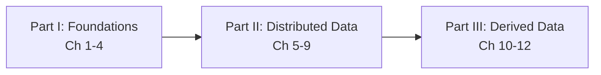

# Preface — How to Read This Book
*Book: Preface, pp. xiii–xix*

## What this book is about

Backend engineering is full of buzzwords: NoSQL, Big Data, web-scale, sharding, ACID, eventual consistency, CAP theorem, MapReduce, cloud services, real-time. The preface promises to show the lasting ideas underneath them.

> **Key term — the buzzwords, in one line each:** **NoSQL** = databases that do not use the classic table-and-SQL model (document, key-value, graph stores). **Big Data** = a loose label for datasets too large for one ordinary machine. **Web-scale** = able to serve internet-sized traffic. **Sharding** = splitting one dataset into pieces on different machines. **ACID** = the four safety promises of a transaction (Atomicity, Consistency, Isolation, Durability; Chapter 7). **Eventual consistency** = copies may disagree briefly but match once updates stop. **CAP theorem** = the claim that, during a network failure, a distributed system must choose between consistency and availability. **MapReduce** = a model for processing huge datasets in parallel across many machines. **Cloud services** = computing rented over the internet. **Real-time** = processed within moments of arrival. All are explained in later chapters; see also [System Design Fundamentals](../00a-system-design-fundamentals/README.md).

Forces that reshaped databases and distributed systems in the preceding decade:

- **Huge internet companies** (Google, Yahoo!, Amazon, Facebook, LinkedIn, Microsoft, Twitter) had to invent new tools to cope with their data and traffic.
- **Businesses want agility**: short cycles, cheap experiments, flexible data models.
- **Open source won** over commercial and home-grown software.
- **Hardware shifted**: single CPU cores (independent processing units) barely get faster, but machines have many cores and networks keep speeding up, so parallelism will only grow.
- **Distribution became cheap**: with infrastructure as a service (IaaS: renting VMs, storage and networks by the hour, e.g. Amazon Web Services), even a tiny team can run across many machines and regions.
- **Downtime is less acceptable**: users expect services to be highly available, so long outages (planned or not) are increasingly unacceptable.

> **Definition: data-intensive vs compute-intensive.** An application is *data-intensive* when its hardest problem is the data itself: its amount, complexity, or speed of change. It is *compute-intensive* when the bottleneck is raw CPU. This book is about the first kind.

Data-intensive applications combine several tools: databases (including NoSQL ones), message queues, caches, search indexes, and batch and stream processing frameworks.

> **Key term — the usual building blocks:** a **message queue** holds messages from one program until another is ready, so the two need not run at the same speed. A **cache** keeps a copy of hot data somewhere faster (usually memory). A **search index** lets you find records by words or fields they contain. **Batch processing** works through a large fixed pile of data in one go (e.g. a nightly report); **stream processing** handles data continuously as it arrives.

The central promise: tools change quickly, but the **principles and trade-offs** behind them change slowly. Knowing those lets you place any new product, use it well, and predict where it will hurt.

## What kind of book it is (and is not)

- **Not a tutorial** for one product and **not a dry theory textbook**.
- It studies **real, successful production systems** under demanding scale, performance and reliability requirements, opening up their **internals and key algorithms** and asking *why* they are built that way.

Afterwards you should be able to pick the right technology and combine tools into a sound architecture. You will **not** be ready to write a storage engine (the part of a database that writes data to disk and reads it back) from scratch (seldom needed), but you will have a solid mental model of what your systems do under the hood, which helps design and debugging.

## Who should read it

Engineers, architects, and technical managers building software with a server or backend that stores or processes data and talks over the internet (web apps, mobile apps, connected sensors), especially whoever chooses tools and designs architectures. Even if you cannot choose your tools, knowing their strengths and weak spots helps.

**Assumed background:**

| You should know | Nice to have | Does not matter |
|---|---|---|
| Building web apps or network services; relational databases (tables of rows and columns) and SQL | Non-relational databases and other data tools; a feel for TCP (reliable byte delivery between machines) and HTTP (the web's request/response protocol) | Your programming language or framework |

Especially valuable if you want to make a system scale (e.g. to millions of users), keep it highly available and robust, keep it maintainable over years, or just understand what happens inside large online services.

> **"You're not Google or Amazon, so forget scale and use a relational database."** Partly true: building for scale you do not need is premature optimization and can lock you into a rigid design. But choosing the right tool still matters, every technology has trade-offs, and relational databases are not the last word on data.

## Scope: what is covered and what is deliberately left out

**Covered:** the architecture of data systems and how they fit into data-intensive applications; fundamental principles and trade-offs; the design choices of different products.

**Deliberately left out:**

- Installation or usage guides for specific packages or APIs (an API is the set of functions or requests software offers to other programs); their own documentation does that.
- Deployment, operations, security, and management: too important for footnotes, they deserve their own books.
- "Big Data" as an organising idea: too vague. The book instead contrasts **single-node vs distributed** systems (one machine vs many cooperating over a network; a *node* is one machine) and **online/interactive vs offline/batch** processing (answering a waiting user vs crunching data in the background).

**Bias toward open source.** The book favours free and open source software (FOSS) because you can read and run the code, and open platforms reduce vendor lock-in (being stuck with a supplier because switching costs too much). Proprietary systems (closed source, SaaS: software the provider runs and you use over the internet, or in-house systems known only from papers) are still discussed where relevant.

**References.** Almost every idea in the book appeared earlier in talks, papers, blogs, source code, bug trackers, mailing lists and engineering folklore; the book collects and cites them (800+ references, mostly free online). Up-to-date links: `github.com/ept/ddia-references`; for papers, Google Scholar usually finds an open-access PDF.

**Acknowledgments (in brief).** The author calls the book a systematic gathering of others' ideas from research and industry, and argues engineers should learn from older work rather than chase only the new. It took almost four years; the chapter-opening maps were illustrated by Shabbir Diwan and Edie Freedman. (Publisher contact details and an O'Reilly Safari notice are irrelevant to the content.)

## Map of the book

Part I builds single-machine foundations, Part II spreads data over many machines, Part III connects many systems through derived data.

### Part I — Foundations of Data Systems
Ideas that apply to every data system, on one machine or a cluster (networked machines working as one system).

| Ch | Title | One-line summary |
|---|---|---|
| 1 | Reliable, Scalable, and Maintainable Applications | What these three goals mean, how to describe load and performance, and how to reason about them. |
| 2 | Data Models and Query Languages | Relational vs document vs graph models, and their query languages: declarative ones (SQL, Cypher, SPARQL, Datalog) versus MapReduce, which sits between declarative and imperative. |
| 3 | Storage and Retrieval | How storage engines lay data out on disk: hash indexes, LSM-trees, B-trees, and column-oriented storage for analytics. |
| 4 | Encoding and Evolution | Formats for turning data into bytes (JSON, Thrift, Protocol Buffers, Avro) and how schemas change safely over time. |

### Part II — Distributed Data
Moving from one machine to many, which scalability often requires, and the problems that follow.

| Ch | Title | One-line summary |
|---|---|---|
| 5 | Replication | Keeping copies on several machines: leaders and followers, multi-leader, leaderless quorums, replication lag. |
| 6 | Partitioning | Splitting a dataset into shards: by key range or hash, secondary indexes, rebalancing, request routing. |
| 7 | Transactions | What ACID means, weak isolation levels and their anomalies, and ways to get serializability (serial execution, 2PL, SSI). |
| 8 | The Trouble with Distributed Systems | Partial failures, unreliable networks and clocks, and reasoning about truth when nodes can be wrong. |
| 9 | Consistency and Consensus | Linearizability, ordering guarantees, two-phase commit, and fault-tolerant consensus and coordination services. |

### Part III — Derived Data
Systems where one dataset is computed from another, common in heterogeneous architectures where no single database does everything, so an application combines databases, caches, indexes and so on.

| Ch | Title | One-line summary |
|---|---|---|
| 10 | Batch Processing | From Unix pipelines to MapReduce and beyond: joins, workflows, and dataflow engines over large fixed datasets. |
| 11 | Stream Processing | Event streams, message brokers and partitioned logs, change data capture, event sourcing, and processing unbounded data. |
| 12 | The Future of Data Systems | Data integration, "unbundling" databases, end-to-end correctness, and doing the right thing ethically. |

The book ends with a **Glossary** of key terms (p. 553).

## How to use these notes

1. Read Chapter 1 first; its vocabulary (faults, load parameters, percentiles, maintainability) is used everywhere. Terms in the tables above (LSM-trees, quorums, 2PL, SSI, linearizability) are defined in their chapters.
2. Part I is prerequisite for Part II, Part II for Part III; chapters within a Part build on each other too.
3. Each chapter README has the same layout: overview, key terms, the book's sections in order, a summary, an interview angle, and a self-check. Try the self-check before rereading.
4. For any new tool, ask: what model does it use, what does it guarantee, and what does it give up to get that?
