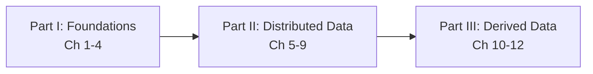

# Preface — How to Read This Book
*Book: Preface, pp. xiii–xix*

## What this book is about

Anyone who has spent time around backend engineering has heard a stream of buzzwords shouted with exclamation marks: NoSQL, Big Data, web-scale, sharding, ACID, eventual consistency, CAP theorem, MapReduce, cloud services, real-time. The preface opens by admitting that this noise is real, and then promises something better: a way to see the lasting ideas that sit underneath all of these fashionable labels.

> **Key term — the buzzwords, in one line each:** **NoSQL** = databases that do not use the classic table-and-SQL model (document, key-value, graph stores). **Big Data** = a loose label for datasets too large for one ordinary machine. **Web-scale** = able to serve internet-sized traffic (millions of users). **Sharding** = splitting one dataset into pieces stored on different machines. **ACID** = the four safety promises of a database transaction (Atomicity, Consistency, Isolation, Durability; see Chapter 7). **Eventual consistency** = copies of the data may disagree briefly but will match once updates stop. **CAP theorem** = a famous claim that, during a network failure, a distributed system must choose between staying consistent and staying available. **MapReduce** = a programming model for processing huge datasets in parallel across many machines. **Cloud services** = computing rented over the internet instead of run on your own hardware. **Real-time** = processed within moments of the data arriving. Every one of these is explained properly in later chapters; see also [System Design Fundamentals](../00a-system-design-fundamentals/README.md).

The author points to several forces that pushed databases and distributed systems to change so much over the preceding decade:

- **Huge internet companies** (Google, Yahoo!, Amazon, Facebook, LinkedIn, Microsoft, Twitter) had so much data and traffic that they had to invent new tools just to cope.
- **Businesses want agility**: short development cycles, cheap experiments, and data models that can bend as the market changes.
- **Open source won**: free and open source software is now often chosen over commercial or home-grown products.
- **Hardware shifted**: single CPU cores (a *core* is one independent processing unit inside a chip) are barely getting faster, but machines have many cores and networks keep speeding up, so parallelism (doing many pieces of work at the same time) will only grow.'
- **Distribution became cheap**: because of infrastructure as a service (IaaS: renting virtual machines, storage and networks from a provider by the hour instead of buying hardware), for example Amazon Web Services, even a tiny team can run software spread over many machines and several geographic regions.
- **Downtime is less acceptable**: users now expect services to be highly available (reachable and working almost all the time), so long outages (planned or not) are increasingly unacceptable.

> **Definition: data-intensive vs compute-intensive.** An application is *data-intensive* when its hardest problem is the data itself: how much of it there is, how complicated it is, or how fast it changes. It is *compute-intensive* when the bottleneck is raw CPU work. This whole book is about the first kind.

Data-intensive applications are rarely built on one tool. Beyond databases (including the newer "NoSQL" ones), they lean on message queues, caches, search indexes, and batch and stream processing frameworks, usually several of them at once.

> **Key term — the usual building blocks:** a **message queue** holds messages from one program until another program is ready to process them, so the two need not run at the same speed. A **cache** keeps a copy of recently or frequently used data somewhere faster (usually memory) so repeated reads are quick. A **search index** is a structure that lets you find records by words or fields they contain, like the index at the back of a book. **Batch processing** works through a large, fixed pile of data in one go (for example, a nightly report); **stream processing** handles data continuously, a little at a time, as it arrives.

The book's central promise is this: tools change quickly, but the **principles and trade-offs** behind them change slowly. If you understand those principles, you can look at any new product and work out where it fits, how to use it well, and where it will hurt you.

## What kind of book it is (and is not)

- It is **not a tutorial** for one product and **not a dry theory textbook**.
- It studies **real, successful data systems** that run in production every day under demanding requirements for scale, performance and reliability.
- It opens up their **internals** (how they work inside) **and key algorithms** and asks *why* they are built the way they are, not only *how* they work.

After reading it you should be able to pick the right technology for a job and combine several tools into a sound architecture. You will **not** be ready to write your own storage engine (the part of a database that actually writes data to disk and reads it back) from scratch (the author notes this is seldom needed), but you will have a solid mental model of what your systems do under the hood, which helps with design decisions and debugging.

## Who should read it

The target reader builds software that has a server or backend (the part of an application that runs on a company's machines rather than on the user's device) which stores or processes data and talks over the internet, such as web apps, mobile apps, or connected sensors. That includes software engineers, architects, and technical managers who still enjoy code, and it is most useful to anyone who chooses tools and designs architectures. Even if you cannot choose your tools, knowing their strengths and weak spots helps.

**Assumed background:**

| You should know | Nice to have | Does not matter |
|---|---|---|
| Building web apps or network services; relational databases (data kept in tables of rows and columns) and SQL (the standard language for querying them) | Non-relational databases and other data tools; a general feel for TCP (reliable delivery of bytes between machines) and HTTP (the request/response protocol of the web) | Your programming language or framework |

The book is especially valuable if you want to:

- make a system scale (for example, to millions of web or mobile users);
- keep an application highly available (little downtime) and robust in operation;
- keep a system maintainable over years as it grows and requirements shift;
- simply satisfy your curiosity about what happens inside large websites and online services.

> **"You're not Google or Amazon, so forget scale and use a relational database."** The author agrees there is truth here: engineering for scale you do not need is wasted effort, a kind of premature optimization (making something faster or bigger before you know it needs to be), and can lock you into a rigid design. But choosing the right tool still matters, every technology has strengths and weaknesses, and relational databases, although important, are not the last word on handling data.

## Scope: what is covered and what is deliberately left out

**Covered:** the architecture of data systems and how they are woven into data-intensive applications; the fundamental principles and trade-offs; and the different design choices made by different products.

**Deliberately left out:**

- Step-by-step installation or usage guides for specific packages or APIs (an API, *application programming interface*, is the set of functions or requests a piece of software offers to other programs; their own documentation already does that).
- Deployment, operations, security, and management. The author considers these too important to squeeze in as footnotes; they deserve dedicated books.
- The term "Big Data" as an organising idea. It is judged too vague for serious engineering talk. Instead the book uses sharper contrasts such as **single-node vs distributed** systems (one machine vs many machines cooperating over a network; a *node* is one machine in such a group) and **online/interactive vs offline/batch** processing (answering a user who is waiting vs crunching data in the background).

**Bias toward open source.** The book favours free and open source software (FOSS) because you can read, change and run the code to see exactly how it works, and open platforms reduce vendor lock-in (being stuck with one supplier because switching away is too costly). Proprietary systems (closed source, software as a service (SaaS: software you use over the internet while the provider runs it), or in-house systems known only from papers) are still discussed where relevant.

**References.** Almost everything in the book has appeared somewhere before, in conference talks, research papers, blog posts, source code, bug trackers, mailing lists, and the folklore engineers pass around. The book gathers the most important of these ideas and cites the originals; each chapter ends with a reference list (the book has 800+ references), and most of it is freely available online. Up-to-date links are kept at `github.com/ept/ddia-references`; for papers, searching the title in Google Scholar usually finds an open-access PDF.

**Acknowledgments (in brief).** The author describes the book as a systematic gathering of many other people's ideas from both research and industry, and argues that engineers can learn a great deal from older work instead of chasing only what is new. It took almost four years to write, and the maps at the start of each chapter were illustrated by Shabbir Diwan and Edie Freedman. (The preface also has publisher contact details and an O'Reilly Safari notice, which are not relevant to the content.)

## Map of the book

The book has three Parts. Part I builds single-machine foundations, Part II spreads data over many machines, and Part III connects many systems together through derived data.

### Part I — Foundations of Data Systems
Ideas that apply to every data system, whether it runs on one machine or a cluster (a group of networked machines working together as one system).

| Ch | Title | One-line summary |
|---|---|---|
| 1 | Reliable, Scalable, and Maintainable Applications | What these three goals really mean, how to describe load and performance, and how to reason about them. |
| 2 | Data Models and Query Languages | Relational vs document vs graph models, and their query languages: declarative ones (SQL, Cypher, SPARQL, Datalog) versus MapReduce, which sits between declarative and imperative. |
| 3 | Storage and Retrieval | How storage engines lay data out on disk: hash indexes, LSM-trees, B-trees, and column-oriented storage for analytics. |
| 4 | Encoding and Evolution | Formats for turning data into bytes (JSON, Thrift, Protocol Buffers, Avro) and how schemas change safely over time. |

### Part II — Distributed Data
Moving from one machine to many, which scalability often requires, and the unusual problems that follow.

| Ch | Title | One-line summary |
|---|---|---|
| 5 | Replication | Keeping copies of data on several machines: leaders and followers, multi-leader, leaderless quorums, replication lag. |
| 6 | Partitioning | Splitting a large dataset into shards: by key range or hash, secondary indexes, rebalancing, request routing. |
| 7 | Transactions | What ACID means, weak isolation levels and their anomalies, and ways to get serializability (serial execution, 2PL, SSI). |
| 8 | The Trouble with Distributed Systems | Partial failures, unreliable networks, unreliable clocks, and how to reason about truth when nodes can be wrong. |
| 9 | Consistency and Consensus | Linearizability, ordering guarantees, two-phase commit, and fault-tolerant consensus and coordination services. |

### Part III — Derived Data
Systems in which one dataset is computed from another. This is common in heterogeneous architectures (systems built from several different kinds of tools) where no single database does everything well, so an application combines databases, caches, indexes and so on.

| Ch | Title | One-line summary |
|---|---|---|
| 10 | Batch Processing | From Unix pipelines to MapReduce and beyond: joins, workflows, and dataflow engines over large fixed datasets. |
| 11 | Stream Processing | Event streams, message brokers and partitioned logs, change data capture, event sourcing, and processing unbounded data. |
| 12 | The Future of Data Systems | Putting it all together: data integration, "unbundling" databases, correctness end to end, and doing the right thing ethically. |

The book finishes with a **Glossary** of key terms (p. 553).

## How to use these notes

1. Read Chapter 1 first; its vocabulary (faults, load parameters, percentiles, maintainability) is used everywhere later. Some table entries above, such as LSM-trees, B-trees, quorums, 2PL, SSI and linearizability, will mean little now; each is defined when its chapter introduces it.
2. Treat Part I as prerequisites for Part II, and Part II as prerequisites for Part III. Chapters inside a Part build on each other too.
3. Each chapter README follows the same layout: overview, key terms, the book's sections in order, a summary, an interview angle, and a self-check. Try the self-check before rereading.
4. When a new tool appears in the wild, ask the book's favourite questions: what model does it use, what guarantees does it give, and what does it give up to get them?
