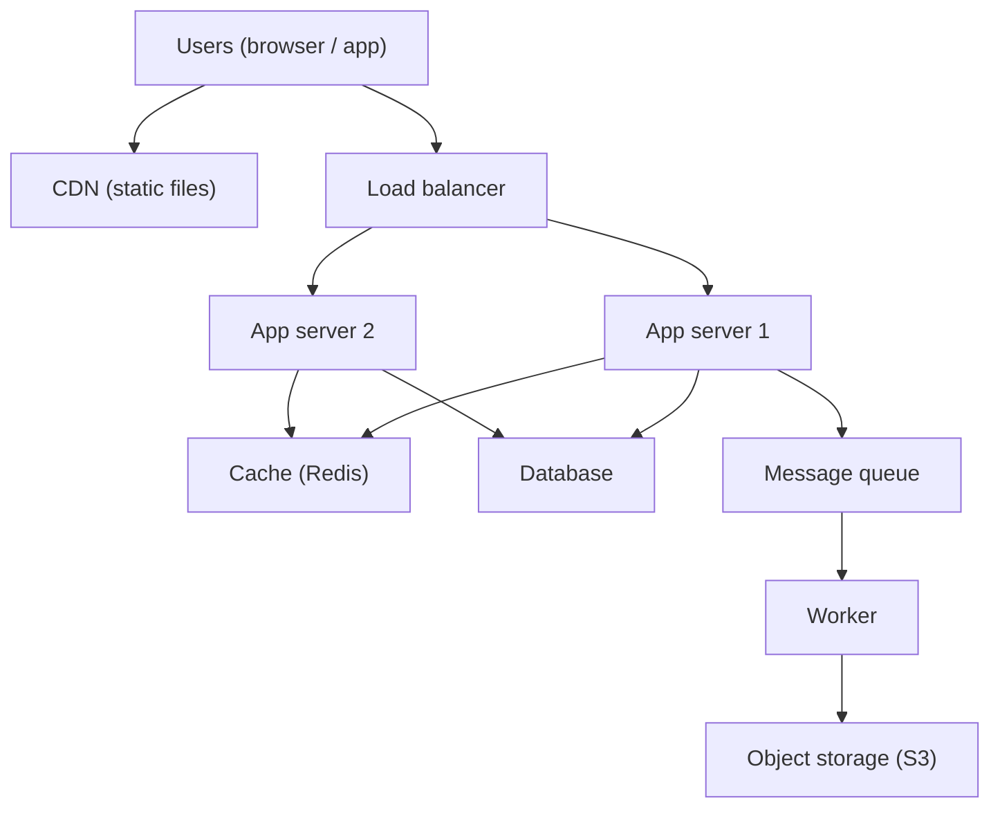
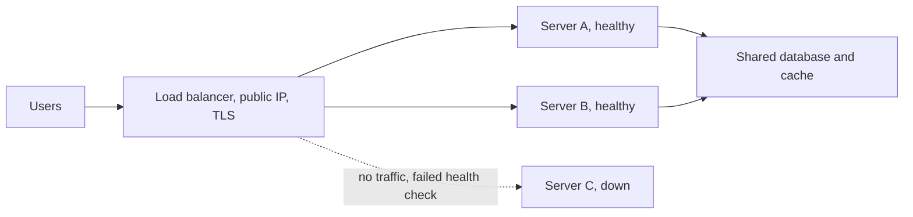
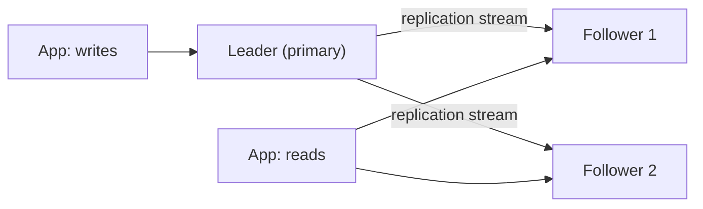
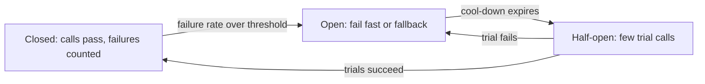
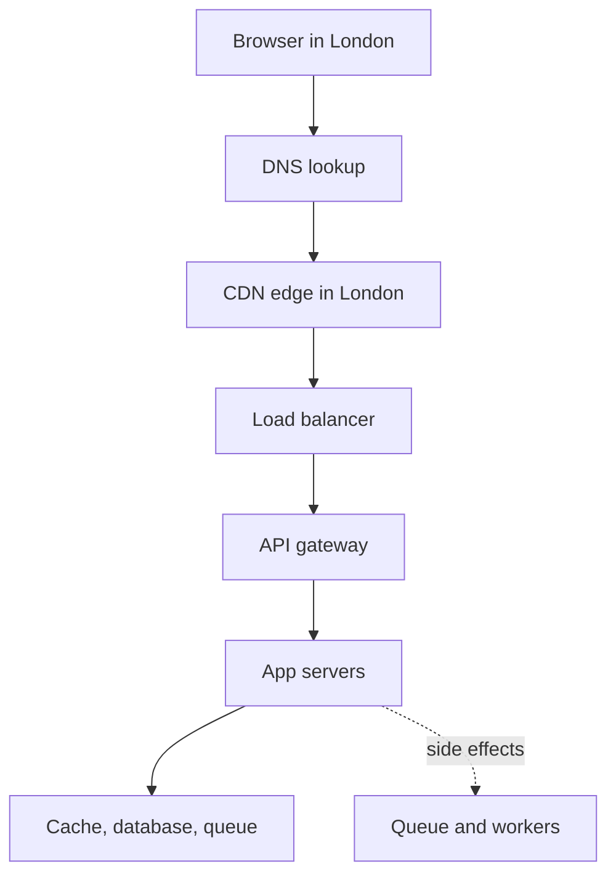

# Chapter 0a — System Design Fundamentals

> **Condensed primer.** This chapter is a ~21k-word primer that defines every system-design fundamental in a few precise sentences; the full ~100k-word treatment (worked examples, diagrams, interview Q&A) lives in [System Design Patterns, Module 0](../../../system-design-patterns/modules/00-system-design-fundamentals/README.md), and every section below ends with a link to its full explanation there.

## Module Introduction

Every other chapter assumes the basic vocabulary of system design: *latency*, *load balancer*, *cache*, *sharding*, *eventual consistency*. This primer defines all of it from zero, in six parts:

| Part | Covers |
|---|---|
| 1 — Foundations and performance | Clients/servers, latency, percentiles, estimation, availability, SLAs, scaling, bottlenecks, the interview method |
| 2 — Networking and communication | IP, DNS, TCP/UDP/QUIC, HTTP, TLS, API styles, real-time push, proxies, load balancers, CDNs |
| 3 — Data storage | Relational databases, ACID, isolation, NoSQL, indexes, replication, sharding, storage types, OLTP/OLAP, durability |
| 4 — Caching, async and consistency | Caches, queues, streams, delivery guarantees, consistency models, CAP, quorums, consensus, clocks, sagas, sketches, IDs |
| 5 — Architecture, operations and security | Architectural styles, resilience patterns, rate limiting, containers, Kubernetes, CI/CD, observability, DR, auth, security |
| 6 — Putting it together | A request's journey, a worked URL shortener, a decision cheat sheet, 60 interview questions, an A–Z index |

Read Parts 1–5 in order once; then use Part 6 as a reference. Terms are **bold** where they are defined.

→ [Full explanation](../../../system-design-patterns/modules/00-system-design-fundamentals/README.md#module-introduction)

## Part 1 — Foundations and performance

The ground floor: what system design is, the standard building blocks, and the vocabulary for speed (latency, throughput, percentiles), size (units, estimation), staying up (availability, reliability, durability) and growing (scalability), ending with a method for the design interview.

> **Part 1 TL;DR:** Describe speed with percentiles, not averages; estimate load from DAU (1 million/day ≈ 12/s); each extra nine of availability is 10× less downtime; series dependencies multiply availability down, redundancy multiplies it up; keep app servers stateless and scale out; find the bottleneck by measuring; in interviews go requirements → estimates → API → data model → design → deep dives → trade-offs.

→ [Full explanation](../../../system-design-patterns/modules/00-system-design-fundamentals/README.md#part-1--foundations-and-performance)

## What system design is

**System design** is deciding which parts a piece of software needs, what each does, how they talk and where data lives, so the whole meets its goals: number of users, response time, staying up when machines break, and cost. Coding asks "how does this function work?"; design asks "how do twenty programs on two hundred machines cooperate without losing data?". The working loop is: understand the goal → estimate the load → sketch the parts → find weak spots (what runs out first, what takes everything down) → fix and justify, repeated as the system grows. Every choice is a **trade-off** (faster reads may mean slower writes; more copies mean safety but cost and disagreement), and in interviews the reasoning is graded, not one "right" answer.

→ [Full explanation](../../../system-design-patterns/modules/00-system-design-fundamentals/README.md#what-system-design-is)

## Clients, servers and the request/response cycle

A **client** is any program that asks for something (browser, app, or another server); a **server** is a program (and loosely its machine) that waits for requests and answers them — a *role*, so one logical server may be hundreds of machines and most microservices are both. They follow **request/response**: the client sends a request (`GET /profile`), the server does work and returns a response (`200 OK` + body), usually over **HTTP**. A **thin client** relies on the server; a **thick client** does much work locally. Normally the client **pulls**; features like chat need the server to **push** (WebSockets, SSE — Part 2). Remember the network between them is slow and unreliable compared with work inside one machine.

→ [Full explanation](../../../system-design-patterns/modules/00-system-design-fundamentals/README.md#clients-servers-and-the-requestresponse-cycle)

## The building blocks of a web application

| Part | Job |
|---|---|
| Client | Renders UI, calls the backend over HTTP |
| Load balancer | Spreads requests over servers, skips dead ones |
| App server | Runs business logic; run several identical copies |
| Database | Stores data durably and lets you query it; holds **state**, so hardest to scale |
| Cache | Fast in-memory copy of hot data (Redis, Memcached); RAM reads are well under 1 ms |
| Message queue + **workers** | Holds jobs for background programs so the request returns immediately |
| Object storage | Cheap storage for large files under keys (Amazon S3) |
| CDN | Servers worldwide keeping static files near users |

Add each box only when you can name the problem it solves ("reads outnumber writes 100:1, so a cache"). Classic mistakes: images stored in the database (put them in object storage, keep the key), slow work (emails, encoding) inside the web request.

→ [Full explanation](../../../system-design-patterns/modules/00-system-design-fundamentals/README.md#the-building-blocks-of-a-web-application)

## Latency, throughput and bandwidth

**Latency** is how long one thing takes (ms = thousandths, µs = millionths of a second); **throughput** is work done per unit time (requests/s, MB/s); **bandwidth** is a link's maximum capacity in bits per second (Mbps, Gbps).

### Response time vs latency

**Response time** is what the client sees end to end; strictly, **latency** is only the delay before work starts (queueing, network hops) and **service time** is the work itself: response time = network delay + queueing delay + service time. In interviews "latency" usually means response time — say which you mean.

Latency comes from **propagation** (light in fibre ≈ 200 km/ms; London–New York round trip ≈ 70 ms), **transmission** (1 MB over 100 Mbps = 80 ms), **queueing** and **processing**. Latency and bandwidth are independent: more bandwidth does not speed up a small API call. Near full utilisation, queues grow and latency explodes while throughput flattens, so teams target ~50–70% peak utilisation. **Batching** raises throughput at a latency cost. 1 byte = 8 bits, so 100 Mbps ≈ 12.5 MB/s.

### Low-latency checklist

Start with a **latency budget**: split the target (e.g. p99 < 200 ms) across hops (network, gateway, service + DB, slack) and work first on the hop that overspends. Levers, roughly by payoff: remove round trips (batch, parallelise, no N+1); reuse connections (pools, keep-alive, HTTP/2–3, TLS 1.3 resumption); move bytes closer (CDN, edge TLS, regional replicas); serve from memory (caches, precomputed feeds and counts); do less while the user waits (queue side effects); shrink payloads (gzip/Brotli, Protobuf, pagination, only needed fields); make each query cheap (index, denormalise the hot read); keep headroom (50–70% utilisation, shed rather than queue); cut the tail (deadlines, hedging, bounded fan-out, fewer GC pauses and shared locks); measure per-hop percentiles with histograms and tracing. Rules: **fix the biggest term first** (a 70 ms ocean crossing dwarfs a 2 ms parse) and **every lever has a price** (staleness, money, load, delayed results) — say which you pay.

→ [Full explanation](../../../system-design-patterns/modules/00-system-design-fundamentals/README.md#latency-throughput-and-bandwidth)

## Percentiles, tail latency and why averages lie

A **percentile** is the value below which that share of measurements fall: **p50** (median), p90, p95, **p99** (1 in 100 slower), **p999**. **Tail latency** is the slow end (p99, p999, max).

### Why averages lie

The **mean** blends fast and slow requests into a number no request had: nine 10 ms requests and one 1,000 ms give mean 109 ms, median 10 ms, p95/p99 1,000 ms. Real latency is skewed (GC pauses, cache misses, retries), so use percentiles.

### Why the tail matters more than you think

Heavy users hit the tail most, and **fan-out** amplifies it: if a request waits on 100 servers each slow 1% of the time, 1 − 0.99^100 ≈ 63% of requests are slow ("The Tail at Scale", Dean and Barroso, 2013). Compute percentiles from **histograms** or sketches (HDRHistogram, t-digest); never average percentiles — merge histograms. Reduce tails with **hedged requests** (send a duplicate after ~p95), timeouts, less fan-out and spare capacity. Beware **coordinated omission**: a load tester that waits for slow replies under-reports the tail.

→ [Full explanation](../../../system-design-patterns/modules/00-system-design-fundamentals/README.md#percentiles-tail-latency-and-why-averages-lie)

## Little's law

For any stable system, **L = λ × W**: average items inside (L) = arrival rate (λ, equal to throughput when stable) × average time inside (W). 1,000 req/s × 0.2 s = 200 requests in flight, so you need ≥ 200 threads/connections; a pool of 20 connections with 5 ms queries caps at 20 / 0.005 = 4,000 queries/s; if latency doubles with fixed concurrency, max throughput halves. Convert ms to seconds, and it does not apply when the queue grows without bound.

→ [Full explanation](../../../system-design-patterns/modules/00-system-design-fundamentals/README.md#littles-law)

## Latency numbers every engineer should know

Orders of magnitude (rounded for current hardware; ratios matter, not exact values): CPU **L1 cache** 1 ns; **RAM** read 100 ns; compress 1 KB 2 µs; send 1 KB over 1 Gbps 10 µs; random 4 KB read from NVMe **SSD** 20–100 µs; read 1 MB sequentially from RAM 50–250 µs; round trip inside a data centre 0.5 ms; 1 MB from SSD 0.2–1 ms; **HDD** seek 10 ms; 1 MB from HDD 5–20 ms; London–New York round trip 70 ms; California–Europe 150 ms. Consequences: RAM is ~100–1,000× faster than SSD for random reads (caches live in RAM); a data-centre round trip costs thousands of memory reads (batch calls); cross-ocean latency only falls by moving data closer; sequential beats random I/O (why LSM-trees and logs append). A remote cache still pays the ~0.5 ms network hop.

→ [Full explanation](../../../system-design-patterns/modules/00-system-design-fundamentals/README.md#latency-numbers-every-engineer-should-know)

## Units, powers of two and data sizes

A **bit** is 0/1; a **byte** is 8 bits. KB, MB, GB, TB, PB each step ×1,000 in estimates (exactly 2^10 = 1,024; strictly KiB/MiB/GiB). Remember 2^10 ≈ 10^3, 2^20 ≈ 10^6, 2^30 ≈ 10^9, 2^40 ≈ 10^12, 2^32 ≈ 4.3 billion (IPv4 addresses; unsigned 32-bit limit, ~2 billion signed), 2^64 ≈ 1.8 × 10^19. Typical sizes: integer 4–8 B, timestamp 8 B, UUID 16 B, short post with metadata 0.5–1 KB, compressed photo 200 KB–2 MB, a minute of HD video ~25–60 MB. A day ≈ 86,400 s ≈ **10^5 s**, a month ≈ 2.6 × 10^6 s, a year ≈ 3 × 10^7 s, so **1 million/day ≈ 12/s**. A 1 Gbps card moves at most 125 MB/s.

→ [Full explanation](../../../system-design-patterns/modules/00-system-design-fundamentals/README.md#units-powers-of-two-and-data-sizes)

## Back-of-the-envelope estimation

A **back-of-the-envelope estimate** is a quick rough calculation whose goal is the right **order of magnitude**, because that decides the architecture (100 QPS fits one server; 100,000 needs caching and sharding). Key terms: **DAU/MAU** (daily/monthly active users), **QPS/RPS** (queries/requests per second), average QPS = requests per day / ~10^5, **peak factor** (peak ÷ average, commonly 2–3×, 5–10× for spiky products), **read/write ratio**, storage/day = items × size, bandwidth = QPS × response size. Rough per-machine capacities: app server 1,000–10,000 req/s; relational DB 1,000–10,000 simple queries/s; Redis/Memcached 100,000+ ops/s; Kafka broker hundreds of MB/s. Don't forget peak, replication (×3 storage), metadata and indexes (+20–50%); round aggressively and say every assumption aloud.

### Worked example: how many servers do we need?

Correct the naive "peak ÷ capacity" with measured cost, a utilisation ceiling, a concurrency check and failure headroom. Assume 30,000 req/s peak, 4 ms CPU and 50 ms end-to-end per request, 16-core machines, 20 KB responses, 3 AZs. One core: 1,000 ÷ 4 = 250 req/s; one server: 4,000 req/s; at a 60% ceiling 2,400 → 30,000 ÷ 2,400 = 12.5 → **13 servers**. Little's law: 30,000 × 0.05 s = 1,500 in flight, ~115 per server (size threads and DB pools to match). Survive losing one of 3 zones: ⌈13 ÷ 2⌉ = 7 per zone → **21**; +10% rolling-deploy surge → **~23**. Network: 600 MB/s ≈ 4.8 Gbps total, ~0.23 Gbps each — CPU is the limit. The naive 8 was ~3× low. **Repeat per tier** with its own bottleneck: cache by memory (working set ÷ RAM × replicas), database by IOPS or write throughput per primary (forcing sharding), streaming by network and disk bandwidth per broker.

→ [Full explanation](../../../system-design-patterns/modules/00-system-design-fundamentals/README.md#back-of-the-envelope-estimation)

## Availability and the nines

**Availability** is the fraction of time (or of valid requests) the system works: uptime / (uptime + downtime).

### The nines table

| Availability | Per year | Per month (30 d) | Per day |
|---|---|---|---|
| 99% (two nines) | 3.65 days | 7.2 h | 14.4 min |
| 99.9% (three) | 8.76 h | 43.2 min | 1.44 min |
| 99.95% | 4.38 h | 21.6 min | 43 s |
| 99.99% (four) | 52.6 min | 4.32 min | 8.6 s |
| 99.999% (five) | 5.26 min | 26 s | 0.86 s |

Each nine is 10× less downtime and usually far more than 10× the effort; at 99.99% recovery must be automatic. Parts in **series** multiply (99.99% × 99.9% × 99.9% ≈ 99.79%); independent parts in **parallel** combine as 1 − (failure probabilities multiplied) (two 99% servers → 99.99%), assuming failures are independent. Cloud single-service SLAs are usually 99.9–99.99%.

→ [Full explanation](../../../system-design-patterns/modules/00-system-design-fundamentals/README.md#availability-and-the-nines)

## SLA, SLO, SLI and error budgets

An **SLI** (Service Level Indicator) is a measurement ("% of requests succeeding under 300 ms over 30 days"); an **SLO** (Objective) is the internal target for it ("99.9%"); an **SLA** (Agreement) is a customer contract with credits or refunds if missed, normally looser than the SLO so the team is warned first. Choose SLIs users feel (failed checkouts, not CPU) and never set an SLO of 100%.

### Error budgets

The **error budget** is 1 − SLO: at 99.9%, 0.1% of requests (100,000 of 100 million a month, ≈ 43 minutes of full outage) may fail. While budget remains, ship fast; when spent, slow releases and fix reliability. The idea comes from Google's **SRE** (Site Reliability Engineering, running production with software-engineering methods); Part 5 covers burn-rate alerts.

→ [Full explanation](../../../system-design-patterns/modules/00-system-design-fundamentals/README.md#sla-slo-sli-and-error-budgets)

## MTBF, MTTR and measuring failure

**MTBF** (mean time between failures — higher is better) and **MTTR** (mean time to repair/recover — lower is better); related: **MTTD** (mean time to detect) and **MTTF** (mean time to failure, for replaced parts like disks). Availability ≈ MTBF / (MTBF + MTTR): 1,000 h / 1,001 h ≈ 99.9%. At scale failures are constant, so cutting MTTR (monitoring, automatic failover, quick rollback) is usually the cheaper lever — the same failures with 10-second automatic recovery give ≈ 99.9997%. Detection time counts toward MTTR.

→ [Full explanation](../../../system-design-patterns/modules/00-system-design-fundamentals/README.md#mtbf-mttr-and-measuring-failure)

## Reliability, availability and durability

**Reliability**: keeps doing the right thing correctly over time despite faults (measured by failure rate, MTBF). **Availability**: up and responding right now (% uptime). **Durability**: saved data stays saved (probability of losing an object per year). They are separate promises: Amazon S3 Standard is designed for 99.999999999% ("eleven nines") durability but 99.99% availability (SLA credits below 99.9%). A system can be available but wrong, or down but durable. Availability comes from redundancy and failover; durability from copies on separate disks/sites, writing to disk before acknowledging, and backups — replication is *not* backup, because a bad delete replicates too.

→ [Full explanation](../../../system-design-patterns/modules/00-system-design-fundamentals/README.md#reliability-availability-and-durability)

## Faults, failures and fault tolerance

A **fault** is one component going wrong; a **failure** is the whole system no longer serving users; **fault tolerance** (resilience) keeps faults from becoming failures, perhaps in degraded form.

| Fault type | Example | Defence |
|---|---|---|
| Hardware | Disk dies | Redundant machines, replicated data |
| Software | Bug, leak | Testing, gradual rollouts, restarts |
| Network | Packet loss, partition | Timeouts, retries, replicas in other zones |
| Human | Bad config, deleted table | Reviews, automation, backups, rollback |
| Dependency | Third-party API down | Timeouts, fallbacks, circuit breakers |

**Failure models** are formal assumptions about how a faulty part behaves, each harder to tolerate than the last: **fail-stop** (halts and everyone reliably learns it; f+1 copies tolerate f), **crash (crash-stop)** (halts silently — looks like slowness, so consensus needs 2f+1 nodes), **crash-recovery** (restarts with only what it saved to disk — write durably before acknowledging), **omission** (drops some messages — acks and idempotent retries), **timing (performance)** (correct but too late or with drifting clocks — timeouts, leases, hedging), **Byzantine (arbitrary)** (wrong or malicious answers — 3f+1 replicas, signatures, checksums). Company data centres usually assume **crash-recovery plus omission plus timing faults**, plus checksums against corrupted data; blockchains design for Byzantine faults. State your model: it sets the replica count (Raft: 3 nodes survive 1 crash; Byzantine tolerance needs 4). The pattern is detect → isolate → recover. Beware **correlated failures** (a shared power supply or bad deploy breaking "independent" copies).

→ [Full explanation](../../../system-design-patterns/modules/00-system-design-fundamentals/README.md#faults-failures-and-fault-tolerance)

## Redundancy, single points of failure and failover

**Redundancy** is having spares; a **single point of failure (SPOF)** is any part whose loss alone stops everything (one DB, one LB, one DNS provider); **failover** switches work to a standby. Remove SPOFs by running ≥ 2 copies in separate **failure domains** (racks, **availability zones** — separate data centres in a region with own power and network — or regions), routing around dead copies, **health checks**, and automated failover. **Active-passive** (primary-standby) keeps an idle up-to-date standby; **active-active** serves from all copies (harder for writable state). Standbys are **cold** (must be started, minutes–hours), **warm** (running, partly current) or **hot** (in sync, seconds). **N+1/N+2** means one or two units beyond peak need. Risk: wrongly declaring a live primary dead gives **split brain** (two primaries accepting writes), prevented with quorums and fencing (Parts 3–4); test failover regularly.

→ [Full explanation](../../../system-design-patterns/modules/00-system-design-fundamentals/README.md#redundancy-single-points-of-failure-and-failover)

## Scalability

**Scalability** is handling more load by adding resources, without redesign or performance collapse, with cost growing roughly in proportion. Load is described by **load parameters** (QPS, concurrent users, read/write ratio, data size, followers per user); "scalable" only means something relative to one of them. Dimensions: **load** (more requests/s), **data** (more stored data), **geographic** (users worldwide needing low latency everywhere) and **organisational** scalability (more engineers without stepping on each other). Core techniques: scale out stateless servers, cache hot data, read replicas, sharding, queues for slow work, CDN for static content. Scale the actual bottleneck, and design so the next 10× is easy rather than 1,000× on day one.

→ [Full explanation](../../../system-design-patterns/modules/00-system-design-fundamentals/README.md#scalability)

## Vertical and horizontal scaling

**Vertical scaling (scale up)** makes one machine bigger (cloud instances reach hundreds of cores and terabytes of RAM); **horizontal scaling (scale out)** adds machines and spreads work.

| | Vertical | Horizontal |
|---|---|---|
| Simplicity | No code change | Needs LB, stateless design or sharding |
| Limit | Biggest machine | Practically unlimited |
| Fault tolerance | Still a SPOF | Losing a node loses a fraction |
| Cost | Big machines cost disproportionately | Commodity machines |
| Consistency | Easy, one copy | Harder |

Scaling up first is often right (Stack Overflow in 2016 ran on 11 web servers and 4 SQL Server machines). What makes scale-out hard is **state**: stateless servers are trivial; data must be replicated or partitioned. Most systems do both.

→ [Full explanation](../../../system-design-patterns/modules/00-system-design-fundamentals/README.md#vertical-and-horizontal-scaling)

## Elasticity

**Elasticity** is adding *and removing* resources automatically and quickly as load changes, so you pay for roughly what you use (scalability = *can* grow; elasticity = grows and shrinks by itself). Mechanism: watch a metric (CPU, RPS, queue length), add servers above a threshold, remove below, LB follows — **autoscaling** (Part 5), also provided by **serverless** platforms that scale to zero. Limits: boot time (seconds for containers, minutes for VMs), mostly stateless parts only, and **flapping** if scale-in is too eager.

→ [Full explanation](../../../system-design-patterns/modules/00-system-design-fundamentals/README.md#elasticity)

## Stateless and stateful services

**State** is data remembered between requests. A **stateless service** keeps no client-specific data in its memory, so any copy can serve any request and copies can be added, killed or replaced freely; a **stateful service** ties a client or data to a particular server. Make app servers stateless by putting sessions in a shared store (Redis) or a signed token (JWT), files in object storage, carts in a DB or cache. Stateful parts that remain (databases, game servers, WebSocket servers) need **sticky sessions** and a plan for server loss. Cost of statelessness: an extra hop (usually < 1 ms) — and the state store itself now needs scaling and redundancy.

→ [Full explanation](../../../system-design-patterns/modules/00-system-design-fundamentals/README.md#stateless-and-stateful-services)

## Performance vs scalability

**Performance** is how fast the system is for one request at current load; **scalability** is how well performance holds as load grows. Diagnostic: one request to an idle system is slow → performance problem (profile it; more servers won't help); fast alone but slow under traffic → scalability problem. Some changes trade one for the other (a shared-cache hop costs a little per-request speed but enables scale-out).

→ [Full explanation](../../../system-design-patterns/modules/00-system-design-fundamentals/README.md#performance-vs-scalability)

## Concurrency vs parallelism

**Concurrency** is many tasks in progress over the same period, interleaved whenever one waits (how work is *organised*); **parallelism** is tasks running at the same instant on multiple cores or machines (how it is *executed*). Web servers mostly wait on I/O, so concurrency lets one server juggle thousands of requests; parallelism speeds CPU-heavy work. Mechanisms: **processes** (isolated memory), **threads** (shared memory, need locks), **event loop / async I/O** (one thread never blocks: Node.js, NGINX, asyncio), **lightweight threads/coroutines** (goroutines, Java virtual threads). Hazards: **race condition** (result depends on timing, e.g. a lost withdrawal), **deadlock** (tasks wait forever on each other's locks), contention. **Amdahl's law**: speed-up is limited by the serial part (10% serial → at most 10×). A single-threaded Node.js server is concurrent but not parallel.

→ [Full explanation](../../../system-design-patterns/modules/00-system-design-fundamentals/README.md#concurrency-vs-parallelism)

## Bottlenecks: CPU, memory, disk and network

A **bottleneck** is the part limiting overall capacity; improving anything else doesn't help. Signs: **CPU** near 100%; **memory** swapping or OOM; **disk** high wait time or IOPS/MB/s at limit; **network** saturated link, loss, high RTT. Non-hardware bottlenecks are as common: one hot lock or row, a too-small connection pool, a rate-limited external API. Measure under load, find what is at its limit or where queues form, fix, re-measure (the bottleneck moves). **CPU-bound** work is limited by computation, **I/O-bound** by waiting; most web services are I/O-bound.

### IOPS and disk performance

**IOPS** (input/output operations per second) limits small random access; **throughput** (MB/s) limits large sequential transfers — a disk can hit one without the other. Rough figures: HDD (7,200 rpm) 75–150 IOPS, 100–250 MB/s; SATA SSD tens of thousands, ~500 MB/s; NVMe SSD hundreds of thousands to ~1 million, several GB/s; AWS gp3 baseline 3,000 IOPS and 125 MB/s. HDD random reads are slow because the arm must move (5–10 ms). Cloud disks have provisioned limits that can throttle a DB while CPU looks idle.

→ [Full explanation](../../../system-design-patterns/modules/00-system-design-fundamentals/README.md#bottlenecks-cpu-memory-disk-and-network)

## How to approach a system design interview

A 45–60 minute open-ended design conversation; use a repeatable structure (rough timings for 45 min):

1. **Requirements (5 min)** — **functional** (what it does: features) and **non-functional** (how well: scale, latency, availability, durability, consistency, security, cost); agree what is out of scope.
2. **Estimates (3–5 min)** — QPS average and peak, read/write ratio, storage, bandwidth, and what they imply.
3. **API (5 min)** — main endpoints with inputs/outputs.
4. **Data model (5 min)** — entities, keys, access patterns, which database fits.
5. **High-level design (10 min)** — boxes and arrows; walk one read and one write end to end.
6. **Deep dives (10–15 min)** — the hardest parts given the numbers (ID generation, sharding, hot keys, failures).
7. **Trade-offs and wrap-up (3–5 min)** — weaknesses, SPOFs, monitoring, what changes at 10×.

### Non-functional requirements and the levers that meet them

A non-functional requirement helps only if **measurable** ("p99 < 200 ms", not "fast") and tied to a **design lever**:

| Requirement | Measure | Levers | Cost |
|---|---|---|---|
| Availability | Success-rate SLO, allowed downtime | Multi-zone redundancy, health checks, failover, degradation | Machines, copy consistency |
| Latency | p50/p95/p99 per endpoint | Caching, CDN, fewer round trips, async, headroom | Staleness, money |
| Scalability | Peak QPS, data growth | Stateless + LB, sharding, queues | Cross-shard work |
| Consistency | Who must see a write, how soon | Single leader + sync replicas, quorums, consensus, or eventual + conflict handling | Write latency, partition availability |
| Durability | No lost acknowledged write; RPO | WAL, replicate before ack, backups, cross-region | Latency, storage |
| Reliability | Error rate, MTTR | Timeouts, backoff retries, idempotency, breakers, bulkheads | Retry load, complexity |
| Security and privacy | Who may do what, sensitive data, compliance | AuthN/AuthZ at the edge, encryption, least privilege, audit logs | Check latency, ops |
| Maintainability | Time to diagnose, time to ship, deploys/day | See below | Up-front effort |
| Cost | Per request, user or GB | Right-size, autoscale, storage tiers, caching | Less headroom |

**Maintainability** (most lifetime cost is operating and changing a system) splits into **operability** (easy to keep healthy: telemetry, SLO alerts, runbooks, automated deploys/rollbacks), **simplicity** (easy to understand: few component types, clear ownership, no **accidental complexity**) and **evolvability** (easy to change: versioned APIs, backward-compatible schemas, loose coupling, feature flags, online migrations, tests) — after Kleppmann's DDIA ch. 1 and ISO/IEC 25010.

Think aloud, justify every component with a requirement or number, give a complete simple design before depth, and never name a technology without the reason.

→ [Full explanation](../../../system-design-patterns/modules/00-system-design-fundamentals/README.md#how-to-approach-a-system-design-interview)

## Part 1 glossary

Every Part 1 term is defined in bold in the sections above. A few extra one-liners:

| Term | Meaning |
|---|---|
| Order of magnitude | Rough size as a power of ten |
| Fan-out | One request triggering many parallel downstream requests |
| Round trip time (RTT) | Time for a message to reach a destination and the reply to return |
| Transmission delay | Time to push a message's bits onto a link |
| NVMe | Fast SSD interface with very high IOPS |
| Thread | Independent flow of execution inside a process |

→ [Full explanation](../../../system-design-patterns/modules/00-system-design-fundamentals/README.md#part-1-glossary)

## Part 2 — Networking and communication

Part 1 was the boxes; this part is the arrows: how one computer finds another, how bytes travel, which **protocols** (agreed rules for how two programs talk) they speak, and which middlemen (proxies, load balancers, CDNs) sit in between.

> **Part 2 TL;DR:** IP finds the machine, the port finds the program; DNS maps names to IPs through cached root/TLD/authoritative servers; TCP is reliable and ordered but costs a handshake and head-of-line blocking, UDP is fire-and-forget, QUIC (HTTP/3) is reliable multi-stream encrypted transport over UDP; a fresh HTTPS connection costs ~2 RTTs before the request; REST for public APIs, gRPC inside, GraphQL for flexible clients; load balancers (L4 vs L7, algorithms, health checks, draining) make scale-out work; CDNs cache near users; round trips, not bandwidth, usually dominate.

→ [Full explanation](../../../system-design-patterns/modules/00-system-design-fundamentals/README.md#part-2--networking-and-communication)

## IP addresses, NAT, ports and sockets

An **IP address** identifies a machine's network connection; routers forward each **packet** (a chunk of up to ~1,500 bytes on Ethernet) by destination IP. **IPv4** is 32 bits (~4.3 billion, exhausted in the 2010s); **IPv6** is 128 bits (~3.4 × 10^38). A **port** (0–65535) picks the program (22 SSH, 53 DNS, 80 HTTP, 443 HTTPS, 5432 PostgreSQL, 6379 Redis). A **socket** is IP + port; a TCP connection is identified by the **5-tuple** (protocol, source IP/port, destination IP/port), which is why one server port holds many connections. **Private IPs** (`10.0.0.0/8`, `172.16.0.0/12`, `192.168.0.0/16` — **CIDR** notation giving the fixed leading bits) live inside a network such as a cloud **VPC** (your isolated cloud network); **NAT** rewrites them to a shared **public IP** (a **NAT gateway** in the cloud). Consequences: servers can't call clients behind NAT (so push uses client-opened connections); a proxy to one backend has ~64,000 source ports (~28,000 with Linux defaults), so **ephemeral port exhaustion** is real; **carrier-grade NAT** makes IP-based rate limits hit many users at once; IPs change, so use DNS and service discovery.

→ [Full explanation](../../../system-design-patterns/modules/00-system-design-fundamentals/README.md#ip-addresses-nat-ports-and-sockets)

## DNS — the internet's phone book

**DNS** turns a **domain name** into IPs. A name is a hierarchy read right to left: root `.` → **top-level domain (TLD)** (`com`) → domain (`example`) → **subdomain** (`www`). Players: the OS **stub resolver**; the **recursive resolver** (ISP, company, 8.8.8.8, 1.1.1.1) that does the work and caches; **root servers** (13 named identities, ~2,000 anycast instances); **TLD servers**; the **authoritative server** holding the real records. On a miss the resolver walks root → TLD → authoritative (the stub sends one **recursive query** — "give me the final answer"; the resolver then follows **iterative queries**, each server returning a **referral** to the next) and caches each answer for its **TTL**; busy resolvers usually answer from cache. Records: **A**/**AAAA** (name → IPv4/IPv6), **CNAME** (alias; not allowed at the bare **apex** domain, hence ALIAS/ANAME/CNAME flattening), **MX** (mail), **NS** (authoritative servers), **TXT** (verification, SPF), plus SOA, SRV, PTR, CAA; a **zone** is one server's set of records. Long TTLs mean fewer lookups but slow changes ("propagation" is just caches expiring); short TTLs (30–60 s) allow fast failover — lower the TTL before a migration. DNS also steers traffic: **round-robin DNS** (several A records, blind to health), **GeoDNS** (answer by location, helped by **EDNS Client Subnet**), **latency-based routing**. A cold lookup costs 20–120 ms; DNS outages (Dyn 2016, Facebook 2021) make healthy sites look down, so many use two providers.

→ [Full explanation](../../../system-design-patterns/modules/00-system-design-fundamentals/README.md#dns--the-internets-phone-book)

## Network layers — OSI and TCP/IP models

Networking is split into **layers**, each wrapping the data with its own header (**encapsulation**): HTTP request → TCP segment (ports) → IP packet (addresses) → Ethernet frame (**MAC address**, a network card's hardware address). The 7-layer **OSI model** is teaching vocabulary (7 application, 6 presentation, 5 session, 4 transport, 3 network, 2 data link, 1 physical); the 4-layer **TCP/IP model** (application, transport, internet, link) is what runs. "L3/L4/L7" decides what a device can see: L3 (routers, IP firewall rules) sees IPs; **L4** also sees ports and TCP/UDP state but not content; **L7** reads the HTTP request (path, headers, cookies) and can route by it, at the cost of CPU and decrypting TLS.

→ [Full explanation](../../../system-design-patterns/modules/00-system-design-fundamentals/README.md#network-layers--osi-and-tcpip-models)

## TCP, UDP and QUIC

These are **transport-layer** protocols. **TCP** is a connection-based, reliable, ordered byte stream: a **three-way handshake** (SYN, SYN-ACK, ACK) costs one **RTT** before data; **sequence numbers**, **ACKs** and **retransmission** give reliability; **flow control** (receive window) protects the receiver; **congestion control** (slow start; Reno, CUBIC — Linux default — and BBR) protects the network, so new connections start slow; either side closes with **FIN**, and the side that closes first holds **TIME_WAIT** (60 s on Linux). **Head-of-line (HOL) blocking**: one lost packet stalls all later bytes, including other requests sharing the connection. **UDP** sends independent **datagrams** with no handshake, ACKs, ordering or congestion control (8-byte header vs TCP's 20+) — used for DNS, video calls, games, where late data is useless. **QUIC** (IETF standard 2021, from Google) runs over UDP and combines transport + TLS 1.3 into 1 RTT (**0-RTT** on resume), has independent streams (loss stalls only its stream), **connection migration** via a **connection ID** (survives Wi-Fi → 4G), is always encrypted and lives in user space (more CPU; some firewalls block UDP, so clients fall back). Every new TCP + TLS connection costs 2–3 RTTs, so reuse connections.

→ [Full explanation](../../../system-design-patterns/modules/00-system-design-fundamentals/README.md#tcp-udp-and-quic)

## HTTP — the language of the web

**HTTP** is a request/response protocol: method, path, headers, optional body → status code, headers, body. Methods: GET (read), HEAD, POST (create/action), PUT (replace), PATCH (partial update), DELETE, OPTIONS. **Safe** = changes nothing (GET, HEAD, OPTIONS); **idempotent** = repeating leaves the same state (GET, HEAD, PUT, DELETE, OPTIONS), so it can be retried after a timeout; POST needs an **idempotency key**. Status classes: 1xx (101 WebSocket upgrade), 2xx (200, 201 Created, 202 Accepted = queued, 204), 3xx (301, 302, 304 Not Modified), 4xx client error (400, 401 = not authenticated, 403 = authenticated but not allowed, 404, 409, 429), 5xx server error (500, 502 bad gateway answer, 503, 504 gateway timeout). Key headers: `Host`, `Content-Type`, `Authorization`, `Cache-Control`, `ETag`/`If-None-Match` (→ 304), `Accept-Encoding`, `X-Forwarded-For` (original client IP). HTTP is **stateless**; **cookies** (`Set-Cookie` with `HttpOnly; Secure; SameSite`) carry a session ID whose data lives in a shared store or signed token. **Keep-alive** reuses connections (default since HTTP/1.1).

| | HTTP/1.1 (1997) | HTTP/2 (2015) | HTTP/3 (2022) |
|---|---|---|---|
| Transport | TCP | TCP | QUIC (UDP) |
| Format | Text | Binary frames, **HPACK** header compression | Binary, **QPACK** |
| Parallelism | One request at a time per connection (~6 connections) | **Multiplexing**: many interleaved streams on one connection | Streams on one connection |
| HOL blocking | HTTP and TCP level | TCP level | Per stream only |

HTTP/3 is discovered via `Alt-Svc` or a DNS HTTPS record, falling back to HTTP/2. Don't use GET for state changes, and don't return 200 with an error body.

→ [Full explanation](../../../system-design-patterns/modules/00-system-design-fundamentals/README.md#http--the-language-of-the-web)

## HTTPS and TLS

**HTTPS** is HTTP inside **TLS** (formerly **SSL**), giving **confidentiality**, **integrity** and **authentication** — **encryption in transit** (vs **at rest** for stored data). Current version TLS 1.3 (2018); 1.2 still common. A server proves identity with a **certificate** (domain, **public key**, expiry, signature by a **Certificate Authority**), checked along the **chain of trust** to a pre-installed **root CA**; Let's Encrypt issues free 90-day certificates renewed by ACME (planned 64 days in 2027, 45 in 2028), so automate renewal. **Asymmetric** crypto (key pair) is used only in the handshake to authenticate and agree a secret via **Diffie–Hellman** (each side sends a **key share** and both derive the same key without ever sending it); bulk data uses fast **symmetric** ciphers (AES-GCM, ChaCha20). TLS 1.3 takes **1 RTT** (1.2 took 2), so a fresh HTTPS-over-TCP request costs ~3 RTTs including the request; **session resumption** and **0-RTT** (replayable, so idempotent requests only) help returning clients. Fresh keys per session give **forward secrecy**. **SNI** puts the hostname in the ClientHello so one IP serves many certificates; **mTLS** has both sides present certificates (service-to-service).

→ [Full explanation](../../../system-design-patterns/modules/00-system-design-fundamentals/README.md#https-and-tls)

## API styles — REST, RPC and gRPC, GraphQL

An **API** is the set of operations a service offers to other programs. **REST** models **resources** (plural nouns: `/users/42/orders`) manipulated by HTTP methods, stateless and cacheable, usually JSON. **RPC** models remote functions (`chargeCard(order)`); **gRPC** (Google) runs on HTTP/2 with **Protocol Buffers** — a compact binary schema format whose numbered field tags allow backward-compatible evolution (add numbers, never reuse) — generates typed clients, supports unary, server, client and bidirectional **streaming**, and needs gRPC-Web or a gateway for browsers. **GraphQL** (Facebook, 2015) exposes one endpoint with a typed **schema**; clients query exactly the fields they want, writes are **mutations**, live updates **subscriptions**, each field filled by a **resolver**; risks are weak HTTP caching, expensive queries (limit depth/cost) and the **N+1 query problem** (fixed by DataLoader batching). REST suffers **over-fetching**/**under-fetching**.

### RPC internals: stubs, marshalling, binding and call semantics

RPC (Birrell and Nelson, Xerox PARC, 1984; later ONC RPC, Java RMI, Thrift, gRPC) has five parts: an **interface definition (IDL)** both sides compile against (gRPC: `.proto`); a **client stub** with the remote procedure's signature that packs arguments and unpacks results; a **server stub (skeleton)** that unpacks, calls the real procedure and packs the result; **marshalling/unmarshalling** to and from bytes (fixing byte order, sizes, encoding; no pointers, structures copied by value); and the **RPC runtime** (connections, matching replies by **call ID**, timeouts, retransmission). **Binding** finds a server: static config, a directory (Grapevine; ONC's `rpcbind`), or DNS/service discovery with client-side balancing. A remote call is thousands of times slower and can **fail partially** — with no reply the caller **cannot know** whether it ran — so systems state **call semantics**: **maybe** (once or not, no retry), **at-least-once** (retry until reply; idempotent operations only), **at-most-once** (server dedups by call ID; caller may get "unknown outcome"), **exactly-once** (not achievable in general; approximated by retries plus durable dedup, i.e. idempotency keys). gRPC has **no deadline by default** (always set one) and retries only when the server never saw the call or by an explicit per-method policy.

| | REST | gRPC | GraphQL |
|---|---|---|---|
| Best for | Public APIs, CRUD, caching | Internal calls, streaming | Many client types, complex screens |
| Weak spot | Over/under-fetching | Browser support, debugging | Caching, query cost |

→ [Full explanation](../../../system-design-patterns/modules/00-system-design-fundamentals/README.md#api-styles--rest-rpc-and-grpc-graphql)

## Real-time communication — polling, long polling, WebSockets, SSE, webhooks

Plain HTTP only lets the client ask, so server push means a client-opened channel or, between servers, a callback. **Short polling** asks every few seconds (wasteful). **Long polling** holds the request open until news or timeout (~30 s), then re-asks. **WebSockets** upgrade an HTTP/1.1 request (`Upgrade: websocket` → `101 Switching Protocols`) into a two-way framed channel (`ws://`/`wss://`); send **heartbeats** (ping/pong every 20–60 s) so idle connections aren't cut (AWS ALB idle timeout 60 s by default) and reconnect with backoff. **Server-Sent Events (SSE)** stream one-way events in a never-ending `text/event-stream` response; the browser's `EventSource` reconnects with `Last-Event-ID` (used for LLM token streaming). **Webhooks** are server-to-server HTTP POSTs to a registered URL — sign them (HMAC), retry with backoff, and make receivers idempotent since events repeat and arrive out of order. Persistent connections make servers **stateful** (capacity = open connections; route messages to the right server via pub/sub; drain on deploy).

→ [Full explanation](../../../system-design-patterns/modules/00-system-design-fundamentals/README.md#real-time-communication--polling-long-polling-websockets-sse-webhooks)

## API design basics

**Versioning**: publish a new version only for breaking changes (URL `/v1/`, header, or Stripe-style dated versions); prefer **additive** changes and tell clients to ignore unknown fields. **Pagination**: never return unbounded lists. **Offset pagination** (`limit=20&offset=40`) allows page jumps but slows deep in the list and shifts under inserts; **cursor (keyset) pagination** (`after=<opaque last-key token>` → `WHERE id < 1234 ORDER BY id DESC LIMIT 20`) is constant-speed and stable — used by feeds. **Rate-limit headers** (`X-RateLimit-Limit/Remaining/Reset`; IETF standardising `RateLimit`) plus **429 Too Many Requests** with `Retry-After`. Also: consistent error bodies, idempotency keys on POST, filtering/sorting via query parameters, and an **OpenAPI** (formerly Swagger) specification.

→ [Full explanation](../../../system-design-patterns/modules/00-system-design-fundamentals/README.md#api-design-basics)

## Proxies and API gateways

A **proxy** forwards requests on someone's behalf. A **forward proxy** acts for **clients** (corporate filtering, hiding client IPs, caching downloads); a **reverse proxy** acts for **servers** (load balancing, TLS termination, caching, compression, hiding internals — NGINX, HAProxy, Envoy). An **API gateway** is a reverse proxy specialised for APIs, the single front door that terminates TLS, authenticates (API key, JWT, OAuth token), rate-limits, routes by path/host/header, transforms or **aggregates** calls, and records logs/metrics/traces (AWS API Gateway, Kong, Apigee). **BFF (Backend for Frontend)** is one gateway per client type. Each proxy is an extra hop and potential SPOF (make it redundant); keep business logic out of the gateway; forward the real client IP via `X-Forwarded-For` (or the **PROXY protocol** at L4).

→ [Full explanation](../../../system-design-patterns/modules/00-system-design-fundamentals/README.md#proxies-and-api-gateways)

## Load balancers

A **load balancer (LB)** spreads incoming traffic across a **pool** (target group) of servers, sending only to healthy ones; clients see one **virtual IP (VIP)**. It enables scale-out, survives server loss, allows zero-downtime deploys, centralises TLS and logging and hides backends; servers behind it should be stateless.

### Types

**L4** balances TCP/UDP connections by IP/port without reading content: microseconds of overhead, any protocol, but per-connection (a long HTTP/2 or gRPC connection sticks to one backend) — AWS **NLB**. **L7** terminates the connection and parses HTTP: routes by path/host/header/cookie, balances per request, does TLS termination, compression, retries, redirects, WAF features — more CPU (~1 ms) — AWS **ALB**. Common layering: L4 in front of a fleet of L7 proxies. Forms: **hardware** appliances (F5 BIG-IP, NetScaler; fast, expensive), **software** (NGINX, HAProxy, Envoy, Traefik; Google **Maglev**, Meta **Katran** on commodity Linux), **managed cloud** (ALB, NLB, Gateway LB, Google Cloud LB, Azure), **DNS load balancing**, and **GSLB** (global server load balancing across regions via DNS steering and/or **anycast**). **Client-side load balancing** lets each client pick from a registry's healthy list (gRPC, Netflix Ribbon, Envoy sidecars), saving a hop.

### Load-balancing algorithms

**Static**: **round robin** (in turn; blind to load), **weighted round robin** (by capacity; also for **canary releases**), **IP hash** (`hash(client IP) mod N`; sticky but remaps almost everyone when N changes), **consistent hashing** (ring with **virtual nodes**; only ~1/N keys move — for cache affinity; HAProxy/Envoy ring hash and Maglev), **random**. **Dynamic**: **least connections** (long or uneven requests, WebSockets), **least response time** (smoothed, e.g. **EWMA**; risks **herding**), **power of two choices (P2C)** — pick two at random, send to the less loaded; avoids herding across many LB instances (Envoy's least-request uses P2C; NGINX `random two least_conn`). Others: least bandwidth, resource-based, URL hash, locality-aware.

### Health checks

**Active** checks probe each backend (TCP connect or `GET /health`), e.g. every 10 s, unhealthy after 2–3 failures, healthy after 2–5 successes. **Passive** checks (**outlier detection**) eject backends producing errors in real traffic (Envoy; NGINX `max_fails`). **Liveness** = process running; **readiness** = able to serve now. Avoid deep checks that fail the whole fleet on a shared-dependency blip; LBs **fail open** (send to all if all look unhealthy — AWS target groups, Envoy panic threshold).

### Sticky sessions (session affinity)

Route one user to the same backend via an LB cookie (AWS `AWSALB`) or IP hash. Needed for unavoidable in-memory state (WebSockets); otherwise avoid — uneven load, lost sessions on scale-in. Prefer a shared session store or signed token.

### SSL/TLS termination

The LB decrypts HTTPS and forwards plain HTTP inside the private network: one place for certificates, saves backend CPU, enables L7 routing/WAF — but internal traffic is unencrypted. **Re-encryption (bridging)** decrypts, inspects, re-encrypts; **passthrough** leaves decryption to backends (routing only by SNI).

### Connection draining (deregistration delay)

On removal, stop sending *new* requests but let in-flight ones finish up to a timeout (AWS default 300 s, often 30–60 s); tell WebSocket clients to reconnect. Draining + health checks make **rolling deployments** invisible.

### Making the load balancer itself highly available

**Active–passive** LB pair sharing a VIP via **VRRP** (`keepalived`); **active–active** nodes behind DNS, anycast or **ECMP** (routers spreading flows across LB machines announcing one IP) — how Maglev, Katran and cloud LBs work; managed ALB/NLB run nodes in every enabled AZ.

### Direct server return (bonus detail)

In **DSR** an L4 LB forwards inbound packets but servers reply straight to clients, so the LB carries only the small inbound half (Maglev, Katran, LVS).

Mistakes: a single LB box, round robin for WebSockets, sticky sessions instead of a session store, L4 in front of gRPC (needs per-request balancing), forgetting `X-Forwarded-For`.

→ [Full explanation](../../../system-design-patterns/modules/00-system-design-fundamentals/README.md#load-balancers)

## CDNs and anycast

A **CDN** is a worldwide network of caching **edge servers** grouped in **PoPs** (points of presence), serving content near users (Sydney fetches from Sydney, not Virginia). The **origin** holds the master copy; **cache hit/miss** and **hit ratio** (95% → origin sees 1 in 20) measure effectiveness; the **cache key** is host + path + selected parameters/headers. The origin controls caching with `Cache-Control` (`max-age`, `s-maxage` for shared caches, `no-store`, `private`) and validators (`ETag`, `Last-Modified` → 304). Benefits: lower latency (TLS terminates nearby), origin offload, absorbing spikes and **DDoS**. **Pull CDNs** fetch on first miss (most websites); **push CDNs** are uploaded in advance (large known files). Freshness: **purge** (seconds–minutes), **cache busting** with versioned names (`app.3f9a1c.js`, allows year-long TTLs), short TTLs. An **origin shield** is a middle tier collapsing edge misses into ~one origin request. Dynamic content still benefits (near TLS, warm connections, **edge computing** like Cloudflare Workers, Lambda@Edge). **Anycast** announces one IP from many sites via **BGP** (how networks advertise reachable IP ranges), routing users to the "nearest" site by routing policy — automatic proximity, DDoS spreading, fast failover (Cloudflare, 8.8.8.8, 1.1.1.1, DNS roots), versus **unicast** (one IP, one place). Never cache personalised responses under a shared key. Netflix runs its own CDN, Open Connect.

→ [Full explanation](../../../system-design-patterns/modules/00-system-design-fundamentals/README.md#cdns-and-anycast)

## Bandwidth vs latency, and network partitions

Round trips usually dominate: 10 sequential trans-Atlantic round trips take ≥ 700 ms on any link speed — fix with fewer round trips (batching, HTTP/2, reuse) and moving data closer. Bulk transfers are bandwidth-bound: 10 TB over 1 Gbps ≈ 22 hours (hence AWS Snowball). Latency has a speed-of-light floor. The **bandwidth-delay product** (bandwidth × RTT) is the data in flight needed to fill a link (1 Gbps × 100 ms = 12.5 MB). A **network partition** splits healthy nodes into groups that can't talk; a node can't distinguish "crashed" from "unreachable", so systems use timeouts and heartbeats and then either stay consistent (minority side refuses) or stay available (reconcile later) — the CAP choice (Part 4); without quorums you risk split brain. The **fallacies of distributed computing** start with "the network is reliable", "latency is zero", "bandwidth is infinite". A timeout doesn't prove the remote operation failed — hence idempotent retries.

→ [Full explanation](../../../system-design-patterns/modules/00-system-design-fundamentals/README.md#bandwidth-vs-latency-and-network-partitions)

## Part 2 glossary

Every Part 2 term is defined in bold above. Extra one-liners:

| Term | Meaning |
|---|---|
| Router | Device forwarding packets toward their destination IP |
| Recursive vs iterative query | "Give me the final answer" vs "point me to who knows" |
| Session | Server-side record of a logged-in user, referenced by a cookie or token |
| Pool / target group | The set of backends behind a load balancer |
| Herding | Many balancers sending traffic to the same seemingly best server |

→ [Full explanation](../../../system-design-patterns/modules/00-system-design-fundamentals/README.md#part-2-glossary)

## Part 3 — Data storage

Code can be redeployed in minutes; data cannot be recreated. This part covers where data lives, how it is organised, how it survives crashes, and how it spreads over many machines once one is not enough.

> **Part 3 TL;DR:** Start with a relational database (ACID transactions, SQL, indexes) and know that most default to an isolation level weaker than serializable; NoSQL families each trade general querying for one access pattern; indexes turn scans into a few page reads but slow writes (B-tree for reads/ranges, LSM-tree for heavy writes); **copy for reads, split for writes** — replication for availability and read scaling, sharding by a good shard key for data size and write throughput, consistent hashing to move only ~1/N keys; put files in object storage; separate OLTP from OLAP; durability is layered: WAL + fsync, replicas, other regions, tested backups.

→ [Full explanation](../../../system-design-patterns/modules/00-system-design-fundamentals/README.md#part-3--data-storage)

## What a database is

A **database** (strictly a **database management system, DBMS**) stores data safely, finds it quickly and coordinates many concurrent users — things plain files can't do: indexed lookup among millions of rows in well under a millisecond, safe **concurrent** access, crash safety (a write fully happens or not at all) and a query language. Because app servers are stateless, the database holds the important **state**, making it the hardest part to scale and the focus of deep interview questions. Per request it parses, **plans** (the **query planner**/optimizer picks e.g. an index over a scan), executes (from the in-memory **buffer cache** or disk), **logs** writes durably first, and returns results. A **read** fetches without changing; a **write** inserts, updates or deletes; consumer apps often read 10–100× more than they write.

→ [Full explanation](../../../system-design-patterns/modules/00-system-design-fundamentals/README.md#what-a-database-is)

## Relational databases and SQL

A **relational database** stores **tables** of **rows** (records) and **columns** (fields) under a **schema** declaring column **data types**; data that doesn't fit is rejected. You query it with **SQL**, which describes *what* you want (PostgreSQL, MySQL, Oracle, SQL Server, SQLite; cloud RDS, Aurora, Cloud SQL). A **primary key** uniquely identifies each row; a **foreign key** holds another table's primary key, and enforcing it is **referential integrity**; a **unique constraint** forbids duplicate values. A **join** combines matching rows: **inner join** (only matches), **left join** (all left rows, blanks where no match), **right join** (the mirror), **full outer join** (all rows from both). Schema-changing statements (`CREATE/ALTER/DROP TABLE`) are **DDL**. Strengths: ad hoc queries, transactions, enforced structure, mature tooling. Costs: schema changes on huge tables need online tools (`gh-ost`, `pt-online-schema-change`); scaling writes past one machine means sharding or **distributed SQL** (Spanner, CockroachDB, YugabyteDB, TiDB). One modern server (64 cores, 512 GB) handles tens of thousands of simple transactions/s — don't pick NoSQL "for scale" for a few hundred GB. Use surrogate IDs, not emails, as keys; no comma-separated lists in a column.

→ [Full explanation](../../../system-design-patterns/modules/00-system-design-fundamentals/README.md#relational-databases-and-sql)

## Transactions and ACID

A **transaction** groups reads and writes into one unit: `BEGIN … COMMIT` makes it permanent, `ROLLBACK` discards it. **ACID**: **Atomicity** — all or nothing, undone on failure or crash; **Consistency** — moves data between valid states per your declared rules (largely the application's job; not CAP's C); **Isolation** — concurrent transactions don't see each other's unfinished work (ideally as if serial; usually weaker levels for speed); **Durability** — once committed, it survives crashes (log flushed to disk before replying). Costs: locks or version tracking, and an fsync per commit (≈ 0.1–2 ms on SSD). A transaction across machines (**distributed transaction**, Part 4) is far slower. Never hold a transaction open across a slow external call.

→ [Full explanation](../../../system-design-patterns/modules/00-system-design-fundamentals/README.md#transactions-and-acid)

## Isolation levels and anomalies

Concurrent transactions touching the same data can produce **anomalies**: **dirty read** (reading uncommitted data), **dirty write** (overwriting uncommitted data; prevented almost everywhere), **non-repeatable read / read skew** (a re-read row changed), **phantom read** (a re-run query returns new rows), **lost update** (two read-modify-writes, one lost: 10 → 11 instead of 12), **write skew** (two transactions read the same rows, decide, and write *different* rows, together breaking a rule — e.g. both on-call doctors go off call).

| Level | Dirty read | Non-repeatable | Phantom |
|---|---|---|---|
| Read uncommitted | Possible | Possible | Possible |
| Read committed | Prevented | Possible | Possible |
| Repeatable read | Prevented | Prevented | Possible (per standard) |
| Serializable | Prevented | Prevented | Prevented |

**Snapshot isolation** (not in the original standard) reads a frozen snapshot via **MVCC** (multiple row versions, so readers and writers don't block); it still allows write skew. **Serializable** equals some one-at-a-time order: by actual serial execution (Redis, VoltDB), **two-phase locking**, or **serializable snapshot isolation (SSI)** (PostgreSQL). Defaults: PostgreSQL read committed (its repeatable read is snapshot isolation); MySQL InnoDB repeatable read; Oracle read committed (its "serializable" is snapshot). Without full serializability use atomic updates (`SET n = n + 1`), `SELECT … FOR UPDATE`, **optimistic concurrency control / compare-and-set** (version column, retry if 0 rows updated) or constraints. Last-ticket fix: `UPDATE … SET left = left - 1 WHERE id = 9 AND left > 0` and check one row changed.

→ [Full explanation](../../../system-design-patterns/modules/00-system-design-fundamentals/README.md#isolation-levels-and-anomalies)

## NoSQL database families

**NoSQL** ("not only SQL", popular from ~2009 after Bigtable, Dynamo, Cassandra) is an umbrella for non-relational stores, each shaped around one access pattern and giving up joins, ad hoc queries or strong transactions.

| Family | Model | Examples | Typical use |
|---|---|---|---|
| **Key-value store** | `put/get` by key, opaque value | Redis, Memcached, DynamoDB, etcd, Riak | Sessions, carts, counters, flags |
| **Document store (document database)** | JSON-like nested **documents** in **collections**, indexable fields | MongoDB (16 MB max doc), Couchbase, Firestore | Self-contained records read whole |
| **Wide-column store** | Rows grouped by **partition key**, sorted by **clustering key**, one table per query | Cassandra, ScyllaDB, HBase, Bigtable | Huge write volume read by key and time |
| **Graph database** | **Nodes** and **edges** with properties | Neo4j (Cypher), Neptune | Social graphs, fraud rings |
| **Time-series database** | Timestamped points, compression, retention | InfluxDB, TimescaleDB, Prometheus | Metrics, sensors |
| **Search engine** | **Inverted index** (word → documents), **tokenising**, stemming, **relevance ranking** (BM25) | Elasticsearch, OpenSearch (Lucene), Solr | Full-text search, as a secondary copy |
| **Vector database** | **Embeddings** (number vectors where similar items are close), **nearest-neighbour search** via **approximate nearest neighbour (ANN)** indexes such as HNSW | Pinecone, Milvus, pgvector | Semantic search, RAG |

"Wide-column" is not "columnar" (analytics storage, below). Lines have blurred: MongoDB has multi-document transactions since 4.0, DynamoDB has transactions, PostgreSQL indexes JSON (`jsonb`).

→ [Full explanation](../../../system-design-patterns/modules/00-system-design-fundamentals/README.md#nosql-database-families)

## SQL vs NoSQL and BASE

Choose from access patterns and correctness needs, not fashion. **BASE** describes many early NoSQL systems: **Basically Available** (keeps answering during failures, maybe with old data), **Soft state** (copies change while catching up), **Eventually consistent** (copies converge once writes stop). Lean SQL for money, inventory, bookings, complex queries and reporting, and when data fits one machine; document stores for varying nested shapes; wide-column/key-value for massive writes, key lookups and multi-region; graph for many-hop relationships. Using several types in one system is **polyglot persistence**. "NoSQL has no schema" is wrong: it is **schema-on-read** (in code) versus SQL's **schema-on-write**.

→ [Full explanation](../../../system-design-patterns/modules/00-system-design-fundamentals/README.md#sql-vs-nosql-and-base)

## Indexes

An **index** is an extra structure, maintained on every write, that finds rows by value without a **full table scan**; check usage with `EXPLAIN`.

- **B-tree** — default: a shallow balanced tree of fixed-size **pages** (PostgreSQL 8 KB, InnoDB 16 KB) with high **branching factor** (~4 levels for billions of rows; a lookup walks root → **leaf**, one page per level); supports `=` and **range queries**/ordering; in-place updates (random writes).
- **LSM-tree** (Cassandra, ScyllaDB, HBase, RocksDB, LevelDB) — writes go to a log and an in-memory sorted **memtable**, flushed as immutable **SSTables** (sequential writes); background **compaction** merges files and drops old versions and deletion markers (**tombstones**); reads check memtable then SSTables, skipping files via **Bloom filters**. Faster writes, slower reads: the **read vs write amplification** trade-off.
- **Hash index** — O(1) exact lookups, no ranges (Bitcask/Riak; PostgreSQL `HASH`).
- **Composite index** `(user_id, created_at)` — helps queries on its **leftmost prefix** only; equality column first, range column after.
- **Covering index** — holds every needed column, enabling an **index-only scan** (`INCLUDE`).
- **Clustered** (rows stored in index order; InnoDB clusters by primary key) vs **secondary** indexes; also unique, **partial**, full-text, GIN/GiST, geospatial.

Costs: slower writes, space, memory; low-**selectivity** columns rarely benefit. Functions on columns (`LOWER(email)`) and leading wildcards (`LIKE '%shoe'`) defeat B-trees; build big indexes with `CREATE INDEX CONCURRENTLY`.

→ [Full explanation](../../../system-design-patterns/modules/00-system-design-fundamentals/README.md#indexes)

## Normalization and denormalization

**Normalization** stores each fact once; **denormalization** duplicates facts to speed reads. Normal forms: **1NF** one value per cell; **2NF** non-key columns depend on the whole key; **3NF** they depend only on the key ("the key, the whole key, and nothing but the key", William Kent, 1983). Normalization prevents **update anomalies** (10,000 copies to rename). Denormalization techniques: copied columns, stored counts (`comment_count`, updated atomically), nested documents, **materialized views** (stored, refreshed query results). Start normalized; denormalize measured hot paths and decide how copies stay in sync; at scale and in join-less NoSQL (one Cassandra table per query) denormalization is the norm.

→ [Full explanation](../../../system-design-patterns/modules/00-system-design-fundamentals/README.md#normalization-and-denormalization)

## Replication

**Replication** keeps copies (**replicas**) of the same data on several machines for availability, read scaling and locality — but not write throughput: **copy for reads, split for writes**.

- **Leader-follower replication** (primary-replica): one **leader** takes writes and streams its log to **followers**; followers serving reads are **read replicas**. Default in PostgreSQL, MySQL, MongoDB, Redis.
- **Multi-leader replication**: several leaders (usually one per region) accept writes, so **write conflicts** must be resolved — **last write wins (LWW)** (loses data, clock-dependent), merge logic, or **CRDTs** (types whose concurrent updates always merge identically).
- **Leaderless replication** (Dynamo, Cassandra, Riak): write to W and read from R of N replicas, with **R + W > N** for overlap (a **quorum**, e.g. N=3, W=2, R=2); fix stale copies by **read repair**, **anti-entropy** (often Merkle trees) and **hinted handoff**.

**Synchronous** replication waits for a follower (no committed data lost, but slow followers stall writes); **asynchronous** replies immediately (fast, may lose the last writes on leader loss); **semi-synchronous** waits for one. **Replication lag** breaks **read-your-own-writes** (read own data from the leader briefly or track log position) and **monotonic reads** (pin users to a replica). **Failover** = detect (missed **heartbeats**, 10–30 s), choose the most up-to-date follower, reconfigure clients (Patroni, Orchestrator, managed DBs). **Split brain** is prevented by majority quorums, **fencing** (STONITH) and fencing tokens. Replicas are not backups. Examples: GitHub's 2018 43-second partition caused a cross-coast failover and a 24-hour degradation; Aurora keeps six copies across three AZs, writes need 4 of 6, reads 3 of 6.

→ [Full explanation](../../../system-design-patterns/modules/00-system-design-fundamentals/README.md#replication)

## Partitioning and sharding

**Partitioning** splits a dataset into pieces; **sharding** places the pieces (**shards**) on different machines, dividing both data and write load (each shard is still replicated). **Horizontal partitioning** splits rows; **vertical partitioning** splits columns (hot small vs cold large). The **shard key** decides placement:

| Strategy | How | Strength | Weakness |
|---|---|---|---|
| **Range** | Shard owns a key range | Range queries hit few shards | Hot newest shard with timestamp keys |
| **Hash** | `hash(key)` picks shard | Even spread | Range queries scatter; `mod N` remaps on resize |
| **Directory** | Lookup service maps key → shard | Fully flexible | Extra lookup, must be HA |
| **Geo** | By user region | Latency, data residency (GDPR) | Uneven sizes |

Routing happens in the app, a router (Vitess, `mongos`, Citus) or any node (Cassandra). **Federation** (functional partitioning) splits databases by feature, matching microservices. A good shard key has high **cardinality**, spreads load evenly, appears in the main query (single-shard; otherwise **scatter-gather**) and isn't monotonic under range sharding. A **hot spot** shard or **hot key** (celebrity, flash sale) needs **key salting**, caching, dedicated shards or write buffering. **Rebalancing** uses many fixed logical partitions moved whole (Elasticsearch, Couchbase, Riak), dynamic splitting (CockroachDB 512 MB ranges, MongoDB 128 MB chunks, HBase 10 GB regions) or consistent hashing. Costs: cross-shard joins and transactions, global IDs, **local vs global secondary indexes**, multiplied operations — so shard late, after indexes, caching, replicas and scaling up. Instagram and Notion (480 logical shards on 32, later 96, machines) map many logical shards to fewer servers.

→ [Full explanation](../../../system-design-patterns/modules/00-system-design-fundamentals/README.md#partitioning-and-sharding)

## Consistent hashing and virtual nodes

**Consistent hashing** assigns keys so adding or removing one of N servers moves only ~1/N of keys (plain `mod N` moves ~80% going from 4 to 5 servers). Servers and keys are hashed onto a **hash ring** (e.g. 0 to 2^32 − 1); each key belongs to the first server clockwise; replicas go to the next distinct servers. **Virtual nodes** give each server many ring positions (100–256; Cassandra moved its default from 256 to 16 in 4.0) for even load, spread-out takeover when a node leaves, and weighting by machine size. Alternatives: **rendezvous hashing** (highest score per key-server pair), **jump consistent hash** (fast, add/remove only at the end), **Maglev hashing**. Like all hashing it destroys key order. Used by Dynamo, Cassandra, Riak, Memcached clients (ketama), Discord and LBs.

→ [Full explanation](../../../system-design-patterns/modules/00-system-design-fundamentals/README.md#consistent-hashing-and-virtual-nodes)

## Storage types: block, file and object

| | **Block** | **File** | **Object** |
|---|---|---|---|
| Unit | Fixed-size blocks under a file system | Files in folders | Whole objects (**blob** + metadata) under a key in a **bucket** |
| Access | Attached disk (EBS, Persistent Disk) | Network protocol (**NFS**, **SMB**; EFS, NAS) | HTTP `PUT/GET/DELETE` (S3, GCS, Azure Blob, MinIO) |
| Shared | Usually one server | Many | Many |
| Partial edit | Yes | Yes | No, replace whole |
| Use | Databases, VM disks | Shared files | Media, backups, data lakes |

Block storage is low-latency (local NVMe well under 1 ms; network block ~1–few ms) and measured in IOPS; object storage is cheapest per GB, practically unlimited and very durable but tens of ms to first byte. Upload pattern: the app issues a **pre-signed URL** (time-limited permission), the client uploads directly to object storage, the DB stores only key and metadata, downloads go through a CDN. S3: eleven nines durability, ≥ 3 AZs, objects up to 50 TB (since December 2025), strong read-after-write consistency since December 2020.

→ [Full explanation](../../../system-design-patterns/modules/00-system-design-fundamentals/README.md#storage-types-block-file-and-object)

## OLTP vs OLAP, row vs column storage, lakes and warehouses

**OLTP** is many small, fast transactional reads/writes from the application (ms latency; PostgreSQL, MySQL, DynamoDB); **OLAP** is few big analytical scans over many rows but few columns (seconds). Don't run OLAP on the OLTP database. A **row store** keeps each row together (good for OLTP); a **column store** keeps each column together, reading only needed columns, compressing well and processing in batches (ClickHouse, Druid, Pinot, Redshift, BigQuery, Snowflake, DuckDB; file formats **Parquet**, **ORC**). A **data warehouse** holds curated, structured, schema-on-write data, often as a **star schema** (a **fact table** of events plus **dimension tables**); a **data lake** holds raw data of any format cheaply in object storage, schema-on-read (risk: "data swamp"; queried by Spark, Trino/Presto, Athena); a **lakehouse** adds transactional table formats (Delta Lake, Iceberg, Hudi). Pipelines: **ETL** transforms before loading, **ELT** loads then transforms in the warehouse, **change data capture (CDC)** streams changes from the DB log (Debezium into Kafka).

→ [Full explanation](../../../system-design-patterns/modules/00-system-design-fundamentals/README.md#oltp-vs-olap-row-vs-column-storage-lakes-and-warehouses)

## Durability: WAL, fsync, backups and recovery

Durability is layered: WAL + fsync survive process crashes and power cuts; replication/RAID survive disk or machine loss; other zones/regions survive site loss; backups and point-in-time recovery survive bugs and humans; immutable separate-account backups survive ransomware. The **write-ahead log (WAL)** (redo log in InnoDB, commit log in Cassandra) appends each change sequentially and **fsyncs** it (forces it from the OS **page cache** to the device) before acknowledging; data pages are written later, a **checkpoint** marks how far they are current, and recovery replays the WAL. The same log feeds replication and CDC. fsync costs tens of µs to several ms, so databases use **group commit**; relaxed settings (`synchronous_commit = off`, `innodb_flush_log_at_trx_commit = 2`, Redis AOF fsync every second) can lose recent commits. **RAID** (1 mirror, 5/6 parity, 10 striped mirrors) only covers disk failure. Backups: **full**, **incremental**, **logical** (`pg_dump`), **physical** (`pg_basebackup`, XtraBackup), **snapshots** (copy-on-write). **Point-in-time recovery (PITR)** restores a base backup and replays archived WAL to any moment (RDS: up to 35 days). Follow **3-2-1** (3 copies, 2 media, 1 off-site) and test restores — GitLab (January 2017) found several backup mechanisms broken and lost ~6 hours of data.

→ [Full explanation](../../../system-design-patterns/modules/00-system-design-fundamentals/README.md#durability-wal-fsync-backups-and-recovery)

## Connection pooling, ORMs and N+1 queries

Opening a DB connection costs TCP + TLS + auth + session setup (several to tens of ms; PostgreSQL forks a process per connection, `max_connections` defaults to 100). A **connection pool** keeps open connections to borrow and return — in-app (HikariCP, driver pools) or as a proxy (**PgBouncer**, Pgpool-II, ProxySQL, RDS Proxy), where **transaction pooling** lends a real connection per transaction so dozens serve thousands of clients (vital for many instances or serverless). Size pools to a few times the DB's cores and remember instances × pool size (50 × 20 = 1,000). An **ORM** maps rows to objects (Hibernate, Django ORM, SQLAlchemy, ActiveRecord, Entity Framework, Prisma), parameterises queries and manages schema **migrations**, but hides the SQL. The **N+1 query problem**: 1 query for a list plus 1 per item for related data (51 round trips for 50 posts); fix with **eager loading** (`select_related`/`prefetch_related`, `includes`, `JOIN FETCH`) or batching one `WHERE id IN (...)` query (**DataLoader**), and detect it by logging query counts (Bullet).

→ [Full explanation](../../../system-design-patterns/modules/00-system-design-fundamentals/README.md#connection-pooling-orms-and-n1-queries)

## Choosing a database

Justify from the **access pattern**, consistency and scale, in order: main queries; data size and growth; read/write ratio and peak writes; consistency needs (money vs likes); multi-region writes; what the team can operate (managed services often win).

| Need | Choice | Examples |
|---|---|---|
| General data, transactions | Relational | PostgreSQL, MySQL, Aurora |
| Relational at global scale | Distributed SQL | Spanner, CockroachDB, YugabyteDB |
| Cache, sessions, counters | In-memory key-value | Redis, Memcached |
| Key access at huge scale | Managed key-value | DynamoDB, Bigtable |
| Nested records | Document | MongoDB, Firestore |
| Heavy writes by key and time | Wide-column | Cassandra, ScyllaDB, HBase |
| Many-hop relationships | Graph | Neo4j, Neptune |
| Metrics | Time-series | Prometheus, InfluxDB |
| Full-text, logs | Search engine | Elasticsearch, OpenSearch |
| Similarity | Vector | pgvector, Pinecone |
| Analytics | Columnar warehouse | Snowflake, BigQuery, ClickHouse |
| Files, media, backups | Object storage | S3, GCS |
| Small strongly consistent config | Coordination store | etcd, ZooKeeper |

Default to PostgreSQL or MySQL and add specialist stores beside it as needs appear.

→ [Full explanation](../../../system-design-patterns/modules/00-system-design-fundamentals/README.md#choosing-a-database)

## Part 3 glossary

Every Part 3 term is defined in bold above. Extra one-liners:

| Term | Meaning |
|---|---|
| Commit / rollback | Make a transaction permanent / discard its changes |
| Concurrency | Several operations running at overlapping times |
| Selectivity | How few rows a filter value matches |
| Access pattern | How an application reads and writes its data |
| Hash function | Turns any input into a fixed-size, random-looking number |

→ [Full explanation](../../../system-design-patterns/modules/00-system-design-fundamentals/README.md#part-3-glossary)

## Part 4 — Caching, async processing and consistency

Three ideas keep a growing system fast and correct: **caching** (keep copies of popular data somewhere quicker), **asynchronous processing** (hand slow work to a queue and answer now) and **consistency in distributed systems** (decide what "the current value" means when data lives on many machines, and how machines agree).

> **Part 4 TL;DR:** Cache-aside with delete-on-write plus TTLs is the default; protect hot keys from stampedes (single flight, stale-while-revalidate, jitter); queues decouple and absorb spikes, Kafka-style logs keep a replayable, per-partition-ordered history; assume at-least-once delivery and make consumers idempotent, with backoff, jitter and a DLQ; consistency models range from linearizable to eventual; CAP = during a partition choose consistency or availability, PACELC adds latency vs consistency otherwise; R + W > N quorums, Raft/Paxos majorities and fencing tokens prevent split brain; don't order events by wall clocks; sagas, not 2PC, across services.

→ [Full explanation](../../../system-design-patterns/modules/00-system-design-fundamentals/README.md#part-4--caching-async-processing-and-consistency)

## Caching basics

A **cache** is a small fast store holding copies of data whose real home (the **source of truth** or origin) is slow or expensive. **Cache hit** = found; **cache miss** = go to the source and usually fill the cache; **hit ratio** = hits ÷ lookups; **TTL** = how long an entry may live; **stale data** = a copy that no longer matches the source; **warm/cold cache** = already holding / not yet holding the popular data. Wins: latency (in-process < 1 µs, Redis 0.2–1 ms, indexed DB query 1–10 ms), database offload (95% hits → DB sees 5% of reads) and cost. Average read time = hit ratio × cache time + miss ratio × (cache + DB time): with 1 ms cache, 20 ms DB, 90% hits ≈ 3 ms; 99% ≈ 1.2 ms and 10× fewer DB reads. Caches work because traffic is **skewed** (a small hot fraction gets most requests). Costs: staleness, RAM price, an extra moving part, and a cold restart sending everything to a DB sized for 5%. Never treat the cache as the source of truth; always set a TTL.

→ [Full explanation](../../../system-design-patterns/modules/00-system-design-fundamentals/README.md#caching-basics)

## Where caches live

From the user inward — closer is faster but harder to invalidate:

| Layer | What it is | Notes |
|---|---|---|
| Browser/client cache | Files and responses on the device, controlled by `Cache-Control: max-age`, `ETag` → 304 | Fastest; can't be deleted remotely, so use TTLs and **cache busting** |
| CDN cache | Edge servers caching public content (Part 2) | Purge API, seconds |
| Reverse proxy cache | NGINX, Varnish storing whole responses | Skips the app entirely |
| In-process cache | A map inside the app (Caffeine, `lru_cache`) | Nanoseconds; one copy per server, lost on restart |
| Distributed cache | Shared cluster: **Memcached** (simple, multi-threaded, no persistence) or **Redis** (rich types, persistence, replication, cluster mode; **Valkey** is its 2024 fork) | Shared, survives deploys, < 1 ms hop |
| Database buffer cache | PostgreSQL **shared buffers**, InnoDB **buffer pool** | Free, automatic |

Also DNS caches, CPU caches and the OS **page cache**. Use in-process for small rarely changing data (config, flags), Redis for user data. Facebook's Memcache paper (2013) describes billions of requests/s; Netflix runs EVCache.

→ [Full explanation](../../../system-design-patterns/modules/00-system-design-fundamentals/README.md#where-caches-live)

## Caching strategies

A **caching strategy** sets who reads/writes the cache relative to the database:

| Strategy | Mechanism | Main risk / fit |
|---|---|---|
| **Cache-aside (lazy loading)** | App checks cache; on miss reads DB and fills; on write updates DB then **deletes** the key | Brief stale window; the default |
| **Read-through** | Cache itself loads from DB on miss (Caffeine loader, DAX) | Simpler app code |
| **Write-through** | Write goes to cache, which synchronously writes DB | Fresh reads, slower writes, caches unread data |
| **Write-behind (write-back)** | Write to cache only, flushed to DB later in batches | Fast; loses data if the node dies — counters only |
| **Write-around** | Writes skip the cache | For data rarely read soon after |
| **Refresh-ahead** | Reload hot entries before expiry | No miss waits; wasted refreshes |

Delete rather than update on write because racing writers can leave the older value cached; keep a TTL as a safety net. **Negative caching** stores short-lived "not found" markers so lookups for missing keys don't all hit the DB.

→ [Full explanation](../../../system-design-patterns/modules/00-system-design-fundamentals/README.md#caching-strategies)

## Eviction policies

When full, a cache **evicts** by policy (distinct from TTL **expiration**): **LRU** (least recently used; hash map + doubly linked list, O(1); the default), **LFU** (least frequently used; good for steady favourites, needs count decay), **FIFO**, **random** (cheap, decent), TTL-based, **MRU**, and hybrids like **W-TinyLFU** (Caffeine). Redis `maxmemory-policy`: `allkeys-lru`, `allkeys-lfu`, `volatile-ttl`, `noeviction` (rejects writes — wrong for a cache); Redis approximates LRU by sampling keys. A big scan can flush an LRU cache; LFU or scan-resistant policies avoid that.

→ [Full explanation](../../../system-design-patterns/modules/00-system-design-fundamentals/README.md#eviction-policies)

## Cache invalidation, stale data and stampedes

**Cache invalidation** removes or updates copies when the source changes ("one of the two hard things", Phil Karlton). Options: TTL only; delete on write; **event-driven** invalidation from a CDC stream (works with many writers); **versioned keys** (`user:42:v7` → `v8`); CDN purge.

### Stale data

Comes from TTLs, lost deletes, reader/writer races and filling the cache from a lagging replica; decide per feature how stale is acceptable (follower count yes, transfer-screen balance no).

### The thundering herd / cache stampede

A **cache stampede** (thundering herd, dog-piling): a hot key expires and thousands of concurrent misses run the same expensive query, overloading the DB, which delays the refill.

### Fixes for stampedes

**Request coalescing / single flight** (one rebuild per key; CDNs call it **request collapsing**); a **lock or lease** (`SET key:lock 1 NX PX 5000`; Facebook's lease); **serve stale while revalidating** (`stale-while-revalidate`); **probabilistic early refresh**; **TTL jitter** (also prevents a **cache avalanche** of mass expiry); warm-up after restarts. Related: **cache penetration** (keys that exist nowhere — negative caching or a Bloom filter) and **hot key** (replicate it or cache in-process).

→ [Full explanation](../../../system-design-patterns/modules/00-system-design-fundamentals/README.md#cache-invalidation-stale-data-and-stampedes)

## Message queues

A **message queue** holds messages until a consumer is ready. **Producer** sends; **broker** stores (RabbitMQ, SQS, Kafka); **consumer**/worker processes. It enables **asynchronous** processing (user gets a fast reply), **decoupling**, **load levelling** of spikes, reliability (a crashed worker's message is redelivered) and independent scaling. Lifecycle: broker persists the message; a consumer receives it and it is hidden (SQS **visibility timeout**, 30 s default); the consumer **acks** after work; no ack → redelivered (hence duplicates). **Point-to-point** queues give each message to one of many **competing consumers**; **pub/sub** gives every subscriber of a **topic** its own copy; they combine (SNS → SQS, RabbitMQ fanout). Monitor **queue depth** and **consumer lag**; put big payloads in object storage and send a reference (**claim check**); don't queue what the user must see immediately.

→ [Full explanation](../../../system-design-patterns/modules/00-system-design-fundamentals/README.md#message-queues)

## Event streaming: topics, partitions, consumer groups and offsets

An **event streaming platform** (log-based broker: Kafka, Kinesis, Pulsar, Redpanda) keeps messages in an append-only **log** for a retention period (Kafka default 7 days) whether read or not; consumers track their position and can replay. A **topic** is split into **partitions** (ordered logs, the unit of parallelism); a message **key** is hashed to a partition so a key's events stay in order; the **offset** is a message's position. A **consumer group** shares a topic's partitions (each partition to one member; extra consumers beyond partitions idle); each group records **committed offsets**; membership changes cause a **rebalance**; lag = newest − committed offset. Ordering holds only within a partition. Classic queues (RabbitMQ with **exchanges**; SQS standard = at-least-once, best-effort order; SQS FIFO = ordered with de-duplication) suit one-off jobs; streams suit pipelines, multiple independent readers, replay and CDC. Kafka now uses its Raft-based KRaft metadata quorum; Kafka 4.0 (2025) removed ZooKeeper.

→ [Full explanation](../../../system-design-patterns/modules/00-system-design-fundamentals/README.md#event-streaming-topics-partitions-consumer-groups-and-offsets)

## Delivery guarantees, idempotency and retries

A **delivery guarantee**: **at-most-once** (ack before processing; may lose), **at-least-once** (ack after; may duplicate — the usual default), **exactly-once** — impossible as *delivery* over an unreliable network; systems offer **exactly-once / effectively-once processing** by dropping duplicates. **Idempotency** means doing it twice equals once ("set to 100" yes, "add 20" no). Implement with an **idempotency key** checked against a processed-keys table and recorded in the same transaction as the work (Stripe's `Idempotency-Key`), **upserts**, unique constraints or conditional updates. Kafka's exactly-once (since 0.11, 2017) combines an **idempotent producer** with transactions writing output and offsets atomically — side effects outside Kafka still need idempotency. SQS FIFO de-duplicates within 5 minutes.

### Ordering

Global order means one lane, so order per key (partition or FIFO group); retries can reorder, so carry versions and ignore older ones.

### Retries, dead-letter queues and backpressure

Retry transient failures with **exponential backoff** and **jitter**, capped. A message that keeps failing (**poison message**) moves after N attempts to a **dead-letter queue (DLQ)** for alerting, fixing and **redrive**. **Backpressure** is a slow consumer signalling "slow down": buffer, block/throttle producers (429/503), drop low-priority work (load shedding) or scale consumers; TCP flow control is a low-level form.

→ [Full explanation](../../../system-design-patterns/modules/00-system-design-fundamentals/README.md#delivery-guarantees-idempotency-and-retries)

## Batch vs stream processing

**Batch processing** runs a job over a bounded, already-collected dataset on a schedule (minutes–hours latency, easy to re-run); **stream processing** handles unbounded events continuously (ms–seconds, harder: state, late events). **MapReduce** (Google 2004, Hadoop): **map** emits key-value pairs, **shuffle** groups by key, **reduce** combines; failed pieces re-run. **Spark** keeps intermediates in memory; warehouses run batch SQL. Stream engines (**Flink**, **Kafka Streams**, Spark Structured Streaming) keep state and group events into **windows** (tumbling, sliding), distinguishing **event time** from **processing time** and using **watermarks** to close windows. **Lambda architecture** runs batch + speed layers; **Kappa architecture** uses only a replayable stream.

→ [Full explanation](../../../system-design-patterns/modules/00-system-design-fundamentals/README.md#batch-vs-stream-processing)

## Event-driven architecture, event sourcing and CQRS

**Event-driven architecture (EDA)**: services publish **events** (past-tense facts, `OrderPlaced`, which listeners can't refuse) rather than sending **commands** (`ShipOrder`, which can be rejected); new consumers need no publisher change. The **dual write** problem (DB updated, event not published) is solved by the **transactional outbox**: insert the event into an outbox table in the same transaction; a relay or CDC (Debezium) publishes with retries; consumers are idempotent. **Event sourcing** stores the event sequence itself as the source of truth, rebuilding state by replay with periodic **snapshots** — full audit and time travel, but harder schema evolution and separate read models. **CQRS** separates the write model from read-optimised views (denormalized tables, search indexes) updated by events — reads scale independently, at the cost of lag (eventual consistency). EDA trades traceability for loose coupling.

→ [Full explanation](../../../system-design-patterns/modules/00-system-design-fundamentals/README.md#event-driven-architecture-event-sourcing-and-cqrs)

## Consistency models

A **consistency model** is the contract about what a read may return after a write (not ACID's C). From strongest:

- **Linearizability** (strong consistency): behaves like one copy; once any read sees a new value, no later read sees the old. Needed for locks, uniqueness, balances; costs latency and availability under partition.
- **Sequential consistency**: everyone sees one order consistent with each client's order, not necessarily real time.
- **Causal consistency**: causally related operations seen in order (reply after post); about the strongest model that stays available under partition.
- **Session guarantees**: **read-your-writes**, **monotonic reads**, **monotonic writes**, **writes-follow-reads** — cheap per-user promises.
- **Eventual consistency**: replicas converge if writes stop, with no time bound (DNS).

Many stores choose per request: DynamoDB strongly consistent reads at double the read cost; Cassandra levels ONE/QUORUM/ALL; Spanner externally consistent transactions.

→ [Full explanation](../../../system-design-patterns/modules/00-system-design-fundamentals/README.md#consistency-models)

## CAP theorem and PACELC

The **CAP theorem** (Brewer 2000; proved by Gilbert and Lynch 2002): with a **network partition**, a replicated store must choose **C** (linearizability; refuse or wait — **CP**) or **A** (every non-crashed node answers, maybe stale — **AP**); **P** (partition tolerance) isn't optional, so the choice applies only during partitions. CP: ZooKeeper, etcd, Consul, Spanner, HBase, MongoDB with majority reads/writes. AP: Cassandra, Riak, Dynamo-style stores at low levels, CouchDB, DNS; many are tunable.

### PACELC

Abadi (2010): if **P**artition, choose **A** or **C**; **E**lse choose **L**atency or **C**onsistency. PA/EL: Cassandra, DynamoDB defaults; PC/EC: Spanner, synchronous single-leader; PA/EC (MongoDB is often described so under some settings) and PC/EL also exist — labels vary with configuration.

### Common mistakes (misreadings of CAP)

"Pick two of three" (CA isn't available to distributed systems); AP means stale only during partitions; CP fails only unsafe requests (minority side); CAP's C isn't ACID's C; choose per feature (cart AP, checkout CP).

→ [Full explanation](../../../system-design-patterns/modules/00-system-design-fundamentals/README.md#cap-theorem-and-pacelc)

## Quorums

A **quorum** is the minimum number of replicas that must take part. With **N** replicas, **W** write acknowledgements and **R** read responses, **R + W > N** makes every read overlap the latest successful write (newest version wins; **read repair** and **anti-entropy** fix laggards). For N = 3: W2/R2 balanced and tolerates one down; W3/R1 fast reads; W1/R3 fast writes; W1/R1 may be stale. A **majority quorum** (> half) tolerates ⌊(N − 1)/2⌋ failures, so use odd sizes (4 nodes tolerate 1, like 3). A **sloppy quorum** with **hinted handoff** writes to stand-in nodes, raising availability but temporarily breaking the overlap guarantee.

### Trade-offs and caveats

R + W > N alone isn't linearizability (concurrent writes, sloppy quorums, partial failures); larger W or R makes that operation slower and less available.

→ [Full explanation](../../../system-design-patterns/modules/00-system-design-fundamentals/README.md#quorums)

## Consensus, leader election and distributed locks

**Consensus** gets machines to agree on a value or log despite crashes and lost messages — preventing split brain; it underpins **etcd** (Kubernetes state), **ZooKeeper**, **Consul**, CockroachDB, TiDB, Spanner. **Paxos** (Lamport, ~1989–90, published 1998) is proven but hard; **Raft** (Ongaro and Ousterhout 2014) is designed to be understandable (etcd, Consul, CockroachDB, KRaft). Raft: nodes are **follower/candidate/leader** in numbered **terms** (epochs); a follower missing **heartbeats** for its randomised **election timeout** (e.g. 150–300 ms) becomes a candidate, increments the term and asks for votes; a **majority** (voting only for candidates with up-to-date logs) elects a leader; entries are **committed** once a majority stores them; stale leaders are rejected by term. A 5-node cluster survives 2 failures (CP). Use a coordination service for **leader election** rather than writing your own.

### Distributed locks and fencing tokens

A **distributed lock** lets one process across machines act at a time, with a **lease** (expiry). A process can pause (GC, VM migration) past its lease while another takes the lock; a **fencing token** — an increasing number issued with each grant, checked by storage, which rejects older tokens — stops the stale holder (ZooKeeper zxid, etcd revision). A Redis `SET NX PX` lock is fine for efficiency, not correctness.

→ [Full explanation](../../../system-design-patterns/modules/00-system-design-fundamentals/README.md#consensus-leader-election-and-distributed-locks)

## Clocks and ordering

Machine clocks disagree (**clock skew**) and run fast or slow (**clock drift**); **NTP** corrects them to a few–tens of ms over the internet (< 1 ms in a good data centre) but can jump backwards. The **wall clock** gives time of day; the **monotonic clock** only moves forward (use it for timeouts). So **last-write-wins** by timestamp can silently drop a later write. **Logical clocks**: a **Lamport clock** (increment per event, send counter, on receive take max + 1) guarantees cause has a smaller number but can't detect concurrency; a **vector clock** (one counter per process, element-wise max) tells before/after/**concurrent**, which Dynamo-style **version vectors** use to keep conflicting "siblings" (size grows with participants). **Hybrid logical clocks (HLC)** (CockroachDB, YugabyteDB) mix wall time and a counter; **Google TrueTime** (Spanner) uses GPS and atomic clocks to give an uncertainty interval of a few ms, and Spanner waits it out before committing.

→ [Full explanation](../../../system-design-patterns/modules/00-system-design-fundamentals/README.md#clocks-and-ordering)

## Distributed transactions: two-phase commit and sagas

A **distributed transaction** must commit all-or-nothing across several databases or services. **Two-phase commit (2PC)**: a **coordinator** asks **participants** to **prepare** (do the work durably, lock, vote yes/no), then tells all to **commit** or abort. True atomicity and isolation, but **blocking** (if the coordinator dies after yes votes, participants hold locks and wait), slow and availability-coupled; used inside Spanner (over Paxos-replicated groups) and via **XA**, rarely across microservices (**three-phase commit** is little used). A **saga** chains **local transactions**, with **compensating transactions** undoing earlier steps in reverse on failure (refund, release seat); coordinated by **choreography** (services react to events) or **orchestration** (a central orchestrator such as Temporal, Step Functions, Camunda). Sagas lack isolation (use `PENDING` states), compensations must be idempotent, and irreversible actions (emails) go last. Sagas are the microservices norm.

→ [Full explanation](../../../system-design-patterns/modules/00-system-design-fundamentals/README.md#distributed-transactions-two-phase-commit-and-sagas)

## Heartbeats, gossip and failure detection

**Failure detection** guesses which nodes are alive, since dead, slow and unreachable look alike. A **heartbeat** is a periodic "I'm alive"; missing several makes a node **suspected dead**. Short timeouts react fast but cause **false positives** and **flapping**; long ones react slowly. Central monitoring (ZooKeeper sessions) must itself be HA. A **gossip protocol** has each node periodically exchange membership lists with heartbeat counters with a few random peers, spreading news to N nodes in ~log N rounds with no SPOF (Cassandra, original Dynamo, Consul's memberlist, Redis Cluster). The **phi accrual detector** (Cassandra, Akka) outputs a suspicion level from arrival history; **SWIM** asks other nodes to ping a suspect indirectly. A node declared dead may still be running — use fencing.

→ [Full explanation](../../../system-design-patterns/modules/00-system-design-fundamentals/README.md#heartbeats-gossip-and-failure-detection)

## Probabilistic data structures and Merkle trees

Structures that trade a small controlled error for far less memory.

### Bloom filter

Answers "is X in the set?" with "definitely not" or "probably yes" — false positives, never false negatives. An m-bit array plus k hash functions: adding sets k bits; any 0 bit on lookup means absent. ~10 bits per item with 7 hashes ≈ 1% false positives; no deletion (a **counting Bloom filter** allows it). Used per SSTable in LSM stores to skip disk reads, against cache penetration, by crawlers.

### HyperLogLog

Estimates **cardinality** (distinct count) in fixed memory by tracking, across many buckets, the longest run of leading zeros in item hashes. Redis HLL: ≤ 12 KB, 0.81% standard error, billions of items, mergeable (`PFADD`, `PFCOUNT`, `PFMERGE`); approximate `COUNT(DISTINCT)` in warehouses.

### Count-min sketch

Estimates item **frequency** with a d × w counter table and one hash per row; query takes the minimum, so it may overestimate, never underestimate. For heavy hitters, trending topics, hot-key detection, top-K.

### Merkle tree

A tree of hashes up to a **root hash**; any data change alters the path to the root. Replicas compare roots and descend only into differing children, finding differences in ~log(blocks) comparisons — Cassandra/Dynamo anti-entropy, Git, blockchains, certificate transparency.

### Summary table

| Structure | Answers | Error | Memory |
|---|---|---|---|
| Bloom filter | Membership | False positives only | ~10 bits/item for 1% |
| HyperLogLog | Distinct count | ~0.81% (Redis) | 12 KB |
| Count-min sketch | Frequency | Overestimates only | Fixed table |
| Merkle tree | Where datasets differ | Exact | One hash per block |

→ [Full explanation](../../../system-design-patterns/modules/00-system-design-fundamentals/README.md#probabilistic-data-structures-and-merkle-trees)

## Unique ID generation

IDs must be unique across machines without coordination, ideally time-sortable (index-friendly), compact (64-bit) and not leaking volume. **Auto-increment** is simple and ordered but centralised, collides after sharding (step by shard count, or a ticket server like Flickr's) and is guessable. **UUID** (128 bits, 36 chars): **UUIDv4** is 122 random bits (collision-negligible, but random order fragments B-trees); **UUIDv7** (RFC 9562, 2024) prefixes a 48-bit ms timestamp so it sorts by time — a good default (**ULID** is similar). **Snowflake ID** (Twitter 2010, 64 bits): 1 sign bit, 41 bits ms timestamp (~69 years), 10 bits machine ID (1,024 generators), 12 bits sequence (4,096/ms per machine, ~4 million/s); needs unique machine IDs and non-backward clocks (Discord, Instagram variant, Sonyflake). Also **segment/range allocation** (blocks of IDs handed out) and content hashing with collision checks.

→ [Full explanation](../../../system-design-patterns/modules/00-system-design-fundamentals/README.md#unique-id-generation)

## Geospatial indexing: geohash and quadtree

B-trees sort one value, so "nearby" needs a **geospatial index**. **Geohash** repeatedly halves longitude/latitude, encoding bits as base-32 characters; a shared prefix means nearby (5 chars ≈ 5 × 5 km, 6 chars ≈ 1.2 × 0.6 km), so proximity becomes a prefix search — query the cell plus its 8 neighbours (Redis `GEOADD`/`GEOSEARCH`, Elasticsearch). A **quadtree** splits a map cell into four when it holds too many points, adapting to density (usually in memory). Others: **R-tree** (PostGIS), Google **S2** (sphere cells), Uber **H3** (hexagons with equidistant neighbours).

→ [Full explanation](../../../system-design-patterns/modules/00-system-design-fundamentals/README.md#geospatial-indexing-geohash-and-quadtree)

## Part 4 glossary

Every Part 4 term is defined in bold above. Extra one-liners:

| Term | Meaning |
|---|---|
| Skewed traffic | A small fraction of items receives most requests |
| Competing consumers | Several workers taking messages from one queue |
| Version vector | Per-replica counters used to detect concurrent writes |
| Lease | A lock or permission that expires automatically |

→ [Full explanation](../../../system-design-patterns/modules/00-system-design-fundamentals/README.md#part-4-glossary)

## Part 5 — Architecture, reliability, operations and security

How to arrange the building blocks into a system, keep it running when pieces break, ship changes safely, see what it is doing, and keep the wrong people out.

> **Part 5 TL;DR:** Start with a modular monolith, split into microservices for team independence or independent scaling; prefer async messaging off the critical path; always set timeouts, retry only transient failures on idempotent calls with backoff + jitter at one layer, and wrap fragile dependencies in circuit breakers, bulkheads and fallbacks; rate limit (token bucket, 429) and shed load before collapse; autoscale with headroom and bounds; containers + Kubernetes reconcile desired state; ship through CI/CD with canaries, feature flags and fast rollback; observe with metrics, logs and traces and page on SLO burn rate; set RPO/RTO and test restores; AuthN ≠ AuthZ, keep tokens short-lived, hash passwords slowly, apply least privilege and zero trust.

→ [Full explanation](../../../system-design-patterns/modules/00-system-design-fundamentals/README.md#part-5--architecture-reliability-operations-and-security)

## Architectural styles: monolith, modular monolith, SOA, microservices and serverless

An **architectural style** answers how code is split into running programs and how they talk.

| Style | What it is | Gains | Costs |
|---|---|---|---|
| **Monolith** | One codebase, one deployable, one DB; scaled by copies behind an LB | Simple build/test/debug, easy transactions | Slow builds and coupled releases as it grows; scale all of it |
| **Modular monolith** | One deployable with strictly bounded modules | Tidiness without the network (Shopify) | Discipline/tooling needed |
| **SOA** | 2000s coarse services joined by an **enterprise service bus (ESB)** | Enterprise integration | Shared models, central bus |
| **Microservices** | Small services per business capability, **own database** (**database per service**: independent schemas and scaling, but no cross-service joins or transactions), independent deploys, "smart endpoints, dumb pipes" | Team independence, independent scaling and failure | **Distributed systems tax**: network failures/latency, no cross-service transactions (sagas), tracing, per-service ops |
| **Serverless / FaaS** | Functions run per event, scaled from zero, billed per invocation (Lambda, Cloud Functions, Workers) | No servers, idle costs nothing | **Cold starts** (~100 ms to seconds), 15-minute Lambda limit, lock-in, costly at steady load |

**Conway's law**: systems mirror the organisation's communication structure. Avoid a **distributed monolith** (services deployed in lockstep, shared DB, long sync chains) and splitting by technical layer. Advice: monolith first; migrate with the **strangler fig pattern** (proxy in front, move features one by one). Prime Video (2023) cut one tool's cost > 90% by moving from Step Functions + Lambda to a single process — pick per workload.

→ [Full explanation](../../../system-design-patterns/modules/00-system-design-fundamentals/README.md#architectural-styles-monolith-modular-monolith-soa-microservices-and-serverless)

## Synchronous vs asynchronous communication

**Synchronous**: A calls B (REST, gRPC) and blocks until a reply or timeout. **Asynchronous**: A publishes to a queue/stream and returns; B processes later; results come by callback, webhook or status polling (HTTP **202 Accepted** + job ID). Sync chains multiply availability (five 99.9% services ≈ 99.5%, ~44 h/year down instead of ~9) and cascade slowness; async absorbs failures but gives eventual results, needs idempotent consumers and correlation IDs. Rule: synchronous with a timeout only if the user needs the result now (card authorisation); everything else (email, analytics, indexing) as events.

→ [Full explanation](../../../system-design-patterns/modules/00-system-design-fundamentals/README.md#synchronous-vs-asynchronous-communication)

## Service discovery, sidecars and service mesh

**Service discovery** answers "which addresses run service X now?". A **service registry** (Consul, etcd, ZooKeeper, Eureka, Kubernetes) records instances that **register**, send heartbeats and are removed when they stop. **Client-side discovery**: the caller queries the registry and load-balances (Eureka + Ribbon); **server-side discovery**: the caller hits a fixed router/LB that looks up the registry (AWS target groups, Kubernetes Services — the usual default); **DNS-based discovery** publishes instances as DNS names (`payments.default.svc.cluster.local`; caching can go stale). A **sidecar** is a helper process beside each instance handling networking, TLS, retries, logging; a **service mesh** is a fleet of sidecar proxies (the **data plane**, usually Envoy) configured by a **control plane** (Istio, Linkerd), giving mTLS, uniform retries/timeouts, traffic splitting and per-call telemetry without code changes — at the cost of an extra hop each side, CPU/memory per pod and operational complexity (overkill for ten services). Don't configure retries in both app and mesh.

→ [Full explanation](../../../system-design-patterns/modules/00-system-design-fundamentals/README.md#service-discovery-sidecars-and-service-mesh)

## Timeouts, retries, exponential backoff and jitter

A **timeout** caps how long a caller waits; a **retry** repeats a request that hit a **transient fault**; **exponential backoff** doubles the wait each attempt up to a cap; **jitter** randomises it. Without timeouts, waiting callers exhaust threads and fail too — a **cascading failure**; careless retries multiply load on a struggling service — a **retry storm**. Set timeouts from measured latency (p99 300 ms → ~0.5–1 s) and propagate a **deadline** across the request (gRPC does). Retry only transient errors (timeouts, resets, 502/503/504, 429 after `Retry-After`), only idempotent operations (or with an idempotency key), 2–3 attempts, at one layer only (four layers × 3 attempts = 81 calls). **Full jitter**: wait random(0, min(cap, base × 2^n)). A **retry budget** caps retries at, say, 10% extra load. **Hedged requests** cut tail latency for a few percent extra load. AWS SDKs back off with jitter by default.

→ [Full explanation](../../../system-design-patterns/modules/00-system-design-fundamentals/README.md#timeouts-retries-exponential-backoff-and-jitter)

## Circuit breakers, bulkheads and fallbacks

A **circuit breaker** wraps calls to a dependency: **Closed** (normal, counting failures in a rolling window) → **Open** when failures exceed a threshold (e.g. 50% of ≥ 20 calls; calls fail instantly or go to a fallback) → **Half-open** after a cool-down (e.g. 30 s; a few trial calls close it on success or re-open it). A **bulkhead** isolates resources (separate thread/connection pools per dependency, separate queues or clusters, **cell-based architecture** limiting **blast radius**) so one failure can't consume everything. A **fallback** returns cached, default or partial data. Costs: tuning thresholds, reserved idle capacity, stale answers (fine for recommendations, not balances). Netflix Hystrix (maintenance mode) → Resilience4j; meshes offer breakers and outlier ejection.

→ [Full explanation](../../../system-design-patterns/modules/00-system-design-fundamentals/README.md#circuit-breakers-bulkheads-and-fallbacks)

## Rate limiting and throttling

**Rate limiting** caps requests per client per window and rejects the excess with **429 Too Many Requests** + `Retry-After` and `X-RateLimit-*` headers; **throttling** strictly means delaying/queueing instead. Purposes: protection, fairness, cost control, slowing brute force, business tiers. Limits are per key (user, API key, IP, user + endpoint).

| Algorithm | How | Bursts | Memory | Accuracy |
|---|---|---|---|---|
| **Token bucket** | Bucket of B tokens refilled at R/s, one per request | Up to B | Tiny | Good (most used) |
| **Leaky bucket** | Queue drained at a fixed rate | Smoothed | Queue | Good |
| **Fixed window** | Counter per calendar window | 2× at edges | Tiny | Rough |
| **Sliding window log** | Timestamp per request | No | Per request | Exact |
| **Sliding window counter** | current + previous × overlap fraction | Little | Two counters | Very good |

Enforce at the edge/CDN/WAF (by IP), the API gateway (per key), inside services, and outbound to partners. **Distributed rate limiting** uses a shared store (Redis atomic Lua script) or local shares synced periodically; if the store fails, choose **fail open** (usual for user traffic) or **fail closed**. GitHub: 5,000 requests/hour authenticated, 60 unauthenticated; NGINX `limit_req` is a leaky bucket. Don't limit by IP alone or answer 500/503.

→ [Full explanation](../../../system-design-patterns/modules/00-system-design-fundamentals/README.md#rate-limiting-and-throttling)

## Load shedding and graceful degradation

**Load shedding** deliberately rejects some requests when overloaded so the rest succeed; **graceful degradation** turns off non-essential features (recommendations, reviews) to keep the core (search, checkout). Overload otherwise leads to **congestion collapse**: queues grow, requests time out after work is done, clients retry, **goodput** (useful completed work) falls to near zero. Steps: detect overload (CPU, in-flight limit, queue wait > ~100 ms); reject cheaply with 503 + `Retry-After`; shed by priority (bots and background first, checkout last); drop requests whose callers already timed out; keep **kill switches**. Backpressure is the cooperative cousin. Rejecting must be cheaper than serving.

→ [Full explanation](../../../system-design-patterns/modules/00-system-design-fundamentals/README.md#load-shedding-and-graceful-degradation)

## Autoscaling

**Autoscaling** adds capacity (**scaling out**) and removes it (**scaling in**) automatically — elasticity in practice. Pick a metric (CPU, RPS per instance, queue depth, p95 latency) and a target (e.g. 60% CPU leaves headroom); the controller (Kubernetes HPA checks every 15 s) computes desired = current × metric/target (10 at 90% with a 60% target → 15); new instances boot (seconds for containers, ~1–5 min for VMs); scale in after a **cool-down** (5–10 min) with draining; set **min/max** bounds. Types: **reactive** (late), **scheduled** (known peaks), **predictive** (learned patterns; AWS, Netflix Scryer), horizontal vs vertical (VPA), **cluster autoscaling** (adds nodes). Watch for the DB connection limit, too-high targets, slow startup and unbounded bills. Scale queue workers on lag; KEDA scales on event sources.

→ [Full explanation](../../../system-design-patterns/modules/00-system-design-fundamentals/README.md#autoscaling)

## Virtual machines, containers and Docker

A **virtual machine (VM)** is an emulated computer with its own OS kernel, created by a **hypervisor** (KVM, Xen, ESXi, AWS Nitro). A **container** is an isolated process sharing the host kernel, built from Linux **namespaces** (what it sees) and **cgroups** (what it may use). A **container image** is a read-only package of app + dependencies built in cached **layers**; **Docker** (2013) popularised the `Dockerfile`, runtime and **registries** (Docker Hub, ECR). Containers start in ms–seconds and weigh MB (dense, portable) but isolate less than VMs (separate kernel, tens of seconds, GB); usually containers run inside cloud VMs, and micro-VMs like Firecracker (Lambda, Fargate) boot in ~125 ms. Keep data out of the container filesystem (volumes/external storage), keep images small, don't run as root or bake in secrets.

→ [Full explanation](../../../system-design-patterns/modules/00-system-design-fundamentals/README.md#virtual-machines-containers-and-docker)

## Kubernetes basics

**Kubernetes (K8s)** is a **container orchestrator**: you declare desired state and it keeps reality matching (open-sourced by Google 2014 from Borg, now CNCF; managed as EKS, GKE, AKS). Vocabulary: **cluster** (machines + control plane); **node** (a machine running the **kubelet** agent); **control plane** (**API server**, **etcd** state store, **scheduler**, **controllers**); **pod** (smallest unit: one or more containers sharing an IP and volumes, replaced not repaired); **Deployment** (replicas + rolling updates for stateless apps); **Service** (stable name and virtual IP load-balancing over matching pods — built-in discovery); **Ingress**/**Gateway API** (external HTTP routing); **ConfigMap**/**Secret**; **Namespace**; **StatefulSet** (stable names and storage per pod); **liveness** (restart) and **readiness** (send traffic) **probes**. The **reconciliation loop** compares desired and actual state ("3, want 5" → create 2). It is complex; ECS, Cloud Run or a **PaaS** may suit small teams. Set resource requests/limits and readiness probes.

→ [Full explanation](../../../system-design-patterns/modules/00-system-design-fundamentals/README.md#kubernetes-basics)

## Infrastructure as code

**Infrastructure as code (IaC)** describes servers, networks, LBs, databases and permissions in version-controlled files applied by a tool, giving reproducible environments, code review and fast rebuilds. **Declarative** tools describe the end state (Terraform, CloudFormation, Kubernetes YAML, Pulumi): write, **plan** (diff), review, **apply**, recorded in a **state file**; **imperative** scripts list steps; **configuration management** (Ansible, Chef, Puppet) configures existing servers; **immutable infrastructure** replaces servers rather than patching them.

### Trade-offs and common mistakes

Learning curve; state files must be stored and locked; manual console edits cause **drift** that the next apply may undo.

→ [Full explanation](../../../system-design-patterns/modules/00-system-design-fundamentals/README.md#infrastructure-as-code)

## CI/CD

**Continuous integration (CI)**: merge small changes at least daily, each triggering automated build and tests (minutes). **Continuous delivery (CD)**: every passing change is packaged and releasable at a button; **continuous deployment**: it goes to production automatically. A **pipeline**: push → build, lint, unit tests, security scans (< ~10 min) → one versioned artifact promoted unchanged through environments → staging and integration tests → production with a safe strategy and automatic rollback. Small frequent releases are safer; the **DORA metrics** (deployment frequency, lead time, change failure rate, time to restore) show high performers deploy more often with fewer failures. Avoid flaky tests, rebuilding per environment, long-lived branches, and non-backward-compatible schema changes — use **expand and contract**.

→ [Full explanation](../../../system-design-patterns/modules/00-system-design-fundamentals/README.md#cicd)

## Deployment strategies and rollback

A **deployment strategy** replaces a running version without downtime while limiting **blast radius** (most outages are caused by changes).

| Strategy | How | Downtime | Rollback | Blast radius |
|---|---|---|---|---|
| **Recreate (big bang)** | Stop all, start new | Yes | Slow | Everyone |
| **Rolling deployment** | Replace a few at a time behind health checks (Kubernetes default) | No | Medium | Grows per batch |
| **Blue-green deployment** | Switch all traffic from blue to a tested green environment | No | Instant | Everyone at switch; 2× capacity |
| **Canary release (deployment)** | 1% → 5% → 25% … with automated metric comparison | No | Fast | Tiny at first |
| **Feature flags** | Ship dark, enable at runtime per audience; doubles as kill switch | No | Seconds | Chosen users |

A **shadow (dark) launch** copies real traffic to the new version and discards responses (beware side effects). Flags separate **deploy** from **release**. **Rollback** to the last good version first, investigate later; when data or schema changed incompatibly, **roll forward**. Lessons: Knight Capital (2012) lost ~$440 million in ~45 minutes after a partial deploy reactivated dormant code; CrowdStrike (July 2024) pushed an update everywhere at once, crashing ~8.5 million Windows machines.

→ [Full explanation](../../../system-design-patterns/modules/00-system-design-fundamentals/README.md#deployment-strategies-and-rollback)

## Observability: logs, metrics and traces

**Monitoring** watches known numbers; **observability** is the ability to explain unexpected behaviour from emitted data, via three pillars: **logs** (timestamped event records, ideally **structured** JSON), **metrics** (cheap numeric time series: **counters**, **gauges**, **histograms**), and **traces** (one request's path as a tree of timed **spans** sharing a **trace ID**). Instrument with **OpenTelemetry**, propagate a **correlation/trace ID** (W3C `traceparent`), ship to log stores (OpenSearch, Loki, Splunk), metrics DBs (Prometheus, Datadog, CloudWatch) and trace backends (Jaeger, Zipkin, Tempo), visualise in Grafana/Kibana, alert on metrics. Google's **Dapper** paper (2010) introduced large-scale tracing (inspiring Zipkin and Jaeger). **Sampling** keeps e.g. 1% of normal and all error/slow traces (**tail-based sampling**). Avoid high-**cardinality** metric labels (user IDs). Logs are rich but expensive, metrics cheap but aggregated, traces precise but sampled; don't log secrets.

### Types: what to measure

**Four golden signals** (Google SRE): latency (successes and failures separately), traffic, errors, saturation. the **RED method** (Tom Wilkie) for services: rate, errors, duration. the **USE method** (Brendan Gregg) for resources: utilisation, saturation, errors. RED shows what users feel; USE shows why.

→ [Full explanation](../../../system-design-patterns/modules/00-system-design-fundamentals/README.md#observability-logs-metrics-and-traces)

## Dashboards, alerting, on-call and SLO-based alerts

A **dashboard** shows key metrics at a glance; an **alert** fires when a metric rule breaks; **on-call** engineers respond; a **page** is urgent, a **ticket** waits for working hours; a **runbook** says what to do; a **postmortem** analyses an incident **blamelessly**. Page only on user-facing symptoms that need human judgement, with runbook and dashboard links, to avoid **alert fatigue**. **SLO-based alerting** pages on **burn rate** — how fast the error budget is spent (1 = exactly the budget over 30 days). Google's SRE workbook scheme: 1 h window at 14.4× (2% of budget) → page; 6 h at 6× (5%) → page; 3 days at 1× (10%) → ticket; pair each long window with a short one. In incidents an **incident commander** coordinates, and **mitigation** (rollback, failover, shed load) comes before root cause.

→ [Full explanation](../../../system-design-patterns/modules/00-system-design-fundamentals/README.md#dashboards-alerting-on-call-and-slo-based-alerts)

## Disaster recovery

**Disaster recovery (DR)** restores service and data after large failures (site loss, region outage, ransomware, deleted database); **business continuity** is the wider plan. **RPO** (recovery point objective) = how much data, in time, you may lose; **RTO** (recovery time objective) = how long you may be down. Lower values cost more. Backups follow **3-2-1**: full, incremental, snapshots, continuous WAL archiving (point-in-time recovery), **immutable / air-gapped** copies; rehearse restores. A cloud **region** contains several **availability zones** (separate data centres, ~1–2 ms apart): **multi-AZ** (synchronous replication practical; the baseline) vs **multi-region** (survives regional outages and serves users nearer home, but 50–150 ms+ apart, so usually async with RPO > 0, and costlier).

### Types: DR strategies

| Strategy | DR site runs | RTO | RPO |
|---|---|---|---|
| Backup and restore | Only backups | Hours–a day | Hours |
| **Pilot light** | Replicated data, servers off | Tens of minutes | Minutes |
| **Warm standby** | Scaled-down full copy | Minutes | Seconds–minutes |
| Active-active | Full copy serving traffic | Near zero | Near zero–seconds |

Active-passive leaves idle capacity and a rarely exercised failover; active-active needs headroom and multi-writer conflict handling. **Chaos engineering** injects controlled failures (Netflix **Chaos Monkey**, 2012) to prove recovery works; **game days** rehearse it. Keep backups in another account/region and ensure DR doesn't depend on the failed region (Facebook's 2021 BGP/DNS outage locked engineers out of internal tools).

→ [Full explanation](../../../system-design-patterns/modules/00-system-design-fundamentals/README.md#disaster-recovery)

## Authentication and authorization

**Authentication (AuthN)** proves who you are (something you know, have, or are; two or more = **MFA**); failure → **401 Unauthorized** (really "unauthenticated"). **Authorization (AuthZ)** decides what you may do; failure → **403 Forbidden**. Models: **ACL** (per-resource list of who may do what; fine-grained, hard at scale), **RBAC** (permissions via roles; simple, auditable, most common), **ABAC** (rules over user, resource and context attributes; flexible, harder to reason about), **ReBAC** (permissions follow graph relationships; Google Zanzibar). Always check authorization on the server for every request.

→ [Full explanation](../../../system-design-patterns/modules/00-system-design-fundamentals/README.md#authentication-and-authorization)

## Sessions, cookies, tokens and JWT

**Session-based authentication**: after login the server stores a **session** (Redis/DB) and gives the browser a random **session ID** in a **cookie** — instantly revocable, but a store lookup per request. **Token-based authentication**: the client sends a token, usually `Authorization: Bearer <token>`; **opaque tokens** are looked up, **self-contained tokens** carry signed claims. A **JWT** ("jot") is `header.payload.signature`, Base64URL-encoded, signed with HS256 (shared secret, HMAC) or RS256 (RSA key pair), verified locally by any service via signature and `exp` — ideal for microservices, but **signed, not encrypted** (no secrets inside) and hard to revoke. Use short-lived **access tokens** (5–15 min) plus a carefully stored **refresh token** checked against a DB. Cookie flags: `HttpOnly` (no JS access, anti-XSS), `Secure` (HTTPS only), `SameSite=Lax/Strict` (anti-CSRF). Reject `alg: none`; prefer HttpOnly cookies over `localStorage` in browsers.

→ [Full explanation](../../../system-design-patterns/modules/00-system-design-fundamentals/README.md#sessions-cookies-tokens-and-jwt)

## OAuth 2.0, OpenID Connect, SSO and API keys

**OAuth 2.0** is **delegated authorization**: an app gets a scoped token to your data elsewhere without your password. Roles: **resource owner** (user), **client** (app), **authorization server** (issues tokens after consent), **resource server** (API checking token and **scopes**). **Authorization code flow with PKCE** (recommended): redirect to the authorization server with client ID, scopes, redirect URL and a hashed one-time secret → user logs in and consents → short-lived single-use **authorization code** returned → client exchanges code + PKCE secret (and client secret for server apps) server-to-server → **access token** (+ refresh token) → API calls with Bearer token. Other flows: **client credentials** (machine-to-machine), **device code** (TVs); implicit and password flows are discouraged. **OpenID Connect (OIDC)** adds authentication via a signed **ID token** (JWT) — "Sign in with Google". **SSO** reuses one identity-provider login across apps (Okta, Entra ID; OIDC or XML-based **SAML**). An **API key** identifies a calling program (header such as `X-API-Key`): simple for metering and rate limits, but a bearer secret without built-in expiry or user identity — never commit keys to Git. Don't treat OAuth access tokens as identity proof.

→ [Full explanation](../../../system-design-patterns/modules/00-system-design-fundamentals/README.md#oauth-20-openid-connect-sso-and-api-keys)

## Encryption, hashing, passwords and secrets

**Encryption** is reversible with a key (**decrypt** to recover it): **symmetric encryption** (one key, AES; fast, bulk data) or **asymmetric** (public key encrypts/verifies, private key decrypts/signs; RSA, elliptic-curve; key exchange and signatures). **In transit** = TLS (mTLS between services); **at rest** = disks, DBs, backups, typically AES-256 with keys from a **KMS** (key management service). **Hashing** makes an irreversible fixed-size **fingerprint** (**hash**/**digest**) (SHA-256 = 256 bits) for matching, integrity and dedup. Passwords: never plain or encrypted; store a per-user random **salt** (defeats rainbow tables) with a deliberately slow hash — **bcrypt** (cost factor), **scrypt** or **Argon2id** (memory-hard; 2015 Password Hashing Competition winner's variant, OWASP's first choice) — tuned to tens–hundreds of ms; fast hashes allow billions of GPU guesses per second. **Envelope encryption**: data keys encrypt data and are themselves encrypted by a master key that never leaves the KMS. **Secrets management**: keep credentials out of code, images and logs, in Vault / AWS Secrets Manager / Google Secret Manager / KMS-backed Kubernetes Secrets, scoped per service and **rotated** automatically. Base64 is encoding, not encryption; never roll your own crypto.

→ [Full explanation](../../../system-design-patterns/modules/00-system-design-fundamentals/README.md#encryption-hashing-passwords-and-secrets)

## Network security: firewalls, WAF and DDoS

A **firewall** filters by IP, port and protocol (L3/L4; cloud **security groups** and network ACLs). A **web application firewall (WAF)** inspects HTTP (L7) for SQL injection, XSS, bad bots and floods (AWS WAF, Cloudflare, ModSecurity with the OWASP Core Rule Set). **Network segmentation** keeps databases in **private subnets**, reachable only via LBs or a **bastion host**. A **DDoS** attack floods a service from many machines (often a **botnet**): **volumetric** (UDP floods, **amplification** via open DNS/memcached), **protocol** (**SYN flood**), **application layer** (expensive HTTP requests). Mitigate by absorbing at scale (anycast scrubbing: Cloudflare, AWS Shield, Cloud Armor, Akamai), edge filtering and SYN cookies, rate limiting and challenges, caching with hidden origin IPs, and capped autoscaling. Records: ~398 million HTTP requests/s (HTTP/2 "Rapid Reset", disclosed by Google October 2023); Mirai (2016) took down Dyn.

→ [Full explanation](../../../system-design-patterns/modules/00-system-design-fundamentals/README.md#network-security-firewalls-waf-and-ddos)

## Common web vulnerabilities: CORS, CSRF, XSS and SQL injection

**Same-origin policy** stops a page from one **origin** (scheme + domain + port) reading another's responses; **CORS** lets a server opt in (`Access-Control-Allow-Origin`, `OPTIONS` **preflight**) — a browser relaxation, not server protection; never `*` with credentials. **CSRF** tricks a logged-in browser into sending a forged request with its cookies; fix with `SameSite` cookies, anti-CSRF tokens and no state changes on GET. **XSS** runs attacker script inside your site; fix with output escaping (React does by default), a **Content Security Policy (CSP)** and `HttpOnly` cookies. **SQL injection** splices input into SQL (`' OR '1'='1`); fix with **parameterised queries**. The **OWASP Top 10** lists the most critical web risks; broken access control tops recent editions.

→ [Full explanation](../../../system-design-patterns/modules/00-system-design-fundamentals/README.md#common-web-vulnerabilities-cors-csrf-xss-and-sql-injection)

## Least privilege and zero trust

**Least privilege**: each user, service and process gets only the permissions it needs, only for as long as needed. **Defence in depth**: independent layers (firewall, WAF, AuthN, AuthZ, encryption, monitoring). **Zero trust**: trust no request because it is "inside" (unlike the castle-and-moat **perimeter model** with a **VPN**) — authenticate user and device, authorise, encrypt (mTLS) and log every request, limiting **lateral movement**. Practice: narrow per-service **IAM** roles, no shared admin accounts, expiring just-in-time access, private subnets, device checks, audit logs. Google **BeyondCorp** (from 2014) based access on user and device identity rather than network location.

→ [Full explanation](../../../system-design-patterns/modules/00-system-design-fundamentals/README.md#least-privilege-and-zero-trust)

## Cost awareness

Cost drivers: compute, storage (per GB-month, cheaper cold tiers), managed databases and **data transfer** — ingress usually free, **egress** to the internet ~$0.05–0.09/GB on AWS, cross-AZ ~$0.01/GB each way (why CDNs matter for video). Pricing: **on-demand**, **reserved instances / savings plans** (1–3-year commitments), **spot/preemptible** (up to ~90% off, reclaimable; batch jobs). Levers: autoscale and stop idle environments, right-size, cache, lifecycle old data to cold tiers, sample logs and traces, compare serverless vs always-on at real traffic. Every nine, region and lower RPO costs money; engineering time too. **FinOps** makes teams see and own their spend. In interviews name your design's dominant cost (video: egress; logging: storage) and one reduction.

→ [Full explanation](../../../system-design-patterns/modules/00-system-design-fundamentals/README.md#cost-awareness)

## Part 5 glossary

Every Part 5 term is defined in bold above. Extra one-liners:

| Term | Meaning |
|---|---|
| Strangler fig pattern | Migrate by routing features one at a time from the old system to new services |
| Transient fault | A temporary failure likely to succeed on retry |
| Goodput | Useful completed work, excluding wasted or timed-out work |
| Lateral movement | An attacker moving from one compromised system to others |

→ [Full explanation](../../../system-design-patterns/modules/00-system-design-fundamentals/README.md#part-5-glossary)

## Part 6 — Putting it together

Parts 1–5 examined each piece alone; this part reassembles them: one request's full journey, a worked URL-shortener design, a decision cheat sheet, the 60 most common beginner interview questions with short answers, and an A–Z index of terms.

> **Part 6 TL;DR:** One click goes browser cache → DNS → TCP/TLS → CDN → load balancer → API gateway → stateless app server → cache → database and back, with side effects pushed through a queue; every hop costs time and can fail, so cache it, duplicate it or take it off the critical path. Every "reach for X" carries a "watch out for Y" — say both.

→ [Full explanation](../../../system-design-patterns/modules/00-system-design-fundamentals/README.md#part-6--putting-it-together)

## A request's journey

A **request's journey** is the full path one user action takes through a system — the classic "what happens when you type a URL and press Enter?" warm-up, showing where time goes and where things break.

### The map

1. **Browser** splits the URL into **scheme** (`https`), **host** and **path**, and checks its **browser cache**.
2. **DNS** (0–50 ms): recursive resolver, root, TLD, authoritative; a CDN CNAME returns a nearby edge (GeoDNS/anycast).
3. **TCP** handshake (1 RTT; 5–10 ms to a London edge vs ~70 ms to New York).
4. **TLS** 1.3 handshake (1 RTT; **0-RTT resumption** for repeat visits; HTTP/3 merges 3 and 4).
5. **HTTP request** (`GET /feed`, cookie carrying the session — HTTP is stateless).
6. **CDN edge** serves static hits; personal `/feed` is forwarded to the origin (DDoS absorption, WAF here).
7. **Load balancer** (L7, TLS termination, health checks, algorithm; itself redundant).
8. **API gateway** authenticates (session/JWT), rate-limits (429), routes.
9. **Stateless app server** in containers on Kubernetes, autoscaled, with service discovery and timeouts.
10. **Cache** (cache-aside, ~0.5 ms; 90–99% hits).
11. On a miss, **database**: read replica, index, shard key, connection pool (2–20 ms).
12. **Fill the cache** with a TTL — readers see eventual consistency.
13. **Response** returns through gateway, LB and edge (compressed); the browser renders and fetches images from the CDN.
14. **Writes** (`POST` like) commit to the primary and publish an event; idempotent **workers** handle notifications and counters (at-least-once).
15. **Observability**: logs, metrics, trace ID; SLO alerts page on-call.

### Where the time goes

| Step | Typical | Shrink with |
|---|---|---|
| DNS | 0–50 ms | Caching, long TTL |
| TCP + TLS | 10–20 ms to nearby edge | CDN, HTTP/3, keep-alive |
| Edge → origin | 5–80 ms | Origin in user's region |
| Gateway + app | 5–20 ms | Fewer hops, parallel calls |
| Cache / DB | 0.5 ms / 5–20 ms | Hit ratio, indexes |
| Rendering | 50–200 ms | Smaller pages |

On a first visit, network round trips often cost more than server work; repeat visits reuse DNS, connections and cached files.

### What can go wrong at each hop

| Hop | Failure | Protection |
|---|---|---|
| DNS | Provider outage | Two providers, sensible TTLs |
| CDN | Edge outage, stale content | Multi-CDN, invalidation |
| Load balancer | Node dies | Redundant pair or managed LB |
| App server | Crash, bad deploy | Health checks, canaries, rollback |
| Cache | Node dies, stampede | Replicas, request coalescing |
| Database | Primary dies | Replica failover, backups |
| Queue/worker | Crash mid-job | At-least-once, retries, DLQ |
| Any call | Slow dependency | Timeouts, circuit breaker, fallback |

→ [Full explanation](../../../system-design-patterns/modules/00-system-design-fundamentals/README.md#a-requests-journey)

## Worked example: designing a URL shortener

A **URL shortener** maps a short code (`sho.rt/aZ3kQ9b`) to a long URL and **redirects** (Bitly, TinyURL) — a classic 45-minute problem.

### Step 1 — Requirements

Functional: create a short link; redirect; optional **custom alias**, expiry, click counts. Non-functional: 99.99% redirect availability, p99 < 50 ms, codes not guessable in sequence, links never lost, read-heavy (assume 100 reads per write). Out of scope: accounts, dashboards, previews.

### Step 2 — Estimates (back of the envelope)

100 million links/month ÷ 2.6 million s ≈ 40 writes/s; × 100 = 4,000 reads/s, ~12,000 at 3× peak; 6 billion links in 5 years × ~500 B ≈ 3 TB; read bandwidth ~2 MB/s. **Base62** (a–z, A–Z, 0–9): 62⁶ ≈ 56.8 billion, 62⁷ ≈ 3.5 trillion → 7 characters (500× headroom). Cache: ~350 million redirects/day over ~50 million distinct links; the hottest 20% (10 million × 500 B) ≈ 5 GB fits one cache node (the **80/20 rule**).

### Step 3 — API

`POST /api/v1/links` (`long_url`, optional `custom_alias`, `expires_at`; `Idempotency-Key` header) → `201 Created` with the code; `GET /{code}` → redirect with `Location`. Versioned path, rate-limited creation (429), `404` for unknown and `410 Gone` for expired codes. **301 Moved Permanently** lets browsers cache the redirect (less load, but lost click counts and no expiry); **302 Found** re-checks every time — choose 302 if analytics or expiry matter.

### Step 4 — Data model

One table: `code` (primary key), `long_url`, `owner_id` (nullable), `created_at`, `expires_at`. Every read is one primary-key lookup, so PostgreSQL or a key-value store (DynamoDB, Cassandra) works. Don't increment a click counter in this row on each redirect.

### Step 5 — Generating the short code

| Approach | Pros | Cons |
|---|---|---|
| Hash the URL (7 base62 chars of MD5/SHA-256) | Same URL → same code | **Hash collisions** must be checked and retried |
| Random code | Simple, unguessable | Collision checks |
| Counter + base62 | No collisions | Bottleneck, guessable |
| **Key generation service (KGS)** | Fast, no collisions | Another service |

Recommended: **counter ranges** handed to each server by a coordination store (DB row, ZooKeeper/etcd), counted in memory (crashed ranges are simply skipped), **scrambled** with a reversible mixing function, then base62-encoded. Snowflake IDs need no coordination but give 11 base62 characters. Custom aliases are inserted directly; a duplicate key → **409 Conflict**.

### Step 6 — High-level design

Client → CDN/DNS → load balancer → stateless link service → Redis, database (primary + replicas), click-event queue → analytics workers. **Redirect path**: Redis (cache-aside) → on miss a replica, cached with a ~24 h TTL → check expiry → publish click event asynchronously → 302. **Create path**: gateway auth and rate limit → validate URL (malware blocklist) → next number, scramble, encode → insert into primary → 201.

### Step 7 — Deep dives

**Caching**: 90%+ hits turn 12,000 reads/s into ~1,200 DB reads; links rarely change; **request coalescing** prevents stampedes; the CDN can cache redirects without analytics. **Scaling**: shard by hash of `code` (every query knows it) with consistent hashing. **Availability**: two+ copies per tier across AZs; redirects keep working from replicas and cache while a primary fails over (graceful degradation). **Analytics**: clicks to Kafka, batched per minute into a column store (ClickHouse); de-duplicate by event ID. **Abuse**: rate limits, malware checks, disabling links.

### Trade-offs we made

302 over 301 (more load, accurate analytics and expiry); counter ranges over hashing (no collision checks, small coordination store); eventual consistency for click counts; long cache TTLs (links effectively immutable). Don't skip estimates, ignore hash collisions, write on the redirect path, or open with 50 shards for 40 writes/s.

→ [Full explanation](../../../system-design-patterns/modules/00-system-design-fundamentals/README.md#worked-example-designing-a-url-shortener)

## Decision cheat sheet

### How to use it

Read the left column as "the interviewer just told me…", name the tool, then say why and what it costs — the "watch out for" earns the marks.

### The table

| If you need… | Reach for… | Watch out for… |
|---|---|---|
| Faster repeated reads | Cache (Redis), cache-aside | Staleness, invalidation, stampedes |
| Fast static files worldwide | CDN | Invalidation delay, cost per GB |
| Low latency far away | CDN, edge, multi-region | Cross-region consistency |
| More stateless capacity | Horizontal scaling behind an LB | Move session state out |
| Quick bump, small system | Vertical scaling | Ceiling, still one machine |
| Spread traffic | Load balancer (L7 HTTP, L4 TCP) | LB redundancy |
| Daily traffic swings | Autoscaling | Start-up time, right metric |
| One entry point for many services | API gateway | Bottleneck, "god" layer |
| Strong consistency, transactions | Relational DB | Scaling writes past one primary |
| Flexible nested records | Document store | Weaker joins/transactions |
| Key lookups at huge scale | Key-value store | Few query patterns |
| High write rate, time-ordered | Wide-column / LSM store | Query-driven tables, eventual consistency |
| Metrics over time | Time-series DB | Retention, downsampling |
| Friends of friends | Graph DB | Hard to shard |
| Full-text search | Search engine | It's a copy — keep in sync |
| Similarity on embeddings | Vector DB / pgvector | Approximate, memory hungry |
| Large files | Object storage | Not for small frequent updates |
| More DB read capacity | Read replicas | Lag, read-your-writes |
| More write capacity / data | Sharding with a good key | Hot spots, cross-shard queries, resharding |
| Change nodes without moving most data | Consistent hashing + vnodes | Some movement, balancing |
| Fast column queries | B-tree index | Slower writes, storage |
| Slow work off the request | Queue + workers | Duplicates, idempotency, DLQ |
| Many services react to one event | Pub/sub or stream (Kafka, SNS) | Ordering, schema changes |
| Replay, high-throughput logs | Kafka | Partitions cap parallelism |
| Safe payment retries | Idempotency key | Key storage and expiry |
| Absorb spikes | Queue buffer, backpressure | Growth hides overload |
| Stop abusive clients | Token-bucket rate limiting, 429 | Fair limits, distributed counters |
| Failing dependency | Timeouts + circuit breaker + fallback | Thresholds, test the open state |
| Transient failures | Backoff + jitter retries | Retry storms; idempotent calls only |
| Contain failures | Bulkheads | Idle reserved capacity |
| Survive a data-centre loss | Multi-AZ, then multi-region | Cost, lag, split brain |
| Cross-service consistency | Saga with compensations | Interim states |
| Atomic commit across two DBs | 2PC | Blocking coordinator, slow |
| One worker at a time | Lock with fencing tokens, leader election | Lease expiry mid-work |
| Agree on a value/leader | Raft via etcd/ZooKeeper | Majority needed, write latency |
| Uncoordinated unique IDs | UUIDv7 / Snowflake | UUIDv4 index locality, clocks |
| "Seen before?" cheaply | Bloom filter | False positives |
| Distinct counts | HyperLogLog | ~1% error |
| Nearby places | Geohash / quadtree | Cell borders |
| Server → browser updates | SSE | One direction |
| Two-way real time | WebSockets | Stateful connections |
| Notify another company | Webhooks | Retries, signatures, duplicates |
| Fast internal calls | gRPC + Protobuf | Browser needs a proxy |
| Clients choose fields | GraphQL | Caching, query cost |
| Overnight analysis | Batch (Spark), warehouse | Hours-old results |
| Results in seconds | Stream processing (Flink) | State, correctness |
| Production visibility | Metrics, logs, traces, SLO alerts | Alert fatigue, log cost |
| Safe releases | Canary, blue-green, feature flags | Schema changes |
| One login, many apps | SSO with OIDC | Critical identity provider |
| Act for a user elsewhere | OAuth 2.0 | Token storage, scopes |
| Stateless auth | JWT | Revocation |
| Store passwords | bcrypt/scrypt/Argon2 | Never encrypt or fast-hash |
| Protect secrets | Secrets manager | Rotation, audit |

→ [Full explanation](../../../system-design-patterns/modules/00-system-design-fundamentals/README.md#decision-cheat-sheet)

## Top 60 interview questions

One-line model answers; the section of the same name above has the detail.

### Foundations and performance

1. **System design?** Choosing parts and how they fit to meet features, scale, speed and reliability — a trade-off exercise.
2. **Latency vs throughput?** Time per request vs requests per second; a cargo ship has huge throughput and high latency.
3. **Why p99, not average?** The mean hides slow requests; p99 shows the unlucky 1%, which fan-out makes common.
4. **Little's law?** L = λ × W: 1,000 req/s × 0.2 s = 200 in flight, sizing threads and pools.
5. **Estimate QPS?** DAU × actions ÷ ~10^5 s, × 2–3 for peak.
6. **Four nines?** 99.99%: ~52.6 min/year, ~4.4 min/month down.
7. **SLA vs SLO vs SLI?** Measurement, internal target, customer contract (looser, with penalties).
8. **Error budget?** 1 − SLO; spend on releases, stop and fix reliability when used up.
9. **Vertical vs horizontal?** Bigger machine (simple, capped, SPOF) vs more machines (needs LB, statelessness).
10. **Stateless service?** No per-user memory between requests, so any instance serves any request.
11. **SPOF?** A part whose loss stops everything; remove with redundancy, health checks, automatic failover.
12. **Reliability/availability/durability?** Correct over time / answering now / saved data survives (S3: eleven nines durability).
13. **Interview approach?** Requirements, estimates, API, data model, high-level design, deep dives, trade-offs.

### Networking and communication

14. **How does DNS work?** Resolver → root → TLD → authoritative, each answer cached for its TTL.
15. **TCP vs UDP?** Reliable ordered connection with handshake vs connectionless datagrams for real-time.
16. **HTTP/1.1 → 2 → 3?** One request per connection → multiplexed streams over TCP → streams over QUIC without TCP HOL blocking.
17. **What HTTPS adds?** TLS encryption, integrity and server authentication via certificates.
18. **Idempotent methods?** GET, HEAD, PUT, DELETE, OPTIONS — safe to retry; POST needs an idempotency key.
19. **REST vs gRPC vs GraphQL?** Public CRUD and caching / internal typed streaming / clients picking fields.
20. **Real-time to browsers?** Polling, long polling, SSE (one-way), WebSockets (two-way).
21. **Load balancer?** Spreads traffic over healthy servers for scale and availability.
22. **L4 vs L7?** Connections by IP/port vs HTTP-aware per-request routing.
23. **LB algorithms?** Round robin, weighted, least connections, least response time, IP/consistent hash, random, P2C.
24. **Sticky sessions?** Same user → same server; avoided because they unbalance load and lose sessions.
25. **CDN?** Edge caches near users cut latency and origin load.
26. **Forward vs reverse proxy?** Acts for clients vs acts for servers.
27. **API gateway?** Front door doing auth, rate limits, routing, transformation.
28. **Offset or cursor pagination?** Offset for small admin lists; cursor for large or changing feeds.

### Data storage

29. **SQL or NoSQL?** By access pattern and consistency; SQL by default.
30. **ACID?** Atomicity, consistency, isolation, durability.
31. **Index cost?** Fast lookups for slower writes, space and memory.
32. **Replication vs sharding?** Copies for reads and availability vs splitting for writes and size.
33. **Sync vs async replication?** No loss but slower writes vs fast but may lose recent writes.
34. **Replication lag?** Followers behind the leader; users may not see their own writes.
35. **Shard key?** High cardinality, even load, in the main query, not monotonic for ranges.
36. **Consistent hashing?** Ring placement so membership changes move ~1/N keys.
37. **Normalize or denormalize?** Normalize first; denormalize measured hot reads.
38. **Object storage?** For large files, backups, data lakes; keep keys in the DB.
39. **OLTP vs OLAP?** Small transactional queries on row stores vs big scans on column stores.
40. **N+1 problem?** One query per list item; fix with eager loading or batching.

### Caching, async and consistency

41. **Cache-aside?** Read cache, on miss load DB and fill; on write update DB and delete key.
42. **Write-through vs write-back?** Synchronous DB write (fresh, slower) vs deferred (fast, can lose data).
43. **LRU?** Evict the least recently used entry.
44. **Cache stampede?** Many misses on one expired hot key; prevent with single flight, stale-while-revalidate, jitter.
45. **Why a queue?** Fast responses, decoupling, spike absorption, retries.
46. **Queue vs pub/sub?** One consumer per message vs every subscriber gets a copy.
47. **Delivery guarantees?** Maybe lost / maybe duplicated / effectively once via dedup.
48. **Idempotency?** Repeating has no extra effect; implement with idempotency keys stored transactionally.
49. **Dead-letter queue?** Where repeatedly failing messages go for inspection and redrive.
50. **Strong vs eventual?** Reads see the latest write vs converge eventually.
51. **CAP?** During a partition choose consistency or availability.
52. **Quorum?** R + W > N replicas so reads overlap writes.
53. **Why Raft?** Majority agreement on leader and log despite failures, preventing split brain.
54. **2PC or saga?** Saga across services; 2PC blocks and couples availability.

### Architecture, reliability and security

55. **Monolith or microservices?** Modular monolith first; split for team or scaling needs.
56. **Circuit breaker?** Stops calling a failing dependency (closed, open, half-open).
57. **Jitter?** Desynchronises retries so they don't arrive in waves.
58. **Token bucket?** B tokens refilled at R/s, one per request; allows bursts.
59. **AuthN vs AuthZ?** Who you are (401) vs what you may do (403).
60. **RPO vs RTO?** Data you may lose vs time you may be down.

→ [Full explanation](../../../system-design-patterns/modules/00-system-design-fundamentals/README.md#top-60-interview-questions)

## Master A–Z glossary

Every term below is defined in bold in Parts 1–6 above (search the page for it); use this list as a self-test index.

### What it is

.

### A

A / AAAA record; ABAC; ACID; Active-active; Active-passive; Active / passive health check; Anycast; API; API gateway; API key; At-least-once / at-most-once delivery; Authentication; Authoritative name server; Authorization; Autoscaling; Availability; Availability zone (AZ).

### B

Back-of-the-envelope estimate; Backpressure; Bandwidth; BASE; Base62; Batch processing; bcrypt; Block storage; Bloom filter; Blue-green deployment; B-tree; Bulkhead; Burn rate.

### C

Cache; Cache-aside; Cache hit / miss; Cache invalidation; Cache stampede; Canary deployment; CAP theorem; Causal consistency; CDN; Certificate (TLS); Chaos engineering; CI/CD; Circuit breaker; CNAME record; Cold start; Column-oriented storage; Compensating action; Concurrency / parallelism; Connection draining; Connection pool; Consensus; Consistency (ACID); Consistency (distributed); Consistent hashing; Consumer; Consumer group; Container; Cookie; CORS; Count-min sketch; Covering index; CQRS; CSRF.

### D

Data lake; Data warehouse; DAU; DDoS; Dead-letter queue (DLQ); Denormalization; Dirty / non-repeatable / phantom read; Disaster recovery (DR); Distributed cache; Distributed lock; Distributed system; DNS; Document database; Durability.

### E

Elasticity; Encryption in transit / at rest; Error budget; Event-driven architecture; Event sourcing; Event streaming; Eventual consistency; Exactly-once; Exponential backoff.

### F

FaaS; Failover; Fallback; Fault / failure; Fault tolerance; Feature flag; Federation; Fencing token; File storage; Firewall; Foreign key; Forward proxy; fsync; Functional requirement.

### G

GeoDNS; Geohash; Global server load balancing (GSLB); Golden signals; Gossip protocol; Graceful degradation; Graph database; GraphQL; gRPC.

### H

Hashing; Head-of-line blocking; Health check; Heartbeat; Horizontal scaling; Horizontal / vertical partitioning; Hot key / hot spot; HTTP; HTTP/2 / HTTP/3; HTTPS; HyperLogLog.

### I

Idempotency; Idempotency key; Index; Infrastructure as code (IaC); In-process cache; Inverted index; IOPS; IP address; IP hash; Isolation level.

### J

Jitter; JWT.

### K

Kafka; Keep-alive; Key-value store; Kubernetes.

### L

L4 / L7; Lamport clock; Latency; Leader election; Leader-follower replication; Leaderless replication; Leaky bucket; Least connections; Least privilege; Linearizability; Little's law; Load balancer; Load shedding; Long polling; Lost update; LRU / LFU; LSM-tree.

### M

MapReduce; Merkle tree; Message queue; Microservices; Modular monolith; Monolith; Monotonic reads; MTBF; MTTR; Multi-leader replication; Multi-region.

### N

N+1 query; NAT; Network partition; Nines; Node; Non-functional requirement; Normalization; NoSQL; NS record; NTP.

### O

OAuth 2.0; Object storage; Observability; Offset (messaging); OLAP; OLTP; On-call; OpenID Connect (OIDC); Origin; Origin shield; ORM; OSI model.

### P

p50 / p95 / p99 / p999; PACELC; Pagination; Partition; Paxos; Peak factor; Percentile; PKCE; Point of presence (PoP); Port; Power of two choices; Primary key; Private / public IP; Protobuf; Pub/sub; Push / pull CDN.

### Q

QPS; Quadtree; QUIC; Quorum.

### R

Raft; Rate limiting; RBAC; Reactive / scheduled / predictive scaling; Read replica; Read-through / write-through / write-around; Read-your-writes; Recursive resolver; Redis; RED method; Redundancy; Region; Relational database; Reliability; Replication; Replication lag; Resharding; Response time; REST; Reverse proxy; Rollback; Rolling deployment; Root server; Round robin; Round trip time (RTT); RPC; RPO; RTO.

### S

Saga; Salt; Saturation; Scalability; Secrets management; Serverless; Server-Sent Events (SSE); Service discovery; Service mesh; Session; Sharding; Shard key; Sidecar; SLA; SLI; Sliding window; SLO; Snowflake ID; SOA; Split brain; SQL injection; SSO; Stateless / stateful service; Sticky session; Stream processing; Strong consistency; Synchronous / asynchronous; Synchronous replication.

### T

Tail latency; TCP; Three-way handshake; Throttling; Throughput; Thundering herd; Timeout; Time-series database; TLD; TLS; TLS termination; Token bucket; Topic; Trace; Transaction; TTL; Two-phase commit (2PC).

### U

UDP; USE method; UUID.

### V

Vector clock; Vector database; Vertical scaling; Virtual machine (VM); Virtual node.

### W

WAF; WAL; Webhook; WebSocket; Wide-column store; Worker; Write-back / write-behind; Write skew.

### X, Y, Z

XSS; Zero trust; ZooKeeper.

→ [Full explanation](../../../system-design-patterns/modules/00-system-design-fundamentals/README.md#master-az-glossary)

## Part 6 glossary

| Term | Meaning |
|---|---|
| Short code | The few characters (e.g. `aZ3kQ9b`) identifying a short link |
| Counter range | Block of numbers handed to one server for ID generation |
| Hash collision | Two different inputs producing the same hash |
| Request coalescing | One request refills a cache entry while others wait for it |
| 80/20 rule | Rough rule that 20% of items get 80% of traffic |

→ [Full explanation](../../../system-design-patterns/modules/00-system-design-fundamentals/README.md#part-6-glossary)
