# Chapter 0a — System Design Fundamentals

## Module Introduction

**What this module is.** Every other module in these notes assumes you already know the basic vocabulary of system design: what *latency* means, what a *load balancer* does, why a *cache* helps, what *sharding* or *eventual consistency* are. This module teaches all of it from zero. If you have only ever written programs that run on one computer, start here.

**How it is organised.** Six parts, each building on the one before:

| Part | What you learn |
|---|---|
| 1 — Foundations and performance | Clients and servers, latency, throughput, percentiles, estimation, availability and the nines, SLAs, scaling up vs out, stateless services, bottlenecks, how a design interview runs |
| 2 — Networking and communication | IP, ports, DNS, TCP/UDP/QUIC, HTTP versions, TLS, REST/gRPC/GraphQL, WebSockets and friends, proxies, API gateways, load balancers (every type and algorithm), CDNs |
| 3 — Data storage | Relational databases, ACID, isolation levels, NoSQL families, indexes, replication, partitioning and sharding, consistent hashing, block/file/object storage, OLTP vs OLAP, durability |
| 4 — Caching, async and consistency | Cache strategies and eviction, queues and streams, delivery guarantees, idempotency, consistency models, CAP/PACELC, quorums, consensus, clocks, 2PC and sagas, Bloom filters, ID generation |
| 5 — Architecture, operations and security | Monolith vs microservices vs serverless, resilience patterns, rate limiting, autoscaling, containers and Kubernetes, CI/CD and deployments, observability, disaster recovery, auth, encryption, web security |
| 6 — Putting it together | A request's journey end to end, a worked design, a decision cheat sheet, 60 interview questions and a master A–Z glossary |

**How to read it.** Each concept follows the same rhythm as the rest of the book: *What it is → Why it matters → How it works → Types → Trade-offs → Common mistakes → Real-world examples → In the interview → TL;DR*. Read Parts 1–5 in order the first time; afterwards use the Part 6 glossary and cheat sheet as a reference. Every part ends with its own glossary table.

> These notes are written in my own words from official documentation, papers and engineering blogs; specific numbers were checked against their sources.

## Part 1 — Foundations and performance

This part is the ground floor. It explains what "system design" means, names the basic pieces every web application is built from, and gives you the vocabulary for talking about speed (latency, throughput, percentiles), size (estimation, units), staying up (availability, reliability, durability) and growing (scalability). It ends with a step-by-step method for a system design interview. Nothing here assumes more than this: a website runs on a computer called a **server**, and you reach it from your phone or laptop over the internet.

---

## What system design is

### What it is
**System design** is the work of deciding which parts a piece of software needs, what each part does, how the parts talk to each other, and where data lives, so that the whole thing meets its goals. Those goals usually include serving a certain number of users, responding within a certain time, staying available when machines break, and costing an acceptable amount.

Writing code answers "how does this function work?". System design answers "how do these twenty programs, running on two hundred machines in three countries, work together without losing anyone's data?".

**Analogy:** an architect designing a building does not lay bricks. They decide how many floors, where the lifts and fire exits go, how water and electricity flow, and how many people the building can hold. System design is the architect's job for software. The builders (programmers) then fill in each room.

### Why it matters
A program that works perfectly for 10 users can collapse at 10 million. The code may be fine; the shape of the system is wrong. Typical shape problems are: one database that every request has to queue for, one machine whose failure takes the whole site down, or data stored so far from users that every page takes seconds. These are fixed by design decisions, not by better loops.

System design also matters for cost. Two designs that both work can differ by ten times in their monthly cloud bill.

### How it works
Most system design follows the same loop:

1. **Understand the goal.** What must the system do (features), and how well (speed, size, uptime)?
2. **Estimate the load.** How many users, requests per second, gigabytes per day?
3. **Sketch the parts.** Clients, servers, databases, caches, queues and how requests flow between them.
4. **Find the weak spots.** Which part runs out of capacity first? Which part, if it dies, takes everything with it?
5. **Fix and justify.** Add or change parts, and state what each change costs.

You repeat this loop as the system grows. A design is never "finished"; it is right for a given load and set of goals.

### Trade-offs
Almost every design choice gives something up. Faster reads may mean slower writes. More copies of data mean better safety but more cost and more chance that copies disagree. Simpler systems are easier to run but may not scale. A good designer names the trade-off out loud instead of pretending a choice is free.

### Common mistakes
- Designing for Google-scale traffic when the product has 1,000 users. Extra parts add cost and failure points.
- Jumping to product names ("use Kafka") before stating the problem the product solves.
- Ignoring failure. Every machine, disk and network link eventually breaks.

### In the interview
**Q:** What is the interviewer actually testing in a system design round?

**A:** Your ability to turn a vague product idea into a reasoned architecture: asking the right questions, estimating scale, choosing components, and explaining trade-offs. There is rarely one correct answer; the reasoning is graded.

**Q:** How is system design different from coding?

**A:** Coding is about correctness inside one program. System design is about how many programs and machines cooperate, how they behave under load and failure, and what that costs.

### TL;DR
System design is choosing the parts of a software system and how they fit together so it is fast enough, big enough, reliable enough and cheap enough. Every choice is a trade-off you should be able to explain.

---

## Clients, servers and the request/response cycle

### What it is
A **client** is any program that asks for something. Your web browser, a phone app, or even another server can be a client. A **server** is a program (and, loosely, the machine it runs on) that waits for requests and answers them.

The conversation between them follows the **request/response** pattern: the client sends a **request** ("give me the home page", "save this photo"), the server does some work, and sends back a **response** (the page, or "saved, here is its ID"). On the web, these messages usually use **HTTP** (HyperText Transfer Protocol), a standard text format for requests and responses. Part 2 covers HTTP in detail.

**Analogy:** a restaurant. You (the client) tell the waiter your order (the request). The kitchen (the server) cooks it and the waiter brings the plate (the response). You don't need to know how the kitchen works; you only need to know how to order.

### How it works
Here is what happens when you open `https://example.com/profile` in a browser, at the simplest level:

1. The browser finds the server's address on the internet (using **DNS**, the internet's phone book, covered in Part 2).
2. It opens a network connection to that server.
3. It sends an HTTP request such as:

```
GET /profile HTTP/1.1
Host: example.com
```

4. The server reads the request, looks up your profile (perhaps in a database), and builds a response.
5. It sends back something like:

```
HTTP/1.1 200 OK
Content-Type: text/html

<html> ... your profile ... </html>
```

6. The browser draws the page.

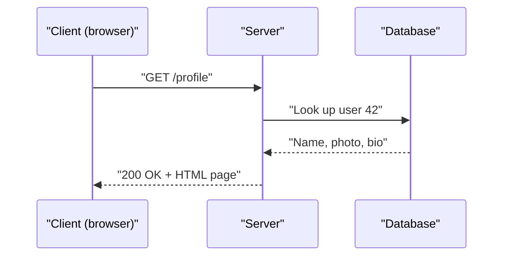

### Types
- **Thin client vs thick client.** A thin client (a basic web page) does little work itself and relies on the server. A thick client (a mobile game, a desktop app) does a lot locally and talks to the server only for shared data.
- **Server-to-server.** Inside a large system, servers are constantly clients of other servers. The "profile service" may call the "photo service". The same request/response idea applies.
- **Push instead of pull.** Normally the client asks (pulls). Some features need the server to send data unasked (a chat message arriving). Techniques for this (WebSockets, Server-Sent Events) are in Part 2.

### Common mistakes
- Thinking "server" always means one physical box. A server is a role. One machine can run many server programs, and one logical "server" (say, `api.example.com`) is often hundreds of machines behind a load balancer.
- Forgetting that the network between client and server is slow and unreliable compared with work inside one machine.

### In the interview
**Q:** Can a server also be a client?

**A:** Yes. Any program that sends a request is acting as a client for that request. In a microservice system almost every service is both.

### TL;DR
A client asks, a server answers. Almost everything on the web is a chain of request/response conversations, often with servers acting as clients of other servers.

---

## The building blocks of a web application

### What it is
Nearly every web application, from a blog to a bank, is built from the same handful of parts. Learn these and most architecture diagrams become readable.

| Part | What it does | Everyday comparison |
|---|---|---|
| Client (browser/app) | Shows the interface, sends requests | The customer |
| Load balancer | Spreads requests across many servers | The host seating diners at free tables |
| App server | Runs the business logic | The kitchen |
| Database | Stores data permanently and lets you query it | The pantry and recipe book |
| Cache | Keeps a fast copy of popular data | Ingredients kept on the counter |
| Message queue | Holds jobs to be done later | The order ticket rail |
| Object storage | Stores large files (images, videos) | The warehouse |
| CDN | Copies static files close to users | Branch shops in every town |

### How it works
**Client.** The browser or mobile app. It renders the user interface and calls the backend over HTTP.

**App server (application server).** A program written in a language such as Java, Python, Go or JavaScript (Node.js) that receives requests, applies rules ("only friends may see this post"), reads and writes data, and returns a response. You usually run several identical copies so that one crash doesn't stop the site.

**Load balancer.** A component that sits in front of the app servers and forwards each incoming request to one of them, so no single server is overloaded and dead servers are skipped. (Covered in depth in Part 2.)

**Database.** Software that stores data durably (it survives power loss) and lets you search it. Examples: PostgreSQL, MySQL, MongoDB, DynamoDB. It is usually the hardest part to scale because it holds **state** (data that must be remembered). (Part 3.)

**Cache.** A small, fast store (usually in memory, RAM) holding copies of data that is read often, so the app doesn't have to ask the slower database every time. Redis and Memcached are common. Reading from RAM takes well under a millisecond; a database query may take several milliseconds or more. (Part 4.)

**Message queue.** A buffer where one part of the system drops a job ("send a welcome email to user 42") and another part picks it up later. This lets the web request return immediately while slow work happens in the background. Examples: RabbitMQ, Amazon SQS, Apache Kafka. (Part 4.)

**Workers.** Background programs that take jobs from the queue and do them.

**Object storage.** A service for storing big files ("objects") cheaply, addressed by a key such as `photos/42/avatar.jpg`. Amazon S3 is the best-known example. Databases are bad at storing large files; object storage is built for it. (Part 3.)

**CDN (Content Delivery Network).** A network of servers spread around the world that keep copies of static files (images, JavaScript, video) close to users, so a user in Sydney doesn't fetch every image from Virginia. (Part 2.)

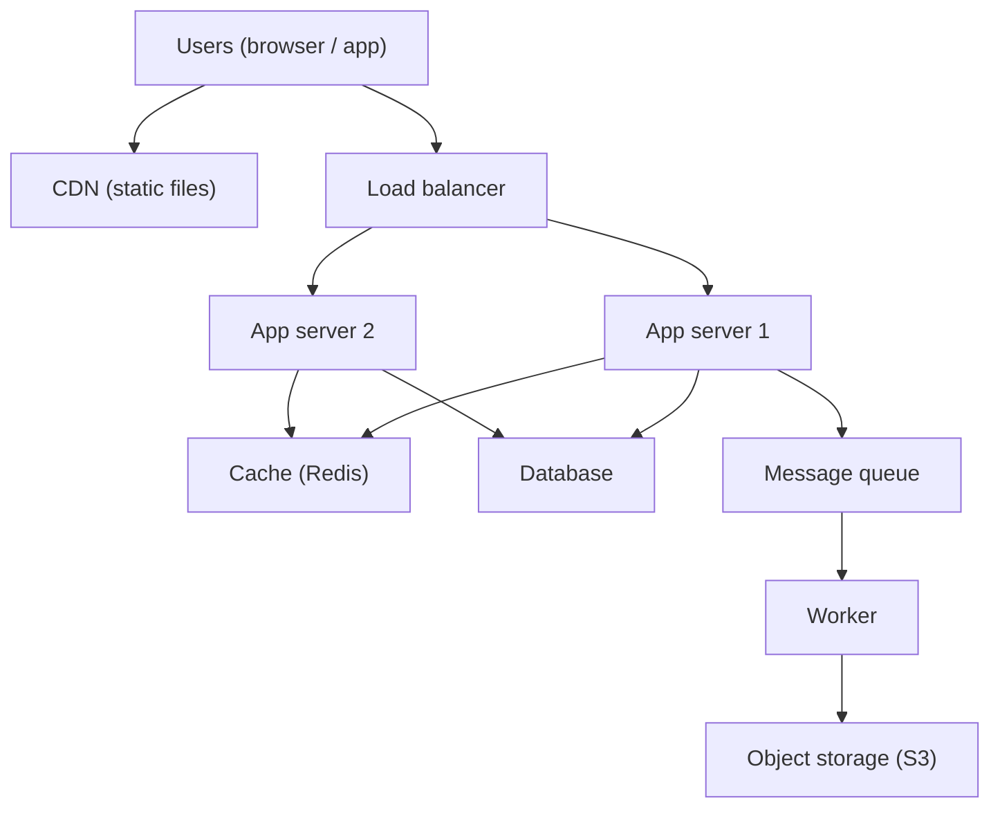

### Why it matters
In an interview you will draw some version of this diagram within the first fifteen minutes. Knowing what each box is for lets you justify adding it ("we add a cache because reads outnumber writes 100 to 1") rather than adding boxes because "big systems have them".

### Common mistakes
- Adding every component by default. A small internal tool may need only one app server and one database.
- Storing images inside the database. Put files in object storage and keep only their key (address) in the database.
- Doing slow work (emails, video encoding) inside the web request. Put it on a queue.

### Real-world examples
- Instagram's early stack (2011–2012) was Django app servers, PostgreSQL, Redis and Memcached, with photos in Amazon S3 — almost exactly the diagram above.
- Most cloud tutorials (AWS, Google Cloud, Azure) describe a "three-tier" app: presentation (client), logic (app servers), data (database), with caches and queues added as it grows.

### In the interview
**Q:** Why not keep everything on one server?

**A:** One server is a single point of failure (if it dies the site is down) and has a hard capacity limit. Splitting into stateless app servers behind a load balancer, plus a separate database, lets you add servers and survive crashes.

**Q:** When do you add a queue?

**A:** When some work is slow, can be done later, or comes in bursts. The queue lets the user get a fast response and smooths spikes for the workers behind it.

### TL;DR
Client, load balancer, app servers, database, cache, queue with workers, object storage and CDN are the standard building blocks. Each solves one problem; add each one only when you can name that problem.

---

## Latency, throughput and bandwidth

### What it is
These three words describe speed, but different kinds of speed.

- **Latency** is how long one thing takes: the delay between asking and getting the answer. Measured in time: milliseconds (ms, thousandths of a second) or microseconds (µs, millionths; written "us" in plain text).
- **Throughput** is how many things get done per unit of time: requests per second, messages per second, megabytes per second.
- **Bandwidth** is the maximum amount of data a network link (or disk, or memory bus) can carry per second. It is a capacity, like the width of a pipe. Measured in bits per second (Mbps, Gbps).

**Analogy:** a motorway. Latency is how long one car takes to drive from London to Birmingham (about 2 hours). Bandwidth is how many lanes the motorway has. Throughput is how many cars actually arrive per hour, which can be lower than the lanes allow if there is a crash or a toll booth.

### Response time vs latency
People often use these as synonyms, but strictly:

- **Response time** is what the client experiences: the full time from sending a request to receiving the complete answer. It includes network travel both ways, time waiting in queues, and the actual processing.
- **Latency**, used strictly, covers only delay: the stretch before a server starts on the request (sitting in a queue, travelling a network hop), not the work itself.
- **Service time** is the time the server spends actually working on it.

So: response time = network delay + queueing delay + service time. In interviews "latency" almost always means response time; just be clear which one you mean when it matters.

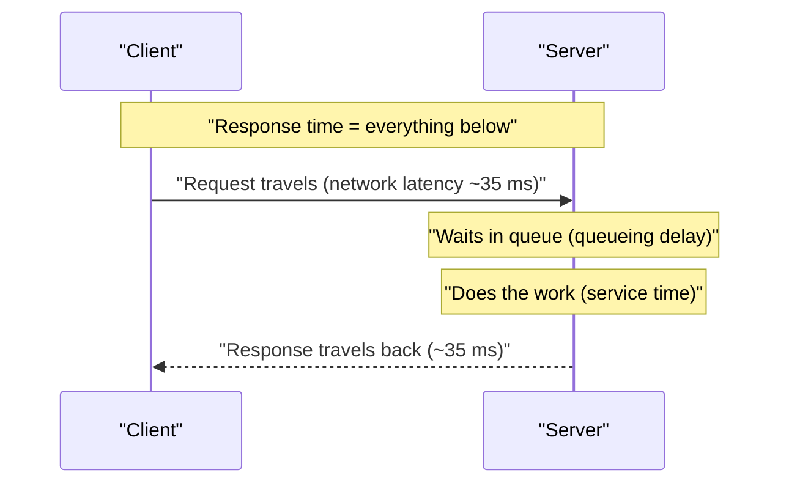

### Why it matters
- Users feel latency. Interfaces under about 100 ms feel instant; delays over a second break concentration. Google and Amazon have both reported that small added delays measurably reduce searches and sales.
- Throughput decides how many machines you need. If one server handles 1,000 requests per second and you expect 50,000, you need at least 50 (and more for headroom).
- Bandwidth decides whether large transfers (video, backups) are even possible in time.

### How it works
**Where latency comes from.** A request picks up delay at every step:

1. **Propagation delay:** signals in fibre travel at roughly two thirds the speed of light, about 200 km per millisecond. London to New York is about 5,600 km, so one way takes at least 28 ms, and a real **round trip** (there and back, RTT) is typically about 70 ms because cables don't run in straight lines and routers add delay.
2. **Transmission delay:** time to push the bits onto the wire. Sending 1 MB (8 megabits) over a 100 Mbps link takes 80 ms; over 1 Gbps, 8 ms. This is where bandwidth matters.
3. **Queueing delay:** waiting behind other requests at routers, load balancers, thread pools, database locks.
4. **Processing delay:** the actual work: parsing, running code, reading disk.

**Latency and bandwidth are independent.** A satellite link may have huge bandwidth and terrible latency (about 600 ms round trip for geostationary satellites). A small request is limited by latency; a large file download is limited by bandwidth. Adding bandwidth does not make a small API call faster.

**Throughput and latency are linked through load.** At low load, throughput rises as you send more requests and latency stays flat. As a server approaches full use, requests start waiting for each other and latency shoots up, while throughput levels off. Running a server with its CPU (central processing unit, the processor) 95% busy usually means terrible latency.

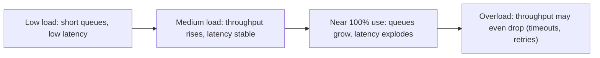

### Trade-offs
- **Batching** improves throughput but hurts latency: waiting to collect 100 writes and sending them together is efficient, but the first write waits for the other 99.
- **Spare capacity** keeps latency low but costs money. Many teams target 50–70% peak utilisation so that bursts don't create queues.

### Common mistakes
- Mixing bits and bytes. Network speeds are in bits (Mbps); file sizes are in bytes (MB). 1 byte = 8 bits, so a 100 Mbps link moves at most 12.5 MB per second.
- Assuming more bandwidth fixes slowness. If the problem is round trips (a page making 40 sequential API calls), only fewer round trips or shorter distances help.
- Measuring throughput without latency (or the reverse). "10,000 requests per second" means nothing if each takes 5 seconds.

### Real-world examples
- Video streaming (Netflix, YouTube) is bandwidth-bound: a 4K stream needs roughly 15–25 Mbps.
- High-frequency trading firms pay for microwave links between Chicago and New York because they shave a few milliseconds of propagation delay compared with fibre.
- Online games are latency-bound: players feel the difference between 20 ms and 120 ms "ping" (round-trip time).

### In the interview
**Q:** What is the difference between latency and throughput?

**A:** Latency is how long one request takes; throughput is how many requests complete per second. You can have high throughput with high latency (a cargo ship) or low latency with low throughput (a motorbike courier).

**Q:** A user in Australia complains the site is slow; servers are in Virginia. What helps?

**A:** The round trip is roughly 200 ms, so cut round trips: serve static files from a CDN near them, reduce the number of sequential calls, reuse connections, and consider a regional deployment closer to them. More bandwidth won't help much.

### TL;DR
Latency is time per request, throughput is requests per time, bandwidth is the pipe's maximum capacity. They are related through load: push a system near its limit and latency rises sharply.

---

## Percentiles, tail latency and why averages lie

### What it is
A **percentile** tells you the value below which a given percentage of measurements fall. If the **p95** (95th percentile) latency is 300 ms, then 95% of requests finished in 300 ms or less, and 5% took longer.

The common ones:

| Name | Meaning | 1 in N requests slower |
|---|---|---|
| p50 (median) | Half are faster, half slower | 1 in 2 |
| p90 | 90% are faster | 1 in 10 |
| p95 | 95% are faster | 1 in 20 |
| p99 | 99% are faster | 1 in 100 |
| p999 (p99.9) | 99.9% are faster | 1 in 1,000 |

**Tail latency** means the slow end of the distribution: p99, p999 and the maximum. These are "the tail" because on a graph of latencies the slow requests form a long thin tail to the right.

**Analogy:** a bus route. "The average trip takes 20 minutes" sounds fine. But if one trip in ten takes 90 minutes because of a broken-down bus, someone who rides twice a day gets stuck several times a month. The p95 (90 minutes) describes their real worry far better than the average.

### Why averages lie
The **mean** (average) mixes fast and slow requests into one number that may match no real request. Take ten requests:

```
10, 10, 10, 10, 10, 10, 10, 10, 10, 1000   (milliseconds)
```

- Mean = 1090 / 10 = 109 ms. No request actually took 109 ms.
- Median (p50) = 10 ms. The typical user is happy.
- p95 and p99 = 1000 ms (they land on the slowest request). One user in ten waits a full second.

The mean hides the 1-second outlier inside a number that looks moderate. In real systems latency is almost never a neat bell curve; it is skewed, with a long tail caused by garbage collection pauses, cache misses, slow disks, retries and queueing. Percentiles show the shape; averages flatten it.

### Why the tail matters more than you think
1. **Heavy users hit the tail most.** A user who loads 100 pages a day hits your p99 about once a day. Often these are your most valuable customers (they have the most data, the biggest carts).
2. **Fan-out amplifies the tail.** If one user request calls 100 backend servers in parallel and waits for all of them, the request is as slow as the slowest server. Suppose each server is slow (1 second) just 1% of the time. The chance that *at least one* of 100 is slow is 1 − 0.99^100 ≈ 63%. So a 1-in-100 problem per server becomes a nearly 2-in-3 problem for the user. This effect is described in Google's well-known paper "The Tail at Scale" (Dean and Barroso, 2013).

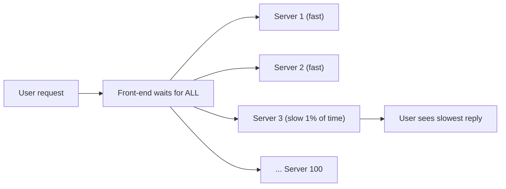

### How it works
**Measuring percentiles.** Record each request's latency, sort them, and pick the value at the required position (the 990th of 1,000 sorted values is roughly p99). Real monitoring systems can't store every value, so they use compact summaries called **histograms** (counts per latency bucket, e.g. 0–10 ms, 10–25 ms ...) or sketches such as HDRHistogram or t-digest, which estimate percentiles with small error.

**Do not average percentiles.** The p99 of server A plus the p99 of server B divided by two is not the p99 of the combined traffic. Merge the histograms and compute the percentile from the merged data.

**Reducing tail latency.** Common techniques:
- **Hedged requests:** if a reply hasn't come back within (say) the p95 time, send the same request to a second replica and use whichever answers first.
- **Timeouts and fewer fan-out calls.**
- Removing sources of pauses: tune garbage collection, avoid shared locks, keep spare capacity so queues stay short.

### Common mistakes
- Reporting only the average in dashboards or SLOs.
- Measuring latency only on the server. The client also sees network time, DNS lookups and connection setup.
- **Coordinated omission:** a load-test tool that waits for each slow response before sending the next request quietly sends fewer requests during slow periods, so it under-reports the tail.

### Real-world examples
- Amazon has long described setting internal service targets at p99.9 rather than averages, so that even its heaviest customers get good performance.
- Monitoring tools such as Prometheus, Datadog and Grafana show latency as p50/p95/p99 lines by default.

### In the interview
**Q:** Why use p99 instead of the average for an SLO?

**A:** The average hides slow outliers and doesn't describe any real user. p99 says "99% of requests are at least this fast", which captures the experience of the unlucky but common slow cases.

**Q:** Your service's p99 is fine but users still complain. Why might that be?

**A:** Each page may call many services or make many requests, so the chance of hitting at least one slow call per page is much higher than 1%. Look at end-to-end page latency and fan-out, not each service in isolation.

### TL;DR
Use percentiles (p50, p95, p99, p999), not averages, to describe latency. The slow tail matters because heavy users and fan-out make rare slowness common.

---

## Little's law

### What it is
**Little's law** is a simple rule that holds for any stable system where items arrive, wait or get served, and leave:

> **L = λ × W**

- **L** = the average number of items inside the system at once (requests in flight, people in a shop).
- **λ** (lambda) = the average arrival rate (requests per second). In a stable system this equals the throughput.
- **W** = the average time each item spends inside (latency).

**Analogy:** a coffee shop. If 2 customers arrive per minute and each stays 10 minutes, then on average 2 × 10 = 20 customers are in the shop. You don't need to know anything about how the barista works.

### Why it matters
It lets you work out any one of the three numbers from the other two, which is extremely handy for sizing:

- **How many concurrent connections or threads do I need?** If a service gets 1,000 requests per second and each takes 200 ms (0.2 s), then on average 1,000 × 0.2 = **200 requests are in flight**. You need at least 200 worker threads or connections (plus headroom), or requests will queue.
- **What throughput can I get?** A database connection pool of 20 connections, with queries taking 5 ms each, can serve at most 20 / 0.005 = **4,000 queries per second**.
- **Why did latency double?** If concurrency limits stay fixed and latency doubles (a slow dependency), maximum throughput halves.

### How it works
1. Pick the boundary of your "system": one server, one thread pool, one queue, the whole service.
2. Measure or assume two of the three numbers over a long enough period for the system to be stable (arrivals roughly equal departures).
3. Compute the third.

Rearranged forms:
- W = L / λ (latency from in-flight count and rate)
- λ = L / W (throughput from concurrency limit and latency)

### Common mistakes
- Applying it to an unstable system where the queue keeps growing (arrival rate above capacity). Then there is no steady state and L grows without limit.
- Forgetting units. Convert milliseconds to seconds before multiplying by "per second".

### In the interview
**Q:** A service handles 5,000 requests per second with an average latency of 40 ms. How many requests are being processed at any moment?

**A:** L = 5,000 × 0.04 = 200 requests in flight on average. If the service has 50 instances, that's about 4 per instance.

**Q:** Your thread pool has 100 threads and each request holds a thread for 250 ms. What is the max throughput?

**A:** λ = 100 / 0.25 = 400 requests per second. Beyond that, requests queue and latency rises.

### TL;DR
Items in the system = arrival rate × time in system. Use it to size thread pools, connection pools and fleets, and to explain why slower dependencies cut throughput.

---

## Latency numbers every engineer should know

### What it is
A list of rough costs for common operations, first popularised by Google's Jeff Dean and Peter Norvig. The exact numbers change with hardware (the table below uses rounded figures for current machines; the original list, for example, gave 150 us for an SSD random read); what matters is the **order of magnitude** (whether something takes nanoseconds, microseconds or milliseconds) and the ratios between them.

Units: 1 ns (nanosecond) = one billionth of a second. 1 µs (microsecond) = 1,000 ns. 1 ms (millisecond) = 1,000 µs.

| Operation | Approximate time | Scaled: if 1 ns were 1 second |
|---|---|---|
| CPU L1 cache read | 1 ns | 1 second |
| CPU L2 cache read | 4 ns | 4 seconds |
| Main memory (RAM) read | 100 ns | about 2 minutes |
| Compress 1 KB (fast algorithm) | 2 us | about half an hour |
| Send 1 KB over 1 Gbps network | 10 us | about 3 hours |
| Read 4 KB at random from NVMe SSD | 20-100 us | 6 hours to a day |
| Read 1 MB sequentially from RAM | 50-250 us | 14 hours to 3 days |
| Round trip inside one data centre | 0.5 ms (500 us) | about 6 days |
| Read 1 MB sequentially from SSD | 0.2-1 ms | 2 to 12 days |
| Hard disk (HDD) seek | 10 ms | about 4 months |
| Read 1 MB sequentially from HDD | 5-20 ms | 2 to 8 months |
| Round trip London to New York | 70 ms | about 2 years |
| Round trip California to Europe | 150 ms | about 5 years |

(A **CPU cache** is a tiny, very fast memory built into the processor. **RAM** is the computer's main working memory, lost on power-off. An **SSD** is a solid-state drive with no moving parts; an **HDD** is a spinning magnetic disk with a moving arm, which is why "seeking" to a new position is slow.)

### Why it matters
These numbers drive design decisions:
- **Memory is about 100 to 1,000 times faster than SSD for random reads**, and SSD is about 100 times faster than spinning disk. That's why caches live in RAM.
- **A network round trip inside a data centre (0.5 ms) costs as much as thousands of memory reads.** A loop that makes 1,000 small database calls spends at least half a second just on round trips. Batch them.
- **Crossing an ocean costs 70–150 ms per round trip**, and the speed of light is not getting faster. Only moving data closer to users (CDNs, regional servers) fixes it.
- **Sequential reads are far faster than random reads**, especially on HDD. Many storage engines (append-only logs, and the log-structured merge trees, or LSM-trees, of Part 3) are designed to write sequentially for this reason.

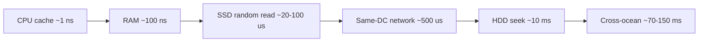

### Common mistakes
- Memorising exact numbers. Interviewers want orders of magnitude: "RAM is nanoseconds, SSD microseconds, network and disk milliseconds".
- Treating a remote cache (Redis over the network) as "as fast as memory". The RAM read is 100 ns, but the network round trip to reach it is ~0.5 ms. It is still far faster than a typical database query, but not free.

### In the interview
**Q:** Why is a cache faster than a database?

**A:** A cache serves data from RAM (nanoseconds per read plus one network hop), while a database may read from disk, parse a query, take locks and do more work. Typical cache hits take well under 1 ms; database queries often take several ms or more.

**Q:** Why does a service that calls another service 50 times per request feel slow even though each call is "fast"?

**A:** Each call costs at least a network round trip (~0.5 ms in the same data centre, more across zones), and sequential calls add up: 50 × 1 ms = 50 ms before any real work. Batch or parallelise the calls.

### TL;DR
Memory is nanoseconds, SSD is tens of microseconds, data-centre network is half a millisecond, spinning disks and cross-continent trips are tens to hundreds of milliseconds. Design so the hot path stays at the fast end.

---

## Units, powers of two and data sizes

### What it is
Estimation needs a shared vocabulary for size. Data is measured in **bits** (a single 0 or 1) and **bytes** (8 bits, enough for one English letter).

| Unit | Bytes (decimal, used in estimates) | Power of two (exact) | Roughly holds |
|---|---|---|---|
| KB (kilobyte) | 1,000 | 2^10 = 1,024 | A short text message or tweet with metadata |
| MB (megabyte) | 1,000,000 (10^6) | 2^20 ≈ 1.05 million | A high-quality photo, a minute of MP3 |
| GB (gigabyte) | 10^9 | 2^30 ≈ 1.07 billion | An hour of streamed HD video (a few GB) |
| TB (terabyte) | 10^12 | 2^40 ≈ 1.1 trillion | A typical laptop drive |
| PB (petabyte) | 10^15 | 2^50 | A large company's data warehouse |

Above PB come EB (exabyte, 10^18) and ZB (zettabyte, 10^21). Strictly, the power-of-two units have their own names (KiB, MiB, GiB), but in estimates everybody rounds 2^10 to 1,000. The 2–10% error doesn't matter.

### How it works
**Powers of two to remember:**
- 2^10 ≈ 1 thousand (10^3)
- 2^20 ≈ 1 million (10^6)
- 2^30 ≈ 1 billion (10^9)
- 2^40 ≈ 1 trillion (10^12)
- 2^32 ≈ 4.3 billion (the number of IPv4 addresses, and the limit of an unsigned 32-bit integer; a 32-bit ID column runs out at about 2 billion signed or 4 billion unsigned)
- 2^64 ≈ 1.8 × 10^19 (plenty for any ID)

**Typical sizes of things:**

| Item | Rough size |
|---|---|
| A number (integer) | 4 or 8 bytes |
| A timestamp | 8 bytes |
| A UUID (random unique ID) | 16 bytes (36 characters as text) |
| A short text post with metadata | 0.5-1 KB |
| A web page's HTML | 50-100 KB |
| A compressed photo | 200 KB - 2 MB |
| One minute of HD video | roughly 25-60 MB |

**Time conversions:**
- 1 day = 86,400 seconds ≈ **10^5 seconds** (round it; makes maths easy).
- 1 month ≈ 2.5 million seconds (2.6 × 10^6).
- 1 year ≈ 31.5 million seconds (≈ 3 × 10^7).

**Shortcut:** 1 million requests per day ≈ 12 requests per second (10^6 / 86,400 ≈ 11.6). So "X million per day" ≈ "12 × X per second".

### Common mistakes
- Mixing bits and bytes: a "1 Gbps" network card moves 125 MB per second at best.
- Carrying too many digits. Round to one or two significant figures and say so.

### TL;DR
KB, MB, GB, TB, PB each step up by about 1,000 (2^10). A day is about 10^5 seconds, so 1 million per day is about 12 per second.

---

## Back-of-the-envelope estimation

### What it is
A **back-of-the-envelope estimate** is a quick, rough calculation (small enough to scribble on an envelope) that tells you the size of a problem: how many requests per second, how much storage, how much bandwidth, how many servers. The goal is the right **order of magnitude** (is it 10, 1,000 or 1,000,000?), not precision.

**Analogy:** before a road trip you estimate "about 400 km, about 5 hours, need to refuel once". You don't compute it to the minute, but it tells you whether to leave at 6 am or noon.

### Why it matters
The estimate decides the architecture. 100 requests per second fits on one server with one database. 100,000 per second needs many servers, caching, and probably sharded data (split across many databases). 10 GB of data fits in memory on one machine; 10 PB needs a distributed storage system. Without numbers you can't tell which design is needed.

### How it works
The key terms:

- **DAU (Daily Active Users):** distinct users who use the product on a given day. **MAU** is the same per month. DAU is usually 20–50% of MAU for social apps.
- **QPS (Queries Per Second)** or **RPS (Requests Per Second):** how many requests reach the system each second.
- **Average QPS** = total requests per day / 86,400.
- **Peak factor:** traffic is not flat. Evenings, weekends, or events (a sale, a football final) create peaks. Peak QPS is commonly estimated as **2–3 times** the average, sometimes 5–10× for spiky products.
- **Read/write ratio:** how many reads per write. Social feeds might be 100:1; logging systems are almost all writes.
- **Storage per day** = new items per day × size of each item.
- **Bandwidth** = QPS × size of each response (or request).

**Step by step, worked example — a photo-sharing app:**

Assumptions (state them out loud):
- 10 million DAU.
- Each user views 50 photos and uploads 0.2 photos per day (one in five users posts once).
- Average photo after compression: 500 KB. Metadata per photo: 1 KB.
- Keep data for 5 years.

1. **Read QPS:** 10M × 50 = 500M views per day. 500M / 10^5 ≈ **5,000 QPS** average. Peak (×3) ≈ **15,000 QPS**.
2. **Write QPS:** 10M × 0.2 = 2M uploads per day ≈ **20 uploads per second** average, ~60 at peak. Read:write ≈ 250:1, so this is a read-heavy system: caching and a CDN will matter a lot.
3. **Storage per day:** 2M × 500 KB = 1,000,000 MB = **1 TB per day** of photos, plus 2M × 1 KB = 2 GB per day of metadata.
4. **Storage for 5 years:** 1 TB × 365 × 5 ≈ **1.8 PB** of photos (more with replicas: typically × 3). Metadata ≈ 3.6 TB. So photos go in object storage; metadata fits in a (sharded) database.
5. **Outgoing bandwidth:** 5,000 views/s × 500 KB = 2,500 MB/s = **2.5 GB/s ≈ 20 Gbps** average. That's a strong argument for a CDN.
6. **Servers:** if one app server handles ~1,000 simple requests per second, peak 15,000 QPS needs ~15 servers, so plan ~20–30 for headroom and failures.

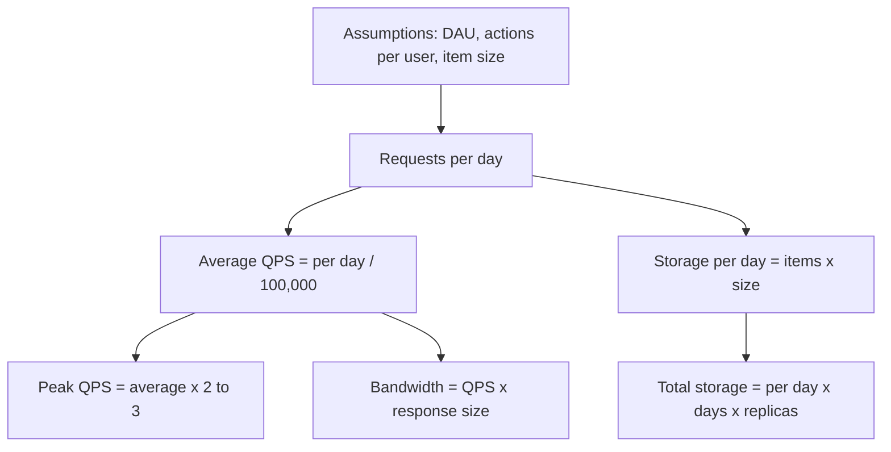

**Rules of thumb for capacity (very rough, for simple workloads on modern hardware):**

| Component | Rough capacity per machine |
|---|---|
| Web/app server (simple API) | 1,000-10,000 requests/s |
| Relational database (simple indexed queries) | 1,000-10,000 queries/s, more for cached reads |
| Redis/Memcached cache | 100,000+ operations/s |
| Kafka broker | hundreds of MB/s |

### Trade-offs
More precise estimates take longer and rarely change the design. Spend 3–5 minutes in an interview, write numbers down, and move on.

### Common mistakes
- Forgetting the peak. Systems fall over at peak, not at average.
- Forgetting replication: storing 3 copies triples storage.
- Forgetting metadata, indexes and logs, which can add 20–50%.
- False precision ("11,574.07 QPS"). Say "about 12,000".
- Doing maths silently. Say each assumption so the interviewer can correct it.

### Real-world examples
- WhatsApp said in late 2020 that it delivers about 100 billion messages per day. 10^11 / 10^5 ≈ 1 million messages per second on average, a useful anchor for "very large" chat scale.
- YouTube said in 2019 that more than 500 hours of video are uploaded every minute. That is about 720,000 hours a day, which makes its storage needs enormous.

### In the interview
**Q:** A service has 100 million DAU, each making 20 requests per day. What QPS should you plan for?

**A:** 100M × 20 = 2 billion requests per day. 2 × 10^9 / 10^5 = 20,000 QPS average. With a peak factor of 3, plan for about 60,000 QPS.

**Q:** Why bother estimating if numbers are guesses?

**A:** The order of magnitude decides the architecture: whether one database is enough, whether data fits in memory, whether you need a CDN. Even rough numbers rule designs in or out.

### TL;DR
Start from DAU and per-user actions, convert per day to per second by dividing by about 10^5, multiply by 2–3 for peak, and compute storage and bandwidth from item sizes. Round aggressively and state every assumption.

---

## Availability and the nines

### What it is
**Availability** is the fraction of time a system is up and doing its job (answering requests correctly). It is usually written as a percentage with many 9s, so people talk about "three nines" (99.9%) or "four nines" (99.99%).

Availability = uptime / (uptime + downtime), or, measured by requests, successful requests / total valid requests.

**Analogy:** a shop that is supposed to be open 24 hours. If it is closed by surprise for 9 hours across a whole year, it was available about 99.9% of the time.

### The nines table
(Year = 365 days, month = 30 days.)

| Availability | Name | Downtime per year | Downtime per month | Downtime per day |
|---|---|---|---|---|
| 99% | two nines | 3.65 days | 7.2 hours | 14.4 minutes |
| 99.9% | three nines | 8.76 hours | 43.2 minutes | 1.44 minutes |
| 99.95% | three and a half | 4.38 hours | 21.6 minutes | 43 seconds |
| 99.99% | four nines | 52.6 minutes | 4.32 minutes | 8.6 seconds |
| 99.999% | five nines | 5.26 minutes | 26 seconds | 0.86 seconds |

Each extra nine cuts allowed downtime by 10×, and usually costs much more than 10× the engineering effort.

### Why it matters
- Downtime costs money and trust. An online shop down for an hour on Black Friday loses that hour's sales permanently.
- The target decides the design. 99% can survive manual recovery ("someone restarts the server in the morning"). 99.99% leaves 4 minutes a month, which is less than the time it takes a human to wake up and log in, so recovery must be **automatic**.

### How it works
**Availability of parts in series (all must work).** If a request passes through a load balancer (99.99%), an app server (99.9%) and a database (99.9%), all three must be up:

Availability = 0.9999 × 0.999 × 0.999 ≈ 0.9979 → **99.79%**.

The chain is weaker than its weakest link. Every dependency you add in series lowers availability.

**Availability of parts in parallel (any one is enough).** Two independent servers, each 99%: the system is down only when both are down at the same time.

Availability = 1 − (0.01 × 0.01) = 1 − 0.0001 = **99.99%**.

Redundancy turns two "two nines" machines into a "four nines" pair, assuming failures are independent (they often aren't fully, e.g. both in the same rack lose power together).

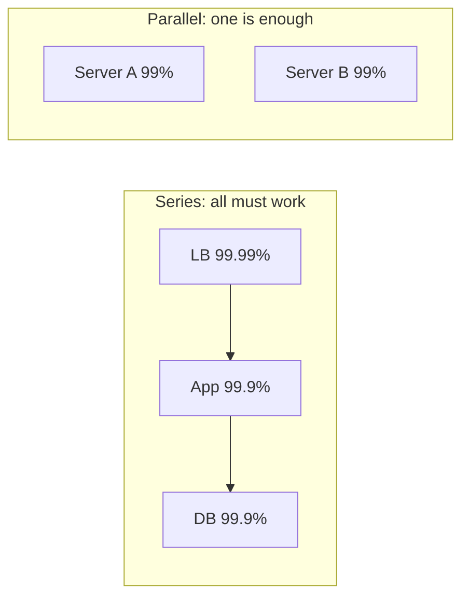

### Trade-offs
Higher availability needs redundancy (more machines, more data centres), automation, testing and on-call staff. Going from 99.9% to 99.99% might mean running in multiple data centres with automatic failover, which roughly doubles infrastructure and adds complexity. Many internal tools are fine at 99.5%.

### Common mistakes
- Promising five nines without the budget. Even the big cloud providers' SLAs for single services are usually 99.9%–99.99%.
- Forgetting dependencies. Your service can't be more available than the things it needs in series (unless you design fallbacks).
- Counting planned maintenance as "not downtime". Users don't care why it's down.

### Real-world examples
- Amazon S3 Standard is designed for 99.99% availability, and its SLA promises 99.9% per month (with service credits below that).
- Telephone networks were historically engineered for five nines.

### In the interview
**Q:** How much downtime per month does 99.9% allow?

**A:** About 43 minutes. 99.99% allows about 4.3 minutes.

**Q:** How do you get higher availability than any single machine provides?

**A:** Run redundant copies in parallel with automatic failover, and remove single points of failure, ideally spreading copies across separate failure domains (racks, zones, regions).

### TL;DR
Availability is the share of time a system works. Each extra nine is ten times less downtime: 99.9% is about 43 minutes a month, 99.99% about 4. Series dependencies multiply down; parallel redundancy multiplies up.

---

## SLA, SLO, SLI and error budgets

### What it is
Three related terms, from most technical to most legal:

- **SLI (Service Level Indicator):** a *measurement* of how the service is doing. Example: "percentage of HTTP requests that returned successfully in under 300 ms over the last 30 days."
- **SLO (Service Level Objective):** an internal *target* for an SLI. Example: "99.9% of requests succeed in under 300 ms, measured over 30 days."
- **SLA (Service Level Agreement):** a *contract* with customers saying what happens if a target is missed, usually refunds or service credits. Example: "If monthly availability falls below 99.9%, customers get 10% of their bill back."

**Analogy:** a pizza shop. The SLI is "how long deliveries actually take". The SLO is the manager's target: "95% delivered within 30 minutes". The SLA is the printed promise: "over 45 minutes and it's free".

The SLA is normally looser than the SLO, so the team gets warning (missing the SLO) before the company has to pay (missing the SLA).

### Error budgets
An **error budget** is the amount of unreliability the SLO allows. If the SLO is 99.9% success, the error budget is 0.1%: in a month with 100 million requests, up to 100,000 may fail (or about 43 minutes of full outage).

The budget turns reliability into a shared decision:
- While budget remains, the team can ship features fast and take risks.
- When the budget is spent, the team slows releases and works on reliability until it recovers.

This idea comes from Google's **Site Reliability Engineering (SRE)** practice. SRE is the discipline of running production systems using software engineering methods.

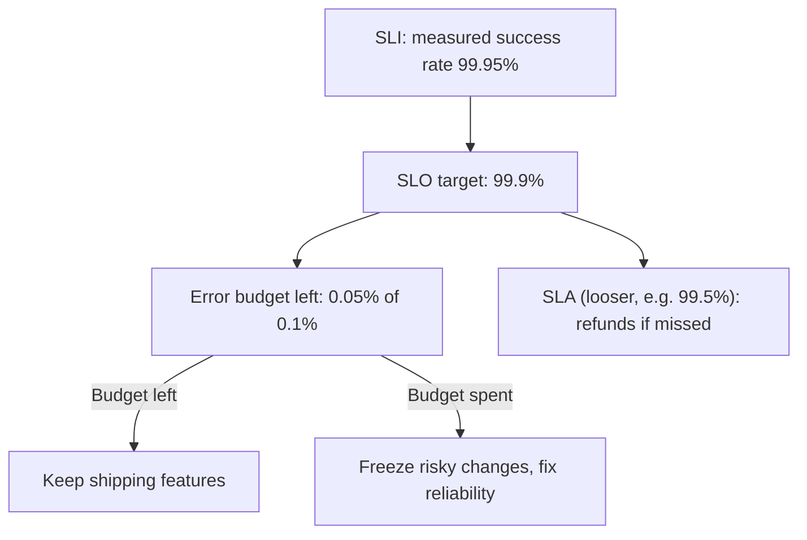

### How it works
1. Choose SLIs that reflect what users feel: availability (success rate), latency (p99 under X ms), freshness (data no older than Y), durability.
2. Set an SLO slightly below what users actually need, not "100%". 100% is impossible and leaves no room to change anything.
3. Measure over a window (often 28 or 30 days, rolling).
4. Alert when the budget is being burned too fast (Part 5 covers burn-rate alerts).

### Common mistakes
- Setting the SLO to 100%. Any deployment risk then "violates" it.
- Choosing SLIs users don't feel (CPU usage) instead of ones they do (failed checkouts).
- Making the SLA as tight as the SLO, leaving no warning margin.

### In the interview
**Q:** What's the difference between an SLO and an SLA?

**A:** An SLO is an internal target for a measured indicator; an SLA is an external contract with penalties. SLAs are usually set looser than SLOs.

**Q:** What is an error budget used for?

**A:** It quantifies how much failure is acceptable (1 − SLO). Teams spend it on releases and experiments; when it's used up, they prioritise reliability work.

### TL;DR
SLI is the measurement, SLO the target, SLA the contract with penalties. The error budget (1 − SLO) is how much failure you can "spend" before you must slow down and fix reliability.

---

## MTBF, MTTR and measuring failure

### What it is
Two averages that describe how often things break and how fast they're fixed:

- **MTBF (Mean Time Between Failures):** average time a system runs before it fails. Higher is better.
- **MTTR (Mean Time To Repair / Recover):** average time from a failure until service is restored. Lower is better.

Related: **MTTD (Mean Time To Detect)**, how long before anyone notices, and **MTTF (Mean Time To Failure)**, used for parts that are replaced rather than repaired (like disks).

**Analogy:** a car. MTBF is how many months it typically goes between breakdowns. MTTR is how long it sits at the garage each time.

### How it works
Availability can be estimated as:

> Availability = MTBF / (MTBF + MTTR)

Example: a server fails on average every 1,000 hours (MTBF) and takes 1 hour to recover (MTTR). Availability = 1,000 / 1,001 ≈ 99.9%.

There are two levers:
1. **Increase MTBF:** better hardware, testing, careful deployments.
2. **Decrease MTTR:** fast detection (monitoring and alerts), automatic failover, quick rollback, runbooks.

In large distributed systems, failures are constant, so cutting MTTR is usually the cheaper lever. If recovery is automatic and takes 10 seconds instead of 1 hour, the same failure rate gives about 99.9997% availability.

### Common mistakes
- Only trying to prevent failures. You can't prevent them all; plan to recover fast.
- Ignoring detection time. An outage nobody notices for 30 minutes has at least 30 minutes of MTTR.

### In the interview
**Q:** Which is easier to improve at scale, MTBF or MTTR?

**A:** Usually MTTR. With thousands of machines something always fails, so automatic detection and failover (seconds) give more availability than trying to make each machine fail less often.

### TL;DR
MTBF is how long between failures, MTTR how long to recover. Availability ≈ MTBF / (MTBF + MTTR); in practice, shrink MTTR with monitoring and automation.

---

## Reliability, availability and durability

### What it is
Three words often mixed up:

- **Reliability:** the system keeps doing the *right thing* over time, even when things go wrong. It returns correct results and doesn't corrupt data. A reliable system is one you can trust.
- **Availability:** the system is *up and responding* when you ask. A system can be available but unreliable (it answers quickly, with wrong data).
- **Durability:** once data is saved, it *stays saved* and isn't lost, even if machines crash or disks die. A system can be unavailable but durable (down for an hour, but no data lost when it returns).

**Analogy:** a bank. Availability: the cash machine works when you walk up. Reliability: it gives you the right amount and debits the right account. Durability: your balance is still there tomorrow even if the bank's building floods.

| Property | Question it answers | Typical measure |
|---|---|---|
| Availability | Can I use it right now? | % uptime, % successful requests |
| Reliability | Does it work correctly over time? | Failure rate, MTBF, correctness |
| Durability | Will my saved data still exist later? | Probability of losing an object per year |

### How it works
- Availability is improved by redundancy and failover (more on this below).
- Durability is improved by keeping multiple copies of data on separate disks, machines and locations, writing to disk before confirming (Part 3 covers write-ahead logs), and backups.
- Reliability is the umbrella: testing, validation, handling faults gracefully, and both of the above.

### Real-world examples
- Amazon S3 Standard is designed for 99.999999999% ("eleven nines") yearly durability per object: keep ten million objects there and, on average, a single one goes missing roughly once in ten thousand years. It is designed for only 99.99% availability (and its SLA pays credits below 99.9%). Durability and availability are separate promises.

### Common mistakes
- Saying "highly available" when you mean "doesn't lose data". Say durable.
- Assuming replication equals backup. If a bug deletes data, replication faithfully deletes every copy. Backups protect against that.

### In the interview
**Q:** Can a system be durable but not available?

**A:** Yes. If a database cluster is down for maintenance, no one can read the data (unavailable), but all of it is safely on disk (durable).

### TL;DR
Availability = can I use it now; reliability = does it work correctly over time; durability = will saved data survive. They are improved by different techniques and promised separately.

---

## Faults, failures and fault tolerance

### What it is
- A **fault** is something going wrong with one part: a disk dies, a process crashes, a network cable is cut, a bug returns a wrong value.
- A **failure** is when the *whole system* stops providing its service to users.

Faults are inevitable; failures are what we try to prevent. **Fault tolerance** (or resilience) is the ability of a system to keep working, perhaps in a reduced way, when some of its parts have faults.

**Analogy:** a plane with two engines. One engine stopping is a fault. The plane crashing would be a failure. Being able to fly and land on one engine is fault tolerance.

### Types
Common kinds of faults:

| Fault type | Example | Typical defence |
|---|---|---|
| Hardware | Disk dies, power supply fails | Redundant machines, replicated data |
| Software | Bug, memory leak, crash on bad input | Testing, gradual rollouts, restarts |
| Network | Packets lost, link cut, partition | Timeouts, retries, replicas in other zones |
| Human | Wrong config pushed, table deleted | Reviews, automation, backups, rollback |
| Dependency | Third-party API is slow or down | Timeouts, fallbacks, circuit breakers |

Faults also differ by behaviour:
- **Crash (fail-stop):** the part stops completely. Easiest to detect.
- **Omission:** some messages are lost.
- **Timing / slow:** the part works but too slowly. Hard to tell from a crash; often worse, because callers keep waiting.
- **Byzantine:** the part sends wrong or even malicious answers. Most business systems assume this doesn't happen inside their own network; blockchains are designed for it.

### How it works
Fault tolerance generally follows a pattern: **detect** the fault (health checks, timeouts, heartbeats), **isolate** it so it doesn't spread (timeouts, bulkheads), and **recover** (route around it, restart, fail over to a copy). Parts 4 and 5 cover the specific tools: retries, circuit breakers, replication, consensus.

### Common mistakes
- Treating "slow" as fine. A dependency that takes 30 seconds to fail can tie up all your threads; a fast error is often better.
- Assuming faults are independent. A bad deployment or a shared power supply can break many "redundant" copies at once (**correlated failure**).

### Real-world examples
- Netflix's Chaos Monkey randomly shuts down production servers so that engineers must build services that tolerate instance faults.
- Large cloud outages are often caused by a configuration change pushed everywhere at once, a reminder that human and software faults matter as much as hardware.

### In the interview
**Q:** What is the difference between a fault and a failure?

**A:** A fault is a component misbehaving; a failure is the system as a whole not serving users. Fault tolerance stops faults from becoming failures.

### TL;DR
Faults happen to parts; failures happen to the system. Design to detect, isolate and recover from faults so they don't become user-visible failures.

---

## Redundancy, single points of failure and failover

### What it is
- **Redundancy** means having more than one of something, so a spare can take over if one breaks: extra servers, extra copies of data, extra network links, extra power supplies.
- A **single point of failure (SPOF)** is any part whose failure alone brings down the whole system. One database, one load balancer, one DNS provider, one data centre, even one engineer who knows the password.
- **Failover** is the process of switching work from a failed component to a standby one.

**Analogy:** a hospital has backup generators. Mains power is a SPOF without them; with them, a blackout triggers failover to the generators within seconds.

### How it works
**Finding SPOFs:** walk through the diagram and ask of every box and arrow, "if this disappears, what happens?". If the answer is "everything stops", it's a SPOF.

**Removing them:**
1. Run at least two of every critical component, in separate **failure domains**: different racks, different **availability zones** (separate data centres in the same region, with their own power and networking), or different regions.
2. Put something in front that can route around dead copies (a load balancer, DNS, a client library).
3. Add **health checks**: periodic tests ("are you alive?") so dead copies are detected.
4. Automate failover so it happens in seconds, not when a human notices.

### Types
**Active-passive (primary-standby):** one copy handles all traffic; a standby waits, kept up to date, and takes over when the primary fails. Simple, but the standby is idle capacity, and failover takes some time (seconds to minutes).

**Active-active:** all copies handle traffic at the same time. If one fails, the others absorb its share. Better use of hardware and faster recovery, but harder for stateful parts like databases (two copies accepting writes can conflict).

**Cold, warm and hot standby:**
- **Cold:** the spare exists but must be started and loaded with data (minutes to hours).
- **Warm:** running and partially up to date (minutes).
- **Hot:** running and fully in sync, ready immediately (seconds).

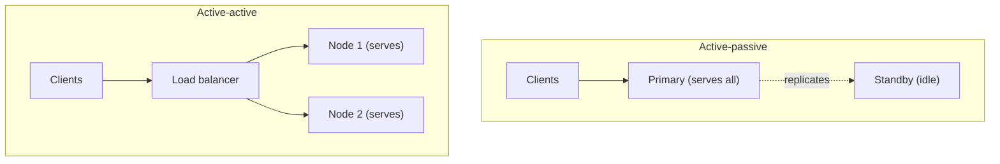

**N+1 and N+2:** if you need N servers to handle peak load, run N+1 (survive one failure) or N+2 (survive one failure during maintenance of another).

### Trade-offs
- Redundancy costs money: standby machines, extra copies of data.
- Failover is risky. If the system wrongly decides the primary is dead while it's actually alive (perhaps just slow or cut off), you can end up with two primaries both accepting writes, called **split brain**. Part 3 and Part 4 cover how databases prevent this (quorums, fencing).
- Failover itself must be tested regularly; untested failover often fails when needed.

### Common mistakes
- Making app servers redundant but leaving one database or one load balancer.
- Putting all "redundant" copies in the same rack or zone.
- Forgetting that the standby needs enough capacity to take the full load.

### Real-world examples
- AWS recommends spreading instances across at least two availability zones; managed databases such as Amazon RDS Multi-AZ keep a synchronous standby in another zone and fail over automatically, typically within a minute or two.
- Load balancers themselves are deployed in pairs (or as a managed, internally redundant service) to avoid being the SPOF.

### In the interview
**Q:** How do you find single points of failure in a design?

**A:** Go component by component (including DNS, load balancers, databases, config stores, third-party APIs) and ask what happens if it disappears. Anything that stops the whole service needs a redundant copy in a separate failure domain and automatic failover.

**Q:** Active-passive or active-active?

**A:** Active-passive is simpler and common for databases with one writer. Active-active uses capacity better and recovers faster, and is natural for stateless services, but needs conflict handling for stateful data.

### TL;DR
Redundancy means spares; a SPOF is any part with no spare; failover moves work to the spare. Remove SPOFs by duplicating critical parts across failure domains and automating failover, while guarding against split brain.

---

## Scalability

### What it is
**Scalability** is a system's ability to handle more load (more users, more requests, more data) by adding resources, without a redesign and without performance collapsing. A scalable system's cost and effort grow roughly in proportion to its load; an unscalable one hits a wall.

**Load** needs to be described with specific numbers, called **load parameters**: requests per second, number of concurrent users, read/write ratio, size of the data, number of followers per user, and so on. "Scalable" only makes sense relative to one of them: "we can scale to 10× the requests per second by adding servers".

**Analogy:** a restaurant that can serve more diners by adding tables and hiring more cooks is scalable. One whose single tiny kitchen can never cook faster than 50 meals an hour, no matter how many tables you add, is not.

### Why it matters
Successful products grow, sometimes overnight. A system that needs a rewrite at each 10× step slows the business down at exactly the wrong moment.

### How it works
There are a few dimensions you can scale along:

- **Load scalability:** more requests per second.
- **Data scalability:** more stored data.
- **Geographic scalability:** users spread around the world, needing low latency everywhere.
- **Organisational scalability:** more engineers working on the system without stepping on each other (one reason teams split into microservices, Part 5).

The core techniques, all explained in later parts:
1. Scale out stateless app servers behind a load balancer (next section).
2. Cache hot data (Part 4).
3. Copy data to read replicas for read-heavy loads (Part 3).
4. Split data across shards for write-heavy or huge data (Part 3).
5. Move slow work to queues and workers (Part 4).
6. Put static content on a CDN (Part 2).

### Common mistakes
- Calling a system "scalable" without saying which load parameter and by how much.
- Scaling the wrong part. Adding app servers does nothing if the database is the bottleneck.
- Building for 1,000× growth on day one. Design so the next 10× is easy, and re-evaluate.

### In the interview
**Q:** What does it mean for a system to be scalable?

**A:** That it can handle growing load, described with concrete numbers, by adding resources roughly in proportion, while keeping performance within targets.

### TL;DR
Scalability is handling more load by adding resources without a redesign. Always say what load (QPS, data size, users) and by how much.

---

## Vertical and horizontal scaling

### What it is
- **Vertical scaling (scale up):** make one machine bigger: more CPU cores, more RAM, faster disks.
- **Horizontal scaling (scale out):** add more machines and spread the work across them.

**Analogy:** to carry more passengers you can buy a bigger bus (vertical) or run more buses (horizontal).

### How it works
**Vertical scaling** is usually just a configuration change on a cloud provider: stop the machine, pick a larger size, start it. No code changes. Modern cloud machines go very large: AWS offers instances with hundreds of CPU cores and multiple terabytes of RAM.

**Horizontal scaling** requires the work to be divisible:
- Stateless app servers: easy. Put a load balancer in front and add copies.
- Databases: harder. Reads can go to replicas; spreading writes needs sharding (each machine holds part of the data).

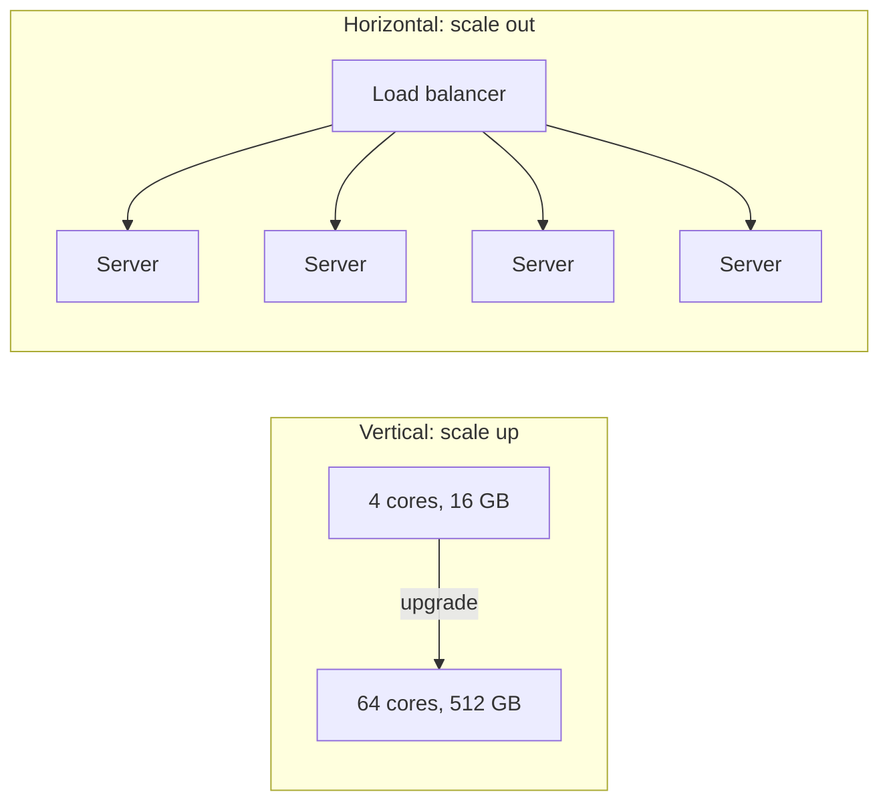

### Trade-offs

| | Vertical (up) | Horizontal (out) |
|---|---|---|
| Simplicity | Very simple, no code change | Needs load balancing, stateless design or sharding |
| Limit | Hard ceiling: the biggest machine | Practically unlimited |
| Fault tolerance | One machine is still a SPOF | Losing one node loses only a fraction |
| Cost curve | Big machines cost disproportionately more | Many cheap commodity machines |
| Downtime to resize | Often needs a restart | Add or remove nodes live |
| Consistency | Easy (one copy of data) | Harder (data spread across machines) |

### Common mistakes
- Dismissing vertical scaling. A single large database server handles a lot; scaling up first is often the right, cheap answer.
- Scaling out a stateful service without dealing with its state (see next sections).

### Real-world examples
- Stack Overflow famously served a very large site from a small number of powerful servers (in 2016: 11 web servers and 4 SQL Server machines, plus a few Redis, search and tag-engine boxes), a well-known example of vertical scaling done well.
- Google, Meta and Amazon are each estimated to run millions of commodity servers: horizontal scaling at the extreme.

### In the interview
**Q:** When would you choose vertical scaling?

**A:** Early on, or for components that are hard to distribute (like a relational database's primary). It's simple and buys time. Switch to horizontal when you approach the largest machine size, need fault tolerance, or costs climb steeply.

**Q:** What makes horizontal scaling hard?

**A:** State. Stateless servers scale out trivially; anything that stores data must be replicated or partitioned, which brings consistency and coordination problems.

### TL;DR
Scale up = bigger machine (simple, limited, still a SPOF). Scale out = more machines (unlimited and fault tolerant, but needs stateless design or data partitioning). Most real systems do both.

---

## Elasticity

### What it is
**Elasticity** is the ability to add and remove resources *automatically and quickly* as load changes, so you pay for roughly what you use. Scalability says "we *can* grow"; elasticity says "we grow and shrink by ourselves, in minutes".

**Analogy:** a supermarket that opens more checkouts when queues get long and closes them when the shop is quiet.

### How it works
1. Watch a metric: CPU use, requests per second, queue length.
2. When it crosses a threshold (say CPU above 70% for 5 minutes), launch more servers.
3. When it drops (CPU below 30%), remove some.
4. The load balancer automatically starts and stops sending them traffic.

This is called **autoscaling** (Part 5 covers kinds: reactive, scheduled, predictive). Cloud platforms (AWS Auto Scaling groups, Kubernetes Horizontal Pod Autoscaler) and **serverless** platforms (AWS Lambda, which runs your code per request and scales to zero) provide it.

### Trade-offs
- New servers take time to start (seconds for containers, minutes for virtual machines). A sudden spike can arrive faster than capacity.
- Only stateless parts are easily elastic; databases scale much more slowly.
- Scaling down too eagerly causes "flapping" (adding and removing repeatedly).

### In the interview
**Q:** What's the difference between scalability and elasticity?

**A:** Scalability is the capability to handle more load by adding resources. Elasticity is doing that automatically, in both directions, to match demand as it changes.

### TL;DR
Elasticity is automatic, fast scaling up and down with demand, mostly for stateless parts, so you pay only for what you need.

---

## Stateless and stateful services

### What it is
**State** is data a program remembers between requests: who is logged in, what's in a shopping cart, the contents of a database.

- A **stateless service** keeps no client-specific data in its own memory between requests. Every request carries (or points to) everything needed to handle it, and any copy of the service can handle any request.
- A **stateful service** remembers data between requests locally, so a particular client or a particular piece of data is tied to a particular server.

**Analogy:** a stateless service is a call centre where every agent can pull up your file from the shared system, so any agent can help you. A stateful service is your family doctor who keeps your history in their head: great until they're on holiday.

### Why it matters
Stateless services are easy to scale out, load balance, restart and replace: kill any copy and nothing is lost. That's why the standard advice is "**make app servers stateless and push state into dedicated stores**" (databases, caches, object storage) that are designed for replication.

### How it works
How to make a web app stateless:
1. Store login sessions in a shared store (Redis) or in a signed token the client sends with each request (like a JWT, JSON Web Token, covered in Part 5), not in server memory.
2. Store uploaded files in object storage, not on the server's local disk.
3. Keep shopping carts and similar data in a database or cache.

Then the load balancer can send each request to any server.

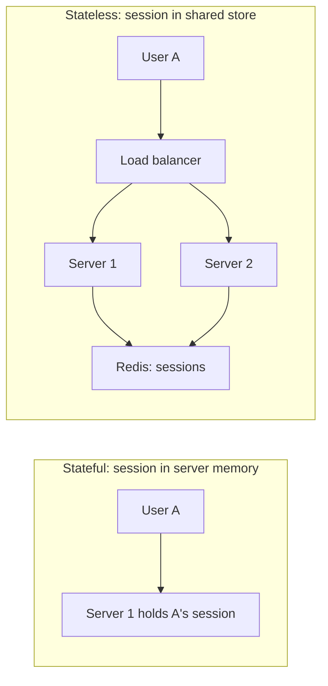

If a service stays stateful (for example a game server holding a live match, or a chat server holding open connections), the load balancer must send each client to the same server, called **sticky sessions** (Part 2), and you must plan for what happens when that server dies.

### Trade-offs
- Stateless servers need an extra network hop to fetch state, adding latency (usually under a millisecond to a cache).
- Stateful designs can be faster (data already in memory) and are sometimes necessary (databases, real-time games, WebSocket servers), but are harder to scale and recover.

### Common mistakes
- Keeping sessions in local memory, then adding a second server and finding users randomly logged out.
- Writing uploaded files to the local disk of one server.
- Calling a system stateless when it just moved state somewhere else; the state store now needs scaling and redundancy too.

### In the interview
**Q:** Why should application servers be stateless?

**A:** So any instance can handle any request: you can add or remove instances freely, load balance evenly, and lose an instance without losing user data. State lives in stores built for durability and replication.

### TL;DR
Stateless services remember nothing between requests and scale easily; stateful ones hold data and are harder to scale and recover. Keep app servers stateless and put state in databases and caches.

---

## Performance vs scalability

### What it is
- **Performance** is how fast the system is for *one* request or user at the current load: low latency, efficient use of resources.
- **Scalability** is how well performance holds up as load *grows*.

A quick diagnostic:
- Send one request to an otherwise idle system. If even that is slow, the trouble is **performance**.
- If that lone request is quick but things drag once traffic piles up, the trouble is **scalability**.

**Analogy:** a sports car is high-performance (fast for one person) but doesn't scale (two seats). A train is slower to get going but carries a thousand people.

### Trade-offs
Some changes help one and hurt the other. Adding a network hop to reach a shared cache slightly hurts single-request performance but lets you scale out. Keeping everything in one process's memory is fast but caps you at one machine.

### In the interview
**Q:** The site is slow even at 3 am with almost no traffic. Performance or scalability?

**A:** Performance: something is slow per request (an unindexed query, a slow external call, a big page). Adding servers won't help; profile the request.

### TL;DR
Performance = fast for one; scalability = stays fast for many. Diagnose which one you have before fixing.

---

## Concurrency vs parallelism

### What it is
- **Concurrency** means several tasks are in progress during the same period, with the program switching between them whenever one has to wait. It describes how the work is organised.
- **Parallelism** means several tasks are literally running at the same instant, on multiple CPU cores or machines. It describes how the work is executed.

Go co-creator Rob Pike summed this up as concurrency being about *dealing with* lots of things at once and parallelism about *doing* lots of things at once.

**Analogy:** one barista taking an order, starting the milk, taking another order while the milk steams, then finishing the first drink, is concurrent. Three baristas each making a drink at the same moment is parallel. You can have concurrency on a single CPU core (by switching) but parallelism needs multiple cores.

### Why it matters
Most web servers spend their time **waiting** (on the network, the database, the disk), not computing. Concurrency lets one server keep thousands of requests in progress while each waits. Parallelism speeds up **CPU-heavy** work (image processing, encryption, analytics) by splitting it across cores.

### How it works
Ways to achieve concurrency:
- **Processes:** separate running programs, each with its own memory. Heavy but isolated.
- **Threads:** multiple flows of execution inside one process, sharing memory. Lighter, but shared memory needs locks to avoid errors.
- **Event loop / async I/O:** one thread handles many requests by never blocking: it starts an I/O operation, handles something else, and comes back when the result is ready. Node.js, NGINX and Python's asyncio work this way.
- **Lightweight threads / coroutines:** cheap tasks scheduled by the language runtime (Go's goroutines, Java's virtual threads), letting you write simple blocking-style code that runs with event-loop efficiency.

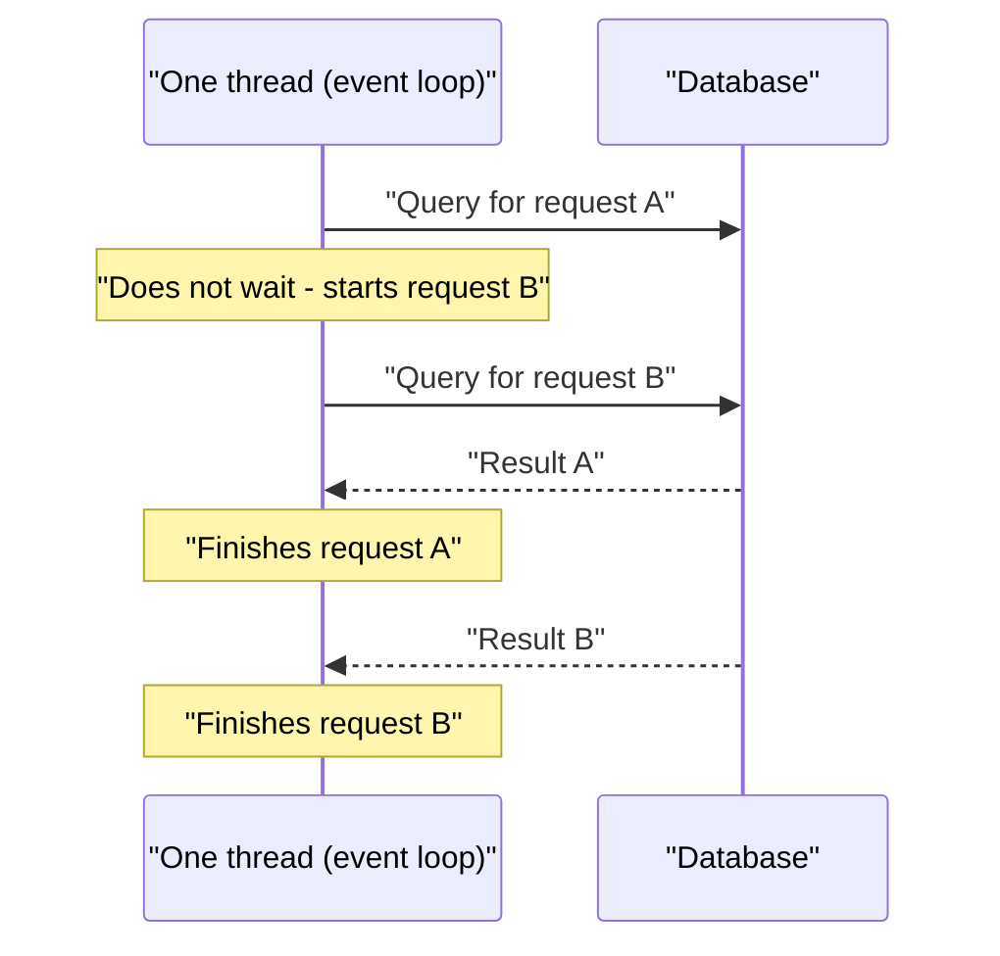

**Concurrency hazards:** when tasks share data you can get a **race condition** (the result depends on timing, like two requests both reading a balance of 100 and both writing 90 after a withdrawal of 10, losing one withdrawal), **deadlock** (two tasks each wait for a lock the other holds, forever) and contention (tasks queue for the same lock). Locks, atomic operations and database transactions (Part 3) address them.

**Amdahl's law** (a related rule) says the speed-up from parallelism is limited by the part of the work that must run one step at a time. If 10% of a job is serial, even infinite cores give at most a 10× speed-up.

### Common mistakes
- Adding threads to a CPU-bound task beyond the number of cores. It just adds switching overhead.
- Assuming parallel code is automatically faster; coordination and locking can make it slower.

### In the interview
**Q:** Is a single-threaded Node.js server concurrent?

**A:** Yes, it handles many requests concurrently using an event loop and non-blocking I/O. It isn't parallel for JavaScript code on one core; you run several processes to use multiple cores.

### TL;DR
Concurrency is juggling many tasks (great for waiting on I/O); parallelism is doing several at the same instant on multiple cores (great for CPU-heavy work). Shared data under concurrency needs care to avoid races and deadlocks.

---

## Bottlenecks: CPU, memory, disk and network

### What it is
A **bottleneck** is the part of a system that limits its overall capacity, like the narrow neck of a bottle that limits how fast you can pour. Improving anything else won't help until the bottleneck is fixed. Every machine has four basic resources that can become one.

| Resource | What it limits | Signs it's the bottleneck | Usual fixes |
|---|---|---|---|
| CPU | Computation (encryption, parsing, compression) | CPU near 100%, latency rises with load | Optimise code, cache results, add cores or servers |
| Memory (RAM) | How much data fits in fast storage | Swapping to disk, out-of-memory crashes, cache misses | More RAM, smaller data, evict wisely |
| Disk | Reading and writing stored data | High disk wait time, IOPS or MB/s at limit | SSDs, caching, sequential writes, sharding |
| Network | Moving data between machines | Link saturated, packet loss, high RTT | Compression, CDNs, fewer calls, closer servers |

### How it works
**Finding the bottleneck:**
1. Measure each resource under load (monitoring dashboards, `top`, `iostat`, cloud metrics).
2. Look for the one at or near its limit, or for queues building up in front of something (thread pools full, database connections exhausted, lock waits).
3. Fix it, then measure again. The bottleneck moves: fix the database and the network may be next.

Non-hardware bottlenecks are just as common: a single lock everybody waits for, a database connection pool that's too small, one "hot" row that every request updates, or an external API with a rate limit.

**Bound terms:** a task is **CPU-bound** when it's limited by computation, and **I/O-bound** when limited by waiting for disk or network. Most web services are I/O-bound.

### IOPS and disk performance
**IOPS (Input/Output Operations Per Second)** is how many separate read or write operations a storage device can perform per second. It matters most for **random** access (many small reads at different locations), such as database lookups.

Disks have two separate limits:
- **IOPS:** number of operations per second (matters for small random reads/writes).
- **Throughput:** megabytes per second (matters for large sequential reads/writes, like streaming a video file or a backup).

| Device | Rough random IOPS | Rough sequential throughput |
|---|---|---|
| Spinning HDD (7,200 rpm) | about 75-150 | 100-250 MB/s |
| SATA SSD | tens of thousands | about 500 MB/s |
| NVMe SSD | hundreds of thousands to about 1 million | several GB/s |
| Cloud block disk (e.g. AWS gp3 baseline) | 3,000 (can buy more) | 125 MB/s (can buy more) |

An HDD's IOPS is low because each random read must physically move the arm and wait for the platter to spin (roughly 5–10 ms). That's why databases moved to SSDs, and why systems that must use HDDs favour sequential writes.

**Example:** a database needs 20,000 random reads per second that miss the cache. One HDD (~150 IOPS) would need over 100 disks; one NVMe SSD handles it comfortably.

### Common mistakes
- Guessing the bottleneck instead of measuring.
- Looking only at averages. A resource at 50% average can be at 100% for the busy minute that matters.
- Forgetting cloud disks have provisioned IOPS limits: a database can be throttled by its disk while CPU looks idle.

### In the interview
**Q:** Latency rises under load but CPU is only at 30%. Where would you look?

**A:** Something else is the bottleneck: disk IOPS, network, a full database connection pool, a lock, or a slow dependency. Look for where requests are queueing.

**Q:** What's the difference between IOPS and disk throughput?

**A:** IOPS counts operations per second (key for many small random reads, like database lookups); throughput counts bytes per second (key for large sequential transfers). A disk can hit one limit without hitting the other.

### TL;DR
The bottleneck is whichever resource (CPU, memory, disk, network, or a lock or pool) runs out first. Measure to find it; disks are limited separately by IOPS and by MB/s.

---

## How to approach a system design interview

### What it is
A system design interview is usually a 45–60 minute conversation where you're asked to design something like "a URL shortener", "a chat app" or "a news feed". It is open-ended on purpose. A clear, repeatable structure helps you cover everything and shows the interviewer how you think.

### How it works
A widely used sequence, with rough timings for a 45-minute interview:

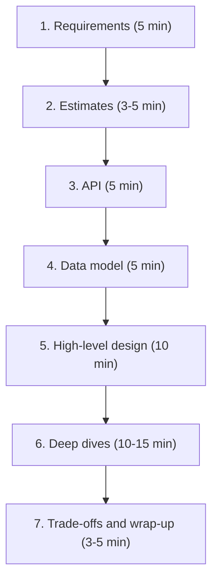

**1. Clarify requirements.** Never start drawing straight away. Ask questions and write down two lists:
- **Functional requirements:** *what* the system does, the features. Example for a URL shortener: "create a short link from a long URL", "redirect a short link to the original", "optional custom aliases", "links expire after a year".
- **Non-functional requirements:** *how well* it does it, the qualities. Scale (100M new links per month), latency (redirect in under 50 ms at p99), availability (99.99% for redirects), durability (never lose a link), consistency (is a newly created link visible everywhere immediately?), security, cost.
- Also agree on what's **out of scope** (analytics dashboards, user accounts), so you don't waste time.

**2. Estimate scale.** Use the back-of-the-envelope method: QPS (average and peak), read/write ratio, storage over time, bandwidth. Keep it quick and say how the numbers affect the design ("100:1 reads, so caching matters").

**3. Define the API.** List the main endpoints the client calls, with inputs and outputs. For example:

```
POST /links        body: {long_url, custom_alias?}  -> {short_code}
GET  /{short_code}                                  -> 301 redirect to long_url
```

This pins down exactly what the system must do.

**4. Sketch the data model.** What entities are stored, their key fields, and how they're accessed. For example a `links` table: `short_code` (primary key), `long_url`, `created_at`, `expires_at`. Mention which kind of database fits the access pattern (Part 3).

**5. Draw the high-level design.** The boxes and arrows: clients, load balancer, app servers, cache, database, queue, etc. Walk through one write and one read end to end. Keep it simple at first; it should meet the functional requirements.

**6. Deep dives.** Pick the hardest or most interesting parts, often guided by the interviewer, and go deeper: how to generate unique short codes without collisions, how to shard the database, how to cache hot links, what happens when a data centre fails, how to handle a celebrity's viral link. Use your estimates to justify choices.

**7. Discuss trade-offs and wrap up.** Name the weaknesses of your design and what you'd do next: bottlenecks, single points of failure, monitoring, what changes at 10× scale.

### Trade-offs
Breadth vs depth: covering every box shallowly looks junior; going deep on one box and never finishing the design is worse. Aim for a complete simple design first, then depth.

### Common mistakes
- Jumping into a detailed design before clarifying requirements.
- Staying silent while thinking. Think out loud.
- Naming technologies without reasons ("use Cassandra"). Always say why ("write-heavy, simple key lookups, needs multi-region").
- Ignoring the non-functional requirements, which usually decide the design.
- Over-engineering: microservices, Kafka and five databases for a system with 100 QPS.
- Not checking the design against the original requirements and numbers at the end.

### In the interview
**Q:** What is the difference between functional and non-functional requirements?

**A:** Functional requirements are features: what the system does (post a photo, follow a user). Non-functional requirements are qualities: how well it does them (latency, availability, scale, consistency, durability, cost). Non-functional requirements usually drive architecture choices.

**Q:** The interviewer says "design Twitter". What do you do first?

**A:** Ask clarifying questions to narrow scope: which features (post, follow, home timeline, search?), how many users, read/write mix, latency and consistency expectations. Write the agreed requirements down before estimating or drawing.

**Q:** How do you choose what to deep-dive into?

**A:** The parts that are hardest given the requirements and estimates (usually the biggest scale or consistency challenge), or whatever the interviewer steers toward. Ask if unsure.

### TL;DR
Requirements (functional and non-functional), estimates, API, data model, high-level design, deep dives, trade-offs. Think out loud, justify every component with a requirement or a number, and finish with weaknesses and next steps.

---

## Part 1 glossary

| Term | Meaning in one line |
|---|---|
| Active-active | All redundant copies serve traffic at once and absorb a failed copy's share |
| Active-passive | One copy serves traffic while a standby waits to take over |
| Amdahl's law | Parallel speed-up is limited by the part of the work that must run serially |
| App server (application server) | Program that runs business logic and answers client requests |
| Availability | Fraction of time (or requests) the system is up and working |
| Availability zone | A separate data centre within a cloud region with its own power and network |
| Back-of-the-envelope estimate | Quick rough calculation to find the order of magnitude of load or storage |
| Bandwidth | Maximum data a link or device can carry per second |
| Batching | Grouping many small operations into one to raise throughput at some latency cost |
| Bit / byte | A bit is a single 0 or 1; a byte is 8 bits |
| Bottleneck | The resource or component that limits overall capacity |
| Cache | Fast, usually in-memory store holding copies of frequently used data |
| CDN | Content Delivery Network; servers worldwide that serve static files close to users |
| Client | Program that sends requests (browser, app, or another server) |
| Cold / warm / hot standby | Spares that need starting, are partly ready, or are ready instantly |
| Concurrency | Making progress on many tasks by interleaving them |
| Coordinated omission | Load-test flaw that under-reports slow responses |
| Correlated failure | Several "independent" parts failing together from a shared cause |
| CPU-bound | Limited by computation speed |
| CPU cache | Tiny, very fast memory inside the processor |
| DAU / MAU | Daily / Monthly Active Users |
| Deadlock | Tasks waiting forever for locks held by each other |
| Durability | Saved data is not lost, even after crashes or disk failures |
| Elasticity | Automatically adding and removing resources to match demand |
| Error budget | Amount of failure an SLO allows (1 minus the SLO) |
| Event loop | Single thread handling many requests by never blocking on I/O |
| Failover | Switching work from a failed component to a standby |
| Failure | The whole system stops providing its service |
| Failure domain | A group of parts that can fail together (rack, zone, region) |
| Fan-out | One request triggering many parallel downstream requests |
| Fault | One component misbehaving (crash, slowness, wrong output) |
| Fault tolerance | Continuing to work despite faults in some components |
| Functional requirement | A feature the system must provide |
| HDD | Hard disk drive; spinning magnetic disk with slow seeks |
| Health check | Periodic test of whether a component is alive and working |
| Hedged request | Sending a duplicate request to another replica if the first is slow |
| Histogram | Counts of measurements per value bucket, used to compute percentiles |
| Horizontal scaling (scale out) | Adding more machines to share the load |
| HTTP | Standard protocol for web requests and responses |
| I/O-bound | Limited by waiting for disk or network |
| IOPS | Input/output operations per second a storage device can perform |
| KB / MB / GB / TB / PB | Data sizes, each about 1,000 times the previous |
| Latency | Time delay for one request or one hop |
| Little's law | Items in system = arrival rate x time in system (L = lambda x W) |
| Load balancer | Component that spreads requests across servers and skips dead ones |
| Load parameters | The numbers that describe load (QPS, data size, users) |
| Mean (average) | Sum divided by count; hides outliers in skewed data |
| Median (p50) | Middle value: half are faster, half slower |
| Message queue | Buffer where jobs wait to be processed later by workers |
| MTBF | Mean time between failures |
| MTTD | Mean time to detect a failure |
| MTTF | Mean time to failure for parts that are replaced, not repaired |
| MTTR | Mean time to repair or recover |
| N+1 redundancy | Running one more unit than peak load needs |
| Nines | Shorthand for availability levels (three nines = 99.9%) |
| Non-functional requirement | A quality the system must have (latency, availability, scale) |
| NVMe | Fast interface for SSDs with very high IOPS |
| Object storage | Service storing large files as objects under keys (e.g. Amazon S3) |
| Order of magnitude | Rough size as a power of ten |
| Parallelism | Executing several tasks at the same instant on multiple cores or machines |
| Peak factor | Ratio of peak traffic to average traffic |
| Percentile | Value below which a given percentage of measurements fall |
| Performance | How fast the system is for a single request at current load |
| Propagation delay | Time for a signal to travel the physical distance |
| QPS / RPS | Queries / requests per second |
| Queueing delay | Time spent waiting behind other work |
| RAM | Main working memory of a computer; fast but volatile |
| Race condition | Bug where the result depends on the timing of concurrent tasks |
| Read/write ratio | How many reads happen per write |
| Redundancy | Having spare copies so one can replace another |
| Reliability | Working correctly over time despite faults |
| Request / response | A client's message asking for something and the server's reply |
| Response time | Total time the client waits, including network, queueing and service |
| Round trip time (RTT) | Time for a message to go to a destination and back |
| Scalability | Handling more load by adding resources without redesign |
| Server | Program (or machine) that waits for and answers requests |
| Service time | Time the server spends actually working on a request |
| SLA | Service Level Agreement; contract with penalties for missed targets |
| SLI | Service Level Indicator; a measurement of service health |
| SLO | Service Level Objective; internal target for an SLI |
| Single point of failure (SPOF) | A part whose failure alone brings the whole system down |
| Split brain | Two nodes both believing they are the primary |
| SRE | Site Reliability Engineering; running production with engineering methods |
| SSD | Solid-state drive; flash storage with no moving parts |
| State | Data a program remembers between requests |
| Stateful service | Service that keeps client or data state locally |
| Stateless service | Service that keeps no per-client state between requests |
| Sticky sessions | Load balancer sending a client to the same server every time |
| System design | Choosing a system's parts and how they interact to meet its goals |
| Tail latency | Latency of the slowest requests (p99, p999, max) |
| Thread | Independent flow of execution inside a process |
| Throughput | Amount of work completed per unit of time |
| Transmission delay | Time to push the bits of a message onto a link |
| Vertical scaling (scale up) | Making one machine bigger |
| Worker | Background program that processes jobs from a queue |


## Part 2 — Networking and communication

Every system design diagram is boxes joined by arrows. Part 1 was about the boxes. This part is about the arrows: how one computer finds another, how bytes travel between them, which languages (protocols) they speak, and which helpers sit in the middle, such as proxies, load balancers and CDNs. You do not need to be a network engineer for a system design interview. You do need to know what happens when a browser types `www.example.com`, why HTTP/2 is faster than HTTP/1.1, and what an L7 load balancer can do that an L4 one cannot. This part teaches exactly that, from zero.

A **protocol** is an agreed set of rules for how two programs talk, the way "say hello, wait for a reply, then speak" is a protocol for a phone call. Networking is a stack of protocols, each one solving one problem and handing the rest to the layer above or below.

## IP addresses, NAT, ports and sockets

### What it is

An **IP address** (Internet Protocol address) is the number that identifies a machine's network connection, like a street address on an envelope. Routers — the boxes that forward traffic across the internet — read only this address to decide where to send each **packet** (a small chunk of data, usually up to about 1,500 bytes on Ethernet).

- **IPv4** addresses are 32 bits, written as four numbers from 0 to 255: `93.184.215.14`. That gives about 4.3 billion addresses (2^32), which the world ran out of in the 2010s.
- **IPv6** addresses are 128 bits, written as eight groups of hex digits: `2606:2800:21f:cb07:6820:80da:af6b:8b2c` (runs of zeros can be shortened with `::`). That is about 3.4 × 10^38 addresses — effectively unlimited.

A **port** is a number from 0 to 65535 that picks which program on a machine gets the data. If the IP address is the building, the port is the apartment number. Well-known ports: 22 (SSH, remote login), 53 (DNS), 80 (HTTP), 443 (HTTPS), 5432 (PostgreSQL), 6379 (Redis).

A **socket** is one end of a conversation, identified by IP address plus port. A single TCP connection is uniquely identified by a **5-tuple**: protocol, source IP, source port, destination IP, destination port. That is why one server on port 443 can hold hundreds of thousands of connections at once — each client brings a different source IP or source port.

**Public vs private IP.** A **public IP** is reachable from anywhere on the internet and is unique worldwide. A **private IP** is only meaningful inside one local network and is reused by millions of networks. The reserved private IPv4 ranges are `10.0.0.0/8`, `172.16.0.0/12` and `192.168.0.0/16`. (The `/8` is **CIDR notation**: the number of leading bits that are fixed. `10.0.0.0/8` means "every address starting with 10", about 16.7 million addresses.) Your laptop at home is almost certainly something like `192.168.1.23`.

**NAT (Network Address Translation)** lets many private machines share one public IP. Your home router rewrites each outgoing packet's source from `192.168.1.23:51000` to its own public IP and a free port, say `81.2.69.160:40001`, remembers the mapping in a table, and reverses the rewrite on replies. In the cloud, the same job is done by a **NAT gateway** so that servers in a private subnet can download updates without being reachable from outside.

### Why it matters

- Servers you design live mostly on private IPs inside a **VPC** (Virtual Private Cloud — your own isolated network inside a cloud provider). Only the load balancer or gateway gets a public address. This is the first layer of security.
- NAT explains why a server cannot simply "call" a phone or a browser: the client is behind NAT and has no stable public address. That is why push systems keep a long-lived connection open *from* the client (see WebSockets below).
- The 5-tuple explains connection limits. A proxy that opens connections from one IP to one backend IP and port can use at most about 64,000 source ports (only about 28,000 with Linux's default range), which is a real limit on busy proxies (called **ephemeral port exhaustion**).

### How it works

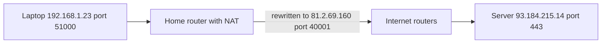

1. Your browser asks the operating system for a socket to `93.184.215.14:443`. The OS picks a random **ephemeral port** (a temporary source port, typically from 32768–60999 on Linux) such as 51000.
2. The router's NAT swaps the private source address for its public one and records the mapping.
3. Internet routers forward the packet hop by hop based only on the destination IP. A typical path crosses 10–20 routers.
4. The server replies to `81.2.69.160:40001`. The router looks up its table and forwards the reply to `192.168.1.23:51000`.

### Common mistakes

- Thinking an IP identifies a person or even a device. Behind **carrier-grade NAT** (NAT run by a mobile operator) thousands of users share one public IP, so rate limiting by IP alone can block an entire office or mobile network.
- Forgetting that IPs change. Cloud instances get new private IPs when they restart, which is why systems use DNS names and service discovery instead of hard-coded addresses.

### TL;DR

An IP address finds the machine, a port finds the program, and the 5-tuple identifies one connection. Private IPs are hidden behind NAT, and only a few edge components in your design should have public IPs.

## DNS — the internet's phone book

### What it is

**DNS (Domain Name System)** turns human-friendly names like `www.example.com` into IP addresses. It is like your phone's contacts list: you tap "Mum", and the phone dials the number. Without DNS you would type `93.184.215.14` into the browser, and a company could never move its servers without telling every user the new number.

A **domain name** is read right to left as a hierarchy: `.` (the root, usually invisible) → `com` (the **top-level domain**, TLD) → `example` (the registered domain) → `www` (a **subdomain**). Each level is managed by a different organisation, which is what lets DNS scale to hundreds of millions of domains.

### Why it matters

- DNS is the very first step of almost every request, so its speed adds directly to page load time (a cold lookup can cost 20–120 ms).
- DNS is a cheap, global traffic-steering tool: by answering with different IPs, you can spread users across data centres or send them to the closest one.
- When DNS breaks, everything looks down even though servers are healthy. Large outages (for example the 2016 Dyn attack, and Facebook's 2021 outage, where its DNS servers became unreachable after a routing change) show it is a critical dependency.

### How it works

The players:

- **Stub resolver** — the tiny DNS client inside your OS. It does not do the hard work; it just asks someone else.
- **Recursive resolver** — the server that does the legwork on your behalf and caches answers. It is usually run by your ISP (internet service provider), your company, or a public service like Google `8.8.8.8` or Cloudflare `1.1.1.1`.
- **Root name servers** — the top of the tree. There are 13 named root server identities (`a.root-servers.net` to `m.root-servers.net`), but each is copied to many locations worldwide using anycast (explained in the CDN section), so there are close to 2,000 physical root server instances.
- **TLD name servers** — know who is in charge of each domain under `.com`, `.org`, `.uk` and so on.
- **Authoritative name server** — holds the real records for a domain (for example Route 53, Cloudflare DNS, or your own servers). Its answer is the final truth.

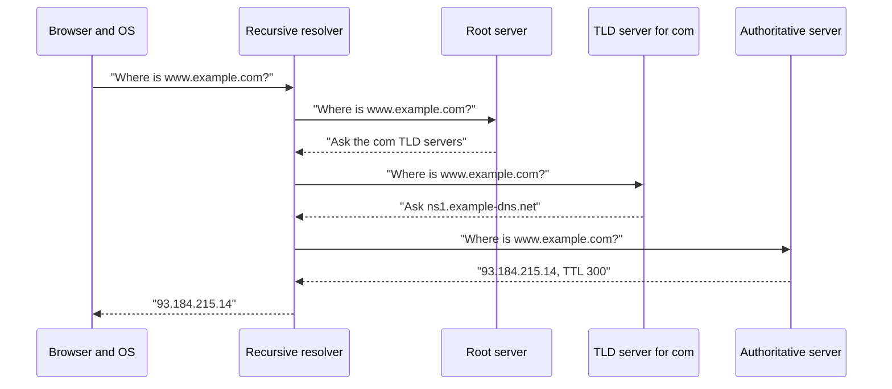

Step by step:

1. The browser checks its own cache, then the OS cache (and the `hosts` file).
2. On a miss, the stub resolver sends a **recursive query** to the recursive resolver: "give me the final answer".
3. If the resolver has nothing cached, it asks a root server, which replies with a **referral**: "I don't know, but here are the `.com` servers". These follow-up questions are **iterative queries** — each server just points to the next.
4. The `.com` TLD server refers it to the domain's authoritative servers (the domain's **NS records**).
5. The authoritative server returns the answer.
6. The resolver caches every step (root and TLD referrals are cached for days), so the next lookup for any `.com` name skips steps 3–4.

In practice, a busy resolver almost always has the root and TLD answers cached, so most lookups are one hop to the authoritative server or a pure cache hit (under 1 ms on the same machine, ~10–30 ms to a public resolver).

### Types

**DNS record types** you should know:

| Record | Maps | Example |
|---|---|---|
| A | name → IPv4 address | `www → 93.184.215.14` |
| AAAA | name → IPv6 address | `www → 2606:2800::1` |
| CNAME | name → another name (alias) | `shop → shops.myplatform.com` |
| MX | domain → mail servers, with priority | `10 mail1.example.com` |
| NS | domain → its authoritative name servers | `ns1.example-dns.net` |
| TXT | name → free text | domain-ownership proofs, SPF rules listing which servers may send a domain's email |

Others you may meet: **SOA** (start of authority — admin data for a zone), **SRV** (service location with port), **PTR** (reverse lookup, IP → name), **CAA** (which certificate authorities may issue certificates for the domain). A **zone** is the set of records one authoritative server is responsible for.

A CNAME cannot sit at the bare domain (`example.com`, called the **apex**) because the apex must also hold NS and SOA records. Providers work around this with non-standard "ALIAS" or "ANAME" records, or Cloudflare's "CNAME flattening".

Here is a real-looking lookup with the `dig` tool:

```text
$ dig www.example.com A +noall +answer
www.example.com.   300   IN   A   93.184.215.14
```

`300` is the **TTL**, `IN` means internet class, and `A` is the record type.

**TTL and DNS caching.** Every record carries a **TTL (time to live)** in seconds: how long any resolver or browser may cache it. A TTL of 300 means "reuse this for 5 minutes". Long TTLs (hours or a day) mean fewer lookups and faster pages, but changes take that long to reach everyone (what people call "propagation" is nothing being pushed out; resolvers simply keep the old answer until their copy times out). Short TTLs (30–60 s) let you fail over quickly but cause more queries. A common trick: lower the TTL a day before a planned migration, switch the record, then raise it again. Some clients and resolvers ignore TTLs and cache longer, so never rely on DNS alone for instant failover.

**DNS-based load balancing.** The authoritative server can return several A records (for example three IPs) and rotate their order on each query — **round-robin DNS**. Clients usually try the first one, so load spreads roughly evenly. It is free and simple but blind: DNS does not know whether a server is busy or dead unless the DNS provider runs health checks and removes bad IPs.

**GeoDNS** answers differently depending on where the query comes from: a user in Paris gets the IP of the Frankfurt data centre, a user in Tokyo gets the Tokyo one. The DNS server guesses location from the resolver's IP, or from the **EDNS Client Subnet** extension, which passes part of the user's own IP so the guess is better. **Latency-based routing** (offered by AWS Route 53) picks the region with the lowest measured latency rather than the closest on a map.

### Trade-offs

| Choice | Benefit | Cost |
|---|---|---|
| Long TTL | Fewer lookups, resilient if DNS provider has a blip | Slow to change or fail over |
| Short TTL | Fast failover and traffic shifts | More DNS traffic and lookup latency |
| DNS load balancing | Global, cheap, no extra hop | Coarse, cached, no knowledge of server load |

### Common mistakes

- Expecting a DNS change to take effect instantly. Cached answers live until their TTL expires, sometimes longer.
- Using one DNS provider with no redundancy. Many large sites now use two providers.
- Treating DNS round robin as a real load balancer. It cannot react to a server being slow.

### Real-world examples

Amazon Route 53, Cloudflare DNS, Google Cloud DNS and NS1 are authoritative DNS services with health checks, GeoDNS and latency routing. Netflix and many others use DNS to steer users between AWS regions during regional failures.

### In the interview

**Q:** What happens when you type a URL in the browser, up to the IP address?

**A:** Browser cache, OS cache, then a recursive resolver. If the resolver has nothing cached, it walks root → TLD → authoritative server, caches each answer for its TTL, and returns the IP. Then the browser opens a TCP (or QUIC) connection to that IP.

**Q:** How would you move traffic away from a failed region using DNS?

**A:** Use health-checked records with a short TTL (say 60 s) so the provider stops returning the failed region's IP. Accept that some clients will still hit the old IP for a while, so the failed region's load balancer should also redirect or fail fast.

### TL;DR

DNS maps names to IPs through a cached hierarchy of root, TLD and authoritative servers. TTL controls the trade-off between speed and how quickly changes spread, and DNS can do coarse global load balancing (round robin, GeoDNS, latency-based).

## Network layers — OSI and TCP/IP models

### What it is

Networking is split into **layers**, each solving one job and relying on the layer below. Think of posting a parcel: you write a letter (application), put it in an envelope with an apartment number (transport), the post office adds a city and street address (network), and a van physically drives it (link and physical). Each layer only cares about its own label.

There are two models. The **OSI model** has seven layers and is mainly a teaching vocabulary. The **TCP/IP model** has four and describes what the internet actually runs. Engineers mix them: when someone says "L4" or "L7", they mean OSI layer numbers.

| OSI layer | Name | What it handles | Examples |
|---|---|---|---|
| 7 | Application | Meaning of messages | HTTP, DNS, gRPC, SMTP |
| 6 | Presentation | Encoding, encryption | TLS (roughly), JSON (a text data format) |
| 5 | Session | Conversations | (rarely discussed) |
| 4 | Transport | Process-to-process delivery, ports | TCP, UDP, QUIC |
| 3 | Network | Machine-to-machine routing | IP, ICMP |
| 2 | Data link | One hop on a local network | Ethernet, Wi-Fi, MAC addresses |
| 1 | Physical | Bits on wire, light or radio | Copper, fibre, radio |

The TCP/IP model merges 5–7 into "application" and 1–2 into "link": Application, Transport, Internet, Link.

### Why it matters

The layer a component works at decides what it can see and therefore what it can do:

- An **L3** device (router, firewall rule on IPs) sees only source and destination IPs.
- An **L4** device (L4 load balancer) also sees ports and TCP/UDP state, but not the content. It can say "send port 443 traffic to these servers" but not "send `/api/` to these".
- An **L7** device (L7 load balancer, API gateway) reads the HTTP request itself: URL path, headers, cookies. It can route by path, rewrite headers, and block bad requests — at the cost of more CPU and needing to decrypt TLS (the encryption behind HTTPS, explained below).

### How it works

When your app sends an HTTP request, each layer wraps the data with its own header — **encapsulation**. HTTP request → TCP segment (adds ports, sequence numbers) → IP packet (adds IPs) → Ethernet frame (adds MAC addresses, the hardware address of a network card). The receiver unwraps in reverse order.

### TL;DR

Layers separate concerns: L3 is IP addresses, L4 is ports and connections (TCP/UDP), L7 is application content (HTTP). "L4 vs L7" in system design always means "can it read the request or only the connection?"

## TCP, UDP and QUIC

### What it is

These are the **transport-layer** protocols: they carry data between two programs.

- **TCP (Transmission Control Protocol)** is like a phone call with a careful note-taker: you connect first, everything arrives, in order, and lost words are repeated.
- **UDP (User Datagram Protocol)** is like shouting postcards across a room: no setup, each message is independent, some may be lost or arrive out of order, nobody repeats anything.
- **QUIC** is a newer protocol built on top of UDP that gives TCP-like reliability plus built-in encryption, without some of TCP's weaknesses. HTTP/3 runs on it.

### Why it matters

The choice shapes latency and behaviour under packet loss. Web pages, APIs and databases want every byte correct, so they use TCP (or QUIC). Live voice, video calls, online games and DNS lookups prefer UDP because a late packet is useless — better to skip it than to wait.

### How it works

**TCP three-way handshake.** Before any data, the two sides agree on starting sequence numbers:

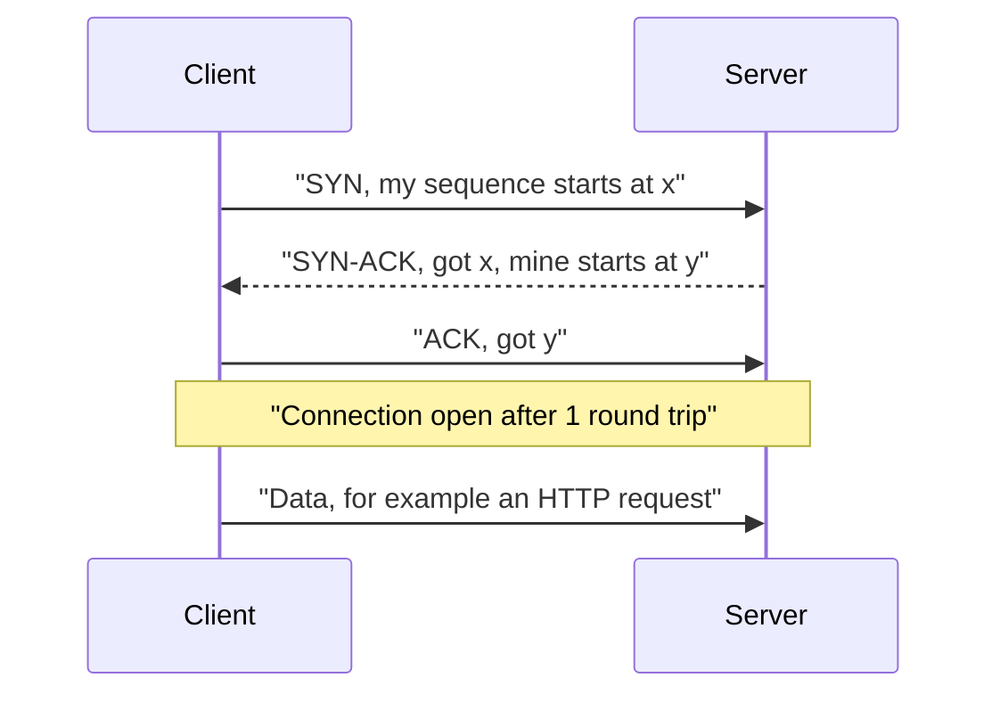

This costs one **round trip (RTT)** before the first byte of the request. London to New York is about 70 ms RTT, so the handshake alone is 70 ms — and TLS adds more on top (see HTTPS). This is why reusing connections matters so much.

**Reliability and ordering.** TCP numbers every byte (**sequence numbers**). The receiver sends **acknowledgements (ACKs)**. If an ACK does not arrive in time, the sender **retransmits**. The receiver reorders out-of-order segments and hands the application a clean, ordered byte stream.

**Flow control.** The receiver advertises a **receive window** — how much buffer space it has — so a fast sender cannot overwhelm a slow receiver.

**Congestion control.** The network in between can also be overwhelmed. TCP starts slowly (**slow start**: send a few packets, roughly double each round trip while ACKs come back), and when it sees loss it backs off. Algorithms include Reno, CUBIC (default on Linux) and Google's BBR, which models bandwidth and RTT instead of waiting for loss. A practical result: a brand-new connection cannot use the full bandwidth immediately, another reason to keep connections warm.

**Closing.** Either side sends **FIN**; the other acknowledges. The side that closes first keeps the socket in **TIME_WAIT** for a short time (on Linux, 60 s) to catch stray packets — a source of port exhaustion on busy clients that open and close many connections.

**Head-of-line (HOL) blocking.** Because TCP delivers bytes strictly in order, one lost packet holds up everything behind it until it is retransmitted, even data that already arrived. Picture a single-lane road where one stalled car stops all traffic behind. If several independent requests share one TCP connection (as in HTTP/2), a single loss stalls all of them.

**UDP** has no handshake, no ACKs, no ordering and no congestion control. Each **datagram** is sent and forgotten. The header is 8 bytes versus TCP's 20+. Applications that need some reliability add it themselves.

**QUIC** (standardised by the IETF, the Internet Engineering Task Force, in 2021, originally developed at Google) runs over UDP and puts into one protocol what used to take TCP + TLS:

1. **Faster setup** — the transport and TLS 1.3 handshakes are combined, so a new connection takes 1 RTT, and a returning client can send data in the first packet (**0-RTT**).
2. **Independent streams** — many streams inside one connection, and a lost packet only stalls the stream it belongs to. No transport-level HOL blocking between streams.
3. **Connection migration** — a connection is identified by a **connection ID**, not the 5-tuple, so your phone switching from Wi-Fi to 4G keeps the same connection.
4. **Always encrypted** — even most of the transport headers.
5. **Lives in user space** — it can evolve without operating-system upgrades. The downside is more CPU per byte than kernel TCP, and some corporate firewalls block UDP, so clients fall back to TCP.

### Types

| | TCP | UDP | QUIC |
|---|---|---|---|
| Connection setup | 1 RTT (plus TLS) | none | 1 RTT incl. TLS, 0-RTT on resume |
| Reliable, ordered | Yes, one stream | No | Yes, per stream |
| HOL blocking | Yes | No | Only within a stream |
| Encryption | Separate (TLS) | None built in | Built in |
| Typical use | Web, APIs, databases | DNS, video calls, games | HTTP/3 |

### Trade-offs

TCP gives correctness at the cost of setup latency and stalls under loss. UDP gives speed and control at the cost of building whatever reliability you need yourself. QUIC fixes TCP's main pains for the web but costs more CPU and is sometimes blocked.

### Common mistakes

- Saying "UDP is faster" without context. On a clean network, a long-lived TCP connection is just as fast for bulk data. UDP wins on setup time and on not waiting for retransmissions.
- Forgetting that every new TCP + TLS connection costs 2–3 RTTs before the first byte. Use connection pooling and keep-alive.

### Real-world examples

Zoom, WebRTC (browser video calls), and most online games use UDP. DNS uses UDP for normal queries and switches to TCP for large responses. Google, YouTube, Meta and Cloudflare serve a large share of their traffic over QUIC / HTTP/3.

### In the interview

**Q:** Why would a video-calling app use UDP instead of TCP?

**A:** Because a frame that arrives 300 ms late is worthless. TCP would pause all later frames while retransmitting the lost one (HOL blocking). With UDP the app just skips the lost frame and stays real-time.

**Q:** What problem does QUIC solve?

**A:** TCP's head-of-line blocking across multiplexed streams and its slow combined TCP + TLS handshake. QUIC gives independent streams, a 1-RTT (or 0-RTT) encrypted handshake, and survives network changes.

### TL;DR

TCP = connected, reliable, ordered, congestion-controlled, but has handshake cost and head-of-line blocking. UDP = fire-and-forget datagrams. QUIC = reliable, encrypted, multi-stream transport over UDP that powers HTTP/3.

## HTTP — the language of the web

### What it is

**HTTP (HyperText Transfer Protocol)** is the request–response protocol browsers and APIs use. The client sends a **request** (a method, a path, headers, optional body); the server sends a **response** (a status code, headers, optional body). It is like ordering at a counter: "GET me the menu" → "200 OK, here it is".

```http
GET /users/42 HTTP/1.1
Host: api.example.com
Accept: application/json
Authorization: Bearer eyJhbGciOi...

HTTP/1.1 200 OK
Content-Type: application/json
Cache-Control: max-age=60

{"id": 42, "name": "Asha"}
```

### Why it matters

Almost every API you design in an interview is HTTP. Choosing the right method and status code makes APIs predictable, cache-friendly and safe to retry. The HTTP version decides how many connections you need and how much latency you pay.

### How it works

**Methods (verbs).**

| Method | Meaning | Safe? | Idempotent? |
|---|---|---|---|
| GET | Read a resource | Yes | Yes |
| HEAD | Like GET, headers only | Yes | Yes |
| POST | Create, or run an action | No | No |
| PUT | Replace a resource fully | No | Yes |
| PATCH | Change part of a resource | No | Not guaranteed |
| DELETE | Remove a resource | No | Yes |
| OPTIONS | Ask what is allowed (used by CORS, the browser's cross-origin permission check) | Yes | Yes |

**Safe** means it does not change anything on the server. **Idempotent** means doing it once or ten times leaves the server in the same state — so a client can safely retry after a timeout. `DELETE /orders/7` twice still leaves order 7 deleted (the second call may return 404, but the state is the same). `POST /orders` twice creates two orders, which is why payment APIs add an **idempotency key** header so the server can recognise a retry.

**Status codes** — the first digit is the category:

| Range | Meaning | Common codes |
|---|---|---|
| 1xx | Informational | 101 Switching Protocols (WebSocket upgrade) |
| 2xx | Success | 200 OK, 201 Created, 202 Accepted, 204 No Content |
| 3xx | Redirect | 301 Moved Permanently, 302 Found, 304 Not Modified |
| 4xx | Client's fault | 400 Bad Request, 401 Unauthorized, 403 Forbidden, 404 Not Found, 409 Conflict, 429 Too Many Requests |
| 5xx | Server's fault | 500 Internal Server Error, 502 Bad Gateway, 503 Service Unavailable, 504 Gateway Timeout |

401 means "we don't know who you are" (not logged in); 403 means "we know who you are and you may not do this". 502 and 504 typically come from a proxy or load balancer: the backend gave a bad answer (502) or no answer in time (504). 202 Accepted is for "queued, will be processed later".

**Headers** are key–value metadata. Important ones: `Host` (which site — many sites share one IP), `Content-Type` (format of the body), `Authorization` (credentials), `Cache-Control` (who may cache and for how long), `ETag` and `If-None-Match` (let the server reply 304 Not Modified if the client's copy is current), `User-Agent`, `Accept-Encoding: gzip, br` (compression), `X-Forwarded-For` (original client IP, added by proxies).

**Statelessness and cookies.** HTTP is **stateless**: each request carries everything the server needs, and the server does not remember the previous request by itself. This is what makes it easy to put many identical servers behind a load balancer. To build logins and shopping carts on top, servers use **cookies**: the server sends `Set-Cookie: session=abc123; HttpOnly; Secure; SameSite=Lax`, and the browser automatically sends `Cookie: session=abc123` on every later request to that site. The session data itself lives in a shared store (like Redis) or inside a signed token, so any server can handle the next request.

**Keep-alive (persistent connections).** HTTP/1.0 opened a new TCP connection per request. HTTP/1.1 keeps the connection open by default for reuse, saving the handshake on every request.

### Types

**HTTP/1.1 (1997).** Text-based. One request at a time per connection; the next request waits for the previous response (**HTTP-level HOL blocking**). "Pipelining" was specified but never worked reliably. Browsers work around it by opening about 6 connections per host, and sites used tricks like domain sharding and sprite images.

**HTTP/2 (2015).** Binary framing. **Multiplexing**: many requests and responses interleave as **streams** over one TCP connection, so one slow response no longer blocks others at the HTTP level. **Header compression** (HPACK) shrinks repetitive headers. Server push existed but was little used and has been removed from Chrome. Weakness: it still runs on one TCP connection, so one lost packet stalls every stream (TCP-level HOL blocking). On lossy mobile networks this can be worse than six HTTP/1.1 connections.

**HTTP/3 (2022).** Same meaning as HTTP/2 but runs on QUIC over UDP. Independent streams remove TCP HOL blocking, setup is faster, and connections survive network switches. Header compression is QPACK. Browsers discover HTTP/3 through an `Alt-Svc` header or a DNS **HTTPS record**, and fall back to HTTP/2 if UDP is blocked.

| | HTTP/1.1 | HTTP/2 | HTTP/3 |
|---|---|---|---|
| Transport | TCP | TCP | QUIC (UDP) |
| Format | Text | Binary frames | Binary frames |
| Parallel requests | ~6 connections | Many streams, 1 connection | Many streams, 1 connection |
| HOL blocking | HTTP and TCP level | TCP level | Per stream only |
| Encryption | Optional | Required by browsers | Always |

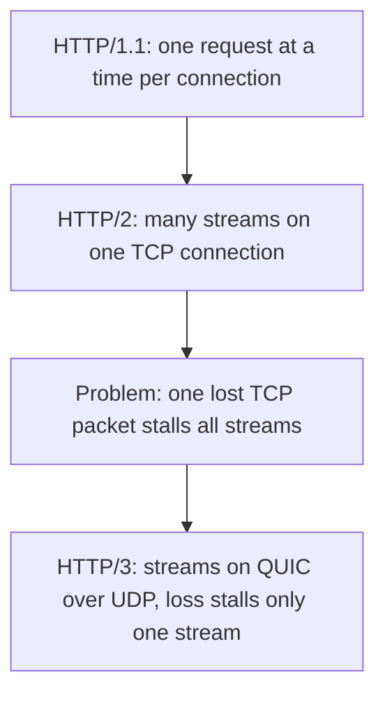

### Common mistakes

- Using GET for actions that change data (a crawler or prefetcher may trigger them).
- Returning 200 with `{"error": ...}` in the body. Proxies, caches, monitoring and retries all rely on real status codes.
- Retrying non-idempotent POSTs blindly. Use idempotency keys.
- Storing session state in one server's memory, which breaks as soon as there are two servers.

### In the interview

**Q:** Which HTTP methods are idempotent and why does it matter?

**A:** GET, HEAD, PUT, DELETE, OPTIONS. It matters because networks time out: if the client does not know whether the request succeeded, it can retry an idempotent request safely. For POST you need an idempotency key.

**Q:** What did HTTP/2 improve and what did HTTP/3 fix on top?

**A:** HTTP/2 multiplexed many requests over one connection with header compression, removing HTTP-level head-of-line blocking. HTTP/3 moved to QUIC to remove the remaining TCP-level head-of-line blocking and speed up connection setup.

### TL;DR

HTTP is a stateless request–response protocol of methods, status codes and headers. Cookies add sessions on top, keep-alive reuses connections, HTTP/2 multiplexes streams over TCP, and HTTP/3 does the same over QUIC.

## HTTPS and TLS

### What it is

**HTTPS** is HTTP sent inside a **TLS (Transport Layer Security)** encrypted tunnel. TLS gives three guarantees: **confidentiality** (eavesdroppers see gibberish), **integrity** (nobody can change the bytes undetected) and **authentication** (you really are talking to `bank.com`, not an impostor). Its older name is **SSL**, which is why people still say "SSL certificate" and "SSL termination". The current version is TLS 1.3 (2018); TLS 1.2 is still common; anything older is deprecated.

Analogy: a sealed, tamper-evident envelope, plus a passport check of the person you are handing it to.

### Why it matters

Browsers mark plain HTTP as "Not secure", HTTP/2 in browsers and HTTP/3 always require it, and any password, token or personal data on the wire must be encrypted. This is **encryption in transit** (as opposed to **encryption at rest**, which protects stored data on disk). TLS also costs latency and CPU, which affects where you decrypt (see TLS termination in the load balancer section).

### How it works

**Certificates.** A server proves its identity with a **certificate**: a file containing the domain name, the server's **public key**, an expiry date, and a digital signature from a **Certificate Authority (CA)** — an organisation trusted by browsers and operating systems, such as Let's Encrypt or DigiCert. The browser follows the **chain of trust**: server certificate → intermediate CA → **root CA** that is pre-installed in the browser. If the chain is valid, the name matches and it is not expired, the server is trusted. Let's Encrypt issues free certificates, renewed automatically with the ACME protocol. They have been valid for 90 days, and lifetimes across the industry are shrinking: Let's Encrypt plans 64 days in 2027 and 45 days in 2028, so automated renewal is mandatory.

**Public-key vs symmetric encryption.** **Asymmetric (public-key) cryptography** uses a key pair: anything signed by the private key can be verified with the public key. It is slow, so TLS uses it only during the handshake to authenticate the server and agree on a shared secret. After that, all data is encrypted with fast **symmetric** encryption (one shared key, e.g. AES-GCM or ChaCha20).

**TLS 1.3 handshake (simplified):**

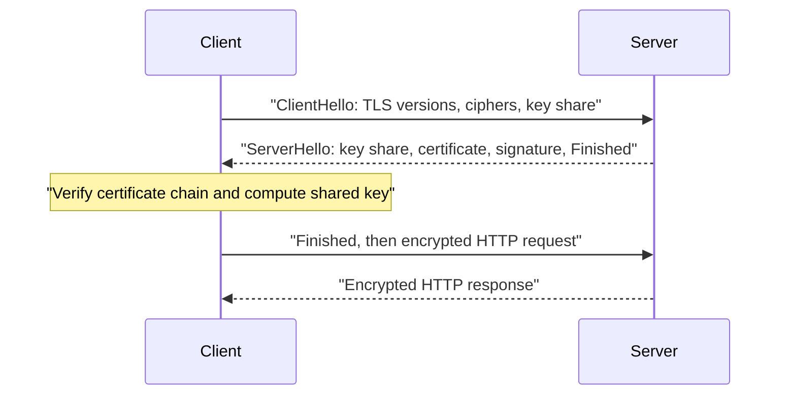

1. The client sends supported versions and cipher suites and a **key share** (its half of a Diffie–Hellman key exchange — a method where two sides each mix in a secret and arrive at the same shared key without ever sending it).
2. The server answers with its key share, its certificate, and a signature proving it owns the certificate's private key.
3. Both sides derive the same symmetric keys. The client sends Finished and can immediately send the encrypted request.

TLS 1.3 needs **1 RTT** (TLS 1.2 needed 2). Combined with TCP's 1 RTT, a fresh HTTPS connection over TCP costs about 2 RTTs before the request goes out — 140 ms from London to New York. **Session resumption** and **0-RTT** let returning clients skip work (0-RTT data can be replayed by an attacker, so it should only be used for idempotent requests). Using fresh Diffie–Hellman keys per session gives **forward secrecy**: stealing the server's private key later does not decrypt old recorded traffic.

**SNI (Server Name Indication).** The ClientHello includes the hostname so one IP can serve certificates for many domains — essential for load balancers and CDNs.

**mTLS (mutual TLS)** — both sides present certificates. Used between internal services (service meshes) so each service proves its identity.

### Common mistakes

- Letting certificates expire. It has caused outages at large companies; automate renewal and alert on expiry.
- Terminating TLS at the edge and sending plaintext across untrusted networks. Inside one VPC it may be acceptable; across data centres, re-encrypt.

### In the interview

**Q:** Why does HTTPS use both asymmetric and symmetric encryption?

**A:** Asymmetric crypto solves authentication and key agreement without a shared secret, but it is slow. Once both sides share a key, symmetric encryption is fast enough for bulk data.

**Q:** How many round trips does a new HTTPS request cost?

**A:** About 1 RTT for TCP, 1 for TLS 1.3, then 1 for the request and response — 3 in total. With HTTP/3 over QUIC the first two merge into one, and resumed connections can send data immediately.

### TL;DR

TLS encrypts and authenticates connections using certificates signed by trusted CAs. The handshake uses public-key crypto to agree on a symmetric key, TLS 1.3 takes 1 RTT, and HTTPS is simply HTTP inside TLS.

## API styles — REST, RPC and gRPC, GraphQL

### What it is

An **API (Application Programming Interface)** is the menu a service offers to other programs: which operations exist, what inputs they take and what they return. Three styles dominate.

- **REST (Representational State Transfer)** models everything as **resources** (nouns) with URLs, manipulated with standard HTTP methods (verbs). `GET /users/42`, `POST /users/42/orders`. Like a library: every book has a shelf address, and there are a few standard things you can do with any book (look, add, replace, remove).
- **RPC (Remote Procedure Call)** models the API as functions you call on a remote machine as if they were local: `getUser(42)`, `chargeCard(order, amount)`. Like phoning a colleague and asking them to do a specific task.
- **GraphQL** gives clients one endpoint and a query language to ask for exactly the fields they want, possibly across several related objects, in one round trip. Like a form where you tick exactly which details you need.

### Why it matters

The API is the contract between teams and between your system and its users. A good style choice makes clients simple and fast; a poor one causes chatty clients, over-fetching (downloading data you don't need) or under-fetching (needing many calls to build one screen).

### How it works

**REST in practice.**

1. Name resources with plural nouns: `/users`, `/users/42`, `/users/42/orders`.
2. Use methods for actions: GET reads, POST creates, PUT replaces, PATCH updates part, DELETE removes.
3. Return proper status codes (201 Created with a `Location` header, 404, 409 Conflict).
4. Keep requests stateless, so any server can answer and GET responses can be cached by browsers and CDNs.
5. Usually JSON over HTTP/1.1 or HTTP/2.

Idempotent methods (GET, PUT, DELETE) can be retried safely; this is a big reason to prefer `PUT /users/42/avatar` over `POST /changeAvatar`.

**gRPC.** An open-source RPC framework from Google that runs on HTTP/2. You define services and messages in a `.proto` file using **Protocol Buffers (Protobuf)** — a compact binary format with a schema:

```protobuf
service UserService {
  rpc GetUser (GetUserRequest) returns (User) {}
}
message GetUserRequest { int64 id = 1; }
message User { int64 id = 1; string name = 2; }
```

The numbers (`= 1`, `= 2`) are field tags that identify each field on the wire. A code generator produces client and server code in many languages, so calling another service looks like calling a local function, with types checked at compile time. Protobuf messages are typically several times smaller and faster to parse than the same JSON, and the numbered fields allow **backward-compatible** schema changes (add new field numbers, never reuse old ones). gRPC supports four call shapes: unary (one request, one response), server streaming, client streaming and bidirectional streaming. Browsers cannot speak native gRPC directly, so it is mostly used **service-to-service**, with gRPC-Web or a REST gateway for browsers.

**GraphQL.** Created at Facebook (open-sourced in 2015). The server publishes a typed **schema**; the client sends a query such as:

```graphql
query {
  user(id: 42) {
    name
    orders(last: 3) { id total }
  }
}
```

and gets back exactly that shape. Writes are **mutations**, and live updates are **subscriptions**. Each field is filled by a **resolver** function on the server. It is ideal when many different clients (web, iOS, Android) need different slices of the same data. Downsides: usually one POST endpoint, so ordinary HTTP caching does not work; a careless query can be very expensive, so servers limit query depth and cost; and naive resolvers cause the **N+1 query problem** (one query for the list, then one per item), usually fixed with batching (the DataLoader pattern).

### Types

| | REST | gRPC | GraphQL |
|---|---|---|---|
| Model | Resources + HTTP verbs | Functions | Typed graph, client picks fields |
| Format | Usually JSON | Protobuf (binary) | JSON |
| Transport | HTTP/1.1 or 2 | HTTP/2 | HTTP, one endpoint |
| Best for | Public APIs, CRUD (create/read/update/delete), caching | Internal service calls, streaming | Many client types, complex screens |
| Weak spot | Over/under-fetching | Browser support, readability | Caching, query cost control |

### Trade-offs

REST is universally understood and cache-friendly, but may need many calls per screen. gRPC is fast, strongly typed and streams well, but is binary (harder to debug with `curl`) and needs a proxy for browsers. GraphQL gives clients flexibility but moves complexity and performance risk to the server.

### Common mistakes

- Verbs in REST URLs (`/getUser?id=42`) instead of methods on resources.
- Using GraphQL "because it is modern" for a simple public API where REST with caching would be cheaper.
- Changing Protobuf field numbers, which silently breaks old clients.

### Real-world examples

Stripe and GitHub's v3 API are classic REST. GitHub also offers a GraphQL API (v4), and Shopify's storefront API is GraphQL. Google, Netflix and many companies use gRPC between internal microservices; Kubernetes uses gRPC for its plug-in interfaces, such as the one between the kubelet and the container runtime.

### In the interview

**Q:** You are designing a mobile app's backend and an internal ranking service. Which API styles?

**A:** REST (or GraphQL if screens need many related objects) for the public mobile API, because it is easy to consume, cache and debug. gRPC between the backend and the ranking service, for compact binary messages, typed contracts and streaming.

**Q:** What makes a REST call safe to retry?

**A:** Using an idempotent method (GET, PUT, DELETE), or attaching an idempotency key to a POST so the server returns the original result instead of repeating the action.

### TL;DR

REST = resources and HTTP verbs, simple and cacheable. gRPC = typed remote functions over HTTP/2 with Protobuf, great inside the data centre. GraphQL = clients query exactly the fields they need from a typed schema.

## Real-time communication — polling, long polling, WebSockets, SSE, webhooks

### What it is

Plain HTTP only lets the client ask. Many features need the server to *tell* the client something as soon as it happens: a chat message, a new notification, a stock price, a driver's location. Because the client is usually behind NAT and the server cannot open a connection to it, every solution is some way of keeping a channel open from the client side — or, between servers, of calling back a public URL.

- **Short polling** — the client asks "anything new?" every few seconds. Like a child asking "are we there yet?" every minute.
- **Long polling** — the client asks, and the server holds the request open until there is news or a timeout (say 30 s), then the client immediately asks again. Like asking a shopkeeper to call you over when your order is ready.
- **WebSockets** — one long-lived, two-way connection over which both sides send messages any time. Like an open phone line.
- **Server-Sent Events (SSE)** — one long-lived HTTP response that the server keeps writing events into; one-way, server to client. Like a radio broadcast you tune into.
- **Webhooks** — server-to-server: when an event happens, service A sends an HTTP POST to a URL that service B registered. Like leaving your phone number so the shop calls you.

### Why it matters

Choosing wrongly wastes resources (polling a million clients every second is a million requests per second, mostly answering "nothing new") or adds needless complexity. Long-lived connections also change capacity planning: a chat server's limit is often the number of open connections (memory per connection, file descriptors) rather than requests per second.

### How it works

**WebSocket upgrade.** It starts as an ordinary HTTP/1.1 request, so it passes through normal ports and proxies:

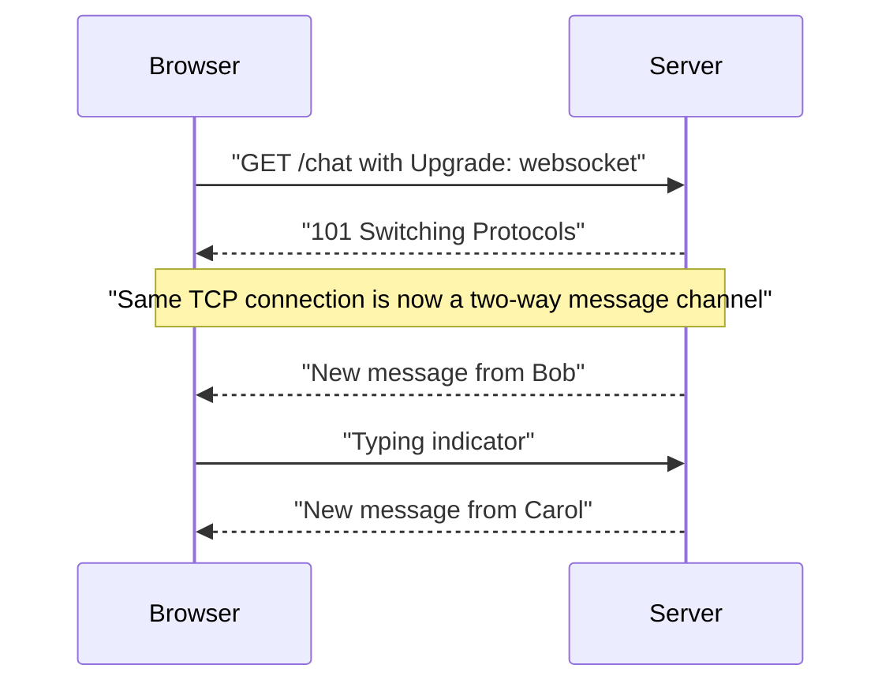

1. The client sends `GET` with `Upgrade: websocket` and `Connection: Upgrade` headers (URL scheme `ws://` or encrypted `wss://`).
2. The server answers `101 Switching Protocols`.
3. From then on, both sides exchange small **frames** with only a few bytes of overhead each, until either side closes.
4. Applications send **heartbeats** (ping/pong) every 20–60 s so that idle connections are not silently cut by NAT routers or load balancers, and clients reconnect with backoff if the link drops.

**SSE.** The client opens `GET /events` with `Accept: text/event-stream`. The server responds and never finishes, writing lines like `data: {"price": 101.5}` followed by a blank line for each event. The browser's built-in `EventSource` reconnects automatically and sends `Last-Event-ID` so the server can resume. It is plain HTTP, so it works well with HTTP/2 and existing infrastructure. Large language model chat interfaces commonly stream tokens this way.

**Webhooks.** The receiver registers `https://myapp.com/hooks/payments`. When a payment succeeds, the provider POSTs a JSON event there. Good practice: sign each request (an HMAC header: a hash of the body computed with a shared secret key) so the receiver can verify the sender; retry with backoff on failure; and make the receiver idempotent because the same event may arrive twice.

### Types

| Technique | Direction | Latency | Cost / complexity | Use when |
|---|---|---|---|---|
| Short polling | Client pulls | Up to the interval | Many wasted requests | Rare updates, simplicity first |
| Long polling | Server push (emulated) | Low | Held requests, reconnect loops | Fallback where WebSockets are blocked |
| WebSocket | Two-way | Lowest | Stateful connections, sticky routing | Chat, games, collaboration |
| SSE | Server to client | Low | Simple, auto-reconnect | Feeds, notifications, live scores, token streaming |
| Webhook | Server to server | Low | Receiver needs public URL | Payment and Git events |

### Trade-offs

Persistent connections give instant delivery but make servers **stateful**: each user is attached to one server, so you need a way to route messages to the right server (often a pub/sub layer such as Redis Pub/Sub or Kafka between servers), and deployments must drain connections gracefully. Polling is stateless and trivially scalable but wasteful and slower.

### Common mistakes

- Choosing WebSockets for a one-way feed where SSE would be simpler.
- Forgetting that a load balancer's idle timeout (for example 60 s by default on AWS ALB) will close quiet WebSockets unless you send heartbeats.
- Assuming webhooks arrive exactly once and in order. They do not.

### Real-world examples

Slack and Discord use WebSockets for their real-time clients. GitHub, Stripe and Shopify deliver events by webhooks. Many dashboards and AI chat apps stream with SSE.

### In the interview

**Q:** How would you push new chat messages to 10 million online users?

**A:** WebSocket connections terminated on a fleet of connection servers (each holding perhaps 50,000–100,000 connections). A registry maps user → connection server, and a pub/sub layer delivers each message to the right server, which writes it to the socket. Clients reconnect with backoff and fetch missed messages using their last seen ID.

**Q:** When would you choose SSE over WebSockets?

**A:** When only the server needs to push (notifications, live scores, streaming text). SSE is plain HTTP, reconnects automatically and needs no protocol upgrade.

### TL;DR

Polling asks repeatedly, long polling waits for news, WebSockets keep a two-way channel, SSE streams one-way from server to client, and webhooks are server-to-server callbacks. Persistent connections are fast but make servers stateful.

## API design basics

### What it is

The small, practical rules that make an API pleasant and safe to evolve: how you version it, how clients page through big lists, how you tell clients about limits and errors.

### Why it matters

Once a public API is used by thousands of clients, you cannot change it freely. Pagination and rate limits protect your servers from clients asking for too much at once.

### How it works

**Versioning.** When you must make a breaking change (removing or renaming a field, changing meaning), publish a new version and keep the old one running for a deprecation period.

- **URL versioning**: `/v1/orders`, `/v2/orders`. Most common, very visible.
- **Header versioning**: `Accept: application/vnd.example.v2+json`, or a custom header. Cleaner URLs, harder to test in a browser.
- **Date-based versions**: Stripe pins each account to a dated version and lets clients opt in to newer ones.

Prefer **additive** changes (new optional fields) that need no new version at all, and tell clients to ignore fields they do not recognise.

**Pagination.** Never return an unbounded list.

- **Offset pagination**: `GET /posts?limit=20&offset=40`. Simple, allows "jump to page 5". But the database still reads and skips the first 40 rows, which gets slow at offset 1,000,000, and if a new post is inserted while you page, items shift and you see duplicates or miss items.
- **Cursor (keyset) pagination**: `GET /posts?limit=20&after=eyJpZCI6MTIzNH0`. The cursor is an opaque token encoding the last item's sort key (e.g. `id=1234`). The server runs `WHERE id < 1234 ORDER BY id DESC LIMIT 20`, which uses an index and is equally fast on page 1 and page 50,000, and stays stable when new items arrive. You cannot jump to an arbitrary page. Feeds and timelines (Twitter/X, Facebook, Slack) use cursors.

| | Offset | Cursor |
|---|---|---|
| Jump to page N | Yes | No |
| Speed deep into list | Gets slower | Constant |
| Stable under inserts | No | Yes |
| Best for | Admin tables, small data | Feeds, large or changing data |

**Rate-limit headers.** When you limit clients (say 5,000 requests per hour), tell them where they stand. Common headers: `X-RateLimit-Limit` (quota), `X-RateLimit-Remaining`, `X-RateLimit-Reset` (when the window resets). GitHub uses exactly these. When a client is over the limit, return **429 Too Many Requests** with a `Retry-After: 30` header (seconds to wait). The IETF is standardising unprefixed `RateLimit` headers for the same purpose. Rate-limiting algorithms themselves are covered in Part 5.

**Other basics.** Consistent error bodies (a machine-readable code plus a human message), idempotency keys on POST, filtering and sorting via query parameters (`?status=paid&sort=-created_at`), and documenting the API with an **OpenAPI** (formerly Swagger) specification.

### Common mistakes

- Breaking changes without a version bump.
- Offset pagination on an infinite-scroll feed with millions of rows.
- Returning 500 for bad input (that is a 400) or hiding rate limiting behind 503.

### TL;DR

Version only for breaking changes, prefer cursor pagination for big or changing lists, and communicate limits with rate-limit headers and 429 + Retry-After.

## Proxies and API gateways

### What it is

A **proxy** is a middleman that receives a request and forwards it on someone else's behalf.

- A **forward proxy** acts for **clients**. The client is configured to send all traffic through it, and the internet sees the proxy instead of the client. Like an assistant who makes calls for you. Used by companies to filter and log employee browsing, by VPN-like services (virtual private networks that tunnel your traffic through another machine) to hide the user's IP, and for caching outbound downloads.
- A **reverse proxy** acts for **servers**. Clients think they are talking to the website; in reality the reverse proxy receives the request and forwards it to one of the hidden servers behind it. Like a hotel receptionist who passes your request to the right staff member. Used for load balancing, TLS termination, caching, compression and hiding internal structure.

```mermaid
flowchart LR
    C1["Clients"] --> FP["Forward proxy, acts for clients"]
    FP --> NET["Internet"]
    NET --> RP["Reverse proxy, acts for servers"]
    RP --> S1["App server 1"]
    RP --> S2["App server 2"]
```

An **API gateway** is a reverse proxy specialised for APIs. It is the single front door to many backend services (often microservices) and handles cross-cutting concerns once instead of in every service.

### Why it matters

Reverse proxies and gateways are where you put shared concerns: authentication, rate limiting, TLS, logging, routing by path. They also let you change the backend (split a monolith, move a service) without clients noticing.

### How it works

An API gateway receiving `GET /orders/7` typically:

1. Terminates TLS.
2. Authenticates the caller (validates an API key, a JWT (JSON Web Token, a signed token carrying the user's identity) or an OAuth access token issued by a login service).
3. Applies rate limits and quotas per client.
4. Routes by path, host or header: `/orders/*` → order service, `/users/*` → user service.
5. Optionally transforms the request (REST to gRPC, adds headers like a request ID), or **aggregates** several backend calls into one response.
6. Records logs, metrics and traces, then returns the response.

A variant is **BFF (Backend for Frontend)**: a separate gateway per client type (web, mobile) that shapes responses for that client.

### Types

| Component | Main job | Examples |
|---|---|---|
| Forward proxy | Act for clients, filter, hide identity | Squid, corporate proxies |
| Reverse proxy | Act for servers, TLS, caching, routing | NGINX, HAProxy, Envoy |
| Load balancer | Spread traffic over healthy servers | AWS ALB/NLB, HAProxy |
| API gateway | Auth, rate limits, routing for APIs | AWS API Gateway, Kong, Apigee |

The lines blur: NGINX is a reverse proxy, load balancer and basic gateway at once. Think of a load balancer as a reverse proxy whose main job is distribution, and an API gateway as a reverse proxy whose main job is API policy.

### Trade-offs

Every proxy adds a network hop (typically well under 1 ms inside a data centre, but more with heavy logic) and is a potential bottleneck and single point of failure, so it must itself be redundant and scaled. A gateway that grows too much business logic becomes a hard-to-change "god service".

### Common mistakes

- Confusing forward and reverse proxies. Ask: whom does it represent — the client or the server?
- Putting business rules in the gateway. Keep it to cross-cutting policy.
- Losing the client's real IP: proxies must pass it on in `X-Forwarded-For` (or the PROXY protocol for L4), and backends must trust that header only from known proxies.

### In the interview

**Q:** What is the difference between a reverse proxy, a load balancer and an API gateway?

**A:** All three sit in front of servers. A reverse proxy is the general idea (forward on behalf of servers). A load balancer focuses on spreading traffic across healthy instances. An API gateway focuses on API concerns — auth, rate limits, routing to many services, transformation. One product often plays all three roles.

### TL;DR

A forward proxy represents clients, a reverse proxy represents servers, and an API gateway is a reverse proxy that enforces API policy (auth, rate limits, routing) at the front door.

## Load balancers

### What it is

A **load balancer (LB)** is a component that receives incoming traffic and spreads it across a group of servers (often called a **pool**, **backend set** or **target group**), sending each request or connection only to servers that are healthy. Clients see one address; behind it there may be 3 or 3,000 servers.

Analogy: the host at a busy restaurant. Guests do not pick a table themselves; the host looks at which waiters are free, skips the one who has gone home sick, and seats each party so no single waiter is swamped.

### Why it matters

The load balancer is what makes **horizontal scaling** (Part 1) actually work:

- **Scalability** — add servers to the pool and capacity grows, with no change for clients.
- **Availability** — if a server dies, health checks notice and traffic flows to the rest. A single server is a single point of failure; a pool behind an LB is not.
- **Zero-downtime deployments** — take servers out one by one, update them, put them back.
- **Central place for shared work** — TLS termination, compression, request logging, basic security.
- **Hiding the backend** — servers keep private IPs; only the LB is public.

Almost every system design answer has a load balancer in front of each tier of stateless servers, and often internal ones between services too.

### How it works

```mermaid
flowchart LR
    U["Users"] --> LB["Load balancer, public IP, TLS"]
    LB --> A["Server A, healthy"]
    LB --> B["Server B, healthy"]
    LB -.->|"no traffic, failed health check"| C["Server C, down"]
    A --> DB["Shared database and cache"]
    B --> DB
```

1. DNS resolves `api.example.com` to the load balancer's address (a **virtual IP**, VIP — an address that belongs to the service, not to any one machine).
2. The client connects to the LB. An L7 LB terminates TLS and reads the HTTP request; an L4 LB just sees the TCP or UDP connection.
3. The LB picks a backend using its **algorithm** (below), considering only servers that currently pass **health checks**.
4. It forwards the request (L7 opens or reuses its own connection to the backend) or the connection's packets (L4).
5. The response flows back through the LB to the client (in most designs; some L4 modes let servers reply directly — see "direct server return").
6. The LB records metrics: requests per second, errors, latency per backend.

Because the servers behind an LB may each receive any request, they should be **stateless** — sessions and data live in a shared cache or database, not in one server's memory.

### Types

#### By network layer: L4 vs L7

**Layer 4 (transport) load balancer.** Works on TCP/UDP connections using IPs and ports. It picks a backend when a connection opens and then shuttles that connection's packets back and forth (either by rewriting addresses, NAT-style, or by proxying the TCP stream), never looking inside. It cannot see URLs, headers or cookies, and with TLS it sees only encrypted bytes (unless it terminates TLS itself, which some L4 products can do).

- Pros: very fast, low latency (microseconds of overhead), handles millions of connections, works for any protocol (databases, MQTT messaging for IoT devices, game servers, raw TCP), cheap.
- Cons: no content-based routing; balancing is per connection, so one long-lived connection carrying lots of requests (HTTP/2, gRPC) is stuck on one backend.

**Layer 7 (application) load balancer.** Terminates the client connection, parses the HTTP request, then makes a separate request to the chosen backend. Because it understands the content, it can:

- Route by path (`/api` → API servers, `/images` → image servers), host name (`shop.example.com` vs `blog.example.com`), headers, cookies or query string.
- Balance **per request**, so many HTTP/2 or gRPC requests on one client connection are spread across many backends.
- Do TLS termination, compression, caching, retries, redirects (HTTP → HTTPS), add headers like `X-Forwarded-For` and request IDs, enforce auth and rate limits, block malicious patterns (web application firewall, or WAF, features).
- Pros: smart routing and rich features. Cons: more CPU per request, more latency (typically still around a millisecond), must hold TLS keys, HTTP-family protocols only.

| | L4 load balancer | L7 load balancer |
|---|---|---|
| Sees | IPs, ports, TCP/UDP | Full HTTP request |
| Decides per | Connection | Request |
| Routing by URL, header, cookie | No | Yes |
| Speed and cost | Faster, cheaper | More CPU per request |
| Protocols | Any TCP/UDP | HTTP, HTTP/2, gRPC, WebSocket |
| AWS example | NLB | ALB |

A common layered setup: an L4 balancer in front (cheap, huge scale, static IPs) feeding a fleet of L7 proxies (smart routing), which feed the app servers.

#### By form: hardware, software, cloud, DNS, global

- **Hardware load balancers** — dedicated appliances with specialised chips (for example F5 BIG-IP, Citrix NetScaler, now NetScaler ADC). Very high throughput and vendor support, but expensive (tens of thousands of dollars each), scaled by buying more boxes, and slow to change. Common in traditional enterprises and banks.
- **Software load balancers** — programs on ordinary servers: **NGINX**, **HAProxy**, **Envoy**, Traefik. Cheap, flexible, configurable as code, scale by adding instances. Hyperscalers built their own software L4 balancers too: Google's **Maglev** and Meta's **Katran** run on commodity Linux servers.
- **Cloud (managed) load balancers** — a service you rent, where the provider runs and scales the fleet: AWS **ALB** (L7), **NLB** (L4), and **Gateway Load Balancer** (for routing through firewalls and appliances); Google Cloud Load Balancing; Azure Load Balancer (L4) and Application Gateway (L7). You pay per hour plus per traffic unit, and get automatic scaling and high availability across zones.
- **DNS load balancing** — the DNS server spreads users by returning different IPs (round robin, weighted, GeoDNS, latency-based), as described in the DNS section. Coarse and cached, but global and with no extra hop.
- **Global server load balancing (GSLB)** — distributing users across **multiple data centres or regions** rather than across servers in one place. It decides which region a user goes to based on geography, latency, region health and capacity, and fails over whole regions. It is built from DNS-based steering (Route 53, Cloudflare Load Balancing, NS1, F5 DNS) and/or **anycast** (one IP announced from many locations, explained in the CDN section), as in Google Cloud's global load balancer and Cloudflare. Inside each region, regular L4/L7 balancers take over.

```mermaid
flowchart TD
    U["User in Europe"] --> G["GSLB: GeoDNS or anycast picks a region"]
    G --> EU["EU region: L4 then L7 load balancers"]
    G -.->|"failover if EU is unhealthy"| US["US region: L4 then L7 load balancers"]
    EU --> S1["EU app servers"]
    US --> S2["US app servers"]
```

#### Where it runs: client-side vs server-side

Most LBs are **server-side** (a separate box or service in the middle). In **client-side load balancing**, each client gets the list of healthy instances from a service registry and picks one itself (gRPC clients, Netflix's Ribbon library, service-mesh sidecars like Envoy next to each service). This removes a hop and a bottleneck but puts logic in every client. Service discovery is covered in Part 5.

### Load-balancing algorithms

The **algorithm** decides which healthy backend gets the next request or connection. They fall into two families: **static** (ignore current load, decide by a fixed rule) and **dynamic** (look at live load signals).

**Round robin.** Send requests to servers in turn: A, B, C, A, B, C... Like dealing cards. Simple and fair when all servers are identical and requests cost about the same. Weakness: blind to load — if some requests are heavy (a 10-second report) a server can pile up work while still getting its "turn".

**Weighted round robin.** Each server gets a weight proportional to its capacity. With weights A=3, B=1, A receives 3 of every 4 requests. Used when servers differ in size (a 16-core next to an 8-core machine), and to send a small share of traffic to a new version (**canary release**: weight 1 for new, 99 for old).

**Least connections.** Send the new request or connection to the server with the fewest active connections right now. Good when requests vary a lot in duration or connections are long-lived (WebSockets, database proxies), since busy servers naturally get fewer new ones. **Weighted least connections** divides the count by each server's weight.

**Least response time (least latency).** Prefer the server with the lowest recent response time, often combined with fewest active connections. Routes around a server that is slow because of a noisy neighbour, garbage collection or a bad disk. Needs the LB to measure latency, and can over-react (everyone rushes to the fastest server, which then becomes slow — **herding**), so implementations smooth the measurements. Envoy's and NGINX Plus's "least time" style policies and the **EWMA** (exponentially weighted moving average) balancer used by some proxies are examples.

**IP hash (source hash).** Compute `hash(client IP) mod N` to pick a server, so the same client always lands on the same server — stickiness with no cookies. Problems: many users behind one NAT all hit one server, and when N changes (a server is added or removed) almost every client is remapped to a different server.

**Consistent hashing.** Fixes the remapping problem. Imagine a ring of hash values from 0 to 2^32. Each server is placed at several points on the ring (**virtual nodes**). A key — client IP, user ID, URL — is hashed onto the ring and goes to the next server clockwise. When a server is added or removed, only the keys in its slice of the ring move, about 1/N of them, instead of almost all. Used when the *same key should reach the same server* so that server's local cache stays useful: caching proxies, sharded caches, chat servers. Google's Maglev uses its own consistent-hashing variant, and HAProxy and Envoy offer **ring hash** and **Maglev** policies. (Consistent hashing is explained more fully with sharding in Part 3.)

**Random.** Pick a server at random. With many requests it evens out statistically, needs no shared state between multiple LB instances, and is surprisingly good. Its weakness is short-term imbalance.

**Power of two choices (P2C).** Pick **two** servers at random, then send the request to the less loaded of the two (fewest active requests or lowest latency). A famous result from probability (Mitzenmacher's analysis of "two choices") shows this tiny bit of information sharply reduces the worst-case load compared with pure random, while avoiding the herding problem of always choosing the global least-loaded server — because many independent LB instances with slightly stale data will not all pick the same "best" server. Envoy's least-request policy uses P2C by default (Envoy's overall default is round robin), and NGINX supports `random two least_conn`.

**Others you may hear.** **Least bandwidth** (fewest bytes per second), **resource-based / adaptive** (backends report CPU or load via an agent), **URL hash** (same URL to the same cache server), and **locality-aware** (prefer backends in the same zone to save cross-zone latency and cost).

```mermaid
flowchart TD
    Q["Next request arrives"] --> H["Keep only healthy backends"]
    H --> P["Pick two at random: B and E"]
    P --> CMP["Compare active requests: B has 12, E has 4"]
    CMP --> S["Send to E"]
```

| Algorithm | Uses live load? | Sticky by key? | Best for |
|---|---|---|---|
| Round robin | No | No | Identical servers, similar requests |
| Weighted round robin | No | No | Mixed server sizes, canaries |
| Least connections | Yes | No | Long or uneven requests, WebSockets |
| Least response time | Yes | No | Avoiding slow servers |
| IP hash | No | Yes, by client IP | Simple stickiness, fixed pool |
| Consistent hashing | No | Yes, by any key | Cache affinity, changing pool |
| Random | No | No | Many LB instances, simplicity |
| Power of two choices | Yes, sampled | No | Large fleets, distributed LBs |

### Health checks

A load balancer must know which backends are alive. Two kinds:

- **Active health checks** — the LB itself probes each backend on a schedule: a TCP connect (L4), or an HTTP `GET /health` expecting a 200 (L7). Typical settings: every 10 s, timeout 5 s, mark **unhealthy after 2–3 consecutive failures**, mark **healthy again after 2–5 consecutive successes**. These thresholds stop one blip from flapping a server in and out.
- **Passive health checks (outlier detection)** — the LB watches real traffic. If a backend returns several 5xx errors in a row or times out, it is ejected for a while (say 30 s) and then retried. Envoy calls this outlier detection; NGINX uses `max_fails` and `fail_timeout`.

Good practice: combine both. Make the health endpoint meaningful but cheap. A **liveness** check says "the process is running"; a **readiness** check says "I can serve traffic now" (warm caches loaded, database reachable). Be careful not to make health checks depend deeply on shared dependencies: if the database blips and every server's health check fails, the LB removes all servers at once and turns a partial problem into a total outage. Many LBs therefore **fail open** — if every backend looks unhealthy, they send traffic to all of them anyway (AWS target groups and Envoy's "panic threshold" both do this).

### Sticky sessions (session affinity)

**Sticky sessions** make the LB send all requests from one user to the same backend. Implemented by:

- **Cookie-based** — the LB sets a cookie naming the backend (AWS ALB's `AWSALB` cookie) or uses the app's own session cookie.
- **IP-based** — hashing the client IP (L4 or L7).

Why use it: the server holds in-memory state (an old app storing sessions locally, a WebSocket connection, a shopping cart in memory) or a warm per-user cache. Why avoid it: load becomes uneven (a few heavy users stuck on one server), scaling in or failing a server loses those users' sessions, and deployments are harder. The better design is to make servers stateless and keep session data in a shared store like Redis, or inside a signed token on the client. Use stickiness only where state is unavoidable, such as WebSockets — and even then design for reconnection to a different server.

### SSL/TLS termination

**TLS termination** means the load balancer decrypts HTTPS traffic and forwards plain HTTP to the backends inside the private network.

- **Benefits**: certificates live in one place and renew in one place; backends save the CPU cost of handshakes; and the LB can read requests for L7 routing, caching and WAF rules.
- **Risk**: traffic between LB and servers is unencrypted. Acceptable inside a trusted private network for many companies, not for regulated data or zero-trust designs.

Variants:

- **TLS re-encryption (bridging)** — decrypt at the LB, inspect, then open a new TLS connection to the backend. Secure end to end, costs more CPU.
- **TLS passthrough** — the LB (typically L4) does not decrypt at all; the backend terminates TLS. The LB cannot route by content, but keys stay only on the servers. It can still route by the SNI host name, which is visible in the ClientHello.

### Connection draining (deregistration delay)

When a server is removed — for a deployment, scale-in or maintenance — cutting it off instantly would break in-flight requests. **Connection draining** tells the LB to stop sending **new** requests to that server but let **existing** requests and connections finish, up to a timeout. AWS calls this the **deregistration delay** (default 300 s, often lowered to 30–60 s for short API requests). For long-lived WebSockets, the server should also tell clients to reconnect elsewhere, because they may never finish on their own. Draining plus health checks is what makes **rolling deployments** invisible to users.

### Making the load balancer itself highly available

A single load balancer is itself a single point of failure. Options:

- **Active–passive** — two LB nodes share one virtual IP. The active node serves all traffic; the passive one watches it via heartbeats and takes over the VIP if the active one dies (commonly using **VRRP**, the Virtual Router Redundancy Protocol, via the `keepalived` tool). Simple, but half the hardware sits idle and failover takes a second or more.
- **Active–active** — all LB nodes serve traffic at once. Traffic is spread across them by DNS (multiple IPs), by anycast, or by **ECMP** (equal-cost multi-path routing, where the network's routers spread flows across several LB machines that all announce the same IP). Better use of capacity and no idle standby; each node must be able to absorb the others' load if they fail. This is how Maglev, Katran and cloud LBs operate.
- **Managed cloud LBs** handle this for you: AWS ALB and NLB run nodes in every Availability Zone you enable, and NLB offers one static IP per zone.

```mermaid
flowchart TD
    VIP["Virtual IP 203.0.113.10"] --> LB1["LB node 1, active"]
    VIP -.->|"takes over on heartbeat loss"| LB2["LB node 2, standby"]
    LB1 --> P["Server pool"]
    LB2 -.-> P
```

### Direct server return (bonus detail)

Responses are usually much larger than requests (a small GET returns a big page or video). In **direct server return (DSR)**, an L4 LB forwards incoming packets to the server, and the server sends the response **straight to the client**, bypassing the LB. The LB handles only the small inbound half, so one LB can front far more traffic. Used by large-scale L4 systems such as Maglev, Katran and some LVS (Linux Virtual Server) setups.

### Trade-offs

| Decision | Option A | Option B |
|---|---|---|
| Layer | L4: fast, any protocol, blind to content | L7: smart routing, per-request, more CPU |
| Form | Managed cloud LB: no operations, pay per use | Self-run NGINX/HAProxy/Envoy: full control, you operate it |
| TLS | Terminate at LB: simpler, inspectable | Passthrough or re-encrypt: end-to-end encryption |
| Algorithm | Static (round robin): predictable, simple | Dynamic (least conn, P2C): adapts to load |
| Sessions | Sticky: supports local state | Stateless: even load, easy failover |

### Common mistakes

- Drawing a single LB box and forgetting it needs redundancy.
- Using round robin for long-lived WebSocket connections; least connections is usually better.
- Sticky sessions as a substitute for a shared session store.
- Health checks that only test "process is up" — the server may be up but unable to reach its database — or, the opposite, deep checks that make the whole fleet fail at once.
- Using an L4 LB in front of gRPC and wondering why one backend is overloaded: gRPC multiplexes many requests on one long connection, so you need per-request (L7 or client-side) balancing.
- Forgetting that backends see the LB's IP, not the client's, unless `X-Forwarded-For` or the PROXY protocol is used.

### Real-world examples

- **NGINX** — popular web server and L7 reverse proxy/LB; round robin by default, also least connections, IP hash, generic hash with consistent option, and random with two choices.
- **HAProxy** — very fast L4/L7 load balancer; round robin, static round robin, least connections, source hash, URI hash, consistent hashing; used at GitHub, Stack Overflow and many others.
- **Envoy** — modern L7 proxy created at Lyft, used as the data plane in service meshes like Istio. Policies include round robin, least request (P2C), ring hash, Maglev and random, plus outlier detection and automatic retries.
- **AWS Application Load Balancer (ALB)** — L7; routes by path, host, headers and query; supports HTTP/2, gRPC and WebSockets; round robin, least outstanding requests or weighted random; cookie stickiness.
- **AWS Network Load Balancer (NLB)** — L4 TCP/UDP/TLS; millions of requests per second; static IP per zone; preserves the client source IP.
- **Google Maglev** and **Meta Katran** — software L4 balancers on commodity servers, using consistent hashing and ECMP to scale out.

### In the interview

**Q:** What is the difference between an L4 and an L7 load balancer, and when would you pick each?

**A:** L4 balances TCP/UDP connections by IP and port without reading content: fast, cheap, any protocol. L7 parses HTTP, so it can route by path or header, balance per request, terminate TLS and apply policies. I would put an L7 balancer in front of HTTP services and gRPC, and use L4 for non-HTTP protocols, extreme throughput, or as the first tier in front of L7 proxies.

**Q:** Which algorithm would you choose for a fleet of identical stateless API servers? For a cache tier?

**A:** For stateless API servers, least outstanding requests or power of two choices — they adapt to uneven request cost and slow servers. For a cache tier, consistent hashing on the cache key, so each key goes to the same node and adding a node moves only about 1/N of the keys.

**Q:** How do you deploy a new version without dropping requests?

**A:** Rolling deployment behind the LB: for each server, deregister it with connection draining (stop new requests, let in-flight ones finish), update it, wait for readiness checks to pass, then re-register it. For extra safety, use weighted routing to canary the new version on a small share of traffic first.

**Q:** Isn't the load balancer a single point of failure?

**A:** Only if there is one. Run LB nodes as active–passive with a floating virtual IP, or active–active behind DNS, anycast or ECMP, across multiple availability zones. Managed cloud LBs already do this.

### TL;DR

A load balancer spreads traffic across healthy servers so you can scale out and survive failures. Know L4 vs L7, the main forms, the algorithms (from round robin to power of two choices), health checks, stickiness, TLS termination, draining, and how to make the LB itself redundant.

## CDNs and anycast

### What it is

A **CDN (Content Delivery Network)** is a worldwide network of caching servers that keep copies of your content close to users. Instead of every user in Sydney fetching an image from your server in Virginia (about 200 ms round trip), they fetch it from a CDN server in Sydney (a few milliseconds).

Analogy: rather than everyone driving to one central warehouse, a retailer stocks local shops with the most popular items.

Key terms:

- **Origin** — your real server (or storage like Amazon S3) that holds the master copy.
- **Edge server** — a CDN cache server near users.
- **PoP (Point of Presence)** — a CDN location (a data centre site in a city) containing many edge servers. Large CDNs have hundreds of PoPs.
- **Cache hit** — the edge already has a fresh copy and answers directly. **Cache miss** — it must fetch from the origin (or an upper tier) first.
- **Cache hit ratio** — hits ÷ total requests. 95% means only 1 in 20 requests reaches the origin.

### Why it matters

- **Lower latency** — static files (images, JavaScript, CSS, video) are served from nearby, and TLS handshakes finish against a nearby edge, which shortens every round trip.
- **Origin offload** — at 95% hit ratio the origin handles 20 times less traffic, so you need far fewer servers and less egress bandwidth.
- **Absorbing spikes and attacks** — the CDN's huge capacity soaks up traffic surges and DDoS (distributed denial-of-service) attacks, where many machines flood a site with junk traffic, before they reach you.
- **Video and large downloads** at global scale would be impossible from one origin.

### How it works

```mermaid
sequenceDiagram
    participant U as User in Sydney
    participant E as Sydney edge PoP
    participant SH as Origin shield
    participant O as Origin in Virginia
    U->>E: "GET /img/logo.png"
    alt "cached and fresh"
        E-->>U: "200 from cache in about 5 ms"
    else "miss"
        E->>SH: "GET /img/logo.png"
        SH->>O: "GET /img/logo.png, only if shield also misses"
        O-->>SH: "200 with Cache-Control max-age=86400"
        SH-->>E: "200"
        E-->>U: "200 and keep a copy"
    end
```

1. The user's DNS lookup for `cdn.example.com` returns a nearby edge (via GeoDNS or anycast).
2. The edge checks its cache for the URL (the **cache key**, usually host + path + some query parameters and headers).
3. On a hit with a fresh copy, it answers immediately.
4. On a miss, it fetches from the origin, stores the copy for as long as the **TTL** allows, and returns it.
5. The origin controls caching through HTTP headers: `Cache-Control: public, max-age=86400` (cache for one day), `s-maxage` (TTL for shared caches like CDNs only), `no-store` (never cache), and validators (`ETag`, `Last-Modified`) so an expired copy can be re-checked cheaply with a 304 Not Modified.

### Types

**Pull CDN vs push CDN.**

- **Pull (origin pull)** — the CDN fetches content from the origin on the first request, lazily. Zero upload effort, and only requested content is cached. Whoever asks for a file first at a given PoP waits for the trip to the origin; later visitors there get the cached copy. Most websites use pull.
- **Push** — you upload content to the CDN's storage ahead of time. Good for large files you know will be requested (game patches, video libraries) and for content that rarely changes; you manage what is stored and pay for storage.

| | Pull CDN | Push CDN |
|---|---|---|
| How content arrives | Fetched on first miss | Uploaded in advance |
| Effort | Low | You manage uploads |
| First request | Slower (miss) | Fast |
| Best for | Websites, mixed traffic | Big known files, video |

**Invalidation (purging).** When content changes before its TTL expires you can:

1. **Purge** — ask the CDN to delete a URL, a prefix or a tag from all edges (seconds to minutes depending on CDN).
2. **Versioned file names (cache busting)** — publish `app.3f9a1c.js` instead of overwriting `app.js`; the HTML references the new name, so there is nothing to invalidate. This is the standard for static assets and lets you use very long TTLs (a year) safely.
3. **Short TTLs** for content that changes often, accepting more origin traffic.

**Origin shield (tiered caching).** An extra cache layer between edges and the origin. Without it, a new file that is popular worldwide causes a miss at every one of hundreds of PoPs, each hitting the origin. With a shield, edges miss to the shield, so the origin sees roughly one request per object. It raises the overall hit ratio and protects the origin.

**Static vs dynamic content.** CDNs mostly cache static, shared content. For personalised or dynamic responses they still help by terminating TLS near the user and using optimised, kept-warm connections back to the origin, and some run code at the edge (Cloudflare Workers, Lambda@Edge, Fastly Compute).

**Anycast.** Normally one IP address belongs to one location (**unicast**). With **anycast**, the same IP address is announced from many locations at once using **BGP** (Border Gateway Protocol — the protocol internet networks use to tell each other which IP ranges they can reach). Routers send each user to the "nearest" location in network terms. Benefits: automatic proximity routing with no DNS tricks, natural spreading of DDoS traffic across all sites, and fast failover — if a site stops announcing, routes shift to the next site. Cloudflare's whole network, Google's public DNS `8.8.8.8`, Cloudflare's `1.1.1.1` and the DNS root servers all use anycast. "Nearest" means the best path according to BGP routing policy (often the fewest networks crossed), which is usually but not always the lowest-latency site.

### Trade-offs

Long TTLs give a high hit ratio but stale content; short TTLs give freshness but more origin load. CDNs cost money per GB served, and caching anything personalised risks leaking one user's data to another if the cache key is wrong.

### Common mistakes

- Caching responses that contain user-specific data under a shared key (use `Cache-Control: private` or vary the key).
- Overwriting files in place with long TTLs, then being unable to update them. Use versioned file names.
- Forgetting the origin must survive a full cache flush (a "cold" CDN) — the origin shield and gradual warm-up help.

### Real-world examples

Akamai, Cloudflare, Fastly, Amazon CloudFront, Google Cloud CDN. Netflix runs its own CDN, **Open Connect**, placing caching appliances inside internet providers' networks so most video bytes never cross the wider internet. YouTube uses Google's global cache network in a similar way.

### In the interview

**Q:** How does a CDN reduce latency and origin load?

**A:** It serves cached copies from PoPs near users, cutting round-trip time, and at a high hit ratio most requests never reach the origin. An origin shield collapses many edge misses into one origin request.

**Q:** You deploy a new version of your JavaScript and some users still get the old one. Why and how do you fix it?

**A:** Edges and browsers are still serving the cached file until its TTL expires. Use content-hashed file names so each version has a new URL, and keep long TTLs; purge only as an emergency tool.

### TL;DR

A CDN caches content at edge PoPs near users to cut latency and offload the origin. Pull fetches on demand, push uploads ahead; manage freshness with TTLs, versioned names and purges; an origin shield protects the origin, and anycast routes users to the nearest site using one IP.

## Bandwidth vs latency, and network partitions

### What it is

Part 1 defined both terms: **bandwidth** is how much data a link can carry per second (1 Gbps is about 125 MB/s), and **latency** is how long one piece of data takes to get from A to B. A wider road does not make the trip shorter. This section looks at what that means for networked systems.

A **network partition** is when the network splits so that some machines cannot reach others, even though all of them are still running. Picture an office building where a corridor door jams: people on both sides keep working, but can no longer talk to each other.

### Why it matters

- Many system designs are latency-bound, not bandwidth-bound. A page that needs 10 sequential round trips across the Atlantic takes at least 700 ms no matter how fast the connection is. Fixes: fewer round trips (batching, HTTP/2, connection reuse), moving data closer (CDN, regional replicas).
- Large transfers are bandwidth-bound: copying 10 TB over a 1 Gbps link takes about 22 hours (10 × 8 × 10^12 bits ÷ 10^9 bits/s ≈ 80,000 s). That is why cloud providers offer physical data-transfer devices (AWS Snowball).
- Latency has a physical floor set by the speed of light in fibre (about 200 km per millisecond, see Part 1), so no protocol trick removes it.
- **Bandwidth-delay product** (bandwidth × RTT) is how much data must be "in flight" to fill a link. A 1 Gbps link with 100 ms RTT needs 12.5 MB in flight, which is why TCP window sizes and congestion control matter on long links.
- Partitions are not rare: a failed switch, a misconfigured firewall, a cut cable between data centres. Every distributed system must decide what to do during one, which leads to the CAP theorem (Part 4).

### How it works

During a partition, a node cannot tell the difference between "the other node crashed" and "the other node is fine but unreachable" — both look like silence. Systems detect trouble with **timeouts** and **heartbeats** and then choose:

1. **Stay consistent** — refuse writes (or reads) on the side that cannot reach a majority, so data never diverges. The minority side becomes unavailable.
2. **Stay available** — keep accepting requests on both sides and reconcile the differences after the network heals, accepting temporarily inconsistent data.

```mermaid
flowchart LR
    subgraph DC1["Data centre 1"]
        A["Node A"]
        B["Node B"]
    end
    subgraph DC2["Data centre 2"]
        C["Node C"]
    end
    A --- B
    B -.-x|"link cut, partition"| C
```

A partition between nodes that both think they are the leader can cause **split brain** (two leaders accepting conflicting writes); quorum-based systems prevent it by requiring a majority (Part 3 and Part 4).

### Common mistakes

- Assuming "the network is reliable" — the first of the classic **fallacies of distributed computing** (others: latency is zero, bandwidth is infinite, the network is secure, topology does not change).
- Treating a timeout as proof that the remote operation failed. It may have succeeded, and only the reply was lost — hence idempotent retries.
- Buying more bandwidth to fix a latency problem.

### In the interview

**Q:** Our API is slow for users in Asia but fine in the US. More bandwidth?

**A:** Probably not — it is likely latency from distance multiplied by round trips. Reduce round trips (keep-alive, HTTP/2 or HTTP/3, batching) and move things closer: a CDN for static content and TLS termination at the edge, then regional deployments or read replicas.

**Q:** What is a network partition and why can't you just avoid it?

**A:** It is a break in communication between groups of healthy nodes. Hardware and configuration failures make it unavoidable at scale, so the design must choose between consistency and availability for the duration of the partition.

### TL;DR

Bandwidth is capacity, latency is delay — round trips usually dominate. Partitions split healthy nodes from each other, cannot be avoided, and force a choice between consistency and availability.

## Part 2 glossary

| Term | Meaning in one line |
|---|---|
| Protocol | Agreed rules for how two programs exchange messages |
| Packet | A small chunk of data (about 1,500 bytes max on Ethernet) routed independently |
| Router | Device that forwards packets toward their destination IP |
| IP address | Number identifying a machine's network interface |
| IPv4 / IPv6 | 32-bit addresses (~4.3 billion) / 128-bit addresses (practically unlimited) |
| CIDR | Notation like `10.0.0.0/8` giving an address range by its fixed leading bits |
| Public IP | Globally unique address reachable from the internet |
| Private IP | Address valid only inside a local network (10/8, 172.16/12, 192.168/16) |
| NAT | Rewriting addresses so many private machines share one public IP |
| NAT gateway | Cloud service giving private servers outbound internet access |
| Carrier-grade NAT | NAT run by an ISP, so many customers share one public IP |
| VPC | Your own isolated private network inside a cloud provider |
| Port | Number (0–65535) selecting which program on a machine receives data |
| Ephemeral port | Temporary source port the OS assigns to an outgoing connection |
| Socket | One endpoint of a connection: IP address plus port |
| 5-tuple | Protocol, source IP/port, destination IP/port — identifies a connection |
| Port exhaustion | Running out of source ports for new outgoing connections |
| DNS | System that translates domain names into IP addresses |
| Domain name | Human-readable hierarchical name such as `www.example.com` |
| TLD | Top-level domain such as `.com` or `.uk` |
| Subdomain | A name under a domain, such as `api.example.com` |
| Apex domain | The bare registered domain without a subdomain, such as `example.com` |
| Stub resolver | Minimal DNS client in the OS that asks a recursive resolver |
| Recursive resolver | DNS server that finds the full answer for clients and caches it |
| Root name server | Top of the DNS tree, refers resolvers to TLD servers |
| TLD name server | Refers resolvers to a domain's authoritative servers |
| Authoritative name server | Server holding the official records for a domain |
| Zone | Set of DNS records one authoritative server is responsible for |
| Recursive vs iterative query | "Give me the final answer" vs "point me to who knows" |
| A / AAAA record | Name to IPv4 / IPv6 address |
| CNAME record | Alias from one name to another name |
| MX record | Mail servers for a domain, with priorities |
| NS record | Authoritative name servers for a domain |
| TXT record | Free-text record used for verification and email policy |
| SOA, SRV, PTR, CAA | Zone admin data, service location, reverse lookup, allowed certificate issuers |
| TTL (DNS) | Seconds a DNS answer may be cached |
| Round-robin DNS | Returning several IPs in rotating order to spread load |
| GeoDNS | Answering DNS queries differently by the user's location |
| Latency-based routing | DNS steering to the region with the lowest measured latency |
| EDNS Client Subnet | DNS extension passing part of the user's IP for better geo answers |
| OSI model | Seven-layer reference model for networking |
| TCP/IP model | Four-layer model the internet actually uses |
| L3 / L4 / L7 | Network (IP), transport (TCP/UDP, ports), application (HTTP) layers |
| Encapsulation | Each layer wrapping data with its own header |
| MAC address | Hardware address of a network card used on the local link |
| TCP | Connection-based, reliable, ordered byte-stream transport |
| UDP | Connectionless, unreliable, unordered datagram transport |
| Datagram | Self-contained UDP message |
| Three-way handshake | SYN, SYN-ACK, ACK exchange that opens a TCP connection |
| RTT | Round-trip time for a message to go and its reply to return |
| Sequence number | Counter TCP uses to order bytes and detect loss |
| ACK | Acknowledgement that data was received |
| Retransmission | Resending data whose acknowledgement did not arrive |
| Flow control | Receiver limiting how fast the sender sends (receive window) |
| Congestion control | Sender slowing down to avoid overloading the network |
| Slow start | TCP ramp-up that grows the sending rate each round trip |
| CUBIC / BBR | Common TCP congestion-control algorithms |
| TIME_WAIT | Short wait state after closing a TCP connection |
| Head-of-line blocking | One delayed item holding up everything queued behind it |
| QUIC | Encrypted, multi-stream, reliable transport over UDP |
| 0-RTT | Sending data in the very first packet when resuming a connection |
| Connection migration | QUIC keeping a connection alive across network changes |
| Connection ID | QUIC identifier for a connection independent of IPs and ports |
| HTTP | Stateless request–response protocol of the web |
| HTTP method | Verb such as GET, POST, PUT, PATCH, DELETE |
| Safe method | Method that does not change server state |
| Idempotent | Repeating the operation leaves the same result as doing it once |
| Idempotency key | Client-supplied ID letting a server detect and ignore retries |
| Status code | Three-digit result code (2xx success, 4xx client error, 5xx server error) |
| Header | Key–value metadata on a request or response |
| Cache-Control | Header telling caches whether and how long to store a response |
| ETag | Version tag of a resource, used to answer 304 Not Modified |
| X-Forwarded-For | Header carrying the original client IP through proxies |
| Stateless | Each request carries all needed context, server keeps no memory between them |
| Cookie | Small value the browser stores and sends back on each request to a site |
| Session | Server-side record of a logged-in user, referenced by a cookie or token |
| Keep-alive | Reusing one TCP connection for many HTTP requests |
| HTTP/1.1 | Text protocol, one request at a time per connection |
| HTTP/2 | Binary protocol multiplexing many streams over one TCP connection |
| HTTP/3 | HTTP over QUIC, removing TCP head-of-line blocking |
| Multiplexing | Interleaving many independent streams over one connection |
| HPACK / QPACK | Header compression for HTTP/2 / HTTP/3 |
| Alt-Svc | Header advertising that a server also speaks HTTP/3 |
| HTTPS | HTTP inside a TLS-encrypted connection |
| TLS / SSL | Protocol for encrypted, authenticated connections (SSL is the old name) |
| Encryption in transit | Protecting data while it moves over the network |
| Certificate | Signed file binding a domain name to a public key |
| Certificate Authority | Trusted organisation that signs certificates |
| Chain of trust | Certificate signed by intermediate, signed by a root the browser trusts |
| Public-key cryptography | Key pair where the public key verifies or encrypts for the private key |
| Symmetric encryption | One shared key both encrypts and decrypts, fast |
| Diffie–Hellman | Method for two sides to agree on a secret key without sending it |
| Forward secrecy | Stolen long-term keys cannot decrypt past sessions |
| Session resumption | Reusing earlier TLS secrets to skip handshake work |
| SNI | Host name sent in the TLS ClientHello so one IP can serve many sites |
| mTLS | Mutual TLS where both client and server present certificates |
| API | Defined set of operations a service offers to other programs |
| REST | API style of resources (URLs) manipulated with HTTP verbs |
| Resource | A noun the API exposes, addressed by a URL |
| RPC | Calling a function on another machine as if it were local |
| gRPC | Google's RPC framework over HTTP/2 using Protobuf |
| Protocol Buffers | Compact binary serialisation format with a schema |
| Streaming RPC | gRPC call where client, server or both send a stream of messages |
| GraphQL | Query language letting clients request exactly the fields they need |
| Schema (GraphQL) | Typed description of all data and operations an API offers |
| Resolver | Server function that fetches one GraphQL field |
| Mutation / subscription | GraphQL write / live-update operation |
| Over-fetching / under-fetching | Getting more data than needed / needing several calls for one screen |
| N+1 query problem | One query for a list plus one extra query per item |
| Short polling | Client repeatedly asking the server for updates on a timer |
| Long polling | Server holding a request open until data is available |
| WebSocket | Persistent two-way message channel upgraded from HTTP |
| Server-Sent Events | One-way server-to-client event stream over HTTP |
| Webhook | HTTP callback a service sends to your URL when an event occurs |
| Heartbeat (ping/pong) | Periodic small message keeping a connection alive and detecting failure |
| API versioning | Running old and new API contracts side by side for breaking changes |
| Offset pagination | Paging with limit and offset, simple but slow and unstable deep in a list |
| Cursor pagination | Paging from an opaque marker of the last item seen, fast and stable |
| Rate-limit headers | Headers telling clients their quota, remaining calls and reset time |
| 429 Too Many Requests | Status code for a client that exceeded its rate limit |
| Retry-After | Header telling the client how long to wait before retrying |
| OpenAPI | Standard format for describing HTTP APIs |
| Proxy | Middleman that forwards requests on someone's behalf |
| Forward proxy | Proxy acting for clients toward the internet |
| Reverse proxy | Proxy acting for servers, receiving client traffic in front of them |
| API gateway | Reverse proxy handling auth, rate limits and routing for APIs |
| BFF | Backend for Frontend, a gateway tailored to one client type |
| Load balancer | Component spreading traffic across healthy servers |
| Pool / target group | The set of backend servers behind a load balancer |
| Virtual IP (VIP) | Address owned by a service rather than one machine |
| L4 load balancer | Balances TCP/UDP connections without reading content |
| L7 load balancer | Parses HTTP and routes or balances per request |
| Hardware load balancer | Dedicated appliance such as F5 BIG-IP |
| Software load balancer | LB program on ordinary servers such as NGINX, HAProxy, Envoy |
| Cloud load balancer | Provider-managed LB service such as AWS ALB or NLB |
| GSLB | Global server load balancing across regions or data centres |
| Client-side load balancing | Each client picks a backend from a list of healthy instances |
| Round robin | Send requests to servers in turn |
| Weighted round robin | Round robin where bigger servers get proportionally more |
| Least connections | Send to the server with the fewest active connections |
| Least response time | Send to the server answering fastest recently |
| EWMA | Exponentially weighted moving average, a smoothed recent value |
| IP hash | Choose a server by hashing the client IP |
| Consistent hashing | Hash ring where adding or removing a node moves only about 1/N of keys |
| Virtual nodes | Several ring positions per server for even spread |
| Random (LB) | Pick a backend at random |
| Power of two choices | Pick two random backends and use the less loaded one |
| Herding | Many balancers sending traffic to the same seemingly best server at once |
| Canary release | Sending a small share of traffic to a new version first |
| Health check | Test that decides whether a backend should receive traffic |
| Active health check | LB probes backends on a schedule |
| Passive health check | LB ejects backends based on errors in real traffic (outlier detection) |
| Liveness vs readiness | "Process is running" vs "ready to serve traffic" |
| Fail open | Sending traffic to all backends when all appear unhealthy |
| Sticky sessions | Routing one user's requests to the same backend |
| TLS termination | Decrypting HTTPS at the load balancer or proxy |
| TLS passthrough | LB forwards encrypted traffic, backend decrypts |
| TLS re-encryption | LB decrypts, inspects, then encrypts again to the backend |
| Connection draining | Stop new traffic to a server but let in-flight work finish |
| Deregistration delay | AWS name for the connection-draining timeout |
| Active–passive | One node serves, a standby takes over on failure |
| Active–active | All nodes serve traffic simultaneously |
| VRRP / keepalived | Protocol and tool that move a virtual IP to a standby node |
| ECMP | Routers spreading flows across several equal-cost paths or machines |
| Direct server return | Backend replies straight to the client, bypassing the LB |
| PROXY protocol | Header an L4 proxy prepends to pass the original client address |
| CDN | Global network of edge caches serving content near users |
| Origin | Your server or storage that holds the master copy of content |
| Edge server | CDN cache server close to users |
| PoP | CDN site in a city containing many edge servers |
| Cache hit / miss | Content served from cache / fetched from upstream |
| Cache hit ratio | Hits divided by total requests |
| Cache key | Values (host, path, some headers) identifying a cached object |
| Pull CDN | CDN fetching content from origin on first request |
| Push CDN | You upload content to the CDN in advance |
| Purge / invalidation | Removing content from CDN caches before its TTL ends |
| Cache busting | Changing a file's name per version so caches fetch the new one |
| Origin shield | Middle cache tier that collapses edge misses before the origin |
| Edge computing | Running code on CDN edge servers |
| Unicast | One IP address belongs to one location |
| Anycast | Same IP announced from many locations, routed to the nearest |
| BGP | Protocol networks use to announce which IP ranges they can reach |
| Bandwidth | Data a link can carry per second |
| Bandwidth-delay product | Bandwidth times RTT, the data in flight needed to fill a link |
| Network partition | Network failure splitting healthy nodes into groups that cannot talk |
| Split brain | Two sides of a partition each acting as leader |
| Fallacies of distributed computing | False assumptions such as "the network is reliable" and "latency is zero" |


## Part 3 — Data storage

Almost every system you will design exists to remember things: who the users are, what they bought, which messages they sent, which photos they posted. The program code can be thrown away and redeployed in minutes. The data cannot. If you lose it, the business may be over. This part explains, from zero, where data lives, how it is organised, how it is kept safe when machines crash, and how it is spread over many machines once one is no longer enough.

Read it in order. Each section uses words defined in the sections before it. Every term is also collected in the glossary at the end of this part.

## What a database is

### What it is

A **database** is a program whose job is to store data, keep it safe, and let other programs find it again quickly. The program you talk to is properly called a **database management system (DBMS)**. People say "database" for both the program and the data it holds, and so will we.

**Analogy.** A database is like a well-run library. Books (data) arrive and are shelved in an agreed place. A catalogue (an index) lets you find a book without walking every aisle. A librarian (the DBMS) makes sure two people cannot check out the same copy at the same moment, and that a book is not lost if the lights go out halfway through shelving it.

Why not just write data to a plain file? You can, for a tiny program. But as soon as you have many users at once, plain files give you none of these:

- **Fast lookup.** Finding one customer among 50 million by reading the whole file takes seconds. A database index finds it in well under a millisecond.
- **Safe concurrent access.** Two web servers writing to the same file at the same moment can corrupt it. A database coordinates them.
- **Crash safety.** If the power fails halfway through a write, a database guarantees that the write either fully happened or did not happen at all.
- **A query language.** Instead of writing a loop for every question, you ask "give me all orders over $100 from last week" and the database works out how.

### Why it matters

In a typical web application, the app servers are **stateless**: they keep nothing important in their own memory between requests, so you can add or remove them freely. All the important **state** (stored facts that must survive) lives in the database. That makes the database the hardest part to scale, the slowest part to change, and the most expensive part to get wrong. In interviews, the data model and the choice of database are usually where most of the deep questions land.

### How it works

At a high level every database does the same few things when your program sends it a request:

1. **Parse** the request (for example a SQL statement) and check it is valid.
2. **Plan** the cheapest way to answer it, such as "use the index on `email`" instead of "read every row". The part that does this is the **query planner** (or optimizer).
3. **Execute** the plan, reading pages of data from memory if they are already there (the **buffer cache**) or from disk if not.
4. For writes, **log** the change to a durable file first, then apply it (explained in the Durability section).
5. **Return** the result to the caller over the network.

Two words you will see everywhere: **read** means fetching data without changing it, and **write** means inserting, updating or deleting data. Most consumer apps read far more than they write; a ratio of 10 reads to 1 write, or even 100 to 1, is common for social feeds and product catalogues.

### TL;DR

A database is a program that stores data safely, finds it quickly, and coordinates many users at once. It holds the state that the rest of the system can afford to forget.

## Relational databases and SQL

### What it is

A **relational database** stores data in **tables**. A table looks like a spreadsheet:

- Each **row** (also called a record or tuple) is one thing, such as one user.
- Each **column** (also called a field or attribute) is one property of that thing, such as `email`.
- The **schema** is the formal description of the tables: their names, their columns, and each column's **data type** (integer, text, date and so on). The database refuses data that does not fit the schema.

The word "relational" comes from mathematics (a table is a "relation"), not from "relationships", although tables do relate to each other through keys.

You talk to a relational database with **SQL (Structured Query Language)**, a language for describing *what* data you want rather than *how* to fetch it. Well-known relational databases include PostgreSQL, MySQL, MariaDB, Oracle Database, Microsoft SQL Server and SQLite. Cloud versions include Amazon RDS and Aurora, Google Cloud SQL and Azure SQL Database.

**Analogy.** Think of a school office with filing cabinets. One cabinet holds a card per student. Another holds a card per class enrolment. Each enrolment card does not copy the student's address; it just writes the student's ID number, and you look the rest up in the student cabinet.

### How it works

**Keys** tie the tables together:

- A **primary key** is a column (or set of columns) whose value is unique for every row and never empty. It is the row's identity. Example: `users.id`.
- A **foreign key** is a column in one table that holds the primary key of a row in another table. Example: `orders.user_id` points to `users.id`. The database can enforce that the referenced row exists (this is called **referential integrity**), so you cannot create an order for a user who does not exist.
- A **unique constraint** says that no two rows may share a value, for example no two users with the same `email`.

```mermaid
flowchart LR
    U["users: id (PK), name, email"]
    O["orders: id (PK), user_id (FK), total, created_at"]
    I["order_items: order_id (FK), product_id (FK), qty"]
    P["products: id (PK), title, price"]
    O -- "user_id points to users.id" --> U
    I -- "order_id points to orders.id" --> O
    I -- "product_id points to products.id" --> P
```

A **join** combines rows from two tables that match on a key. Here is a short query that lists each order with the buyer's name:

```sql
SELECT o.id, u.name, o.total
FROM orders o
JOIN users u ON u.id = o.user_id
WHERE o.created_at > '2026-01-01'
ORDER BY o.total DESC
LIMIT 10;
```

The main kinds of join are: **inner join** (only rows that match on both sides), **left join** (every row from the left table, with empty values where the right side has no match), **right join** (the mirror image) and **full outer join** (every row from both sides).

SQL statements fall into a few groups. `SELECT` reads. `INSERT`, `UPDATE` and `DELETE` change rows. `CREATE TABLE`, `ALTER TABLE` and `DROP TABLE` change the schema; this kind of statement is called **DDL (data definition language)**.

### Why it matters

Relational databases are the default choice for most applications, and have been for about 50 years, because they give you:

- A **flexible query language**: you can ask questions you did not plan for when you designed the tables.
- **Strong guarantees** (transactions and ACID, next section) that protect money, inventory and anything else that must add up.
- **Enforced structure**: bad data is rejected at the door.
- **Mature tools**: backups, monitoring, replication and decades of operational knowledge.

### Trade-offs

- **Schema changes take care.** Adding a column to a 2-billion-row table can lock it or take hours unless you use online migration tools (for example `gh-ost` or `pt-online-schema-change` for MySQL).
- **Scaling writes past one machine is hard.** A classic relational database is built around one main server. Spreading it across many machines (sharding, covered later) is possible but you lose cross-machine joins and transactions unless you use a distributed SQL database such as Google Spanner, CockroachDB, YugabyteDB or TiDB.
- **Joins get expensive** when the tables are huge and the join cannot use an index.

### Common mistakes

- Choosing a NoSQL database "for scale" when the data is a few hundred gigabytes and fits comfortably in one PostgreSQL server. A single modern server with 64 cores, 512 GB of memory and fast SSDs can handle tens of thousands of simple transactions per second.
- Storing a list as a comma-separated string inside one column. It cannot be indexed or joined properly; use a separate table.
- Using a natural value such as an email address as a primary key. Emails change; IDs should not.

### Real-world examples

Shopify, GitHub and Basecamp run large parts of their products on MySQL. Instagram began on PostgreSQL and sharded it as it grew. Stack Overflow is well known for running one of the web's busiest sites on a handful of SQL Server machines.

### TL;DR

A relational database stores data in tables with a fixed schema, links them with primary and foreign keys, and lets you combine them with joins in SQL. It is the safe default for most systems.

## Transactions and ACID

### What it is

A **transaction** is a group of reads and writes that the database treats as one unit: either all of them take effect, or none do. You start one with `BEGIN`, and finish with `COMMIT` (make it permanent) or `ROLLBACK` (throw it all away).

**Analogy.** Moving money between two bank accounts is two steps: take $100 from Alice, add $100 to Bob. If the system crashes between the steps, $100 vanishes. A transaction is like a sealed envelope: the bank only opens and acts on it when both instructions are inside, and if anything goes wrong the whole envelope is discarded.

```sql
BEGIN;
UPDATE accounts SET balance = balance - 100 WHERE id = 'alice';
UPDATE accounts SET balance = balance + 100 WHERE id = 'bob';
COMMIT;
```

**ACID** is the name for the four promises a transactional database makes:

- **A — Atomicity.** All or nothing. If any step fails, or the server crashes before `COMMIT`, every change in the transaction is undone. "Atomic" here means "cannot be split", not anything to do with speed or concurrency.
- **C — Consistency.** The transaction moves the data from one valid state to another valid state, where "valid" means it obeys the rules you declared: constraints, foreign keys, "balance must not go below zero" checks. Note that this C is mostly the application's job (you define the rules); the database only enforces the ones you tell it about. It is a different meaning from the "C" in the CAP theorem (Part 4).
- **I — Isolation.** Transactions running at the same time do not see each other's half-finished work. Ideally the result is the same as if they had run one after another. In practice databases offer several weaker **isolation levels** for speed (next section).
- **D — Durability.** Once the database says "committed", the data survives a crash or power cut. This is done by writing the change to a log on disk and forcing it to the physical device before replying (see the Durability section).

```mermaid
sequenceDiagram
    participant App as "App server"
    participant DB as "Database"
    App->>DB: "BEGIN"
    App->>DB: "UPDATE alice -100"
    App->>DB: "UPDATE bob +100"
    App->>DB: "COMMIT"
    DB->>DB: "Write commit record to log and flush to disk"
    DB-->>App: "OK, committed"
    Note over App,DB: "If a crash happens before the flush, both updates are undone on restart"
```

### Why it matters

Without transactions, every piece of application code would have to handle "what if we crash halfway?" and "what if someone else changed this row while I was reading it?". Those bugs are rare, hard to reproduce and often cost real money: double-charged customers, oversold concert tickets, negative stock.

### Trade-offs

Stronger guarantees cost speed. Isolation needs locks or version tracking, and durability needs a disk flush on every commit (often 0.1–2 ms on an SSD, more on a spinning disk or a network disk). Spreading a transaction across several machines (a **distributed transaction**, Part 4) is far slower again, because the machines must agree over the network.

### Common mistakes

- Holding a transaction open while calling a slow external service (for example a payment API). The transaction keeps its locks the whole time and blocks other users. Do the external call outside the transaction.
- Assuming that a database labelled "ACID" gives you full isolation by default. Most do not (see next section).

### In the interview

**Q:** What does ACID stand for and which letter is the database's responsibility versus the application's?

**A:** Atomicity, Consistency, Isolation, Durability. Atomicity, isolation and durability are mechanisms the database provides. Consistency is mostly a property of the application's rules; the database helps by enforcing the constraints you declare.

**Q:** Why not use transactions for everything across services?

**A:** A transaction that spans several databases needs a coordination protocol such as two-phase commit, which is slow and blocks if the coordinator fails. Across services people usually use sagas and idempotent operations instead (Part 4).

### TL;DR

A transaction groups several operations so they all succeed or all fail. ACID means all-or-nothing, rules respected, no interference, and nothing lost after commit.

## Isolation levels and anomalies

### What it is

**Concurrency** means several transactions running at overlapping times. When they touch the same data, strange results called **anomalies** (or race conditions) can appear. An **isolation level** is a setting that chooses which anomalies the database prevents. Stronger levels prevent more but run slower or abort more transactions.

**Analogy.** Imagine two people editing the same shared shopping list on paper. If one reads the list while the other is halfway through crossing items out, they see a messy in-between state. Isolation levels are house rules about when you are allowed to read or write the list while someone else is using it.

### Types

**The anomalies, from simplest to subtlest:**

- **Dirty read.** Transaction A reads a value that transaction B has written but not yet committed. If B then rolls back, A has acted on data that never officially existed.
- **Dirty write.** A overwrites B's uncommitted write. Almost every database prevents this at every level.
- **Non-repeatable read (read skew).** A reads a row, B updates and commits that row, A reads it again and gets a different value within the same transaction.
- **Phantom read.** A runs a query such as "all bookings for room 7 on Friday" and gets 2 rows. B inserts a new matching booking and commits. A runs the same query again and now sees 3 rows. The new row is the "phantom".
- **Lost update.** A and B both read a counter as 10, both add 1, both write 11. One increment is lost; the answer should be 12.
- **Write skew.** A and B each read the same set of rows, each decide something is safe based on what they read, and each write to a *different* row. Classic example: a hospital rule says at least one doctor must be on call. Two doctors on call both click "go off call" at the same moment. Each transaction sees "two doctors on call, so it is fine for me to leave" and each updates only its own row. Result: zero doctors on call. No single row was written twice, so simple row locks do not catch it.

**The standard isolation levels (defined in the SQL standard), weakest to strongest:**

| Level | Dirty read | Non-repeatable read | Phantom read |
|---|---|---|---|
| Read uncommitted | Possible | Possible | Possible |
| Read committed | Prevented | Possible | Possible |
| Repeatable read | Prevented | Prevented | Possible (per standard) |
| Serializable | Prevented | Prevented | Prevented |

**Snapshot isolation** is a widely used level that is not in the original standard. Each transaction reads from a consistent **snapshot**: a frozen picture of the database as of the moment the transaction started. It prevents dirty reads, non-repeatable reads and most phantoms, but it still allows write skew. It is usually built with **MVCC (multi-version concurrency control)**: instead of overwriting a row, the database keeps several versions of it, each stamped with the transaction that created it, so readers can see the old version while a writer prepares a new one. The practical pay-off: a long report and a busy stream of updates can run side by side without either waiting on the other's locks.

**Serializable** means the end result is the same as if the transactions had run one at a time in some order. It prevents every anomaly above, including write skew. Databases achieve it by literally running one at a time (Redis, VoltDB), by **two-phase locking** (readers and writers take locks and hold them until commit), or by **serializable snapshot isolation (SSI)**, which runs optimistically and aborts a transaction if a dangerous pattern is detected (PostgreSQL does this).

### How it works

Defaults in popular databases (worth knowing because they surprise people):

- **PostgreSQL**: default is *read committed*. Its *repeatable read* is actually snapshot isolation. *Serializable* uses SSI.
- **MySQL (InnoDB engine)**: default is *repeatable read*, implemented with MVCC snapshots plus some locking.
- **Oracle**: default is *read committed*; its level called "serializable" is really snapshot isolation.

Tools for preventing lost updates and write skew without going fully serializable:

1. **Atomic operations**: `UPDATE counters SET n = n + 1 WHERE id = 7` lets the database do the read-modify-write in one step.
2. **Explicit locks**: `SELECT ... FOR UPDATE` locks the rows you read so no one else can change them until you commit.
3. **Optimistic concurrency control**: store a `version` number in the row and write with `UPDATE ... SET ..., version = 6 WHERE id = 7 AND version = 5`. If zero rows were updated, someone else got there first, so retry. Also called **compare-and-set**.
4. **Constraints**: a unique index on `(room_id, date)` makes the database reject the second double-booking.

### Trade-offs

Higher isolation means more aborted transactions (which the application must retry) or more waiting on locks, so lower throughput. Most web applications run at read committed or snapshot isolation and add explicit locks or constraints only where money or inventory is involved.

### Common mistakes

- Doing "read the balance in the app, check it, then write the new balance" with no lock or version check. That is a lost-update bug waiting to happen.
- Believing "repeatable read" means the same thing in every database. It does not.

### In the interview

**Q:** Two users try to buy the last ticket at the same time. How do you stop overselling?

**A:** Make the check and the decrement one atomic step, for example `UPDATE tickets SET left = left - 1 WHERE id = 9 AND left > 0` and check that one row was affected. Alternatives are `SELECT ... FOR UPDATE` or an optimistic version column with retry.

**Q:** What is write skew?

**A:** Two transactions read overlapping data, each makes a decision based on it, and each writes a different row, so together they break a rule that each alone respects. Snapshot isolation allows it; serializable isolation prevents it.

### TL;DR

Isolation levels decide which concurrency bugs the database blocks. Know the anomalies (dirty read, non-repeatable read, phantom, lost update, write skew) and the fact that most databases default to something weaker than serializable.

## NoSQL database families

### What it is

**NoSQL** ("not only SQL") is an umbrella name for databases that do not use the relational table model as their main way of storing data. The term became popular around 2009, when companies such as Google (Bigtable), Amazon (Dynamo) and Facebook (Cassandra) published or open-sourced systems built to spread huge amounts of data across hundreds of cheap machines.

There is no single "NoSQL design". Each family is shaped around one access pattern and gives up something (often joins, flexible queries or strong transactions) to be very good at it.

**Analogy.** A relational database is a general-purpose kitchen. NoSQL databases are specialist tools: a pizza oven, a deep fryer, an espresso machine. Each is far better than the general kitchen at one thing and poor at everything else.

### Types

**Key-value stores.** The simplest model: a giant dictionary. You `put(key, value)` and `get(key)`. The database does not look inside the value. Extremely fast (often well under 1 ms) and easy to spread across machines, because each key can live anywhere. Weak at "find all items where X". Examples: Redis (in memory, also has lists, sets, sorted sets), Memcached (cache only), Amazon DynamoDB (key-value plus document features), etcd (small, strongly consistent configuration data), Riak. Typical use: sessions, caches, shopping carts, feature flags, rate-limit counters.

**Document stores.** Each record is a **document**, usually JSON or a binary form of it, which can hold nested fields and arrays. Documents in the same **collection** do not have to share a schema. You can query and index fields inside documents. Examples: MongoDB (maximum document size 16 MB), Couchbase, Amazon DocumentDB, Google Firestore. Good when each item is naturally a self-contained tree, such as a product with its variants or a blog post with its tags, and you usually read the whole thing at once.

```json
{ "_id": "p42", "title": "Trail shoe", "price": 89.0,
  "sizes": [40, 41, 42], "seller": { "id": "s7", "name": "RunCo" } }
```

**Wide-column stores** (also called column-family stores). Data is grouped by a **partition key**; inside one partition, rows are sorted by a **clustering key**, and each row can have many columns, with different rows having different columns. You design one table per query. Built to absorb huge write volumes spread over many machines. Examples: Apache Cassandra, ScyllaDB, Apache HBase, Google Bigtable. Typical use: message histories, activity logs, IoT readings, anything that is "write a lot, read by key and time range". Note: "wide-column" is not the same as "columnar" (column-oriented analytics storage, covered later).

**Graph databases.** Data is stored as **nodes** (things, such as people) and **edges** (relationships, such as "follows"), both of which can carry properties. Following edges is cheap no matter how big the graph is, so questions like "friends of friends who live in Paris" are natural. Examples: Neo4j (query language Cypher), Amazon Neptune, JanusGraph. Typical use: social graphs, fraud rings, recommendations, knowledge graphs.

**Time-series databases.** Optimised for data points stamped with a time, arriving in time order, such as "CPU 73% at 10:00:05 on host 12". They compress such data heavily, make "average per minute over the last 6 hours" fast, and expire old data automatically. Examples: InfluxDB, TimescaleDB (a PostgreSQL extension), Prometheus (monitoring), QuestDB. Typical use: metrics, sensor data, stock ticks.

**Search engines.** Built around an **inverted index**: for each word, a list of the documents that contain it, like the index at the back of a book. To find documents containing "red" and "shoe", the engine intersects two lists instead of scanning everything. They also handle **tokenising** (splitting text into words), stemming ("running" matches "run"), typo tolerance and **relevance ranking** (which results are best, for example with the BM25 scoring formula). Examples: Elasticsearch and OpenSearch (both built on the Apache Lucene library), Apache Solr. Usually a *secondary* store: the source of truth is another database and data is copied into the search engine.

**Vector databases.** Store **embeddings**: lists of numbers (vectors), often hundreds or thousands long, produced by a machine-learning model so that similar items (images, sentences) get nearby vectors. The key query is **nearest-neighbour search**: "find the 10 vectors closest to this one". Doing that exactly over millions of vectors is slow, so they use **approximate nearest neighbour (ANN)** indexes such as HNSW (a layered graph you walk towards the target). Examples: Pinecone, Milvus, Weaviate, Qdrant, and the pgvector extension for PostgreSQL. Typical use: semantic search, recommendations, and retrieval-augmented generation (feeding relevant documents to a large language model).

```mermaid
flowchart TD
    Q["What does your main query look like?"]
    Q --> K["Get one item by its key: Key-value (Redis, DynamoDB)"]
    Q --> D["Get a whole nested record: Document (MongoDB)"]
    Q --> W["Huge write volume, read by key and time: Wide-column (Cassandra)"]
    Q --> G["Follow relationships many hops: Graph (Neo4j)"]
    Q --> T["Metrics over time windows: Time-series (InfluxDB)"]
    Q --> S["Full-text search or similarity: Search engine or vector DB"]
```

### Trade-offs

NoSQL databases usually give up some of: joins, ad hoc queries, multi-record transactions and enforced schemas. In return they gain easy horizontal scaling, high write throughput, flexible data shapes, or a very fast specialised query. The lines have blurred: MongoDB added multi-document transactions in version 4.0, DynamoDB has transactions, and PostgreSQL stores and indexes JSON with its `jsonb` type.

### Real-world examples

Discord stores trillions of chat messages in a wide-column store (it moved from Cassandra to ScyllaDB around 2022–2023). Amazon's shopping cart was the motivating example in the 2007 Dynamo paper. LinkedIn and Uber have published about their graph and time-series systems. Most large sites run Elasticsearch or OpenSearch next to their main database for search.

### TL;DR

NoSQL is a family of specialist databases: key-value, document, wide-column, graph, time-series, search and vector. Each trades general querying for speed or scale on one access pattern.

## SQL vs NoSQL and BASE

### What it is

Choosing between a relational (SQL) database and a NoSQL one is one of the most common interview decisions. There is no universal winner; the question is "which access patterns and guarantees does this data need?".

**BASE** is a tongue-in-cheek opposite of ACID used to describe many early NoSQL systems:

- **Basically Available**: the system keeps answering requests even when some machines fail, even if some answers are a bit old.
- **Soft state**: the data on different copies may be changing even without new writes, because copies are still catching up with each other.
- **Eventually consistent**: if writes stop, all copies will eventually agree. Until then, two readers may see different values.

**Analogy.** ACID is a bank teller who will not hand over cash until the ledger is updated and checked. BASE is a busy coffee shop that takes your order immediately and sorts out the odd mix-up afterwards.

### Trade-offs

| Need | Lean towards |
|---|---|
| Money, inventory, bookings, strong correctness | SQL (or distributed SQL) |
| Complex queries, reporting, joins across many entities | SQL |
| Data shape changes often, nested records read whole | Document store |
| Massive write volume, simple key lookups, many regions | Wide-column or key-value |
| Relationship-heavy queries many hops deep | Graph |
| Team already knows PostgreSQL and data fits on one machine | SQL, almost always |

A good interview answer names the access pattern first: "Users are read by ID and email, orders need transactions with payments, so I will use PostgreSQL. The activity feed is append-heavy and read by user and time, so I will use Cassandra for it." Using more than one database type in one system is normal and is called **polyglot persistence**.

### Common mistakes

- "NoSQL is faster." It is faster for the pattern it was designed for, and often slower or impossible for others.
- "NoSQL has no schema." The schema still exists; it just lives in the application code instead of the database (often called **schema-on-read** versus SQL's **schema-on-write**).
- Picking eventual consistency for data where users would notice, such as an account balance.

### In the interview

**Q:** When would you choose NoSQL over SQL?

**A:** When the access pattern is simple (mostly by key), the volume of data or writes is beyond one machine, the schema varies a lot, or you need multi-region writes with high availability, and you can live without joins and multi-row transactions.

### TL;DR

Pick from the access pattern and the correctness needs, not from fashion. SQL is the default; reach for NoSQL when scale, shape or availability needs justify the lost features.

## Indexes

### What it is

An **index** is an extra data structure the database keeps next to a table so it can find rows by a column's value without reading the whole table. Without an index, finding `email = 'a@b.com'` means a **full table scan**: reading every row. With 100 million rows, that could take many seconds. With an index, it takes a few page reads and well under a millisecond if the pages are cached.

**Analogy.** The index at the back of a textbook. To find "photosynthesis" you look it up alphabetically and jump to page 212, instead of reading all 600 pages.

### How it works

The index stores the indexed column's values in a structure that is fast to search, each paired with a pointer to where the full row lives (or with the row's primary key). The database keeps it up to date on every insert, update and delete.

You create one like this:

```sql
CREATE INDEX idx_orders_user_created ON orders (user_id, created_at);
```

You can check whether a query uses an index with `EXPLAIN` (PostgreSQL, MySQL), which shows the plan the query planner chose.

### Types

**B-tree index.** The default in almost every relational database. A **B-tree** is a balanced tree of fixed-size **pages** (blocks of storage, typically 4–16 KB: PostgreSQL uses 8 KB, MySQL InnoDB 16 KB). Each page holds hundreds of sorted keys and pointers to child pages. Because each page has so many children (the **branching factor**), the tree is very shallow: about 4 levels are enough for billions of rows. A lookup walks from the root to a **leaf** page, reading one page per level. Because keys are sorted, B-trees support both exact matches (`=`) and **range queries** (`BETWEEN`, `>`, `ORDER BY`). Updates are done in place, which means random writes on disk.

```mermaid
flowchart TD
    R["Root page: keys 100 | 200"]
    A["Inner page: keys 20 | 50 | 80"]
    B["Inner page: keys 120 | 150 | 180"]
    C["Inner page: keys 220 | 260 | 300"]
    L["Leaf page: keys 120 to 149 with row pointers"]
    R -- "key below 100" --> A
    R -- "100 to 199" --> B
    R -- "200 and above" --> C
    B -- "120 to 149" --> L
```

**LSM-tree (log-structured merge tree).** Used by write-heavy stores such as Cassandra, ScyllaDB, HBase, RocksDB and LevelDB. Writes never modify data in place:

1. A write is appended to a log on disk (for crash safety) and inserted into an in-memory sorted structure called the **memtable**.
2. When the memtable reaches a size limit (say 64 MB), it is written out as an immutable sorted file called an **SSTable (sorted string table)**. Writing a whole file in order is a fast **sequential write**.
3. Over time there are many SSTables. A background process called **compaction** merges them, keeping only the newest version of each key and dropping deleted ones (a deletion is first recorded as a marker called a **tombstone**).
4. A read checks the memtable, then the SSTables from newest to oldest. To avoid opening every file, each SSTable has a **Bloom filter** (a small structure that can say "this key is definitely not here", Part 4) and a sparse index.

LSM-trees give very high write throughput but reads can be slower, and compaction uses background disk and CPU. B-trees give predictable reads but slower writes. This is the classic **read amplification versus write amplification** trade-off: how many extra disk reads a lookup needs versus how many times each byte is rewritten.

```mermaid
flowchart LR
    W["Write"] --> M["Memtable in memory (sorted)"]
    W --> L["Commit log on disk"]
    M -- "full, flush" --> S1["SSTable 3 (newest)"]
    S1 --> C["Compaction merges files"]
    S2["SSTable 1 and 2 (older)"] --> C
    C --> S3["One larger merged SSTable"]
```

**Hash index.** Keeps a hash map from each key to the location of its value. Exact lookups are O(1) (constant time), but it cannot do range queries or sorting, because hashing scatters neighbouring keys. Example: Bitcask, the storage engine used by Riak, keeps every key in an in-memory hash map pointing into append-only data files. PostgreSQL also offers a `HASH` index type.

**Composite (multi-column) index.** One index on several columns, such as `(user_id, created_at)`. It is sorted by the first column, then by the second within each first value, like a phone book sorted by last name then first name. It helps queries that filter on the **leftmost prefix**: `user_id`, or `user_id` plus `created_at`. It does *not* help a query that filters only on `created_at`. Put the column you filter by equality first and the range or sort column after it.

**Covering index.** An index that contains every column a query needs, so the database can answer from the index alone without visiting the table (an **index-only scan**). PostgreSQL and SQL Server let you add extra non-key columns with `INCLUDE`.

**Clustered vs non-clustered (secondary) index.** In a **clustered index** the table rows themselves are stored in index order; a table can have only one. MySQL InnoDB always clusters rows by the primary key. A **secondary index** is any other index; it points back to the row (in InnoDB, by storing the primary key).

**Other kinds you may meet**: **unique index** (also enforces uniqueness), **partial index** (only rows matching a condition, such as `WHERE deleted = false`), **full-text index** (an inverted index inside a relational database), **GIN/GiST** indexes in PostgreSQL for JSON, arrays and geometry, and **geospatial indexes** (R-trees, geohashes).

### Trade-offs

Indexes are not free:

- **Every write gets slower.** An insert into a table with 6 indexes means 7 structures to update.
- **They use space**, sometimes as much as the table itself.
- **They use memory.** Indexes are fast only when their hot pages fit in the buffer cache.
- **Low-selectivity columns** (few distinct values, such as a boolean `is_active`) rarely benefit, because the database would read most of the table anyway.

The rule of thumb: index the columns you filter, join and sort on in your frequent queries, and nothing else. Read-heavy tables can afford more indexes than write-heavy ones.

### Common mistakes

- Wrapping an indexed column in a function, such as `WHERE LOWER(email) = ...`, which stops the plain index from being used (create an index on the expression instead).
- A leading wildcard `LIKE '%shoe'` cannot use a B-tree index; use full-text search.
- Creating an index on a big production table in a way that locks writes (PostgreSQL offers `CREATE INDEX CONCURRENTLY`).

### In the interview

**Q:** Why do LSM-tree databases handle writes better than B-tree databases?

**A:** LSM-trees buffer writes in memory and flush them as large sequential files, never updating in place, while B-trees do random in-place page updates. The cost is slower reads and background compaction.

**Q:** You have an index on `(country, city)`. Does `WHERE city = 'Lyon'` use it?

**A:** Generally no, because the index is sorted by country first. It helps queries on `country` or on `country` and `city` together.

### TL;DR

An index is a sorted (or hashed) lookup structure that turns a full scan into a few page reads. B-trees suit reads and ranges, LSM-trees suit heavy writes, and every index makes writes slower.

## Normalization and denormalization

### What it is

**Normalization** means organising tables so that each fact is stored in exactly one place. **Denormalization** means deliberately storing the same fact in more than one place so that reads are faster.

**Analogy.** A normalized office keeps one master address book; everyone looks addresses up there. A denormalized office writes the customer's address on every invoice. Reading an invoice is faster (no lookup), but when the customer moves, every invoice copy must be updated or it goes stale.

### How it works

Normalization is described by **normal forms**. A beginner needs three:

1. **First normal form (1NF)**: each cell holds one value, not a list. No `tags = "red,blue,green"`.
2. **Second normal form (2NF)**: every non-key column depends on the *whole* primary key, not part of it. In an `order_items(order_id, product_id, qty, product_title)` table, `product_title` depends only on `product_id`, so it belongs in `products`.
3. **Third normal form (3NF)**: non-key columns depend only on the key, not on other non-key columns. If `users` has `zip_code` and `city`, and the city follows from the zip code, the city belongs in a zip-code table.

A classic mnemonic, usually credited to William Kent (1983), sums up all three: every column should describe "the key, the whole key, and nothing but the key".

Normalization prevents **update anomalies**: if the product title is stored in 10,000 order rows and you rename the product, you must update 10,000 rows, and if one fails they disagree.

Denormalization techniques include: copying a column (store `author_name` on each post), storing a precomputed total (`comment_count` on a post instead of counting each time), storing a nested document with its children (a document database's natural style), and **materialized views** (a stored, periodically refreshed query result).

### Trade-offs

| | Normalized | Denormalized |
|---|---|---|
| Storage | Smaller | Larger (duplicates) |
| Reads | May need joins | Fewer or no joins, faster |
| Writes | One place to update | Many places to update |
| Risk | Slow joins at scale | Copies drift out of sync |

Start normalized. Denormalize specific hot read paths once you measure a problem, and decide how the copies will be kept in sync (same transaction, a background job, or events). At large scale and in NoSQL stores without joins, denormalization is the norm: in Cassandra you often keep one table per query, each holding a copy of the data arranged for that query.

### Common mistakes

- Denormalizing before there is a performance problem, and then spending months fixing drift bugs.
- Forgetting that a counter like `like_count` updated by many users at once needs an atomic increment.

### TL;DR

Normalize so each fact lives once; denormalize selected data to make hot reads fast, accepting extra write work and the risk of stale copies.

## Replication

### What it is

**Replication** means keeping copies of the same data on several machines, each called a **replica** (or node). The copies are kept in sync by sending every change from one machine to the others.

**Analogy.** A company keeps its master price list at head office and sends updated copies to every branch. Customers at any branch can read prices locally. If head office burns down, a branch copy can become the new master.

### Why it matters

Replication gives you three things:

1. **Availability and fault tolerance.** If one machine dies, another copy can serve requests.
2. **Read scaling.** Spread read traffic over many copies. Ten replicas can serve roughly ten times the reads.
3. **Lower latency.** Put a copy near users: a replica in Frankfurt answers European readers in about 10–20 ms instead of the roughly 80–100 ms round trip to Virginia.

Remember what replication does *not* do: it does not help write throughput, because every copy must still apply every write. To scale writes you split the data (partitioning, next section). A useful rule: **copy for reads, split for writes**.

### Types

**Leader-follower (also called primary-replica, master-slave, or active-passive replication).** One node, the **leader** (primary), accepts all writes. It records each change in its replication log and streams it to the **followers** (replicas, secondaries), which apply the changes in the same order. Clients may read from the leader or the followers. This is the default in PostgreSQL, MySQL, MongoDB replica sets, SQL Server and Redis.

```mermaid
flowchart LR
    C1["App: writes"] --> L["Leader (primary)"]
    L -- "replication stream" --> F1["Follower 1"]
    L -- "replication stream" --> F2["Follower 2"]
    C2["App: reads"] --> F1
    C2 --> F2
```

**Read replicas** is the common name for followers used mainly to serve reads, for example Amazon RDS read replicas. They are ideal for read-heavy workloads such as product pages, reports and search indexing.

**Multi-leader (multi-primary, active-active).** Several nodes accept writes, usually one per data centre or region, and replicate to each other. Users in each region get fast local writes, and a region can keep working if it loses contact with the others. The hard part is **write conflicts**: two leaders change the same record at the same time. Ways to resolve them:

- **Last write wins (LWW)**: keep the write with the latest timestamp, silently dropping the other. Simple but loses data, and clocks on different machines disagree (Part 4).
- **Merge** the values with application logic, or ask the user.
- **CRDTs (conflict-free replicated data types)**: special data types, such as counters and sets, designed so that concurrent changes always merge to the same result.

Examples: MySQL and PostgreSQL with multi-primary tools, CouchDB, collaborative editors and offline-first mobile apps (each device is effectively a leader).

**Leaderless.** Any replica accepts reads and writes. A client (or a coordinator node) sends each write to several replicas at once and considers it successful when enough of them confirm. Reads also query several replicas and take the newest value. With N copies, writing to W of them and reading from R of them, choosing **R + W > N** means every read overlaps at least one up-to-date copy (this is a **quorum**, covered in Part 4). A common setting is N=3, W=2, R=2. Stale copies are fixed by **read repair** (the reader writes back the newest value to replicas that returned an old one), **anti-entropy** (a background process that compares replicas, often using Merkle trees) and **hinted handoff** (a healthy node temporarily holds writes meant for a down node and passes them on later). Examples: Amazon's original Dynamo, Apache Cassandra, ScyllaDB, Riak.

**Synchronous vs asynchronous replication.** This is about *when* the leader tells the client "done":

- **Synchronous**: the leader waits until a follower confirms it has the change. If the leader then dies, no committed data is lost. Cost: every write waits for a network round trip, and if the follower is down or slow, writes stall.
- **Asynchronous**: the leader replies as soon as its own write is durable and ships the change to followers in the background. Fast and unaffected by slow followers, but if the leader dies, the last few changes that had not reached any follower are lost.
- **Semi-synchronous**: a common middle ground. Wait for *one* follower (or a quorum) to confirm, and replicate to the rest asynchronously. MySQL has a semi-synchronous mode; PostgreSQL lets you list synchronous standbys.

```mermaid
sequenceDiagram
    participant C as "Client"
    participant L as "Leader"
    participant S as "Sync follower"
    participant A as "Async follower"
    C->>L: "write x = 5"
    L->>S: "replicate x = 5"
    S-->>L: "ack"
    L-->>C: "committed"
    L->>A: "replicate x = 5 (later)"
```

### How it works

**Replication lag** is how far behind the leader a follower is, usually milliseconds but sometimes seconds or minutes when a follower is overloaded or a huge transaction is being applied. Lag causes visible bugs:

- **Read-your-own-writes violation**: a user edits their profile, the page reloads from a lagging replica, and their change seems to have vanished. Fix: read the user's own data from the leader for a short time after they write, or track the write's position in the log and only read from a replica that has caught up to it.
- **Monotonic reads violation**: two refreshes hit different replicas and the second shows *older* data than the first, as if time went backwards. Fix: pin each user to one replica.

**Failover** is the process of promoting a follower to leader when the leader fails:

1. **Detect** the failure, usually because the leader misses **heartbeats** (regular "I am alive" messages) for a timeout such as 10–30 seconds.
2. **Choose** a new leader, ideally the follower with the most up-to-date data. This may be done by an election among replicas or by an external coordinator.
3. **Reconfigure**: point clients and the other followers at the new leader (via DNS, a proxy, or a service-discovery system).

Failover can be **automatic** (tools such as Patroni for PostgreSQL, Orchestrator for MySQL, or managed cloud databases that fail over in under a minute or two) or **manual** (a human decides).

**Split brain** is the nightmare case: two nodes both believe they are the leader and both accept writes, so the data diverges. It happens when the old leader was not dead, just cut off by a network problem, and comes back still thinking it is in charge. Defences: require a **majority (quorum)** of nodes to agree on who the leader is, so an isolated minority cannot elect one; **fencing**, which forcibly stops or blocks the old leader (sometimes called STONITH, "shoot the other node in the head"); and **fencing tokens**, increasing numbers that let storage reject writes from an out-of-date leader (Part 4).

### Trade-offs

| Style | Writes go to | Strength | Weakness |
|---|---|---|---|
| Leader-follower | One leader | Simple, no write conflicts | Leader limits writes, failover needed |
| Multi-leader | Several leaders | Local writes per region, survives region loss | Conflicts must be resolved |
| Leaderless | Any W replicas | No failover, high availability | Weaker consistency, more complex reads |

### Common mistakes

- Treating a replica as a backup. If someone runs `DELETE FROM users` by mistake, the delete replicates to every copy within milliseconds. You also need real backups (see Durability).
- Sending all reads to replicas without thinking about read-your-own-writes.
- Setting the failover timeout too short, so a brief network hiccup triggers a needless and risky failover.

### Real-world examples

GitHub's October 2018 incident is a famous lesson: a network interruption of about 43 seconds between its US East Coast hub and data centre triggered an automatic MySQL failover to its West Coast data centre; some writes had reached only the old primary, and untangling the two sets of data left the site degraded for just over 24 hours. Amazon Aurora keeps six copies of each piece of data across three **availability zones** (separate data centres within one cloud region, two copies in each) and treats a write as durable after four of the six confirm; reads and repairs need three of the six.

### In the interview

**Q:** Synchronous or asynchronous replication for a payments database?

**A:** At least one synchronous (or quorum) copy so a committed payment survives the loss of the leader, with further asynchronous replicas for reads and other regions. Fully synchronous to all copies would make every write as slow as the slowest replica.

**Q:** A user updates their bio and immediately sees the old one. Why, and how do you fix it?

**A:** The read went to a lagging replica. Route that user's reads of their own data to the leader for a short window after a write, or read from a replica only once it has applied the write's log position.

### TL;DR

Replication keeps copies for availability, read scaling and locality. Know leader-follower, multi-leader and leaderless; sync versus async; replication lag; failover; and split brain.

## Partitioning and sharding

### What it is

**Partitioning** means splitting one large dataset into smaller pieces, called **partitions**. **Sharding** is partitioning where the pieces, called **shards**, live on *different machines*. In everyday speech the two words are often used interchangeably, but strictly, you can partition a table inside one database server (PostgreSQL's declarative partitioning splits a table by month on the same machine), whereas sharding always spreads the data across servers.

**Analogy.** A library that outgrows its building opens branches: A–F books at the north branch, G–M at the east branch, and so on. Each branch handles only its share of visitors. A catalogue tells you which branch to go to.

### Why it matters

Replication copies everything onto every node, so it cannot help when:

- The data is too big for one machine's disk or memory (say 50 TB).
- The *writes* per second are more than one machine can handle (say 200,000 writes per second).

Sharding divides both data and write load. With 10 shards, each holds roughly a tenth of the data and takes a tenth of the writes. In practice each shard is also replicated, so you get both: split for writes, copy for reads and safety.

### Types

**Horizontal vs vertical partitioning.**

- **Horizontal partitioning** splits *rows*: users 1–1,000,000 in one partition, 1,000,001–2,000,000 in another. Every partition has the same columns. Sharding is horizontal partitioning across machines.
- **Vertical partitioning** splits *columns*: frequently read small columns (`id`, `name`, `avatar_url`) in one table, rarely read large ones (`bio`, `settings_json`) in another, joined by the same ID. It keeps hot data compact. Splitting whole tables or features onto different databases is related and is called federation (below).

**Strategies for deciding which shard a row belongs to.** The column used to decide is the **shard key** (also called partition key).

- **Range-based.** Each shard owns a continuous range of key values: A–F, G–M; or January, February. Range queries ("all orders from March") hit one or a few shards. Danger: uneven load. If the key is a timestamp, *all* new writes go to the newest shard. Used by HBase, Bigtable, MongoDB (ranged sharding) and CockroachDB, which split ranges automatically as they grow.
- **Hash-based.** Compute a hash of the key (a function that turns any input into a number that looks random) and use it to pick the shard, for example `shard = hash(user_id) mod 8`. Keys spread evenly, so load is balanced. Cost: neighbouring keys land on different shards, so range queries must ask every shard. Also, with plain `mod N`, changing N from 8 to 9 moves almost every key, which is why consistent hashing exists (next section).
- **Directory-based (lookup table).** A separate service stores a map from key (or key range) to shard. Fully flexible: you can move a single big customer to its own shard. Cost: the directory is an extra lookup on every request and must itself be highly available and cached.
- **Geo-based (geographic).** Shard by the user's region: European users on EU shards, US users on US shards. Lowers latency and helps with data-residency laws such as the EU's GDPR. Load is uneven if regions differ in size.

```mermaid
flowchart TD
    R["Request for user_id 4821"] --> RT["Router: hash(4821) mod 4 = 1"]
    RT --> S0["Shard 0"]
    RT --> S1["Shard 1 (owns this user)"]
    RT --> S2["Shard 2"]
    RT --> S3["Shard 3"]
```

**Where the routing happens.** The application can compute the shard itself; a proxy or **router** can do it (Vitess for MySQL, `mongos` for MongoDB, Citus for PostgreSQL); or any node can accept the request and forward it (Cassandra).

**Federation (functional partitioning).** Instead of splitting one table, split the database *by feature*: a users database, a products database, an orders database, each on its own server. Each is smaller and gets its own share of traffic. You lose joins and transactions between them, and it only goes as far as the number of features. It is often a first step before true sharding, and it maps naturally onto microservices, each owning its database.

### How it works

**Choosing a shard key** is the most important decision in sharding, because changing it later is very expensive. A good shard key:

1. **Has high cardinality** (many distinct values), so data can be split finely. `country` is poor (about 200 values, very uneven); `user_id` is good.
2. **Spreads load evenly**, both data size and traffic.
3. **Matches the main query**, so most requests touch a single shard. If you almost always look up "orders for a user", shard orders by `user_id`, so all of one user's orders sit together.
4. **Does not grow in one direction** if you use range sharding (avoid auto-increment IDs and timestamps as the range key).

Queries that include the shard key are **single-shard** and fast. Queries that do not must be sent to every shard and the results combined (**scatter-gather**), which is slower and gets worse as shards are added.

**Hot spots and hot keys.** A **hot spot** is a shard that gets far more load than the others. A **hot key** is a single key that causes it, such as a celebrity's account with 300 million followers, or one viral product during a flash sale. Even perfect hashing cannot split a single key. Fixes:

- **Key salting**: append a small random number to the hot key (`celebrity_42#0` to `celebrity_42#9`) to spread its writes over 10 shards, then read all 10 and combine.
- **Caching** the hot item's reads in front of the database.
- **Dedicated shards** for known whales (big customers), using a directory.
- **Write buffering**: collect increments in memory and apply them in batches.

**Rebalancing (resharding).** Over time you must add shards because data grows, or move data because some shards are hotter. Approaches:

- **Fixed number of logical partitions**: create many more partitions than machines from day one (say 1,024 partitions on 8 machines, 128 each). To add a machine, move whole partitions to it; keys never change partition. Used by Elasticsearch, Couchbase and Riak, and in spirit by many hand-rolled systems.
- **Dynamic splitting**: when a range partition grows past a size limit (by default 512 MB per range in CockroachDB, 128 MB per chunk in recent MongoDB versions, 10 GB per region in HBase), split it in two and move one half (HBase, MongoDB, CockroachDB).
- **Consistent hashing** (next section).

Rebalancing must move data while the system keeps serving traffic, usually by copying in the background, catching up on new writes, then switching the routing. Doing this automatically is convenient but risky; many teams keep a human in the loop.

### Trade-offs

What you give up when you shard:

- **Cross-shard joins** become application code or scatter-gather.
- **Cross-shard transactions** need distributed transactions or sagas (Part 4).
- **Globally unique IDs** cannot come from one auto-increment counter; you need UUIDs or a scheme like Snowflake IDs (Part 4).
- **Secondary indexes** become harder: either each shard indexes its own rows (**local index**, queries must hit all shards) or a separate **global index** is itself sharded by the indexed value (reads are fast, writes must update another shard).
- **Operations** (backups, schema changes, monitoring) multiply by the number of shards.

So shard late. First optimize queries, add indexes, add caching, add read replicas, and scale up the machine. Shard when one primary truly cannot handle the writes or the data size.

### Common mistakes

- Sharding by a timestamp with range partitioning, so today's shard takes every write.
- Choosing a shard key that does not appear in the main queries, making most reads scatter-gather.
- Using `hash mod N`, then discovering that adding one server moves nearly all data.
- Forgetting that a single hot key cannot be fixed by adding shards.

### Real-world examples

Instagram sharded PostgreSQL into thousands of logical shards mapped onto fewer physical servers, so shards could be moved without changing keys. Notion split its single PostgreSQL database into 480 logical shards on 32 physical databases in 2021, then in 2023 spread the same 480 shards over 96 machines without changing any keys. YouTube created Vitess to shard MySQL; it is now used by Slack, GitHub and others. Pinterest shards MySQL by putting a shard ID inside every object ID.

### In the interview

**Q:** How would you shard a chat application's messages table?

**A:** Shard by `conversation_id` (hashed), because messages are almost always read per conversation, so each read hits one shard; inside the shard, order by message time. Watch for hot conversations, such as huge group channels.

**Q:** What makes a good shard key?

**A:** High cardinality, even spread of data and traffic, present in most queries so they hit one shard, and not monotonically increasing when range-sharded.

### TL;DR

Sharding splits rows across machines so data and writes scale. The shard key decides everything: pick one with many values, even load and alignment with your main queries, and plan for hot keys and rebalancing.

## Consistent hashing and virtual nodes

### What it is

**Consistent hashing** is a way of assigning keys to servers so that adding or removing a server moves only a small share of the keys, about 1/N of them with N servers, instead of almost all of them.

**Why plain modulo fails.** With `server = hash(key) mod 4`, a key whose hash is 10 goes to server 2. Add a fifth server and it becomes `10 mod 5 = 0`. In general about 80% of keys change servers when going from 4 to 5. For a cache, that is a sudden flood of misses; for a database, a huge data migration.

**Analogy.** Picture a round clock face. Servers stand at a few positions around the rim. Each key is also placed on the rim, then walks clockwise until it meets a server: that server owns it. If a new server steps onto the rim, it only takes over the keys between itself and the previous server. Everyone else keeps their keys.

### How it works

1. Imagine the output range of a hash function (for example 0 to 2^32 − 1) bent into a circle, the **hash ring**.
2. Hash each server's name to get its position on the ring.
3. Hash each key to get its position, then move clockwise to the first server. That server stores the key.
4. **Adding a server**: it lands at one point and takes over only the keys between its predecessor and itself. On average 1/N of all keys move.
5. **Removing a server**: its keys move to the next server clockwise; nothing else changes.
6. **Replication**: store each key on the first server it meets plus the next 2 distinct servers clockwise to keep 3 copies (Cassandra and Dynamo do this).

```mermaid
flowchart LR
    K1["key 'alice' at position 15"] --> A["Server A at position 20"]
    K2["key 'bob' at position 47"] --> B["Server B at position 55"]
    K3["key 'carol' at position 80"] --> C["Server C at position 90"]
    K4["key 'dave' at position 95"] -- "wraps around past the top" --> A
```

**Virtual nodes (vnodes).** With only a few servers, their random positions leave some with big arcs of the ring and some with small arcs, so load is uneven. Also, when a server leaves, *all* its load lands on one neighbour. The fix: give each physical server many positions on the ring, for example 100–256 **virtual nodes** each, by hashing "A-1", "A-2", ... "A-256". Now each server owns many small arcs scattered around the ring, so:

- Load evens out statistically.
- When a server leaves, its many small arcs are picked up by many different servers, spreading the extra load.
- A more powerful machine can be given more virtual nodes to take a bigger share.

Cassandra used 256 vnodes per node by default for years and lowered the default to 16 in version 4.0 with a smarter token-allocation algorithm.

### Types

Other algorithms solve the same problem: **rendezvous hashing** (highest random weight: compute a score for each key-server pair and pick the highest), **jump consistent hash** (Google, very fast and memory-free, but servers can only be added or removed at the end), and **Maglev hashing** (Google's load balancer, which uses a lookup table for even spread).

### Trade-offs

Consistent hashing minimises data movement and needs no central directory, but plain consistent hashing balances poorly without virtual nodes, and like any hashing it destroys key ordering, so range queries become scatter-gather.

### Real-world examples

Amazon Dynamo (2007 paper), Apache Cassandra, ScyllaDB, Riak, Memcached client libraries (ketama), Discord's routing of users and guilds to servers, and many load balancers (for sticky routing, Part 2) use consistent hashing.

### In the interview

**Q:** Why use consistent hashing instead of `hash mod N`?

**A:** With `mod N`, changing N remaps almost every key. With consistent hashing, adding or removing one of N servers moves only about 1/N of the keys.

**Q:** What problem do virtual nodes solve?

**A:** Uneven arcs and uneven load. Many positions per server spread each server's ownership in small pieces, smooth the load, and let a departing server's keys spread across many others.

### TL;DR

Consistent hashing places servers and keys on a ring so a membership change moves only about 1/N of keys; virtual nodes make the spread even.

## Storage types: block, file and object

### What it is

Beneath every database and every uploaded photo is raw storage. Cloud providers sell it in three shapes, and picking the right one is a common design decision.

**Analogy.** **Block storage** is an empty plot of land: you decide how to build on it. **File storage** is an office building with floors, rooms and labelled cabinets that several people can share. **Object storage** is a giant valet coat check: you hand over an item, get a ticket (the key), and later hand back the ticket to get the item. You cannot rearrange things inside the cloakroom; you can only check in, retrieve or throw away whole items.

### Types

**Block storage.** The storage looks like a raw disk divided into fixed-size **blocks**, each with an address. The operating system puts a **file system** (such as ext4 or NTFS) on top, or a database manages the blocks directly. It is attached to one server at a time (usually), offers low latency (well under a millisecond for local NVMe SSDs, roughly one to a few milliseconds for network block storage) and lets you change a few bytes in the middle of a file. Measured in **IOPS** (input/output operations per second) and throughput. Examples: a laptop's SSD, Amazon EBS, Google Persistent Disk, Azure Managed Disks. Use for: database data files, virtual machine boot disks.

**File storage.** A shared file system with folders and files, accessed over the network by many servers at once using protocols such as **NFS** (Network File System, common on Linux) or **SMB** (common on Windows). Familiar to programs that expect files and paths. Examples: Amazon EFS, Azure Files, Google Filestore, a NAS (network-attached storage) box. Use for: shared content between servers, home directories, legacy applications.

**Object storage.** Stores **objects**: a blob of bytes plus metadata, addressed by a unique key inside a **bucket** (a top-level container). There are no real folders (a key like `photos/2026/cat.jpg` only looks like a path), and you cannot edit part of an object; you replace the whole thing. Accessed over HTTP with simple calls such as `PUT`, `GET` and `DELETE`. It scales to practically unlimited size, is the cheapest per gigabyte, and is extremely durable. Latency is higher, often tens of milliseconds for the first byte. Examples: Amazon S3, Google Cloud Storage, Azure Blob Storage, Cloudflare R2, and the open-source MinIO and Ceph.

A **blob** (binary large object) is any large chunk of unstructured binary data: an image, video, PDF or backup file. "Blob storage" is another name for object storage (Azure literally calls its service Blob Storage).

| | Block | File | Object |
|---|---|---|---|
| Unit | Fixed-size block | File in folders | Whole object with key |
| Access | Attached disk | Network file protocol | HTTP API |
| Shared by many servers | Usually no | Yes | Yes |
| Edit part in place | Yes | Yes | No, replace whole |
| Typical use | Databases, VM disks | Shared files | Media, backups, data lakes |

### How it works

The standard pattern for user uploads (photos, videos, documents):

1. The client asks the app server for permission to upload.
2. The app server returns a **pre-signed URL**: a time-limited link that allows one upload to one key in the bucket.
3. The client uploads the file straight to object storage, so gigabytes never pass through your app servers.
4. The app server stores only the object's key and metadata (owner, size, type) in the database.
5. Downloads are served through a CDN (Part 2) in front of the bucket.

```mermaid
sequenceDiagram
    participant C as "Client"
    participant A as "App server"
    participant S as "Object storage"
    participant D as "Database"
    C->>A: "I want to upload cat.jpg"
    A-->>C: "Pre-signed upload URL"
    C->>S: "PUT file using the URL"
    S-->>C: "200 OK"
    C->>A: "Upload done"
    A->>D: "Save key, owner, size"
```

### Trade-offs

Never store large files inside the relational database: it bloats backups, wastes the buffer cache and makes replication slow. Store the file in object storage and the pointer in the database.

### Real-world examples

Amazon S3 is designed for 99.999999999% ("eleven nines") durability of objects, stores each object across at least three availability zones in its standard storage classes, allows single objects up to 50 TB (raised from 5 TB in December 2025), and has offered strong read-after-write consistency since December 2020. Netflix, Dropbox (which later moved much of its data to its own Magic Pocket system), and almost every photo-sharing app store media in object storage.

### TL;DR

Block storage is a raw fast disk for one server, file storage is a shared folder tree, and object storage is cheap, huge, durable key-to-blob storage over HTTP. Put media in object storage and keep only its key in the database.

## OLTP vs OLAP, row vs column storage, lakes and warehouses

### What it is

Databases serve two very different kinds of work:

- **OLTP (online transaction processing)**: the everyday work of an application. Many small, fast reads and writes that each touch a few rows: "load user 42", "insert this order". Latency matters (milliseconds), and thousands run per second. PostgreSQL, MySQL and DynamoDB are OLTP systems.
- **OLAP (online analytical processing)**: analysis and reporting. Few, big queries that scan millions or billions of rows but only a few columns: "total revenue per country per month for the last three years". Each query may take seconds. Analysts and dashboards run them.

**Analogy.** OLTP is the checkout counter at a supermarket: fast, one customer at a time. OLAP is the head office accountant going through a year of receipts to find trends.

Running heavy OLAP queries on the OLTP database is a classic mistake: one big report can slow down every customer's checkout. So companies copy the data into separate analytical systems.

### Types

**Row-oriented vs column-oriented storage.**

- A **row store** keeps all the columns of one row together on disk. Great for OLTP: "fetch user 42" reads one place and gets everything.
- A **column store** (columnar storage) keeps all values of one column together: every `country` value in one file, every `amount` value in another. Great for OLAP: "sum of `amount` by `country`" reads just those two columns and skips the other 50. Values in one column are similar, so they compress very well (often several times smaller), and the CPU can process them in batches.

```mermaid
flowchart TD
    T["Table: id, country, amount"]
    T --> R["Row store on disk: (1, FR, 20) (2, US, 35) (3, FR, 12)"]
    T --> C["Column store on disk: ids 1,2,3 | countries FR,US,FR | amounts 20,35,12"]
    R --> RU["Good for: fetch one whole row (OLTP)"]
    C --> CU["Good for: aggregate one column over many rows (OLAP)"]
```

Columnar databases and formats: ClickHouse, Apache Druid, Apache Pinot, Amazon Redshift, Google BigQuery, Snowflake, DuckDB; and the file formats **Apache Parquet** and **ORC**.

**Data warehouse.** A central analytical database that holds cleaned, structured data from many sources (orders, payments, marketing), organised for reporting. Data is usually loaded on a schedule, and the schema is defined in advance (schema-on-write). Often modelled as a **star schema**: a big **fact table** of events (each sale) surrounded by **dimension tables** (product, customer, date). Examples: Snowflake, BigQuery, Amazon Redshift, Azure Synapse.

**Data lake.** A huge, cheap store of raw data in any format (logs, JSON, CSV, images, Parquet files), usually in object storage such as S3. You store first and decide structure when you read (schema-on-read). Flexible and cheap, but without discipline it becomes a "data swamp" nobody can trust. Query engines such as Apache Spark, Trino/Presto and Amazon Athena read it directly.

**Lakehouse.** A newer middle ground: data lake files plus a table format that adds transactions, schemas and versioning on top, such as Delta Lake, Apache Iceberg and Apache Hudi.

**ETL vs ELT.** Data moves from OLTP systems into analytics through a **pipeline**. **ETL (extract, transform, load)** cleans and reshapes the data before loading it into the warehouse. **ELT (extract, load, transform)** loads raw data first and transforms it inside the warehouse, which became popular as cloud warehouses got cheap and powerful. **Change data capture (CDC)** streams every change from the OLTP database's log (for example with Debezium into Kafka) so analytics stay minutes or seconds behind instead of a day.

### Trade-offs

| | OLTP | OLAP |
|---|---|---|
| Query shape | Few rows, by key | Many rows, few columns |
| Users | Customers via the app | Analysts, dashboards |
| Storage layout | Row-oriented | Column-oriented |
| Latency target | Milliseconds | Seconds to minutes |
| Examples | PostgreSQL, MySQL | Snowflake, BigQuery, ClickHouse |

### In the interview

**Q:** Why are column stores faster for analytics?

**A:** An analytic query reads a few columns across many rows. A column store reads only those columns from disk, compresses them well, and processes them in tight batches, so it moves far less data than a row store.

**Q:** Data lake or data warehouse?

**A:** A warehouse holds curated, structured data with a fixed schema for reliable reporting; a lake holds raw data of any type cheaply for exploration and machine learning. Many companies have both, or a lakehouse.

### TL;DR

OLTP is many small transactional queries on row stores; OLAP is big analytical scans on column stores. Warehouses hold curated structured data, lakes hold raw data cheaply, and pipelines (ETL, ELT, CDC) move data between them.

## Durability: WAL, fsync, backups and recovery

### What it is

**Durability** means that once data is saved (committed), it stays saved, even through crashes, power cuts, disk failures and human mistakes. Different tools protect against different threats:

| Threat | Protection |
|---|---|
| Process crash or power cut | Write-ahead log plus fsync |
| One disk or machine dies | Replication, RAID |
| Whole data centre lost | Copies in another zone or region |
| Bug or human deletes data | Backups and point-in-time recovery |
| Ransomware or account takeover | Immutable, separate-account backups |

**Analogy.** A careful accountant writes each transaction in a pen-and-ink journal *before* updating the neat ledger. If the ledger is ruined halfway through an update, the journal shows exactly what to redo. And every night she photocopies the books and stores the copy in another building.

### How it works

**Write-ahead log (WAL).** Updating the real data files in place is slow (random writes) and dangerous (a crash midway leaves a half-written page). So the database first appends a description of each change to a sequential log file, the **write-ahead log** (also called a redo log in MySQL InnoDB, or a commit log in Cassandra). The rule is: *log first, then data*.

1. A transaction changes some rows in memory.
2. On `COMMIT`, the database appends the changes and a commit record to the WAL.
3. It forces the WAL to physical storage with **fsync**, a system call that tells the operating system "really write this to the device now, do not just keep it in your memory buffer".
4. Only then does it tell the client "committed".
5. Later, a background process writes the changed pages to the data files. A **checkpoint** records how far the data files are up to date, so old WAL can be recycled.
6. After a crash, the database replays the WAL from the last checkpoint, redoing committed changes and discarding uncommitted ones.

```mermaid
sequenceDiagram
    participant App as "App"
    participant DB as "Database memory"
    participant W as "WAL file"
    participant F as "Data files"
    App->>DB: "COMMIT"
    DB->>W: "Append change and commit record"
    W->>W: "fsync to disk"
    DB-->>App: "Committed"
    DB->>F: "Write pages later (checkpoint)"
    Note over W,F: "After a crash: replay WAL since last checkpoint"
```

The same log is reused for replication (followers replay the leader's WAL stream) and for change data capture.

**Why fsync matters.** Operating systems keep written data in a memory **page cache** and flush it to disk later, for speed. Without fsync, a power cut can lose writes that the program believed were saved. fsync is slow-ish (from tens of microseconds on enterprise SSDs with power-loss protection to several milliseconds on cheaper or network disks), so databases batch many commits into one fsync (**group commit**). Some systems let you trade safety for speed: PostgreSQL's `synchronous_commit = off` and MySQL's `innodb_flush_log_at_trx_commit = 2` can lose the last moment of commits on a crash. Redis's append-only file defaults to fsync once per second, so up to about one second of writes can be lost.

**RAID** (redundant array of independent disks) combines several disks so the failure of one does not lose data: RAID 1 mirrors two disks, RAID 5/6 store parity, RAID 10 stripes across mirrored pairs. It protects against disk failure only.

**Backups.** A **backup** is a copy of the data stored separately, kept for days or months, so you can recover from things replication would happily copy, such as an accidental `DROP TABLE`.

- **Full backup**: a complete copy. Simple, slow and large.
- **Incremental backup**: only what changed since the last backup. Small and fast, but restoring needs the chain of increments.
- **Logical backup**: the data exported as SQL statements or rows (`pg_dump`, `mysqldump`). Portable but slow for big databases.
- **Physical backup**: a copy of the raw data files (`pg_basebackup`, Percona XtraBackup).
- **Snapshot**: a point-in-time image of a disk or volume (for example an EBS snapshot), usually taken in seconds using copy-on-write, where only blocks changed after the snapshot need extra space.

**Point-in-time recovery (PITR)** lets you restore to any moment, say 14:31:07, just before a bad deploy deleted data. It works by restoring the last full backup and then replaying archived WAL up to the chosen moment. Managed databases such as Amazon RDS offer it with a retention window of up to 35 days.

A widely used rule is **3-2-1**: keep 3 copies of the data, on 2 different kinds of media, with 1 copy off-site (today often: another region or another cloud account).

**Test your restores.** Until you have actually rebuilt a database from a backup, you do not know that the backup works. Measure how long a restore takes, because that number feeds your recovery time objective (RTO, Part 5).

### Common mistakes

- Keeping backups in the same account or region as production, where one compromised credential or one regional outage takes both.
- Never testing restores. In January 2017 GitLab accidentally deleted a production database directory and found that several of its backup and replication mechanisms had not been working; it restored from a copy about six hours old and lost roughly six hours of changes.
- Disabling fsync for benchmarks and forgetting to turn it back on.

### In the interview

**Q:** How does a database guarantee durability without writing every change to the data files immediately?

**A:** It appends each change to a sequential write-ahead log and fsyncs the log before acknowledging the commit. The data files are updated later; after a crash, the log is replayed.

**Q:** You have three replicas. Do you still need backups?

**A:** Yes. Replicas protect against hardware failure, but a bad deploy, a bug or a human error is copied to every replica in milliseconds. Backups with point-in-time recovery let you go back to before the mistake.

### TL;DR

Durability comes in layers: WAL and fsync survive crashes, replication survives machine loss, cross-region copies survive site loss, and tested backups with point-in-time recovery survive mistakes.

## Connection pooling, ORMs and N+1 queries

### What it is

These three topics are about how application code talks to the database, and they cause a surprising share of real-world performance problems.

**Connection pooling.** Opening a database connection is expensive: a TCP handshake, often a TLS handshake, authentication, and the database setting up memory for the session. That can cost several milliseconds, sometimes tens. PostgreSQL even starts a whole operating-system process per connection, using several megabytes of memory each, and its default limit (`max_connections`) is 100. A **connection pool** keeps a set of open connections ready; a request borrows one, uses it and returns it, instead of opening and closing one each time.

**Analogy.** A taxi rank. Instead of building a new car for every passenger, a fixed set of taxis waits at the rank; passengers take one and it comes back.

### How it works

There are two places a pool can live:

1. **In the application** (client-side pool): a library inside each app process, such as HikariCP for Java, or the pools built into most database drivers. Typical settings are a minimum and maximum size, and a timeout for waiting when all connections are busy.
2. **As a separate proxy** (server-side pool): a small service between all app servers and the database, such as **PgBouncer** or Pgpool-II for PostgreSQL, ProxySQL for MySQL, or Amazon RDS Proxy. Useful when you have hundreds of app instances or serverless functions, which would otherwise open thousands of connections. PgBouncer's **transaction pooling** mode hands a server connection to a client only for the duration of one transaction, so a few dozen real connections can serve thousands of clients.

Sizing tip: bigger is not better. A database with 16 CPU cores cannot run 500 queries at once; extra connections just wait and compete for memory. Pools of a few times the core count often perform best. Remember the multiplication: 50 app servers × 20 connections each = 1,000 connections at the database.

**ORMs.** An **ORM (object-relational mapper)** is a library that maps database rows to objects in your programming language, so you can write `user.orders` instead of SQL. Examples: Hibernate (Java), Django ORM and SQLAlchemy (Python), ActiveRecord (Ruby on Rails), Entity Framework (.NET), Prisma and Sequelize (JavaScript/TypeScript). ORMs speed up development, protect against SQL injection by using parameters, and handle schema **migrations** (versioned scripts that change the schema). The cost is that they hide the queries actually being run, which makes it easy to write very slow code without noticing. Good teams use the ORM for everyday work, read the generated SQL for hot paths, and drop to hand-written SQL where needed.

**The N+1 query problem.** The most famous ORM trap. You load a list of N items with 1 query, then loop over them and the ORM quietly runs 1 more query per item to load a related object: N+1 queries in total.

```python
posts = Post.objects.all()[:50]       # 1 query
for p in posts:
    print(p.author.name)               # 50 more queries, one per post
```

At 1 ms per round trip that is about 51 ms instead of 2 ms, and with 1,000 items it is a full second. The fixes:

- **Eager loading**: tell the ORM to fetch the related data up front, in a join or one extra query (`select_related` / `prefetch_related` in Django, `includes` in Rails, `JOIN FETCH` in Hibernate).
- **Batching**: collect all the IDs and fetch them in one `WHERE id IN (...)` query. The **DataLoader** pattern does this automatically in GraphQL servers.
- **Detect it**: log query counts per request in development; tools such as Bullet (Rails) flag N+1 patterns.

```mermaid
flowchart LR
    A["Bad: 1 query for 50 posts"] --> B["then 50 separate author queries"]
    B --> C["51 round trips"]
    D["Good: 1 query for 50 posts"] --> E["1 query: authors WHERE id IN (...)"]
    E --> F["2 round trips"]
```

### Common mistakes

- Opening a new connection per request with no pool, then hitting "too many connections" at peak traffic.
- Pool size × number of instances exceeding the database limit after autoscaling adds servers.
- Serverless functions each holding their own connections, without a proxy such as RDS Proxy or PgBouncer.
- Trusting the ORM blindly and shipping N+1 queries on a list page.

### In the interview

**Q:** A list page gets slower as the list grows, and the database shows thousands of tiny identical queries. What is happening?

**A:** An N+1 query problem: one query for the list and one per item for related data. Use eager loading or batch the lookups into a single `IN` query.

**Q:** Why put PgBouncer in front of PostgreSQL?

**A:** PostgreSQL connections are heavy (one process each) and limited. PgBouncer lets thousands of client connections share a small number of real database connections.

### TL;DR

Reuse connections through a pool, sized to what the database can actually run in parallel. Use ORMs for productivity but watch the SQL they generate, especially for N+1 queries.

## Choosing a database

### What it is

This section pulls the part together into a quick decision aid. In an interview, always justify the choice from the **access pattern** (how data is read and written), the **consistency** needed, and the **scale** (data size and requests per second), not from brand names.

### How it works

Ask these questions, in order:

1. **What are the main queries?** By key, by range, full-text, joins across entities, aggregations, graph traversal, similarity?
2. **How much data, and how fast does it grow?** Gigabytes fit anywhere. Tens of terabytes push towards sharding or a distributed store.
3. **What is the read-to-write ratio, and the peak writes per second?** Read-heavy suggests replicas and caches; write-heavy suggests LSM-based or sharded stores.
4. **How strong must consistency be?** Money and inventory need transactions. Likes and view counts can be eventually consistent.
5. **Does it need to work across regions?** Multi-region writes push towards multi-leader, leaderless or globally distributed databases.
6. **What does the team know how to run?** Operating a database well is a major cost; a managed service often wins.

### Real-world examples

| Need | Good choice | Examples |
|---|---|---|
| General app data, transactions | Relational | PostgreSQL, MySQL, Aurora |
| Relational at global scale | Distributed SQL | Spanner, CockroachDB, YugabyteDB |
| Cache, sessions, counters | In-memory key-value | Redis, Memcached |
| Simple key access at huge scale | Managed key-value | DynamoDB, Bigtable |
| Flexible nested records | Document | MongoDB, Firestore, Couchbase |
| Heavy writes by key and time | Wide-column | Cassandra, ScyllaDB, HBase |
| Relationships many hops deep | Graph | Neo4j, Neptune |
| Metrics and sensor data | Time-series | Prometheus, InfluxDB, TimescaleDB |
| Full-text search, logs | Search engine | Elasticsearch, OpenSearch |
| Semantic or image similarity | Vector | pgvector, Pinecone, Milvus |
| Analytics and reporting | Columnar warehouse | Snowflake, BigQuery, ClickHouse |
| Photos, videos, backups | Object storage | S3, GCS, Azure Blob |
| Small strongly consistent config | Coordination store | etcd, ZooKeeper |

### Common mistakes

- Naming a database without saying why.
- Using one database type for everything, or a different exotic one for every table.
- Forgetting the operational cost: backups, upgrades, monitoring and on-call.

### In the interview

**Q:** Which database would you use for a Twitter-like timeline?

**A:** Users, follows and tweets as the source of truth in a relational database or a wide-column store sharded by user ID; precomputed home timelines in an in-memory store like Redis for fast reads; media in object storage behind a CDN; and a search engine for tweet search. Each choice follows the access pattern.

### TL;DR

Start with PostgreSQL or MySQL unless the access pattern or scale clearly needs something else, and add specialist stores (cache, search, object storage, analytics) beside it as needs appear.

## Part 3 glossary

| Term | Meaning in one line |
|---|---|
| Database / DBMS | A program that stores data safely, finds it quickly and coordinates concurrent users |
| State | Stored facts that must survive between requests |
| Query planner (optimizer) | The part of a database that picks the cheapest way to run a query |
| Buffer cache | Database memory holding recently used data pages |
| Read / write | Fetching data without changing it / inserting, updating or deleting data |
| Relational database | A database storing data in tables of rows and columns with a fixed schema |
| Table, row, column | A set of records, one record, one property of a record |
| Schema | The declared structure of tables, columns and data types |
| Primary key | A column whose unique value identifies each row |
| Foreign key | A column holding another table's primary key, linking the two |
| Referential integrity | The guarantee that foreign keys point to rows that exist |
| Unique constraint | A rule that no two rows share a value in a column |
| Join | Combining rows from two tables that match on a key |
| SQL | The standard language for querying relational databases |
| DDL | SQL statements that change the schema, such as CREATE TABLE |
| Distributed SQL | Relational databases spread over many machines, such as Spanner or CockroachDB |
| Transaction | A group of operations that all succeed or all fail |
| Commit / rollback | Make a transaction permanent / discard all its changes |
| ACID | Atomicity, Consistency, Isolation, Durability |
| Atomicity | All-or-nothing execution of a transaction |
| Consistency (ACID) | A transaction leaves data obeying all declared rules |
| Isolation | Concurrent transactions do not see each other's unfinished work |
| Durability | Committed data survives crashes |
| Concurrency | Several operations running at overlapping times |
| Anomaly | An incorrect result caused by concurrent transactions |
| Dirty read | Reading another transaction's uncommitted data |
| Dirty write | Overwriting another transaction's uncommitted data |
| Non-repeatable read | Re-reading a row in one transaction and getting a different value |
| Phantom read | A repeated query returning new rows inserted by another transaction |
| Lost update | Two read-modify-write cycles overwrite each other, losing one change |
| Write skew | Two transactions each write different rows based on a shared read and together break a rule |
| Isolation level | A setting choosing which anomalies the database prevents |
| Read committed | Isolation level preventing dirty reads only |
| Repeatable read | Isolation level also preventing non-repeatable reads |
| Snapshot isolation | Each transaction reads a frozen consistent picture of the data |
| Serializable | Result equals some one-at-a-time order of the transactions |
| MVCC | Keeping multiple row versions so readers and writers do not block each other |
| Two-phase locking | Taking locks and holding them until commit to get serializability |
| SSI | Serializable snapshot isolation, which aborts transactions on dangerous patterns |
| SELECT FOR UPDATE | Locking rows that were read until the transaction ends |
| Optimistic concurrency control | Detecting conflicting writes with a version check and retrying |
| Compare-and-set | Writing only if the current value still equals what was read |
| NoSQL | Non-relational databases built around specific access patterns |
| Key-value store | A database mapping keys to opaque values |
| Document store | A database storing self-contained JSON-like documents |
| Collection | A group of documents in a document store |
| Wide-column store | A database grouping rows by partition key and sorting them by clustering key |
| Clustering key | The key that sorts rows inside one partition in a wide-column store |
| Graph database | A database storing nodes and edges for relationship queries |
| Time-series database | A database optimised for timestamped measurements |
| Search engine | A store built on an inverted index for full-text queries |
| Inverted index | A map from each word to the documents containing it |
| Tokenising | Splitting text into searchable words |
| Relevance ranking | Ordering search results by how well they match |
| Vector database | A store for embeddings supporting nearest-neighbour search |
| Embedding | A list of numbers representing an item so similar items are close |
| ANN / HNSW | Approximate nearest-neighbour search / a popular graph-based ANN index |
| BASE | Basically available, soft state, eventually consistent |
| Eventual consistency | Copies agree eventually once writes stop |
| Polyglot persistence | Using several database types in one system |
| Schema-on-read / on-write | Structure applied when reading / enforced when writing |
| Index | An extra structure that finds rows by value without a full scan |
| Full table scan | Reading every row to answer a query |
| B-tree | A shallow balanced tree of sorted pages, the default index |
| Page | A fixed-size block of storage, typically 4 to 16 KB |
| Branching factor | Number of children per B-tree page |
| Range query | A query for values between two bounds |
| LSM-tree | A write-optimised structure of memtable plus merged sorted files |
| Memtable | The in-memory sorted buffer of an LSM-tree |
| SSTable | An immutable sorted file written by an LSM-tree |
| Compaction | Merging SSTables and dropping old versions |
| Tombstone | A marker recording that a key was deleted |
| Read / write amplification | Extra disk reads per lookup / extra rewrites per byte written |
| Hash index | An index mapping keys to locations via a hash map |
| Composite index | An index over several columns in order |
| Leftmost prefix | The rule that a composite index helps queries on its leading columns |
| Covering index | An index containing every column a query needs |
| Index-only scan | Answering a query from the index without touching the table |
| Clustered index | An index whose order is the physical order of the rows |
| Secondary index | Any index other than the clustered or primary one |
| Partial index | An index over only rows matching a condition |
| Selectivity | How few rows a filter value matches |
| EXPLAIN | A command showing the plan the database will use |
| Normalization | Storing each fact in exactly one place |
| Normal forms (1NF, 2NF, 3NF) | Progressive rules removing repeated and misplaced data |
| Update anomaly | Inconsistency caused by a fact stored in many places |
| Denormalization | Duplicating data deliberately to speed up reads |
| Materialized view | A stored, refreshed result of a query |
| Replication | Keeping copies of data on several machines |
| Replica | One copy of the data |
| Leader / follower | The node accepting writes / nodes copying from it |
| Read replica | A follower used mainly to serve reads |
| Multi-leader replication | Several nodes accept writes and replicate to each other |
| Write conflict | Two concurrent writes to the same record on different leaders |
| Last write wins | Conflict rule keeping the write with the latest timestamp |
| CRDT | A data type whose concurrent updates always merge to the same result |
| Leaderless replication | Any replica accepts writes, with quorums for reads and writes |
| Quorum | The minimum number of replicas that must respond for success |
| Read repair | Fixing stale replicas during a read |
| Anti-entropy | Background comparison and repair of replicas |
| Hinted handoff | Holding writes for a down node and delivering them later |
| Synchronous replication | Leader waits for a follower before confirming a write |
| Asynchronous replication | Leader confirms before followers have the write |
| Semi-synchronous replication | Leader waits for one follower, the rest are asynchronous |
| Replication lag | How far a follower is behind the leader |
| Read-your-own-writes | A user always sees their own latest changes |
| Monotonic reads | A user never sees data go backwards in time |
| Failover | Promoting a follower to leader after the leader fails |
| Heartbeat | A periodic "I am alive" message |
| Split brain | Two nodes both acting as leader and accepting writes |
| Fencing | Forcibly stopping an old leader from acting |
| Partitioning | Splitting a dataset into smaller pieces |
| Sharding | Partitioning across different machines |
| Shard / partition | One piece of the split data |
| Horizontal partitioning | Splitting by rows |
| Vertical partitioning | Splitting by columns |
| Shard key | The column that decides which shard a row goes to |
| Range sharding | Each shard owns a continuous range of keys |
| Hash sharding | The shard is chosen from a hash of the key |
| Directory-based sharding | A lookup service maps keys to shards |
| Geo sharding | Sharding by user location |
| Router | A component that sends each query to the right shard |
| Cardinality | Number of distinct values in a column |
| Scatter-gather | Sending a query to all shards and merging results |
| Hot spot | A shard receiving far more load than others |
| Hot key | A single key receiving disproportionate traffic |
| Key salting | Adding a suffix to spread one hot key over several shards |
| Rebalancing / resharding | Moving data between shards as the cluster changes |
| Local vs global index | Index per shard / index sharded by the indexed value |
| Federation | Splitting databases by feature or function |
| Hash function | A function turning any input into a fixed-size, random-looking number |
| Consistent hashing | Key placement on a ring so membership changes move about 1/N of keys |
| Hash ring | The hash output range arranged as a circle |
| Virtual node | One of many ring positions owned by a single physical server |
| Rendezvous hashing | Picking the server with the highest score for each key |
| Block storage | Raw fixed-size blocks presented as a disk |
| IOPS | Input/output operations per second |
| File storage | A shared network file system with folders |
| NFS / SMB | Network file-sharing protocols for Linux / Windows |
| Object storage | Keyed blobs with metadata accessed over HTTP |
| Bucket | A top-level container in object storage |
| Blob | A large chunk of unstructured binary data |
| Pre-signed URL | A time-limited link allowing one direct upload or download |
| OLTP | Many small transactional queries from an application |
| OLAP | Large analytical queries over many rows |
| Row store | Storage keeping each row's columns together |
| Column store | Storage keeping each column's values together |
| Parquet / ORC | Columnar file formats for analytics |
| Data warehouse | Curated structured store for reporting |
| Star schema | A fact table surrounded by dimension tables |
| Data lake | Cheap store of raw data in any format |
| Lakehouse | A data lake with transactional table formats on top |
| ETL / ELT | Transform before loading / load then transform |
| Change data capture (CDC) | Streaming every change from a database's log |
| Write-ahead log (WAL) | A sequential log of changes written before the data files |
| fsync | A system call forcing written data onto the physical device |
| Page cache | Operating-system memory buffering file writes |
| Group commit | Flushing many commits with one fsync |
| Checkpoint | A point up to which data files reflect the log |
| RAID | Combining disks so one failure loses no data |
| Backup | A separate copy kept to recover from loss or mistakes |
| Full / incremental backup | Complete copy / only changes since the last backup |
| Logical / physical backup | Exported rows or SQL / copied raw data files |
| Snapshot | A point-in-time image of a disk or volume |
| Point-in-time recovery | Restoring to any moment by replaying logs over a backup |
| 3-2-1 rule | Three copies, two media types, one off-site |
| Connection pool | A set of reusable open database connections |
| PgBouncer | A popular connection-pooling proxy for PostgreSQL |
| Transaction pooling | Lending a database connection only for one transaction |
| ORM | A library mapping rows to programming-language objects |
| Migration | A versioned script that changes the schema |
| N+1 query problem | One query for a list plus one per item for related data |
| Eager loading | Fetching related data up front in few queries |
| DataLoader | A pattern that batches per-item lookups into one query |
| Access pattern | How an application reads and writes its data |


## Part 4 — Caching, async processing and consistency

Parts 1 to 3 built a system that works: clients send requests, servers answer them, and databases remember things. This part covers the three ideas that let that system stay fast and correct once it grows past one machine:

1. **Caching**: keep a copy of popular data somewhere quicker to reach, so you do less slow work.
2. **Asynchronous processing**: hand slow work to a queue and answer the user straight away, instead of making them wait.
3. **Consistency in distributed systems**: once data lives on many machines, decide what "the current value" means and how the machines agree on it.

Most of the vocabulary that makes system design sound hard (CAP, quorum, Raft, idempotency, saga, vector clock, Bloom filter, Snowflake ID) is here. Every term is explained from zero.

## Caching basics

### What it is

A **cache** is a small, fast store that keeps copies of data that is slow or expensive to get from its real home. The real home is called the **source of truth** or **origin**, usually a database or another service.

Analogy: a chef keeps a small bowl of chopped onions next to the stove instead of going to the cold room for one onion at a time. The bowl is the cache, the cold room is the source of truth. The bowl is within arm's reach but holds little, and what is in it slowly stops being fresh.

Some words you will hear constantly:

- **Cache hit**: the data you asked for was in the cache. Fast path.
- **Cache miss**: it was not, so you go to the source of truth (slow path) and usually put the answer into the cache for next time.
- **Hit ratio** (or hit rate): hits divided by total lookups. A hit ratio of 0.95 means 95 out of every 100 requests never touch the database.
- **TTL (time to live)**: how long an entry may stay in the cache before it is treated as expired and dropped or refreshed.
- **Stale data**: a cached copy that no longer matches the source of truth because the source changed after the copy was taken.
- **Warm cache / cold cache**: a warm cache already holds the popular data. A cold cache (just started, or just emptied) misses on almost everything until it fills up.

### Why it matters

Reading from memory is many times faster than asking a database across the network: a local in-memory lookup takes well under a microsecond, while even a quick indexed query takes about a millisecond. Typical numbers:

| Where the data is | Typical time to read a small item |
|---|---|
| CPU cache / process memory | well under 1 microsecond |
| Redis or Memcached on the same data-centre network | about 0.2–1 ms |
| Database query hitting an index on SSD | about 1–10 ms |
| Database query doing a big join or scan | 50 ms to seconds |
| Call to a service in another continent | 70–200 ms |

Caching gives you three wins:

1. **Lower latency** for the user: a 1 ms cache read instead of a 30 ms query.
2. **Less load on the database**: with a 95% hit ratio the database sees only 5% of the read traffic, which can be the difference between needing one database and needing twenty.
3. **Lower cost**: memory reads are cheaper than recomputing a page or paying for database capacity.

The maths of hit ratio is worth remembering. Average read time = hit ratio x cache time + miss ratio x (cache time + database time). With a 1 ms cache, a 20 ms database and a 90% hit ratio the average is about 0.9 x 1 + 0.1 x 21 = 3 ms. Raise the hit ratio to 99% and it falls to about 1.2 ms. Watch the miss ratio, because that is what the database feels: moving from 90% to 99% hits takes misses from 10 in every 100 reads to 1, a tenfold drop in database reads.

### How it works

A cache is usually a **key-value store**: you look things up by a key such as `user:42` and get back a value such as the JSON of user 42's profile. The basic read path:

1. The application builds a key from the request, for example `product:1001`.
2. It asks the cache for that key.
3. On a hit, it returns the cached value.
4. On a miss, it reads from the database, stores the result in the cache with a TTL (say 5 minutes), and returns it.

```mermaid
flowchart LR
    A["App server"] -->|"1. GET product:1001"| C["Cache"]
    C -->|"2a. hit - return value"| A
    A -->|"2b. miss - query"| D["Database"]
    D -->|"3. row"| A
    A -->|"4. SET with TTL"| C
```

Caches work because real traffic is **skewed**: a small fraction of items gets most of the requests (the most popular 20% of products might get 80% of the views). You only need to cache that small hot fraction to get a high hit ratio.

### Trade-offs

- **Speed vs freshness**: the longer you cache, the faster and cheaper, but the more likely users see stale data.
- **Memory cost**: RAM costs much more per gigabyte than disk, so you cannot cache everything.
- **Extra moving part**: the cache can fail, fill up, or disagree with the database. You now have two copies of the truth to keep in line.
- **Cold-start risk**: if the cache is wiped, every request falls through to a database that was sized for 5% of the traffic.

### Common mistakes

- Caching data that is rarely read twice (low hit ratio, wasted memory).
- Forgetting a TTL, so a wrong value lives forever.
- Treating the cache as the source of truth. A cache may lose data at any time; the database must still have it.
- Sizing the database only for the cache-miss traffic and then crashing when the cache restarts.

### TL;DR

A cache is a fast copy of slow data. It wins on latency and database load, and the price is memory and the risk of serving stale data.

## Where caches live

### What it is

Caching is not one box in the diagram. Copies of data can be kept at every hop between the user and the database. The closer to the user, the faster the hit, but the harder it is to update or delete.

```mermaid
flowchart LR
    B["Browser cache"] --> CDN["CDN edge"]
    CDN --> RP["Reverse proxy cache"]
    RP --> APP["App server with in-process cache"]
    APP --> DC["Distributed cache - Redis or Memcached"]
    DC --> DB["Database with buffer cache"]
```

### Types

**Client or browser cache.** The browser keeps copies of files (images, CSS, JavaScript, sometimes API responses) on the user's own device. The server controls this with HTTP headers: `Cache-Control: max-age=86400` means "you may reuse this for 86,400 seconds (one day) without asking me". An `ETag` header gives the file a version fingerprint so the browser can ask "has it changed?" and get a tiny `304 Not Modified` reply instead of the whole file. Mobile apps do the same thing with their own local storage. Fastest possible hit (no network at all), but you cannot reach into a user's device to delete a stale copy, so you rely on TTLs and on changing the file name when content changes (for example `app.3f9a1c.js`, called **cache busting**).

**CDN cache.** A **CDN (content delivery network)** is a network of servers placed in many cities (Part 2). Each edge server caches responses near users so a viewer in Sydney gets the image from Sydney, not from a server in Virginia. Great for static files and for public pages that are the same for everyone.

**Reverse proxy cache.** A **reverse proxy** is a server that sits in front of your app servers and forwards requests to them (Part 2). NGINX, Varnish and similar proxies can store whole HTTP responses and serve repeated requests without touching the app at all.

**Application or in-process cache.** A plain in-memory map inside the application process itself (for example a Java Caffeine cache or a Python `functools.lru_cache`). Reads take nanoseconds because there is no network hop. Downsides: each app server has its own copy (ten servers means ten copies that can disagree), the memory is limited to that process, and the cache is lost every time the process restarts or is redeployed.

**Distributed cache.** A separate cluster of cache servers shared by all app servers, reached over the network. The two famous ones:

- **Memcached**: a simple, very fast, multi-threaded key-value cache holding plain strings or bytes. No persistence, no replication built in. Facebook ran one of the largest Memcached deployments in the world.
- **Redis**: a key-value server with rich data types (strings, lists, hashes, sets, sorted sets, streams, HyperLogLog), optional saving to disk, replication and a cluster mode that splits keys across nodes. Used for caching and also for leaderboards, rate limiters, session stores and simple queues. (Valkey is a community fork of Redis created in 2024 when Redis changed its licence.)

All app servers see the same copy, it survives app restarts, and it can hold hundreds of gigabytes across nodes. The cost is a network hop (well under a millisecond inside a data centre) and another system to run.

**Database buffer cache.** Databases keep recently used disk pages in RAM themselves: PostgreSQL's **shared buffers**, MySQL InnoDB's **buffer pool**. You get this for free. It is why the second run of the same query is often much faster than the first.

Other caches you may meet: **DNS caches** (your laptop and resolver cache name lookups for their TTL, Part 2), CPU caches (L1/L2/L3, inside the processor), and the operating system **page cache** that keeps recently read file data in spare RAM.

### Trade-offs

| Layer | Speed of hit | Shared by all users? | Easy to invalidate? |
|---|---|---|---|
| Browser | fastest (no network) | no, one user | no |
| CDN | very fast (nearby city) | yes, per region | yes, with purge API, takes seconds |
| In-process | nanoseconds | no, one server | hard across many servers |
| Distributed (Redis) | under 1 ms | yes | yes, delete the key |
| DB buffer cache | fast inside DB | yes | automatic |

### Real-world examples

- Facebook described in its 2013 paper "Scaling Memcache at Facebook" a Memcached layer handling billions of requests per second in front of MySQL.
- Twitter (X) and GitHub use Redis and Memcached heavily for timelines, sessions and counters.
- Netflix runs EVCache, its own distributed cache built on Memcached, replicated across AWS regions.

### In the interview

**Q:** Where would you put a cache in this design?

**A:** Name the layers from outside in: browser and CDN for static assets and public pages, a distributed cache like Redis in front of the database for hot reads such as user profiles, and rely on the database's own buffer cache. Explain what you cache, the key format and the TTL.

**Q:** In-process cache or Redis?

**A:** In-process is fastest but each server has its own copy, so it suits small, rarely changing data such as config or feature flags. Redis is shared, larger and survives deploys, so it suits user data and anything that must look the same from every server.

### TL;DR

Caches exist at every hop: browser, CDN, reverse proxy, app memory, a shared cache like Redis, and inside the database. Closer to the user is faster but harder to invalidate.

## Caching strategies

### What it is

A **caching strategy** (or caching pattern) is the rule for who reads and writes the cache and in what order relative to the database. The choice decides how stale data can get and what happens when something fails half-way.

### Types

**Cache-aside (lazy loading).** The application talks to both the cache and the database. On read: check the cache, on a miss read the database and fill the cache. On write: update the database, then **delete** (invalidate) the cache key so the next read reloads it. This is the most common pattern. Only data that is actually requested gets cached, and if the cache dies the app still works (slower).

```mermaid
sequenceDiagram
    participant App
    participant Cache
    participant DB
    App->>Cache: GET user:42
    Cache-->>App: miss
    App->>DB: SELECT user 42
    DB-->>App: row
    App->>Cache: SET user:42 TTL 300s
    Note over App,DB: On update - write DB first, then DELETE user:42
```

Why delete instead of updating the cache on writes? If two writers race, "update cache" can leave the older value in the cache last. Deleting means the next reader fetches the fresh row. A small race still exists (a slow reader can put an old value back just after the delete), which is why you keep a TTL as a safety net.

**Read-through.** Like cache-aside, but the cache itself loads from the database on a miss. The application only ever talks to the cache. Simpler application code, but you need a cache library or product that knows how to call your database (for example a loader function in Caffeine, or Amazon DynamoDB Accelerator, DAX, in front of DynamoDB).

**Write-through.** Every write goes to the cache and the cache synchronously writes it to the database before confirming. Cache and database stay in step, and reads right after a write are hits. Cost: every write pays for two writes, and you fill the cache with data that may never be read.

**Write-behind (write-back).** The write goes to the cache only, the user gets "done" immediately, and the cache flushes changes to the database later, often in batches (for example every second). Very fast writes and fewer database writes (ten updates to the same counter can become one). Danger: if the cache node crashes before flushing, those writes are lost. Used for things like view counters where losing a few is acceptable. CPUs and disk controllers use write-back caches internally too.

**Write-around.** Writes go straight to the database and skip the cache entirely. The cache is filled only by reads (usually combined with cache-aside). Good when written data is rarely read soon after, such as logs or bulk imports, so the cache isn't flooded with cold data.

**Refresh-ahead.** The cache reloads popular entries **before** they expire. If an item has a 60-second TTL and is read at second 50, the cache returns the current value and refreshes it in the background. Users never wait on a miss for hot keys. Cost: you may refresh items nobody will ask for again.

| Strategy | Who writes the DB | Read after write | Main risk |
|---|---|---|---|
| Cache-aside | App | miss, then reload | brief stale window |
| Read-through | App (cache loads reads) | miss, then reload | same as cache-aside |
| Write-through | Cache, synchronously | hit, fresh | slower writes |
| Write-behind | Cache, later | hit, fresh | data loss on crash |
| Write-around | App, cache skipped | miss | first reads slow |
| Refresh-ahead | n/a (read side) | depends | wasted refreshes |

### Trade-offs

Read-heavy, tolerant of a few seconds of staleness (product pages, profiles): cache-aside with a TTL. Must read your own write immediately: write-through. Extremely write-heavy and loss-tolerant (likes, view counts): write-behind. Data written once and rarely read: write-around.

### Common mistakes

- Updating the cache and the database in two steps with no TTL, so a failure between the steps leaves them different forever.
- Using write-behind for money or orders, where a lost write is unacceptable.
- Caching `null` results never, so lookups for things that don't exist always hit the database (an attacker can exploit this by requesting random IDs; caching a short-lived "not found" marker, called **negative caching**, fixes it).

### In the interview

**Q:** Which caching pattern would you use for user profiles?

**A:** Cache-aside: read from Redis, on miss load from the database and set a TTL of a few minutes. On profile update, write to the database then delete the key. It's simple, survives cache failure, and only caches what's read.

**Q:** When is write-behind acceptable?

**A:** When speed matters more than losing a few recent writes, such as counters or analytics events. Never for payments or anything a user was told is saved.

### TL;DR

Cache-aside is the default: app reads cache, falls back to the database, and deletes the key on writes. Write-through trades write speed for freshness, write-behind trades safety for speed.

## Eviction policies

### What it is

A cache has limited memory. When it is full and a new item arrives, it must throw something out. The rule that picks the victim is the **eviction policy**. Eviction (removing because the cache is full) is different from **expiration** (removing because the TTL ran out), though many caches do both.

Analogy: a small bookshelf next to your bed. When it's full and you buy a new book, you move one to the attic. Which one? The one you haven't touched in longest (LRU), the one you read least often (LFU), or the one that's been there longest (FIFO).

### Types

- **LRU (least recently used)**: evict the item that has gone longest without being read. Implemented with a hash map plus a doubly linked list so every read moves the item to the front in O(1) time. The default choice almost everywhere because recent use is a good predictor of near-future use.
- **LFU (least frequently used)**: evict the item with the fewest reads. Better when some items are steadily popular for a long time. Weakness: an item that was hugely popular yesterday keeps a high count and squats in the cache, so real LFU implementations decay counts over time.
- **FIFO (first in, first out)**: evict the oldest inserted item regardless of use. Simple, but can throw out a hot item just because it arrived early.
- **TTL-based**: items leave when their time to live expires. Not strictly a "who to evict when full" policy, but it bounds staleness and frees memory.
- **Random**: evict a random item. Surprisingly decent and very cheap.
- Others you may meet: **MRU** (most recently used, useful for some scan patterns), and modern designs like **W-TinyLFU** (used by the Java Caffeine library), which combine recency and frequency.

Redis lets you choose with the `maxmemory-policy` setting, for example `allkeys-lru`, `allkeys-lfu`, `volatile-ttl` or `noeviction` (refuse new writes when full). Redis uses an approximate LRU: it samples a handful of keys and evicts the best candidate among them, which saves memory compared with a full linked list.

### Common mistakes

- Using `noeviction` for a cache, so it starts rejecting writes when full.
- One huge scan (like a nightly report reading every row) flushing all the hot items out of an LRU cache. LFU or scan-resistant policies avoid this.

### TL;DR

When a cache is full it evicts by a rule: LRU (least recently used) is the safe default, LFU for steady favourites, FIFO and random for simplicity, TTL to bound staleness.

## Cache invalidation, stale data and stampedes

### What it is

**Cache invalidation** means removing or updating a cached copy when the source of truth changes. There is a well-known joke, credited to Phil Karlton, that "there are only two hard things in computer science: cache invalidation and naming things". It is hard because the cache and the database are two separate systems and there is no single moment where both change together.

### How it works

Ways to keep caches fresh, from simplest to most precise:

1. **TTL only.** Accept that data may be up to TTL seconds old. A 60-second TTL on a product price means a price change can take up to a minute to show.
2. **Delete on write.** After writing to the database, the app deletes the cache key (cache-aside).
3. **Event-driven invalidation.** The database publishes a change event (for example through **change data capture, CDC**, which reads the database's own change log) and a consumer deletes or updates the affected cache keys. Works even when many services write to the database.
4. **Versioned keys.** Put a version in the key, such as `user:42:v7`. A write bumps the version to `v8`, so readers look for a new key and the old one simply ages out. No delete needed.
5. **CDN purge.** CDNs offer an API to purge a URL or a tag; it usually propagates worldwide in seconds.

### Stale data

Stale reads happen because of TTLs, lost delete messages, races between readers and writers, and replication lag (the cache was filled from a replica that was behind). Decide per feature how stale is acceptable: a follower count can be minutes old, a bank balance on the transfer screen cannot.

### The thundering herd / cache stampede

A **cache stampede** (also called **thundering herd** or **dog-piling**) happens when a very popular key expires or is deleted and thousands of requests miss at the same instant. They all query the database for the same value at once, the database slows down or falls over, and since nothing has refilled the cache yet, more requests pile in.

Example: the home page key gets 10,000 reads per second. It expires. In the 200 ms it takes to rebuild, 2,000 requests all hit the database with the same expensive query.

```mermaid
flowchart LR
    K["Hot key expires"] --> M["Thousands of requests miss at once"]
    M --> Q["All run the same DB query"]
    Q --> O["DB overloaded, slower responses"]
    O --> M
```

### Fixes for stampedes

- **Request coalescing / single flight**: only one request per key is allowed to rebuild. Others wait for its result (inside one process) or briefly retry the cache. CDNs such as Fastly and Cloudflare do the same at the edge and call it **request collapsing**.
- **Lock or lease**: the first miss takes a short lock in the cache (for example Redis `SET key:lock 1 NX PX 5000`, meaning "set only if not present, expire in 5 s"). Whoever gets the lock rebuilds, the rest serve the old value or wait. Facebook's Memcache paper calls this a **lease**.
- **Serve stale while revalidating**: keep the expired value and return it while one background job refreshes it. HTTP has a header for exactly this: `Cache-Control: stale-while-revalidate=30`.
- **Early or probabilistic refresh**: each reader, as expiry approaches, has a small and growing chance to refresh early, so one request refreshes before the deadline instead of everyone at the deadline.
- **TTL jitter**: add randomness to TTLs (300 s plus or minus 30 s) so keys written together don't all expire together. This also prevents a **cache avalanche**, where a mass expiry or a cache restart sends everything to the database at once.
- **Warm-up**: pre-load hot keys after a restart or deploy before sending real traffic.

Two related problems: **cache penetration** (requests for keys that don't exist anywhere, so every one hits the database; fixed with negative caching or a Bloom filter, see later) and **hot key** (one key so popular that the single cache node holding it is overloaded; fixed by replicating that key to several nodes or caching it in-process too).

### Common mistakes

- Setting the same fixed TTL on millions of keys loaded at the same moment.
- Letting every miss rebuild independently with no coalescing.
- Assuming "delete after write" is atomic. If the delete fails, the stale value lives until TTL, so always have a TTL.

### In the interview

**Q:** A celebrity's profile key expires and the database spikes. What happened and how do you fix it?

**A:** A cache stampede: thousands of concurrent misses on one hot key all query the database. Fix with single-flight or a short lock so only one request rebuilds, serve the stale value meanwhile, refresh hot keys early, and add jitter to TTLs.

**Q:** How do you keep a cache consistent with the database?

**A:** You can't make it perfectly consistent cheaply. Use cache-aside with delete-on-write plus a TTL as a safety net. If many services write, invalidate from a change-data-capture stream. Pick the TTL per data type based on how much staleness users can tolerate.

### TL;DR

Invalidation is the hard part of caching: use delete-on-write plus TTLs, and protect hot keys from stampedes with locks, stale-while-revalidate, early refresh and TTL jitter.

## Message queues

### What it is

A **message queue** is a middleman that holds messages (small pieces of data describing work or an event) until another program is ready to handle them. Three roles:

- **Producer** (or publisher): the program that sends a message, for example the web server saying "send welcome email to user 42".
- **Broker**: the queue server that stores messages safely until they are taken. Examples: RabbitMQ, Amazon SQS, Apache Kafka.
- **Consumer** (or worker, subscriber): the program that takes messages and does the work, for example an email worker.

Analogy: a restaurant's order rail. The waiter (producer) clips an order ticket to the rail (broker) and goes back to the customers. The cooks (consumers) take tickets when they have a free hand. The waiter never waits for the food to be cooked, and if the kitchen is busy the tickets just queue up.

### Why it matters

Without a queue, the web server would call the email service directly and the user would wait for the email to send. Queues give you:

1. **Faster responses**: the user gets "signed up!" in 50 ms while the slow work (sending email, resizing a photo, charging a card, generating a PDF) happens in the background. This is **asynchronous** processing: the caller doesn't wait for the result.
2. **Decoupling**: the producer doesn't need to know who consumes, how many consumers there are, or whether they are up right now. You can add a new consumer (say, analytics) without touching the producer.
3. **Absorbing spikes (load levelling)**: if 10,000 orders arrive in one minute but workers can handle 2,000 a minute, the queue holds the backlog and workers catch up over five minutes instead of the system falling over.
4. **Reliability**: if a worker crashes mid-task, the message is still in the broker and another worker picks it up.
5. **Independent scaling**: add more workers when the queue grows, remove them when it shrinks.

### How it works

A typical lifecycle in a work queue (like SQS or RabbitMQ):

1. The producer sends the message. The broker writes it to disk (and often to replicas) and replies "accepted".
2. A consumer asks for messages and receives one. The broker hides it from other consumers for a while (SQS calls this the **visibility timeout**, 30 seconds by default).
3. The consumer does the work.
4. The consumer sends an **acknowledgement (ack)**: "done, delete it".
5. If no ack arrives in time (the consumer crashed or was too slow), the broker makes the message visible again and another consumer gets it. This is why messages can be delivered more than once, discussed below.

```mermaid
flowchart LR
    P["Producer - web server"] -->|"send"| Q["Queue - broker"]
    Q -->|"receive"| W1["Worker 1"]
    Q -->|"receive"| W2["Worker 2"]
    W1 -->|"ack"| Q
    W2 -->|"ack"| Q
```

### Types

**Point-to-point (work queue).** Each message is processed by exactly one consumer out of many. Workers compete for messages (the **competing consumers** pattern). Used for jobs: "resize this image" should happen once, not once per worker.

**Publish/subscribe (pub/sub).** A message is published to a **topic** (a named channel, like "order-placed") and **every** subscriber gets its own copy. The order service publishes "order 9 placed" once, and the email service, the warehouse service and the analytics service each receive it. Used for events that many parts of the system care about.

```mermaid
flowchart LR
    P["Order service"] -->|"publish order-placed"| T["Topic"]
    T --> E["Email service"]
    T --> W["Warehouse service"]
    T --> A["Analytics service"]
```

Many systems combine both: a topic fans out to several queues, and each queue has competing workers (for example Amazon SNS topic feeding several SQS queues, or a RabbitMQ fanout exchange feeding several queues).

### Trade-offs

- You gain resilience and speed but lose the immediate answer: the user can't be told "email sent", only "email will be sent".
- Debugging is harder because work happens later, somewhere else. You need tracing and monitoring of **queue depth** (how many messages are waiting) and **consumer lag** (how far behind consumers are).
- Messages may arrive twice or out of order (see delivery guarantees), so consumers must be written carefully.
- The broker is another system to run and size.

### Common mistakes

- Using a queue for something the user must see immediately (like "is my password correct?").
- Not monitoring queue depth, so a dead worker goes unnoticed while millions of messages pile up.
- Putting huge payloads (videos) in messages. Store the file in object storage and send its URL in the message instead (the **claim check** pattern).

### TL;DR

A message queue lets producers hand work to consumers through a broker, so slow tasks run in the background, spikes are absorbed and services are decoupled. Point-to-point gives each message to one worker, pub/sub gives every subscriber a copy.

## Event streaming: topics, partitions, consumer groups and offsets

### What it is

Classic queues delete a message once it is acknowledged. An **event streaming platform** (also called a **log-based broker**) such as **Apache Kafka** instead keeps every message in an append-only **log** (a file you only add to the end of) for a set retention period (Kafka's default is 7 days), whether or not anyone has read it. Consumers just remember how far they have read. Many independent consumers can read the same log, and a consumer can rewind and re-read history.

Analogy: a classic queue is a to-do pile where you throw away each note once it's done. A log is a newspaper archive: every reader keeps a bookmark, the papers stay on the shelf, and a new reader can start from last week's issue.

### How it works

Kafka vocabulary, one term at a time:

- **Topic**: a named stream of events, such as `payments`.
- **Partition**: a topic is split into partitions, each an ordered log stored on one broker (with copies on others for safety). Partitions are how Kafka scales: a topic with 12 partitions can be written and read by 12 machines in parallel.
- **Key**: each message can carry a key, such as a user ID. Kafka hashes the key to choose the partition, so all events for user 42 always land in the same partition and stay in order.
- **Offset**: the position number of a message within a partition: 0, 1, 2, ... It never changes. Ordering is guaranteed only **within** one partition, not across the whole topic.
- **Consumer group**: a set of consumers sharing the work for one application. Kafka assigns each partition to exactly one consumer in the group. With 12 partitions and 4 consumers, each consumer reads 3 partitions. A second group (say, analytics) gets its own full copy of the stream independently.
- **Committed offset**: each group periodically records "for partition 3 I have processed up to offset 1,500". After a crash, the replacement consumer resumes from the committed offset.
- **Rebalance**: when a consumer joins or leaves the group, partitions are reassigned.
- **Consumer lag**: newest offset minus committed offset, the main health metric.

```mermaid
flowchart LR
    P["Producers"] --> P0["Partition 0"]
    P --> P1["Partition 1"]
    P --> P2["Partition 2"]
    P0 --> C1["Group A - consumer 1"]
    P1 --> C2["Group A - consumer 2"]
    P2 --> C2
    P0 --> D1["Group B - one consumer reads all"]
```

Note that adding more consumers than partitions doesn't help: extra consumers sit idle. Choose the partition count with future parallelism in mind.

### Types

| | Classic queue (RabbitMQ, SQS) | Event stream (Kafka, Kinesis, Pulsar) |
|---|---|---|
| After consumption | message deleted | message kept until retention ends |
| Re-reading history | no | yes, reset the offset |
| Many independent readers | needs one queue per reader | natural, one group per reader |
| Ordering | weak (FIFO queues exist) | strict per partition |
| Best for | background jobs, task distribution | event pipelines, analytics, CDC, replay |

**RabbitMQ** is a traditional broker with flexible routing: producers send to an **exchange**, which routes to queues by rules (direct, fanout, topic patterns). **Amazon SQS** is a fully managed queue: standard queues give at-least-once delivery and best-effort ordering, FIFO queues add strict ordering and de-duplication. **Kafka** was created at LinkedIn and is now an Apache project; it now runs its own Raft-based metadata quorum (KRaft) instead of ZooKeeper, and Kafka 4.0 (2025) removed ZooKeeper support entirely. **Amazon Kinesis**, **Apache Pulsar** and **Redpanda** are similar streaming systems.

### In the interview

**Q:** Kafka or RabbitMQ/SQS?

**A:** For background jobs where each task runs once and is then forgotten, a queue like SQS or RabbitMQ is simpler. For a high-volume stream of events that several services must read independently, need to replay, or need ordered per key, choose Kafka.

**Q:** How do you keep all events for one order in order?

**A:** Use the order ID as the message key, so they all go to the same partition, which is strictly ordered, and have one consumer per partition.

### TL;DR

Kafka-style streams keep an ordered, replayable log split into partitions. Consumer groups share partitions and track their position with offsets. Ordering holds only within a partition.

## Delivery guarantees, idempotency and retries

### What it is

Networks drop packets and machines crash, so a broker can never be sure a message was processed exactly once. A **delivery guarantee** states what the system promises:

- **At-most-once**: each message is delivered zero or one times. If anything fails, it is lost, never repeated. Done by acknowledging (or committing the offset) **before** processing. Fine for metrics where a lost data point doesn't matter.
- **At-least-once**: each message is delivered one or more times. Never lost, but may be repeated. Done by acknowledging **after** processing: if the consumer crashes after doing the work but before the ack, the message comes back and is processed again. This is the default for most systems.
- **Exactly-once**: each message affects the result exactly one time. True exactly-once **delivery** over an unreliable network is impossible in general. What systems offer is **exactly-once processing** or **effectively-once**: messages may be delivered more than once, but duplicates are detected and ignored, so the outcome is as if each was processed once.

### How it works

Why duplicates are unavoidable with at-least-once:

```mermaid
sequenceDiagram
    participant Broker
    participant Worker
    participant DB
    Broker->>Worker: message charge order 9
    Worker->>DB: charge 20 dollars
    DB-->>Worker: ok
    Note over Worker: crashes before ack
    Broker->>Worker: redelivers charge order 9
    Worker->>DB: charge 20 dollars again
```

The fix is to make the consumer **idempotent**.

**Idempotency** means doing an operation twice has the same effect as doing it once. "Set balance to 100" is idempotent; "add 20 to balance" is not. "Delete order 9" is idempotent; "create a new order" is not.

How to make non-idempotent work idempotent:

1. Give each operation a unique **idempotency key**, such as a UUID the client generates once for "pay for order 9" and reuses on every retry.
2. Before doing the work, the consumer (or API) checks a table of processed keys.
3. If the key is new, do the work **and** record the key in the same database transaction.
4. If the key was seen, skip the work and return the saved result.

Payment APIs such as Stripe accept an `Idempotency-Key` HTTP header for exactly this reason: a phone that loses signal and retries "pay $20" must not charge twice. Other techniques: **upserts** (insert or overwrite by a unique ID), unique constraints in the database, and conditional updates ("set status to SHIPPED only if it is PAID").

Kafka provides exactly-once semantics inside Kafka (since version 0.11, 2017) by combining an **idempotent producer** (the broker drops duplicate sends using a producer ID and sequence number) with **transactions** that write output messages and the consumer's offset atomically. Once a side effect leaves Kafka (sending an email, calling a bank), you are back to needing idempotency in that system. SQS FIFO queues de-duplicate messages with the same deduplication ID inside a 5-minute window.

### Ordering

Ordering costs throughput, because strict global order means one line of processing. Practical systems guarantee order **per key** (per user, per order) by routing a key to one partition or FIFO group. Retries can also break order: if message 5 fails and is retried after message 6 succeeds, they are now out of order. Consumers that care can carry a version number and ignore an older version arriving after a newer one.

### Retries, dead-letter queues and backpressure

**Retries.** When processing fails because of something temporary (a timeout, a database briefly unavailable), try again. Use **exponential backoff**: wait 1 s, then 2 s, 4 s, 8 s, so a struggling dependency isn't hammered, and add **jitter** (random variation) so thousands of clients don't retry at the same instant. Cap the number of attempts. Part 5 covers this in depth.

**Dead-letter queue (DLQ).** A message that keeps failing (a **poison message**, for example malformed JSON, or an order referring to a deleted product) would otherwise be retried forever and block or waste workers. After N attempts (say 5), the broker moves it to a separate dead-letter queue. Engineers get an alert, inspect it, fix the bug, and **redrive** (replay) the messages back to the main queue. SQS, RabbitMQ and most Kafka frameworks support DLQs.

```mermaid
flowchart LR
    Q["Main queue"] --> W["Worker"]
    W -->|"success"| D["Done"]
    W -->|"fail, retry with backoff"| Q
    W -->|"failed 5 times"| DLQ["Dead-letter queue"]
    DLQ -->|"alert, fix, redrive"| Q
```

**Backpressure.** When consumers can't keep up, something must give. Backpressure is any way for a slow downstream part to signal "slow down" to the upstream part, instead of silently drowning. Options:

- **Buffer**: let the queue grow (fine for spikes, dangerous if it never drains).
- **Block or throttle the producer**: the broker or a bounded queue refuses or delays new messages, for example HTTP `429 Too Many Requests` or `503 Service Unavailable`.
- **Drop**: discard low-priority messages (load shedding).
- **Scale out consumers**: autoscale workers based on queue depth.

TCP flow control (Part 2) and reactive streams libraries are low-level forms of backpressure.

### Common mistakes

- Assuming "exactly-once" in a vendor's docs covers your email sends and database writes. It rarely does; design idempotent consumers anyway.
- Retrying instantly in a tight loop, making an outage worse.
- No DLQ, so one poison message blocks a partition (Kafka consumers process a partition in order, so a stuck message stalls everything behind it).
- Unbounded in-memory queues that grow until the process runs out of memory.

### Real-world examples

- Stripe's API idempotency keys, described in its public docs.
- Uber and LinkedIn run Kafka at trillions of messages per day, relying on per-key partitioning for ordering.
- AWS SQS redrive policies send messages to a DLQ after a configured `maxReceiveCount`.

### In the interview

**Q:** How do you guarantee a payment is not charged twice when the queue is at-least-once?

**A:** Make the consumer idempotent. Each payment carries an idempotency key; the worker records processed keys in the same transaction as the charge and skips any key it has seen. Duplicates are then harmless.

**Q:** What is a dead-letter queue?

**A:** A side queue where messages go after failing a set number of times, so a poison message doesn't block or waste workers. It's monitored, and messages are replayed after the bug is fixed.

### TL;DR

Assume at-least-once delivery, make consumers idempotent with idempotency keys, retry with backoff and jitter, park repeated failures in a dead-letter queue, and apply backpressure when consumers fall behind.

## Batch vs stream processing

### What it is

Once data is flowing through a system, you often need to compute things from it: daily revenue, recommendations, fraud scores, search indexes.

- **Batch processing** takes a large, bounded pile of data that has already been collected (say, yesterday's 2 TB of logs) and processes it all in one job, usually on a schedule (nightly, hourly). Think of a bakery that bakes the whole day's bread before the shop opens.
- **Stream processing** handles each event (or small window of events) continuously as it arrives, within milliseconds or seconds. Think of a barista who makes each coffee the moment it is ordered.

### How it works

**MapReduce in one paragraph.** MapReduce, published by Google in 2004 and copied by Apache Hadoop, is the classic batch model. The input files are split across many machines. In the **map** step, each machine reads its chunk and emits key-value pairs (for counting words: `("cat", 1)` for every "cat"). In the **shuffle** step, the framework sends all pairs with the same key to the same machine. In the **reduce** step, each machine combines the values for its keys (`("cat", 1+1+1) = ("cat", 3)`). If a machine dies, its piece is simply re-run. Modern engines such as **Apache Spark** keep the same idea but hold intermediate data in memory and are much faster; SQL warehouses like BigQuery, Snowflake and Redshift run batch-style queries over huge tables.

**Stream processing** engines such as **Apache Flink**, **Kafka Streams** and **Spark Structured Streaming** read from a stream (usually Kafka), keep state (such as running counts per user), and group events into **windows**, for example "orders per minute" (a tumbling one-minute window) or "logins in the last 5 minutes, updated every 10 seconds" (a sliding window). A subtle point: events can arrive late or out of order, so engines distinguish **event time** (when it happened) from **processing time** (when it arrived) and use **watermarks** to decide when a window is complete.

```mermaid
flowchart LR
    S["Event sources"] --> K["Kafka stream"]
    K --> SP["Stream processor - Flink"]
    SP --> RT["Real-time dashboard or alert"]
    K --> L["Data lake - files on S3"]
    L --> B["Nightly batch job - Spark"]
    B --> W["Warehouse reports"]
```

### Trade-offs

| | Batch | Stream |
|---|---|---|
| Latency of results | minutes to hours | milliseconds to seconds |
| Input | bounded, complete | unbounded, arriving |
| Complexity | simpler, easy to re-run | harder: state, late events, failures |
| Typical uses | reports, billing, ML training, backfills | fraud detection, live metrics, alerts |

Two named architectures: **Lambda architecture** runs both a batch layer (accurate, slow) and a speed layer (fast, approximate) and merges them. **Kappa architecture** uses only a stream and handles reprocessing by replaying the log from the start. Many companies now prefer Kappa-style designs to avoid writing logic twice.

### In the interview

**Q:** Should a "trending hashtags" feature use batch or streaming?

**A:** Streaming, because users expect it to reflect the last few minutes. Count hashtags in sliding windows with a stream processor reading from Kafka, possibly with an approximate structure like count-min sketch, and recompute exact daily numbers in batch.

### TL;DR

Batch processes a complete pile of data on a schedule (MapReduce, Spark); streaming processes events continuously as they arrive (Flink, Kafka Streams). Choose by how fresh the result must be.

## Event-driven architecture, event sourcing and CQRS

### What it is

**Event-driven architecture (EDA)** is a style where services communicate by publishing **events**, facts about something that already happened ("OrderPlaced", "PaymentFailed"), rather than calling each other with commands ("ship this now"). The publisher doesn't know or care who listens.

Analogy: a town crier announces "the market opens at noon" to the square. Anyone who cares acts on it; the crier doesn't keep a list of who should be told.

An **event** reports something that is already done, so a listener can ignore it but cannot say no to it. A **command** is a request that the receiver may reject. Name them to match: events in the past tense (`OrderPlaced`), commands as orders (`ShipOrder`).

### How it works

When an order is placed, the order service saves it and publishes `OrderPlaced`. The payment, inventory, email and analytics services each subscribe and react. Adding a loyalty-points service later needs no change to the order service.

A practical problem: the service must both update its database and publish the event. If it does one and crashes before the other, they disagree (the **dual write** problem). The standard fix is the **transactional outbox**: in the same database transaction as the business change, insert the event into an `outbox` table. A separate relay process (or CDC tool like Debezium) reads the outbox and publishes to the broker, retrying until it succeeds. Combined with idempotent consumers, nothing is lost.

**Event sourcing.** Instead of storing only the current state (balance = 70), store the full sequence of events that led there (Deposited 100, Withdrew 50, Deposited 20) as the source of truth. Current state is computed by replaying events, usually with periodic **snapshots** so you don't replay millions every time. Benefits: a complete audit trail, the ability to rebuild state or answer "what was the balance last Tuesday?", and easy new projections. Costs: more complex, events can't be changed once written so schema evolution is harder, and queries need separate read models. Bank ledgers and accounting books have always worked this way.

**CQRS (Command Query Responsibility Segregation).** Use one model (and often one database) for writes (commands) and a different model for reads (queries). Writes go to a normalized database; events or CDC update one or more read-optimised views, such as a denormalized table, a search index in Elasticsearch, or a cache. Reads scale independently and each screen gets data in exactly the shape it needs. Cost: the read side lags the write side slightly (eventual consistency), and there are more moving parts. CQRS pairs naturally with event sourcing but doesn't require it.

```mermaid
flowchart LR
    U["User"] -->|"command"| WS["Write model"]
    WS --> WDB["Write DB or event store"]
    WDB -->|"events"| PR["Projector"]
    PR --> RDB["Read model - search index or view"]
    U -->|"query"| RDB
```

### Trade-offs

EDA gives loose coupling and easy extension, but flows become harder to follow (no single place shows the whole order process), and you live with eventual consistency, duplicates and ordering issues. Use it where many services react to the same facts; keep simple request-response for things needing an immediate answer.

### In the interview

**Q:** How do you reliably update the database and publish an event?

**A:** Transactional outbox: write the event to an outbox table in the same transaction as the change, then a relay publishes it with retries. Consumers are idempotent because the relay may publish twice.

**Q:** What is CQRS and when would you use it?

**A:** Separate write and read models. Use it when reads and writes have very different shapes or scale, for example writes to a relational DB and searches served from Elasticsearch kept up to date by events.

### TL;DR

Event-driven systems react to published facts instead of direct calls. Event sourcing stores the events themselves as the truth; CQRS splits the write model from read-optimised views. Both add flexibility at the cost of eventual consistency and complexity.

## Consistency models

### What it is

When data is copied to several machines (replication, Part 3), a read might go to a copy that hasn't received the latest write yet. A **consistency model** is the promise a system makes about what a read can return after a write. It is a contract between the database and the programmer: "if you do X, you will never see Y".

Note: this "consistency" is different from the C in ACID (Part 3), which means "transactions keep the data valid according to your rules". Same word, different idea.

Analogy: a family shares a shopping list copied onto three fridges in three houses. Strong consistency means that the moment anyone adds "milk", every fridge shows it before anyone can read any list. Eventual consistency means the copies are updated by phone calls over the next few minutes; for a while, different fridges show different lists, but if people stop editing, all three end up the same.

### Types

From strongest (easiest to reason about, most expensive) to weakest:

**Linearizability (strong consistency).** The system behaves as if there is only one copy of the data and every operation happens at a single instant between its start and its end. Once any read has returned the new value, no later read anywhere can return the old one. Plain words: "it looks like one machine". Needed for things like a username uniqueness check, a lock, or a bank balance check before withdrawal. Cost: every write must reach a majority or a leader before it's confirmed, which adds latency, especially across regions, and the system may refuse requests during a network partition.

**Sequential consistency.** All clients see all operations in the same order, and each client's own operations appear in the order it issued them, but that order needn't match real time. Mostly a term you'll meet in theory and CPU memory models.

**Causal consistency.** If one operation could have caused another, everyone sees them in that order. If Alice posts "I'm engaged!" and Bob replies "Congratulations!", nobody should see Bob's reply without Alice's post. Unrelated operations (Carol's post in another thread) may appear in different orders to different people. Research has shown that causal consistency (in a slightly strengthened form) is about the strongest model a system can offer while staying available during a network partition, so it's attractive for global systems.

**Session guarantees** (also called client-centric consistency) are promises to a single user, cheap to provide and often enough:

- **Read-your-writes** (read-your-own-writes): after you change your profile photo, you always see the new photo, even if other users see the old one for a few seconds. Implemented by reading your own data from the leader for a short time after writing, or by tracking the write's position and only reading from replicas that have caught up.
- **Monotonic reads**: once you've seen a value, you never see an older one later. Without it, refreshing a page could show a comment, then hide it, then show it, because each refresh hit a different replica. Implemented by sticking each user to one replica.
- **Monotonic writes**: your writes are applied in the order you made them.
- **Writes-follow-reads**: if you read something and then write based on it, your write is ordered after what you read.

**Eventual consistency.** If no new writes happen, all replicas will eventually return the same value. No promise about how long "eventually" is (usually milliseconds to seconds) or what you see in the meantime. DNS is a classic example: change a record and different resolvers return old or new answers until TTLs expire. Cheap, fast, and highly available.

```mermaid
sequenceDiagram
    participant Alice
    participant Leader
    participant Replica
    Alice->>Leader: write photo v2
    Leader-->>Alice: ok
    Leader-)Replica: replicate v2 - arrives after 500 ms
    Alice->>Replica: read photo after 100 ms
    Replica-->>Alice: photo v1 - stale
    Note over Alice,Replica: Breaks read-your-writes
```

**Strong vs eventual in practice.** Many databases let you choose per request. DynamoDB reads are eventually consistent by default, and you can ask for a strongly consistent read at double the read cost. Cassandra lets you set a consistency level per query (ONE, QUORUM, ALL). Google Spanner offers externally consistent (linearizable) transactions globally.

### Trade-offs

| Model | Promise | Cost | Good for |
|---|---|---|---|
| Linearizable | looks like one copy | high latency, less available | locks, balances, unique names |
| Causal | cause before effect | moderate | comments, chat, social feeds |
| Read-your-writes | you see your own changes | low | profiles, settings |
| Eventual | converges eventually | lowest | likes, view counts, DNS |

### Common mistakes

- Saying "eventually consistent" as if it means "consistent after a short fixed time". It promises no bound.
- Assuming reading from replicas is safe for a flow like "save, then redirect to the page that shows it". Users will see their own change missing. Use read-your-writes.
- Confusing consistency in CAP (linearizability) with consistency in ACID (valid data).

### In the interview

**Q:** Where is eventual consistency acceptable?

**A:** Where brief staleness is harmless: like counts, follower counts, view counts, recommendations, search indexes. Not for balances, inventory at checkout, or uniqueness checks.

### TL;DR

Consistency models describe what reads may return after writes, from linearizable (acts like one copy) through causal and session guarantees to eventual (converges sometime). Stronger means simpler reasoning but slower and less available.

## CAP theorem and PACELC

### What it is

The **CAP theorem**, proposed by Eric Brewer in 2000 and proved by Gilbert and Lynch in 2002, says that a distributed data store facing a **network partition** must choose between consistency and availability.

- **C, consistency**: here it means linearizability: every read sees the latest write, as if there were one copy.
- **A, availability**: every request to a working (non-crashed) node gets a non-error answer, without waiting forever.
- **P, partition tolerance**: the system keeps operating even when the network between nodes drops or delays messages.

A **network partition** is when the network splits the nodes into groups that can't talk to each other, even though each node is still running. Example: the link between your US and EU data centres fails. Each side is healthy and still receiving user requests, but neither can tell what the other is doing.

### How it works

Suppose two replicas, one in the US and one in the EU, and the link between them is cut. A user in the EU writes `x = 2`. Now a user in the US reads `x`. The US replica has two options:

1. **Refuse or wait** (return an error or block) because it can't confirm it has the latest value. It stays **consistent** but is not **available**. This is **CP**.
2. **Answer with what it has** (`x = 1`, old). It stays **available** but is not **consistent**. This is **AP**.

There is no third option: it can't know about a write it can't hear about. Because partitions in real networks are not optional (cables get cut, switches fail, cloud zones lose connectivity), the real choice is between C and A **during a partition**. When the network is healthy, a system can provide both.

```mermaid
flowchart TD
    P["Network partition happens"] --> Q{"Node cannot reach the others"}
    Q -->|"refuse until healed"| CP["CP - consistent, some requests fail"]
    Q -->|"answer with local data"| AP["AP - available, may be stale"]
```

### Types

**CP examples**: systems built on consensus or a single leader, such as ZooKeeper, etcd, Consul, Google Spanner, HBase, and MongoDB with majority reads and writes. On the minority side of a partition they stop accepting writes.

**AP examples**: Cassandra, Riak, DynamoDB-style leaderless stores at low consistency levels, CouchDB, DNS. Both sides keep serving and reconcile afterwards (using timestamps, version vectors or merge rules).

Many systems are tunable, so "Cassandra is AP" really means "Cassandra with consistency level ONE behaves AP".

### PACELC

CAP only talks about the rare partition case. **PACELC**, proposed by Daniel Abadi in 2010, adds the everyday case: **if** there is a **P**artition, choose **A** or **C**; **E**lse (normal operation), choose **L**atency or **C**onsistency. Even with a perfect network, keeping replicas strongly consistent means waiting for other machines, which costs latency.

- **PA/EL**: Cassandra, DynamoDB (default settings): available in partitions, low latency normally, consistency relaxed both times.
- **PC/EC**: Spanner, traditional single-leader setups with synchronous replication: consistent always, pay in availability and latency.
- **PA/EC** and **PC/EL** exist too (for example, MongoDB is often described as PA/EC under some settings; descriptions vary with configuration).

### Common mistakes (misreadings of CAP)

- **"Pick any two of three."** You can't pick CA in a distributed system, because you can't opt out of partitions. A single-node database is "CA" only because it isn't distributed.
- **"AP means no consistency ever."** It means the system may return stale data during a partition. Normally it's usually consistent within milliseconds.
- **"CP means the system goes down."** Only requests that can't be safely served fail, typically on the minority side.
- **Mixing CAP's C with ACID's C.** CAP's C is linearizability.
- **Treating CAP as a whole-system label.** Different features of one product can make different choices (a shopping cart can be AP, checkout CP).

### In the interview

**Q:** Explain CAP in one breath.

**A:** When the network splits, a replicated system must either refuse some requests to stay consistent (CP) or keep answering with possibly stale data (AP). Partitions are a fact of life, so the real choice is C or A during them.

**Q:** Is your design CP or AP?

**A:** Say per component: payment and inventory reservation are CP (we'd rather fail than double-sell), while the product catalogue, likes and feeds are AP (stale is fine, downtime is not). Then mention PACELC: even without partitions, we accept slightly stale reads for lower latency on the AP parts.

### TL;DR

CAP: during a network partition, choose consistency (refuse) or availability (answer, maybe stale). PACELC adds: otherwise, choose latency or consistency.

## Quorums

### What it is

A **quorum** is the minimum number of replicas that must take part in an operation for it to count. In **leaderless replication** (Part 3: Dynamo, Cassandra, Riak), clients write to and read from several replicas at once, and quorums decide how many must answer.

Three numbers:

- **N**: number of replicas that store each piece of data (often 3).
- **W**: number of replicas that must confirm a write before it's considered successful.
- **R**: number of replicas that must answer a read.

### How it works

The key rule: if **R + W > N**, every read set overlaps every write set in at least one replica, so a read is guaranteed to reach at least one replica holding the latest successful write. The reader picks the newest version among the answers (by version number or timestamp).

Example with N = 3, W = 2, R = 2: a write reaches replicas A and B. A later read asks B and C. B has the new value, so the reader sees it. 2 + 2 = 4 > 3.

```mermaid
flowchart LR
    C["Client"] -->|"write v2"| A["Replica A - v2"]
    C -->|"write v2"| B["Replica B - v2"]
    C -.->|"write lost"| X["Replica C - v1"]
    R["Reader - R=2"] --> B
    R --> X
```

The reader gets v2 from B and v1 from C and keeps v2. It may also fix C on the spot (**read repair**). Background **anti-entropy** processes compare replicas (often with Merkle trees, below) to fix the rest.

Common settings for N = 3:

| W | R | Effect |
|---|---|---|
| 2 | 2 | balanced, tolerates 1 replica down for both reads and writes |
| 3 | 1 | fast reads, any replica down blocks writes |
| 1 | 3 | fast writes, any replica down blocks reads |
| 1 | 1 | fastest, R + W = 2 is not > 3, so reads may be stale |

A **majority quorum** is more than half: 2 of 3, 3 of 5. Two majorities always overlap, which is why consensus algorithms use them. With N nodes, a majority quorum tolerates `floor((N - 1) / 2)` failures: 1 failure with 3 nodes, 2 with 5. That's why clusters use odd sizes: 4 nodes tolerate only 1 failure, the same as 3.

**Sloppy quorum and hinted handoff.** If some home replicas are unreachable, Dynamo-style systems may temporarily write to other nodes, which later hand the data back. This boosts availability but breaks the R + W > N guarantee for a while.

### Trade-offs and caveats

Quorums give tunable consistency, but R + W > N is not full linearizability on its own: concurrent writes, sloppy quorums and failed partial writes can still produce odd results. Larger W makes writes slower and less available; larger R does the same for reads.

### In the interview

**Q:** With 3 replicas, how do you make sure reads see the latest write?

**A:** Use quorums with R + W > N, for example W = 2 and R = 2, so read and write sets always overlap. That also tolerates one replica being down.

### TL;DR

Quorums: write to W replicas and read from R out of N. When R + W > N, reads overlap writes and see the latest value; tune R and W to trade read speed, write speed and availability.

## Consensus, leader election and distributed locks

### What it is

**Consensus** is getting several machines to agree on one value (or one sequence of values) even when some of them crash or messages are lost. "Who is the leader?", "Was this transaction committed?", "Who holds the lock?", "What is the next entry in the log?" are all consensus problems.

Analogy: five friends choosing a restaurant over unreliable text messages, where some phones die mid-conversation. They need a method so that, once a choice is announced, nobody ends up at a different restaurant, and the group can still decide if one or two phones die.

### Why it matters

Without consensus you get **split brain** (Part 3): two nodes both think they're the leader, both accept writes, and the data diverges. Consensus systems are the backbone of coordination services like **etcd** (used by Kubernetes to store all cluster state), **ZooKeeper** (used by Hadoop, older Kafka), **Consul**, and of databases like CockroachDB, TiDB, YugabyteDB and Spanner.

### How it works

Two famous algorithms:

- **Paxos**, by Leslie Lamport (first written up around 1989–1990, formally published in 1998), the first widely known proven solution. Correct but famously hard to understand and implement.
- **Raft**, by Diego Ongaro and John Ousterhout (2014), designed to be understandable. Most new systems use Raft (etcd, Consul, CockroachDB, Kafka's KRaft).

Raft intuition, step by step:

1. Each node is a **follower**, a **candidate** or the **leader**. Time is divided into numbered **terms** (also called **epochs** or generations in other systems). Each term has at most one leader.
2. The leader sends regular **heartbeats** to followers. If a follower hears nothing for its **election timeout** (randomised, for example 150 to 300 ms, so nodes don't all time out together), it assumes the leader is dead.
3. That follower becomes a candidate, increments the term (say from 4 to 5), votes for itself, and asks others for votes.
4. Each node votes for at most one candidate per term, and only for a candidate whose log is at least as up-to-date as its own. A candidate with votes from a **majority** becomes leader for term 5.
5. Clients send writes to the leader. The leader appends the write to its log and sends it to followers. Once a majority have stored it, the entry is **committed**, applied, and the client gets "ok".
6. If an old leader from term 4 comes back, any message it sends carries term 4; nodes reject it because they've seen term 5, and it steps down. Terms are how stale leaders are detected.

```mermaid
stateDiagram-v2
    [*] --> Follower
    Follower --> Candidate: election timeout, no heartbeat
    Candidate --> Leader: wins majority of votes
    Candidate --> Follower: sees higher term or other leader
    Candidate --> Candidate: split vote, new term
    Leader --> Follower: sees higher term
```

Because a majority is needed, a 5-node Raft cluster keeps working with 2 nodes down; with 3 down it stops accepting writes (it chooses consistency, so it's CP). Consensus clusters are usually 3 or 5 nodes: more nodes means more fault tolerance but slower writes.

**Leader election** is the most common use: many replicas of a service, but only one should run the nightly billing job or act as database primary. You use a coordination service (etcd, ZooKeeper, Consul) rather than writing your own consensus.

### Distributed locks and fencing tokens

A **distributed lock** ensures that only one process across many machines does something at a time (for example, only one worker processes refund 77). It's usually a key in a coordination service or Redis with a **lease** (an expiry time) so that a crashed holder doesn't block everyone forever.

The danger: a process takes the lock with a 10-second lease, then pauses (a long garbage-collection pause, a slow disk, its virtual machine being moved to another host) for 15 seconds. The lease expires, another process takes the lock and starts writing. The first process wakes up, still believes it holds the lock, and writes too. Now two "lock holders" are writing.

The fix is a **fencing token**: every time the lock is granted, the lock service hands out a number that always increases (33, then 34). The holder sends its token with every write to the storage system, and storage rejects any write with a token lower than one it has already seen. The paused process with token 33 is rejected because 34 has already written.

```mermaid
sequenceDiagram
    participant A as Client A
    participant L as Lock service
    participant B as Client B
    participant S as Storage
    A->>L: acquire lock
    L-->>A: granted, token 33
    Note over A: long pause, lease expires
    B->>L: acquire lock
    L-->>B: granted, token 34
    B->>S: write with token 34
    S-->>B: ok
    A->>S: write with token 33
    S-->>A: rejected, token too old
```

ZooKeeper's zxid and etcd's revision numbers can serve as fencing tokens. A simple Redis `SET lock NX PX` lock is fine for efficiency (avoiding duplicate work) but should not be trusted alone for correctness, because it provides no fencing token.

### Common mistakes

- Writing your own consensus or leader election with timestamps and hope. Use etcd, ZooKeeper or Consul.
- Running consensus with 2 or 4 nodes (no extra fault tolerance over 1 or 3).
- Trusting a lease-based lock without fencing for data correctness.
- Spreading a consensus cluster across continents without realising every write now waits for an intercontinental round trip (70+ ms).

### In the interview

**Q:** How do you ensure only one instance runs a scheduled job?

**A:** Leader election through a coordination service such as etcd or ZooKeeper, or a lock with a lease. Make the job idempotent and, if it writes shared data, pass a fencing token so a stale leader's writes are rejected.

**Q:** Why are consensus clusters 3 or 5 nodes?

**A:** They need a majority to make progress. 3 nodes tolerate 1 failure, 5 tolerate 2. Even numbers add cost without extra tolerance, and more nodes slow every write.

### TL;DR

Consensus (Raft, Paxos) lets machines agree on a leader or a log despite failures by requiring a majority and numbering leadership terms. Use a coordination service for leader election and locks, and protect locks with fencing tokens.

## Clocks and ordering

### What it is

To decide "which write happened last?" it's tempting to compare timestamps. But each machine has its own clock, and clocks are not in perfect agreement.

- **Clock skew**: the difference between two machines' clocks at the same moment, for example server A says 12:00:00.000 and server B says 12:00:00.150.
- **Clock drift**: a clock running slightly fast or slow. A quartz clock can drift by tens of microseconds per second, which adds up to seconds per day if never corrected.
- **NTP (Network Time Protocol)**: machines periodically ask time servers for the correct time and adjust. Over the internet it typically keeps clocks within a few to tens of milliseconds; inside a good data centre, better than a millisecond. Clocks can still jump backwards after a correction.

Two kinds of clock in every machine: the **wall clock** (time of day, can jump) and the **monotonic clock** (only moves forward, good for measuring durations like timeouts, meaningless across machines).

### Why it matters

**Last-write-wins (LWW)** conflict resolution keeps the write with the highest timestamp. If server B's clock is 150 ms fast, a write on B can "win" over a later write on A, and A's write silently disappears. Ordering events by wall-clock timestamps from different machines is unsafe.

### How it works

**Logical clocks** order events without real time.

**Lamport clock** (Leslie Lamport, 1978). Each process keeps a counter.

1. Before each local event, increment the counter.
2. When sending a message, attach the counter.
3. When receiving a message with counter `c`, set your counter to `max(yours, c) + 1`.

If event X caused event Y (directly or through a chain of messages), then X's Lamport time is smaller than Y's. Ties are broken by process ID to get a total order. Limitation: a smaller number does not prove X caused Y, so Lamport clocks can't detect concurrent events.

**Vector clock.** Each process keeps a list of counters, one per process, for example `[A:2, B:0, C:1]`. You increment your own entry on each event and, on receiving, take the element-wise maximum and then increment your own. Comparing two vectors tells you one of three things: X happened before Y (every entry of X is less than or equal to Y's, and at least one is smaller), Y before X, or they are **concurrent** (each has some entry larger). Concurrency detection is exactly what you need to spot conflicting writes, for example two people editing the same shopping cart offline. Dynamo-style stores use similar **version vectors** to keep both conflicting versions ("siblings") and let the application merge them. Cost: the vector grows with the number of participants.

| Clock | Detects causality? | Detects concurrency? | Size |
|---|---|---|---|
| Wall clock | no (skew) | no | one number |
| Lamport | if X caused Y, then L(X) < L(Y) | no | one number |
| Vector | yes | yes | one number per node |

**Hybrid logical clocks (HLC)** combine wall time with a logical counter, giving timestamps close to real time that still respect causality; CockroachDB and YugabyteDB use them. **Google TrueTime** (in Spanner) uses GPS receivers and atomic clocks in every data centre and returns an interval "now is between T1 and T2" with a typical uncertainty of a few milliseconds; Spanner waits out that uncertainty before committing so timestamps are globally ordered.

### Common mistakes

- Using `System.currentTimeMillis()` from different servers to decide which update wins.
- Measuring timeouts with the wall clock (an NTP jump can make a duration negative). Use a monotonic clock.

### In the interview

**Q:** Two replicas accepted conflicting writes. How do you tell which came first?

**A:** Wall clocks can't be trusted across machines. Vector clocks (version vectors) tell you whether one write happened before the other or whether they were concurrent; concurrent writes need a merge rule or the user to choose. Lamport clocks give a consistent total order but can't detect concurrency.

### TL;DR

Machine clocks disagree (skew) and drift, even with NTP, so don't order cross-machine events by timestamps. Lamport clocks give an order consistent with causality; vector clocks also detect concurrent, conflicting updates.

## Distributed transactions: two-phase commit and sagas

### What it is

A **distributed transaction** is a change that must happen across several databases or services as one unit: either all parts happen or none do. Example: booking a trip charges the card (payment service), reserves a seat (flight service) and books a room (hotel service). Charging the card without the seat is a bug that costs real money.

Inside one database, ACID transactions (Part 3) handle this. Across several, there are two main approaches.

### Types

**Two-phase commit (2PC).** A **coordinator** (also called transaction manager) runs the transaction across **participants** (the databases).

1. **Prepare phase**: the coordinator asks every participant "can you commit?". Each one does the work, writes it durably, locks the rows involved, and votes **yes** (promising it can commit even after a crash) or **no**.
2. **Commit phase**: if all voted yes, the coordinator writes "commit" to its own log and tells everyone to commit. If any voted no or didn't answer, it tells everyone to abort.

```mermaid
sequenceDiagram
    participant C as Coordinator
    participant P1 as Payments DB
    participant P2 as Orders DB
    C->>P1: prepare
    C->>P2: prepare
    P1-->>C: yes
    P2-->>C: yes
    C->>P1: commit
    C->>P2: commit
    P1-->>C: done
    P2-->>C: done
```

Strength: real atomicity and isolation across databases. Weaknesses: it's **blocking**. If the coordinator crashes after participants voted yes, they must keep their rows locked and wait, possibly for a long time, because they promised to obey whatever the coordinator decides. Every transaction needs several round trips and holds locks meanwhile, so throughput and availability suffer. It's used inside some distributed databases (Spanner runs 2PC over Paxos-replicated groups, so the coordinator itself is replicated and cannot simply vanish) and via the XA standard (a common interface that lets one transaction manager drive several databases) between traditional databases, but rarely across microservices. (Three-phase commit was proposed to reduce blocking but is little used in practice.)

**Saga.** Break the big transaction into a sequence of **local transactions**, one per service, each committed on its own. If a later step fails, run **compensating transactions** that semantically undo the earlier steps, in reverse order.

Trip example:

1. Payment service charges the card. (Compensation: refund.)
2. Flight service reserves a seat. (Compensation: release the seat.)
3. Hotel service books a room. Fails, no rooms.
4. Run compensations: release the seat, refund the card.

Two ways to coordinate a saga:

- **Choreography**: no central controller. Each service listens for events and reacts ("PaymentCompleted" makes the flight service reserve, "HotelFailed" makes the flight service release). Simple for 2–3 steps, hard to follow with many.
- **Orchestration**: a central **orchestrator** (a workflow engine such as Temporal, AWS Step Functions or Camunda, or your own service) tells each service what to do next and triggers compensations on failure. Easier to see and change the whole flow.

```mermaid
flowchart LR
    O["Saga orchestrator"] -->|"1 charge"| PAY["Payment"]
    O -->|"2 reserve seat"| FL["Flight"]
    O -->|"3 book room - fails"| HO["Hotel"]
    O -->|"4 release seat"| FL
    O -->|"5 refund"| PAY
```

### Trade-offs

| | 2PC | Saga |
|---|---|---|
| Atomicity | true all-or-nothing | eventual, via compensations |
| Isolation | yes, locks held | no, others can see partial results |
| Availability | blocks if coordinator fails | each step independent |
| Fits | few databases, short transactions | microservices, long business flows |

Sagas give up isolation: between steps, someone could see "card charged, no seat yet". Designs cope with it using states like `PENDING`, and compensations must be idempotent and retryable because they may run more than once. Some actions can't be undone (an email sent), so you put them last or compensate with another action (a "sorry" email).

### In the interview

**Q:** How do you keep data consistent across order, payment and inventory microservices?

**A:** A saga: each service does a local transaction and publishes an event (via outbox), with compensations on failure, coordinated by an orchestrator for visibility. Avoid 2PC across services because it blocks and couples availability.

**Q:** What's the main weakness of 2PC?

**A:** It's blocking: if the coordinator fails after participants vote yes, they hold locks and wait. It also needs every participant up for every transaction.

### TL;DR

2PC gives true atomic commits across databases but blocks on coordinator failure; sagas chain local transactions with compensating undo steps, trading isolation for availability, and are the norm in microservices.

## Heartbeats, gossip and failure detection

### What it is

In a cluster, nodes need to know which other nodes are alive. But over a network you can never tell the difference between a node that's dead, one that's slow, and a network that's dropping messages. **Failure detection** is the art of making a good guess.

- **Heartbeat**: a small "I'm alive" message a node sends regularly, say every second. If the monitor misses several in a row (say, nothing for 5 seconds), it marks the node as **suspected dead**. Load balancer health checks (Part 2) and Raft leader heartbeats are the same idea.
- **Timeout choice**: short timeouts detect failures quickly but cause **false positives** (declaring a slow-but-alive node dead, triggering needless failovers). Long timeouts are safe but slow to react.

### How it works

**Centralised monitoring** (every node heartbeats to one coordinator, such as ZooKeeper sessions) is simple, but the monitor must itself be highly available.

**Gossip protocol.** In large clusters with no central monitor, nodes spread information the way rumours spread in an office:

1. Every second, each node picks one or a few random other nodes.
2. It sends them what it knows: its membership list, with a heartbeat counter for every node it has heard of.
3. The receiver merges the lists, keeping the higher counter for each node.
4. If a node's counter hasn't gone up for a while, it is suspected dead, and that suspicion spreads too.

Information reaches all N nodes in about log(N) rounds: with 1,000 nodes, around 10 rounds. No single point of failure, and load per node stays constant. Cassandra, DynamoDB's original design, Consul (via memberlist, a library based on the SWIM protocol described below) and Redis Cluster use gossip for membership and failure detection.

```mermaid
flowchart LR
    A["Node A"] -->|"gossip round 1"| B["Node B"]
    A -->|"gossip round 1"| C["Node C"]
    B -->|"round 2"| D["Node D"]
    C -->|"round 2"| E["Node E"]
    D -->|"round 3"| F["Node F"]
```

**Smarter detectors.** The **phi accrual failure detector** (used by Cassandra and Akka) outputs a suspicion level based on the history of heartbeat arrival times, instead of a fixed yes/no timeout, so it adapts to networks that are normally slow. **SWIM** asks a few other nodes to ping a suspected node indirectly before declaring it dead, cutting false positives caused by one bad link.

### Common mistakes

- Very short failure timeouts that cause **flapping**: nodes marked dead and alive over and over, triggering repeated failovers.
- Assuming a node declared dead has stopped. It may still be running and writing (the paused lock holder from earlier). Use fencing.

### TL;DR

Nodes send heartbeats; missing heartbeats mean "suspected dead". Gossip spreads membership and liveness through random peer-to-peer exchanges, reaching everyone in about log N rounds with no central monitor.

## Probabilistic data structures and Merkle trees

These are clever structures that answer questions using far less memory than an exact answer would need, in exchange for a small, controlled error. Each appears often in interviews.

### Bloom filter

**What it is.** A compact structure that answers "is X in the set?" with either **"definitely not"** or **"probably yes"**. It never gives a false negative, but it can give a **false positive**.

**How it works.**

1. Start with an array of m bits, all 0 (say 10 million bits, about 1.2 MB).
2. Pick k hash functions (say 7). A hash function turns any input into a number; here each one maps an item to a bit position.
3. To add "alice", compute her 7 positions and set those bits to 1.
4. To check "bob", compute his 7 positions. If any bit is 0, bob was **definitely never added**. If all are 1, bob is **probably** in the set (those bits could have been set by other items).

With about 10 bits per item and 7 hash functions, the false-positive rate is about 1%. You can't delete items from a basic Bloom filter (a **counting Bloom filter** variant allows it).

**Uses.** Databases with LSM-trees (Cassandra, RocksDB, HBase) keep a Bloom filter per data file so a read for a missing key skips files without touching disk. Caches use one to block lookups for keys that don't exist (cache penetration). Web crawlers use them to skip URLs already visited. Chrome once used one to check URLs against a list of malicious sites before a slower exact check.

### HyperLogLog

**What it is.** Estimates the **number of distinct items** (cardinality), such as unique visitors today, using a tiny, fixed amount of memory.

**How it works (intuition).** Hash each item to a random-looking binary number. Rare patterns such as a long run of leading zeros only show up when you've seen many distinct items: seeing a hash that starts with 20 zeros suggests you've seen roughly 2^20 (about a million) distinct items. HyperLogLog splits items into many buckets, records the longest run in each, and averages them to reduce luck. Duplicates hash the same, so they don't change the estimate.

**Numbers.** Redis's HyperLogLog uses at most 12 KB per counter, has a standard error of 0.81%, and can count billions of distinct items. An exact set of a billion user IDs would need gigabytes. Sketches from different servers can be merged (`PFMERGE`) to get a combined count. Used for unique visitors, distinct search queries, and approximate `COUNT(DISTINCT ...)` in BigQuery and other warehouses.

### Count-min sketch

**What it is.** Estimates **how many times** each item has appeared in a stream (frequency), in fixed memory, for example "how many times was #worldcup posted in the last hour?".

**How it works.** Keep a small table of counters with d rows and w columns, and one hash function per row. To add an item, hash it in each row and increment that counter. To query, hash it in each row and take the **minimum** of the d counters. Collisions only ever add counts, so the estimate can be too high but never too low; taking the minimum picks the least-polluted counter.

**Uses.** Finding heavy hitters and trending topics, detecting hot keys in a cache, network traffic monitoring, approximate top-K lists.

### Merkle tree

**What it is.** A tree of hashes. Each leaf is the hash of a block of data; each parent is the hash of its children's hashes; the single hash at the top is the **root hash**. If any byte of any block changes, its leaf hash changes, and so does every hash on the path up to the root.

**How it works for comparing replicas.** Two replicas each build a Merkle tree over their data, split into ranges.

1. Compare root hashes. Equal means all the data is identical: done, with one tiny message.
2. If different, compare the two children, and only descend into the halves whose hashes differ.
3. At the bottom you find exactly which ranges differ and copy only those.

```mermaid
flowchart TD
    R["Root hash = H of H12 and H34"] --> H12["H12 = H of H1 and H2"]
    R --> H34["H34 = H of H3 and H4"]
    H12 --> H1["H1 - block 1"]
    H12 --> H2["H2 - block 2"]
    H34 --> H3["H3 - block 3"]
    H34 --> H4["H4 - block 4"]
```

Finding a few differences among billions of records costs about log(number of blocks) comparisons instead of shipping everything. **Uses**: anti-entropy repair in Cassandra and Dynamo-style stores, Git (commit and tree objects are built from hashes), Bitcoin and other blockchains (proving a transaction is in a block), certificate transparency logs, and file sync tools.

### Summary table

| Structure | Answers | Error | Memory |
|---|---|---|---|
| Bloom filter | is X in the set? | false positives only | ~10 bits per item for 1% |
| HyperLogLog | how many distinct items? | ~0.81% in Redis | 12 KB per counter |
| Count-min sketch | how often has X appeared? | overestimates only | fixed table |
| Merkle tree | do two datasets differ, and where? | none (exact) | one hash per block |

### In the interview

**Q:** How would you count unique daily visitors for a site with 500 million users?

**A:** A HyperLogLog per day (for example Redis `PFADD` and `PFCOUNT`): about 12 KB per day with under 1% error, and daily sketches can be merged into weekly counts. An exact set would take gigabytes.

**Q:** How can a database avoid disk reads for keys that don't exist?

**A:** A Bloom filter per data file: if it says "definitely not here", skip the file. Only "probably yes" answers cost a disk read.

### TL;DR

Bloom filter: set membership with false positives only. HyperLogLog: distinct counts in kilobytes. Count-min sketch: approximate frequencies. Merkle tree: find differences between large datasets by comparing hashes top-down.

## Unique ID generation

### What it is

Every order, user, message and photo needs an **ID** that is unique. On one database this is easy; across many servers and databases, generating unique IDs without them checking with each other is a design problem of its own. Nice extra properties: IDs that sort roughly by creation time (good for database indexes and "newest first" queries), short IDs (64 bits fits a standard integer column), and IDs that don't leak business information.

### Types

**Auto-increment (database sequence).** The database hands out 1, 2, 3, ... Simple, short and ordered. Problems: one database becomes a bottleneck and single point of failure; after sharding, two shards would both issue ID 1000 (workarounds: each shard steps by the number of shards, so shard 1 issues 1, 3, 5 and shard 2 issues 2, 4, 6, or a central ticket server like Flickr used); and sequential IDs reveal volume (a competitor can see you got 500 orders today) and let attackers guess other users' URLs.

**UUID (universally unique identifier).** A 128-bit value, usually written as 36 characters like `550e8400-e29b-41d4-a716-446655440000`. Any machine can generate one with no coordination.

- **UUIDv4** is 122 random bits. The chance of a collision is negligible (you'd need billions of IDs per second for decades). Downside: random order scatters inserts across a B-tree index, causing more page splits and cache misses, and 128 bits is twice the size of a 64-bit integer.
- **UUIDv7** (standardised in RFC 9562, 2024) puts a millisecond timestamp in the first 48 bits and randomness after, so IDs are unique **and** sort by time, fixing the index problem. A good modern default. (**ULID** is a similar earlier format.)

**Snowflake ID.** Twitter's 2010 design for 64-bit, time-sortable IDs generated independently by many machines. The 64 bits are split:

| Bits | Field | Meaning |
|---|---|---|
| 1 | sign | always 0 |
| 41 | timestamp | milliseconds since a custom epoch, lasts about 69 years |
| 10 | machine ID | up to 1,024 generators |
| 12 | sequence | up to 4,096 IDs per machine per millisecond |

So each machine can create about 4 million IDs per second with no coordination, and IDs sort by time. Requirements: each machine needs a unique machine ID (assigned through config or a coordination service like ZooKeeper), and clocks must not go backwards (if they do, the generator waits or refuses). Discord, Instagram (a variant generated inside PostgreSQL shards) and many others use Snowflake-style IDs. Sonyflake and others change the bit split.

```mermaid
flowchart LR
    S["0 - sign bit"] --> T["41 bits - ms timestamp"]
    T --> M["10 bits - machine ID"]
    M --> Q["12 bits - sequence"]
```

**Other approaches.** **Segment / range allocation**: a central service hands each server a block of 1,000 IDs at a time, so servers rarely talk to it. **Hashing** (for example for URL shorteners, Part 6) derives a short ID from content, with collision checks.

### In the interview

**Q:** How would you generate unique IDs for a sharded system with high write volume?

**A:** Snowflake-style 64-bit IDs: timestamp, machine ID and per-millisecond sequence. No coordination per ID, roughly time-ordered, fits a BIGINT (64-bit integer) column. If 128 bits is fine, UUIDv7 gives the same ordering with no machine IDs to manage.

**Q:** Why not just use UUIDv4?

**A:** It works and needs no coordination, but random IDs fragment B-tree indexes and are larger. Time-ordered IDs (UUIDv7, Snowflake) insert at the end of the index.

### TL;DR

Auto-increment is simple but centralised and guessable; UUIDs need no coordination (v7 also sorts by time); Snowflake packs time, machine and sequence into 64 sortable bits.

## Geospatial indexing: geohash and quadtree

### What it is

"Find restaurants within 2 km" or "find drivers near me" can't be answered efficiently with a normal index on latitude and longitude, because a B-tree index sorts by one value at a time. **Geospatial indexes** turn 2D locations into something you can search quickly.

### Types

**Geohash.** Divide the world map in half by longitude, then by latitude, and keep halving, writing down a bit for which half you're in at each step. The bits are encoded in base-32 letters and digits. Longer strings mean smaller boxes: a 5-character geohash is a cell roughly 5 km x 5 km, 6 characters roughly 1.2 km x 0.6 km. Places that share a prefix are near each other (`gcpvj` and `gcpvm` are side-by-side cells in central London), so "nearby" becomes a **prefix search** on a normal string index. To avoid missing places just over a cell edge, you search the target cell plus its 8 neighbours. Redis's `GEOADD`/`GEOSEARCH` and Elasticsearch support geohash-style indexing.

**Quadtree.** A tree where each node covers a rectangle of the map. When a node holds too many points (say more than 100 businesses), it splits into four children (north-west, north-east, south-west, south-east). Dense cities get small, deep cells; empty oceans stay as one big cell. To find nearby places, walk down to the leaf containing the user and look at it and its neighbours. Quadtrees adapt to uneven density better than fixed-size geohash cells and are typically kept in memory.

```mermaid
flowchart TD
    W["World"] --> NW["NW quadrant"]
    W --> NE["NE quadrant - dense, split again"]
    W --> SW["SW quadrant"]
    W --> SE["SE quadrant"]
    NE --> A["NE-NW"]
    NE --> B["NE-NE"]
    NE --> C["NE-SW"]
    NE --> D["NE-SE"]
```

Others you'll hear: **R-tree** (bounding-box tree used by PostGIS), Google's **S2** (cells on a sphere, used in Google Maps and by MongoDB) and Uber's **H3** (a grid of hexagons, good for ride-demand heatmaps because every neighbour is the same distance away).

### In the interview

**Q:** How do you find drivers near a rider?

**A:** Drivers send locations every few seconds; store them in an in-memory geo index (geohash cells in Redis, or a quadtree) keyed by cell. Query the rider's cell and its neighbours, then compute exact distances for the handful of candidates.

### TL;DR

Geohash turns locations into strings where a shared prefix means nearby; a quadtree splits the map into four recursively where it's dense. Both turn "what's near me?" into a fast lookup.

## Part 4 glossary

| Term | Meaning in one line |
|---|---|
| Cache | Small, fast store holding copies of data from a slower source |
| Source of truth / origin | The authoritative home of the data, usually a database |
| Cache hit / miss | Requested item was / was not found in the cache |
| Hit ratio | Fraction of lookups served by the cache |
| TTL (time to live) | How long an entry may live before it expires |
| Stale data | A cached or replicated copy older than the latest write |
| Warm / cold cache | Cache already full of hot data / empty and missing a lot |
| Cache-Control, ETag | HTTP headers controlling browser/CDN caching and validating versions |
| Cache busting | Changing a file name or URL when content changes so old copies aren't used |
| In-process cache | Cache inside the application's own memory |
| Distributed cache | Shared cache cluster reached over the network (Redis, Memcached) |
| Redis | In-memory key-value server with rich data types, often used as a cache |
| Memcached | Simple, fast, multi-threaded in-memory key-value cache |
| Buffer cache / buffer pool | Database's own in-memory copy of recently used disk pages |
| Page cache | Operating system's RAM cache of recently read file data |
| Cache-aside (lazy loading) | App checks cache, loads from DB on miss, deletes key on write |
| Read-through | Cache loads from the DB itself on a miss |
| Write-through | Writes go to cache and DB synchronously |
| Write-behind / write-back | Writes go to cache, flushed to DB later |
| Write-around | Writes skip the cache and go only to the DB |
| Refresh-ahead | Cache reloads hot entries before they expire |
| Negative caching | Caching "not found" results for a short time |
| Eviction policy | Rule for what to remove when the cache is full |
| LRU / LFU / FIFO | Evict least recently used / least frequently used / oldest inserted |
| Cache invalidation | Removing or updating cached copies when the source changes |
| Versioned keys | Putting a version in the cache key so new writes use new keys |
| Change data capture (CDC) | Streaming a database's changes from its log to other systems |
| Cache stampede / thundering herd | Many simultaneous misses on one key overloading the DB |
| Request coalescing / single flight | Letting only one request rebuild a missing key |
| Lease (cache) | Token granting one client the right to refill a key |
| Stale-while-revalidate | Serve the expired value while refreshing in the background |
| TTL jitter | Randomising TTLs so keys don't expire together |
| Cache avalanche | Mass expiry or cache loss sending all traffic to the DB |
| Cache penetration | Requests for non-existent keys always hitting the DB |
| Hot key | One key so popular it overloads the node that holds it |
| Message queue | Broker that holds messages until consumers process them |
| Producer / consumer / broker | Sender / processor / storage middleman of messages |
| Asynchronous processing | Doing work later without the caller waiting for it |
| Decoupling | Letting components work without knowing about each other directly |
| Load levelling | Using a queue to smooth spikes into a steady processing rate |
| Acknowledgement (ack) | Consumer's signal that a message is done and can be removed |
| Visibility timeout | Time a received message is hidden before being redelivered (SQS) |
| Point-to-point / competing consumers | Each message processed by one of many workers |
| Publish/subscribe (pub/sub) | Each message delivered to every subscriber of a topic |
| Topic | Named channel or stream of messages |
| Exchange | RabbitMQ component that routes messages to queues |
| Claim check | Store a big payload elsewhere and send only its reference |
| Queue depth | Number of messages waiting in a queue |
| Event streaming / log-based broker | Broker keeping an ordered, replayable log of events (Kafka) |
| Partition (stream) | Ordered sub-log of a topic, the unit of parallelism |
| Message key | Value hashed to pick a partition, keeping related events ordered |
| Offset | Position number of a message in a partition |
| Consumer group | Consumers sharing a topic's partitions for one application |
| Committed offset | Saved position a consumer group has processed up to |
| Rebalance | Reassigning partitions when group membership changes |
| Consumer lag | How far a consumer is behind the newest message |
| Retention | How long a log keeps messages |
| At-most-once | Delivered zero or one times, may be lost |
| At-least-once | Delivered one or more times, may be duplicated |
| Exactly-once / effectively-once | Each message affects the result once, via de-duplication |
| Idempotency | Doing an operation twice has the same effect as once |
| Idempotency key | Unique ID per operation used to detect and skip repeats |
| Upsert | Insert a row or update it if it already exists |
| Idempotent producer | Producer whose duplicate sends the broker discards |
| Exponential backoff | Waiting longer after each failed retry |
| Jitter | Random variation added to waits or TTLs |
| Poison message | A message that fails every time it's processed |
| Dead-letter queue (DLQ) | Side queue for messages that failed too many times |
| Redrive | Moving DLQ messages back to the main queue |
| Backpressure | Downstream signalling upstream to slow down |
| Load shedding | Dropping some work on purpose to stay alive under overload |
| Batch processing | Processing a bounded pile of data in one scheduled job |
| Stream processing | Processing events continuously as they arrive |
| MapReduce | Batch model of map, shuffle and reduce across many machines |
| Window (streaming) | Time range grouping events, e.g. tumbling or sliding |
| Event time / processing time | When an event happened / when it was processed |
| Watermark | Stream engine's estimate that all events up to a time have arrived |
| Lambda / Kappa architecture | Batch plus speed layer / stream-only with replay |
| Event-driven architecture | Services reacting to published events instead of direct calls |
| Event vs command | Fact that happened vs request that something happen |
| Dual write problem | Updating DB and broker separately, risking disagreement |
| Transactional outbox | Writing events to an outbox table in the same DB transaction |
| Event sourcing | Storing the sequence of events as the source of truth |
| Snapshot (event sourcing) | Saved state to avoid replaying every event |
| CQRS | Separate models for writes (commands) and reads (queries) |
| Projection / read model | Read-optimised view built from events |
| Consistency model | Promise about what reads can return after writes |
| Linearizability / strong consistency | System behaves as if there were one copy, in real-time order |
| Sequential consistency | Everyone sees the same order, not necessarily real time |
| Causal consistency | Causes are always seen before their effects |
| Read-your-writes | A user always sees their own changes |
| Monotonic reads | A user never sees data go back in time |
| Monotonic writes | A user's writes apply in the order made |
| Eventual consistency | Replicas converge if writes stop, no time bound |
| CAP theorem | Under a partition, choose consistency or availability |
| Network partition | Network failure splitting nodes into groups that can't talk |
| CP / AP | Refuses requests to stay consistent / answers with maybe-stale data |
| PACELC | If partition: A or C, else: latency or consistency |
| Quorum | Minimum number of replicas that must take part in an operation |
| N, R, W | Replica count, read quorum, write quorum |
| R + W > N | Condition for read and write sets to overlap |
| Majority quorum | More than half the nodes |
| Read repair | Fixing stale replicas noticed during a read |
| Anti-entropy | Background process comparing and syncing replicas |
| Sloppy quorum / hinted handoff | Temporarily writing to stand-in nodes that hand data back later |
| Consensus | Getting nodes to agree on a value despite failures |
| Paxos | First widely known proven consensus algorithm |
| Raft | Consensus algorithm designed to be understandable |
| Leader / follower / candidate | Raft node roles |
| Term / epoch | Number that increases with each new leader |
| Election timeout | Time without heartbeats before a follower starts an election |
| Leader election | Choosing one node to act as leader |
| Split brain | Two nodes both acting as leader |
| Coordination service | System like etcd, ZooKeeper or Consul for consensus-backed coordination |
| Distributed lock | Lock that works across machines |
| Lease | Lock or role that automatically expires after a time |
| Fencing token | Increasing number that lets storage reject stale lock holders |
| Clock skew | Difference between two machines' clocks |
| Clock drift | A clock gradually running fast or slow |
| NTP | Protocol for synchronising clocks with time servers |
| Wall clock / monotonic clock | Time of day (can jump) / always-forward timer for durations |
| Last-write-wins (LWW) | Conflict rule keeping the write with the highest timestamp |
| Logical clock | Counter-based ordering of events without real time |
| Lamport clock | Single counter consistent with causality |
| Vector clock / version vector | Per-node counters that also detect concurrent events |
| Hybrid logical clock | Timestamp mixing wall time with a logical counter |
| TrueTime | Spanner's clock API returning a bounded time interval |
| Distributed transaction | Change spanning several databases or services, all or nothing |
| Two-phase commit (2PC) | Prepare then commit across participants via a coordinator |
| Coordinator / participant | Runner of 2PC / database taking part in it |
| Saga | Sequence of local transactions with compensations on failure |
| Compensating transaction | Action that semantically undoes an earlier step |
| Choreography / orchestration | Saga steps triggered by events / by a central controller |
| Heartbeat | Periodic "I'm alive" message |
| Failure detection | Deciding whether a node is probably dead |
| False positive (failure) | Declaring a slow but alive node dead |
| Flapping | Node repeatedly marked dead and alive |
| Gossip protocol | Nodes spreading state to random peers each round |
| Phi accrual detector | Failure detector giving a suspicion level, not yes/no |
| SWIM | Gossip membership protocol with indirect pings |
| Bloom filter | Set membership test with false positives but no false negatives |
| Hash function | Function mapping any input to a fixed-size number |
| HyperLogLog | Distinct-count estimator using kilobytes of memory |
| Cardinality | Number of distinct items |
| Count-min sketch | Fixed-size table estimating item frequencies |
| Heavy hitters | The most frequent items in a stream |
| Merkle tree | Tree of hashes for detecting where datasets differ |
| Root hash | Top hash of a Merkle tree, summarising all data |
| Auto-increment / sequence | Database-generated increasing integer IDs |
| Ticket server | Central service issuing unique IDs |
| UUID | 128-bit identifier generated without coordination |
| UUIDv4 / UUIDv7 | Random UUID / time-ordered UUID |
| ULID | Time-sortable 128-bit ID format |
| Snowflake ID | 64-bit ID of timestamp, machine ID and sequence |
| Geospatial index | Index for searching by location |
| Geohash | String encoding of a map cell, shared prefix means nearby |
| Quadtree | Tree splitting map regions into four as density grows |
| R-tree / S2 / H3 | Bounding-box tree / sphere cells / hexagon grid geo indexes |


## Part 5 — Architecture, reliability, operations and security

Parts 1 to 4 covered the building blocks: servers, networks, databases, caches and queues. This part is about how you arrange those blocks into a whole system, how you keep that system running when pieces break, how you ship changes to it safely, how you see what it is doing, and how you stop the wrong people from getting in. These are the topics that separate "it works on my laptop" from "it has served a billion requests this month and nobody noticed when a data centre lost power".

## Architectural styles: monolith, modular monolith, SOA, microservices and serverless

### What it is

An **architectural style** is the big-picture answer to "how is our code split into running programs, and how do those programs talk?". Think of a restaurant. One chef can cook every dish in one kitchen (a monolith). A big kitchen can be divided into stations, grill, pastry, salad, each with its own cook but still one kitchen (a modular monolith). A food court has independent stalls, each with its own staff, menu and till, and customers walk between them (microservices). A catering agency that sends a cook only when an order comes in, and bills you per dish, is serverless.

- **Monolith**: the whole application (user accounts, product catalogue, checkout, emails) is one codebase, built into one deployable program, usually sharing one database. You run several identical copies behind a load balancer to scale.
- **Modular monolith**: still one deployable program, but the code is split into modules with strict boundaries (the checkout module may only call the catalogue module through a defined interface, never reach into its tables). It gives most of the tidiness of microservices without the network.
- **Service-oriented architecture (SOA)**: a 2000s-era style where large enterprise systems were split into services that talked through a central **enterprise service bus (ESB)**, a piece of middleware that routed, transformed and orchestrated messages. Services were often coarse (a whole "billing system") and shared data models.
- **Microservices**: the application is split into many small services, each owning one business capability (for example "payments" or "search"), each with its **own database**, deployed independently, and talking over the network using HTTP/REST, gRPC or messages. "Smart endpoints, dumb pipes": the logic lives in the services, not in a central bus.
- **Serverless / Function as a Service (FaaS)**: you upload individual functions; the cloud provider runs them only when an event arrives (an HTTP request, a file upload, a queue message), scales them automatically from zero to thousands of copies, and bills per invocation and per millisecond of run time. You never manage a server. Examples: AWS Lambda, Google Cloud Functions, Azure Functions, Cloudflare Workers. "Serverless" also loosely covers managed services you never size yourself, such as DynamoDB or S3.

### Why it matters

The style decides how fast teams can move, how failures spread, how much the system costs and how hard it is to debug. A five-person startup and a 2,000-engineer company need different answers. **Conway's law** says a system's structure ends up mirroring the communication structure of the organisation that builds it, so architecture is partly a decision about teams.

### How it works

A request in a monolith is a chain of in-process function calls: `checkout()` calls `reserveStock()` calls `chargeCard()`, each taking nanoseconds to microseconds and all inside one database transaction. The same request in microservices becomes network calls: the checkout service sends an HTTP request to the inventory service (about 0.5 to 2 ms inside one data centre) and another to the payment service, and there is no single transaction covering both, so you need patterns like sagas (Part 4) to undo work if a later step fails.

```mermaid
flowchart TD
    subgraph M["Monolith"]
        A["One process: users, catalogue, checkout, email"] --> DB1[("One database")]
    end
    subgraph MS["Microservices"]
        G["API gateway"] --> U["User service"]
        G --> C["Checkout service"]
        C --> P["Payment service"]
        U --> DB2[("Users DB")]
        P --> DB3[("Payments DB")]
    end
```

### Types

| Style | Deploy unit | Data | Best for |
|---|---|---|---|
| Monolith | One app | One shared DB | Small teams, new products |
| Modular monolith | One app, strict modules | One DB, owned schemas | Growing teams wanting order |
| SOA | Coarse services + ESB | Often shared | Legacy enterprise integration |
| Microservices | Many small services | DB per service | Many teams, independent scaling |
| Serverless (FaaS) | Single functions | Managed stores | Spiky or event-driven work |

### Trade-offs

- **Monolith**: simple to build, test, deploy and debug; one stack trace shows everything; transactions are easy. But as it grows past a few hundred thousand lines and dozens of developers, builds slow down, one bad change can take everything down, and you must scale the whole thing even if only search is busy.
- **Microservices**: teams deploy independently many times a day, each service scales and fails on its own, and each can pick its own language or database. The price is the **distributed systems tax**: network calls fail and add latency, data is spread across databases so consistency is harder, you need service discovery, tracing, per-service CI/CD and on-call, and a single user action may touch 20 services.
- **Serverless**: zero servers to manage, scales to zero so idle costs nothing, scales up in seconds. Downsides: **cold starts** (the first call to a fresh copy waits for the runtime to load, from about 100 ms to a few seconds), execution time limits (AWS Lambda caps a single run at 15 minutes), harder local testing, vendor lock-in, and at steady high load it is often more expensive than always-on servers.

### Common mistakes

- Starting a new product with 30 microservices. You do not yet know where the boundaries are, and you pay the tax from day one. The common advice is "monolith first", split later.
- A **distributed monolith**: services that must all be deployed together, share one database or call each other synchronously in long chains. You pay the network and operations bill of microservices while still moving in lockstep like a monolith.
- Splitting by technical layer ("database service", "UI service") instead of business capability.
- Thinking microservices are faster. A network hop is thousands of times slower than a function call.

### Real-world examples

- **Shopify** runs one of the largest Ruby on Rails monoliths and deliberately chose a modular monolith, enforcing component boundaries with tooling, instead of breaking it into microservices.
- **Netflix** and **Amazon** are the classic microservices stories; Uber has written about running around 2,200 critical microservices and then grouping them into "domains" to tame the complexity.
- In 2023 the **Amazon Prime Video** team publicly described moving an audio/video quality-monitoring tool from a distributed serverless design (AWS Step Functions plus Lambda) into a single process running as one container task, cutting that tool's infrastructure cost by more than 90%. The lesson: pick the style per workload.
- The **strangler fig pattern** is how most companies migrate: put a proxy in front of the monolith and move one feature at a time into a new service until the old code can be deleted.

### In the interview

**Q:** Would you start this design with microservices?

**A:** Usually no. I would start with a well-modularised monolith, then extract a service when there is a clear reason: a part that needs to scale independently, a team that needs to deploy on its own schedule, or a component with very different reliability needs.

**Q:** What does "database per service" buy you and what does it cost?

**A:** It lets each team change its schema and scale its store without coordinating with others, and stops one service's bad query from hurting another. It costs you cross-service joins and transactions: you need APIs, events and sagas, and you accept eventual consistency between services.

**Q:** When is serverless a good fit?

**A:** Spiky or unpredictable, event-driven work such as image thumbnails on upload, webhooks or nightly jobs, where scaling to zero saves money. It is a poor fit for long-running jobs, latency-critical paths that cannot tolerate cold starts, or steady high traffic.

### TL;DR

Monoliths are simple and fast to start; microservices trade simplicity for team independence and independent scaling; serverless trades control for zero operations. Choose by team size and workload, not fashion.

## Synchronous vs asynchronous communication

### What it is

When one service needs another, it can either **wait for the answer** or **leave a message and carry on**. A phone call is synchronous: you speak, you wait, you get a reply. A text message is asynchronous: you send it and continue your day; the reply comes whenever it comes.

- **Synchronous**: service A calls service B (REST, gRPC) and blocks until B responds or a timeout fires. The caller needs the answer to continue.
- **Asynchronous**: A puts a message on a queue or event stream (Part 4) and returns immediately. B processes it later. A may get a result through a callback, a webhook or by checking a status endpoint.

### Why it matters

A synchronous chain ties the callers' fate to the callee: if B is slow or down, A is slow or down. Availability multiplies, too. If a request must pass through five services that are each 99.9% available, the chain is at best 0.999^5, about 99.5%, which is roughly 44 hours of downtime a year instead of 9. Asynchronous messaging breaks that chain: if the email service is down, orders still succeed and the emails go out when it recovers.

### How it works

1. User clicks "Place order". The order service must check the card synchronously because the user is waiting for "approved" or "declined".
2. Once the order is saved, the order service publishes an `OrderPlaced` event to a queue and replies to the user in, say, 200 ms.
3. Email, analytics and warehouse services each consume the event at their own pace. If the warehouse system is down for ten minutes, events wait in the queue.

```mermaid
sequenceDiagram
    participant U as User
    participant O as Order service
    participant P as Payment service
    participant Q as Queue
    participant E as Email service
    U->>O: Place order
    O->>P: Charge card (sync)
    P-->>O: Approved
    O->>Q: Publish OrderPlaced
    O-->>U: Order confirmed
    Q->>E: Deliver event later (async)
```

### Trade-offs

| | Synchronous | Asynchronous |
|---|---|---|
| Simplicity | Easy to reason about | Harder: eventual results |
| Coupling | Tight in time | Loose |
| Latency for user | Sum of all calls | Only the critical path |
| Failure spread | Cascades | Absorbed by the queue |
| Debugging | One request, one trace | Needs correlation IDs |

### Common mistakes

- Making every call synchronous "because it is simpler", building deep call chains.
- Using async for something the user must see immediately (like "is my payment approved?") and then building awkward polling.
- Forgetting that async consumers must be idempotent, because queues usually deliver at least once.

### In the interview

**Q:** How do you decide sync vs async between two services?

**A:** Ask whether the caller needs the result to answer the user right now. If yes, call synchronously with a timeout. If the work can finish later (notifications, analytics, search indexing), publish an event so failures and slowness do not reach the user.

**Q:** How do you tell the user about an async job's result?

**A:** Return a job ID immediately (HTTP 202 Accepted), then let the client poll a status endpoint, or push the result with WebSockets, server-sent events or a webhook.

### TL;DR

Synchronous calls are simple but chain failures and latency together; asynchronous messages decouple services in time at the cost of eventual results and harder debugging.

## Service discovery, sidecars and service mesh

### What it is

In a system with many services, each running many copies that start and stop all the time, a caller needs to know "which IP addresses currently run the payment service?". **Service discovery** answers that. It is like a hospital switchboard: you ask for "cardiology" rather than memorising which doctor is on shift today.

- **Service registry**: a database of live service instances and their addresses. Instances **register** when they start, send **heartbeats** to say they are alive, and are removed when they stop or miss heartbeats. Examples: Consul, etcd, ZooKeeper, Netflix Eureka, and the built-in registry inside Kubernetes.
- **Sidecar**: a helper process deployed right next to each service instance (in the same pod or host) that handles cross-cutting jobs such as networking, TLS, retries, logging. Like a motorbike sidecar, it rides alongside and goes everywhere the main process goes.
- **Service mesh**: a fleet of sidecar proxies, one per service instance, that intercept all service-to-service traffic, plus a **control plane** that configures them all. The sidecars form the **data plane**. Examples: Istio and Linkerd; Envoy is the most common sidecar proxy.

### Why it matters

Hard-coding IP addresses breaks the moment autoscaling adds a machine or a container is rescheduled. And every service needs the same plumbing (timeouts, retries, encryption between services, metrics); writing it into every codebase in every language is slow and inconsistent. A mesh moves that plumbing out of application code.

### How it works

1. A new payment-service instance starts on `10.0.3.17:8080` and registers itself in the registry.
2. The registry health-checks it every few seconds.
3. The checkout service wants to call payments. It either asks the registry itself or goes through a router that asks for it.
4. The call goes to one healthy instance. If that instance dies, it misses heartbeats and is removed, usually within seconds.

### Types

- **Client-side discovery**: the caller queries the registry, gets the list of instances and picks one with its own load-balancing logic. Fewer hops, but every client needs a discovery library. Netflix Eureka with the Ribbon client library worked this way.
- **Server-side discovery**: the caller sends the request to a fixed address (a load balancer or router), which looks up the registry and forwards it. Clients stay simple. AWS load balancers with target groups and Kubernetes Services work this way.
- **DNS-based discovery**: the registry publishes instances as DNS records (Consul and Kubernetes both do), so any program can find a service by a name such as `payments.default.svc.cluster.local`. Simple, but DNS caching can leave stale addresses.

```mermaid
flowchart LR
    subgraph PodA["Checkout pod"]
        A["Checkout app"] --> SA["Sidecar proxy"]
    end
    subgraph PodB["Payment pod"]
        SB["Sidecar proxy"] --> B["Payment app"]
    end
    SA -- "mTLS, retries, metrics" --> SB
    CP["Mesh control plane"] -.-> SA
    CP -.-> SB
```

### Trade-offs

A service mesh gives you, without code changes, mutual TLS (both sides prove their identity with certificates) between all services, uniform retries and timeouts, traffic splitting for canary releases and per-call metrics and traces. It costs an extra proxy hop on each side of every call (usually well under a millisecond, but not zero), extra memory and CPU per pod, and a complex control plane your team must understand when things go wrong. For ten services it is often overkill.

### Common mistakes

- Running a registry with no health checks, so dead instances keep receiving traffic.
- Adopting a full service mesh before you have the operational skills to debug it.
- Configuring retries both in application code and in the mesh, multiplying retries (see the next section).

### In the interview

**Q:** Client-side or server-side discovery?

**A:** Server-side keeps clients thin and language-neutral, so it is the usual default, especially on Kubernetes. Client-side saves a hop and gives the caller control over load balancing, which matters at very high call rates.

**Q:** What is a service mesh in one sentence?

**A:** A sidecar proxy beside every service instance that handles service-to-service networking (discovery, load balancing, mTLS, retries, metrics), all configured centrally by a control plane.

### TL;DR

Service discovery is a live phone book of service instances; a sidecar is a helper process beside each instance; a service mesh is a centrally managed fleet of sidecars that handles networking for you.

## Timeouts, retries, exponential backoff and jitter

### What it is

- A **timeout** is the maximum time a caller will wait for a response before giving up. Like hanging up after the phone rings 10 times.
- A **retry** is trying the same request again after a failure, in case the failure was temporary (a **transient fault**, such as a dropped packet or a server that was restarting).
- **Exponential backoff** means waiting longer after each failed attempt, doubling the wait: 100 ms, 200 ms, 400 ms, 800 ms, up to a cap.
- **Jitter** means adding randomness to that wait so that thousands of clients do not all retry at exactly the same moment.

### Why it matters

Without a timeout, a caller waiting on a dead service holds a thread, a connection and memory forever; soon it runs out and dies too. That is how one slow service takes down everything upstream, a **cascading failure**. Retries turn many transient failures into successes, but careless retries are dangerous: if a struggling service gets every request three times, its load triples exactly when it is weakest. This is a **retry storm**.

### How it works

**Setting a timeout.** Base it on the callee's measured latency, not a guess. If payment calls have a p99 of 300 ms, a timeout around 500 ms to 1 s is sensible. Use a **deadline** across the whole request: if the user-facing budget is 2 s and 1.5 s has already gone, the next call gets at most 0.5 s. gRPC propagates deadlines between services for exactly this reason.

**Retrying safely.**

1. Retry only errors that may be temporary: timeouts, connection resets, HTTP 502/503/504, HTTP 429 (after the `Retry-After` delay). Never retry 400 Bad Request or 403 Forbidden; they will fail again.
2. Retry only **idempotent** operations (doing them twice has the same effect as once), or make them idempotent with an idempotency key (Part 4). Retrying "charge card $50" without a key can charge twice.
3. Limit attempts, typically 2 to 3 retries in total.
4. Wait with exponential backoff and jitter between attempts.
5. Retry at one layer only. If the browser, gateway, service A and service B each make up to 3 attempts, one user click can become 3 x 3 x 3 x 3 = 81 calls to the database.

**Backoff with jitter.** With "full jitter", the wait before attempt n is a random number between 0 and `min(cap, base * 2^n)`.

```text
base = 100 ms, cap = 10 s
attempt 1: wait random(0, 200 ms)
attempt 2: wait random(0, 400 ms)
attempt 3: wait random(0, 800 ms)
```

Without jitter, 10,000 clients that failed at the same second all retry at exactly +100 ms, then +200 ms, in synchronised waves. With jitter, their retries spread across the window and the server sees a smooth trickle.

A **retry budget** is a further guard: allow retries to add at most, say, 10% extra load. If more than 10% of calls are already retries, stop retrying and fail fast.

### Trade-offs

Short timeouts free resources quickly but may cut off requests that would have succeeded; long ones risk resource exhaustion. More retries improve success rates for rare blips but amplify load during real outages. **Hedged requests** (sending a second copy to another replica if the first has not answered by the p95 time, and taking whichever answers first) cut tail latency at the cost of a few percent extra load.

### Common mistakes

- No timeout at all. Many HTTP client libraries default to waiting forever or for minutes.
- A caller timeout shorter than the callee's, so the callee keeps working on an answer nobody will read.
- Retrying non-idempotent writes.
- Retrying immediately in a tight loop.

### Real-world examples

AWS SDKs retry throttled and transient errors with exponential backoff and jitter by default, and the AWS Architecture Blog popularised the "full jitter" formula. Google's **Site Reliability Engineering (SRE)** book describes per-client retry budgets to prevent retry storms.

### In the interview

**Q:** Why add jitter to backoff?

**A:** To break synchronisation. When many clients fail together, plain backoff makes them retry together in waves that knock the service over again. Random jitter spreads them out.

**Q:** Where should retries live in a deep call chain?

**A:** At one layer, ideally close to the user or at the edge of each service boundary, with a small attempt limit, so retries do not multiply across layers.

### TL;DR

Always set timeouts; retry only transient failures on idempotent operations, a few times, with exponential backoff plus random jitter, at a single layer.

## Circuit breakers, bulkheads and fallbacks

### What it is

- A **circuit breaker** is a wrapper around calls to a dependency that "trips" after too many failures and then fails calls instantly for a while instead of waiting on a broken service. It is named after the electrical breaker in your house that cuts power when a wire overloads, protecting the rest of the house.
- A **bulkhead** isolates resources so one failing part cannot consume everything. Ships are divided into watertight compartments (bulkheads) so a hole floods one compartment, not the whole hull.
- A **fallback** is what you do instead when a call fails: return cached data, a default, or a reduced answer.

### Why it matters

Suppose a recommendation service hangs. Every product page waits 2 seconds for its timeout. Web server threads pile up waiting, the thread pool fills, and now product pages, which could have rendered without recommendations, fail too. A circuit breaker notices recommendations are broken and stops calling them; a bulkhead makes sure recommendation calls can only use, say, 20 of the 200 threads; a fallback shows "popular items" instead.

### How it works

A circuit breaker has three states.

1. **Closed** (normal): calls pass through. The breaker counts failures in a rolling window, for example the last 100 calls or last 10 seconds.
2. If failures exceed a threshold (say 50% of at least 20 calls), it moves to **Open**: every call fails immediately with an error or goes straight to the fallback, without touching the dependency. This gives the dependency time to recover and frees the caller's threads.
3. After a cool-down (say 30 seconds) it moves to **Half-open**: it lets a few trial calls through. If they succeed, it returns to Closed. If they fail, back to Open for another cool-down.

```mermaid
stateDiagram-v2
    [*] --> Closed
    Closed --> Open: failure rate over threshold
    Open --> HalfOpen: cool-down timer expires
    HalfOpen --> Closed: trial calls succeed
    HalfOpen --> Open: trial call fails
```

**Bulkheads** in practice: separate thread pools or connection pools per dependency, separate queues per customer tier, separate clusters for internal batch jobs and user-facing traffic, or **cell-based architecture**, where users are split into independent copies of the whole stack ("cells") so a bad deploy or poison request only affects one cell's users.

**Fallback options**: a cached last-known value, a static default ("free shipping info unavailable"), a simpler algorithm, an empty section of the page, or queueing the work to finish later.

### Trade-offs

Breakers add a little state and configuration per dependency, and thresholds tuned badly either trip on normal noise or never trip. Bulkheads waste some capacity, because a reserved pool sits idle even when another is overloaded. Fallbacks give users stale or partial data, which is fine for recommendations but not for a bank balance.

### Common mistakes

- Using a fallback that calls another fragile service, which then fails too.
- One global breaker for a dependency with many endpoints, so one bad endpoint blocks healthy ones.
- Never testing the open state, so the fallback code path has a bug nobody has seen.

### Real-world examples

Netflix popularised circuit breakers with its Hystrix library (now in maintenance mode); Resilience4j is the common Java successor, and service meshes such as Istio offer breakers and outlier ejection at the proxy. Amazon describes cell-based architectures to limit the "blast radius" of failures.

### In the interview

**Q:** Explain the half-open state.

**A:** After the breaker has been open for a cool-down period, it lets a small number of test requests through. Success closes the breaker and resumes normal traffic; failure re-opens it. It is how the breaker discovers that the dependency has recovered without flooding it.

**Q:** How would you stop a slow non-critical service from taking down your homepage?

**A:** Tight timeout on the call, a circuit breaker around it, a separate small thread pool (bulkhead) for it, and a fallback such as cached or default content, so the page renders without that section.

### TL;DR

A circuit breaker stops calling a failing dependency (Closed, Open, Half-open); a bulkhead caps how many resources any one dependency can consume; a fallback gives a degraded answer instead of an error.

## Rate limiting and throttling

### What it is

**Rate limiting** caps how many requests a client may make in a time window, for example 100 requests per minute per user. **Throttling** is often used as a synonym; strictly, throttling slows requests down (delays or queues them) while rate limiting rejects the excess. A nightclub bouncer who lets in only 50 people per hour is rate limiting; one who makes people wait in line until there is room is throttling.

### Why it matters

- **Protection**: stops one buggy script or abusive client from overwhelming the service for everyone.
- **Fairness**: each customer gets a fair share.
- **Cost control**: expensive operations (sending SMS, calling a paid AI model) cannot run away.
- **Security**: slows brute-force password guessing and scraping.
- **Business tiers**: free plan 1,000 calls per day, paid plan 100,000.

### How it works

When a client exceeds its limit, the server returns **HTTP 429 Too Many Requests**, ideally with a `Retry-After` header saying how many seconds to wait. Many APIs also send headers so clients can pace themselves:

```http
HTTP/1.1 429 Too Many Requests
Retry-After: 30
X-RateLimit-Limit: 5000
X-RateLimit-Remaining: 0
X-RateLimit-Reset: 1767225600
```

The limit is applied per **key**: user ID, API key, IP address, or a combination such as (user, endpoint).

### Types

**Algorithms.**

- **Token bucket**: a bucket holds up to B tokens and is refilled at R tokens per second. Each request takes one token; if the bucket is empty, the request is rejected. It allows short **bursts** up to B, then a steady rate R. Example: B = 10, R = 1 per second lets a user fire 10 requests at once, then one per second. Only two numbers per key (token count, last refill time), so it is cheap. The most widely used algorithm.
- **Leaky bucket**: requests enter a queue (the bucket) and leave at a fixed rate, like water dripping from a hole. If the bucket is full, new requests are dropped. It smooths bursts into a perfectly steady outflow, good for protecting a downstream that cannot handle bursts, but adds queueing delay.
- **Fixed window counter**: count requests in each calendar window (12:00:00 to 12:00:59). Reset at the boundary. Very simple, one counter per key, but a client can send the full limit at 12:00:59 and again at 12:01:00, doubling the rate across the boundary.
- **Sliding window log**: store the timestamp of every request; on each new request, drop timestamps older than the window and count the rest. Exact, but stores one entry per request, which is memory-hungry at high limits.
- **Sliding window counter**: keep counters for the current and previous fixed windows and estimate the sliding count as `current + previous x (fraction of previous window still inside the sliding window)`. If the limit is 100 per minute, we are 15 s into the current minute with 30 requests, and the previous minute had 80, the estimate is 30 + 80 x 0.75 = 90, so the request is allowed. Nearly as accurate as the log with the memory of fixed windows.

| Algorithm | Allows bursts | Memory per key | Accuracy |
|---|---|---|---|
| Token bucket | Yes, up to B | Tiny | Good |
| Leaky bucket | No, smooths | Queue size | Good |
| Fixed window | Yes, 2x at edges | Tiny | Rough |
| Sliding log | No | One entry per request | Exact |
| Sliding counter | Little | Two counters | Very good |

**Where to rate limit.**

- **Client side**: polite clients self-limit, but you cannot trust them.
- **Edge / CDN / WAF**: block floods by IP before they reach you (Cloudflare, AWS WAF rate rules).
- **API gateway or load balancer**: the common place for per-API-key limits.
- **Inside each service**: protects the service itself, for example limiting calls to an expensive endpoint.
- **In front of a fragile dependency**: an outbound limiter so you never exceed a partner API's quota.

**Distributed rate limiting.** With 20 gateway servers, each must see the same count. The usual answer is a shared fast store such as Redis, with an atomic increment-and-check (often a small Lua script so the read and write happen in one step). To avoid a Redis call on every request, some systems give each node a local share of the limit and sync periodically, accepting slight inaccuracy.

```mermaid
flowchart LR
    C["Client"] --> GW["API gateway"]
    GW -- "check and decrement tokens" --> R[("Redis counters")]
    GW -- "allowed" --> S["Backend service"]
    GW -- "over limit" --> X["429 Too Many Requests"]
```

### Trade-offs

Strict, globally exact limits need a central store on the hot path (added latency, a dependency that can fail). Local per-node limits are fast but approximate. If the limiter's store is down, you must choose **fail open** (allow traffic, risk overload) or **fail closed** (reject traffic, guaranteed outage); most choose fail open for user traffic.

### Common mistakes

- Limiting only by IP address, which punishes many users behind one corporate NAT and is dodged by attackers with many IPs.
- Returning 500 or 503 instead of 429, so clients do not know to back off.
- Forgetting to tell clients their remaining quota.

### Real-world examples

GitHub's REST API allows 5,000 requests per hour for an authenticated user and 60 per hour unauthenticated, and reports usage in `x-ratelimit-*` headers. Stripe has written about using token buckets for its API rate limiters. NGINX's `limit_req` module implements a leaky bucket. Cloudflare has described using the sliding window counter approximation at its edge.

### In the interview

**Q:** Design a rate limiter for an API used by millions of users.

**A:** Token bucket per API key, stored in Redis with an atomic script, enforced at the API gateway. Return 429 with `Retry-After` and rate-limit headers. Shard Redis by key, keep limits in config so they change without deploys, and fail open if Redis is unavailable.

**Q:** Token bucket vs leaky bucket?

**A:** Token bucket permits bursts up to the bucket size while enforcing an average rate, which suits APIs. Leaky bucket outputs a constant rate, which suits protecting a downstream that cannot absorb bursts.

### TL;DR

Rate limiting caps requests per client per time window and answers excess with 429; token bucket is the default algorithm; enforce it at the edge or gateway with a shared counter store.

## Load shedding and graceful degradation

### What it is

- **Load shedding** means deliberately rejecting some requests when the system is overloaded so that the rest still succeed. Like an electricity company switching off some neighbourhoods for an hour so the whole grid does not collapse.
- **Graceful degradation** means turning off non-essential features under stress so the core keeps working. An online shop at peak may hide personalised recommendations and reviews but keep search and checkout.

### Why it matters

When a server receives more work than it can do, things do not just get a bit slower. Queues grow, every request waits longer, many time out after the server has already done the work, clients retry, and the server ends up spending all its effort on requests nobody is waiting for. Throughput can collapse to near zero. This is **congestion collapse**. Shedding the excess early keeps **goodput** (useful completed work) high.

### How it works

1. Measure a sign of overload: CPU above 90%, concurrent in-flight requests above a limit, queue wait time above, say, 100 ms.
2. When overloaded, reject new low-priority requests immediately and cheaply with 503 Service Unavailable (with `Retry-After`) rather than queueing them.
3. Prioritise: shed background jobs and bots first, then logged-out traffic, and keep checkout and login last.
4. Drop requests that have already waited longer than the client's timeout; working on them is wasted.
5. Combine with degradation flags: a "kill switch" turns off expensive features during an incident.

**Backpressure** (Part 4) is the cooperative cousin: a consumer signals producers to slow down rather than silently dropping.

### Trade-offs

Some users see errors on purpose. But controlled, partial failure beats total failure. The hard parts are picking the right overload signal and making the rejection path cheap: if rejecting a request costs as much as serving it, shedding does not help.

### Common mistakes

- Unbounded queues: they hide overload until latency is minutes long.
- Shedding at random, dropping a checkout while serving a crawler.
- No degradation switches, so the only lever during an incident is "add servers and hope".

### Real-world examples

Google's SRE book describes per-request criticality levels so overloaded servers shed the least important traffic first. Amazon has written about using in-flight request limits and dropping requests whose callers have already timed out. Netflix serves a generic, non-personalised home page row when its personalisation services are degraded.

### In the interview

**Q:** What happens if traffic is 3x your capacity and autoscaling takes 5 minutes?

**A:** Without protection, queues grow and the service collapses. I would shed load at the edge by priority with fast 503s, rate limit heavy clients, turn off non-essential features, and serve cached content where possible until new capacity arrives.

### TL;DR

When overloaded, reject some work early and cheaply (load shedding) and switch off extras (graceful degradation) so the core stays up.

## Autoscaling

### What it is

**Autoscaling** automatically adds servers (or containers, or function copies) when load rises and removes them when it falls. Adding capacity is **scaling out**; removing it is **scaling in**. A supermarket that opens more tills when queues get long and closes them in the quiet afternoon is autoscaling its cashiers. It is the practical form of the **elasticity** introduced in Part 1.

### Why it matters

Traffic is rarely flat. A food-delivery app may see 5x more orders at 7 pm than at 3 pm. Without autoscaling you either buy for the peak (and pay for idle machines most of the day) or buy for the average (and fall over at dinner time). In the cloud you pay by the second or hour, so matching capacity to demand saves real money.

### How it works

1. Choose a **metric** that tracks load: average CPU utilisation, requests per second per instance, queue length (messages waiting), p95 latency, or a custom business metric.
2. Choose a **target**: for example "keep average CPU at 60%". The headroom (40%) absorbs spikes while new instances boot.
3. A controller checks the metric periodically (Kubernetes' Horizontal Pod Autoscaler checks every 15 seconds by default) and computes the needed count: `desired = current x (current metric / target)`. With 10 instances at 90% CPU and a 60% target, desired = 10 x 90/60 = 15.
4. It launches 5 more instances. They boot, pass health checks and join the load balancer. This takes seconds for containers and roughly 1 to 5 minutes for virtual machines.
5. When load drops, it scales in slowly, after a **cool-down** period (often 5 to 10 minutes), so it does not flap up and down, and it **drains** connections from instances before terminating them.
6. **Minimum and maximum** bounds stop it from scaling to zero by mistake or to 10,000 machines during an attack.

### Types

- **Reactive (dynamic) scaling**: responds to current metrics as above. Simple, but always slightly late, because capacity arrives minutes after the spike begins.
- **Scheduled scaling**: scale by the clock. "Every weekday at 08:30 set minimum to 40 instances." Perfect for known patterns such as business hours, a TV ad slot or a ticket sale opening at 10:00.
- **Predictive scaling**: a model learns daily and weekly patterns from history and adds capacity before the forecasted rise. AWS Auto Scaling offers this.
- **Horizontal vs vertical autoscaling**: horizontal adds instances (the common case); vertical gives an instance more CPU or memory (Kubernetes' Vertical Pod Autoscaler), which usually needs a restart.
- **Cluster autoscaling**: in Kubernetes, adds whole machines (nodes) when pods cannot fit on the existing ones.

### Trade-offs

Reactive scaling is cheap but lags; keep headroom or combine it with scheduled or predictive scaling. Scaling on CPU is easy but misleading for services that wait on I/O; requests per instance or queue depth is often better. Autoscaling the stateless web tier is easy; databases and other stateful systems scale far more slowly because data must be copied.

### Common mistakes

- Scaling the web tier to 200 instances that then exhaust the database's connection limit, moving the bottleneck rather than fixing it.
- Targets set too high (90% CPU), leaving no buffer for the minutes it takes to boot.
- Slow startup (large images, long cache warm-up) making autoscaling useless for sudden spikes.
- No maximum, so a bug or a DDoS attack produces a huge bill.

### Real-world examples

AWS EC2 Auto Scaling groups, Google Cloud managed instance groups, Kubernetes Horizontal Pod Autoscaler and KEDA (Kubernetes Event-driven Autoscaling, which scales on event sources such as Kafka consumer lag). Netflix built a predictive autoscaler called Scryer to pre-provision capacity before its daily evening peak.

### In the interview

**Q:** Your service gets a 10x spike every evening at 8 pm. How do you scale?

**A:** Scheduled or predictive scaling to raise capacity before 8 pm, reactive scaling on requests per instance to handle surprises, and make sure the database, caches and connection pools can handle the higher instance count.

**Q:** Which metric would you autoscale a queue worker on?

**A:** Queue depth or consumer lag divided by the rate one worker can process, because CPU does not tell you how far behind you are.

### TL;DR

Autoscaling adds and removes capacity based on a metric and a target; reactive is late, scheduled and predictive are early; set min and max bounds and keep headroom.

## Virtual machines, containers and Docker

### What it is

- A **virtual machine (VM)** is a software-emulated computer. A program called a **hypervisor** (such as KVM, Xen, VMware ESXi, or AWS's Nitro) splits one physical server into several VMs, each with its own complete operating system (its own Linux or Windows kernel). It is like dividing a house into flats, each with its own kitchen, plumbing and front door.
- A **container** is an isolated process (or group of processes) that shares the host machine's operating-system kernel but has its own view of files, network and process list, and its own limits on CPU and memory. It is like rooms in a shared house: private rooms, shared kitchen and plumbing. Linux implements it with **namespaces** (what a process can see) and **cgroups** (how much it can use).
- A **container image** is a packaged, read-only snapshot of an application and everything it needs (runtime, libraries, config defaults). Run the image and you get a container.
- **Docker** is the tool that made containers popular from 2013: a simple file format (the `Dockerfile`) to build images, a way to run them and **registries** (Docker Hub, Amazon ECR) to share them.

### Why it matters

"It works on my machine" disappears: the same image runs on a laptop, in testing and in production. Containers start in under a second to a few seconds and use megabytes rather than gigabytes of overhead, so you can pack dozens onto a server and scale them quickly. They are the unit that modern platforms like Kubernetes schedule.

### How it works

A tiny Dockerfile for a web service:

```dockerfile
FROM python:3.12-slim
WORKDIR /app
COPY requirements.txt .
RUN pip install -r requirements.txt
COPY . .
CMD ["gunicorn", "-b", "0.0.0.0:8080", "app:server"]
```

1. `docker build` turns this into an image made of stacked **layers** (base OS files, then the installed libraries, then your code). Unchanged layers are cached, so rebuilding after a code change takes seconds.
2. The image is pushed to a registry with a tag such as `shop-api:1.4.2`.
3. Any server pulls it and runs it as a container, with its own isolated filesystem and network interface.

```mermaid
flowchart TD
    subgraph VMs["Virtual machines"]
        H1["Physical server"] --> HV["Hypervisor"]
        HV --> G1["Guest OS + App A"]
        HV --> G2["Guest OS + App B"]
    end
    subgraph CT["Containers"]
        H2["Physical server + one OS kernel"] --> CR["Container runtime"]
        CR --> C1["App A + libs"]
        CR --> C2["App B + libs"]
    end
```

### Trade-offs

| | Virtual machine | Container |
|---|---|---|
| Isolation | Strong: separate kernel | Weaker: shared kernel |
| Start time | Tens of seconds to minutes | Milliseconds to seconds |
| Size | Gigabytes | Megabytes |
| Density per host | Few to tens | Tens to hundreds |
| Typical use | Multi-tenant clouds, different OSes | Packaging and running apps |

In practice they are combined: cloud providers give you VMs, and you run containers inside them. Lightweight "micro-VMs" such as AWS Firecracker (used by Lambda and Fargate) blend the two, booting a minimal VM in around 125 ms.

### Common mistakes

- Storing important data inside the container's filesystem; it vanishes when the container is replaced. Use volumes or external storage.
- Huge images (several GB) that slow down every deploy and scale-out.
- Running containers as root and baking secrets into images.

### In the interview

**Q:** Container vs VM in one line?

**A:** A VM virtualises hardware and runs its own OS kernel; a container virtualises the OS, sharing the host kernel, so it is lighter and faster to start but less isolated.

### TL;DR

VMs are full emulated computers with their own OS; containers are isolated processes sharing one kernel; Docker packages apps as portable container images.

## Kubernetes basics

### What it is

**Kubernetes** (often written **K8s**) is a **container orchestrator**: software that runs and manages containers across a fleet of machines. You tell it *what* you want ("run 5 copies of `shop-api:1.4.2`, each with 1 CPU and 512 MB of memory, reachable at the name `shop-api`") and it continuously works to make reality match. Picture a harbour master for a busy port: it assigns each shipping container to a free berth, notices when one falls into the water and orders a replacement, and moves cargo elsewhere when a crane breaks. Google open-sourced it in 2014, based on its internal system Borg; it is now run by the Cloud Native Computing Foundation (CNCF).

### Why it matters

With 300 containers across 40 machines, nobody can place, restart and wire them up by hand. Kubernetes automates scheduling, self-healing, scaling, rolling updates, service discovery and configuration, and it works the same on every major cloud (Amazon EKS, Google GKE, Azure AKS) and on your own servers.

### How it works

Key words, beginner level:

- **Cluster**: the whole Kubernetes installation, a set of machines plus the brain that controls them.
- **Node**: one machine (physical or VM) in the cluster that runs containers. Each node runs an agent called the **kubelet**.
- **Control plane**: the brain. The **API server** receives your instructions, **etcd** stores the cluster's desired and current state, the **scheduler** decides which node each pod goes on, and **controllers** keep fixing differences.
- **Pod**: the smallest unit Kubernetes runs. One or more tightly coupled containers that share a network address and storage, for example your app plus its sidecar. Pods are disposable: they are replaced, not repaired.
- **Deployment**: a description of a stateless app ("5 replicas of this pod template"). It creates and replaces pods and performs rolling updates when you change the image.
- **Service**: a stable name and virtual IP address that load-balances traffic across the current set of matching pods, even as pods come and go. This is Kubernetes' built-in server-side service discovery.
- **Ingress** (or the newer **Gateway API**): rules that route outside HTTP traffic (`shop.com/api`) to Services.
- **ConfigMap** and **Secret**: configuration values and sensitive values injected into pods.
- **Namespace**: a folder-like grouping to separate teams or environments.
- **StatefulSet**: like a Deployment but for stateful apps (databases), giving each pod a stable name and its own persistent storage.
- **Probes**: a **liveness probe** tells Kubernetes to restart a stuck container; a **readiness probe** tells it whether to send the pod traffic yet.

The heart of Kubernetes is the **reconciliation loop**: controllers repeatedly compare desired state with actual state and act on any difference. If a node dies and 2 of your 5 pods vanish, the Deployment's controller sees "3, want 5" and creates 2 new pods on healthy nodes.

```mermaid
flowchart TD
    U["You: kubectl apply deployment.yaml"] --> API["API server"]
    API --> ETCD[("etcd: desired state")]
    API --> SCH["Scheduler: pick nodes"]
    SCH --> N1["Node 1: kubelet runs pods"]
    SCH --> N2["Node 2: kubelet runs pods"]
    SVC["Service: stable name shop-api"] --> N1
    SVC --> N2
```

### Trade-offs

Kubernetes is powerful but complex: networking, storage, security policies and upgrades all need expertise, and a small team can spend more time running the platform than building the product. Managed offerings (EKS, GKE, AKS) and simpler platforms (AWS ECS, Google Cloud Run, Fly.io, or a Heroku-style **platform as a service (PaaS)**, where you hand over code and the provider runs it) are often the better first choice.

### Common mistakes

- No resource requests and limits, so one pod hogs a node's memory and others get killed.
- Missing readiness probes, so traffic arrives before the app has finished starting.
- Running a production database on Kubernetes without understanding StatefulSets, persistent volumes and backups.

### In the interview

**Q:** What happens if a node crashes?

**A:** The control plane notices the node has stopped reporting, marks its pods as lost, and the Deployment controller creates replacement pods on healthy nodes. The Service automatically stops routing to the dead pods.

**Q:** Pod vs container?

**A:** A container is one isolated process image; a pod is Kubernetes' wrapper around one or more containers that share an IP address and volumes and are scheduled together.

### TL;DR

Kubernetes runs containers across many machines, keeping the actual state equal to the desired state you declare: pods run on nodes, Deployments manage replicas and rollouts, Services give them a stable address.

## Infrastructure as code

### What it is

**Infrastructure as code (IaC)** means describing your servers, networks, load balancers, databases and permissions in text files that are kept in version control and applied by a tool, instead of clicking around a cloud console. It is like a recipe instead of cooking from memory: anyone can reproduce the same dish, and you can see exactly what changed between versions.

### Why it matters

Hand-built environments drift apart ("staging has a setting production does not"), cannot be rebuilt quickly after a disaster and have no review trail. With IaC, a new region or a test environment is one command away, every change is code-reviewed, and the files themselves document the system.

### How it works

1. Write a **declarative** description of the desired resources, for example in Terraform:

```hcl
resource "aws_s3_bucket" "images" {
  bucket = "shop-product-images"
}
```

2. Run a **plan**: the tool compares the files with what actually exists and shows the diff ("will create 1 bucket").
3. A teammate reviews the plan in a pull request.
4. **Apply** it; the tool calls the cloud APIs to create or change resources and records what it built in a **state file**.

**Declarative** tools describe the end state (Terraform, AWS CloudFormation, Kubernetes YAML, Pulumi); **imperative** scripts describe the steps. **Configuration management** tools (Ansible, Chef, Puppet) configure software on existing servers. **Immutable infrastructure** is the related idea of never patching a running server: build a new image and replace the old server instead.

### Trade-offs and common mistakes

IaC has a learning curve and its state files must be stored and locked carefully (two people applying at once can corrupt them). The classic mistake is mixing IaC with manual console edits, which creates **drift** the next apply may silently undo.

### TL;DR

Infrastructure as code keeps your cloud setup in reviewed, versioned files that a tool applies, so environments are reproducible and changes are auditable.

## CI/CD

### What it is

- **Continuous integration (CI)**: every developer merges small changes into the main branch frequently (at least daily), and each change automatically triggers a build and test run. It catches conflicts and bugs within minutes.
- **Continuous delivery (CD)**: every change that passes the pipeline is automatically packaged and ready to release to production at the push of a button.
- **Continuous deployment**: one step further, every passing change goes to production automatically, with no human button.

A **pipeline** is the automated sequence of steps. Think of a car factory line: each station checks or adds something, and a faulty car is pulled off before it reaches the showroom.

### Why it matters

Small, frequent releases are less risky than big, rare ones: if a release contains one change and breaks something, you know exactly what to roll back. The research programme behind the **DORA metrics** (deployment frequency, lead time for changes, change failure rate, time to restore service) found that high-performing teams deploy more often *and* have fewer failures.

### How it works

```mermaid
flowchart LR
    A["Push commit"] --> B["Build and unit tests"]
    B --> C["Package image"]
    C --> D["Deploy to staging"]
    D --> E["Integration tests"]
    E --> F["Deploy to production"]
```

1. A developer pushes a commit or opens a pull request.
2. The CI server (GitHub Actions, GitLab CI, Jenkins, CircleCI) compiles the code, runs linters and unit tests and security scans, typically in under 10 minutes.
3. It builds one versioned artifact, such as a container image, and stores it. The **same artifact** is promoted through every environment, never rebuilt.
4. It deploys to a staging environment and runs integration or end-to-end tests.
5. It deploys to production using a safe strategy (next section), watches health metrics and rolls back automatically if they worsen.

### Common mistakes

- Flaky tests that fail randomly, so people learn to ignore red builds.
- Rebuilding separately for production, so what you tested is not what you ship.
- Long-lived feature branches merged once a month, which defeats the point of integration.
- Database schema changes that are not backward compatible, so the new code and old code cannot run side by side during a rollout. Use **expand and contract**: add the new column first, deploy code that writes both, migrate, then remove the old column in a later release.

### TL;DR

CI builds and tests every change automatically; CD keeps every passing build ready to release (or releases it automatically); small frequent releases are safer releases.

## Deployment strategies and rollback

### What it is

A **deployment strategy** is how you replace the old version of a running service with a new one without taking the site down, and how you limit damage if the new version is bad. The **blast radius** is how many users a bad change can hurt; good strategies keep it small.

### Why it matters

Most outages are caused by changes: a new code release, a config edit, a schema migration. How you release decides whether a bug hits 1% of users for two minutes or 100% of users for an hour.

### Types

- **Recreate (big bang)**: stop all old instances, start new ones. Simple, but there is downtime. Only acceptable for internal tools or maintenance windows.
- **Rolling deployment**: replace instances a few at a time (say 2 of 20). Each new instance must pass health checks before the next batch goes. No extra servers needed and no downtime, but for a while both versions serve traffic side by side, and rollback means rolling back through the batches. Kubernetes Deployments do this by default.
- **Blue-green deployment**: run two full environments. **Blue** serves all live traffic on the old version; **green** gets the new version and is tested privately. Then the load balancer (or DNS) switches all traffic to green in one step. Rollback is instant: switch back to blue. The cost is double capacity during the release, and databases are shared, so schema changes must work for both.
- **Canary release**: send a small slice of real traffic, say 1%, to the new version, compare its error rate and latency with the old version, then step up (1%, 5%, 25%, 50%, 100%) if healthy, or pull it back automatically if not. Named after canaries that miners carried to detect gas before it hurt people. Smallest blast radius, but needs good metrics and automation.
- **Shadow (dark) launch**: copy real traffic to the new version but throw away its responses. Tests performance under real load with zero user impact; you must be careful that it does not write data or send emails.
- **Feature flags (feature toggles)**: ship new code turned off, then turn it on at runtime through configuration, for internal users first, then 5% of customers, then everyone. This separates **deploy** (code is on the servers) from **release** (users see the feature). A flag is also a kill switch: turn it off in seconds without a deploy. Tools: LaunchDarkly, Unleash, Flagsmith, or in-house systems.

```mermaid
flowchart LR
    LB["Load balancer"] -- "99% of traffic" --> V1["Version 1 (stable)"]
    LB -- "1% canary" --> V2["Version 2 (new)"]
    V2 --> M["Compare errors and latency"]
    M -- "healthy: increase share" --> LB
```

**Rollback** means returning to the last known-good version. During an incident, going back beats going forward: restore the last good version, then investigate calmly. Make it boring: keep the previous artifact, automate the button, practise it. Rollback is easy for stateless code, hard when the release changed data or the schema in a non-backward-compatible way; then you need **roll forward** (ship a quick fix) instead.

### Trade-offs

| Strategy | Downtime | Extra capacity | Rollback speed | Blast radius |
|---|---|---|---|---|
| Recreate | Yes | None | Slow | Everyone |
| Rolling | No | Small | Medium | Grows per batch |
| Blue-green | No | 2x briefly | Instant | Everyone at switch |
| Canary | No | Small | Fast | Tiny at first |
| Feature flag | No | None | Seconds | Chosen users |

### Common mistakes

- Canary without automated metric comparison, so nobody notices the 1% is failing.
- Old feature flags never cleaned up, leaving confusing dead code paths.
- Treating config changes as safe and pushing them globally at once.

### Real-world examples

In 2012 **Knight Capital** deployed new trading code to only 7 of its 8 servers; a reused flag activated old dormant code on the eighth, which sent more than 4 million orders into the market and lost the firm about $440 million in roughly 45 minutes (the SEC later put the loss above $460 million). In July 2024 a faulty **CrowdStrike** content update was pushed to all customers at once and crashed about 8.5 million Windows machines (Microsoft's estimate); staged, canary-style rollout was the main lesson. Large companies such as Google and Meta release most changes through progressive rollouts with automatic rollback.

### In the interview

**Q:** Blue-green or canary?

**A:** Blue-green gives an instant switch and instant rollback but exposes everyone at once and needs double capacity. Canary exposes a small percentage first and grows only if metrics stay healthy, so a bad release hurts far fewer users. For high-traffic user-facing services I prefer canary, ideally combined with feature flags.

**Q:** How do you deploy a database schema change safely?

**A:** Make it backward compatible with expand and contract: add new columns or tables first, deploy code that works with both shapes, backfill data, switch reads, and only drop the old structure in a later release once nothing uses it.

### TL;DR

Release gradually (rolling, canary, feature flags) or switch whole environments (blue-green), watch metrics, and keep rollback one fast, practised step.

## Observability: logs, metrics and traces

### What it is

**Monitoring** is watching known numbers to check the system is healthy. **Observability** is the broader ability to understand *why* a system is behaving as it is, including problems you never predicted, purely from the data it emits. A car dashboard (speed, fuel, warning lights) is monitoring; a mechanic's diagnostic computer that lets you ask any question about the engine is closer to observability. The data comes in three main kinds, often called the **three pillars**.

- **Logs**: timestamped text records of individual events. `2026-10-07T09:14:03Z ERROR order=8812 payment declined: card expired`. Best written as **structured logs** (JSON with named fields) so tools can search and filter them.
- **Metrics**: numbers measured over time, cheap to store and fast to graph. Examples: requests per second, error count, p99 latency, CPU %, queue depth. Common shapes are **counters** (only go up, such as total requests), **gauges** (go up and down, such as memory in use) and **histograms** (distribution of values, such as latency buckets, from which percentiles are computed).
- **Traces**: the path of one request through many services. A trace is a tree of **spans**; each span is one operation (a service handling the request, a database query) with a start time and duration. All spans share a **trace ID** passed along in request headers, so you can see that a 2.1 s checkout spent 1.8 s waiting on the tax service.

### Why it matters

In a monolith you can read one log file. In microservices, one click touches 15 services on 200 machines. Without metrics you do not know something is wrong; without traces you do not know where; without logs you do not know why. Observability also drives decisions: capacity planning, SLOs and whether a canary is healthy.

### How it works

1. **Instrument** code with a library, today usually **OpenTelemetry**, the vendor-neutral standard for emitting logs, metrics and traces.
2. Every incoming request gets a **correlation ID** or trace ID, which is logged and forwarded to every downstream call (the W3C `traceparent` header is the standard).
3. **Collect and ship**: agents or collectors send logs to a store (Elasticsearch/OpenSearch, Loki, Splunk), metrics to a time-series database (Prometheus, Datadog, CloudWatch) and traces to a tracing backend (Jaeger, Zipkin, Tempo, Honeycomb).
4. **Visualise**: dashboards (Grafana, Datadog, Kibana) graph key metrics.
5. **Alert**: rules on metrics notify a human when something needs attention.

```mermaid
flowchart LR
    S1["Service A"] --> COL["OpenTelemetry collector"]
    S2["Service B"] --> COL
    COL --> LOGS[("Log store")]
    COL --> MET[("Metrics database")]
    COL --> TR[("Trace store")]
    MET --> DASH["Dashboards and alerts"]
```

**Sampling.** Storing every trace at 100,000 requests per second is too expensive, so systems keep a sample, for example 1% of normal requests but 100% of errors and slow requests (**tail-based sampling**, which decides after seeing the whole trace).

**Cardinality.** Each unique combination of metric labels is a separate time series. A label like `user_id` with 10 million values creates 10 million series and can crash a metrics system. Put high-cardinality details in logs and traces, not metric labels.

### Types: what to measure

- **Four golden signals** (from Google's SRE book), for any user-facing service:
  - **Latency**: how long requests take, tracking successful and failed requests separately (a fast error is not a success).
  - **Traffic**: demand, such as requests per second.
  - **Errors**: rate of failed requests (explicit 5xx, wrong answers, too slow).
  - **Saturation**: how full the most constrained resource is (CPU, memory, connection pool, queue).
- **RED method** (Tom Wilkie), for request-driven services: **Rate** (requests per second), **Errors** (failed requests per second), **Duration** (latency distribution).
- **USE method** (Brendan Gregg), for resources like CPU, disks and network: **Utilisation** (% of time busy), **Saturation** (extra work queued, waiting), **Errors** (error events).

RED looks at a service from the outside (what users feel); USE looks at the machines underneath (why it might be happening).

### Trade-offs

Observability data can cost a lot: large companies spend a noticeable share of their infrastructure bill on logging and monitoring. Logs are rich but expensive per event; metrics are cheap but aggregated (they say *that* p99 rose, not *which* request); traces are precise but sampled. Use all three, linked by trace ID.

### Common mistakes

- Logging everything at debug level in production, then paying to store terabytes nobody reads.
- Logging secrets, passwords or personal data.
- Averages instead of percentiles on latency dashboards (Part 1).
- No correlation ID, so logs from different services cannot be stitched together.

### Real-world examples

Google's **Dapper** paper (2010) introduced large-scale distributed tracing and inspired Zipkin (Twitter) and Jaeger (Uber). Prometheus, created at SoundCloud, is the standard open-source metrics system in the Kubernetes world, usually paired with Grafana dashboards.

### In the interview

**Q:** A user says checkout is slow. How do you find out why?

**A:** Check the RED metrics for checkout to confirm and size the problem (which percentile, since when, which regions), correlate with recent deploys, then open slow traces to see which span is slow, and read that service's logs for those trace IDs. Then use USE metrics on the slow component's machines or database.

**Q:** Logs vs metrics vs traces?

**A:** Metrics are the cheap early warning: a number moved, and by how much. A trace pinpoints which hop in the call chain was slow or failed. Logs give the detailed story of what one component did at that moment.

### TL;DR

Emit metrics (cheap numbers), logs (detailed events) and traces (one request across services), tied together by a trace ID; watch the golden signals, RED for services and USE for resources.

## Dashboards, alerting, on-call and SLO-based alerts

### What it is

- A **dashboard** is a page of graphs showing a system's key metrics at a glance.
- An **alert** is an automated notification fired when a rule on a metric is broken, for example "error rate above 2% for 5 minutes".
- **On-call** is the rota of engineers responsible for responding to alerts, including at night. A **page** is an urgent alert that wakes someone up (via PagerDuty, Opsgenie and similar tools); a **ticket** is a non-urgent alert handled in working hours.
- A **runbook** (or playbook) is a written guide for what to do when a specific alert fires.
- A **postmortem** (incident review) is a written analysis after an incident: timeline, impact, root causes and follow-up actions, written **blameless**, focusing on how the system allowed the mistake rather than who made it.

### Why it matters

Alerts are how humans learn something is broken before customers flood support. But too many alerts cause **alert fatigue**: if on-call is paged 30 times a night for things that fix themselves, they start ignoring pages and miss the real one.

### How it works

**Good alerting rules:**

1. Page on **symptoms users feel** (high error rate, high latency, checkout failures), not on causes (one server at 90% CPU, which may be fine).
2. Every page must be urgent, actionable and needing human judgement. Otherwise make it a ticket or automate the fix.
3. Attach a runbook link and a dashboard to every alert.

**SLO-based alerting.** Recall from Part 1: an **SLI** is a measured indicator (fraction of successful requests), an **SLO** is the target (99.9% over 30 days), and the **error budget** is the allowed failure (0.1%, about 43 minutes of full downtime per 30 days). Instead of alerting on any blip, alert on the **burn rate**: how fast you are spending the budget. A burn rate of 1 uses exactly the whole budget in 30 days; a burn rate of 14.4 sustained for one hour uses 2% of the monthly budget in that hour, and would exhaust the budget in about two days.

A common scheme from Google's SRE workbook:

| Window | Burn rate | Budget used | Action |
|---|---|---|---|
| 1 hour | 14.4 | 2% | Page now |
| 6 hours | 6 | 5% | Page |
| 3 days | 1 | 10% | Ticket |

Pairing each long window with a short one (for example 1 hour and 5 minutes) makes the alert fire fast and also stop quickly once the problem is fixed.

**Incident response roles.** In a serious incident, one **incident commander** coordinates, others investigate, one person communicates with stakeholders and customers. The first goal is **mitigation** (stop the bleeding: roll back, fail over, shed load), not finding the root cause.

### Common mistakes

- Alerting on every metric someone thought of, and never deleting noisy alerts.
- Dashboards with 80 graphs and no clear "is it healthy?" panel at the top.
- Debugging the root cause during an outage instead of rolling back first.
- Postmortems that blame a person, which teaches people to hide mistakes.

### In the interview

**Q:** What would you alert on for this service?

**A:** SLO burn rate for availability and latency of the main user journeys, plus a few critical saturation signals that predict imminent failure, such as disk nearly full or queue lag growing. Everything else goes on dashboards or tickets, not pages.

### TL;DR

Page on user-facing symptoms and fast error-budget burn, keep every page actionable with a runbook, mitigate first, and write blameless postmortems.

## Disaster recovery

### What it is

**Disaster recovery (DR)** is your plan for getting the service and its data back after a large failure: a data-centre fire, a whole cloud region going down, a ransomware attack, or an engineer deleting the production database. **Business continuity** is the wider plan for keeping the business running. Two numbers define a DR target:

- **RPO (recovery point objective)**: how much data, measured in time, you can afford to lose. RPO of 1 hour means after recovery you may be missing at most the last hour of writes. Think "how far back is my last save point?".
- **RTO (recovery time objective)**: how long the service may be down before it is restored. RTO of 4 hours means you must be running again within 4 hours. Think "how long until I am playing again?".

### Why it matters

Redundancy within one site (Part 1) protects against a disk or server failing. It does not help if the whole site goes, or if a bug or human corrupts data that is then faithfully replicated to every copy. Only backups and DR plans protect you there. Lower RPO and RTO cost more, so they must be agreed with the business: a bank's payment ledger may need RPO near zero and RTO of minutes; an internal wiki can accept a day.

### How it works

**Backups.** Copies of data stored separately from the original, ideally following the **3-2-1 rule**: 3 copies, on 2 different media or services, with 1 off-site (another region or account). Kinds:

- **Full backup**: everything, every time. Simple, large.
- **Incremental backup**: only what changed since the last backup. Small, but restoring needs the chain.
- **Snapshot**: a point-in-time image of a disk or database, usually fast and incremental under the hood.
- **Continuous archiving** of the write-ahead log (Part 3), which allows **point-in-time recovery** to any second.
- **Immutable / air-gapped backups** that cannot be deleted or altered for a set period, protecting against ransomware and rogue deletes.

Until you have actually restored from a backup, you do not know it works. Rehearse restores on a schedule and time them, because restore time is part of your RTO.

**Availability zones and regions.** A cloud **region** is a geographic area (for example AWS `eu-west-1` in Ireland). Each region contains several **availability zones (AZs)**: one or more separate data centres with independent power, cooling and networking, a few to tens of kilometres apart, linked by fast connections with round trips of roughly 1 to 2 ms. AZs fail independently; regions are hundreds or thousands of kilometres apart.

- **Multi-AZ**: run copies in 2 or 3 AZs of one region. Protects against a data-centre failure. Synchronous database replication is practical because AZs are close. This is the normal baseline for production.
- **Multi-region**: run in two or more regions. Protects against a whole-region outage and serves users nearer home, but cross-region round trips are 50 to 150 ms or more, so replication is usually asynchronous (RPO greater than zero), and it costs much more and is much more complex.

### Types: DR strategies

From cheapest and slowest to most expensive and fastest:

| Strategy | What runs in the DR site | Typical RTO | Typical RPO |
|---|---|---|---|
| Backup and restore | Nothing, only backups | Hours to a day | Hours |
| Pilot light | Data replicated, servers off | Tens of minutes | Minutes |
| Warm standby | Scaled-down full copy | Minutes | Seconds to minutes |
| Active-active | Full copy serving traffic | Near zero | Near zero to seconds |

- **Active-passive**: one site serves all traffic; the other is on standby (pilot light or warm) and takes over on **failover**. Simpler, but standby capacity sits idle and failover is a risky moment that is rarely exercised.
- **Active-active**: all sites serve live traffic at the same time; if one fails, the others absorb its share. Fast recovery and no idle capacity, but each site must have spare headroom, and writes in several places raise hard consistency problems (Part 3 multi-leader replication, Part 4 conflict resolution).

```mermaid
flowchart TD
    DNS["Global DNS / load balancer"] --> R1["Region A: active"]
    DNS -. "failover only" .-> R2["Region B: standby"]
    R1 --> DB1[("Primary database")]
    DB1 -- "async replication" --> DB2[("Replica database")]
    R2 --> DB2
```

**Chaos engineering** is the practice of deliberately injecting failures into a system (killing servers, adding network latency, blocking a dependency, even taking out a whole AZ) in a controlled way to prove that redundancy, failover and alerting actually work, and to find weaknesses before real outages do. Start small: a hypothesis ("if one cache node dies, p99 stays under 300 ms"), a limited blast radius, an abort button. **Game days** are scheduled team exercises of this kind, including practising a full regional failover.

### Common mistakes

- Backups stored in the same account and region as the data, so the same disaster or attacker removes both.
- Never testing restores; discovering during the disaster that backups were silently failing.
- Assuming replication is a backup. A `DELETE` replicates too.
- A DR region that depends on a service in the failed region (shared DNS, auth, or deployment tooling).

### Real-world examples

In 2017 **GitLab** accidentally deleted a production database directory; none of its five backup and replication methods turned out to be working reliably, and it restored from a six-hour-old copy, losing about six hours of data. Netflix created **Chaos Monkey** (open-sourced in 2012) to randomly terminate production instances, and later tools that simulate whole-region outages; it runs active-active across several AWS regions. The October 2021 **Facebook** outage, where a mistaken maintenance command cut its backbone network and its DNS servers then withdrew their **BGP** routes (the announcements that tell the rest of the internet how to reach them), lasted about six hours and also locked engineers out of internal tools they needed to fix it, a reminder that recovery tooling must not depend on the thing that failed.

### In the interview

**Q:** Explain RPO and RTO with an example.

**A:** If the database is backed up every 6 hours and a restore takes 2 hours, the worst-case RPO is 6 hours of lost data and RTO is at least 2 hours of downtime. Adding continuous log shipping to another region could bring RPO to seconds, and a warm standby could bring RTO to minutes.

**Q:** Multi-AZ or multi-region?

**A:** Multi-AZ is the standard baseline: it survives a data-centre failure with low latency and synchronous replication. Multi-region adds protection against a regional outage and lower latency for global users, but costs much more and usually means asynchronous replication, so I would choose it only when the SLA or user geography demands it.

### TL;DR

RPO is how much data you can lose, RTO is how long you can be down; backups (tested!) and multi-AZ are the baseline, multi-region active-passive or active-active buys more at a higher price, and chaos engineering proves it works.

## Authentication and authorization

### What it is

- **Authentication (AuthN)** answers "who are you?". It proves identity, usually with something you know (a password), something you have (a phone or security key) or something you are (a fingerprint). Using two or more of these is **multi-factor authentication (MFA)**.
- **Authorization (AuthZ)** answers "what are you allowed to do?". It checks permissions after identity is known.

At an airport, showing your passport is authentication; your boarding pass deciding which plane and seat you may board is authorization. Failing authentication returns HTTP **401 Unauthorized** (confusingly named; it really means "unauthenticated"); being known but not permitted returns **403 Forbidden**.

### Why it matters

Nearly every system has users, and nearly every security breach involves either stolen identities or missing permission checks. Getting the vocabulary right is also one of the most common interview probes.

### How it works

**Authorization models:**

- **Access control list (ACL)**: each resource lists who may do what ("doc 42: Alice can edit, Bob can read"). Fine-grained but hard to manage at scale.
- **Role-based access control (RBAC)**: permissions are attached to roles (admin, editor, viewer) and users are given roles. Simple and auditable; most business software uses it.
- **Attribute-based access control (ABAC)**: rules evaluate attributes of the user, resource and context: "a doctor may read a patient record if they are in the same hospital department and it is during their shift". Very flexible, harder to reason about.
- **Relationship-based access control (ReBAC)**: permissions follow relationships in a graph ("can view if member of a group that owns the folder containing the file"). Google's Zanzibar system, which powers sharing in Drive and other products, is the famous example.

Authorization must be checked on the server for every request, never only by hiding buttons in the user interface.

### In the interview

**Q:** Authentication vs authorization?

**A:** Authentication proves who the caller is (login, token validation, returns 401 on failure); authorization decides whether that identity may perform this action on this resource (roles, policies, returns 403 on failure).

### TL;DR

AuthN is who you are; AuthZ is what you may do; RBAC grants permissions through roles, ABAC through attribute rules.

## Sessions, cookies, tokens and JWT

### What it is

HTTP is stateless (Part 2): each request stands alone, so after you log in the server needs a way to recognise you on the next request.

- **Session-based authentication**: after login, the server creates a **session** record (user ID, expiry) in its memory, a database or Redis, and gives the browser a random **session ID** inside a **cookie** (a small piece of data the browser stores and automatically sends back to the same site on every request). Like a cloakroom ticket: the ticket itself means nothing, the server looks it up.
- **Token-based authentication**: after login, the server gives the client a **token**, a string the client sends with each request, usually in the header `Authorization: Bearer <token>`. An **opaque token** is a random string the server must look up; a **self-contained token** carries the user's details inside it and is signed so it cannot be forged.
- **JWT (JSON Web Token)**, pronounced "jot", is the most common self-contained token format: three Base64URL-encoded parts separated by dots, `header.payload.signature`.

```text
header:    {"alg":"RS256","typ":"JWT"}
payload:   {"sub":"user_8812","role":"editor","exp":1767225600}
signature: RSA signature over header + payload, made with the server's private key
```

### How it works

**JWT verification**: any service with the issuer's key (a shared secret for HS256, an HMAC-based signature, or the public key for RS256, an RSA signature) recomputes or checks the signature and the `exp` (expiry) claim. If valid, it trusts the claims without calling a database. That is why JWTs suit microservices: every service can verify a request locally.

A JWT is **signed, not encrypted**. Anyone can Base64-decode the payload and read it, so never put secrets in it. And because no database lookup happens, a stolen JWT works until it expires and cannot easily be revoked. The usual answer is short-lived **access tokens** (5 to 15 minutes) plus a long-lived **refresh token**, stored more carefully and checked against a database, used to obtain new access tokens; revoking the refresh token logs the user out within minutes.

**Cookie safety flags**: `HttpOnly` (JavaScript cannot read the cookie, protecting it from XSS theft), `Secure` (sent only over HTTPS), `SameSite=Lax` or `Strict` (not sent on most cross-site requests, protecting against CSRF), plus an expiry.

### Trade-offs

| | Server sessions | JWT access tokens |
|---|---|---|
| Server state | Session store needed | None for verification |
| Revocation | Instant: delete session | Hard until expiry |
| Per-request cost | Store lookup | Signature check only |
| Size | Small ID | Hundreds of bytes or more |
| Best fit | Classic web apps | APIs, microservices, mobile |

### Common mistakes

- Accepting JWTs with `alg: none` or not checking the signature and expiry.
- Storing tokens in browser `localStorage`, where any XSS script can steal them; an `HttpOnly` cookie is safer for browser apps.
- Very long-lived access tokens.

### TL;DR

Sessions keep login state on the server and give the browser an ID in a cookie; tokens like JWT carry signed claims the client presents on each request, easy to verify anywhere but hard to revoke, so keep them short-lived.

## OAuth 2.0, OpenID Connect, SSO and API keys

### What it is

- **OAuth 2.0** is a standard for **delegated authorization**: letting one app access your data in another app *without giving it your password*. "Allow PhotoPrinter to read your Google Photos?" is OAuth. Analogy: a hotel key card that opens only your room and expires at checkout, instead of handing over the master key.
- **OpenID Connect (OIDC)** is a thin identity layer on top of OAuth 2.0 that adds **authentication**: it returns an **ID token** (a JWT) saying who the user is. "Sign in with Google" or "Sign in with Apple" is OIDC.
- **Single sign-on (SSO)**: log in once with one identity provider and get access to many applications. At work you sign in to Okta or Microsoft Entra ID once and reach email, chat and dashboards without logging in again. Enterprise SSO uses OIDC or the older XML-based **SAML**.
- **API key**: a long random secret string that identifies a calling program (not a person), sent in a header such as `X-API-Key`. Simple for server-to-server use, metering and rate limiting, but it is a bearer secret with no built-in expiry or user identity.

### How it works

**The four OAuth roles:**

- **Resource owner**: the user who owns the data.
- **Client**: the app that wants access (PhotoPrinter).
- **Authorization server**: issues tokens after the user consents (Google's login and consent service).
- **Resource server**: the API holding the data (Google Photos API), which accepts the access token.

**Authorization code flow (with PKCE)**, the recommended flow for web and mobile apps:

1. The user clicks "Connect Google Photos". The client redirects the browser to the authorization server with its client ID, the **scopes** it wants (for example `photos.read`) and a redirect URL. With **PKCE** (Proof Key for Code Exchange) it also sends a hash of a one-time random secret.
2. The user logs in at Google (the client never sees the password) and approves the scopes.
3. The authorization server redirects back to the client with a short-lived, single-use **authorization code**.
4. The client exchanges the code (plus the PKCE secret, and for server apps its client secret) at the authorization server's token endpoint, server to server.
5. It receives an **access token** (and often a refresh token; with OIDC also an ID token).
6. The client calls the Photos API with `Authorization: Bearer <access token>`; the resource server validates it and checks the scopes.

```mermaid
sequenceDiagram
    participant U as User browser
    participant C as Client app
    participant A as Authorization server
    participant R as Resource server
    U->>C: Click connect
    C->>U: Redirect to authorization server
    U->>A: Log in and approve scopes
    A->>U: Redirect back with code
    U->>C: Deliver code
    C->>A: Exchange code plus PKCE secret
    A->>C: Access token (and ID token with OIDC)
    C->>R: API call with Bearer token
    R->>C: Protected data
```

Other flows: **client credentials** for machine-to-machine calls with no user, and **device code** for TVs and devices without a keyboard. The old "implicit" and "password" flows are discouraged.

### Common mistakes

- Using OAuth access tokens as proof of identity. OAuth says what a client may access; OIDC's ID token says who logged in.
- Requesting far broader scopes than needed.
- Committing API keys to Git repositories. Automated scanners find leaked keys within minutes.

### In the interview

**Q:** OAuth vs OpenID Connect?

**A:** OAuth 2.0 is for authorization: it gives an app a scoped access token to call an API on the user's behalf. OIDC builds on it for authentication, adding a signed ID token that tells the app who the user is, which is what "Sign in with Google" uses.

**Q:** When would you use an API key instead of OAuth?

**A:** For simple server-to-server access by a known customer's backend, where you mainly need identification, metering and rate limiting. For acting on behalf of users, or anything needing scopes and expiry, use OAuth.

### TL;DR

OAuth 2.0 delegates scoped access without sharing passwords (owner, client, authorization server, resource server; authorization code flow with PKCE); OIDC adds an ID token for login; SSO reuses one login across apps; API keys identify programs.

## Encryption, hashing, passwords and secrets

### What it is

- **Encryption** scrambles data with a **key** so only someone with the right key can unscramble (**decrypt**) it. It is two-way.
  - **Symmetric encryption**: the same key locks and unlocks (AES). Fast; used for bulk data.
  - **Asymmetric (public-key) encryption**: a **public key** anyone can use to encrypt or verify, and a **private key** only the owner holds to decrypt or sign (RSA, elliptic-curve). Slower; used for key exchange and digital signatures, as in TLS.
- **Encryption in transit**: protecting data while it travels over a network, almost always with **TLS** (Part 2), the "S" in HTTPS. Inside a data centre, service-to-service **mutual TLS (mTLS)** has both sides present certificates.
- **Encryption at rest**: protecting stored data on disks, databases, backups and object storage, so a stolen disk or backup file is unreadable. Cloud services typically do this with AES-256 and keys from a **key management service (KMS)**.
- **Hashing** turns any input into a fixed-size **fingerprint** (a **hash** or **digest**) that cannot be reversed. SHA-256 of any file is 256 bits. The same input always gives the same hash; a tiny change gives a completely different one. It is one-way: you can grind coffee beans into powder, but you cannot rebuild the beans from the powder.

### How it works

**Hashing vs encryption.** Use encryption when you need the original back (a stored credit-card number you will charge later). Use hashing when you only need to check a match (passwords, file integrity, deduplication).

**Password hashing.** Never store passwords in plain text or encrypted (if the key leaks, all passwords leak). Store a **slow, salted hash**:

1. Generate a random **salt** (for example 16 bytes) per user, so two users with the same password get different hashes and precomputed "rainbow tables" are useless.
2. Hash password + salt with a deliberately slow algorithm: **bcrypt** (with a cost factor), **scrypt**, or **Argon2id** (a variant of Argon2, which won the 2015 Password Hashing Competition; it is the current first choice of OWASP, the Open Worldwide Application Security Project), tuned so one hash takes tens to hundreds of milliseconds and, for scrypt and Argon2, lots of memory.
3. Store the algorithm, parameters, salt and hash together.
4. At login, recompute with the stored salt and compare.

Fast hashes like SHA-256 or MD5 are wrong for passwords: a single modern GPU can try billions of SHA-256 guesses per second, but only thousands to tens of thousands of bcrypt guesses at typical cost settings.

**Envelope encryption.** A KMS holds a master key that never leaves it. Each piece of data is encrypted with its own **data key**, and the data key is itself encrypted by the master key and stored beside the data. Rotating or revoking the master key controls access to everything.

**Secrets management.** Secrets are passwords, API keys, database credentials, private keys and tokens. Keep them out of source code, container images and logs. Store them in a secrets manager (HashiCorp Vault, AWS Secrets Manager, Google Secret Manager, Kubernetes Secrets backed by a KMS), give each service access only to its own secrets, **rotate** them regularly and automatically, and prefer short-lived dynamically issued credentials where possible.

### Common mistakes

- Inventing your own cryptography; always use well-known libraries.
- Confusing encoding (Base64, reversible by anyone) with encryption.
- Encrypting data at rest but keeping the key on the same disk.
- Passwords hashed with plain SHA-256 and no salt.

### In the interview

**Q:** How should you store user passwords?

**A:** Hash each one with a unique random salt using a deliberately slow algorithm such as Argon2id (which is also memory-hard) or bcrypt with a tuned cost, store only the hash and parameters, and compare by re-hashing at login. Never store them plain or reversibly encrypted.

**Q:** Encryption in transit vs at rest?

**A:** In transit protects data moving over networks, using TLS (and mTLS between services). At rest protects stored data on disks, databases and backups, usually AES with keys managed by a KMS. You need both.

### TL;DR

Encryption is reversible with a key (in transit via TLS, at rest via AES and a KMS); hashing is one-way; passwords get a unique salt and a slow hash like Argon2id or bcrypt; secrets live in a secrets manager and rotate.

## Network security: firewalls, WAF and DDoS

### What it is

- A **firewall** filters network traffic by rules on IP addresses, ports and protocols (layers 3 and 4): "allow TCP 443 from anywhere, allow TCP 5432 only from the app servers' subnet, deny everything else". Cloud **security groups** and network ACLs are firewalls. It is the building's security desk checking which doors visitors may use.
- A **web application firewall (WAF)** inspects HTTP requests (layer 7) and blocks those that look like attacks: SQL injection patterns, cross-site scripting payloads, known bad bots, too many requests from one source. Examples: AWS WAF, Cloudflare WAF, ModSecurity, often using the OWASP Core Rule Set.
- A **DDoS (distributed denial-of-service) attack** floods a service with traffic from many machines at once (often a **botnet** of hijacked devices) to make it unavailable to real users.
- **Network segmentation**: placing databases and internal services in **private subnets** with no route from the internet, reachable only through load balancers or a **bastion host** (a hardened jump server).

### How it works

**Kinds of DDoS:**

- **Volumetric** (layer 3/4): saturate the network pipe, for example UDP floods or **amplification** attacks that send small spoofed requests to open DNS or memcached servers, which reply with much larger responses to the victim.
- **Protocol**: exhaust connection state, for example a **SYN flood** sending millions of half-open TCP handshakes.
- **Application layer** (layer 7): many legitimate-looking HTTP requests to expensive pages such as search.

**Mitigation:**

1. Absorb with scale: a CDN or DDoS-protection network with huge capacity, often using anycast (Part 2) to spread the attack across hundreds of data centres (Cloudflare, AWS Shield, Google Cloud Armor, Akamai).
2. Filter at the edge: drop malformed packets, use SYN cookies, block known bad sources.
3. Rate limit and challenge suspicious clients (CAPTCHAs, JavaScript challenges).
4. Cache aggressively so most requests never reach the origin, and hide origin IP addresses so attackers cannot bypass the CDN.
5. Autoscale, with a cost ceiling, and keep graceful degradation switches ready.

```mermaid
flowchart LR
    I["Internet traffic incl. attack"] --> E["CDN and DDoS scrubbing"]
    E --> W["WAF rules"]
    W --> LB["Load balancer (public subnet)"]
    LB --> APP["App servers (private subnet)"]
    APP --> DB[("Database (private subnet)")]
```

### Real-world examples

In October 2023 Google disclosed that, that August, it had mitigated an attack peaking at about 398 million HTTP requests per second, exploiting an HTTP/2 weakness called "Rapid Reset"; Cloudflare and AWS reported record attacks from the same technique. The 2016 **Mirai** botnet of hacked cameras and routers took down the DNS provider Dyn and, with it, many major websites for hours.

### TL;DR

Firewalls filter by IP and port, WAFs filter malicious HTTP, private subnets hide internal systems, and DDoS is absorbed by large edge networks, filtering, rate limiting and caching.

## Common web vulnerabilities: CORS, CSRF, XSS and SQL injection

These four come up constantly. One-line ideas plus the fix.

**Same-origin policy and CORS.** Browsers stop a page from one **origin** (scheme + domain + port, such as `https://shop.com`) reading responses from another origin. **CORS (Cross-Origin Resource Sharing)** is how a server opts in: it replies with headers such as `Access-Control-Allow-Origin: https://shop.com`, and for non-simple requests the browser first sends an `OPTIONS` **preflight** request to ask permission. CORS is a browser safety relaxation, not server protection: `curl` ignores it. Mistake: `Access-Control-Allow-Origin: *` on APIs that use cookies or private data.

**CSRF (cross-site request forgery).** An evil site tricks your logged-in browser into sending a request to another site, and the browser attaches your cookies, for example a hidden form that posts "transfer $1,000" to your bank. Fixes: `SameSite` cookies, anti-CSRF tokens (a random value the real page includes and the server checks), and never changing state on GET.

**XSS (cross-site scripting).** An attacker gets their JavaScript to run inside your site in other users' browsers, for example by posting a comment containing `<script>`, which can then steal data or act as the user. Fixes: escape all user content when rendering (modern frameworks like React do by default), a **Content Security Policy (CSP)** header that restricts which scripts may run, and `HttpOnly` cookies so scripts cannot read session cookies.

**SQL injection.** User input is glued into a SQL string, so input like `' OR '1'='1` changes the query's meaning and can read or delete data. Fix: **parameterised queries** (prepared statements), where the input is always treated as data, never as SQL.

```text
Unsafe: "SELECT * FROM users WHERE email = '" + input + "'"
Safe:   "SELECT * FROM users WHERE email = ?"   with parameter [input]
```

The **OWASP Top 10** (from the Open Worldwide Application Security Project) is the widely used list of the most critical web application risks; broken access control has been at the top of its most recent editions.

### In the interview

**Q:** What is the difference between XSS and CSRF?

**A:** XSS runs the attacker's script inside your site, so it can do anything the user can. CSRF does not run code in your site; it makes the victim's browser send a forged request to your site with their cookies. XSS is fixed by output escaping and CSP; CSRF by SameSite cookies and CSRF tokens.

### TL;DR

CORS lets servers allow cross-origin browser reads; CSRF forges requests with the victim's cookies; XSS injects scripts; SQL injection injects query text; use SameSite cookies, CSRF tokens, escaping, CSP and parameterised queries.

## Least privilege and zero trust

### What it is

- **Principle of least privilege**: every user, service and process gets only the permissions it needs for its job, for only as long as it needs them. A cleaner gets keys to the offices, not the safe. If the image-resizing service is hacked, it should only be able to read one bucket, not delete the customer database.
- **Defence in depth**: several independent layers of protection (firewall, WAF, authentication, authorization, encryption, monitoring), so one failed layer is not fatal.
- **Zero trust**: never trust a request just because it comes from "inside" the network. The old **perimeter model** was a castle with a moat: once inside the office network or the **VPN** (virtual private network, an encrypted tunnel into that network), everything trusted you. Zero trust verifies every request: authenticate the user and device, check authorization, encrypt the connection (often mTLS between services), and log it, wherever it comes from.

### Why it matters

Attackers who get one foothold (a phished laptop, a vulnerable server) then move sideways ("lateral movement") through a flat, trusting network. Least privilege and zero trust shrink what that foothold can reach.

### How it works

Practical steps: separate **IAM** (identity and access management) roles per service with narrowly scoped policies; no shared admin accounts; just-in-time access for engineers that expires; private subnets; mTLS through a service mesh; device health checks; audit logs reviewed for unusual access. Google's **BeyondCorp** (described publicly from 2014) moved its employees off a privileged corporate network so that access to internal apps depends on user and device identity, not network location.

### Common mistakes

- Giving every service an all-powerful cloud role "to get it working", then never narrowing it.
- Long-lived engineer credentials on laptops.
- Treating the VPN as the only security boundary.

### TL;DR

Grant the minimum access needed, layer defences, and verify every request regardless of network location.

## Cost awareness

Interviewers increasingly ask "and what would this cost?". A few rules of thumb:

- **Big cost drivers**: compute (servers, containers, functions), storage (per GB-month, with cheaper "cold" tiers for rarely read data), managed databases, and **data transfer**. Data entering a cloud is usually free; data leaving to the internet (**egress**) is charged, roughly $0.05 to $0.09 per GB on AWS depending on volume, and even traffic between availability zones costs around $0.01 per GB in each direction. Heavy video or download traffic is mostly a bandwidth bill, which is one reason CDNs matter.
- **Pricing models**: **on-demand** (pay per second or hour, flexible), **reserved instances or savings plans** (commit for 1 to 3 years for large discounts), **spot or preemptible instances** (spare capacity at up to around 90% off, but can be taken back at short notice, fine for batch jobs).
- **Levers**: autoscale and turn off idle environments at night; right-size oversized instances; cache to cut database and egress costs; move old data to cheaper tiers with lifecycle rules; sample logs and traces; compare serverless vs always-on at your real traffic level.
- **Trade-off to mention**: every extra nine of availability, extra region and lower RPO costs real money. Engineering time is a cost too, so a managed service that costs more per hour may still be cheaper overall.
- **FinOps** is the practice of making teams see and own their cloud spend, with tags per team and per service and regular reviews.

**In the interview:** state the expensive component of your design (for a video site, egress bandwidth; for a logging system, storage), and one way you would reduce it.

## Part 5 glossary

| Term | Meaning in one line |
|---|---|
| Architectural style | The overall way code is split into running programs and how they communicate |
| Monolith | Whole application built and deployed as one program |
| Modular monolith | One deployable program with strictly separated internal modules |
| SOA | Older style of coarse services connected through a central service bus |
| Enterprise service bus (ESB) | Middleware that routes and transforms messages between SOA services |
| Microservices | Many small, independently deployed services, each owning one capability and its data |
| Database per service | Each microservice owns its private data store |
| Distributed monolith | Microservices so coupled they must change and deploy together |
| Serverless | Running code or using services without managing servers, billed per use |
| FaaS | Function as a Service: upload functions, provider runs them per event |
| Cold start | Extra delay when a serverless function runs on a freshly created instance |
| Conway's law | Systems mirror the communication structure of the teams that build them |
| Strangler fig pattern | Migrating a monolith piece by piece behind a routing layer |
| Synchronous / asynchronous call | Caller waits for the response / sends a message and carries on |
| Service discovery | Finding the current network addresses of a service's instances |
| Service registry | Live database of service instances and their addresses |
| Client-side / server-side discovery | Caller queries the registry itself / a router or load balancer does it for the caller |
| Sidecar | Helper process deployed beside each service instance |
| Service mesh | Centrally configured sidecar proxies handling all service-to-service traffic |
| Data plane / control plane | The proxies that carry traffic / the component that configures them |
| mTLS | Mutual TLS: both client and server prove identity with certificates |
| Timeout | Maximum time a caller waits before giving up |
| Deadline propagation | Passing the remaining time budget along to downstream calls |
| Retry | Repeating a failed request in case the fault was temporary |
| Transient fault | A short-lived failure likely to succeed on retry |
| Exponential backoff | Doubling the wait between successive retries |
| Jitter | Randomness added to retry waits to avoid synchronised retries |
| Retry storm | Retries multiplying load on an already struggling service |
| Retry budget | Cap on the share of traffic that may be retries |
| Hedged request | Sending a duplicate request to another replica if the first is slow |
| Cascading failure | One component's failure spreading to the components that depend on it |
| Circuit breaker | Wrapper that stops calling a failing dependency for a while |
| Closed / Open / Half-open | Circuit breaker states: normal, failing fast, testing recovery |
| Bulkhead | Isolating resource pools so one failure cannot consume everything |
| Cell-based architecture | Splitting users across independent copies of the stack to limit blast radius |
| Fallback | Alternative response used when a call fails |
| Rate limiting | Capping requests per client per time window and rejecting the excess |
| Throttling | Slowing or queuing excess requests instead of rejecting them |
| HTTP 429 | Status code meaning too many requests |
| Retry-After | Header telling a client how long to wait before retrying |
| Token bucket | Rate limiter with refilling tokens that allows bursts up to bucket size |
| Leaky bucket | Rate limiter that outputs requests at a fixed steady rate |
| Fixed window counter | Rate limiter counting requests per calendar time window |
| Sliding window log | Rate limiter storing each request timestamp for an exact count |
| Sliding window counter | Rate limiter estimating a sliding count from two fixed windows |
| Fail open / fail closed | Allowing or denying traffic when a safety component itself fails |
| Load shedding | Deliberately rejecting some work when overloaded so the rest succeeds |
| Graceful degradation | Turning off non-essential features under stress to keep the core working |
| Goodput | Useful work completed, as opposed to raw throughput |
| Congestion collapse | Overload where throughput falls towards zero due to wasted work |
| Kill switch | Flag that instantly disables a feature |
| Autoscaling | Automatically adding or removing capacity based on load |
| Scale out / scale in | Adding or removing instances |
| Reactive / scheduled / predictive scaling | Scaling on current metrics / at preset times / ahead of forecast demand |
| Cool-down period | Wait after a scaling action before another, to avoid flapping |
| Cluster autoscaler | Adds or removes Kubernetes nodes as pods need room |
| Virtual machine (VM) | Emulated computer with its own operating system |
| Hypervisor | Software that runs and isolates virtual machines on a physical host |
| Container | Isolated process sharing the host's OS kernel |
| Namespaces and cgroups | Linux features that isolate what a process sees and limit what it uses |
| Container image | Read-only package of an app and its dependencies |
| Docker | Popular tool for building, sharing and running container images |
| Dockerfile | Text recipe for building a container image |
| Container registry | Storage service for container images |
| Kubernetes (K8s) | Container orchestrator that keeps declared state running across machines |
| Cluster | The set of machines and control plane managed by Kubernetes |
| Node | One machine in a Kubernetes cluster |
| Kubelet | Agent on each node that runs its pods |
| etcd | Consistent key-value store holding Kubernetes cluster state |
| Pod | Smallest Kubernetes unit: one or more containers sharing network and storage |
| Deployment (Kubernetes) | Object managing replicas and rolling updates of stateless pods |
| Service (Kubernetes) | Stable name and virtual IP load-balancing to matching pods |
| Ingress | Kubernetes rules routing external HTTP traffic to services |
| ConfigMap / Secret | Kubernetes objects for configuration and sensitive values |
| StatefulSet | Kubernetes object for stateful pods with stable identity and storage |
| Liveness / readiness probe | Checks for whether to restart a container or send it traffic |
| Reconciliation loop | Controllers continually driving actual state towards desired state |
| Infrastructure as code (IaC) | Defining infrastructure in versioned files applied by tools |
| Terraform | Popular declarative infrastructure-as-code tool |
| Configuration drift | Real infrastructure diverging from its definition |
| Immutable infrastructure | Replacing servers with new images instead of modifying them |
| Continuous integration (CI) | Automatically building and testing every merged change |
| Continuous delivery | Keeping every passing build releasable on demand |
| Continuous deployment | Automatically releasing every passing build to production |
| Pipeline | Automated sequence of build, test and deploy steps |
| DORA metrics | Deployment frequency, lead time, change failure rate, time to restore |
| Expand and contract | Backward-compatible schema change done in several releases |
| Deployment strategy | Method for replacing a running version with a new one |
| Blast radius | How much of the system or user base a failure can affect |
| Recreate deployment | Stop old version, start new, with downtime |
| Rolling deployment | Replacing instances in small batches |
| Blue-green deployment | Switching traffic between two full environments |
| Canary release | Sending a small share of traffic to a new version first |
| Shadow launch | Copying real traffic to a new version and discarding its responses |
| Feature flag | Runtime switch that turns code paths on or off for chosen users |
| Rollback | Returning to the previous known-good version |
| Roll forward | Fixing a bad release by shipping a new fix instead of reverting |
| Monitoring | Watching known metrics to check health |
| Observability | Ability to understand system behaviour from its emitted data |
| Log | Timestamped record of a single event |
| Structured logging | Logs written as fields (such as JSON) for easy querying |
| Metric | Numeric measurement tracked over time |
| Counter / gauge / histogram | Metric that only rises / goes up and down / records a distribution |
| Trace | Record of one request's path across services |
| Span | One timed operation inside a trace |
| Trace ID / correlation ID | Identifier passed along to link all data for one request |
| OpenTelemetry | Vendor-neutral standard and libraries for telemetry |
| Sampling | Keeping only a fraction of traces or logs to control cost |
| Cardinality | Number of distinct label combinations in metrics |
| Four golden signals | Latency, traffic, errors, saturation |
| RED method | Rate, Errors, Duration for services |
| USE method | Utilisation, Saturation, Errors for resources |
| Saturation | How full the most constrained resource is |
| Dashboard / alert | Page of graphs showing key metrics / automated notification when a metric rule breaks |
| Page / ticket | Urgent alert waking someone / non-urgent work item |
| Alert fatigue | Ignoring alerts because there are too many noisy ones |
| On-call | Rota of engineers responding to alerts |
| Runbook | Step-by-step guide for handling a specific alert |
| Burn rate | Speed at which the error budget is being consumed |
| Incident commander | Person coordinating the response to an incident |
| Mitigation | Action that stops user impact before the root cause is fixed |
| Postmortem | Blameless written review of an incident |
| Disaster recovery (DR) | Plan for restoring service and data after a major failure |
| RPO | Maximum acceptable data loss, measured in time |
| RTO | Maximum acceptable downtime before restoration |
| Backup | Separate copy of data for restoration |
| Full / incremental backup | Copy of everything / only changes since the last backup |
| Snapshot | Point-in-time image of a disk or database |
| Point-in-time recovery | Restoring data to any chosen moment using logs |
| 3-2-1 rule | Three copies, two media, one off-site |
| Immutable backup | Backup that cannot be altered or deleted for a set period |
| Region | Geographic cloud area containing several availability zones |
| Availability zone (AZ) | Independent data centre group within a region |
| Multi-AZ | Running across several zones in one region |
| Multi-region | Running across several geographic regions |
| Backup and restore / pilot light / warm standby | DR strategies from cheapest and slowest to faster and costlier |
| Active-passive | One site serves traffic while another waits to take over |
| Active-active | All sites serve traffic at the same time |
| Chaos engineering | Deliberately injecting failures to prove resilience |
| Game day | Planned exercise practising failures and recovery |
| Authentication (AuthN) | Proving who someone is |
| Authorization (AuthZ) | Deciding what an identity may do |
| MFA | Multi-factor authentication using two or more kinds of proof |
| 401 / 403 | Not authenticated / authenticated but not permitted |
| ACL | List of who may access a specific resource |
| RBAC | Permissions granted through roles |
| ABAC | Permissions decided by rules over attributes |
| ReBAC | Permissions derived from relationships between users and objects |
| Session | Server-side record of a logged-in user |
| Cookie | Small data stored by the browser and sent back to the site automatically |
| HttpOnly / Secure / SameSite | Cookie flags: no script access / HTTPS only / limit cross-site sending |
| Token | String a client presents to prove identity or access |
| Bearer token | Token that grants access to whoever holds it |
| JWT | Signed, self-contained JSON token: header.payload.signature |
| Access token / refresh token | Short-lived API credential / long-lived credential to get new access tokens |
| OAuth 2.0 | Standard for delegated, scoped access without sharing passwords |
| Resource owner / client / authorization server / resource server | The four OAuth roles |
| Scope | Named permission an OAuth token grants |
| Authorization code flow | OAuth flow exchanging a one-time code for tokens |
| PKCE | One-time secret proving the code exchanger started the flow |
| Client credentials flow | OAuth flow for machine-to-machine access |
| OpenID Connect (OIDC) | Identity layer on OAuth that adds an ID token for login |
| ID token | JWT stating who the user is |
| SSO | Single sign-on: one login for many applications |
| SAML | Older XML-based standard for enterprise SSO |
| API key | Secret string identifying a calling program |
| Encryption | Reversible scrambling of data with a key |
| Symmetric / asymmetric encryption | Same key both ways / public and private key pair |
| Encryption in transit / at rest | Protecting data moving over a network (TLS) / stored on disks and backups |
| KMS | Key management service that stores and uses encryption keys |
| Envelope encryption | Encrypting data keys with a master key held in a KMS |
| Hashing | One-way conversion of data into a fixed-size fingerprint |
| Salt | Random per-user value added before hashing a password |
| bcrypt / scrypt / Argon2id | Deliberately slow password-hashing algorithms |
| Secrets management | Storing, distributing and regularly rotating (replacing) credentials securely |
| Firewall | Filters traffic by IP, port and protocol |
| Security group | Cloud firewall attached to instances |
| WAF | Web application firewall filtering malicious HTTP requests |
| DDoS | Flooding a service from many machines to make it unavailable |
| Botnet | Network of hijacked devices controlled by an attacker |
| Amplification attack | Spoofed small requests causing large replies to hit a victim |
| SYN flood | Attack exhausting servers with half-open TCP connections |
| Private subnet | Network segment with no direct route from the internet |
| Bastion host | Hardened server used as the only entry point to private machines |
| Same-origin policy | Browser rule blocking pages from reading other origins' responses |
| CORS | Headers letting a server allow cross-origin browser requests |
| Preflight request | Browser OPTIONS request checking CORS permission first |
| CSRF | Forged request sent by the victim's browser with their cookies |
| XSS | Attacker's script running inside a trusted site |
| Content Security Policy (CSP) | Header restricting which scripts and resources a page may load |
| SQL injection | Input altering the meaning of a SQL query |
| Parameterised query | Query where inputs are passed separately as data |
| OWASP Top 10 | Widely used list of top web application security risks |
| Least privilege | Granting only the minimum access needed |
| Defence in depth | Multiple independent layers of security |
| Lateral movement | Attacker spreading from one compromised system to others |
| Zero trust | Verifying every request regardless of network location |
| Perimeter security | Trusting everything inside the network boundary |
| Egress | Data leaving a cloud network, usually billed |
| On-demand / reserved / spot instances | Pay as you go / committed discount / cheap but reclaimable |
| FinOps | Practice of making teams see and manage their cloud costs |


## Part 6 — Putting it together

Parts 1 to 5 took the system apart and looked at each piece by itself: latency in Part 1, DNS and load balancers in Part 2, databases in Part 3, caches and queues in Part 4, and reliability and security in Part 5. This part puts the pieces back together. It has five sections, and each one is useful on its own:

1. **A request's journey** follows one click from the browser all the way to the database and back, and names every concept along the way. If you can tell this story without notes, you understand the fundamentals.
2. **Worked example: a URL shortener** designs a small but real system from scratch, step by step, with real numbers. It shows the interview method from Part 1 in action.
3. **Decision cheat sheet** is a lookup table: "if you need X, reach for Y".
4. **Top 60 interview questions** are the beginner questions interviewers ask most, with short model answers.
5. **Master A–Z glossary** lists close to 300 of the most important terms, one line each, so you can quickly look up a word you meet in this module or in an interview.

When this part says "see *Load balancers* in Part 2", it means the section with that name in Part 2 of this module. Go back to it whenever a one-line reminder here is not enough.

---

## A request's journey

### What it is
A **request's journey** is the full path one user action takes through a system. You click "Like" on a photo, and about a tenth of a second later the heart turns red. In that tenth of a second your request may touch fifteen different machines and use almost every concept in this module. Following that path is the best way to see how the pieces fit.

**Analogy:** sending a parcel. You write an address (a domain name), the post office looks up the route (DNS), the parcel goes to a local sorting office near you (a CDN edge), then to the main depot (the load balancer), where a clerk checks the label (the API gateway) and hands it to a worker (an app server). The worker looks in a quick-access drawer first (the cache) before going down to the archive (the database). Anything that can wait, like sending you a receipt, goes into an out-tray (a queue) for someone else to handle later (a worker).

### Why it matters
- **It is the most common warm-up question.** "What happens when you type a URL into the browser and press Enter?" is asked at every level, from internships to senior roles.
- **It shows where time goes.** Every hop adds latency. Knowing the hops tells you which ones to remove (with caches, CDNs and connection reuse) when a page is slow.
- **It shows where things break.** Every hop is something that can fail. Knowing the path lets you ask "what if this hop is down?" one hop at a time, which is how you find single points of failure.

### The map
Here is the whole path for our example. The user is in London and opens `https://photos.example.com/feed`, a page that shows the latest photos from people they follow.

```mermaid
flowchart TD
    U["Browser in London"] --> D["DNS lookup"]
    D --> C["CDN edge in London"]
    C --> L["Load balancer"]
    L --> G["API gateway"]
    G --> A["App servers"]
    A --> S["Cache, database, queue"]
```

And here is the same journey as a sequence of messages over time. Read it top to bottom.

```mermaid
sequenceDiagram
    participant B as Browser
    participant R as DNS resolver
    participant E as CDN edge
    participant L as Load balancer
    participant G as API gateway
    participant A as App server
    participant C as Cache
    participant DB as Database
    B->>R: Where is photos.example.com
    R-->>B: IP address of nearest edge
    B->>E: TCP and TLS handshakes
    B->>E: GET /feed
    E->>L: Forward, page is not cacheable
    L->>G: Pick a healthy gateway
    G->>A: Request plus user id after auth
    A->>C: GET feed for user 42
    C-->>A: Miss
    A->>DB: SELECT latest posts
    DB-->>A: Rows
    A->>C: SET feed for user 42 with TTL
    A-->>G: JSON response
    G-->>L: Response
    L-->>E: Response
    E-->>B: 200 OK with JSON
```

### How it works
We walk through it one step at a time. The times are typical figures for a user in London talking to a well-run site; your numbers will differ, but the order of magnitude is what matters.

**Step 1 — The browser checks what it already knows (0 ms).** You type the address and press Enter. The browser splits the URL into a **scheme** (`https`, meaning "HTTP over TLS"), a **host** (`photos.example.com`) and a **path** (`/feed`). Before using the network it checks its own **browser cache**: maybe it already has a fresh copy of this page, or at least a remembered IP address for the host. This is caching at the client, the cheapest cache of all because it involves no network at all. See *Where caches live* in Part 4 and *Clients, servers and the request/response cycle* in Part 1.

**Step 2 — DNS turns the name into an IP address (0–50 ms).** Computers talk using **IP addresses** such as `203.0.113.10`, not names. The browser asks the operating system, which asks a **recursive resolver** (usually run by your internet provider, or a public one like 1.1.1.1 or 8.8.8.8). If the resolver has the answer cached and its **TTL** (time to live) has not run out, it replies in a few milliseconds. If not, it asks a **root server**, then the **TLD server** for `.com`, then the **authoritative server** for `example.com`. Because `photos.example.com` uses a CDN, the authoritative answer is often a **CNAME** (an alias) pointing at the CDN, and the CDN's DNS returns the IP of an edge server close to the user. This is **GeoDNS** or **anycast** at work. See *DNS — the internet's phone book* and *CDNs and anycast* in Part 2.

**Step 3 — TCP opens a connection (about 1 round trip).** The browser opens a **TCP** connection to the edge server on **port** 443. TCP needs a **three-way handshake** (SYN, SYN-ACK, ACK) before any data flows. The edge is in London, so a round trip takes maybe 5–10 ms. If the server were in New York it would be around 70 ms, which is the whole reason CDNs exist. See *TCP, UDP and QUIC* in Part 2.

**Step 4 — TLS sets up encryption (about 1 more round trip).** Because the scheme is `https`, the browser and edge now run a **TLS handshake**. The server shows a **certificate** that proves it really is `photos.example.com`, and the two sides agree on encryption keys. With TLS 1.3 this costs one extra round trip (zero for a repeat visit that uses 0-RTT resumption). If the browser and site support **HTTP/3**, it runs over **QUIC**, which combines the transport and TLS handshakes into one round trip. See *HTTPS and TLS* in Part 2.

**Step 5 — The browser sends the HTTP request.** Now the real request goes out:

```http
GET /feed HTTP/2
Host: photos.example.com
Cookie: session=7f3a9c...
Accept: application/json
```

`GET` is the **HTTP method** (read, do not change anything), the **headers** carry extra information, and the **cookie** carries the session token that says who you are. HTTP itself is **stateless**: the server remembers nothing between requests, so every request must carry its own identity. See *HTTP — the language of the web* in Part 2.

**Step 6 — The CDN edge decides: serve or forward (1–5 ms at the edge).** A **CDN** (content delivery network) is a set of servers spread around the world, each location called a **point of presence (PoP)**. The edge checks its cache. Static files such as images, JavaScript and CSS are almost always a **cache hit**, served straight from London in a few milliseconds. But `/feed` is personal to you, so it is marked as not cacheable and the edge forwards the request to the **origin** (the company's own servers), often over a fast, already-open connection. Many CDNs also absorb **DDoS** attacks and run a **WAF** (web application firewall) here. See *CDNs and anycast* in Part 2 and *Network security: firewalls, WAF and DDoS* in Part 5.

**Step 7 — The load balancer picks a server (under 1 ms).** The request reaches the origin's **load balancer**, which spreads traffic across many identical machines. A **layer 7** load balancer can read the HTTP path and headers. It often does **TLS termination** (decrypting here so the servers behind it do not have to). It only sends traffic to targets that pass **health checks**, and it chooses among them with an algorithm such as **round robin** or **least connections**. The load balancer is itself run as a redundant pair or a managed cloud service, so it is not a **single point of failure**. See *Load balancers* in Part 2 and *Redundancy, single points of failure and failover* in Part 1.

**Step 8 — The API gateway checks the request (1–5 ms).** The **API gateway** is the front door for all the company's APIs. It **authenticates** the request (checks the session or **JWT** to learn that you are user 42), applies **rate limiting** (are you sending too many requests? If so, reply **429 Too Many Requests**), and **routes** `/feed` to the feed service. In smaller systems the load balancer and gateway are the same product. See *Proxies and API gateways* in Part 2, and *Authentication and authorization* and *Rate limiting and throttling* in Part 5.

**Step 9 — An app server runs the business logic.** The feed service runs on many **stateless** app servers, usually as **containers** managed by **Kubernetes**. Stateless means any server can handle any request, because nothing about you is stored in the server's memory between requests. That is what lets the system **scale horizontally**: add more servers when traffic grows, and let **autoscaling** remove them when it drops. The service may find other services it needs through **service discovery**, and every call it makes has a **timeout**. See *Stateless and stateful services* and *Vertical and horizontal scaling* in Part 1, and *Service discovery, sidecars and service mesh* and *Autoscaling* in Part 5.

**Step 10 — Check the cache first (about 0.5 ms).** The feed service asks a **distributed cache** such as **Redis**: "do you have the feed for user 42?" This is the **cache-aside** pattern. If it is a **cache hit**, the answer comes back in well under a millisecond and steps 11 and 12 are skipped. A well-tuned cache serves 90–99% of reads this way, which is the main reason big sites are fast and their databases survive. See *Caching strategies* in Part 4.

**Step 11 — On a miss, query the database (2–20 ms).** On a **cache miss** the service asks the **database**. Reads usually go to a **read replica** (a copy of the data kept in sync from the **primary**), so the primary is free for writes. The query uses an **index** so the database does not scan every row. If the data is too big for one machine, it is **sharded**, and the service (or a routing layer) uses the **shard key** — here, the user ID — to pick the right shard. The service talks to the database through a **connection pool** so it does not pay for a new connection every time. See *Indexes*, *Replication* and Partitioning and sharding in Part 3.

**Step 12 — Fill the cache.** The service stores the result in the cache with a **TTL** (say 60 seconds), so the next request for the same feed is a hit. Because replicas can be slightly behind (**replication lag**) and the cache can be up to 60 seconds old, the user sees **eventual consistency**: new posts appear within a minute, not instantly. For a feed that is fine. For a bank balance it would not be. See *Consistency models* in Part 4.

**Step 13 — The response travels back.** The service builds a **JSON** response, and it travels back through the gateway, load balancer and CDN edge. The edge may **compress** it. The browser receives `200 OK`, renders the page, and then fetches the photo files themselves, which are almost all cache hits at the CDN edge.

**Step 14 — Asynchronous work happens later.** Suppose you now click "Like". That is a **write** (`POST /photos/991/likes`). The service writes the like to the **primary** database and replies at once. But several other things should happen too: notify the photo's owner, update the like counter, feed the recommendation system. None of those need to finish before you see the red heart, so the service puts an event on a **message queue** or **event stream** (such as **Kafka**) and moves on. **Workers** (consumers) pick up the event in the background. Because queues usually give **at-least-once delivery**, the workers must be **idempotent** so a duplicate event does not send two notifications. See *Message queues* and *Delivery guarantees, idempotency and retries* in Part 4.

**Step 15 — Everything is watched.** Every hop writes **logs**, emits **metrics** (request rate, errors, duration) and passes along a **trace ID**, so an engineer can follow this exact request through all the services later. If the error rate rises above the **SLO**, an **alert** pages the **on-call** engineer. See *Observability: logs, metrics and traces* in Part 5.

### Where the time goes
A rough budget for the feed request on a first visit, user in London, origin in the same region:

| Step | Typical time | How to shrink it |
|---|---|---|
| DNS lookup | 0–50 ms | DNS caching, long TTL |
| TCP + TLS handshakes | 10–20 ms to a nearby edge | CDN edge nearby, HTTP/3, keep-alive |
| Edge to origin | 5–80 ms | Origin in the user's region |
| Gateway + app logic | 5–20 ms | Fewer service hops, parallel calls |
| Cache hit / DB query | 0.5 ms / 5–20 ms | Higher cache hit ratio, indexes |
| Browser rendering | 50–200 ms | Smaller pages, fewer scripts |

The lesson: on a first visit, the **network round trips** often cost more than the server work. That is why repeat visits feel faster: the DNS answer is cached, the connection is reused (**keep-alive**), and static files come from the browser cache.

### What can go wrong at each hop

| Hop | Failure | Usual protection |
|---|---|---|
| DNS | Provider outage, wrong record | Two DNS providers, sensible TTLs |
| CDN | Edge outage, stale content | Multi-CDN, cache invalidation |
| Load balancer | LB node dies | Redundant pair or managed LB |
| App server | Crash, bad deploy | Health checks, canary deploys, rollback |
| Cache | Cache node dies, stampede | Replicas, request coalescing |
| Database | Primary dies | Replica failover, backups |
| Queue/worker | Worker crashes mid-job | At-least-once delivery, retries, DLQ |
| Any call | Slow dependency | Timeouts, circuit breaker, fallback |

### Common mistakes
- **Forgetting DNS and TLS.** Beginners jump straight from "browser" to "server". The handshakes are often the slowest part of a first visit.
- **Making everything synchronous.** If the like request waits for the notification email to send, a slow email provider makes liking slow. Push side effects to a queue.
- **Treating the cache as the source of truth.** The database is the truth. The cache is a copy that can be lost or stale at any moment.
- **Forgetting that every box is redundant.** In a design drawing, one "load balancer" box really means at least two machines.

### In the interview
**Q:** What happens when you type a URL and press Enter?

**A:** The browser checks its cache, then resolves the name with DNS (resolver, root, TLD, authoritative) to get an IP, usually a nearby CDN edge. It opens a TCP connection and does a TLS handshake, then sends an HTTP GET. The edge serves cached static content or forwards to the origin, where a load balancer picks a healthy server, a gateway authenticates and rate-limits, and the app checks a cache before the database. The response returns the same way, and the browser renders it and fetches images and scripts, mostly from the CDN.

**Q:** Where would you put a cache in this path?

**A:** At every layer where it pays: the browser cache for static files, the CDN for public content, a distributed cache like Redis in front of the database for hot data, and the database's own buffer cache. The closer the cache is to the user, the more latency it saves, but the harder it is to invalidate.

**Q:** Which of these steps would you make asynchronous?

**A:** Anything the user does not need to see before getting a response: notifications, emails, counters, analytics, search indexing, thumbnails. The request writes the essential data, publishes an event, and returns. Workers do the rest with retries.

### TL;DR
One click goes browser cache → DNS → TCP/TLS → CDN → load balancer → API gateway → stateless app server → cache → database, and back; side effects go through a queue to workers. Each hop costs time and can break, so good designs cache it, duplicate it or take it off the user's critical path.

---

## Worked example: designing a URL shortener

### What it is
A **URL shortener** turns a long web address into a short one. You give it `https://www.example.com/blog/2026/10/a-very-long-article-title?ref=newsletter` and it gives back `https://sho.rt/aZ3kQ9b`. When anyone opens the short link, the service **redirects** their browser to the long one. Bitly and TinyURL are well-known examples.

Interviewers love it as a first problem: you can finish it in 45 minutes, yet it still needs estimates, an API, a data model, ID generation, caching, sharding and a read-heavy design. Below we design it with the six-step method from *How to approach a system design interview* in Part 1: requirements, estimates, API, data model, high-level design, deep dives.

### Step 1 — Requirements
Always start by asking questions. Write down the answers as two lists.

**Functional requirements** (what the system does):
- Given a long URL, create a short URL.
- Opening the short URL redirects to the long URL.
- Optional: a user may choose a **custom alias** (`sho.rt/my-party`).
- Optional: links can **expire** after a date.
- Optional: show **click counts** to the link's owner.

**Non-functional requirements** (how well it does it):
- **Very high availability** for redirects. If redirects fail, every link anyone ever shared is broken. Target 99.99% (about 52 minutes of downtime a year — see *Availability and the nines* in Part 1).
- **Low latency** for redirects: p99 under 50 ms at the server.
- **Short links must not be guessable in order**, so people cannot walk through everyone's links by counting.
- **Durability**: once created, a link must never be lost.
- **Read-heavy**: far more redirects than creations. We assume 100 reads per write.

Also say what is **out of scope**: user accounts, a full analytics dashboard, link previews.

### Step 2 — Estimates (back of the envelope)
Assume **100 million new short links per month**. A month has about 2.6 million seconds (30 × 86,400 = 2,592,000).

| Quantity | Calculation | Result |
|---|---|---|
| Writes per second (average) | 100 M ÷ 2.6 M s | about 40 /s |
| Reads per second (average) | 40 × 100 | about 4,000 /s |
| Peak reads (3× average) | 4,000 × 3 | about 12,000 /s |
| Links over 5 years | 100 M × 12 × 5 | 6 billion |
| Storage per link | URL + code + metadata | about 500 bytes |
| Total storage over 5 years | 6 B × 500 B | about 3 TB |
| Read bandwidth | 4,000 × 500 B | about 2 MB/s |

What these numbers tell us:
- **40 writes per second is tiny.** One ordinary database handles that easily.
- **12,000 reads per second at peak is moderate.** One database could perhaps cope, but with no headroom. A cache will take most of it.
- **3 TB is too much for one cheap machine's memory, but fine for a few database machines.** Sharding is a "later" concern, not day one.
- **How many characters do we need?** If each character can be one of 62 symbols (a–z, A–Z, 0–9, called **base62**), then 6 characters give 62⁶ ≈ 56.8 billion codes and 7 characters give 62⁷ ≈ 3.5 trillion. We need 6 billion, so 7 characters gives over 500 times headroom. We choose 7.

**Cache sizing:** clicks are very uneven: a small minority of links collects most of the traffic (people often quote this as the 80/20 rule). A day brings about 350 million redirects (4,000 × 86,400), but far fewer distinct links; suppose 50 million. Keeping the busiest fifth of those, 10 million entries at roughly 500 bytes each, needs about 5 GB. That fits in the memory of a single cache node, and we run a few for redundancy.

### Step 3 — API
Two endpoints are enough. See *API styles — REST, RPC and gRPC, GraphQL* and *API design basics* in Part 2.

```http
POST /api/v1/links
Content-Type: application/json
Idempotency-Key: 5d1c...

{"long_url": "https://www.example.com/blog/...", "custom_alias": null, "expires_at": null}

-> 201 Created
{"short_url": "https://sho.rt/aZ3kQ9b", "code": "aZ3kQ9b"}
```

```http
GET /aZ3kQ9b

-> 302 Found
Location: https://www.example.com/blog/...
```

Design notes:
- The `v1` in the path is **API versioning**, so we can change the API later without breaking old clients.
- The **idempotency key** means that if the client times out and retries, it gets the same short link back instead of creating two. See *Delivery guarantees, idempotency and retries* in Part 4.
- The create endpoint is **rate limited** per API key or IP (for example 100 per hour) to stop spammers. Over the limit, it replies `429`. See *Rate limiting and throttling* in Part 5.
- A missing or expired code returns `404 Not Found` (or `410 Gone` for an expired link).

**301 or 302?** Both are **HTTP redirect** status codes. A **301 Moved Permanently** tells the browser it may remember the redirect and skip our server next time. That saves load, but we stop seeing repeat clicks, so click counts are wrong and we cannot change or expire the link for browsers that cached it. A **302 Found** (temporary) makes the browser ask us every time. Choose 302 if analytics or expiry matter, 301 if pure speed and low cost matter. Saying this trade-off out loud is worth points in the interview.

### Step 4 — Data model
One main table. A relational database such as PostgreSQL works well; a key-value store such as DynamoDB or Cassandra works too, because every read is "look up one row by its code". See *SQL vs NoSQL and BASE* in Part 3.

| Column | Type | Notes |
|---|---|---|
| `code` | varchar(16) | Primary key, e.g. `aZ3kQ9b` |
| `long_url` | text | Up to about 2 KB |
| `owner_id` | bigint | Nullable for anonymous links |
| `created_at` | timestamp | |
| `expires_at` | timestamp | Nullable |

The primary key on `code` gives us an **index** for free, so a redirect is a single index lookup. Clicks are **not** stored by updating a counter in this row on every redirect — that would turn every read into a write. Instead they go to a separate analytics pipeline (see the deep dives).

### Step 5 — Generating the short code
This is the heart of the problem. Four common options:

| Approach | How | Pros | Cons |
|---|---|---|---|
| Hash the URL | MD5/SHA-256 of the long URL, take 7 base62 chars | Same URL gets same code | Collisions, must check and retry |
| Random code | 7 random base62 chars | Simple, not guessable | Must check for collisions |
| Counter + base62 | Global counter 1, 2, 3 … encoded in base62 | No collisions | Counter is a bottleneck, guessable |
| Key generation service | Pre-make unused codes, hand out in batches | Fast, no collisions | One more service to run |

A good beginner answer is **counter ranges plus base62, with shuffling**:

1. A small coordination store (a database row, or ZooKeeper/etcd) hands each app server a **range** of numbers, for example server A gets 1,000,000–1,999,999 and server B gets 2,000,000–2,999,999.
2. Each server counts through its own range in memory, with no network call per link. When it runs out, it asks for a new range. If a server crashes, the rest of its range is simply skipped — we have trillions to spare.
3. The number is **scrambled** with a reversible mixing function (or a block cipher) before encoding, so consecutive links do not get consecutive codes. That meets the "not guessable in order" requirement.
4. The scrambled number is written in **base62**, giving a 7-character code.

Alternatively a **Snowflake-style ID** (a 64-bit number built from timestamp + machine ID + sequence) needs no coordination at all, but the resulting code is 11 characters in base62, longer than we want. See *Unique ID generation* in Part 4.

**Custom aliases** skip the generator. We simply try to insert the alias as the primary key; if the insert fails because the key exists, we reply `409 Conflict`. The database's uniqueness check is what makes this safe when two people race for the same alias.

### Step 6 — High-level design

```mermaid
flowchart TD
    C["Client"] --> CDN["CDN and DNS"]
    CDN --> LB["Load balancer"]
    LB --> W["Link service, stateless, many copies"]
    W --> R["Redis cache"]
    W --> DB["Database, primary plus replicas"]
    W --> Q["Click events queue"]
    Q --> AN["Analytics workers and store"]
```

**Redirect path (read, 99% of traffic):**
1. `GET /aZ3kQ9b` arrives through DNS, the CDN and the load balancer at any link-service instance.
2. The service looks up `aZ3kQ9b` in **Redis** (cache-aside). On a hit (most of the time) it has the long URL in under a millisecond.
3. On a miss it reads from a **database replica**, then writes the result into Redis with a TTL of, say, 24 hours.
4. It checks `expires_at`, publishes a small "click" event to the queue without waiting, and returns `302` with the `Location` header.

**Create path (write, 1% of traffic):**
1. `POST /api/v1/links` passes the gateway's authentication and rate limiter.
2. The service validates the URL (well-formed, not on a malware blocklist), takes the next number from its range, scrambles and encodes it.
3. It inserts the row into the **primary** database and returns `201` with the short URL. No cache write is needed; the first redirect fills the cache.

### Step 7 — Deep dives

**Caching.** With a 90%+ hit ratio, the 12,000 peak reads per second become about 1,200 database reads per second, which two read replicas handle easily. Links almost never change, so the cache rarely needs invalidating. When a link is deleted or expires, we delete its cache key. To stop a viral link causing a **cache stampede** when its entry expires, we let only one request refill it (request coalescing). See *Cache invalidation, stale data and stampedes* in Part 4.

**Even faster: cache at the edge.** For links without analytics we can let the CDN cache the redirect response itself for a few minutes, so most clicks never reach our servers at all.

**Scaling the database.** 3 TB over five years fits in a primary with a few replicas at first. When it outgrows that, we **shard by hash of `code`**. Every redirect knows its code, so every query goes to exactly one shard — the ideal shard key. Using **consistent hashing** makes adding shards move only a small share of the keys. See Partitioning and sharding in Part 3.

**Availability.** Every tier runs at least two copies across **availability zones**. The link service is stateless, so a dead instance is simply removed by the load balancer's health checks. The database fails over to a replica if the primary dies. Because the redirect path only needs reads, it can keep working from replicas and cache even while the primary is being replaced — a form of **graceful degradation**: creating links pauses for a minute, but existing links keep working.

**Analytics.** Writing a counter on every click would put 12,000 writes per second on the database. Instead each click becomes an event on **Kafka**. Workers batch them and update counts once a minute in an analytics store (for example a column store such as ClickHouse). Counts are a little delayed — **eventual consistency** — which owners accept. If a worker crashes, the events are re-read from the queue (**at-least-once**); de-duplicating by event ID keeps counts honest.

**Abuse.** Short links are popular with spammers. Rate-limit creation, check long URLs against malware lists, and allow links to be disabled.

### Trade-offs we made
- **302 over 301:** more load on us, but accurate analytics and the ability to expire links.
- **Counter ranges over hashing:** no collision checks, at the cost of a small coordination store.
- **Eventual consistency for click counts:** much cheaper writes, slightly stale numbers.
- **Cache with long TTL:** fast and cheap, safe because links are effectively immutable.

### Common mistakes
- **Skipping the estimates.** Without them you cannot justify 7 characters, the cache size or whether you need sharding at all.
- **Using a single auto-increment column in one database as the generator** and calling it scalable. It works at 40 writes per second, but say out loud that it is a bottleneck and a single point of failure, and how you would fix it.
- **Taking the first 7 characters of an MD5 hash and ignoring collisions.** With billions of links, collisions are certain. You must detect and retry.
- **Updating a click counter on the redirect path.** It makes the cheapest, most common operation expensive.
- **Over-engineering.** Do not open with 50 shards and three regions for 40 writes per second. Start simple, then show how it grows.

### In the interview
**Q:** How long should the short code be?

**A:** It depends on how many links we must hold. With base62, 7 characters give about 3.5 trillion codes; we expect about 6 billion in five years, so 7 leaves plenty of headroom. 6 characters (about 57 billion) would also work but with less margin.

**Q:** How would you handle one link going viral with millions of clicks a minute?

**A:** It is a hot key, but a read-only one, so caching solves it: the entry sits in Redis, we can add a small in-process cache on each app server for the very hottest keys, and we can let the CDN cache the redirect for a short time. Request coalescing prevents a stampede when the entry expires.

**Q:** SQL or NoSQL?

**A:** Either works because access is a simple key lookup and the write rate is low. I would start with PostgreSQL for its familiarity and strong uniqueness guarantees, and note that a key-value store such as DynamoDB scales out more simply if we reach many terabytes.

### TL;DR
At heart the service maps a code to a URL and is read about a hundred times per write: generate a unique 7-character base62 code (counter ranges plus scrambling), store code → URL in a database, put Redis and optionally the CDN in front for the 100:1 reads, return a 302, and push click analytics through a queue.

---
## Decision cheat sheet

### What it is
A lookup table of the most common design needs and the tool or pattern people usually reach for. It is a starting point, not a rule: in an interview, name the tool, then say **why** and **what it costs**. The "Watch out for" column is the part that earns the marks.

### How to use it
Read the left column as "the interviewer just told me…". For example, "the system is read-heavy" → add a cache and read replicas. Then check the right column before committing.

```mermaid
flowchart TD
    N["New requirement"] --> Q1{"Is someone waiting for the result?"}
    Q1 -->|"Yes"| S["Synchronous call with timeout"]
    Q1 -->|"No"| A["Queue or event stream"]
    S --> Q2{"Read-heavy?"}
    Q2 -->|"Yes"| C["Cache plus read replicas"]
    Q2 -->|"No, write-heavy"| W["Sharding or LSM-based store"]
```

### The table

| If you need… | Reach for… | Watch out for… |
|---|---|---|
| Faster reads of the same data | Cache (Redis, Memcached), cache-aside | Stale data, invalidation, stampedes |
| Fast static files worldwide | CDN | Invalidation delay, cost per GB |
| Lower latency for far-away users | CDN, edge, multi-region deployment | Data consistency across regions |
| More capacity for stateless servers | Horizontal scaling behind a load balancer | Must move session state out of servers |
| A quick capacity bump, small system | Vertical scaling (bigger machine) | Hard ceiling, still one machine |
| To spread traffic across servers | Load balancer (L7 for HTTP, L4 for raw TCP) | LB must be redundant itself |
| Traffic that grows and shrinks daily | Autoscaling | Slow start-up, scale on the right metric |
| One public entry point for many services | API gateway | Can become a bottleneck or a "god" layer |
| Strong consistency and transactions | Relational database (PostgreSQL, MySQL) | Harder to scale writes beyond one primary |
| Flexible, nested records | Document store (MongoDB) | Joins and multi-document transactions are weaker |
| Simple lookups by key at huge scale | Key-value store (DynamoDB, Redis) | Few query patterns besides by key |
| Very high write rate, time-ordered data | Wide-column or LSM-based store (Cassandra) | Design tables around queries, eventual consistency |
| Metrics and sensor readings over time | Time-series database (Prometheus, InfluxDB) | Retention and downsampling planning |
| Relationship queries (friends of friends) | Graph database (Neo4j) | Harder to shard |
| Full-text search, fuzzy matching | Search engine (Elasticsearch, OpenSearch) | It is a copy: keep it in sync, not the source of truth |
| Similarity search on embeddings | Vector database or vector index (pgvector) | Approximate results, memory hungry |
| Store large files (images, video, backups) | Object storage (Amazon S3) | Not for frequent small updates |
| More read capacity on the database | Read replicas | Replication lag, read-your-writes issues |
| More write capacity or data than one machine | Sharding with a good shard key | Hot spots, cross-shard queries, resharding |
| Add or remove nodes without moving most data | Consistent hashing with virtual nodes | Still some data movement, needs balancing |
| Fast queries on a column | Index (B-tree) | Slower writes, extra storage |
| Do slow work without making the user wait | Message queue + workers (SQS, RabbitMQ) | Duplicates, need idempotency and a DLQ |
| Many services react to one event | Pub/sub or event stream (Kafka, SNS) | Ordering, schema changes |
| Replay past events, high-throughput logs | Event streaming (Kafka) | Partitions limit parallelism, ops effort |
| Safe retries of a payment or order | Idempotency key | Storing keys, choosing an expiry |
| Absorb traffic spikes | Queue as a buffer, backpressure | Queue growth hides overload |
| Protect a service from abusive clients | Rate limiting (token bucket) returning 429 | Fair limits per user, distributed counters |
| Stop a failing dependency dragging you down | Timeouts + circuit breaker + fallback | Picking thresholds, testing the open state |
| Retry transient failures | Retries with exponential backoff and jitter | Retry storms, only retry idempotent calls |
| Keep one failure from sinking everything | Bulkheads (separate pools) | Unused reserved capacity |
| Survive a whole data-centre outage | Multi-AZ, then multi-region, failover | Cost, replication lag, split brain |
| A consistent operation across services | Saga with compensating actions | Complex failure handling, interim states |
| Atomic commit across two databases | Two-phase commit (2PC) | Blocking if the coordinator fails, slow |
| Only one worker doing a job at a time | Distributed lock (with fencing tokens) or leader election | Lock expiry while still working |
| Nodes agreeing on a value or leader | Consensus (Raft via etcd/ZooKeeper) | Needs a majority, latency of writes |
| Unique IDs without coordination | UUID or Snowflake-style IDs | UUIDv4 is random (poor index locality), clock issues |
| "Have we seen this before?" with little memory | Bloom filter | False positives possible |
| Count distinct users cheaply | HyperLogLog | Approximate (about 1% error) |
| Find nearby places | Geohash or quadtree, geo index | Edge cases at cell borders |
| Real-time updates to the browser, server to client | Server-Sent Events | One direction only |
| Two-way real-time (chat, games) | WebSockets | Stateful connections, harder load balancing |
| Notify another company's system | Webhooks | Retries, signatures, duplicates |
| Fast internal service-to-service calls | gRPC with Protobuf | Browser support needs a proxy |
| Clients choosing exactly which fields they get | GraphQL | Caching, expensive queries |
| Large data analysis overnight | Batch processing (Spark), data warehouse | Results are hours old |
| Results within seconds of events | Stream processing (Flink, Kafka Streams) | Harder to get right, state management |
| Know what is happening in production | Metrics, logs, traces, alerts on SLOs | Alert fatigue, cost of logs |
| Release safely | Canary or blue-green deploys, feature flags | Database changes still need care |
| Users log in once for many apps | SSO with OpenID Connect | Central identity provider is critical |
| Let an app act for a user on another service | OAuth 2.0 | Token storage and scopes |
| Stateless auth across services | Signed tokens (JWT) | Hard to revoke before expiry |
| Store passwords | bcrypt, scrypt or Argon2 (slow, salted hashing) | Never encrypt or plain-hash passwords |
| Protect secrets like API keys | Secrets manager (Vault, AWS Secrets Manager) | Rotation, access audit |

### TL;DR
Every "reach for" brings a "watch out for". Naming both in one sentence — "I'd add read replicas, accepting some replication lag" — is the habit that interviewers look for.

---

## Top 60 interview questions

### What it is
These are the beginner-level questions that come up most in system design interviews and phone screens. Each answer is 2–4 sentences: about what you would say out loud before the interviewer asks a follow-up. The section in brackets tells you where to read more.

### Foundations and performance

**Q1: What is system design?**

**A:** System design is deciding how the parts of a software system — servers, databases, caches, queues, networks — fit together so it meets its requirements for features, scale, speed and reliability. It is about trade-offs rather than one right answer. (*What system design is*, Part 1.)

**Q2: What is the difference between latency and throughput?**

**A:** Latency is how long one request takes, for example 120 ms. Throughput is how many requests the system completes per unit of time, for example 5,000 requests per second. The two can move apart: a cargo ship carries thousands of containers per trip (huge throughput) yet each one takes weeks to arrive (high latency). (*Latency, throughput and bandwidth*, Part 1.)

**Q3: Why do we measure p99 latency instead of the average?**

**A:** The average hides the slow requests: a few 5-second requests disappear among thousands of fast ones. p99 means 99% of requests are faster than this value, so it shows what the unluckiest 1% of users feel. A page that makes 100 backend calls will almost always hit at least one p99-slow call, so tail latency matters a lot at scale. (*Percentiles, tail latency and why averages lie*, Part 1.)

**Q4: What is Little's law and why is it useful?**

**A:** It says the average number of requests in a system equals the arrival rate times the average time each spends inside: L = λ × W. If 1,000 requests per second each take 0.2 seconds, about 200 are in flight at any moment, which tells you how many threads or connections you need. (*Little's law*, Part 1.)

**Q5: How do you estimate QPS for a system?**

**A:** Start from daily active users and actions per user: 10 million DAU × 10 requests each = 100 million requests per day. Divide by about 86,400 seconds (round to 100,000) to get about 1,000 QPS on average, then multiply by a peak factor of 2–3 for busy hours. (*Back-of-the-envelope estimation*, Part 1.)

**Q6: What does "four nines" availability mean?**

**A:** 99.99% availability: the service may be down for about 52.6 minutes a year, or about 4.4 minutes a month. Each extra nine cuts allowed downtime by ten times and usually costs much more to achieve. (*Availability and the nines*, Part 1.)

**Q7: What is the difference between an SLA, an SLO and an SLI?**

**A:** An SLI (indicator) is a measurement, such as the percentage of requests that succeed. An SLO (objective) is the internal target for it, such as 99.9% over 30 days. An SLA (agreement) is a contract with customers, usually looser than the SLO, with refunds or penalties if it is missed. (*SLA, SLO, SLI and error budgets*, Part 1.)

**Q8: What is an error budget?**

**A:** It is the amount of failure the SLO allows: a 99.9% SLO leaves 0.1% of requests (or about 43 minutes a month) that may fail. While budget remains, teams can ship fast; when it is spent, they slow down and focus on reliability. (*SLA, SLO, SLI and error budgets*, Part 1.)

**Q9: What is the difference between vertical and horizontal scaling?**

**A:** Vertical scaling (scale up) means a bigger machine: more CPU, memory or disk. Horizontal scaling (scale out) means more machines sharing the work. Vertical is simpler but has a ceiling and stays a single point of failure; horizontal grows further and adds redundancy but needs load balancing and stateless services. (*Vertical and horizontal scaling*, Part 1.)

**Q10: What does "stateless service" mean and why does it help scaling?**

**A:** A stateless service keeps no per-user data in its own memory between requests; session data lives in a shared store such as Redis or a database, or in a token the client sends. Any instance can then serve any request, so you can add, remove or replace instances freely behind a load balancer. (*Stateless and stateful services*, Part 1.)

**Q11: What is a single point of failure and how do you remove one?**

**A:** It is any component whose failure takes the whole system down, such as one database server or one load balancer. You remove it with redundancy — two or more copies — plus automatic failover and health checks so traffic moves to a healthy copy. (*Redundancy, single points of failure and failover*, Part 1.)

**Q12: What is the difference between reliability, availability and durability?**

**A:** Availability is whether the system answers right now. Reliability is whether it keeps doing the right thing correctly over time. Durability is whether saved data survives — Amazon S3, for example, is designed for 99.999999999% (eleven nines) annual durability of stored objects. (*Reliability, availability and durability*, Part 1.)

**Q13: How do you approach a system design interview question?**

**A:** Clarify functional and non-functional requirements, do quick estimates, define the API and data model, draw a simple high-level design, then deep-dive into the hardest parts and discuss trade-offs and failures. Keep talking through your reasoning, and start simple before adding complexity. (*How to approach a system design interview*, Part 1.)

### Networking and communication

**Q14: How does DNS work?**

**A:** Your device asks a recursive resolver for a name. If not cached, the resolver asks a root server, which points to the TLD server (for `.com`), which points to the domain's authoritative server, which returns the IP address. Every answer is cached for its TTL so most lookups take only milliseconds. (*DNS — the internet's phone book*, Part 2.)

**Q15: What is the difference between TCP and UDP?**

**A:** TCP sets up a connection with a handshake and guarantees that bytes arrive complete, in order, with congestion control; it is used for web pages, APIs and databases. UDP just sends individual packets with no guarantees, so it has less overhead and no waiting for lost packets; it is used for video calls, games and DNS queries, and as the base of QUIC. (*TCP, UDP and QUIC*, Part 2.)

**Q16: What changed between HTTP/1.1, HTTP/2 and HTTP/3?**

**A:** HTTP/1.1 handles one request at a time per connection, so browsers open several connections. HTTP/2 multiplexes many requests over one TCP connection with compressed headers, but a lost TCP packet still stalls all of them (head-of-line blocking). HTTP/3 runs over QUIC on UDP, so streams are independent and connection set-up is faster. (*HTTP — the language of the web*, Part 2.)

**Q17: What does HTTPS add to HTTP?**

**A:** HTTPS is HTTP inside a TLS connection. TLS encrypts the traffic so others on the network cannot read or change it, and the server's certificate, signed by a trusted certificate authority, proves you are talking to the real site. (*HTTPS and TLS*, Part 2.)

**Q18: Which HTTP methods are idempotent and why does it matter?**

**A:** GET, PUT, DELETE, HEAD and OPTIONS are idempotent: repeating them has the same effect as doing them once. POST (and usually PATCH) is not. It matters because networks fail and clients retry; idempotent requests are safe to retry, while non-idempotent ones need an idempotency key. (*HTTP — the language of the web*, Part 2.)

**Q19: REST vs gRPC vs GraphQL — when would you use each?**

**A:** REST over JSON is the simple, widely understood default for public APIs. gRPC uses Protobuf over HTTP/2 and is fast and strongly typed, so it suits internal service-to-service calls. GraphQL lets clients ask for exactly the fields they need in one request, which helps mobile apps and complex UIs with many data sources. (*API styles — REST, RPC and gRPC, GraphQL*, Part 2.)

**Q20: How do you push real-time updates to a browser?**

**A:** Short polling asks repeatedly on a timer; long polling holds a request open until there is news; Server-Sent Events keep one HTTP response open for a server-to-client stream; WebSockets give a full two-way connection. Use SSE for one-way feeds such as live scores and WebSockets for chat or games. (*Real-time communication — polling, long polling, WebSockets, SSE, webhooks*, Part 2.)

**Q21: What is a load balancer and why do you need one?**

**A:** It sits in front of a group of servers and spreads incoming requests across them. It lets you scale horizontally, sends traffic only to healthy servers (via health checks), and lets you deploy or remove servers without users noticing. (*Load balancers*, Part 2.)

**Q22: What is the difference between an L4 and an L7 load balancer?**

**A:** An L4 load balancer routes by IP address and port without looking inside the traffic, so it is very fast and works for any TCP or UDP protocol (for example AWS NLB). An L7 load balancer understands HTTP, so it can route by path, header or cookie, terminate TLS and retry requests, at somewhat higher cost (for example AWS ALB, NGINX, Envoy). (*Load balancers*, Part 2.)

**Q23: Name some load-balancing algorithms.**

**A:** Round robin sends requests to each server in turn; weighted round robin gives bigger servers more; least connections picks the server with the fewest open connections; IP hash or consistent hashing sends the same client or key to the same server; power of two choices picks two random servers and uses the less busy one. (*Load balancers*, Part 2.)

**Q24: What are sticky sessions and why are they often avoided?**

**A:** Sticky sessions make the load balancer send a user to the same server every time, usually via a cookie, so in-memory session data keeps working. They cause uneven load and lost sessions when a server dies, so the better fix is stateless servers with sessions in a shared store. (*Load balancers*, Part 2.)

**Q25: What is a CDN and how does it help?**

**A:** A content delivery network is a set of servers in many cities that cache your content close to users. It cuts latency (a few milliseconds instead of a cross-ocean round trip), offloads traffic from your origin servers, and helps absorb DDoS attacks. (*CDNs and anycast*, Part 2.)

**Q26: What is the difference between a forward proxy and a reverse proxy?**

**A:** A forward proxy sits in front of clients and makes requests on their behalf, for example a company proxy that filters web access. A reverse proxy sits in front of servers and receives requests on their behalf, providing load balancing, TLS termination, caching and protection; NGINX is a common one. (*Proxies and API gateways*, Part 2.)

**Q27: What is an API gateway?**

**A:** It is a reverse proxy that acts as the single entry point for many backend services. It handles shared concerns such as authentication, rate limiting, routing, request transformation and logging so each service does not have to. (*Proxies and API gateways*, Part 2.)

**Q28: Offset or cursor pagination?**

**A:** Offset pagination (`?page=5` or `OFFSET 100`) is simple but gets slow on deep pages and can skip or repeat items when data changes. Cursor pagination passes a pointer to the last item seen (`?after=abc`), stays fast and stable, and suits feeds and large lists. (*API design basics*, Part 2.)

### Data storage

**Q29: SQL or NoSQL — how do you choose?**

**A:** Choose SQL when you need transactions, joins and a well-defined schema, such as orders and payments. Choose a NoSQL family when you need a specific shape at large scale: key-value for simple lookups, document for flexible records, wide-column for heavy writes, graph for relationships. Many systems use both. (*SQL vs NoSQL and BASE*, Part 3.)

**Q30: What does ACID mean?**

**A:** Atomicity: a transaction happens completely or not at all. Consistency: it moves the database from one valid state to another, respecting rules. Isolation: concurrent transactions do not see each other's half-finished work. Durability: once committed, data survives crashes. (*Transactions and ACID*, Part 3.)

**Q31: What is an index and what does it cost?**

**A:** An index is an extra data structure, usually a B-tree, that lets the database find rows by a column without scanning the whole table — like the index at the back of a book. It makes reads much faster but slows writes, because every insert or update must also update the index, and it uses storage. (*Indexes*, Part 3.)

**Q32: What is the difference between replication and sharding?**

**A:** Replication keeps full copies of the same data on several machines, which improves availability and read capacity. Sharding splits the data so each machine holds a different part, which increases write capacity and total storage. Large systems usually do both: each shard is replicated. (*Replication* and Partitioning and sharding, Part 3.)

**Q33: Synchronous vs asynchronous replication?**

**A:** With synchronous replication, the primary waits for the replica to confirm before telling the client the write succeeded: no data loss on failover, but slower writes. With asynchronous replication, the primary confirms immediately: faster, but recent writes can be lost if the primary dies and replicas may lag behind. (*Replication*, Part 3.)

**Q34: What is replication lag and how does it affect users?**

**A:** It is the delay before a write on the primary shows up on a replica, usually milliseconds but sometimes seconds. A user who posts a comment and then reads from a lagging replica may not see it. Fixes include reading your own recent writes from the primary or tracking the write position. (*Replication*, Part 3, and *Consistency models*, Part 4.)

**Q35: How do you choose a shard key?**

**A:** Pick a key that spreads data and traffic evenly and that most queries include, so each query hits one shard. User ID is a common choice; a timestamp is usually bad because all new writes go to the same shard, creating a hot spot. (*Partitioning and sharding*, Part 3.)

**Q36: What is consistent hashing?**

**A:** Servers and keys are placed on the same hash ring, and each key belongs to the next server clockwise. When a server is added or removed, only the keys next to it move, about 1/N of them, instead of almost all keys as with `hash mod N`. Virtual nodes give each server many points on the ring for an even spread. (*Consistent hashing and virtual nodes*, Part 3.)

**Q37: Normalization or denormalization?**

**A:** Normalization stores each fact once and links tables with keys, which avoids inconsistent copies but needs joins. Denormalization copies data into the shape you read it, making reads fast at the cost of more storage and keeping copies in sync. Read-heavy systems often denormalize their hottest paths. (*Normalization and denormalization*, Part 3.)

**Q38: When would you use object storage?**

**A:** For large, unstructured files that are written once and read many times: images, videos, backups, logs, data-lake files. Services like Amazon S3 are cheap, extremely durable and scale without limit; you store the file there and keep only its URL and metadata in the database. (*Storage types: block, file and object*, Part 3.)

**Q39: What is the difference between OLTP and OLAP?**

**A:** OLTP (online transaction processing) handles many small, fast reads and writes for the live application, such as placing an order. OLAP (online analytical processing) runs large queries over lots of historical data for reports, usually in a column-oriented data warehouse. (*OLTP vs OLAP, row vs column storage, lakes and warehouses*, Part 3.)

**Q40: What is the N+1 query problem?**

**A:** Code fetches a list with one query, then runs one more query per item to fetch related data: 1 + N queries instead of 1 or 2. It often hides behind an ORM and makes pages slow. Fix it with a join, an `IN (...)` batch query or eager loading. (*Connection pooling, ORMs and N+1 queries*, Part 3.)

### Caching, async and consistency

**Q41: Explain cache-aside.**

**A:** The application checks the cache first. On a hit it returns the cached value; on a miss it reads the database, stores the result in the cache with a TTL, and returns it. On writes, it updates the database and deletes the cache entry. It is the most common caching pattern. (*Caching strategies*, Part 4.)

**Q42: Write-through vs write-back caching?**

**A:** Write-through writes to the cache and the database together, so the cache is always fresh but each write pays both costs. Write-back (write-behind) writes to the cache and saves to the database later in batches, giving fast writes but risking data loss if the cache fails before flushing. (*Caching strategies*, Part 4.)

**Q43: What is LRU eviction?**

**A:** Least Recently Used: when the cache is full, it removes the item that has gone longest without being read. It works well because recently used data tends to be used again soon. Alternatives include LFU (least frequently used) and simple TTL expiry. (*Eviction policies*, Part 4.)

**Q44: What is a cache stampede and how do you prevent it?**

**A:** When a popular cache entry expires, thousands of requests miss at once and all hit the database together, which can knock it over. Prevent it with request coalescing (only one request refills, others wait), a lock around the refill, random jitter on TTLs, or refreshing popular entries before they expire. (*Cache invalidation, stale data and stampedes*, Part 4.)

**Q45: Why use a message queue?**

**A:** It decouples the sender from the worker: the sender drops a message and returns immediately, and workers process it at their own pace. This smooths traffic spikes, lets the worker be down for a while without losing work, and lets you scale producers and consumers separately. (*Message queues*, Part 4.)

**Q46: Queue vs publish/subscribe?**

**A:** In a queue (point-to-point), each message is handled by exactly one consumer — good for jobs. In publish/subscribe, every subscriber gets its own copy of each message — good for events that several services care about. Kafka can do both using consumer groups. (*Message queues*, Part 4.)

**Q47: At-most-once, at-least-once, exactly-once — what do they mean?**

**A:** At-most-once may lose messages but never duplicates them. At-least-once never loses them but may deliver some twice, which is the common default. Exactly-once is very hard end to end; in practice it means at-least-once delivery plus idempotent processing, sometimes called effectively-once. (*Delivery guarantees, idempotency and retries*, Part 4.)

**Q48: What is idempotency and how do you implement it?**

**A:** An operation is idempotent if doing it twice has the same effect as doing it once. Implement it by giving each request or message a unique ID (an idempotency key), recording processed IDs, and skipping or returning the stored result when an ID repeats. (*Delivery guarantees, idempotency and retries*, Part 4.)

**Q49: What is a dead-letter queue?**

**A:** A separate queue where messages go after failing processing a set number of times. It stops one bad message from blocking or endlessly retrying, and lets engineers inspect and replay failures later. (*Delivery guarantees, idempotency and retries*, Part 4.)

**Q50: Strong vs eventual consistency?**

**A:** With strong consistency, every read sees the latest successful write, as if there were one copy of the data. With eventual consistency, replicas may briefly disagree, but if writes stop they all converge. Strong is simpler to reason about but costs latency and availability; eventual is faster and more available. (*Consistency models*, Part 4.)

**Q51: Explain the CAP theorem.**

**A:** When a network partition splits a distributed system, it must choose between consistency (refuse or delay some requests so no one sees stale data) and availability (answer everything, possibly with stale data). Partitions cannot be ruled out, so the real choice is CP vs AP during a partition; when there is no partition you can have both. (*CAP theorem and PACELC*, Part 4.)

**Q52: What is a quorum?**

**A:** With N replicas, a write must be confirmed by W of them and a read must ask R of them. If R + W > N, every read overlaps at least one replica holding the latest write. A common setting is N = 3, W = 2, R = 2. (*Quorums*, Part 4.)

**Q53: Why do distributed systems need consensus algorithms like Raft?**

**A:** Several nodes must agree on one value — such as who the leader is or the order of log entries — even when some nodes crash or messages are delayed. Raft and Paxos do this safely as long as a majority is reachable. Tools like etcd and ZooKeeper provide it so you do not have to build it. (*Consensus, leader election and distributed locks*, Part 4.)

**Q54: 2PC or saga for a transaction across services?**

**A:** Two-phase commit has a coordinator ask everyone to prepare, then commit; it gives atomicity but blocks if the coordinator fails and couples services tightly. A saga runs a chain of local transactions and, on failure, runs compensating actions to undo earlier steps; it is the usual choice for microservices, accepting temporary inconsistency. (*Distributed transactions: two-phase commit and sagas*, Part 4.)

### Architecture, reliability and security

**Q55: Monolith or microservices?**

**A:** A monolith is one deployable application: simple to build, test and deploy, and the right default for small teams. Microservices split the system into independently deployable services owned by separate teams, helping large organizations scale but adding network calls, distributed failures and operational work. Many teams start with a modular monolith. (*Architectural styles: monolith, modular monolith, SOA, microservices and serverless*, Part 5.)

**Q56: What is a circuit breaker?**

**A:** It wraps calls to a dependency and counts failures. After too many, it "opens" and fails fast without calling, giving the dependency time to recover; after a pause it goes "half-open" and lets a few test calls through, closing again if they succeed. It stops one slow service from tying up all your threads. (*Circuit breakers, bulkheads and fallbacks*, Part 5.)

**Q57: Why add jitter to exponential backoff?**

**A:** Exponential backoff waits 1, 2, 4, 8 seconds between retries so a struggling service gets breathing room. Without jitter, thousands of clients that failed together retry together, in synchronized waves. Adding randomness spreads retries out. (*Timeouts, retries, exponential backoff and jitter*, Part 5.)

**Q58: How does the token bucket rate limiter work?**

**A:** A bucket holds up to B tokens and is refilled at R tokens per second. Each request takes one token; if the bucket is empty the request is rejected with 429. It allows short bursts up to B while enforcing an average rate of R. (*Rate limiting and throttling*, Part 5.)

**Q59: What is the difference between authentication and authorization?**

**A:** Authentication answers "who are you?" — for example by checking a password or a token. Authorization answers "what are you allowed to do?" — for example whether user 42 may delete this post. Authentication always comes first. (*Authentication and authorization*, Part 5.)

**Q60: What are RPO and RTO?**

**A:** RPO (recovery point objective) is how much data you can afford to lose, measured in time: an RPO of 5 minutes means backups or replication must be at most 5 minutes behind. RTO (recovery time objective) is how long you can be down before service is restored. Lower values of either cost more. (*Disaster recovery*, Part 5.)

### TL;DR
If you can answer these 60 in your own words, with a number or an example in each answer, you have the fundamentals an interviewer expects from a beginner.

---
## Master A–Z glossary

### What it is
The most important terms from Parts 1 to 5, plus a few related words you will meet in system design reading and interviews, in alphabetical order with a one-line meaning. Closely related terms share a row (for example "LRU / LFU"). Use it as a quick reminder; each part's own glossary has the complete list, and the parts themselves have the full explanations.

### A

| Term | Meaning in one line |
|---|---|
| A / AAAA record | DNS records that map a name to an IPv4 / IPv6 address |
| ABAC | Attribute-based access control: permissions decided by attributes of user, resource and context |
| ACID | Transaction guarantees: atomicity (all or nothing), consistency (rules kept), isolation (no interference), durability (survives crashes) |
| Active-active | Two or more sites or nodes all serving traffic at once |
| Active-passive | One node serves traffic while a standby waits to take over |
| Active / passive health check | Load balancer probes servers on a schedule / ejects them after real requests fail |
| Anycast | Many servers announce the same IP address and the network routes each user to the nearest one |
| API | Application programming interface: the defined way one program asks another to do something |
| API gateway | Single entry point for APIs that handles auth, rate limits and routing |
| API key | Secret string that identifies a calling application |
| At-least-once / at-most-once delivery | Messages never lost but maybe duplicated / never duplicated but maybe lost |
| Authentication | Proving who you are |
| Authoritative name server | DNS server that holds the real records for a domain |
| Authorization | Deciding what an identified user may do |
| Autoscaling | Automatically adding or removing servers based on load |
| Availability | Share of time a system is up and answering correctly |
| Availability zone (AZ) | One or more isolated data centres with independent power and networking inside a cloud region |

### B

| Term | Meaning in one line |
|---|---|
| Back-of-the-envelope estimate | Quick rough calculation of load, storage and bandwidth |
| Backpressure | A slow consumer signalling producers to slow down |
| Bandwidth | Maximum data a link can carry per second |
| BASE | Basically available, soft state, eventually consistent: the NoSQL alternative to ACID |
| Base62 | Writing numbers using 62 symbols (a–z, A–Z, 0–9) to make short codes |
| Batch processing | Processing a large set of stored data in one job, often on a schedule |
| bcrypt | Deliberately slow, salted password-hashing function |
| Block storage | Raw fixed-size disk blocks attached to one machine, like a virtual hard drive |
| Bloom filter | Compact structure that says "definitely not present" or "probably present" |
| Blue-green deployment | Run old (blue) and new (green) versions side by side and switch traffic at once |
| B-tree | Balanced tree structure used by most database indexes |
| Bulkhead | Separate resource pools so one failing part cannot exhaust everything |
| Burn rate | How fast the error budget is being spent; 1 means exactly on budget for the SLO window |

### C

| Term | Meaning in one line |
|---|---|
| Cache | Fast storage holding copies of data to serve repeat reads quickly |
| Cache-aside | App checks cache, on miss loads from database and fills the cache |
| Cache hit / miss | Requested data was / was not found in the cache; hits ÷ all requests is the hit ratio |
| Cache invalidation | Removing or updating cached data when the source changes |
| Cache stampede | Many requests miss the same expired key and hit the database at once |
| Canary deployment | Release a new version to a small share of traffic first |
| CAP theorem | During a network partition a system must choose consistency or availability |
| Causal consistency | Effects are never seen before their causes |
| CDN | Content delivery network: servers worldwide that cache content near users |
| Certificate (TLS) | Document signed by a trusted certificate authority (CA) proving a server owns a domain name |
| Chaos engineering | Deliberately injecting failures to test resilience |
| CI/CD | Continuous integration and continuous delivery/deployment: automated build, test and release |
| Circuit breaker | Stops calling a failing dependency for a while so it can recover |
| CNAME record | DNS record that makes one name an alias of another |
| Cold start | Extra delay when a new instance or serverless function starts |
| Column-oriented storage | Stores each column together, great for analytics scans |
| Compensating action | Step that undoes an earlier step in a saga |
| Concurrency / parallelism | Many tasks in progress at once by taking turns / tasks literally running at the same moment |
| Connection draining | Letting a server finish in-flight requests before removing it |
| Connection pool | Set of reusable open database connections |
| Consensus | Nodes agreeing on a single value despite failures |
| Consistency (ACID) | Transactions keep the data valid under all rules |
| Consistency (distributed) | Whether all readers see the same, latest data |
| Consistent hashing | Hash ring placement that moves few keys when nodes change |
| Consumer | Program that reads messages from a queue or stream |
| Consumer group | Set of consumers that share a topic's partitions |
| Container | Lightweight packaged app with its dependencies, sharing the host OS kernel |
| Cookie | Small piece of data a site stores in the browser and receives with each request |
| CORS | Cross-origin resource sharing: headers by which a server lets pages from other origins read its responses |
| Count-min sketch | Compact structure that estimates how often items appear |
| Covering index | Index that contains every column a query needs |
| CQRS | Command query responsibility segregation: separate models for writes and reads |
| CSRF | Cross-site request forgery: tricking a logged-in browser into sending a request |

### D

| Term | Meaning in one line |
|---|---|
| Data lake | Cheap storage of raw data in many formats for later analysis |
| Data warehouse | Structured store optimized for analytical queries |
| DAU | Daily active users |
| DDoS | Distributed denial of service: flooding a system from many machines |
| Dead-letter queue (DLQ) | Queue for messages that keep failing |
| Denormalization | Duplicating data to make reads faster |
| Dirty / non-repeatable / phantom read | Isolation anomalies: seeing uncommitted data / a row changing / new rows appearing on re-read |
| Disaster recovery (DR) | Plans and systems to restore service after a major outage |
| Distributed cache | Cache spread over several servers and shared by many app servers |
| Distributed lock | Lock that coordinates processes across machines |
| Distributed system | Many computers working together over a network as one system |
| DNS | Domain name system: turns names into IP addresses |
| Document database | NoSQL store of JSON-like documents (e.g. MongoDB) |
| Durability | Committed data survives crashes and failures |

### E

| Term | Meaning in one line |
|---|---|
| Elasticity | Ability to grow and shrink resources quickly with demand |
| Encryption in transit / at rest | Protecting data moving over a network (TLS) / stored on disks and backups |
| Error budget | Amount of failure allowed by an SLO |
| Event-driven architecture | Services communicate by publishing and reacting to events |
| Event sourcing | Storing every change as an event and rebuilding state from them |
| Event streaming | Durable, ordered, replayable log of events (e.g. Kafka) |
| Eventual consistency | Replicas may differ briefly but converge if writes stop |
| Exactly-once | Each message's effect happens once; in practice at-least-once plus idempotency |
| Exponential backoff | Doubling the wait after each failed retry (100, 200, 400 ms …), up to a cap |

### F

| Term | Meaning in one line |
|---|---|
| FaaS | Function as a service: run code per event without managing servers |
| Failover | Switching to a standby when the active component fails |
| Fallback | Alternative response used when the normal path fails |
| Fault / failure | One component going wrong / the whole system no longer delivering its service |
| Fault tolerance | Continuing to work correctly despite faults |
| Feature flag | Switch to turn a feature on or off without redeploying |
| Federation | Splitting databases by function (users DB, orders DB) |
| Fencing token | Increasing number that lets storage reject requests from a stale lock holder |
| File storage | Shared files and folders over the network (e.g. NFS) |
| Firewall | Filter that allows or blocks network traffic by rules |
| Foreign key | Column that refers to a primary key in another table |
| Forward proxy | Proxy acting on behalf of clients |
| fsync | System call that forces written data onto disk |
| Functional requirement | What the system must do |

### G

| Term | Meaning in one line |
|---|---|
| GeoDNS | DNS that answers differently depending on the user's location |
| Geohash | Encoding of a location as a short string where shared prefixes mean nearby |
| Global server load balancing (GSLB) | Spreading traffic across data centres or regions |
| Golden signals | Latency, traffic, errors and saturation |
| Gossip protocol | Nodes share state by chatting with random peers |
| Graceful degradation | Keeping core features working when parts fail |
| Graph database | Store of nodes and edges for relationship queries (e.g. Neo4j) |
| GraphQL | Query language where clients ask for exactly the fields they need |
| gRPC | High-performance RPC framework using Protobuf over HTTP/2 |

### H

| Term | Meaning in one line |
|---|---|
| Hashing | One-way function that turns data into a fixed-size fingerprint |
| Head-of-line blocking | One stuck item delays everything queued behind it |
| Health check | Test that tells whether a server can take traffic |
| Heartbeat | Periodic "I'm alive" message |
| Horizontal scaling | Adding more machines (scale out) |
| Horizontal / vertical partitioning | Splitting a table by rows / by columns |
| Hot key / hot spot | One key or shard receiving far more traffic than others |
| HTTP | Hypertext transfer protocol: request/response protocol of the web |
| HTTP/2 / HTTP/3 | HTTP multiplexing many streams over one TCP connection / HTTP over QUIC (UDP), avoiding TCP head-of-line blocking |
| HTTPS | HTTP over TLS encryption |
| HyperLogLog | Compact structure for estimating distinct counts |

### I

| Term | Meaning in one line |
|---|---|
| Idempotency | Doing an operation twice has the same effect as once |
| Idempotency key | Unique request ID used to detect and ignore repeats |
| Index | Data structure that speeds up lookups on a column |
| Infrastructure as code (IaC) | Defining servers and networks in versioned files (e.g. Terraform) |
| In-process cache | Cache inside the application's own memory |
| Inverted index | Map from each word to the documents containing it, used by search engines |
| IOPS | Input/output operations per second a disk can do |
| IP address | Numeric address of a device on a network: 32-bit IPv4 or 128-bit IPv6 |
| IP hash | Load-balancing by hashing the client IP to pick a server |
| Isolation level | How strictly a database isolates transactions (read committed, serializable …) |

### J

| Term | Meaning in one line |
|---|---|
| Jitter | Random variation, added to retry delays or TTLs to avoid synchronized spikes |
| JWT | JSON Web Token: signed token carrying user claims |

### K

| Term | Meaning in one line |
|---|---|
| Kafka | Distributed event streaming platform built on a partitioned log |
| Keep-alive | Reusing one TCP connection for many HTTP requests |
| Key-value store | Database that stores values looked up by a key |
| Kubernetes | System for running and managing containers across many machines |

### L

| Term | Meaning in one line |
|---|---|
| L4 / L7 | Transport layer (TCP/UDP) / application layer (HTTP) of the network model |
| Lamport clock | Logical counter that orders events without real time |
| Latency | Time for one operation or message to complete or arrive |
| Leader election | Choosing one node to coordinate the others |
| Leader-follower replication | One node (leader, or primary) takes writes and copies them to followers (replicas) |
| Leaderless replication | Any replica accepts writes, using quorums (e.g. Cassandra) |
| Leaky bucket | Rate limiter that processes requests at a fixed outflow rate |
| Least connections | Send each request to the server with the fewest active connections |
| Least privilege | Give each user or service only the access it needs |
| Linearizability | Strongest single-object consistency: behaves like one copy with instant operations |
| Little's law | Items in system = arrival rate × time in system |
| Load balancer | Spreads requests across a group of servers |
| Load shedding | Rejecting some requests on purpose to protect the system under overload |
| Long polling | Client request held open until the server has news |
| Lost update | Two concurrent writes where one silently overwrites the other |
| LRU / LFU | Eviction of the least recently / least frequently used item |
| LSM-tree | Log-structured merge tree: write-optimized storage structure |

### M

| Term | Meaning in one line |
|---|---|
| MapReduce | Batch model: map data into key-value pairs, then reduce each key's values |
| Merkle tree | Tree of hashes used to find differences between data sets quickly |
| Message queue | Buffer where producers leave messages for consumers |
| Microservices | System built from small independently deployable services |
| Modular monolith | One deployable app with strong internal module boundaries |
| Monolith | Whole application built and deployed as one unit |
| Monotonic reads | A user never sees data go backwards in time |
| MTBF | Mean time between failures |
| MTTR | Mean time to recovery (or repair) |
| Multi-leader replication | Several nodes accept writes and sync with each other |
| Multi-region | Running in several geographic cloud regions |

### N

| Term | Meaning in one line |
|---|---|
| N+1 query | One query for a list plus one per item |
| NAT | Network address translation: many private IPs share one public IP |
| Network partition | Network failure that splits nodes into groups that cannot talk |
| Nines | Shorthand for availability (99.9% = three nines) |
| Node | One machine (or process) in a cluster or distributed system |
| Non-functional requirement | How well the system must work: speed, scale, availability |
| Normalization | Organizing tables so each fact is stored once |
| NoSQL | Non-relational databases: key-value, document, wide-column, graph … |
| NS record | DNS record naming a domain's authoritative servers |
| NTP | Network time protocol: keeps machine clocks in sync |

### O

| Term | Meaning in one line |
|---|---|
| OAuth 2.0 | Standard for granting an app limited access to a user's resources |
| Object storage | Flat store of files with metadata, accessed over HTTP (e.g. S3) |
| Observability | Ability to understand a system's internal state from its outputs |
| Offset (messaging) | A consumer's position in a partition |
| OLAP | Online analytical processing: large queries for analysis |
| OLTP | Online transaction processing: many small live reads and writes |
| On-call | Engineer responsible for responding to alerts in a given period |
| OpenID Connect (OIDC) | Identity layer on OAuth 2.0 for login |
| Origin | Your own servers or storage holding the master copy of content behind a CDN |
| Origin shield | Extra CDN cache layer that protects the origin |
| ORM | Object-relational mapper: library mapping objects to database rows |
| OSI model | Seven-layer reference model of networking |

### P

| Term | Meaning in one line |
|---|---|
| p50 / p95 / p99 / p999 | Latency below which 50 / 95 / 99 / 99.9% of requests fall |
| PACELC | Extends CAP: else (no partition), choose latency or consistency |
| Pagination | Returning large results in pages, by offset (skip N rows) or by cursor (after the last item seen) |
| Partition | A subset of data stored separately; in Kafka, an ordered sub-log of a topic and the unit of parallelism |
| Paxos | Classic consensus algorithm |
| Peak factor | Ratio of peak load to average load |
| Percentile | Value below which a given share of measurements fall |
| PKCE | Proof Key for Code Exchange: one-time secret proving the app that started an OAuth flow is the one finishing it |
| Point of presence (PoP) | A CDN or network location in a city |
| Port | Number identifying a service on a machine (443 for HTTPS) |
| Power of two choices | Pick two random servers and use the less loaded |
| Primary key | Column(s) uniquely identifying each row |
| Private / public IP | Address valid only inside a private network / reachable from the internet |
| Protobuf | Protocol Buffers: compact binary format for structured data |
| Pub/sub | Publish/subscribe: every subscriber gets a copy of each message |
| Push / pull CDN | You upload content to the CDN in advance / the CDN fetches it from origin on first request |

### Q

| Term | Meaning in one line |
|---|---|
| QPS | Queries (requests) per second |
| Quadtree | Tree that splits a map into four squares recursively |
| QUIC | UDP-based transport with built-in TLS, used by HTTP/3 |
| Quorum | Minimum replicas that must agree for a read or write |

### R

| Term | Meaning in one line |
|---|---|
| Raft | Understandable consensus algorithm with leaders and terms |
| Rate limiting | Capping how many requests a client may make per time window, rejecting the excess (HTTP 429) |
| RBAC | Role-based access control: permissions attached to roles |
| Reactive / scheduled / predictive scaling | Scaling on current metrics / at set times / ahead of forecast load |
| Read replica | Copy of a database used to serve reads |
| Read-through / write-through / write-around | Cache loads from the DB on a miss / writes go to cache and DB together / writes skip the cache |
| Read-your-writes | A user always sees their own recent writes |
| Recursive resolver | DNS server that does the full lookup for clients |
| Redis | In-memory data store used as a cache, queue and more |
| RED method | Rate, errors, duration: metrics for each service |
| Redundancy | Extra copies of components so one failure is survivable |
| Region | Geographic area of a cloud provider with several AZs |
| Relational database | Stores data in tables with schemas and supports SQL |
| Reliability | Working correctly over time, even when things go wrong |
| Replication | Keeping copies of data on multiple nodes |
| Replication lag | Delay before a write reaches replicas |
| Resharding | Changing the number of shards and moving data |
| Response time | What the client sees: latency plus queueing and processing |
| REST | API style using resources, URLs and HTTP methods |
| Reverse proxy | Proxy acting on behalf of servers |
| Rollback | Returning to the previous version after a bad deploy |
| Rolling deployment | Updating servers a few at a time |
| Root server | Top of the DNS hierarchy, points to TLD servers |
| Round robin | Send requests to each server in turn |
| Round trip time (RTT) | Time for a message to go there and back |
| RPC | Remote procedure call: calling a function on another machine |
| RPO | Recovery point objective: maximum acceptable data loss |
| RTO | Recovery time objective: maximum acceptable downtime |

### S

| Term | Meaning in one line |
|---|---|
| Saga | Sequence of local transactions with compensations on failure |
| Salt | Random per-user value mixed into a password before hashing |
| Saturation | How full a resource is (CPU, queue length) |
| Scalability | Ability to handle more load by adding resources |
| Secrets management | Securely storing and rotating passwords and keys |
| Serverless | Running code without managing servers, billed per use |
| Server-Sent Events (SSE) | One-way stream of events from server to browser over HTTP |
| Service discovery | How services find each other's current addresses |
| Service mesh | Network of sidecar proxies handling service-to-service traffic |
| Session | Server-side record of a logged-in user |
| Sharding | Splitting data across machines by a shard key |
| Shard key | Field that decides which shard holds a record |
| Sidecar | Helper process deployed next to each service instance |
| SLA | Service level agreement: promise to customers with penalties |
| SLI | Service level indicator: a measured value |
| Sliding window | Rate limiter that counts requests in a moving time window |
| SLO | Service level objective: internal target for an SLI |
| Snowflake ID | 64-bit, roughly time-ordered ID made from timestamp, machine ID and sequence |
| SOA | Service-oriented architecture: earlier, coarser form of services |
| Split brain | Two nodes both believe they are the leader |
| SQL injection | Attack that smuggles SQL commands into input |
| SSO | Single sign-on: log in once for many apps |
| Stateless / stateful service | Keeps no client data between requests / keeps client or data state locally |
| Sticky session | Load balancer sends a user to the same server each time |
| Stream processing | Processing events continuously as they arrive |
| Strong consistency | Every read sees the latest write |
| Synchronous / asynchronous | Caller waits for the result / caller hands off the work and carries on |
| Synchronous replication | Primary waits for replicas before confirming a write |

### T

| Term | Meaning in one line |
|---|---|
| Tail latency | The slowest requests (p99 and above) |
| TCP | Reliable, ordered, connection-based transport protocol |
| Three-way handshake | SYN, SYN-ACK, ACK exchange that opens a TCP connection |
| Throttling | Slowing or queuing requests that exceed a rate instead of rejecting them |
| Throughput | Work completed per unit of time |
| Thundering herd | Many clients waking or retrying at the same moment |
| Timeout | Maximum time a caller waits before giving up on a call |
| Time-series database | Store optimized for timestamped measurements |
| TLD | Top-level domain such as .com or .org |
| TLS | Transport layer security: encryption and identity for connections |
| TLS termination | Decrypting TLS at a proxy or load balancer |
| Token bucket | Rate limiter allowing bursts up to a bucket size |
| Topic | Named stream of messages in pub/sub or Kafka |
| Trace | Record of one request's path across services |
| Transaction | Group of operations treated as one unit |
| TTL | Time to live: how long cached data or a DNS answer stays valid |
| Two-phase commit (2PC) | Prepare then commit protocol for atomic distributed transactions |

### U

| Term | Meaning in one line |
|---|---|
| UDP | Connectionless transport without delivery or ordering guarantees |
| USE method | Utilization, saturation, errors: metrics for each resource |
| UUID | 128-bit universally unique identifier |

### V

| Term | Meaning in one line |
|---|---|
| Vector clock | Per-node counters that detect concurrent updates |
| Vector database | Store that finds items with similar embedding vectors |
| Vertical scaling | Making one machine bigger (scale up) |
| Virtual machine (VM) | Software-emulated computer with its own OS |
| Virtual node | Many ring positions per server in consistent hashing |

### W

| Term | Meaning in one line |
|---|---|
| WAF | Web application firewall: filters malicious HTTP traffic |
| WAL | Write-ahead log: changes written to a log before applying, for crash recovery |
| Webhook | HTTP callback a system sends to another when an event happens |
| WebSocket | Persistent two-way connection between browser and server |
| Wide-column store | NoSQL store that groups rows by a partition key and sorts them within it (e.g. Cassandra) |
| Worker | Background process that consumes and handles jobs |
| Write-back / write-behind | Writes go to the cache and reach the database later |
| Write skew | Two transactions read the same data, each update different rows, and together break a rule |

### X, Y, Z

| Term | Meaning in one line |
|---|---|
| XSS | Cross-site scripting: injecting malicious script into pages others view |
| Zero trust | Security model that verifies every request, inside the network or not |
| ZooKeeper | Coordination service for config, locks and leader election |

---

## Part 6 glossary

| Term | Meaning in one line |
|---|---|
| Request's journey | The full path one user action takes through every component and back |
| Scheme | First part of a URL, such as `https`, saying which protocol to use |
| Host | The domain-name part of a URL, such as photos.example.com |
| Path | The part of a URL after the host, such as /feed |
| Browser cache | Copies of pages, files and DNS answers kept by the browser |
| 0-RTT resumption | TLS 1.3 feature letting a returning client send data in its first message |
| URL shortener | Service that maps a short code to a long URL and redirects |
| Short code | The few characters (e.g. aZ3kQ9b) that identify a short link |
| Custom alias | User-chosen short code |
| Redirect | HTTP response telling the browser to go to another URL |
| 301 Moved Permanently | Redirect the browser may cache forever |
| 302 Found | Temporary redirect the browser re-checks each time |
| 409 Conflict | Status code for a request that clashes with existing data |
| 410 Gone | Status code for a resource that existed but was removed |
| Counter range | Block of numbers handed to one server for ID generation |
| Key generation service (KGS) | Service that pre-creates unused unique keys |
| Hash collision | Two different inputs producing the same short hash |
| Request coalescing | Letting one request refill a cache entry while others wait for it |
| 80/20 rule | Rough rule that 20% of items get 80% of the traffic |
| Decision cheat sheet | Table mapping common needs to standard tools and their costs |
| Master glossary | A–Z list of all system design terms in this module |


