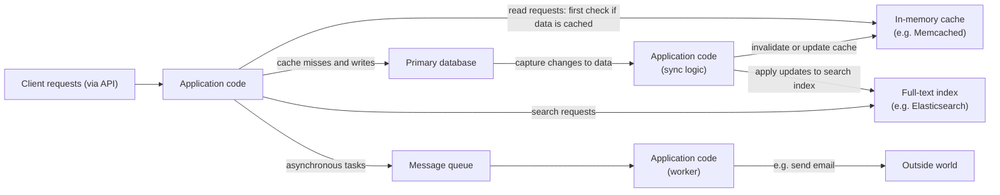
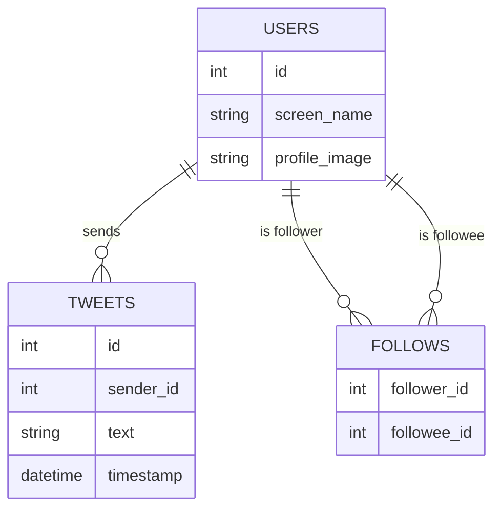
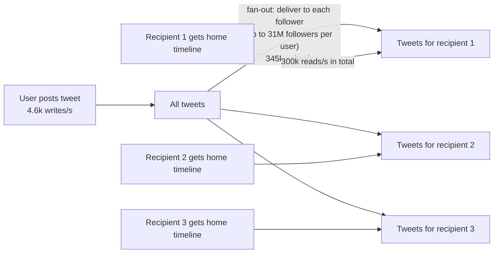
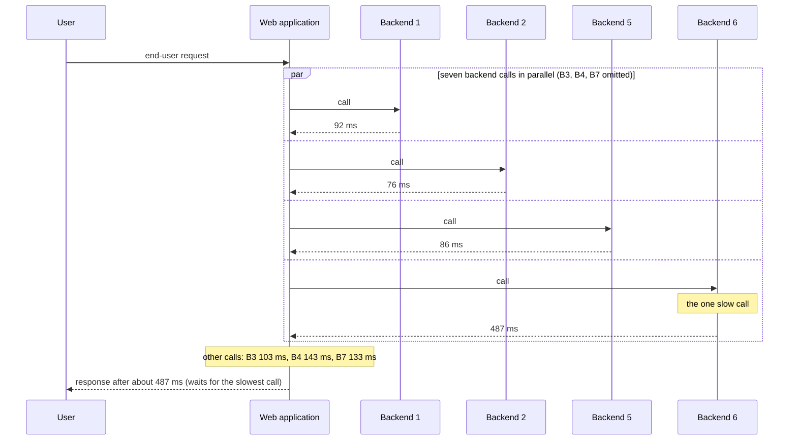

# Chapter 1 — Reliable, Scalable, and Maintainable Applications
*Book: Chapter 1, pp. 3–26*

## Overview

**Part I in brief (Foundations of Data Systems).** Chapters 1 to 4 cover ideas that hold for every data system, whether it lives on one machine or across a cluster (a group of networked machines acting as one system):

1. **Chapter 1** (this one) sets up vocabulary and a way of thinking: what *reliability*, *scalability* and *maintainability* actually mean, and how to aim for them.
2. **Chapter 2** compares data models and query languages, which is the most visible difference between databases from a developer's seat.
3. **Chapter 3** opens up storage engines (the part of a database that physically writes data to disk and reads it back) and how they arrange data on disk; different engines suit different workloads (the mix of reads, writes and queries a system receives), and the choice can dominate performance.
4. **Chapter 4** looks at encoding (serialization: turning in-memory data into bytes that can be saved or sent) formats and how well they cope when requirements change and schemas (the declared structure of the data: which fields exist and their types) must evolve.

Part II then moves on to problems specific to distributed data.

**What question does Chapter 1 answer?** "When we say a data system should be *good*, what exactly do we mean, and how do we talk about it precisely?" The chapter picks three goals and gives each one concrete, measurable meaning:

- **Reliability**: keep working correctly even when things break.
- **Scalability**: have sensible options when load grows.
- **Maintainability**: let many people keep operating and changing the system productively for years.

**Why it matters.** Most modern apps are *data-intensive*: their pain comes from the volume, complexity, or rate of change of data, not from CPU power (the CPU, *central processing unit*, is the chip that executes program instructions). They are assembled from standard parts:

| Need | Building block |
|---|---|
| Keep data so it can be found later | Database |
| Keep the answer to a costly computation so later reads are fast | Cache |
| Let users search by keyword or filter | Search index |
| Hand a message to another process (a running program) to handle asynchronously (later, without the sender waiting) | Stream processing |
| Periodically crunch a big pile of accumulated data | Batch processing |

These building blocks are so successful that we barely notice them. But there are many databases, many caching styles, many ways to build search indexes, and so on, each suited to different needs. Picking and combining them well is the real skill.

**Everyday analogy.** Think of running a restaurant. *Reliability* is still serving good meals when an oven breaks or a cook drops a tray. *Scalability* is having a plan when you go from 50 to 500 diners a night. *Maintainability* is a kitchen organised so a new cook can find things, the manager can see what is happening, and the menu can change without rebuilding the kitchen.

## Key terms

| Term | Plain-English meaning |
|---|---|
| Data-intensive application | An app whose main difficulty is data (amount, complexity, change speed), not CPU. |
| Compute-intensive application | An app whose bottleneck is CPU cycles. |
| Data system | Umbrella name for databases, queues, caches, search indexes, etc., which increasingly overlap. |
| Reliability | The system keeps doing the right thing at the needed performance despite faults. |
| Fault | One component deviating from its specification (a disk dies, a process crashes). |
| Failure | The system as a whole stops giving users the required service. |
| Fault-tolerant / resilient | Able to anticipate and cope with certain kinds of faults. |
| Chaos Monkey | Netflix tool that deliberately kills processes to exercise fault-handling. |
| MTTF (mean time to failure) | Average time before a component fails; for hard disks about 10–50 years. |
| RAID | Arrangement of several disks so one can fail without data loss. |
| Rolling upgrade | Patching or upgrading one node at a time so the whole system never goes down. |
| Systematic error | A fault correlated across many nodes, such as a shared software bug. |
| Cascading failure | A small fault in one part triggers faults in others, spreading outward. |
| Telemetry | Detailed monitoring data (metrics, error rates) about a running system. |
| Scalability | The ability to cope with increased load; discussed as "what are our options if load grows like X?" |
| Load parameters | A few numbers that describe current load (requests/sec, read/write ratio, active users, cache hit rate...). |
| Fan-out | How many further requests (or writes) one incoming request triggers. |
| Throughput | How many records are processed per second, or how long a job takes on a dataset of some size. |
| Response time | What the client sees: time from sending a request to getting the reply. |
| Latency | Time a request spends waiting to be handled (latent). Not the same as response time. |
| Service time | The time actually spent processing the request. |
| Percentile (p50, p95, p99, p999) | The value below which that percentage of measurements fall. |
| Median | The 50th percentile: half of requests are faster, half slower. |
| Tail latency | The high percentiles of response time (the slow outliers). |
| SLO / SLA | Service level objective / agreement: stated targets or contracts for performance and availability. |
| Head-of-line blocking | A few slow requests at the front of a queue delay the fast ones behind them. |
| Tail latency amplification | When one user request needs many backend calls, the chance that at least one is slow grows. |
| Scaling up (vertical) | Moving to a bigger, more powerful machine. |
| Scaling out (horizontal) | Spreading load across many smaller machines. |
| Shared-nothing architecture | Another name for scaling out: machines do not share memory or disk. |
| Elastic system | Automatically adds resources when it detects rising load. |
| Stateless / stateful service | Keeps no durable data of its own / owns data that must be preserved. |
| Maintainability | How easily people can keep the system running and change it over time. |
| Operability | How easy it is for operations teams to keep things running smoothly. |
| Simplicity | How easy it is for new engineers to understand the system. |
| Evolvability | How easy it is to adapt the system to new requirements (also extensibility, modifiability, plasticity). |
| Big ball of mud | A software project drowning in complexity. |
| Accidental complexity | Complexity caused by the implementation rather than by the problem users need solved. |
| Abstraction | A clean interface that hides lots of implementation detail and can be reused. |
| Functional vs nonfunctional requirements | What the system must do vs general properties it must have (security, reliability, scalability...). |

## Thinking About Data Systems

**What it is.** The book lumps databases, queues, caches and similar tools together as **data systems**. At first this seems odd: a database and a message queue both hold data for a while, but they are accessed very differently, so they perform differently and are built differently.

**Why group them anyway?** Two reasons:

1. **The categories are blurring.** Newer tools target a mix of use cases. Redis is a datastore (an in-memory key-value store) that people also use as a message queue (a buffer that holds messages until a consumer picks them up); Apache Kafka is a message queue with durability guarantees (once written, data survives crashes) similar to a database.
2. **One tool is rarely enough.** Many applications have such wide-ranging needs that the work is split into tasks, each handled well by a specific tool, and *your application code* stitches the tools together.

**Example.** Suppose your app has its own caching layer (for example Memcached, a simple in-memory cache) and a separate full-text search server (one that finds documents by any words they contain; Elasticsearch or Solr) next to the main database. Usually it is the application's job to keep the cache and the search index in step with the database.

> **Key term — cache, hit, miss, invalidation:** a **cache** is a fast copy of data that also lives somewhere slower and authoritative (here, the database). A read that finds what it wants in the cache is a **cache hit**; one that does not, and must go to the database, is a **cache miss**. When the underlying data changes, the stale cached copy must be **invalidated** (thrown away) or updated, otherwise readers see old values. Getting this right is famously tricky. See [System Design Fundamentals](../00a-system-design-fundamentals/README.md).

*Figure 1-1 (redrawn): one possible architecture combining several data components behind an application.*



Clients only see the service's API (application programming interface). Behind it, you have effectively built a **new, special-purpose data system** out of general-purpose parts, and it may promise things like "the cache is correctly invalidated or updated on every write so clients see consistent results." So you are now a **data system designer**, not just an app developer.

**Questions a designer must face:** How do we keep data correct and complete when parts break? How do we give steady performance when some parts are degraded? How do we handle growing load? What should the API look like?

Many situational factors also shape a design: team skills, legacy dependencies (older systems you must keep working with), delivery deadline, the organisation's appetite for risk, regulations. The book focuses on three concerns that matter for nearly all software:

| Concern | Short definition |
|---|---|
| **Reliability** | Keeps working correctly (right function, acceptable performance) despite adversity: hardware faults, software faults, even human mistakes. |
| **Scalability** | As data volume, traffic, or complexity grows, there are reasonable ways to cope. |
| **Maintainability** | Over time many people (engineering and operations) can work on it productively, both keeping it running and adapting it. |

**Common confusion:** these words get thrown around loosely. The rest of the chapter gives each one a precise meaning.

## Reliability

**What it is.** Informally, users expect software to:

- do what they expected it to do;
- tolerate users making mistakes or using it in odd ways;
- perform well enough for the use case at the expected load and data volume;
- block unauthorised access and abuse.

If all of that is "working correctly", reliability roughly means **still behaving correctly while things are going wrong**.

**Faults vs failures.**

| | Fault | Failure |
|---|---|---|
| Scope | One component | The whole system |
| Meaning | A part deviates from its spec | Users no longer get the required service |
| Goal | Can never be driven to zero probability | Prevent faults from turning into failures |

Things that can go wrong are **faults**; systems that anticipate and cope with them are **fault-tolerant** or **resilient**. "Fault-tolerant" slightly oversells: no system can survive every conceivable fault. (The book's joke: if a black hole swallowed Earth, surviving that would require hosting in space, which no budget will approve.) So we always talk about tolerating *specific kinds* of faults. The book covers many techniques for building reliable systems out of unreliable parts.

**Deliberately causing faults.** It can make sense to *increase* the fault rate on purpose, for example by randomly killing processes without warning. Many serious bugs come from poor error handling, so constantly exercising the recovery machinery makes you more confident it will work when a real fault happens. The **Netflix Chaos Monkey** is the classic example.

**Prevention vs cure.** Usually tolerating faults beats preventing them, but some faults have no cure. **Security** is the main case: once an attacker has stolen sensitive data, you cannot undo it. The book mostly deals with faults that *can* be cured.

### Hardware Faults

**What they are.** Disks crash, RAM (the computer's fast working memory, which loses its contents when power is lost) goes bad, the power grid blacks out, someone unplugs the wrong network cable. In a large datacenter (a building full of servers, power and networking equipment) these happen constantly.

**The numbers.** Hard disks have an MTTF of roughly **10 to 50 years**. With **10,000 disks** in a cluster, you should expect around **one disk to die every day**.

**First response: hardware redundancy.**

1. Put disks in a **RAID** configuration.
2. Give servers **dual power supplies** and **hot-swappable CPUs** (parts that can be replaced while the machine keeps running).
3. Give datacenters **batteries and diesel generators** for backup power.
4. When one part dies, the redundant part takes over while the broken one is replaced.

It cannot fully stop hardware trouble from causing failures, yet it is a well-understood technique and often keeps a single machine up without interruption for years.

**Why that stopped being enough.**

- Until recently, redundant components made total loss of a single machine rare, and restoring a backup (a saved copy of the data) onto a new machine was usually quick enough. Only a few apps truly needed multiple machines for high availability (staying usable nearly all the time, even when parts break).
- Now data volumes and compute demands mean more apps use **many machines**, which raises the total rate of hardware faults proportionally.
- On some cloud platforms such as **AWS** (Amazon Web Services, which rents computing over the internet), virtual machine instances (a *virtual machine* is a software-simulated computer sharing a physical server with others; each running one is an *instance*) can vanish without warning, because the platforms favour **flexibility and elasticity** over single-machine reliability.

**The shift.** Systems increasingly use **software fault tolerance** to survive losing a *whole machine*, instead of or in addition to hardware redundancy. Bonus: operations get easier. A single-server system needs planned downtime to reboot (for example for OS security patches, i.e. fixes to the operating system such as Linux or Windows), whereas a system that tolerates node loss can be patched **node by node** with no overall downtime: a **rolling upgrade** (see Chapter 4).

### Software Errors

**How they differ from hardware faults.** Hardware faults are usually treated as **random and independent**: one disk dying does not make another die (apart from weak correlations such as rack temperature; a *rack* is the tall metal frame holding a stack of servers). Many components failing together is unlikely.

**Systematic errors** are different: they are harder to predict and are **correlated across nodes**, so they cause far more system failures than independent hardware faults. Examples:

- A bug that crashes *every* instance of an app server when it sees a particular bad input. Real case: the **leap second on June 30, 2012** (an extra second occasionally added to clocks to keep them aligned with Earth's rotation), which made many applications hang at the same moment because of a **Linux kernel** bug (the *kernel* is the core of the operating system that manages hardware, memory and processes).
- A runaway process that exhausts something shared, such as memory, CPU time, network bandwidth (how much data the network can carry per second), or disk space.
- A dependency (another service or library your system relies on) that slows down, stops responding, or starts returning corrupted data.
- **Cascading failures**: a minor fault in one part causes a fault in a second part, which in turn causes further faults.

**Why they hide.** Such bugs can sit quietly for ages until some unusual combination of circumstances sets them off. The trigger exposes an assumption the software made about its environment that was *usually* true and then, one day, was not.

**What helps (no silver bullet):**

1. Think carefully about assumptions and interactions in the system.
2. Test thoroughly.
3. Isolate processes.
4. Let processes crash and restart.
5. Measure, monitor and analyse behaviour in production (the live system that real users are using).
6. If the system promises some guarantee, have it **check itself continuously** and alert on discrepancies. Example: a message queue can check that messages in equals messages out.

### Human Errors

**The problem.** Humans design, build and operate systems, and even well-meaning humans are unreliable. One study of large internet services found **operator configuration errors were the leading cause of outages** (periods when a service is unavailable), while hardware faults (servers or network) were involved in just **10–25%** of outages.

**How the best systems cope** (they combine several approaches):

| Approach | What it means in practice |
|---|---|
| Design to minimise error opportunities | Good abstractions, APIs and admin interfaces make the right thing easy and the wrong thing hard. But if they are too restrictive, people work around them, so balance is needed. |
| Decouple mistake-prone places from failure-causing places | Provide full-featured **non-production sandbox** environments (isolated copies of the system where mistakes cannot harm anyone) with real data where people can experiment without affecting real users. |
| Test at every level | Unit tests (checking one small piece of code alone), whole-system integration tests (checking pieces working together), manual tests. Automated tests are especially good at covering rare corner cases (unusual inputs or situations). |
| Make recovery quick and easy | Fast rollback (undo back to the previous version) of configuration changes, **gradual rollouts** of new code so a bug hits only a few users, and tools to **recompute data** if an old computation was wrong. |
| Detailed, clear monitoring | Performance metrics and error rates, called **telemetry** in other engineering fields (a rocket in flight depends on it). Monitoring gives early warnings, checks assumptions, and helps diagnosis. |
| Good management and training | Important but outside the book's scope. |

### How Important Is Reliability?

Reliability is not only for nuclear plants or air traffic control. Ordinary apps must be reliable too:

- Bugs in business software cost productivity, and wrong reported figures can bring **legal risk**.
- Outages of **ecommerce** (online shopping) sites cost revenue and reputation.
- Even "noncritical" apps carry responsibility. Picture a parent keeping every photo and video of their children in your photo app. How would they feel if the database were corrupted, and would they even know how to restore a backup?

Sometimes we knowingly trade reliability away, to lower **development cost** (a prototype for an unproven market) or **operational cost** (a service with razor-thin margins). The book's point: do it consciously, knowing where you are cutting corners.

## Scalability

**What it is.** A system that works today may not work tomorrow. A common reason is **increased load** (the amount of work being asked of the system): perhaps concurrent users (people using it at the same moment) grow from 10,000 to 100,000, or from 1 million to 10 million, or data volumes grow a lot.

**Scalability** is the word for how well a system can handle growing load.

**Common confusion:** scalability is *not* a yes/no label. Saying "X scales" or "Y doesn't scale" means nothing. The useful questions are:

- "If the system grows *in this particular way*, what options do we have?"
- "How can we add computing resources to absorb the extra load?"

### Describing Load

**What it is.** Before asking "what if load doubles?" you must describe today's load with a few numbers, the **load parameters**. Which ones depend on your architecture: requests per second to a web server (the program that receives HTTP requests from browsers and apps), read/write ratio in a database (how many lookups per update), simultaneously active users in a chat room, cache hit rate (the fraction of reads answered from the cache), or something else. Sometimes the average matters; sometimes a few extreme cases are the real bottleneck (the one part that limits the speed of the whole).

**Worked example: Twitter (data from November 2012).** Two main operations:

| Operation | What it does | Load |
|---|---|---|
| Post tweet | Publish a message to your followers | **4.6k** requests/sec on average, over **12k** requests/sec at peak |
| Home timeline | View tweets from people you follow | **300k** requests/sec |

Handling 12,000 writes per second alone would be fairly easy. The real challenge is **fan-out**: each user follows many people and is followed by many people.

> **Aside: where "fan-out" comes from.** It is borrowed from electronics, where it counts how many logic gate (a tiny circuit computing AND, OR, NOT and so on) inputs hang off one gate's output (which must supply enough current for all of them). In transaction processing (systems that handle many small, interactive reads and writes, such as orders or payments) it means how many requests to other services one incoming request causes.

**Two ways to implement it:**

**Approach 1 — compute on read.** Posting a tweet just inserts it into one global collection of tweets. When someone opens their home timeline:

1. Look up everyone they follow.
2. Fetch all tweets from each of those users.
3. Merge them, sorted by time.

*Figure 1-2 (redrawn): a simple relational schema (the set of tables, their columns and how they link) for a Twitter-style home timeline.*



In SQL, approach 1 is one join-heavy query (a *join* combines rows from two tables that share a value, such as a user id). Here is an equivalent idea for a different app, a recipe site where you "subscribe" to chefs and see their latest recipes:

```sql
SELECT recipes.*, chefs.display_name      -- the recipe plus who wrote it
FROM recipes
  JOIN chefs         ON recipes.author_id = chefs.id          -- attach author details
  JOIN subscriptions ON subscriptions.chef_id = chefs.id      -- keep chefs someone subscribes to
WHERE subscriptions.reader_id = :me                           -- ...and that someone is me
ORDER BY recipes.published_at DESC;                           -- newest first
```

- Line 1 picks the columns to show.
- Lines 3–4 link each recipe to its author and each author to their subscribers.
- Line 5 keeps only rows where the subscriber is the current user.
- Line 6 sorts by time, just like merging timelines. All the work happens at **read time**.

**Approach 2 — precompute on write.** Keep a cache per user holding their home timeline, like a mailbox. When someone posts:

1. Look up all of that user's followers.
2. Insert the new tweet into each follower's home timeline cache.
3. Reading a timeline is now cheap, because the result was built in advance.

*Figure 1-3 (redrawn): Twitter's pipeline for delivering tweets to followers, with November 2012 load parameters.*



**Which is better?** Twitter started with approach 1, but the system could not keep up with timeline reads, so it switched to approach 2. It works better because tweets are published at a rate almost **two orders of magnitude lower** (an *order of magnitude* is a factor of 10, so roughly 100 times lower) than timelines are read, so it is worth shifting effort to the write path to make the read path cheap.

**The downside of approach 2.** Posting becomes expensive. An average tweet reaches about **75 followers**, turning **4.6k tweets/sec into 345k cache writes/sec**. But the average hides huge variation: some users have **over 30 million followers**, so one tweet may trigger over 30 million writes. Twitter aims to deliver tweets within **five seconds**, which makes this hard.

**Lesson.** For Twitter, the **distribution of followers per user** (perhaps weighted by how often each tweets) is a key load parameter because it drives fan-out load. Your app will differ, but you can reason about its load the same way.

**The final twist: a hybrid.** With approach 2 working robustly, Twitter moved to a mix. Most users' tweets are still fanned out on write, but a small number of **celebrities** with enormous follower counts are exempt. Their tweets are fetched separately at read time and merged in, like approach 1. This gives consistently good performance. (The book returns to this in Chapter 12.)

| | Approach 1: fan-out on read | Approach 2: fan-out on write | Hybrid |
|---|---|---|---|
| Cost of posting | Cheap (one insert) | Expensive (one write per follower) | Cheap for celebrities, per-follower for others |
| Cost of reading | Expensive (join + merge) | Cheap (read one cache) | Cheap cache read + merge in celebrity tweets |
| Pain point | Read rate is ~100x write rate | Users with 30M+ followers | More moving parts |

### Describing Performance

Once load is described, you can ask what happens when it grows, in two ways:

1. **Fixed resources:** raise a load parameter but keep CPU, memory and bandwidth the same. How does performance change?
2. **Fixed performance:** raise a load parameter. How much must you add in resources to keep performance the same?

Both need performance numbers.

**Throughput vs response time.**

- In **batch** systems (Hadoop, an open-source framework for processing huge datasets across a cluster, is the book's example), the usual concern is **throughput**: records processed per second, or total time for a job on a dataset of a given size.
- In **online** systems (ones where a user or client is waiting for each answer), **response time** usually matters most: the time from when a client sends a request until the reply arrives.

> **Aside: batch running time.** Ideally a batch job takes dataset size divided by throughput. In practice it takes longer because of **skew** (data not evenly spread among workers) and waiting for the slowest task to finish.

> **Latency vs response time.** People often treat them as synonyms, but they differ. **Response time** is what the client experiences: the actual processing time (**service time**) plus network delays and queueing delays. **Latency** is only the time a request spends *waiting* to be handled, when it is latent.

**Response time is a distribution, not a number.** Sending the same request repeatedly still gives slightly different times, and a real system with varied requests varies a lot. Some slow requests are genuinely more expensive (more data). But even identical requests vary because of random extra delays: switching the CPU to a background process (context switch), a dropped packet (one small unit of network data) that TCP (the protocol that guarantees delivery by resending lost data) must retransmit, a pause for garbage collection (the language runtime stopping to reclaim memory no longer in use), a page fault (the program touches memory that has been moved to disk, so it must be loaded back first) that forces a disk read, even mechanical vibration in the server rack, and plenty of other causes.

*Figure 1-4 (described):* a bar chart of response times for 100 sample requests. Most bars are short, a handful of outliers are much taller, and the chart marks the mean, the median, and the 95th and 99th percentiles, showing how a single average hides the spread while the high percentiles reveal how bad the outliers are.

**Why the mean is misleading.** "Average" usually means the arithmetic mean (add n values, divide by n). It does not tell you how many users actually waited that long, so it is a poor measure of the *typical* experience.

**Use percentiles instead.**

1. Sort all response times from fastest to slowest.
2. The **median** (50th percentile, **p50**) is the halfway point. If p50 = 200 ms, half of requests finish faster than 200 ms and half take longer. It tells you how long users *typically* wait.
3. Higher percentiles show how bad the outliers are: **p95, p99, p999** (99.9th). If p95 = 1.5 s, then 95 of 100 requests take under 1.5 s and 5 of 100 take 1.5 s or more.

**Common confusion:** the median is about a *single request*. If a user makes several requests (over a session, or because one page loads several resources), the chance that *at least one* is slower than the median is well above 50%.

**Why tail latencies matter.** High percentiles, or **tail latencies**, directly shape user experience.

- **Amazon** sets internal service response-time requirements at the **99.9th percentile**, even though that concerns only 1 in 1,000 requests. The slowest requests often belong to customers with the most data, because they have bought the most, making them the **most valuable customers**.
- Amazon observed that **100 ms** more response time cuts sales by **1%**; others report a **1-second** slowdown lowers a customer satisfaction metric by **16%**.
- But optimising the **99.99th percentile** (1 in 10,000) was judged too costly for too little gain at Amazon. Very high percentiles are dominated by random events you cannot control, and returns diminish.

**SLOs and SLAs.** Percentiles are commonly written into **SLOs (service level objectives)** and **SLAs (service level agreements)**, the internal targets and the formal contracts stating how fast and how available a service is expected to be. Example SLA: the service counts as "up" if its median response time is below **200 ms** and its p99 below **1 s** (slower is as bad as down), and it must meet that bar for no less than **99.9%** of the time. Clients know what to expect and can claim refunds if it is missed.

**Queueing delays and head-of-line blocking.** A server can only work on a few things at once (limited by, for example, CPU cores, the independent processing units inside a chip). Requests that arrive while it is busy wait in a **queue** (a waiting line, served in order). A few slow requests can hold up everything queued behind them: **head-of-line blocking**. The later requests may be quick to process, yet the client sees a slow response because of waiting. Therefore **measure response time on the client side**.

**Load-testing pitfall.** When generating artificial load (load testing: deliberately sending lots of fake traffic to see how a system copes), the test client must keep sending requests **regardless of response time**. If it waits for each reply before sending the next, queues stay artificially short and the results are skewed.

> **Percentiles in practice (sidebar).**
> - **Tail latency amplification:** when one end-user request calls several backends (even in parallel), it must wait for the *slowest* call. One slow call makes the whole request slow. So even if only a small fraction of backend calls are slow, a larger fraction of user requests end up slow.
> - **Computing percentiles on dashboards** (screens of live graphs about a system's health): e.g. keep a rolling window (a time span that slides forward, always covering the most recent period) of the last 10 minutes of response times and, every minute, compute the median and other percentiles and plot them.
> - The naive way keeps every response time in the window and sorts the list every minute. Cheaper probabilistic algorithms (methods that trade a small, bounded error for big savings) estimate percentiles closely while using very little CPU and memory: **forward decay**, **t-digest**, **HdrHistogram**.
> - **Never average percentiles** (for example to lower time resolution or merge several machines). It is mathematically meaningless. To combine response-time data correctly, you **add up the histograms** (a histogram counts how many measurements fell into each range of values, e.g. 0–10 ms, 10–20 ms).

*Figure 1-5 (redrawn): a web application fans one end-user request out to seven backends (92, 76, 103, 143, 86, 487, 133 ms); the single 487 ms call sets the time for the whole request.*



A quick illustration of amplification (our own numbers, not the book's): if each backend call has a 1% chance of being slow and a page makes 100 independent calls, the chance that at least one is slow is 1 − 0.99^100 ≈ 0.634, about 63%.

### Approaches for Coping with Load

**Core idea.** An architecture suited to one level of load is unlikely to handle **10 times** that load. A fast-growing service will probably need to rethink its architecture at **every order of magnitude** of growth, or even more often.

**Scaling up vs scaling out.**

| | Scaling up (vertical) | Scaling out (horizontal, shared-nothing) |
|---|---|---|
| How | Move to a more powerful machine | Spread load over many smaller machines |
| Pros | Simpler; everything on one machine | Can go beyond any single machine's limits |
| Cons | High-end machines get very expensive | More complexity, especially for stateful data |

In practice good architectures mix both pragmatically. For example, a few fairly powerful machines can be simpler and cheaper than lots of small virtual machines.

**Elastic vs manual scaling.**

- **Elastic** systems add resources automatically when load rises. Useful when load is highly unpredictable.
- **Manually scaled** systems rely on a human to analyse capacity (how much load the current machines can handle) and add machines. Simpler, with fewer operational surprises (see "Rebalancing Partitions", Chapter 6).

**Stateless vs stateful.** Spreading **stateless** services over many machines is fairly easy. Taking a **stateful** data system from one node to many adds a lot of complexity. So conventional wisdom until recently was: **keep your database on one node (scale up)** until cost or high-availability needs force you to distribute it. As distributed tools and abstractions improve, this may change, and distributed data systems might become the default even for modest data or traffic. The rest of the book examines many distributed data systems for scalability, ease of use and maintainability.

**No magic scaling sauce.** Large-scale architectures are usually very specific to the application; there is no generic, one-size-fits-all scalable design. The problem might be read volume, write volume, data volume, data complexity, response time needs, access patterns, or (usually) a mix of all of these and more. (*Access patterns* means which data is read or written, how often, and in what shape.)

**Example of why.** A system for **100,000 requests/sec of 1 kB each** looks very different from one for **3 requests/minute of 2 GB each**, even though both move the same amount of data per second.

**Assumptions matter.** A well-scaling architecture is built on assumptions about which operations are common and which are rare (the load parameters). If those assumptions are wrong, scaling work is wasted at best and harmful at worst. In an **early-stage startup or unproven product**, fast iteration (shipping small changes quickly and learning from them) on features usually matters more than scaling for imagined future load.

Still, even application-specific scalable designs tend to be assembled from **general-purpose building blocks in recurring patterns**, and those blocks and patterns are what the book teaches.

## Maintainability

**Why it matters.** Most of the cost of software comes **after** initial development: fixing bugs, keeping systems running, investigating failures, moving to new platforms, adapting to new use cases, paying back technical debt (shortcuts taken earlier that make later changes harder, like a loan that accrues interest), and adding features.

Many engineers dislike maintaining **legacy systems** (old systems still in use, often built by people who have left; fixing others' mistakes, outdated platforms, systems stretched to do things they were not designed for). Every legacy system is painful in its own way, so general advice is hard. What we *can* do is design so that maintenance hurts less, and avoid creating legacy software ourselves.

Three design principles:

| Principle | Goal |
|---|---|
| **Operability** | Make it easy for operations to keep the system running smoothly. |
| **Simplicity** | Remove as much complexity as you can so newcomers can understand the system. (This is about the system's internals, not a simple user interface.) |
| **Evolvability** | Make it easy to change the system later for unanticipated needs. Also called extensibility, modifiability, or plasticity. |

Just like reliability and scalability, these have no quick recipe; the aim is to keep the three principles in mind while designing.

### Operability: Making Life Easy for Operations

One often-quoted view: a strong operations team can frequently compensate for weak or incomplete software, whereas even excellent software will not run reliably if operations are poor. Some operations work can and should be automated, yet humans must still set up that automation and check it works.

**What a good operations team typically does:**

- Monitors system health and quickly restores service when it goes bad.
- Tracks down causes of problems such as failures or degraded performance.
- Keeps platforms and software current, security patches included.
- Understands how systems affect each other, so a risky change is caught before damage.
- Anticipates future problems (for example **capacity planning**: forecasting how many machines, disks and so on will be needed) and solves them early.
- Establishes good practices and tools for deployment (putting new code into production) and configuration management (keeping settings across many machines correct and consistent).
- Performs complex maintenance, such as migrating an application between platforms.
- Keeps the system secure as configuration changes.
- Defines processes that make operations predictable and production stable.
- Preserves organisational knowledge about the system as people come and go.

**What data systems can do to make routine tasks easy** (freeing ops for high-value work):

- Give **visibility** into runtime behaviour and internals via good monitoring.
- Support **automation** and integration with standard tools.
- **Avoid depending on individual machines**, so any one machine can be switched off for maintenance while the rest keeps serving.
- Provide good documentation and an **operational model** that is easy to grasp (doing X leads to Y).
- Offer **good defaults**, but let admins override them.
- **Self-heal** where sensible, but give admins manual control of system state when needed.
- Behave **predictably**, with few surprises.

### Simplicity: Managing Complexity

**The problem.** Small projects can have beautifully simple code, but big projects tend to become complex and hard to understand. Complexity slows everyone down and raises maintenance cost. A project stuck in complexity is called a **big ball of mud**.

**Symptoms of complexity:** a state space (the set of all situations the system can be in) that explodes, modules coupled too tightly (so changing one forces changes in others), dependencies in a tangle, names and terms used inconsistently, performance hacks, special cases to work around problems elsewhere, and more.

**Why it hurts.** Budgets and schedules overrun. Changes are riskier: when a system is hard to reason about, hidden assumptions, unintended consequences and surprising interactions slip by. Reducing complexity greatly improves maintainability, so **simplicity should be a key goal**.

**Accidental vs essential complexity.** Simpler does not have to mean fewer features. It can mean removing **accidental complexity**, which Moseley and Marks define as complexity that is not inherent in the problem as users see it but arises only from the implementation.

**Abstraction is the best tool.** A good abstraction hides lots of detail behind a clean, easy façade and can be reused by many applications. Reuse is more efficient than rebuilding similar things, and improvements to the shared component benefit every user of it.

Examples:

- **High-level programming languages** hide machine code (the raw instructions a CPU executes), CPU registers (tiny storage slots inside the CPU) and syscalls (requests a program makes to the operating system, such as "open this file"). The machine code is still there; you just do not deal with it directly.
- **SQL** shields you from intricate data structures on disk and in memory, from other clients' concurrent requests (requests running at the same time), and from inconsistencies left by crashes.

**The catch.** Good abstractions are hard to find. In distributed systems there are many good algorithms, but it is much less clear how to package them into abstractions that keep complexity manageable. The book keeps looking for abstractions that turn parts of large systems into well-defined, reusable components.

### Evolvability: Making Change Easy

Requirements almost never stay fixed. You learn new facts, new use cases appear, business priorities shift, users ask for features, new platforms replace old ones, laws and regulations change, and growth forces architectural changes.

- **Agile** working patterns (short cycles of building, showing and adjusting, rather than one big up-front plan) give an organisational framework for change, and the Agile community contributed technical practices like **test-driven development (TDD)** (writing a failing test first, then the code that makes it pass) and **refactoring** (restructuring code without changing what it does).
- Most of those discussions are small-scale (a couple of source files in one app). This book looks for agility at the level of a **whole data system**, possibly many applications and services. Example question: how would you "refactor" Twitter's timeline architecture from approach 1 to approach 2?
- How easily a data system can be changed depends heavily on its **simplicity and abstractions**: simple, understandable systems are easier to modify.

Because this system-level agility is so important, the book gives it its own name: **evolvability**.

## Summary

- An application must meet **functional requirements** (what it does: store, retrieve, search, process data) and **nonfunctional requirements** (general properties like security, reliability, compliance (meeting laws and regulations), scalability, compatibility, maintainability). This chapter focused on three nonfunctional ones.
- **Reliability** = working correctly even when faults happen. Faults come from **hardware** (usually random and uncorrelated), **software** (bugs are usually systematic and hard to handle), and **humans** (who will make mistakes). Fault-tolerance techniques can hide some kinds of faults from users.
- **Scalability** = having strategies to keep performance good as load grows. To discuss it, describe **load** quantitatively (Twitter's home timeline and fan-out) and **performance** quantitatively (response time percentiles). A scalable system lets you add capacity to stay reliable under high load.
- **Maintainability** is about making life better for the engineers and operators who work on the system. Good abstractions cut complexity and make the system simpler to modify and adapt to new use cases; good operability means clear visibility into health and effective ways to manage it.
- There is no easy fix for any of the three, but certain patterns and techniques recur across many kinds of applications; the coming chapters study them. Part III returns to multi-component systems like Figure 1-1.

## Interview angle

**1. "What is the difference between a fault and a failure, and how do you build reliable systems?"**
*30-second answer:* A fault is one component misbehaving; a failure is the whole system no longer serving users. You cannot eliminate faults, so you design fault tolerance so faults do not become failures: redundancy (RAID, dual power, multiple machines), software tolerance of whole-node loss, process isolation and restarts, monitoring, and quick rollback. Deliberately injecting faults (Chaos Monkey) keeps the recovery paths tested.
- *Follow-up: Why are software bugs worse than hardware faults?* Hardware faults are mostly independent; a bug is systematic and hits every node that sees the same input or condition at once (e.g. the 2012 leap-second Linux bug), so it can take down the whole fleet.
- *Follow-up: What is the biggest cause of outages?* In the study cited, operator configuration errors; hardware played a role in only 10–25%.

**2. "Design a Twitter home timeline. Fan-out on write or on read?"**
*30-second answer:* Reads (300k/s) outnumber posts (4.6k/s avg) by about 100x, so precompute timelines at write time into per-user caches. But celebrities with tens of millions of followers make write fan-out explode, so use a hybrid: fan out for normal users, and fetch celebrity tweets at read time and merge.
- *Follow-up: What is the key load parameter?* The distribution of followers per user (weighted by tweet frequency), because it determines fan-out cost.
- *Follow-up: How many cache writes per second?* About 75 followers on average, so roughly 345k writes/s.

**3. "Why use percentiles instead of the average for latency?"**
*30-second answer:* The mean hides how many users actually suffer; percentiles show the distribution. p50 is the typical experience, p99/p999 show the tail. Tails matter because the slowest requests often belong to the most valuable users and because fan-out to many backends amplifies tail latency.
- *Follow-up: Can I average p99s from 10 servers?* No, that is meaningless; merge the histograms instead (or use t-digest/HdrHistogram).
- *Follow-up: Where should latency be measured?* On the client side, because queueing and head-of-line blocking add delay the server does not see.
- *Follow-up: Latency vs response time?* Response time = service time + network + queueing delays, as seen by the client; latency is only the waiting time.

**4. "Scale up or scale out?"**
*30-second answer:* Scaling up is simpler but high-end hardware gets very expensive; scaling out (shared-nothing) goes further but adds complexity, especially for stateful data. Stateless services are easy to scale out; the classic advice is to keep the database on one node until cost or availability forces distribution. Real systems mix both, and expect to redesign at each order-of-magnitude of growth.
- *Follow-up: Elastic or manual scaling?* Elastic helps with unpredictable load; manual is simpler with fewer surprises.

**5. "What makes a system maintainable?"**
*30-second answer:* Operability (easy to run: monitoring, automation, no single-machine dependencies, predictable behaviour), simplicity (remove accidental complexity with good abstractions), and evolvability (easy to adapt as requirements change).
- *Follow-up: What is accidental complexity?* Complexity that comes from the implementation, not from the problem users need solved.

## Self-check

1. **What makes an application "data-intensive"?**
   Its main challenge is the data (volume, complexity, or rate of change) rather than CPU power.

2. **Give two reasons the book groups databases, queues and caches under "data systems".**
   Tools now overlap (Redis as a queue, Kafka with database-like durability), and apps combine several tools with application code, effectively creating a new composite data system.

3. **A cluster has 10,000 disks with MTTF of 10–50 years. Roughly how many fail per day?**
   About one per day on average.

4. **Why did the industry shift from hardware redundancy toward software fault tolerance?**
   More machines mean more total hardware faults, cloud VMs can disappear without warning, and tolerating whole-node loss enables rolling upgrades without downtime.

5. **Your p50 is 100 ms and p99 is 2 s. A page makes 20 backend calls in parallel. Is the typical page load closer to 100 ms or 2 s? Why?**
   Neither number describes it well. The page waits for the slowest of its 20 calls, so it is almost never as fast as the per-call median (the chance that all 20 calls beat p50 is 0.5^20, about one in a million). And with a 1% chance per call of being p99-slow, about 18% of pages (1 − 0.99^20 ≈ 0.18) wait 2 s or more, compared with 1% of single calls. That jump from 1% to 18% is tail latency amplification. (Our own illustrative numbers, assuming independent calls; the book states the effect without arithmetic.)

6. **Why did Twitter switch from approach 1 to approach 2, and why then move to a hybrid?**
   Timeline reads vastly outnumbered posts, so precomputing on write made reads cheap. But users with 30M+ followers made write fan-out huge, so celebrities' tweets are fetched at read time instead.

7. **A load-test client waits for each response before sending the next request. What goes wrong?**
   Queues stay artificially short, so measured response times look better than reality.

8. **Two systems each handle the same bytes per second: one with 100,000 × 1 kB requests/sec, one with 3 × 2 GB requests/minute. Should they share an architecture?**
   No. Load parameters differ completely, so the architectures would look very different; there is no generic scalable design.

9. **Name three things a data system can do to improve operability.**
   Any three of: good monitoring/visibility, automation support, no dependency on single machines, clear documentation and operational model, sensible overridable defaults, self-healing with manual override, predictable behaviour.

10. **When is it acceptable to sacrifice reliability?**
    When deliberately trading it for lower development cost (prototype for an unproven market) or operational cost (very thin margins), as long as you know you are cutting corners.
