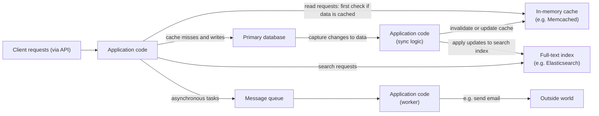
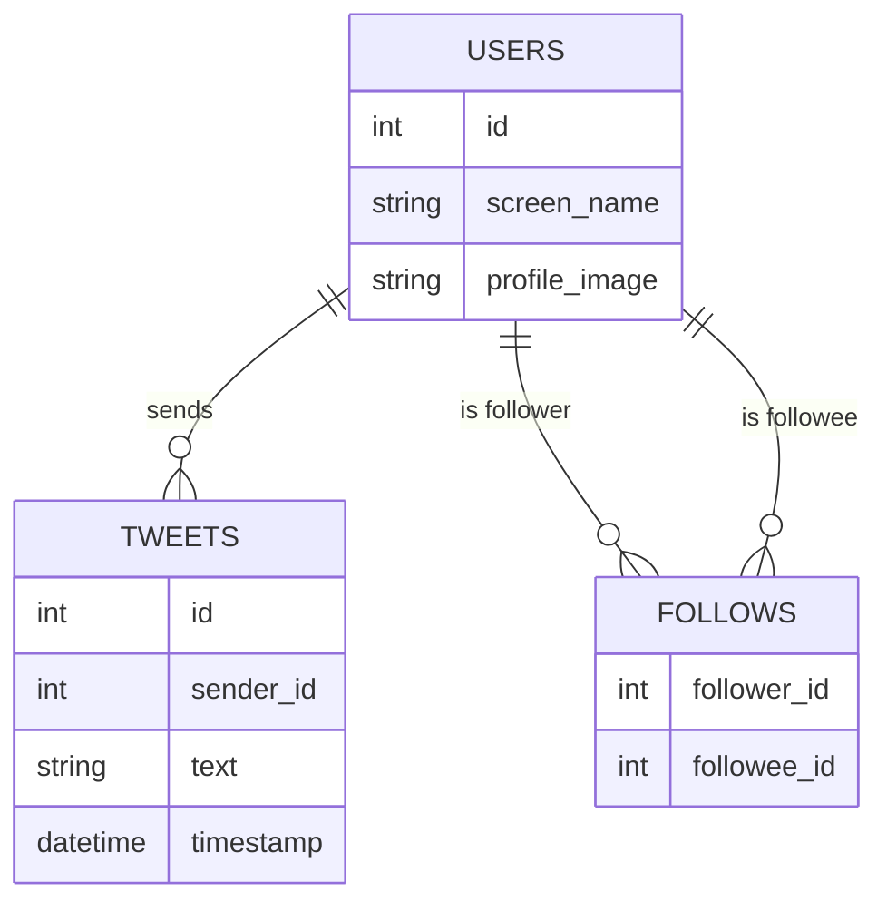
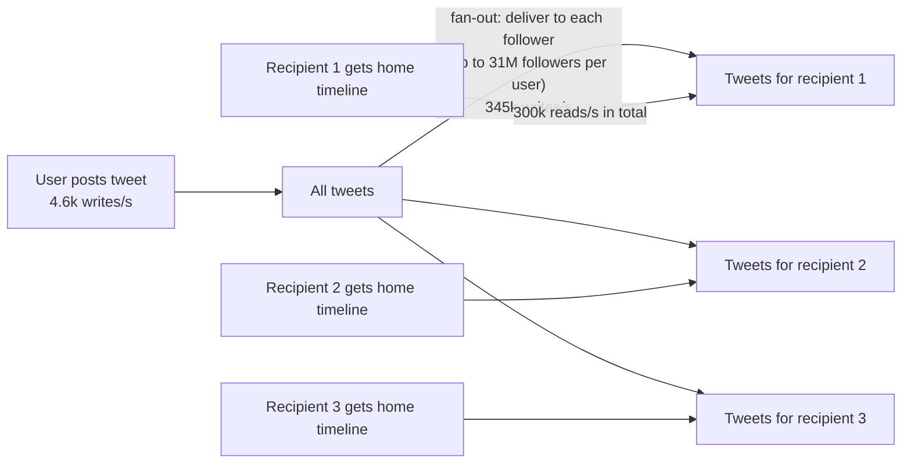
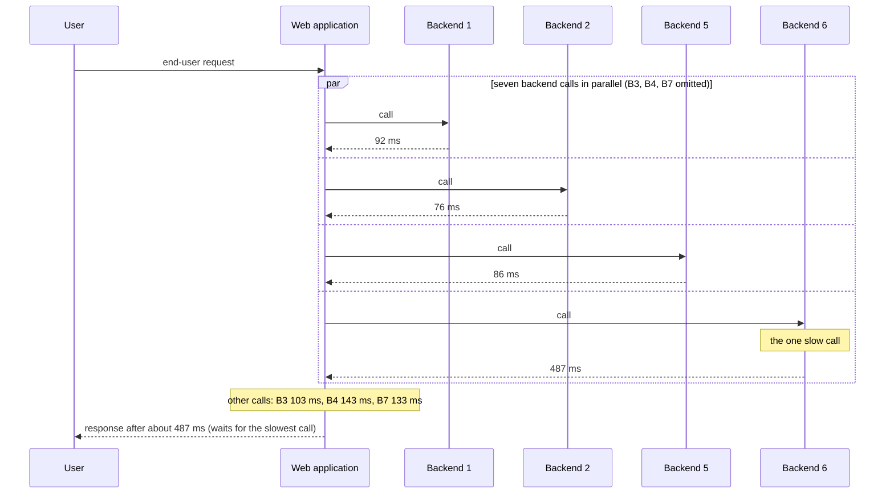

# Chapter 1 — Reliable, Scalable, and Maintainable Applications
*Book: Chapter 1, pp. 3–26*

## Overview

**Part I in brief (Foundations of Data Systems).** Chapters 1–4 hold for every data system, on one machine or a cluster: Ch 1 sets the vocabulary (reliability, scalability, maintainability); Ch 2 compares data models and query languages; Ch 3 opens up storage engines (the part of a database that writes data to disk and reads it back), whose fit to the workload (mix of reads, writes and queries) can dominate performance; Ch 4 covers encoding (serialization: turning in-memory data into bytes) and schema evolution (a *schema* is the declared structure of the data). Part II then turns to distributed data.

**What question does Chapter 1 answer?** "What exactly do we mean when we say a data system is *good*?" Three goals, each given a measurable meaning:

- **Reliability**: keep working correctly even when things break.
- **Scalability**: have sensible options when load grows.
- **Maintainability**: let many people keep operating and changing the system productively for years.

**Why it matters.** Most modern apps are *data-intensive* (the pain is data volume, complexity or rate of change, not CPU) and are assembled from standard parts:

| Need | Building block |
|---|---|
| Keep data so it can be found later | Database |
| Remember the result of a costly computation for fast reads | Cache |
| Search by keyword or filter | Search index |
| Hand a message to another process to handle asynchronously | Stream processing |
| Periodically crunch a big pile of accumulated data | Batch processing |

There are many databases, caching styles and indexing approaches, each suited to different needs; picking and combining them well is the real skill.

## Key terms

| Term | Plain-English meaning |
|---|---|
| Data-intensive / compute-intensive | Main difficulty is data (amount, complexity, change speed) / CPU cycles. |
| Data system | Umbrella for databases, queues, caches, search indexes, etc., which increasingly overlap. |
| Reliability | Keeps doing the right thing at the needed performance despite faults. |
| Fault vs failure | One component deviating from its spec vs the whole system no longer serving users. |
| Fault-tolerant / resilient | Able to anticipate and cope with certain kinds of faults. |
| Chaos Monkey | Netflix tool that deliberately kills processes to exercise fault handling. |
| MTTF (mean time to failure) | Average time before a component fails; hard disks about 10–50 years. |
| RAID | Several disks arranged so one can fail without data loss. |
| Rolling upgrade | Upgrading one node at a time so the system never goes down. |
| Systematic error | A fault correlated across many nodes, e.g. a shared software bug. |
| Cascading failure | A small fault in one part triggers faults in others. |
| Telemetry | Detailed monitoring data (metrics, error rates) about a running system. |
| Scalability | Ability to cope with increased load: "what are our options if load grows like X?" |
| Load parameters | A few numbers describing current load (requests/sec, read/write ratio, active users, cache hit rate…). |
| Fan-out | How many further requests (or writes) one incoming request triggers. |
| Throughput | Records processed per second, or job time for a dataset of some size. |
| Response time / service time / latency | What the client sees (send to reply) / time actually processing / time waiting to be handled. |
| Percentile (p50, p95, p99, p999) | Value below which that percentage of measurements fall; p50 = median. |
| Tail latency | High percentiles of response time (slow outliers). |
| SLO / SLA | Service level objective / agreement: targets or contracts for performance and availability. |
| Head-of-line blocking | Slow requests at the front of a queue delay fast ones behind them. |
| Tail latency amplification | One user request needing many backend calls makes it likelier that at least one is slow. |
| Scaling up (vertical) / out (horizontal, shared-nothing) | Bigger machine / many smaller machines not sharing memory or disk. |
| Elastic system | Automatically adds resources when load rises. |
| Stateless / stateful service | Keeps no durable data / owns data that must be preserved. |
| Maintainability: operability, simplicity, evolvability | Easy for ops to run / for newcomers to understand / to adapt to new requirements (also extensibility, modifiability, plasticity). |
| Big ball of mud | A project drowning in complexity. |
| Accidental complexity | Complexity from the implementation, not from the problem users need solved. |
| Abstraction | A clean, reusable interface hiding implementation detail. |
| Functional vs nonfunctional requirements | What the system must do vs general properties (security, reliability, scalability…). |

## Thinking About Data Systems

**What it is.** The book lumps databases, queues and caches together as **data systems**, even though they are accessed, perform and are built very differently. Two reasons:

1. **The categories are blurring.** Redis is an in-memory key-value datastore also used as a message queue; Apache Kafka is a message queue with database-like durability guarantees (written data survives crashes).
2. **One tool is rarely enough.** Work is split into tasks, each handled by a specific tool, and *your application code* stitches them together.

**Example.** An app with its own caching layer (e.g. Memcached) and a full-text search server (Elasticsearch or Solr: finds documents by any words they contain) beside the main database. Usually the application must keep cache and index in step with the database.

> **Key term — cache, hit, miss, invalidation:** a **cache** is a fast copy of data whose authoritative home is slower (here, the database). A read found in the cache is a **hit**; one that must go to the database is a **miss**. When the underlying data changes, the stale copy must be **invalidated** (thrown away) or updated, or readers see old values; getting this right is famously tricky. See [System Design Fundamentals](../00a-system-design-fundamentals/README.md).

*Figure 1-1 (redrawn): one possible architecture combining several data components behind an application.*



Clients only see the service's API. Behind it you have built a **new, special-purpose data system** from general-purpose parts, which may promise things like "the cache is correctly invalidated or updated on every write." You are now a **data system designer**, not just an app developer.

**Designer's questions:** How do we keep data correct and complete when parts break? How do we give steady performance when parts are degraded? How do we handle growing load? What should the API look like? Situational factors (team skills, legacy dependencies, deadlines, risk appetite, regulation) also matter, but the book focuses on three concerns that matter for nearly all software:

| Concern | Short definition |
|---|---|
| **Reliability** | Keeps working correctly (right function, acceptable performance) despite hardware faults, software faults, even human mistakes. |
| **Scalability** | As data volume, traffic, or complexity grows, there are reasonable ways to cope. |
| **Maintainability** | Over time many people (engineering and operations) can work on it productively, both keeping it running and adapting it. |

## Reliability

**What it is.** Users expect software to do what they expected, tolerate their mistakes or odd usage, perform well enough at the expected load and data volume, and block unauthorised access and abuse. Reliability roughly means **continuing to work correctly when things go wrong**.

**Faults vs failures.**

| | Fault | Failure |
|---|---|---|
| Scope | One component | The whole system |
| Meaning | A part deviates from its spec | Users no longer get the required service |
| Goal | Can never be driven to zero probability | Prevent faults from turning into failures |

Systems that cope with faults are **fault-tolerant** or **resilient**. No system survives every fault (the book's joke: surviving a black hole swallowing Earth would need hosting in space), so we always mean tolerating *specific kinds* of faults, building reliable systems out of unreliable parts.

**Deliberately causing faults.** Randomly killing processes (the **Netflix Chaos Monkey**) constantly exercises recovery machinery; many serious bugs come from poor error handling, so this raises confidence that real faults will be handled.

**Prevention vs cure.** Tolerating faults usually beats preventing them, but some faults have no cure. **Security** is the main case: stolen data cannot be un-stolen. The book deals mostly with curable faults.

### Hardware Faults

**What they are.** Disks crash, RAM goes bad, power blacks out, someone unplugs the wrong cable; in a large datacenter this happens constantly.

**The numbers.** Hard disks have an MTTF of roughly **10 to 50 years**, so a cluster of **10,000 disks** should expect about **one disk failure per day**.

**First response: hardware redundancy.** **RAID** disks, **dual power supplies**, **hot-swappable CPUs** (replaceable while running), datacenter **batteries and diesel generators**. When one part dies, the redundant one takes over. This cannot stop every failure, but it is well understood and often keeps one machine up for years.

**Why that stopped being enough.**

- Redundancy made losing a whole machine rare, and restoring a backup onto a new machine was usually quick enough; few apps truly needed multiple machines for high availability.
- Now more apps use **many machines**, which raises the total rate of hardware faults proportionally.
- On cloud platforms such as **AWS**, virtual machine instances can vanish without warning, because the platforms favour **flexibility and elasticity** over single-machine reliability.

**The shift.** Systems increasingly use **software fault tolerance** to survive losing a *whole machine*, instead of or alongside hardware redundancy. Bonus: a single-server system needs planned downtime to reboot (e.g. for OS security patches), whereas a node-loss-tolerant system can be patched **node by node** with no overall downtime: a **rolling upgrade** (Chapter 4).

### Software Errors

**How they differ.** Hardware faults are usually **random and independent** (one disk dying does not make another die, apart from weak correlations like rack temperature). **Systematic errors** are **correlated across nodes**, harder to predict, and cause far more system failures. Examples:

- A bug that crashes *every* app server instance on a particular bad input. Real case: the **leap second on June 30, 2012** made many applications hang simultaneously because of a **Linux kernel** bug.
- A runaway process exhausting a shared resource (memory, CPU, network bandwidth, disk).
- A dependency (service or library) that slows down, stops responding, or returns corrupted data.
- **Cascading failures**: a minor fault in one part triggers faults in others, and so on.

**Why they hide.** Such bugs lie dormant until an unusual circumstance exposes an assumption about the environment that was *usually* true and one day is not.

**What helps (no silver bullet):** think carefully about assumptions and interactions; test thoroughly; isolate processes; let processes crash and restart; measure, monitor and analyse production behaviour; and if the system promises a guarantee, have it **check itself continuously** and alert on discrepancies (e.g. a message queue checking messages in = messages out).

### Human Errors

**The problem.** Humans design, build and operate systems and are unreliable. One study of large internet services found **operator configuration errors were the leading cause of outages**, while hardware faults (servers or network) played a role in only **10–25%**.

**How the best systems cope** (combining approaches):

| Approach | What it means in practice |
|---|---|
| Design to minimise error opportunities | Good abstractions, APIs and admin interfaces make the right thing easy and the wrong thing hard; too restrictive and people work around them. |
| Decouple mistake-prone places from failure-causing places | Full-featured **non-production sandbox** environments with real data, where people can experiment without affecting users. |
| Test at every level | Unit, whole-system integration, and manual tests; automated tests are great for rare corner cases. |
| Make recovery quick and easy | Fast rollback of configuration changes, **gradual rollouts** of new code so a bug hits few users, tools to **recompute data** if an old computation was wrong. |
| Detailed, clear monitoring | Performance metrics and error rates (**telemetry**, as in rocketry): early warnings, checking assumptions, diagnosis. |
| Good management and training | Important but outside the book's scope. |

### How Important Is Reliability?

Not only for nuclear plants and air traffic control: business-software bugs cost productivity (and wrong reported figures bring **legal risk**); **ecommerce** outages cost revenue and reputation; even a "noncritical" photo app holding a parent's only copies of their children's photos carries responsibility if its database is corrupted.

Sometimes we knowingly trade reliability for lower **development cost** (a prototype for an unproven market) or **operational cost** (razor-thin margins). Do it consciously, knowing where you cut corners.

## Scalability

**What it is.** A system working today may not tomorrow, commonly because of **increased load**: concurrent users grow from 10,000 to 100,000, or 1 million to 10 million, or data volume grows. **Scalability** is how well a system handles growing load.

**Common confusion:** scalability is *not* a yes/no label; "X scales" is meaningless. Ask instead: "If the system grows *in this particular way*, what are our options?" and "How do we add computing resources to absorb the extra load?"

### Describing Load

**What it is.** First describe today's load with a few **load parameters**, chosen to fit the architecture: requests/sec to a web server, database read/write ratio, simultaneously active users in a chat room, cache hit rate, etc. Sometimes the average matters; sometimes a few extreme cases are the bottleneck.

**Worked example: Twitter (data from November 2012).**

| Operation | What it does | Load |
|---|---|---|
| Post tweet | Publish a message to your followers | **4.6k** requests/sec average, over **12k** at peak |
| Home timeline | View tweets from people you follow | **300k** requests/sec |

12,000 writes/sec alone would be fairly easy. The challenge is **fan-out**: each user follows many people and is followed by many. (The term comes from electronics, where it counts how many logic-gate inputs one gate's output drives; in transaction processing it means how many requests to other services one incoming request causes.)

**Approach 1 — compute on read.** Posting inserts the tweet into one global collection. Reading a home timeline: look up everyone the user follows, fetch all their tweets, merge sorted by time.

*Figure 1-2 (redrawn): a simple relational schema for a Twitter-style home timeline.*



In SQL this is one join-heavy query (a *join* combines rows from tables sharing a value). The same shape for a recipe site where you subscribe to chefs:

```sql
SELECT recipes.*, chefs.display_name      -- the recipe plus who wrote it
FROM recipes
  JOIN chefs         ON recipes.author_id = chefs.id          -- attach author details
  JOIN subscriptions ON subscriptions.chef_id = chefs.id      -- keep chefs someone subscribes to
WHERE subscriptions.reader_id = :me                           -- ...and that someone is me
ORDER BY recipes.published_at DESC;                           -- newest first
```

All the work happens at **read time**.

**Approach 2 — precompute on write.** Keep a per-user home timeline cache, like a mailbox. On post: look up the poster's followers and insert the tweet into each follower's cache. Reading is now cheap because the result was built in advance.

*Figure 1-3 (redrawn): Twitter's pipeline for delivering tweets to followers, with November 2012 load parameters.*



**Which is better?** Twitter started with approach 1 but could not keep up with timeline reads, so it switched to approach 2. Tweets are published almost **two orders of magnitude** (~100x) less often than timelines are read, so shifting work to the write path pays off.

**The downside of approach 2.** Posting becomes expensive. An average tweet reaches about **75 followers**, turning **4.6k tweets/sec into 345k cache writes/sec**. But some users have **over 30 million followers**, so one tweet may trigger 30M+ writes, and Twitter aims to deliver tweets within **five seconds**.

**Lesson.** For Twitter, the **distribution of followers per user** (perhaps weighted by how often each tweets) is a key load parameter because it drives fan-out. Reason about your own app's load the same way.

**The final twist: a hybrid.** Most users' tweets are fanned out on write, but a few **celebrities** with huge follower counts are exempt: their tweets are fetched at read time and merged in, like approach 1. This gives consistently good performance. (Revisited in Chapter 12.)

| | Approach 1: fan-out on read | Approach 2: fan-out on write | Hybrid |
|---|---|---|---|
| Cost of posting | Cheap (one insert) | Expensive (one write per follower) | Cheap for celebrities, per-follower for others |
| Cost of reading | Expensive (join + merge) | Cheap (read one cache) | Cheap cache read + merge in celebrity tweets |
| Pain point | Read rate is ~100x write rate | Users with 30M+ followers | More moving parts |

### Describing Performance

With load described, ask what happens as it grows: (1) **fixed resources** — raise a load parameter, keep CPU/memory/bandwidth the same: how does performance change? (2) **fixed performance** — how much must resources grow to keep performance unchanged? Both need performance numbers.

**Throughput vs response time.** **Batch** systems (e.g. Hadoop) care about **throughput**: records/sec, or total job time on a dataset of given size. **Online** systems (a client is waiting) care about **response time**: from sending a request to receiving the reply.

> **Aside: batch running time.** Ideally dataset size ÷ throughput; in practice longer because of **skew** (data unevenly spread across workers) and waiting for the slowest task.

> **Latency vs response time.** Often used as synonyms, but **response time** is what the client sees: **service time** (actual processing) plus network and queueing delays. **Latency** is only the time a request spends *waiting* to be handled (latent).

**Response time is a distribution, not a number.** Identical requests still vary because of random extra delays: a context switch to a background process, a lost network packet that TCP must retransmit, a garbage-collection pause, a page fault forcing a disk read, even mechanical vibration in the rack. Some requests are also genuinely more expensive (more data).

*Figure 1-4 (described):* response times of 100 sample requests as bars: mostly short, a few tall outliers, with mean, median, p95 and p99 marked. A single average hides the spread; high percentiles reveal the outliers.

**Why the mean is misleading.** The arithmetic mean does not tell you how many users actually waited that long, so it poorly describes the *typical* experience.

**Use percentiles instead.** Sort response times fastest to slowest. The **median** (**p50**) is the halfway point: if p50 = 200 ms, half of requests finish faster, half slower — the *typical* wait. Higher percentiles (**p95, p99, p999**) show the outliers: if p95 = 1.5 s, 5 in 100 requests take 1.5 s or more.

**Common confusion:** the median is about a *single request*. A user making several requests (over a session, or several resources per page) has well over a 50% chance that *at least one* is slower than the median.

**Why tail latencies matter.**

- **Amazon** sets internal response-time requirements at the **99.9th percentile** (1 in 1,000 requests) because the slowest requests often come from customers with the most data — those who bought the most, i.e. the **most valuable customers**.
- Amazon observed **100 ms** more response time cuts sales by **1%**; others report a **1-second** slowdown lowers a customer satisfaction metric by **16%**.
- But optimising the **99.99th percentile** was judged too costly at Amazon: very high percentiles are dominated by uncontrollable random events, with diminishing returns.

**SLOs and SLAs.** Percentiles appear in **service level objectives** (internal targets) and **service level agreements** (contracts). Example SLA: "up" means median response time below **200 ms** and p99 below **1 s** (slower counts as down), met at least **99.9%** of the time; clients can claim refunds if missed.

**Queueing delays and head-of-line blocking.** A server handles only a few things at once (e.g. limited by CPU cores); requests arriving while busy wait in a **queue**, and a few slow ones hold up everything behind them (**head-of-line blocking**). Later requests may be fast to process yet look slow to the client. Therefore **measure response time on the client side**.

**Load-testing pitfall.** The load-generating client must keep sending requests **regardless of response time**. If it waits for each reply first, queues stay artificially short and results are skewed.

> **Percentiles in practice (sidebar).**
> - **Tail latency amplification:** a request calling several backends (even in parallel) waits for the *slowest* call, so a small fraction of slow backend calls makes a larger fraction of user requests slow.
> - **Dashboards:** e.g. keep a rolling 10-minute window of response times and every minute compute and plot the median and other percentiles.
> - The naive way sorts all values in the window every minute; cheaper probabilistic algorithms estimate percentiles closely with little CPU and memory: **forward decay**, **t-digest**, **HdrHistogram**.
> - **Never average percentiles** (to lower time resolution or merge machines) — mathematically meaningless. **Add up the histograms** (counts per value range, e.g. 0–10 ms, 10–20 ms) instead.

*Figure 1-5 (redrawn): one end-user request fans out to seven backends (92, 76, 103, 143, 86, 487, 133 ms); the single 487 ms call sets the time for the whole request.*



Illustration (our numbers, not the book's): if each call has a 1% chance of being slow and a page makes 100 independent calls, P(at least one slow) = 1 − 0.99^100 ≈ 63%.

### Approaches for Coping with Load

**Core idea.** An architecture suited to one load level is unlikely to cope with **10x** that load; a fast-growing service will probably rethink its architecture at **every order of magnitude** of growth, or more often.

| | Scaling up (vertical) | Scaling out (horizontal, shared-nothing) |
|---|---|---|
| How | Move to a more powerful machine | Spread load over many smaller machines |
| Pros | Simpler; everything on one machine | Can go beyond any single machine's limits |
| Cons | High-end machines get very expensive | More complexity, especially for stateful data |

Good architectures mix both pragmatically; a few fairly powerful machines can be simpler and cheaper than many small VMs.

**Elastic vs manual scaling.** **Elastic** systems add resources automatically — useful for highly unpredictable load. **Manually scaled** systems rely on a human analysing capacity and adding machines — simpler, with fewer operational surprises (see "Rebalancing Partitions", Chapter 6).

**Stateless vs stateful.** Distributing **stateless** services is fairly easy; taking a **stateful** data system from one node to many adds a lot of complexity. Hence the conventional wisdom until recently: **keep your database on one node (scale up)** until cost or high-availability needs force distribution. As distributed tools improve, distributed data systems may become the default even for modest workloads.

**No magic scaling sauce.** Large-scale architectures are highly application-specific. The problem may be read volume, write volume, data volume, data complexity, response-time needs, access patterns (which data is read or written, how often, in what shape), or a mix. Example: **100,000 requests/sec of 1 kB each** needs a very different design from **3 requests/minute of 2 GB each**, despite the same data throughput.

**Assumptions matter.** A scalable architecture assumes which operations are common and which rare (the load parameters); wrong assumptions make scaling effort wasted or harmful. In an **early-stage startup or unproven product**, fast feature iteration usually matters more than scaling for imagined load. Still, scalable designs are built from **general-purpose building blocks in recurring patterns**, which the book teaches.

## Maintainability

**Why it matters.** Most software cost comes **after** initial development: fixing bugs, keeping systems running, investigating failures, moving platforms, adapting to new use cases, repaying technical debt, adding features. Engineers dislike **legacy systems** (old code by people who left, outdated platforms, systems stretched beyond their design); each is painful in its own way, but we can design so maintenance hurts less and avoid creating legacy software ourselves.

| Principle | Goal |
|---|---|
| **Operability** | Make it easy for operations to keep the system running smoothly. |
| **Simplicity** | Remove as much complexity as possible so newcomers can understand the system (internals, not a simple UI). |
| **Evolvability** | Make it easy to change the system later for unanticipated needs (extensibility, modifiability, plasticity). |

As with reliability and scalability, there is no quick recipe; keep these principles in mind while designing.

### Operability: Making Life Easy for Operations

A good operations team can often compensate for weak software, while excellent software runs unreliably under poor operations. Some work can be automated, but humans must set up and check the automation.

**What a good operations team does:** monitors health and quickly restores service; tracks down causes of failures or degraded performance; keeps platforms current, including security patches; understands how systems affect each other to catch risky changes; anticipates problems (e.g. **capacity planning**); establishes good deployment and configuration-management practices and tools; performs complex maintenance like platform migrations; keeps security intact as configuration changes; defines processes that make operations predictable; preserves organisational knowledge as people come and go.

**What data systems can do to make routine tasks easy:**

- Give **visibility** into runtime behaviour and internals via good monitoring.
- Support **automation** and integration with standard tools.
- **Avoid depending on individual machines** (any one can be taken down for maintenance).
- Provide good documentation and an easy **operational model** ("doing X leads to Y").
- Offer **good defaults** that admins can override.
- **Self-heal** where sensible, with manual admin control when needed.
- Behave **predictably**, with few surprises.

### Simplicity: Managing Complexity

**The problem.** Large projects tend to become complex; complexity slows everyone and raises maintenance cost. A project stuck in it is a **big ball of mud**.

**Symptoms:** exploding state space, tightly coupled modules, tangled dependencies, inconsistent naming, performance hacks, special cases working around problems elsewhere.

**Why it hurts.** Budgets and schedules overrun, and changes are riskier because hidden assumptions, unintended consequences and surprising interactions slip by. So **simplicity should be a key goal**.

**Accidental vs essential complexity.** Simpler need not mean fewer features; it can mean removing **accidental complexity**, which Moseley and Marks define as complexity not inherent in the problem as users see it but arising only from the implementation.

**Abstraction is the best tool.** A good abstraction hides detail behind a clean façade and is reusable, so improvements to it benefit every user. Examples: **high-level languages** hide machine code, CPU registers and syscalls; **SQL** hides on-disk and in-memory data structures, concurrent requests from other clients, and inconsistencies left by crashes.

**The catch.** Good abstractions are hard to find. Distributed systems have many good algorithms but it is much less clear how to package them into abstractions; the book keeps looking for ones that turn parts of large systems into well-defined, reusable components.

### Evolvability: Making Change Easy

Requirements change constantly: new facts and use cases, shifting business priorities, feature requests, platform replacements, new laws, growth forcing architectural changes.

- **Agile** working patterns provide an organisational framework for change, plus technical practices like **test-driven development (TDD)** and **refactoring** (restructuring code without changing behaviour).
- Those discussions are mostly small-scale (a few source files). This book seeks agility at the level of a **whole data system**, e.g. how would you "refactor" Twitter's timeline from approach 1 to approach 2?
- Ease of change depends heavily on **simplicity and abstractions**.

The book names this system-level agility **evolvability**.

## Summary

- Applications have **functional requirements** (store, retrieve, search, process data) and **nonfunctional** ones (security, reliability, compliance, scalability, compatibility, maintainability). This chapter covered three nonfunctional ones.
- **Reliability** = working correctly despite faults from **hardware** (random, uncorrelated), **software** (systematic, hard to handle) and **humans** (inevitable mistakes). Fault tolerance can hide some faults from users.
- **Scalability** = strategies to keep performance good as load grows. Describe **load** quantitatively (Twitter fan-out) and **performance** quantitatively (response-time percentiles).
- **Maintainability** = making life better for engineers and operators: good abstractions reduce complexity and ease change; good operability means visibility and effective management.
- No easy fix exists for any of the three, but patterns recur; the coming chapters study them, and Part III returns to multi-component systems like Figure 1-1.

## Interview angle

**1. "What is the difference between a fault and a failure, and how do you build reliable systems?"**
*30-second answer:* A fault is one component misbehaving; a failure is the whole system no longer serving users. Faults cannot be eliminated, so design fault tolerance so they do not become failures: redundancy (RAID, dual power, multiple machines), software tolerance of whole-node loss, process isolation and restarts, monitoring, quick rollback. Injecting faults (Chaos Monkey) keeps recovery paths tested.
- *Follow-up: Why are software bugs worse than hardware faults?* Hardware faults are mostly independent; a bug is systematic and hits every node seeing the same input at once (e.g. the 2012 leap-second Linux bug).
- *Follow-up: Biggest cause of outages?* In the study cited, operator configuration errors; hardware played a role in only 10–25%.

**2. "Design a Twitter home timeline. Fan-out on write or on read?"**
*30-second answer:* Reads (300k/s) outnumber posts (4.6k/s avg) ~100x, so precompute timelines at write time into per-user caches. Celebrities with tens of millions of followers make write fan-out explode, so go hybrid: fan out for normal users, fetch and merge celebrity tweets at read time.
- *Follow-up: Key load parameter?* Distribution of followers per user (weighted by tweet frequency).
- *Follow-up: Cache writes per second?* ~75 followers on average, so ~345k writes/s.

**3. "Why use percentiles instead of the average for latency?"**
*30-second answer:* The mean hides how many users suffer; p50 is the typical experience, p99/p999 the tail. Tails matter because the slowest requests often belong to the most valuable users and fan-out amplifies tail latency.
- *Follow-up: Can I average p99s from 10 servers?* No; merge histograms (or use t-digest/HdrHistogram).
- *Follow-up: Where to measure?* Client side, since queueing and head-of-line blocking add delay the server does not see.
- *Follow-up: Latency vs response time?* Response time = service time + network + queueing delays, as seen by the client; latency is only the waiting time.

**4. "Scale up or scale out?"**
*30-second answer:* Scaling up is simpler but high-end hardware gets very expensive; scaling out (shared-nothing) goes further but adds complexity, especially for stateful data. Stateless services scale out easily; classic advice is to keep the database on one node until cost or availability forces distribution. Real systems mix both and redesign at each order of magnitude.
- *Follow-up: Elastic or manual?* Elastic for unpredictable load; manual is simpler with fewer surprises.

**5. "What makes a system maintainable?"**
*30-second answer:* Operability (monitoring, automation, no single-machine dependencies, predictability), simplicity (remove accidental complexity with good abstractions), evolvability (easy to adapt).
- *Follow-up: Accidental complexity?* Complexity from the implementation, not from the problem users need solved.

## Self-check

1. **What makes an application "data-intensive"?**
   Its main challenge is the data (volume, complexity, rate of change) rather than CPU.

2. **Give two reasons the book groups databases, queues and caches under "data systems".**
   Tools overlap (Redis as a queue, Kafka with database-like durability), and apps combine several tools with application code into a new composite data system.

3. **A cluster has 10,000 disks with MTTF of 10–50 years. Roughly how many fail per day?**
   About one per day.

4. **Why did the industry shift from hardware redundancy toward software fault tolerance?**
   More machines mean more total hardware faults, cloud VMs can vanish without warning, and tolerating node loss enables rolling upgrades without downtime.

5. **Your p50 is 100 ms and p99 is 2 s. A page makes 20 backend calls in parallel. Is the typical page load closer to 100 ms or 2 s? Why?**
   Neither describes it well. The page waits for the slowest of 20 calls, so it is almost never as fast as the per-call median (P(all 20 beat p50) = 0.5^20, about one in a million). With a 1% chance per call of being p99-slow, about 18% of pages (1 − 0.99^20 ≈ 0.18) wait 2 s or more, versus 1% of single calls: tail latency amplification. (Our illustrative numbers, assuming independent calls.)

6. **Why did Twitter switch from approach 1 to approach 2, and why then move to a hybrid?**
   Reads vastly outnumbered posts, so precomputing on write made reads cheap; but 30M+-follower users made write fan-out huge, so celebrity tweets are fetched at read time.

7. **A load-test client waits for each response before sending the next request. What goes wrong?**
   Queues stay artificially short, so measured response times look better than reality.

8. **Two systems each handle the same bytes per second: one with 100,000 × 1 kB requests/sec, one with 3 × 2 GB requests/minute. Should they share an architecture?**
   No. Their load parameters differ completely; there is no generic scalable design.

9. **Name three things a data system can do to improve operability.**
   Any three of: monitoring/visibility, automation support, no single-machine dependency, clear documentation and operational model, overridable defaults, self-healing with manual override, predictable behaviour.

10. **When is it acceptable to sacrifice reliability?**
    When deliberately trading it for lower development cost (prototype for an unproven market) or operational cost (thin margins), knowing you are cutting corners.
