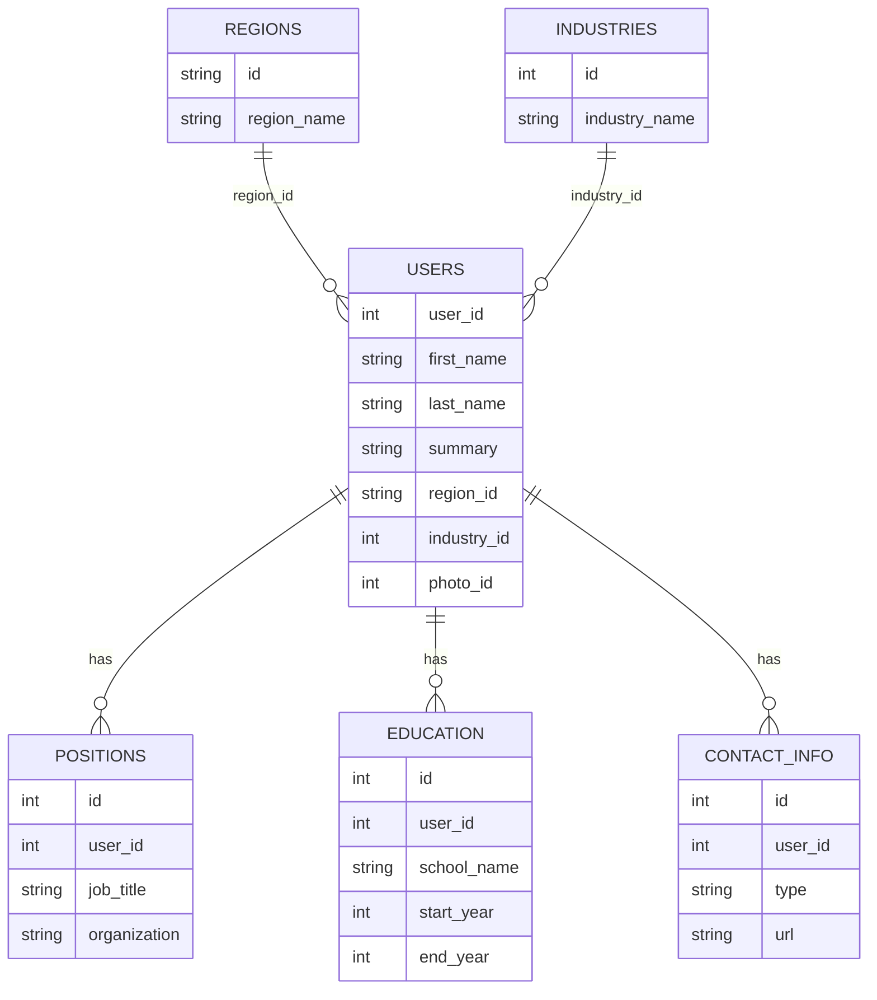
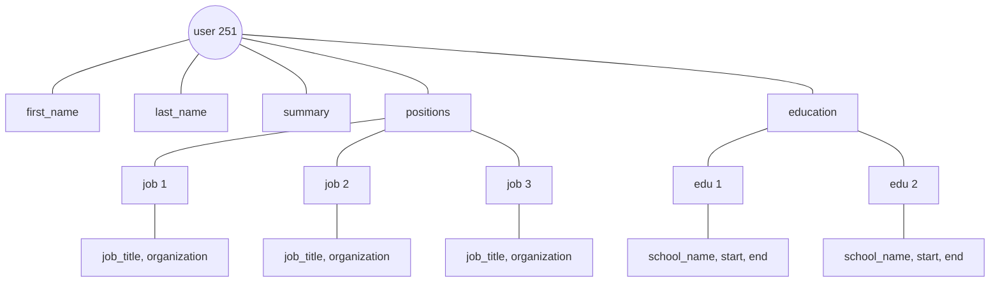
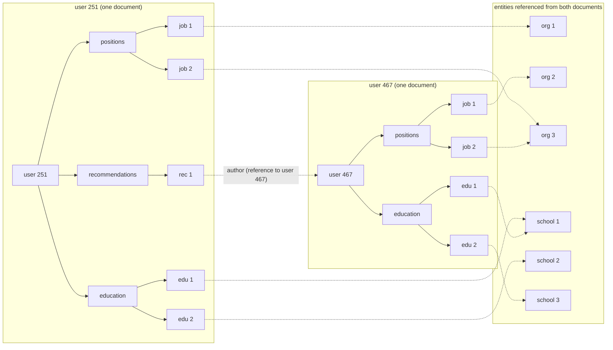
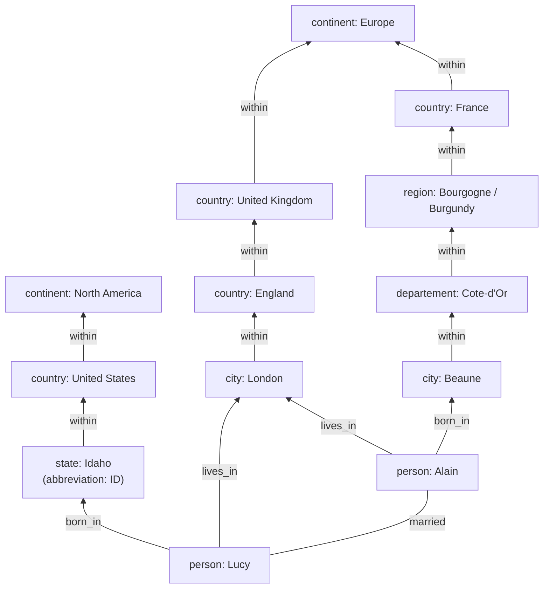
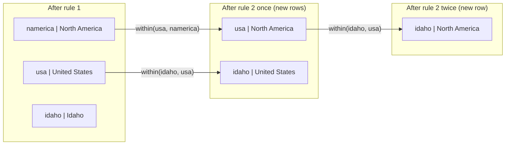

# Chapter 2 — Data Models and Query Languages
*Book: Chapter 2, pp. 27–68*

## Overview

**What question does this chapter answer?** "In what *shape* should I store my data, and how do I ask questions of it?" It compares the three big general-purpose **data models** (relational, document, graph) and their **query languages** (languages for asking a database for data): SQL, relational algebra, MapReduce, the MongoDB aggregation pipeline, Cypher, SPARQL and Datalog, with CSS/XSL (web styling/XML transformation languages) as a side analogy.

**Why it matters.** The data model is arguably the most important decision in software: it shapes both the code and how you *think* about the problem. Every model makes some operations easy and fast and others awkward, slow or impossible; a model that fits your data's relationships saves years of pain.

**Layers of data models.** Each layer hides the one below behind a cleaner model (an **abstraction**):

1. **Application developer:** models the real world (people, goods, actions, money flows, sensors…) as objects/data structures plus APIs that manipulate them.
2. **General-purpose data model:** those structures expressed as JSON or XML documents (text formats for nested data: `{"name": "Asha"}` / `<name>Asha</name>`), relational tables, or a graph. *This chapter.*
3. **Database engineers:** represent JSON/XML/tables/graphs as bytes in memory, on disk or on the network, in ways that allow querying and processing. *Chapter 3.*
4. **Hardware engineers:** represent bytes as electrical currents, light pulses, magnetic fields.

Bigger systems have more layers, but each hides the complexity beneath, letting different groups (e.g. database-vendor engineers and app developers) work together. Mastering even one model is a lot of work, so choose carefully.

## Key terms

| Term | Plain-English meaning |
|---|---|
| Relational model | Data as relations (tables), each an unordered collection of tuples (rows). Edgar Codd, 1970. RDBMS = relational database management system. |
| Transaction / batch processing (here) | Day-to-day operations (sales, banking, airline reservations, stock-keeping) / periodic bulk jobs (invoicing, payroll, reporting). |
| Network / hierarchical model | Pre-relational models of the 1970s (CODASYL, IMS). |
| NoSQL | Loose label for nonrelational databases; later "Not Only SQL". |
| Polyglot persistence | Using relational and various nonrelational stores side by side. |
| Impedance mismatch | Awkward translation between application objects and tables/rows/columns. |
| ORM (object-relational mapping) | Frameworks (ActiveRecord, Hibernate) that reduce that translation boilerplate. |
| One-to-many / many-to-one / many-to-many | A user has many jobs (a tree) / many people live in one region / people and the companies they worked at. |
| Normalization / denormalization | Store each human-meaningful fact once, referenced by ID / deliberately duplicate (e.g. to avoid joins) and keep copies in sync. |
| Join | Combining records from different tables/collections that reference each other. |
| Foreign key / document reference | An ID pointing at another record (relational / document). |
| Locality | Storing related data together so it is read in one go. |
| Access path | In the network model, the chain of links followed from a root record to reach a record. |
| Query optimizer | Decides automatically how to execute a query (order, indexes, join methods). |
| Shredding | Splitting a document-like structure into several tables. |
| Schema-on-write / schema-on-read | Explicit schema enforced on write (like static typing) / implicit structure interpreted by the reader (like dynamic typing). "Schemaless" is a misleading name for schema-on-read. |
| BSON | MongoDB's binary encoding of JSON-like documents. |
| Imperative / declarative language | Says *which operations in which order* / *what result you want*. |
| Relational algebra | The mathematical operators behind SQL, e.g. σ (selection). |
| MapReduce | Bulk processing model across many machines using map and reduce functions. |
| Pure function | Uses only its inputs, makes no extra database queries, has no side effects. |
| Aggregation pipeline | MongoDB's declarative, JSON-syntax query language (added in 2.2). |
| Graph, vertex, edge | Vertices (nodes/entities) connected by edges (relationships/arcs). Tail / head vertex = where an edge starts / ends. |
| Property graph | Vertices and edges have IDs and key-value properties; edges have labels. |
| Cypher | Neo4j's declarative property-graph query language. |
| Recursive common table expression | SQL:1999 `WITH RECURSIVE` for variable-length traversals. |
| Triple-store, RDF, Turtle/N3 | Facts as (subject, predicate, object); RDF is the semantic web's triple model; Turtle (a subset of Notation3) is a readable text format for triples. |
| Semantic web | Idea that websites publish machine-readable data combinable into a "web of data". |
| SPARQL | Query language for RDF triple-stores ("sparkle"). |
| Datalog / rule | 1980s logic query language, a subset of Prolog / a definition of a derived predicate from facts and other rules. |

## Relational Model Versus Document Model

**What it is.** The **relational model** behind SQL (**Edgar Codd, 1970**): data sits in **relations** (SQL: *tables*), each a collection of **tuples** (SQL: *rows*) with **no inherent order**.

**A short history.**

- At first a theoretical proposal many doubted could be implemented efficiently; by the **mid-1980s** RDBMSes and SQL were the default for regularly structured data, a dominance lasting **25–30 years**.
- Roots in **business data processing** on 1960s–70s **mainframes**: **transaction processing** and **batch processing**. Other databases of that era made developers think about internal representation; the relational model **hid that detail behind a cleaner interface**.
- Challengers were hyped and faded: **network** and **hierarchical models** (1970s–early '80s), **object databases** (late '80s–early '90s), **XML databases** (early 2000s, niche).
- Relational databases generalised far beyond business data: much of today's web (publishing, discussion, social networking, ecommerce, games, SaaS productivity apps) runs on them.

### The Birth of NoSQL

**NoSQL**, the **2010s** challenger, names no particular technology: it began as a **Twitter hashtag for a 2009 meetup** on open source, distributed, nonrelational databases, and was later reinterpreted as **"Not Only SQL"**.

**Why people adopted it:**

1. **More scalability** than relational databases easily provide (huge datasets, very high write throughput).
2. Preference for **free and open source** software over commercial databases.
3. **Specialised query operations** the relational model supports poorly.
4. Frustration with **restrictive relational schemas**; desire for a more dynamic, expressive model.

Relational databases will likely keep being used **alongside** many nonrelational stores: **polyglot persistence**.

### The Object-Relational Mismatch

**The problem.** Most application code is object-oriented (Java, Python, C#); data in relational tables needs an awkward translation layer between objects and tables/rows/columns: the **impedance mismatch** (an electronics term: power transfers best when one circuit's output impedance matches the next one's input impedance). **ORMs** like **ActiveRecord** and **Hibernate** reduce the boilerplate but cannot fully hide the differences.

**The résumé example.** The book models a **LinkedIn profile** (Bill Gates's) relationally: the profile has a unique `user_id`; once-per-user fields (`first_name`, `last_name`) are columns in `users`; but positions, education entries and contact info vary in number — **one-to-many** relationships.

*Figure 2-1 (redrawn): a LinkedIn-style profile represented with a relational schema.*



(The book's figure has `photo_id`; its JSON version, Example 2-1, has a `photo_url` string.)

**Three ways to store one-to-many data in SQL:**

| Option | How | Notes |
|---|---|---|
| 1. Separate tables (classic normalized) | `positions`, `education`, `contact_info` each with a foreign key to `users` | Common approach before SQL:1999. |
| 2. Structured / XML / JSON datatypes | Multi-valued data inside one row, with querying and indexing inside it | Oracle, IBM DB2, MS SQL Server, PostgreSQL support this to varying extents; several (IBM DB2, MySQL, PostgreSQL) also have a JSON datatype. |
| 3. Encode as JSON/XML text | Text column interpreted by the application | You usually **cannot query** inside it with the database. |

**The document alternative.** A résumé is mostly a **self-contained document**, so JSON (much simpler than XML) fits well. Document databases: **MongoDB**, **RethinkDB**, **CouchDB**, **Espresso**. Our own fictional profile:

```json
{
  "user_id": 7042,
  "first_name": "Asha",
  "last_name": "Rao",
  "summary": "Marine ecologist and science writer.",
  "region_id": "in:ka",
  "industry_id": 57,
  "positions": [
    {"job_title": "Research Lead", "organization": "Coral Watch Trust"},
    {"job_title": "Field Scientist", "organization": "Ocean Survey Institute"}
  ],
  "education": [
    {"school_name": "University of Mysore", "start": 2006, "end": 2010},
    {"school_name": "Bishop Cotton School", "start": null, "end": null}
  ],
  "contact_info": {
    "blog": "https://example.org/asha",
    "mastodon": "@asha@example.social"
  }
}
```

`positions` and `education` are nested **arrays** replacing whole tables; `contact_info` is a nested **object**; `region_id`/`industry_id` are **IDs**, not text (next section).

**Pros of the JSON version:**

- Some developers find it **reduces the impedance mismatch** (JSON's own encoding problems: Chapter 4).
- The **lack of a schema** is often called an advantage (see "Schema flexibility" below).
- **Better locality:** relationally, a profile needs several queries (one per table) or a messy multi-way join; in JSON one query fetches everything.
- The one-to-many relationships form a **tree**, which JSON makes **explicit**.

*Figure 2-2 (redrawn): the book's user 251 as a tree. Scalar fields hang directly off the user; positions and education are one-to-many branches. (The book's tree omits contact_info.)*



### Many-to-One and Many-to-Many Relationships

**Why IDs instead of text?** The book stores `region_id`/`industry_id` rather than `"Greater Seattle Area"`/`"Philanthropy"`. Standardised lists (drop-downs, autocomplete) give: **consistent** spelling; **no ambiguity** between same-named cities; **easy updates** (a renamed city changes in one place); **localisation** (lists can be translated into the viewer's language); **better search** (the region list can encode that Seattle is in Washington, so a search for philanthropists in Washington finds this profile).

**ID vs text is really about duplication.** With an ID, the human-meaningful information is stored **once** and referenced by an ID meaningful only inside the database, so the ID **never needs to change**. With text, that information is **copied into every record**, and any change must update every copy: **write overhead** and risk of **inconsistency**. Removing such duplication is the core idea of **normalization**. (Relational theory's several normal forms differ little in practice; rule of thumb: if values that could live in one place are duplicated, the schema is not normalized. DBAs and developers love arguing normalize vs denormalize; the book defers the debate to Part III's treatment of caching and derived data.)

**The catch for documents.** Normalizing needs **many-to-one** relationships, which fit documents poorly:

- Relational: referring to rows by ID is normal because **joins are easy**.
- Document: one-to-many trees need no joins, and **join support is often weak** — at the time of writing **RethinkDB supports joins, MongoDB does not, CouchDB only in predeclared views**.
- Without database joins you **emulate them in application code** with multiple queries (fine for small, rarely changing lists like regions, which can be cached in memory — but the join work has moved into your code).

**Data grows more connected over time.** Two résumé extensions add links even if v1 fitted a join-free model:

- **Organizations and schools as entities** with their own pages (logo, news feed), referenced from résumés instead of plain strings. *(Figure 2-3, described: a LinkedIn screenshot where a company name links to the company's page with logo.)*
- **Recommendations** written by one user for another, showing the **author's name and photo**; if the author changes their photo, every recommendation must show the new one, so it must **reference the author's profile**.

*Figure 2-4 (redrawn): two résumés (user 251 and user 467) extended with many-to-many links. Each dashed box could be one document; arrows leaving a box are references needing joins.*



### Are Document Databases Repeating History?

Document databases reopened a debate about many-to-many relationships far older than NoSQL.

**IMS and the hierarchical model.** The leading 1970s business database was IBM's **Information Management System (IMS)**, built to track stock for the **Apollo space program**, commercially released in **1968**, and still used on **OS/390** on IBM mainframes. Its **hierarchical model** stored all data as a **tree of records nested inside records**, much like JSON. Like document databases it handled **one-to-many** well, made **many-to-many** hard, and had **no joins**, forcing a choice between **duplicating (denormalizing)** data and **manually resolving references** — the same problems document databases face today.

Two solutions were proposed: the **relational model** (became SQL, conquered the industry) and the **network model** (early fans, then obscurity). Their "great debate" ran through much of the 1970s.

#### The network model

- Standardised by the **Conference on Data Systems Languages (CODASYL)**, hence the **CODASYL model**.
- It **generalised** the hierarchy: a record could have **multiple parents** (e.g. one "Greater Seattle Area" record linked from every user there), enabling many-to-one and many-to-many links.
- Links were like **pointers** (stored on disk), not **foreign keys**.
- Reaching a record meant starting at a **root record** and following chains of links: the **access path**. A query moved a **cursor** through the database, iterating over record lists and following links (like walking a linked list). With many-to-many relationships several paths could reach one record and the programmer had to track them all; CODASYL members likened it to **navigating an n-dimensional data space**.

**Trade-off.** Hand-chosen access paths used scarce 1970s hardware efficiently (e.g. **tape drives**, where seeks are extremely slow), but query and update code became **complicated and inflexible**. Without a path to the data you needed, you were stuck; changing access paths meant rewriting lots of query code, so the data model was hard to change.

#### The relational model

**What it did differently:** put all data **in the open** — a relation is just a collection of tuples, with no nested structures or access paths. You can read any rows **matching an arbitrary condition**, fetch a row by its **key** (the columns uniquely identifying it), and **insert into any table** without caring about links in or out.

> **Foreign key constraints aside.** Constraints can restrict modifications but are not required by the model. Even with them, joins on foreign keys happen **at query time**; CODASYL effectively did the join **at insert time**.

**The query optimizer** decides the execution order of a query's parts and which indexes to use. These choices *are* the access path, but made by the optimizer, not the developer.

> **Key term — index:** an extra structure kept alongside a table that finds rows matching a value without scanning every row, like a book's index. Indexes speed reads but cost extra work on every write. Built in Chapter 3.

- To query in a new way, **declare a new index**; queries use it automatically without changes, making new features much easier.
- Optimizers took years of R&D, but the insight is **build it once and every application benefits**. Hand-coding one query's access path is easier than a general optimizer, yet over time the **general-purpose approach wins**.

#### Comparison to document databases

- Document databases **returned to the hierarchical model in one respect**: nested one-to-many records (positions, education, contact_info) live **inside the parent**.
- For **many-to-one and many-to-many**, they are **basically like relational**: a unique ID (**foreign key** / **document reference**) resolved **at read time** via a join or follow-up queries.
- So far they have **not** followed CODASYL's path.

### Relational Versus Document Databases Today

Fault tolerance (Chapter 5) and concurrency (Chapter 7) also differ; here we compare only **data models**.

| | Document model | Relational model |
|---|---|---|
| Main arguments for | Schema flexibility; locality performance; closer to app data structures for some apps | Better joins; better many-to-one / many-to-many support |

#### Which data model leads to simpler application code?

- **Document-like data** (a tree of one-to-many relationships, usually loaded whole) → **document model**; relational **shredding** gives clumsy schemas and needless complexity.
- **Document limitation:** no direct reference to a nested item; you say "the second item in user 251's positions list" (like a hierarchical access path). Fine if nesting is **shallow**.
- **Weak joins** may not matter: an **analytics app** recording events with timestamps may never need many-to-many.
- **Many-to-many needed** → documents get less attractive: **denormalizing** means the app must keep copies consistent; **emulating joins** with several requests moves complexity into the app and is usually **slower** than in-database joins.
- **Bottom line:** it depends on relationships between data items. For **highly interconnected** data: documents awkward, relational acceptable, **graph models most natural**.

#### Schema flexibility in the document model

Most document databases, and the JSON support in relational databases, do **not enforce a schema**; XML support usually offers **optional** validation. Any keys and values may be added, and readers get **no guarantee** which fields exist.

**Common confusion: "schemaless" is misleading.** Reading code assumes some structure, so there is an **implicit schema** the database does not enforce.

| | Schema-on-read | Schema-on-write |
|---|---|---|
| Structure | Implicit; interpreted when read | Explicit; database checks all writes conform |
| Typical of | Document databases | Traditional relational databases |
| Programming analogy | **Dynamic (runtime) type checking** | **Static (compile-time) type checking** |

As with typing, there is **no universally right answer**.

**Where it shows: changing the data format.** The book splits a full-name field into first and last name. Our variant: splitting a `location` string like `"Pune, India"` into a `city` field.

*Document database (schema-on-read):* write new documents with the new field and handle old ones when reading:

```javascript
if (member && member.location && !member.city) {
    // Records created before the 2021 redesign lack a "city" field
    member.city = member.location.split(",")[0].trim();
}
```

*Relational database (schema-on-write):* run a **migration** (one-time scripted change to schema and data):

```sql
ALTER TABLE members ADD COLUMN city text;                                  -- new column, NULL by default
UPDATE members SET city = split_part(location, ',', 1);                    -- PostgreSQL
UPDATE members SET city = substring_index(location, ',', 1);               -- MySQL
```

**Are schema changes slow?** Their bad reputation is **not entirely deserved**:

- Most relational databases run `ALTER TABLE` in **a few milliseconds**.
- **MySQL is the notable exception**: `ALTER TABLE` **copies the entire table**, so a big table can mean minutes or hours of downtime (tools exist to work around this).
- `UPDATE` on a large table is **slow on any database** (every row rewritten). Alternative: leave the new column `NULL` and fill it at read time, as a document database would.

**When schema-on-read is better:** **heterogeneous** items — **many object types**, impractical to give each a table; or structure dictated by **external systems** you do not control that may change anytime. When all records share a structure, a schema usefully **documents and enforces** it. (Schema evolution: Chapter 4.)

#### Data locality for queries

A document is usually stored as **a single contiguous string** — JSON, XML, or a binary variant such as **MongoDB's BSON**. If the app needs the **whole document** (e.g. to render a page), this **storage locality** wins over a multi-table layout needing several index lookups and disk seeks.

**Limitations:** the benefit exists only when reading **large portions** together, since the database usually loads the **whole document** even for a small piece; **updates** usually rewrite the whole document, and only changes that **keep the encoded size** are easy in place. Hence the advice: keep documents **small-ish** and avoid writes that **grow** them. This significantly narrows where document databases are useful.

**Locality is not unique to documents:**

| System | Locality feature |
|---|---|
| Google's **Spanner** | Relational; schema can declare a table's rows **interleaved (nested)** in a parent table |
| **Oracle** | **Multi-table index cluster tables** |
| **Bigtable** model (**Cassandra**, **HBase**) | **Column families** control locality |

(More in Chapter 3.)

#### Convergence of document and relational databases

- Since the **mid-2000s**, most relational databases **except MySQL** support **XML**, including local modification and indexing/querying inside documents.
- **JSON support**: **PostgreSQL since 9.3**, **MySQL since 5.7**, **IBM DB2 since 10.5**; others likely to follow given JSON's popularity in web APIs.
- From the document side: **RethinkDB** supports relational-style joins; some **MongoDB drivers** resolve references automatically — a **client-side join**, likely slower than in-database joins (extra network round-trips, less optimisation).

> **Codd's nonsimple domains.** Codd's 1970 paper already allowed a row value to be a nested relation rather than a primitive, permitting arbitrarily nested trees — much like the XML/JSON support SQL gained 30+ years later.

**Takeaway.** The models are **converging** and complement each other; a **hybrid** handling document-like data plus relational queries is a good direction.

## Query Languages for Data

**Imperative vs declarative.** **SQL is declarative**; **IMS and CODASYL** were queried with **imperative code**.

**Our own example:** return only the citrus fruits. Imperative JavaScript:

```javascript
function getCitrus() {
    var result = [];
    for (var i = 0; i < fruits.length; i++) {        // walk the list in order
        if (fruits[i].group === "Citrus") {         // test each item
            result.push(fruits[i]);                 // collect matches
        }
    }
    return result;
}
```

In **relational algebra**, `citrus = σ group = "Citrus" (fruits)`, where **σ (sigma)** is the **selection operator**. SQL follows relational algebra closely:

```sql
SELECT * FROM fruits WHERE "group" = 'Citrus';   -- "group" is quoted because it is a SQL keyword
```

| | Imperative | Declarative |
|---|---|---|
| You specify | Which operations, in which order (loop, test, update variables) | Only the result pattern: conditions and transformations (sort, group, aggregate) |
| Who picks the algorithm | You | The **query optimizer** (indexes, join methods, order) |

**Why declarative wins:**

1. **Concise** and easier to work with.
2. **Hides engine internals**, so performance can improve **without changing queries**. If the database reshuffles records to reclaim disk space, imperative code relying on iteration order might break, and the database cannot tell; SQL promises **no order**, so reordering is safe. Being **more limited** gives more room for optimisation.
3. **Parallel execution.** CPUs now gain **cores**, not clock speed. Imperative code fixes an instruction order and is hard to parallelise; declarative queries specify only the result, so the database may run them **in parallel**.

### Declarative Queries on the Web

The advantage extends beyond databases. The book uses a web page about ocean animals (user on "Sharks"); our version is a planets site with "Mars" selected:

```html
<ul>
    <li class="selected">          <!-- the current page's menu item -->
        <p>Mars</p>                <!-- title of the selected page -->
        <ul>
            <li>Olympus Mons</li>
            <li>Valles Marineris</li>
        </ul>
    </li>
    <li>
        <p>Venus</p>
        <ul>
            <li>Maxwell Montes</li>
        </ul>
    </li>
</ul>
```

**Goal:** give the selected page's title a blue background.

**Declarative CSS:** the selector states the pattern; `<p>Mars</p>` matches, `<p>Venus</p>` does not.

```css
li.selected > p {           /* any <p> whose direct parent is <li class="selected"> */
    background-color: blue;
}
```

**Declarative XSL**, using the **XPath** expression `li[@class='selected']/p` (equivalent to the CSS selector):

```xml
<xsl:template match="li[@class='selected']/p">   <!-- same pattern in XPath -->
    <fo:block background-color="blue">
        <xsl:apply-templates/>                   <!-- keep processing children -->
    </fo:block>
</xsl:template>
```

**Imperative JavaScript DOM API** (the DOM is the browser's in-memory tree of page elements):

```javascript
var items = document.getElementsByTagName("li");
for (var i = 0; i < items.length; i++) {
    if (items[i].className === "selected") {                     // find selected <li>
        var kids = items[i].childNodes;
        for (var j = 0; j < kids.length; j++) {
            var k = kids[j];
            if (k.nodeType === Node.ELEMENT_NODE && k.tagName === "P") {
                k.setAttribute("style", "background-color: blue"); // colour it
            }
        }
    }
}
```

**Problems with the imperative version** (besides length):

- If the `selected` class is **removed** (user clicks another page), the blue stays — even if the code reruns — until reload. With CSS the browser **notices automatically** and removes it.
- Using a newer, faster API (`getElementsByClassName`, `document.evaluate()`) means **rewriting the code**; browser vendors can speed up CSS and XPath without breaking compatibility.

**Conclusion.** Declarative CSS beats imperative styling in browsers, as declarative SQL beat imperative query APIs in databases. (IMS and CODASYL offered only imperative APIs, typically used from **COBOL** (a 1959 business language), stepping through records one by one.)

### MapReduce Querying

**What it is.** **MapReduce**, popularised by **Google**, is a model for bulk processing of large datasets across many machines. **MongoDB** and **CouchDB** offer a **restricted version** for **read-only queries over many documents**. (General MapReduce: Chapter 10.)

**Where it sits:** **between** declarative and imperative. Query logic is **code snippets** the framework calls repeatedly, based on functional programming's **map** (*collect*: apply a function to every item) and **reduce** (*fold*/*inject*: combine many items into one).

**The book's example:** a marine biologist's report of **sharks seen per month**. Our parallel: a birdwatcher counting **herons per month**.

**PostgreSQL (declarative):** filter to herons, group by month, sum the counts. `date_trunc('month', timestamp)` returns the start of the calendar month containing the timestamp (rounds down).

```sql
SELECT date_trunc('month', seen_at) AS sighting_month,   -- round timestamp down to month start
       sum(bird_count)            AS total_birds          -- add up birds per month
FROM sightings
WHERE family = 'Herons'                                    -- only herons
GROUP BY sighting_month;                                   -- one row per month
```

**MongoDB MapReduce:**

```javascript
db.sightings.mapReduce(
    function map() {                                       // called once per matching document
        var y = this.seenAt.getFullYear();
        var m = this.seenAt.getMonth() + 1;               // JS months start at 0
        emit(y + "-" + m, this.birdCount);                // key = "year-month", value = count
    },
    function reduce(key, values) {                         // called once per distinct key
        return Array.sum(values);                          // total birds that month
    },
    {
        query: { family: "Herons" },                       // declarative filter (MongoDB extension)
        out: "monthlyHeronReport"                          // collection to write results into
    }
);
```

**How it runs:**

1. The `query` filter selects documents declaratively (a MongoDB extension to MapReduce).
2. `map` is called **once per matching document** (`this` = the document) and **emits** a key (year-month string such as `"2013-12"` or `"2014-1"`) and a value (the count).
3. Emitted pairs are **grouped by key**; `reduce` is called **once per key** and sums the counts.
4. Output goes to the named collection (book: `monthlySharkReport`).

**Worked example from the book:** shark sightings on **25 Dec 1995** (3 animals, *Carcharodon carcharias*) and **12 Dec 1995** (4 animals, *Carcharias taurus*). `map` emits `("1995-12", 3)` and `("1995-12", 4)`; then `reduce("1995-12", [3, 4])` returns **7**.

**Restriction: pure functions.** `map` and `reduce` may use only their inputs, may **not** run extra database queries, and must have **no side effects**, so the database can run them **anywhere, in any order, and rerun them after failure**. They can still parse strings, call libraries, compute.

**Clearing up confusions:**

- MapReduce is a fairly **low-level** model for cluster execution. SQL **can** be implemented as MapReduce pipelines (Chapter 10), but many distributed SQL implementations do **not** use it.
- Nothing restricts SQL to one machine; MapReduce has **no monopoly** on distributed querying.
- JavaScript inside queries is not unique to MapReduce: some **SQL databases accept JavaScript extensions**.

**Usability problem and fix.** Writing **two coordinated functions** is often harder than one query, and declarative languages give the optimizer more room. So **MongoDB 2.2** added the declarative **aggregation pipeline**:

```javascript
db.sightings.aggregate([
    { $match: { family: "Herons" } },                      // filter, like WHERE
    { $group: {                                            // group, like GROUP BY
        _id: {
            year:  { $year:  "$seenAt" },
            month: { $month: "$seenAt" }
        },
        totalBirds: { $sum: "$birdCount" }                 // aggregate, like sum()
    } }
]);
```

Its expressiveness is similar to a **subset of SQL** with **JSON-based syntax** (arguably a matter of taste). Moral: a NoSQL system may end up **accidentally reinventing SQL** in disguise.

## Graph-Like Data Models

**When to use graphs.** Many-to-many relationships are the key differentiator: mostly one-to-many or none → **documents**; simple many-to-many → **relational**; **very common, complex** connections → **graph**.

**What a graph is:** **vertices** (*nodes*, *entities*) and **edges** (*relationships*, *arcs*).

| Graph | Vertices | Edges |
|---|---|---|
| **Social graphs** | People | Who knows whom |
| **The web graph** | Web pages | HTML links |
| **Road or rail networks** | Junctions | Roads or railway lines |

Well-known algorithms: **car navigation** (shortest paths); **PageRank** (page popularity on the web graph, for search ranking).

**Heterogeneous graphs.** Vertices need not be the same kind; one graph can store completely different object types. **Facebook**'s single graph has vertices for **people, locations, events, checkins, comments**, and edges for **friendship, checkin location, who commented on which post, who attended which event**, etc.

**Running example (Figure 2-5):** **Lucy, originally from Idaho**, and **Alain, originally from Beaune, France**, **married and living in London** (could be a social network or genealogy database).

*Figure 2-5 (redrawn): graph-structured data. France's hierarchy (city, département, région, country) differs from the US one (state, country).*



| | Models | Implementations |
|---|---|---|
| Property graph | vertices + edges with properties | **Neo4j, Titan, InfiniteGraph** |
| Triple-store | (subject, predicate, object) | **Datomic, AllegroGraph**, others |

Declarative graph languages covered: **Cypher, SPARQL, Datalog**. Others exist: **imperative** languages such as **Gremlin**, and graph processing frameworks like **Pregel** (Chapter 10).

### Property Graphs

| Each vertex has | Each edge has |
|---|---|
| A unique identifier | A unique identifier |
| A set of outgoing edges | The **tail vertex** (start) |
| A set of incoming edges | The **head vertex** (end) |
| Properties (key-value pairs) | A **label** for the relationship |
| | Properties (key-value pairs) |

**As relational tables:** a vertex table and an edge table (the book's Example 2-2 uses PostgreSQL's `json` type for properties). Our own sketch:

```sql
CREATE TABLE nodes (
    node_id  integer PRIMARY KEY,                       -- unique vertex ID
    attrs    json                                       -- key-value properties
);

CREATE TABLE links (
    link_id  integer PRIMARY KEY,                       -- unique edge ID
    from_node integer REFERENCES nodes (node_id),       -- tail vertex
    to_node   integer REFERENCES nodes (node_id),       -- head vertex
    kind     text,                                      -- the edge label
    attrs    json                                       -- edge properties
);

CREATE INDEX links_from ON links (from_node);           -- fast outgoing-edge lookups
CREATE INDEX links_to   ON links (to_node);             -- fast incoming-edge lookups
```

**Important properties:**

1. **Any vertex can connect to any other**; no schema restricts associations.
2. From any vertex you can efficiently find **incoming and outgoing** edges, so you can **traverse** forwards and backwards (hence indexes on both columns).
3. **Different labels** let one graph hold many kinds of information cleanly.

**Why the flexibility matters (Figure 2-5):** easy to represent **different regional structures** (French *départements* and *régions* vs US *counties* and *states*), **historical quirks** like a **country within a country** (England within the UK), and **varying granularity** (Lucy's residence is a **city**, her birthplace only a **state**).

**Evolvability.** E.g. **food allergies**: a vertex per allergen, edges from people to their allergens, and links from allergens to foods containing them; a query can then find **foods safe for each person**.

### The Cypher Query Language

**Cypher** is a **declarative** property-graph language created for **Neo4j** (named after a *Matrix* character, unrelated to ciphers).

**Inserting data.** The book's Example 2-3 inserts the left part of Figure 2-5. Each vertex gets a **symbolic name**; `(Idaho) -[:WITHIN]-> (USA)` creates a WITHIN edge with Idaho as **tail** and USA as **head**. Our own data:

```cypher
CREATE
  (Asia:Location    {name:'Asia',      type:'continent'}),   // vertex with label + properties
  (India:Location   {name:'India',     type:'country'}),
  (Kerala:Location  {name:'Kerala',    type:'state'}),
  (Priya:Person     {name:'Priya'}),
  (Kerala) -[:WITHIN]-> (India) -[:WITHIN]-> (Asia),         // chain of WITHIN edges
  (Priya)  -[:BORN_IN]-> (Kerala)                            // Priya's birthplace
```

**Querying.** The book finds **everyone who emigrated from the United States to Europe** (a `BORN_IN` edge to a place within the US **and** a `LIVES_IN` edge to a place within Europe). Ours: people **born in India now living in Canada**:

```cypher
MATCH
  (p) -[:BORN_IN]->  () -[:WITHIN*0..]-> (:Location {name:'India'}),
  (p) -[:LIVES_IN]-> () -[:WITHIN*0..]-> (:Location {name:'Canada'})
RETURN p.name
```

- `(p) -[:BORN_IN]-> ()` matches a BORN_IN edge, binding its tail to `p`.
- `-[:WITHIN*0..]->` follows WITHIN edges **zero or more times** (like regex `*`) until a Location named India.
- The second line requires the **same** `p` to have a LIVES_IN path to Canada; return `p.name`.

**Execution is the optimizer's job.** It might scan **forward** (all people, check birthplace and residence) or go **backward** (use a `name` index to find the two Location vertices, follow **incoming** WITHIN edges to collect all places inside each, then find people via incoming BORN_IN/LIVES_IN edges). You do not choose.

### Graph Queries in SQL

**Possible, with difficulty.** Relational queries usually **know in advance which joins** are needed; graph queries traverse a **variable number of edges**, so the **number of joins is not fixed**. A LIVES_IN edge might point to a street, city, district, region, state…, and the place you want may be several WITHIN levels up.

**The SQL tool:** since **SQL:1999**, **recursive common table expressions** (`WITH RECURSIVE`: a named sub-query that refers to itself, repeating until no new rows appear), supported by **PostgreSQL, Oracle, IBM DB2, SQL Server**. It works but is **very clumsy**. Our India→Canada query over `nodes`/`links`:

```sql
WITH RECURSIVE
  in_india(node_id) AS (                                   -- all places inside India
      SELECT node_id FROM nodes WHERE attrs->>'name' = 'India'
    UNION
      SELECT links.from_node FROM links
        JOIN in_india ON links.to_node = in_india.node_id
        WHERE links.kind = 'within'
  ),
  in_canada(node_id) AS (                                  -- all places inside Canada
      SELECT node_id FROM nodes WHERE attrs->>'name' = 'Canada'
    UNION
      SELECT links.from_node FROM links
        JOIN in_canada ON links.to_node = in_canada.node_id
        WHERE links.kind = 'within'
  ),
  born_in_india(node_id) AS (                              -- people born somewhere in India
    SELECT links.from_node FROM links
      JOIN in_india ON links.to_node = in_india.node_id
      WHERE links.kind = 'born_in'
  ),
  lives_in_canada(node_id) AS (                            -- people living somewhere in Canada
    SELECT links.from_node FROM links
      JOIN in_canada ON links.to_node = in_canada.node_id
      WHERE links.kind = 'lives_in'
  )
SELECT nodes.attrs->>'name'
FROM nodes
JOIN born_in_india   ON nodes.node_id = born_in_india.node_id     -- intersect the
JOIN lives_in_canada ON nodes.node_id = lives_in_canada.node_id;  -- two sets
```

Steps: seed `in_india` with the India vertex and repeatedly add tails of **incoming** `within` edges until nothing new; same for Canada; collect people with incoming `born_in` edges from `in_india` and `lives_in` edges from `in_canada`; **intersect** the two sets.

**Lesson.** The book notes the same query is **4 lines** in one language and **29 lines** in another: different data models suit different use cases.

### Triple-Stores and SPARQL

**What it is.** The **triple-store** model is **mostly equivalent** to the property graph in different words, but worth knowing for its tools and languages.

**Triples:** **(subject, predicate, object)**, e.g. (*Jim, likes, bananas*). The **subject** is like a vertex. The **object** is either:

1. **A primitive value** (string, number): predicate + object act as a **property** of the subject, e.g. *(lucy, age, 33)* ≈ vertex `lucy` with `{"age":33}`.
2. **Another vertex**: the predicate is an **edge** (subject = tail, object = head), e.g. *(lucy, marriedTo, alain)*.

**Turtle format.** The book writes Figure 2-5 as triples in **Turtle** (a subset of **Notation3 (N3)**). In full form, one triple per line: `_:priya :bornIn _:kerala.` (an edge: object is a vertex) or `_:india :name "India".` (a property: object is a literal). Vertices are written `_:someName`; the name means nothing outside the file, it only marks which triples refer to the same vertex, and `a` means "is of type". **Semicolons** say several things about one subject; our data in that compact form:

```turtle
@prefix : <urn:example:>.
_:priya  a :Person;   :name "Priya";  :bornIn _:kerala.
_:kerala a :Location; :name "Kerala"; :type "state";     :within _:india.
_:india  a :Location; :name "India";  :type "country";   :within _:asia.
_:asia   a :Location; :name "Asia";   :type "continent".
```

#### The semantic web

- Triple-stores are **completely independent** of the semantic web (**Datomic** claims no link to it), but many associate the two.
- **The idea:** websites publish **machine-readable data** alongside human content; the **Resource Description Framework (RDF)** would let data from different sites combine into a **"web of data"** — an internet-wide "database of everything".
- **Reality:** **overhyped in the early 2000s**, not realised in practice, and weighed down by acronyms, over-complex standards and hubris, making many cynical.
- **But** it produced useful work: **triples are a good internal data model** even with no intent to publish RDF.

> **Datomic aside.** Datomic actually stores **5-tuples**: the two extra fields are **metadata for versioning**.

#### The RDF data model

Turtle is a **human-readable** RDF format; RDF can also be written in much more verbose **XML**. Tools like **Apache Jena** convert between formats automatically. Part of our data in RDF/XML:

```xml
<rdf:RDF xmlns="urn:example:" xmlns:rdf="http://www.w3.org/1999/02/22-rdf-syntax-ns#">
  <Location rdf:nodeID="kerala">
    <name>Kerala</name>
    <type>state</type>
    <within>
      <Location rdf:nodeID="india">
        <name>India</name>
        <type>country</type>
      </Location>
    </within>
  </Location>
  <Person rdf:nodeID="priya">
    <name>Priya</name>
    <bornIn rdf:nodeID="kerala"/>
  </Person>
</rdf:RDF>
```

**RDF quirks from internet-wide data exchange:** subjects, predicates and objects are often **URIs** (globally unique names like web addresses), e.g. `<http://my-company.com/namespace#within>` instead of `WITHIN`, so your data can merge with others' without clashes (theirs might be `<http://other.org/foo#within>`). The URL **need not resolve**; it is just a namespace. The book uses non-resolvable `urn:example:within`, declared **once** at the top.

#### The SPARQL query language

**SPARQL** (**SPARQL Protocol and RDF Query Language**, said "sparkle") queries RDF triple-stores. It **predates Cypher**, whose pattern matching was **borrowed from SPARQL**. The emigration query is **even more concise** than in Cypher; ours:

```sparql
PREFIX : <urn:example:>

SELECT ?who WHERE {
  ?p :name ?who.                                 # bind the person's name
  ?p :bornIn  / :within* / :name "India".        # born somewhere inside India
  ?p :livesIn / :within* / :name "Canada".       # living somewhere inside Canada
}
```

Variables start with `?`; `/` chains predicates into a path; `:within*` follows `within` zero or more times. Correspondence: Cypher `(p) -[:BORN_IN]-> () -[:WITHIN*0..]-> (place)` ≈ SPARQL `?p :bornIn / :within* ?place.`, and Cypher `(ind {name:'India'})` ≈ SPARQL `?ind :name "India".` Because RDF uses predicates for **both properties and edges**, one syntax matches both. SPARQL is useful internally even if the semantic web never happens.

> **Graph Databases Compared to the Network Model (sidebar).** Are graph databases CODASYL again? **No**:
>
> | CODASYL (network model) | Graph databases |
> |---|---|
> | A schema dictated which record type could nest within which | Any vertex can link to any other, so apps adapt more easily |
> | The only way to reach a record was an access path | Refer to any vertex directly by **unique ID**, or find vertices by value via an **index** |
> | Children were an **ordered set** maintained by the database (affecting storage), and inserts had to care about positions | Vertices and edges are **unordered**; sort at query time |
> | All queries imperative, hard to write, easily broken by schema changes | Imperative traversal possible, but most offer **declarative** languages (Cypher, SPARQL) |

### The Foundation: Datalog

**What it is.** **Datalog** is much **older** than SPARQL or Cypher (studied extensively in the **1980s**), less known among engineers but the **foundation** later languages build on. Used by **Datomic**, and **Cascalog** implements it for big datasets on **Hadoop**. (Both use Clojure S-expression syntax; the book uses equivalent **Prolog** syntax.)

**Data model:** like triples, generalised — **predicate(subject, object)**. Our facts:

```prolog
name(asia, 'Asia').
type(asia, continent).
name(india, 'India').
type(india, country).
within(india, asia).
name(kerala, 'Kerala').
type(kerala, state).
within(kerala, india).
name(priya, 'Priya').
born_in(priya, kerala).
```

**Queries are built from rules** (Datalog is a **subset of Prolog**). Our emigration query (assume Priya also lives in Toronto, within Canada):

```prolog
inside(Place, Name) :- name(Place, Name).                   /* Rule 1 */
inside(Place, Name) :- within(Place, Via),                  /* Rule 2 */
                       inside(Via, Name).

moved(Name, From, To) :- name(Person, Name),                /* Rule 3 */
                         born_in(Person, BirthPlace),
                         inside(BirthPlace, From),
                         lives_in(Person, HomePlace),
                         inside(HomePlace, To).

?- moved(Who, 'India', 'Canada').
/* Who = 'Priya'. */
```

(The book's rules are `within_recursive` and `migrated`, querying `'United States'` to `'Europe'` and answering `Who = 'Lucy'`.)

**How rules work:**

- Datalog proceeds **a small step at a time**: rules define **new predicates** (`inside`, `moved`) that are **derived**, not stored.
- Rules can call other rules or themselves **recursively**, building complex queries piece by piece.
- **Uppercase words are variables**; `name(Place, Name)` matches `name(asia, 'Asia')` with `Place = asia`, `Name = 'Asia'`.
- A rule **applies** when **all** predicates right of `:-` match; then the left side (variables substituted) is as if **added to the database**.

**One possible evaluation (our data):**

1. `name(asia, 'Asia')` exists → **rule 1** generates `inside(asia, 'Asia')`.
2. `within(india, asia)` + step 1 → **rule 2** generates `inside(india, 'Asia')`.
3. `within(kerala, india)` + step 2 → **rule 2** generates `inside(kerala, 'Asia')`.

Repeating rules 1 and 2 lists every location inside Asia (or any named place).

*Figure 2-6 (redrawn): the within_recursive table (Location, Name) as the book's rules are applied. Rule 1 seeds each place with its own name; each pass of rule 2 copies a name one level down. After two passes, (idaho, North America) appears.*



**Rule 3** then finds people born in some place `BornIn` and living in some place `LivingIn`; the book's query sets `BornIn = 'United States'`, `LivingIn = 'Europe'` and leaves the person as variable `Who`, which gives the same answer as Cypher and SPARQL.

**Trade-off.** Datalog needs a different way of thinking, but **rules combine and are reused across queries**: less handy for simple one-off queries, better for **complex data**.

## Summary

- **History:** data began as **one big tree** (**hierarchical model**), which handled **many-to-many** badly, so the **relational model** was invented. Applications that did not fit relational led **NoSQL** in two directions: **document databases** (self-contained documents, **rare** relationships between them) and **graph databases** (**anything may relate to everything**).
- All three models are widely used, each good in its domain. One can **emulate** another (graphs in relational tables), but **awkwardly** — hence different systems for different purposes.
- Document and graph databases usually **do not enforce a schema**, easing change; the app still assumes structure, so the question is **explicit (on write)** vs **implicit (on read)**.
- Each model has its query language: **SQL, MapReduce, MongoDB aggregation pipeline, Cypher, SPARQL, Datalog**; **CSS and XSL/XPath** show parallels.
- **Models not covered:** **genome data** needs **sequence-similarity search** (matching a very long DNA string against a database of similar ones), served by specialised software like **GenBank**; **particle physics** (the **Large Hadron Collider (LHC)** handles **hundreds of petabytes**, needing custom solutions to control hardware cost); **full-text search** (information retrieval; search indexes in Chapter 3 and Part III).
- Next chapter: trade-offs in **implementing** these models.

## Interview angle

**1. "Relational or document database — how do you choose?"**
*30-second answer:* Look at the relationships. A self-contained tree of one-to-many data usually loaded whole (a profile, an order with line items) suits documents: locality, schema flexibility, no shredding. Many-to-one or many-to-many relationships favour relational joins; emulating joins in app code is slower and more complex. Highly interconnected data → consider a graph database. The line is blurring (JSON in PostgreSQL/MySQL, joins in RethinkDB).
- *Follow-up: Is a document DB "schemaless"?* No, it is schema-on-read: code assumes structure the database does not enforce. Schema-on-write ≈ static typing, schema-on-read ≈ dynamic typing.
- *Follow-up: When is document locality a disadvantage?* When you need a small part of a large document (whole thing is loaded) or when updates grow it (usually rewritten). Keep documents small.

**2. "What is normalization and why store IDs instead of text?"**
*30-second answer:* Store each human-meaningful fact once and reference it by ID. IDs never change, so renames are one update with no inconsistent copies, plus consistent spelling, disambiguation, localisation and better search. The cost is many-to-one relationships needing joins, which document databases handle poorly.
- *Follow-up: When denormalize?* To avoid joins for read performance, accepting extra write work and inconsistency risk.

**3. "Why is SQL declarative and why does that matter?"**
*30-second answer:* You describe the result; the optimizer chooses indexes, join methods and order. Queries are shorter, the database can improve or reorganise storage without breaking queries (no promised order), and parallel execution is easier as CPUs gain cores rather than speed.
- *Follow-up: Where does MapReduce fit?* In between: map and reduce code snippets (pure functions) run by the framework. MongoDB added the declarative aggregation pipeline in 2.2 because coordinating two functions is harder and limits optimisation.

**4. "When would you use a graph database, and how does it differ from the old network model?"**
*30-second answer:* When many-to-many relationships are common and complex and queries traverse a variable number of hops (social networks, web graph, road networks, heterogeneous data like Facebook's graph). Unlike CODASYL: no schema restricting links, direct access by ID or index, unordered children, declarative languages like Cypher and SPARQL.
- *Follow-up: Can I do this in SQL?* Yes, with recursive CTEs (`WITH RECURSIVE`, SQL:1999), but clumsily: 29 lines of SQL vs 4 of Cypher in the book's example.
- *Follow-up: Property graph vs triple-store?* Mostly equivalent; triples express properties (object is a value) and edges (object is a vertex) as (subject, predicate, object).

**5. "Why did the relational model beat the network model?"**
*30-second answer:* CODASYL made programmers navigate pointer access paths by hand, so code was complex and hard to change. Relational exposed plain tables and let an optimizer choose access paths, so new indexes and queries needed no code rewrites. Build the optimizer once and every app benefits.

## Self-check

1. **What are the four layers of data models the chapter describes, and which one does this chapter focus on?**
   Application objects/data structures; general-purpose model (JSON/XML, tables, graph); bytes in memory/disk/network; electrical/optical/magnetic hardware. The chapter focuses on the second.

2. **Name the four driving forces behind NoSQL.**
   Greater scalability (large datasets, high write throughput); preference for free/open source; specialised queries poorly supported by relational; frustration with restrictive schemas.

3. **Why does a document database struggle once résumés gain organisation pages and recommendations?**
   These add many-to-one and many-to-many links; with weak join support you must denormalize or emulate joins in application code.

4. **How is IMS similar to modern document databases?**
   Its hierarchical model stored nested record trees like JSON, handled one-to-many well, made many-to-many hard, and lacked joins, forcing duplication or manual reference resolution.

5. **What was an "access path" in CODASYL, and what replaced it in relational databases?**
   A programmer-chosen chain of pointer links from a root record; replaced by the query optimizer choosing execution paths automatically.

6. **Scenario: you need to split a full-name field into a new `first_name` column across 500 million rows in MySQL with no downtime. What does the chapter warn about, and what workaround does it suggest?**
   MySQL copies the entire table on `ALTER TABLE` (possible hours of downtime; external tools exist), and a mass `UPDATE` is slow on any database. Add the column with a NULL default and fill values at read time, schema-on-read style.

7. **Why can a database reorder records safely under SQL but not under imperative query code?**
   SQL promises no order; imperative code might depend on iteration order, and the database cannot tell.

8. **In the book's MapReduce example, what do `map` and `reduce` output for the two December 1995 shark sightings?**
   Two emits for key `"1995-12"` with values 3 and 4; reduce receives `[3, 4]` and returns 7.

9. **Why must map and reduce be pure functions?**
   So the database can run them anywhere, in any order, and rerun them after failures.

10. **Give three ways graph databases differ from the CODASYL network model.**
    Any three of: no schema restricting connections; direct access by ID or index; unordered vertices/edges; declarative query languages.
