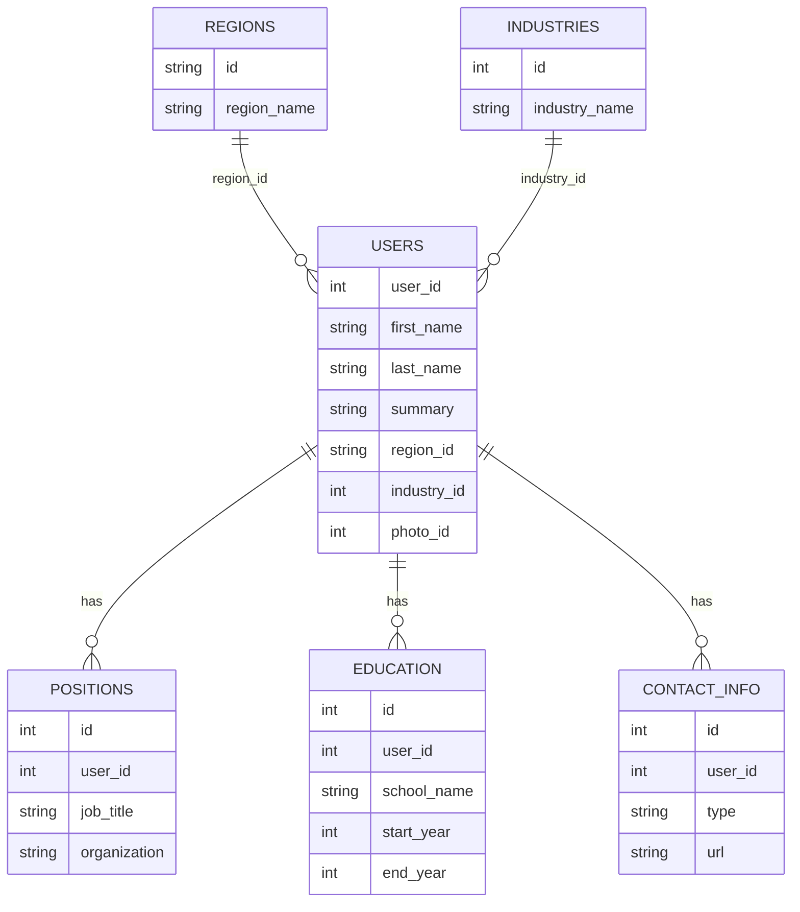
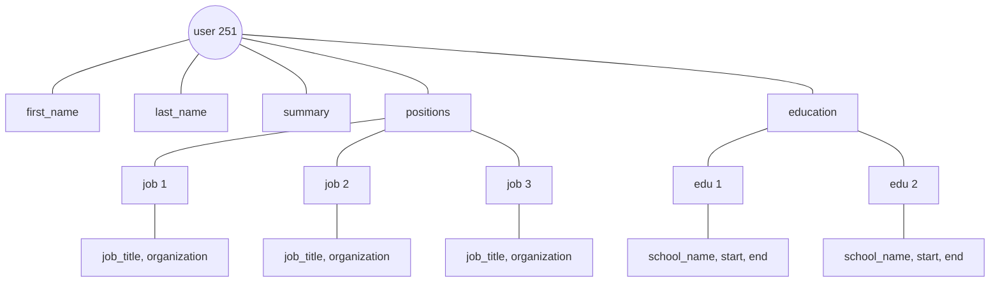
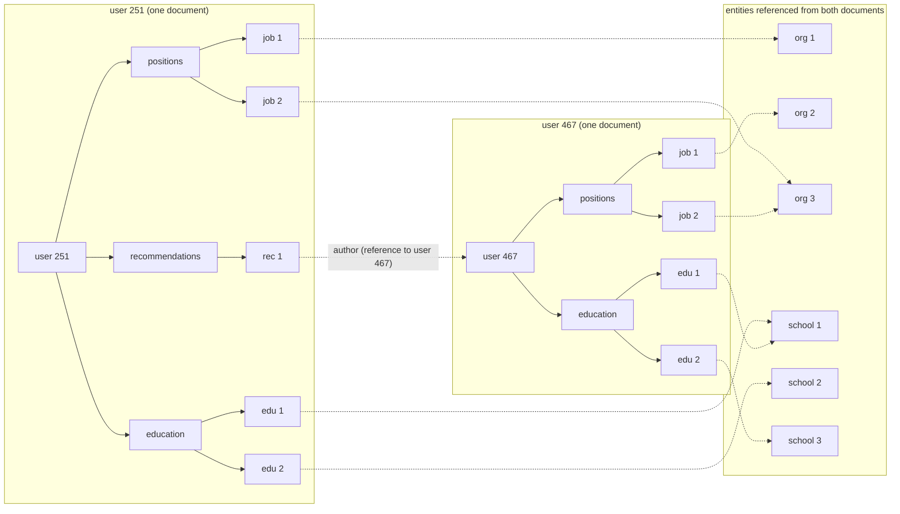
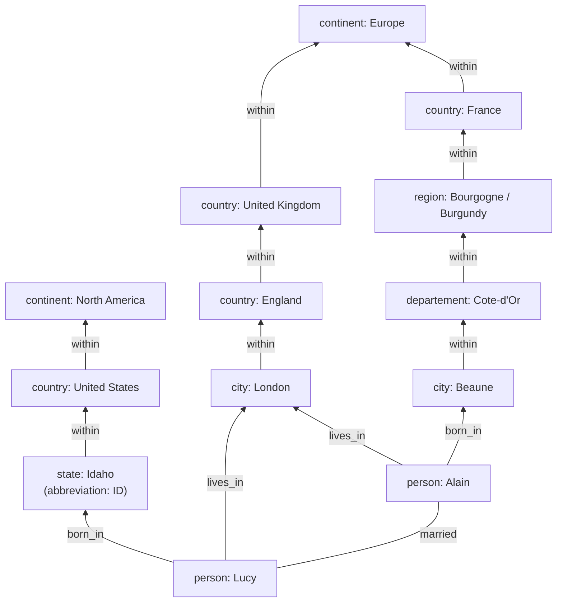
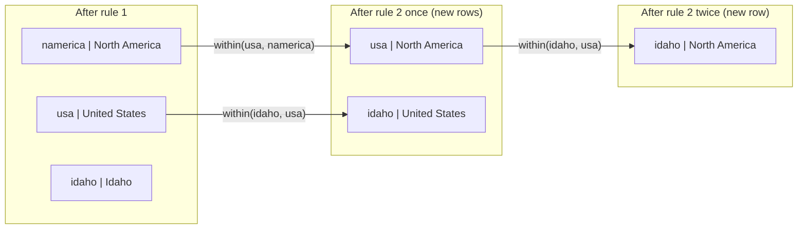

# Chapter 2 — Data Models and Query Languages
*Book: Chapter 2, pp. 27–68*

## Overview

**What question does this chapter answer?** "In what *shape* should I store my data, and how do I ask questions of it?" It compares the three big general-purpose **data models** (relational, document, graph) and the **query languages** that go with them (SQL, relational algebra, MapReduce, the MongoDB aggregation pipeline, Cypher, SPARQL and Datalog), plus CSS/XSL as a side analogy.

**Why it matters.** The data model is arguably the most important decision in a piece of software: it shapes not only how the code is written but how you *think* about the problem. Every model assumes certain usage. Some operations are easy and fast in it, others are awkward, slow, or impossible. Choosing a model that fits your data's relationships saves years of pain.

**Layers of data models.** Software is built by stacking one model on another, and each layer hides the one below behind a cleaner model (an **abstraction**):

1. **Application developer:** models the real world (people, organisations, goods, actions, money flows, sensors...) as objects/data structures plus APIs that manipulate them. Often app-specific.
2. **General-purpose data model:** to store those structures you express them as JSON or XML documents, relational tables, or a graph. *This chapter lives here.*
3. **Database engineers:** decided how to represent JSON/XML/tables/graphs as bytes in memory, on disk, or on the network, in ways that allow querying, searching and processing. *That is Chapter 3.*
4. **Hardware engineers:** represent bytes as electrical currents, light pulses, magnetic fields, and more.

Bigger systems may have more layers (APIs on top of APIs), but the idea holds: each layer hides the complexity beneath, which lets different groups (say, the database vendor's engineers and the app developers using that database) work together effectively. Mastering even one model is a lot of work (think of how many books exist on relational modeling), so choose carefully.

**Everyday analogy.** Think of storing information about your family. A **document** is like a folder per person with everything about them inside. A **relational** store is like a set of spreadsheets (people, addresses, jobs) linked by ID numbers. A **graph** is like a big family-tree wall chart where anything can be connected to anything with a labelled string.

## Key terms

| Term | Plain-English meaning |
|---|---|
| Data model | The general shape used to represent data (tables, documents, graphs). |
| Relational model | Data organised as relations (tables), each an unordered collection of tuples (rows). Proposed by Edgar Codd in 1970. |
| RDBMS | Relational database management system. |
| Transaction processing | Day-to-day business operations: sales, banking transactions, airline reservations, warehouse stock-keeping. |
| Batch processing (here) | Periodic bulk jobs: customer invoicing, payroll, reporting. |
| Network model / hierarchical model | Pre-relational database models of the 1970s (CODASYL, IMS). |
| NoSQL | Loose label for nonrelational databases; later reinterpreted as "Not Only SQL". |
| Polyglot persistence | Using relational and various nonrelational stores side by side. |
| Impedance mismatch | The awkward translation between application objects and tables/rows/columns. |
| ORM (object-relational mapping) | Frameworks like ActiveRecord and Hibernate that reduce translation boilerplate. |
| One-to-many relationship | One item owns many sub-items (a user has many jobs); forms a tree. |
| Many-to-one relationship | Many items point to one shared item (many people live in one region). |
| Many-to-many relationship | Items on both sides relate to many on the other (people and the companies they worked at). |
| Normalization | Storing each human-meaningful fact once and referring to it by ID; avoids duplication. |
| Denormalization | Deliberately duplicating data (e.g. to avoid joins), at the cost of keeping copies in sync. |
| Join | Combining records from different tables/collections that reference each other. |
| Foreign key / document reference | An ID pointing at another record, in relational / document databases respectively. |
| Locality | Storing related data together so it can be read in one go. |
| Access path | In the network model, the chain of links you follow from a root record to reach a record. |
| Query optimizer | Database component that automatically decides how to execute a query (order, indexes, join methods). |
| Shredding | Splitting a document-like structure into several tables. |
| Schema-on-write | Explicit schema enforced by the database when data is written (like static type checking). |
| Schema-on-read | Implicit structure interpreted by the code that reads the data (like dynamic type checking). |
| "Schemaless" | Misleading name for schema-on-read. |
| BSON | MongoDB's binary encoding of JSON-like documents. |
| Imperative language | Tells the computer *which operations to perform in which order*. |
| Declarative language | States *what result you want* (conditions, transformations), not how to compute it. |
| Relational algebra | The mathematical operators behind SQL, e.g. σ (selection). |
| MapReduce | Programming model for bulk processing across many machines using map and reduce functions. |
| Pure function | Uses only its inputs, makes no extra database queries, and has no side effects. |
| Aggregation pipeline | MongoDB's declarative, JSON-syntax query language (added in 2.2). |
| Graph, vertex, edge | A graph is vertices (nodes/entities) connected by edges (relationships/arcs). |
| Property graph | Graph model where vertices and edges have IDs, labels (on edges) and key-value properties. |
| Tail / head vertex | Where an edge starts / where it ends. |
| Cypher | Neo4j's declarative language for querying property graphs. |
| Recursive common table expression | SQL:1999 `WITH RECURSIVE` feature for variable-length traversals. |
| Triple-store | Stores facts as (subject, predicate, object) triples. |
| Turtle / N3 | Human-readable text formats for triples (Turtle is a subset of Notation3). |
| RDF | Resource Description Framework, the semantic web's triple data model. |
| Semantic web | Idea that websites should publish machine-readable data that can be combined into a "web of data". |
| SPARQL | Query language for RDF triple-stores (pronounced "sparkle"). |
| Datalog | Old logic query language (studied in the 1980s), a subset of Prolog; builds queries from rules. |
| Rule (Datalog) | Defines a new derived predicate from existing facts and other rules. |

## Relational Model Versus Document Model

**What it is.** The best-known data model is the **relational model** behind SQL, proposed by **Edgar Codd in 1970**. Data sits in **relations** (SQL calls them *tables*), and every relation is a collection of **tuples** (SQL: *rows*) with **no inherent order**.

**A short history.**

- At first it was only a theoretical proposal and many doubted it could be implemented efficiently. By the **mid-1980s**, RDBMSes and SQL were the default choice for storing and querying data with some regular structure. That dominance lasted about **25–30 years**, an eternity in computing.
- Its roots are in **business data processing** on **mainframes in the 1960s and '70s**: mostly **transaction processing** (recording sales or banking transactions, booking airline seats, tracking warehouse stock) and **batch processing** (invoicing customers, payroll, reporting).
- Other databases of that era made developers think hard about how data was represented internally. The relational model's goal was to **hide that detail behind a cleaner interface**.
- Challengers came and went: the **network model** and **hierarchical model** (1970s and early 1980s), **object databases** (late 1980s and early 1990s), **XML databases** (early 2000s, only niche adoption). Each was hyped; none lasted.
- Meanwhile relational databases generalised far beyond business data processing. Much of today's web (online publishing, discussion, social networking, ecommerce, games, SaaS productivity apps) still runs on them.

### The Birth of NoSQL

In the **2010s**, **NoSQL** became the latest attempt to dethrone the relational model.

- The name refers to no particular technology. It began as a catchy **Twitter hashtag for a 2009 meetup** about open source, distributed, nonrelational databases. It caught on in the startup world and beyond, and was later reinterpreted as **"Not Only SQL"**.

**Why people adopted NoSQL:**

1. Need for **more scalability** than relational databases easily provide, for instance huge datasets or a very high rate of writes.
2. A broad preference for **free and open source** products over commercial databases.
3. **Specialised query operations** that the relational model does not support well.
4. Frustration with **restrictive relational schemas** and a wish for a more dynamic, expressive data model.

Different applications have different needs, so relational databases will likely keep being used **alongside** a wide range of nonrelational stores. This mix is called **polyglot persistence**.

### The Object-Relational Mismatch

**The problem.** Most application code is written in object-oriented languages. If the data lives in relational tables, you need an awkward translation layer between objects in code and tables/rows/columns in the database. This disconnect is called the **impedance mismatch**.

> **Where "impedance mismatch" comes from.** It is an electronics term. Every circuit has an impedance (resistance to alternating current) at its inputs and outputs. Power transfers best when the output impedance of one circuit matches the input impedance of the next; a mismatch causes signal reflections and other problems.

**ORMs** such as **ActiveRecord** and **Hibernate** cut down the boilerplate for this translation, but they cannot fully hide the differences between the two models.

**The résumé example.** The book models a résumé, specifically a **LinkedIn profile** (of Bill Gates), in a relational schema.

- The whole profile is identified by a unique `user_id`.
- Fields that appear once per user, like `first_name` and `last_name`, are columns on the `users` table.
- But people have had several jobs (**positions**), a varying number of **education** entries, and any amount of **contact information**. These are **one-to-many** relationships from the user.

*Figure 2-1 (redrawn): a LinkedIn-style profile represented with a relational schema.*



(In the book's figure the `users` table holds a `photo_id`; the JSON version in Example 2-1 instead carries a `photo_url` string.)

**Three ways to store one-to-many data in SQL:**

| Option | How | Notes |
|---|---|---|
| 1. Separate tables (classic normalized) | `positions`, `education`, `contact_info` tables, each with a foreign key to `users` (as in Figure 2-1) | The common approach before SQL:1999. |
| 2. Structured / XML / JSON datatypes | Store multi-valued data inside one row, with querying and indexing inside those documents | Oracle, IBM DB2, MS SQL Server and PostgreSQL support this, each to a different extent. Several (including IBM DB2, MySQL, PostgreSQL) also offer a JSON datatype. |
| 3. Encode as JSON/XML text | Put the jobs, education and contacts in a text column and let the application interpret it | You usually **cannot query** inside that column with the database. |

**The document alternative.** A résumé is mostly a **self-contained document**, so a JSON representation fits well. JSON is also much simpler than XML. Document-oriented databases **MongoDB**, **RethinkDB**, **CouchDB** and **Espresso** support this model. Here is our own profile in the same style (fictional person):

```json
{
  "user_id": 7042,
  "first_name": "Asha",
  "last_name": "Rao",
  "summary": "Marine ecologist and science writer.",
  "region_id": "in:ka",
  "industry_id": 57,
  "positions": [
    {"job_title": "Research Lead", "organization": "Coral Watch Trust"},
    {"job_title": "Field Scientist", "organization": "Ocean Survey Institute"}
  ],
  "education": [
    {"school_name": "University of Mysore", "start": 2006, "end": 2010},
    {"school_name": "Bishop Cotton School", "start": null, "end": null}
  ],
  "contact_info": {
    "blog": "https://example.org/asha",
    "mastodon": "@asha@example.social"
  }
}
```

- `user_id`, `first_name`, `last_name`, `summary`: one-per-user fields, like columns.
- `region_id`, `industry_id`: stored as **IDs**, not text (explained in the next section).
- `positions` and `education`: **arrays** nested inside the document, replacing whole separate tables.
- `contact_info`: a nested **object**.

**Pros of the JSON version:**

- Some developers find it **reduces the impedance mismatch** between code and storage. (JSON has its own problems as an encoding format, covered in Chapter 4.)
- The **lack of a schema** is often called an advantage (see "Schema flexibility in the document model" below).
- **Better locality:** in the relational version, fetching a profile needs several queries (one per table by `user_id`) or a messy multi-way join. In JSON all the relevant data sits together, so a **single query** suffices.
- The one-to-many relationships form a **tree**, and JSON makes that tree **explicit**.

*Figure 2-2 (redrawn): the book's user 251 as a tree. Scalar fields hang directly off the user; positions and education are one-to-many branches whose entries each carry their own fields. (The book's tree leaves out contact_info; our JSON above would add it as a third branch.)*



### Many-to-One and Many-to-Many Relationships

**Why IDs instead of text?** In the book's JSON, `region_id` and `industry_id` are IDs, not strings like `"Greater Seattle Area"` and `"Philanthropy"`. Free-text input could just be stored as text, but **standardised lists** (drop-downs or autocomplete) bring benefits:

- **Consistent** style and spelling across profiles.
- **No ambiguity**, for example when several cities share a name.
- **Easy updates:** the name lives in one place, so a change (say a city renamed after political events) happens everywhere at once.
- **Localisation:** when the site is translated, the standard lists can be translated, so region and industry show in the viewer's language.
- **Better search:** if someone looks for philanthropists located in Washington state, this profile can show up, because the standard region list can encode that Seattle lies in Washington, a fact the text "Greater Seattle Area" does not reveal.

**ID vs text is really about duplication.**

- With an ID, the **human-meaningful** information (like the word *Philanthropy*) is stored **once**, and everything else refers to it by an ID that only has meaning inside the database.
- With text, that human-meaningful information is **copied into every record**.
- Because an ID means nothing to humans, it **never needs to change**, even if what it identifies changes. Anything meaningful to humans might change someday, and if it is duplicated, every copy must be updated. That costs **write overhead** and risks **inconsistency** (some copies updated, others not).
- Removing such duplication is the core idea of **normalization**.

> **Normal forms aside.** Relational theory defines several normal forms, but the differences between them matter little in practice. Rule of thumb: if you duplicate values that could live in one place, the schema is not normalized.

> The book notes that DBAs and developers love arguing about normalization vs denormalization and defers judgement; Part III returns to caching, denormalization and derived data systematically.

**The catch for documents.** Normalizing needs **many-to-one** relationships (many people live in one region, many work in one industry), and these do not fit the document model nicely.

- In relational databases, referring to other tables' rows by ID is normal because **joins are easy**.
- In document databases, one-to-many trees need no joins, and **join support is often weak**. At the time of writing: **RethinkDB supports joins, MongoDB does not, and CouchDB supports them only in predeclared views.**
- Without database joins you **emulate them in application code** with multiple queries. (Here the region and industry lists are small and change rarely, so the app could just keep them in memory. Still, the join work has moved from the database to your code.)

**Data grows more connected over time.** Even if version 1 of an app fits a join-free document model, new features tend to add connections. Two extensions to the résumé:

- **Organizations and schools as entities.** `organization` and `school_name` are currently just strings. They could become references to entities, each with its own web page (logo, news feed, etc.), and each résumé could link to them and show their logos.

*Figure 2-3 (described):* a LinkedIn screenshot where the company name on a profile is a link to a company entity page (with logo), not just plain text.

- **Recommendations.** Suppose users can write recommendations for each other. A recommendation appears on the recommended user's résumé along with the **name and photo of the author**. If the author changes their photo, every recommendation they wrote must show the new photo, so the recommendation must **reference the author's profile**.

*Figure 2-4 (redrawn): two résumés (user 251 and user 467) extended with many-to-many links. Everything inside one dashed box could be one document; the arrows leaving a box are references to organizations, schools or other users, which need joins when queried.*



### Are Document Databases Repeating History?

Many-to-many relationships and joins are routine in relational databases, but document databases and NoSQL **reopened the debate** about how to represent them. That debate is far older than NoSQL.

**IMS and the hierarchical model.**

- In the **1970s**, the leading database for business data processing was IBM's **Information Management System (IMS)**. It was originally developed to track stock for the **Apollo space program**, went on commercial release in **1968**, and is still maintained and used today on **OS/390** on IBM mainframes.
- IMS used the **hierarchical model**: all data is a **tree of records nested inside records**, strikingly similar to JSON documents (like Figure 2-2).
- Like document databases, IMS handled **one-to-many** well, made **many-to-many** hard, and **did not support joins**. Developers had to choose between **duplicating (denormalizing)** data or **manually resolving references** between records. These 1960s–70s problems look very much like what developers face with document databases today.

Two main solutions were proposed: the **relational model** (which turned into SQL and conquered the industry) and the **network model** (which had many fans early on but faded into obscurity). The "great debate" between them lasted much of the 1970s.

#### The network model

- A committee named the **Conference on Data Systems Languages (CODASYL)** standardised it, several vendors implemented it, which is why people also call it the **CODASYL model**.
- It **generalised** the hierarchical model: in a tree each record has exactly **one parent**; in the network model a record could have **multiple parents**. Example: a single "Greater Seattle Area" region record that every user in that area links to. That made it possible to model many-to-one and many-to-many links.
- Links between records resembled **pointers** in a programming language (although kept on disk), rather than **foreign keys**.
- To get to a record you had no choice but to start at a **root record** and walk along chains of links; that route is the **access path**.

**How a CODASYL query worked:**

1. Start from a root record.
2. Move a **cursor** through the database, iterating over lists of records and following links (in the simplest case like walking a linked list until you find the record you want).
3. With many-to-many relationships, several different paths could lead to the same record, and the programmer had to track them all mentally. If a record had several parents (incoming pointers), the application code had to track all those relationships. CODASYL committee members themselves likened this to **navigating an n-dimensional data space**.

**Trade-off.** Hand-chosen access paths used the very limited 1970s hardware efficiently (e.g. **tape drives**, whose seeks are extremely slow). But query and update code became **complicated and inflexible**. With both hierarchical and network models, if you lacked a path to the data you needed, you were stuck. Changing access paths meant rewriting lots of hand-written query code, so changing the data model was hard.

#### The relational model

**What it did differently:** put all data **in the open**. A relation is just a collection of tuples. No labyrinth of nested structures, no access paths to follow.

- Read any or all rows of a table, **selecting those matching an arbitrary condition**.
- Fetch a specific row by designating certain columns as a **key** and looking it up.
- **Add a row to any table** without caring about foreign-key links pointing in or out.

> **Foreign key constraints aside.** Constraints can restrict modifications, but the relational model does not require them. Even when constraints exist, joining on foreign keys is performed **when you query**; CODASYL in effect did the join **when you inserted**.

**The query optimizer.** Relational systems have a **query optimizer** that automatically picks the execution order of a query's parts and the indexes to use. Those choices *are* the access path, but they are made by the optimizer, not the developer, so we rarely think about them.

- Want to query data in a new way? **Declare a new index**; queries automatically use the most suitable indexes, and you do not change the queries. That made adding features much easier.
- Query optimizers are complicated and have consumed many years of R&D. The key insight: **build the optimizer once, and every application benefits**. Without one, hand-coding access paths for one query is easier than writing a general optimizer, yet over time the **general-purpose approach comes out ahead**.

#### Comparison to document databases

- Document databases went **back to the hierarchical model in one respect**: they store nested one-to-many records (positions, education, contact_info) **inside the parent** record instead of separate tables.
- For **many-to-one and many-to-many**, the two kinds of database are **basically alike**: both point at the related item using a unique ID, a **foreign key** (relational) or **document reference** (document model). That ID gets resolved **when reading**, via a join or extra queries.
- So far, document databases have **not** followed CODASYL's path.

### Relational Versus Document Databases Today

Many differences exist (fault tolerance, Chapter 5; concurrency, Chapter 7), but this chapter compares only the **data models**.

| | Document model | Relational model |
|---|---|---|
| Main arguments for | Schema flexibility; better performance from locality; closer to app data structures for some apps | Stronger support for joins and for many-to-one / many-to-many links |

#### Which data model leads to simpler application code?

- If your data is **document-like** (a tree of one-to-many relationships, usually loaded all at once), use a **document model**. Relational **shredding** (splitting such a structure across several tables like positions, education, contact_info) can produce clumsy schemas and needlessly complex code.
- **Document limitations:** you cannot refer directly to a nested item; you say something like "the second item in user 251's positions list" (much like a hierarchical access path). Usually fine if documents are **not too deeply nested**.
- **Weak joins** may or may not matter. An **analytics app** recording which events happened when may never need many-to-many relationships.
- If your app **does** need many-to-many relationships, documents get less attractive. You can **denormalize** to reduce joins, but then the app must keep the copies consistent. You can **emulate joins** with several requests, but that moves complexity into the app and is usually **slower** than a join done by specialised code inside the database. The result can be significantly more complex code and worse performance.
- **Bottom line:** it depends on the relationships between data items. For **highly interconnected** data, documents are awkward, relational is acceptable, and **graph models are most natural**.

#### Schema flexibility in the document model

- Most document databases do **not enforce any schema** on document contents, and neither does the JSON support in relational databases. XML support in relational databases usually offers **optional** schema validation.
- No schema means you can add arbitrary keys and values, and readers get **no guarantee** about which fields exist.

**Common confusion: "schemaless".** It is misleading. The reading code usually assumes some structure, so there is an **implicit schema** that the database does not enforce. Better terms:

| | Schema-on-read | Schema-on-write |
|---|---|---|
| Structure | Implicit; interpreted when data is read | Explicit; the database checks all written data conforms |
| Typical of | Document databases | Traditional relational databases |
| Programming analogy | **Dynamic (runtime) type checking** | **Static (compile-time) type checking** |

As with static vs dynamic typing, there is a big debate and **no universally right answer**.

**Where the difference shows: changing the data format.** The book's scenario: user names are kept as one full-name field, and you decide to split them into first name and last name. Our own variant: splitting a `location` string like `"Pune, India"` into a separate `city` field.

*Document database (schema-on-read):* start writing new documents with the new field and handle old ones in code.

```javascript
if (member && member.location && !member.city) {
    // Records created before the 2021 redesign lack a "city" field
    member.city = member.location.split(",")[0].trim();
}
```

- Line 1: only act if this is an old-style record (has `location`, lacks `city`).
- Line 3: derive `city` on the fly when reading.

*Relational database (schema-on-write):* run a **migration**.

```sql
ALTER TABLE members ADD COLUMN city text;                                  -- new column, NULL by default
UPDATE members SET city = split_part(location, ',', 1);                    -- PostgreSQL
UPDATE members SET city = substring_index(location, ',', 1);               -- MySQL
```

- `ALTER TABLE` adds the column.
- `UPDATE` fills it for every existing row (the function name differs by database).

**Are schema changes slow?** Their reputation for slowness and downtime is **not entirely deserved**:

- Most relational databases run `ALTER TABLE` in **a few milliseconds**.
- **MySQL is the notable exception**: `ALTER TABLE` makes it **copy the entire table**, so altering a big table can cost minutes or even hours of downtime (various tools work around this).
- Running `UPDATE` on a large table is **slow on any database**, since every row is rewritten. If that is unacceptable, leave the new column as its default `NULL` and populate it when rows are read, as a document database would.

**When schema-on-read is better:** when items in a collection do **not all share a structure** (heterogeneous data), for example because:

- you have **lots of object types** and giving each its own table is impractical; or
- the structure is dictated by **external systems** you do not control, which may change at any time.

Then a schema may hurt more than help. But when all records are expected to share a structure, a schema is a useful way to **document and enforce** it. (Schemas and schema evolution are covered in Chapter 4.)

#### Data locality for queries

- A document is normally saved as **a single contiguous string** in JSON, XML, or a binary form of them such as **MongoDB's BSON**.
- If the app often needs the **whole document** (e.g. to render a web page), this **storage locality** is a performance win. In a multi-table layout like Figure 2-1, you need several index lookups, possibly more disk seeks and more time.

**Limitations:**

- The locality benefit exists only when you read **big portions** of the document together. The database usually loads the **entire document** even for a small piece, which is wasteful for big documents.
- **Updates** usually rewrite the whole document; only changes that **do not alter the encoded size** are easy to do in place.
- So the usual advice: keep documents **small-ish** and avoid writes that make them **larger**. These limits significantly narrow where document databases are useful.

**Locality is not unique to documents:**

| System | Locality feature |
|---|---|
| Google's **Spanner** | Relational model where the schema can declare that a table's rows are **interleaved (nested)** inside a parent table |
| **Oracle** | **Multi-table index cluster tables** |
| The **Bigtable** model (as used by **Cassandra** and **HBase**) | **Column families** (the column-family data model), which serve to control locality |

(Chapter 3 says more about locality.)

#### Convergence of document and relational databases

- Since the **mid-2000s**, most relational databases **except MySQL** have offered **XML support**, including local modifications of XML documents and indexing/querying inside them, giving apps a model very close to a document database.
- **JSON support** at a similar level: **PostgreSQL since 9.3**, **MySQL since 5.7**, **IBM DB2 since 10.5**. Given JSON's popularity in web APIs, others will likely follow.
- From the document side: **RethinkDB**'s query language can do joins much like a relational database, and certain **MongoDB drivers** resolve database references for you automatically. That is a **client-side join**, likely slower than an in-database join because of extra network round-trips and less optimisation.

> **Codd's nonsimple domains.** Codd's original 1970 description actually allowed something very like JSON documents inside a relational schema. He called them **nonsimple domains**: a value in a row need not be a primitive like a number or string, but could itself be a nested relation (table), allowing arbitrarily nested trees, much like the XML/JSON support SQL gained over 30 years later.

**Takeaway.** The two families are **converging**, which is a good thing: the models complement each other. A **hybrid** that handles document-like data and also supports relational queries is a good direction for future databases.

## Query Languages for Data

**Imperative vs declarative.** When the relational model arrived, it brought a new way to query: **SQL is declarative**, whereas **IMS and CODASYL** were queried with **imperative code**.

**Our own example.** Given a list of fruits, return only the citrus ones. Imperative JavaScript:

```javascript
function getCitrus() {
    var result = [];
    for (var i = 0; i < fruits.length; i++) {        // walk the list in order
        if (fruits[i].group === "Citrus") {         // test each item
            result.push(fruits[i]);                 // collect matches
        }
    }
    return result;
}
```

In **relational algebra** you would write the same thing as a selection:

```text
citrus = σ group = "Citrus" (fruits)
```

where **σ (sigma)** is the **selection operator**, returning only items matching the condition. SQL was defined to follow relational algebra quite closely:

```sql
SELECT * FROM fruits WHERE "group" = 'Citrus';   -- "group" is quoted because it is a SQL keyword
```

| | Imperative | Declarative |
|---|---|---|
| You specify | Which operations, in which order (loop, test, update variables) | Only the pattern of the result: conditions, and how to transform (sort, group, aggregate) |
| Who picks the algorithm | You | The database's **query optimizer** (indexes, join methods, execution order) |

**Why declarative wins:**

1. **Concise and easier** to work with than an imperative API.
2. **Hides engine internals**, so the database can improve performance **without changing queries**. Example: the imperative loop visits fruits in some order. Suppose the database decides to free up disk space by shuffling records around behind the scenes, which changes that order; it cannot tell whether some imperative code depends on it. SQL promises **no particular order**, so reordering is safe. Being **more limited** gives the database more room for automatic optimisation.
3. **Parallel execution.** CPUs now get faster by adding **cores**, not by much higher clock speeds. Imperative code fixes an order of instructions and is very hard to parallelise across cores and machines. Declarative queries describe only the shape of the answer, leaving the database free to execute them **in parallel** where that helps.

### Declarative Queries on the Web

The advantage is not limited to databases. The book compares approaches in a **web browser**, using a website about ocean animals where the user is on the "Sharks" page. Our own version: a site about planets, user viewing "Mars".

```html
<ul>
    <li class="selected">          <!-- the current page's menu item -->
        <p>Mars</p>                <!-- title of the selected page -->
        <ul>
            <li>Olympus Mons</li>
            <li>Valles Marineris</li>
        </ul>
    </li>
    <li>
        <p>Venus</p>
        <ul>
            <li>Maxwell Montes</li>
        </ul>
    </li>
</ul>
```

**Goal:** give the selected page's title a blue background.

**Declarative with CSS:**

```css
li.selected > p {           /* any <p> whose direct parent is <li class="selected"> */
    background-color: blue;
}
```

The **selector** `li.selected > p` states the pattern; `<p>Mars</p>` matches, `<p>Venus</p>` does not (its `<li>` lacks the class).

**Declarative with XSL:** the **XPath** expression `li[@class='selected']/p` means the same as that CSS selector.

```xml
<xsl:template match="li[@class='selected']/p">   <!-- same pattern in XPath -->
    <fo:block background-color="blue">
        <xsl:apply-templates/>                   <!-- keep processing children -->
    </fo:block>
</xsl:template>
```

**Imperative with the JavaScript DOM API:**

```javascript
var items = document.getElementsByTagName("li");
for (var i = 0; i < items.length; i++) {
    if (items[i].className === "selected") {                     // find selected <li>
        var kids = items[i].childNodes;
        for (var j = 0; j < kids.length; j++) {
            var k = kids[j];
            if (k.nodeType === Node.ELEMENT_NODE && k.tagName === "P") {
                k.setAttribute("style", "background-color: blue"); // colour it
            }
        }
    }
}
```

**Problems with the imperative version** (beyond being longer and harder to read):

- If the `selected` class is **removed** (the user clicks another page), the blue stays, even if the code runs again, until the page reloads. With CSS the browser **notices automatically** when the rule stops applying and removes the colour.
- To use a newer, possibly faster API (like `document.getElementsByClassName("selected")` or `document.evaluate()`), you must **rewrite the code**. Browser vendors, by contrast, can speed up CSS and XPath without breaking compatibility.

**Conclusion.** In browsers, declarative CSS beats imperative style manipulation; likewise in databases, declarative SQL turned out much better than imperative query APIs.

> **Historical note.** Both IMS and CODASYL offered only imperative query APIs; programs were typically written in **COBOL** and stepped through records one by one.

### MapReduce Querying

**What it is.** **MapReduce**, made popular by **Google**, is a programming model for bulk processing of big datasets spread over many machines. A few NoSQL stores, such as **MongoDB** and **CouchDB**, offer a **restricted version** of it for running **read-only queries over many documents**. (MapReduce in general is covered in Chapter 10.)

**Where it sits.** Neither fully declarative nor fully imperative, but **in between**: the query logic is written as **snippets of code** that the framework calls repeatedly. It is based on the **map** (also called *collect*) and **reduce** (also called *fold* or *inject*) functions from functional programming.

**The book's example:** a marine biologist records each ocean animal sighting and wants a report of **how many sharks were seen per month**. Our own parallel: a birdwatcher counting **herons per month**.

**In PostgreSQL (declarative):**

```sql
SELECT date_trunc('month', seen_at) AS sighting_month,   -- round timestamp down to month start
       sum(bird_count)            AS total_birds          -- add up birds per month
FROM sightings
WHERE family = 'Herons'                                    -- only herons
GROUP BY sighting_month;                                   -- one row per month
```

- `date_trunc('month', timestamp)` finds the calendar month containing the timestamp and returns a timestamp for that month's start (rounds down).
- Steps: **filter** to herons, **group** by month, **sum** the counts.

**In MongoDB's MapReduce:**

```javascript
db.sightings.mapReduce(
    function map() {                                       // called once per matching document
        var y = this.seenAt.getFullYear();
        var m = this.seenAt.getMonth() + 1;               // JS months start at 0
        emit(y + "-" + m, this.birdCount);                // key = "year-month", value = count
    },
    function reduce(key, values) {                         // called once per distinct key
        return Array.sum(values);                          // total birds that month
    },
    {
        query: { family: "Herons" },                       // declarative filter (MongoDB extension)
        out: "monthlyHeronReport"                          // collection to write results into
    }
);
```

**How it runs, step by step:**

1. The `query` filter selects matching documents declaratively (a MongoDB-specific extension to MapReduce).
2. `map` is called **once per matching document**, with `this` bound to that document.
3. `map` **emits** a key (a year-month string such as `"2013-12"` or `"2014-1"`) together with a value (the animal count of that observation).
4. Emitted pairs are **grouped by key**; `reduce` is called **once per key**.
5. `reduce` adds up the counts for that month.
6. Output is written to the named collection (in the book, `monthlySharkReport`).

**Worked example from the book:** two shark observations, on **25 Dec 1995** (3 animals, *Carcharodon carcharias*) and **12 Dec 1995** (4 animals, *Carcharias taurus*). `map` runs twice, giving `emit("1995-12", 3)` and then `emit("1995-12", 4)`; afterwards the call `reduce("1995-12", [3, 4])` yields **7**.

**Restrictions: pure functions.** `map` and `reduce` may only use their inputs, may **not** run additional database queries, and must have **no side effects**. That freedom lets the database execute them **on any machine, in any sequence, and retry them after a failure**. They are still powerful: they can parse strings, call libraries, calculate, and more.

**Clearing up confusions:**

- MapReduce is a fairly **low-level** model for distributed execution on a cluster. Higher-level languages like SQL **can** be implemented as pipelines of MapReduce jobs (Chapter 10), but many distributed SQL implementations do **not** use MapReduce.
- Nothing restricts SQL to a single machine, and MapReduce has **no monopoly** on distributed query execution.
- Running JavaScript inside a query is great for advanced queries, but not unique to MapReduce: some **SQL databases also accept JavaScript extensions** (user functions).

**Usability problem and the fix.** You must write **two carefully coordinated** functions, often harder than one query, and a declarative language gives the optimizer more room. So **MongoDB 2.2** added a declarative **aggregation pipeline**:

```javascript
db.sightings.aggregate([
    { $match: { family: "Herons" } },                      // filter, like WHERE
    { $group: {                                            // group, like GROUP BY
        _id: {
            year:  { $year:  "$seenAt" },
            month: { $month: "$seenAt" }
        },
        totalBirds: { $sum: "$birdCount" }                 // aggregate, like sum()
    } }
]);
```

Its expressiveness is similar to a **subset of SQL**, but with **JSON-based syntax** instead of SQL's English-sentence style (arguably a matter of taste). The moral: a NoSQL system may end up **accidentally reinventing SQL**, in disguise.

## Graph-Like Data Models

**When to use graphs.** Many-to-many relationships are the key differentiator between models. Mostly one-to-many (trees) or no relationships: **documents** fit. Some simple many-to-many: **relational** copes. **Very common and complex** connections: model data as a **graph**.

**What a graph is.** Two kinds of objects: **vertices** (also *nodes* or *entities*) and **edges** (also *relationships* or *arcs*). Typical examples:

| Graph | Vertices | Edges |
|---|---|---|
| **Social graphs** | People | Who knows whom |
| **The web graph** | Web pages | HTML links |
| **Road or rail networks** | Junctions | Roads or railway lines |

Well-known algorithms run on these: **car navigation** finds shortest paths in road networks; **PageRank** on the web graph estimates page popularity and hence search ranking.

**Heterogeneous graphs.** Vertices need not all be the same kind. Graphs also give a consistent way to store **completely different types of objects** in one datastore. **Facebook** keeps a single graph whose vertices include **people, locations, events, checkins, and user comments**, and whose edges record **who is friends with whom, where each checkin took place, who commented on what post, who went to which event**, and more.

**The book's running example (Figure 2-5).** It might belong to a social network or a genealogy database: **Lucy, originally from Idaho**, and **Alain, originally from Beaune in France**, who are **married and living in London**.

*Figure 2-5 (redrawn): graph-structured data. Boxes are vertices (each with a type and a name), arrows are edges. Note that France's hierarchy (city, département, région, country) differs from the US one (state, country).*



**Ways to structure and query graphs covered:**

| | Models | Implementations |
|---|---|---|
| Property graph | vertices + edges with properties | **Neo4j, Titan, InfiniteGraph** |
| Triple-store | (subject, predicate, object) | **Datomic, AllegroGraph**, others |

Declarative graph query languages covered: **Cypher, SPARQL, Datalog**. Also exist: **imperative** graph query languages such as **Gremlin**, and graph processing frameworks like **Pregel** (Chapter 10).

### Property Graphs

**Structure.**

| Each vertex has | Each edge has |
|---|---|
| A unique identifier | A unique identifier |
| A set of outgoing edges | The **tail vertex** (where the edge starts) |
| A set of incoming edges | The **head vertex** (where the edge ends) |
| A collection of properties (key-value pairs) | A **label** describing the relationship |
| | A collection of properties (key-value pairs) |

**As relational tables.** A graph store can be imagined as a pair of relational tables: a vertex table and an edge table. The book's Example 2-2 uses PostgreSQL's `json` type for properties. Our own sketch of the same idea (different names, same structure):

```sql
CREATE TABLE nodes (
    node_id  integer PRIMARY KEY,                       -- unique vertex ID
    attrs    json                                       -- key-value properties
);

CREATE TABLE links (
    link_id  integer PRIMARY KEY,                       -- unique edge ID
    from_node integer REFERENCES nodes (node_id),       -- tail vertex
    to_node   integer REFERENCES nodes (node_id),       -- head vertex
    kind     text,                                      -- the edge label
    attrs    json                                       -- edge properties
);

CREATE INDEX links_from ON links (from_node);           -- fast outgoing-edge lookups
CREATE INDEX links_to   ON links (to_node);             -- fast incoming-edge lookups
```

To get a vertex's **outgoing** edges, query by tail vertex; for **incoming** edges, query by head vertex.

**Important properties of this model:**

1. **Any vertex can connect to any other.** No schema restricts which kinds of things may be associated.
2. From any vertex you can efficiently find **both incoming and outgoing** edges, so you can **traverse** the graph forwards and backwards. (Hence indexes on both columns.)
3. Using **different labels** for different relationships lets one graph hold many kinds of information while staying a clean model.

**Why this flexibility matters (Figure 2-5 again).** Things that are hard in a traditional relational schema become easy:

- **Different regional structures per country**: France has *départements* and *régions*, the US has *counties* and *states*.
- **Quirks of history**, such as a **country inside another country** (England inside the United Kingdom), setting aside the subtleties of sovereign states versus nations.
- **Varying granularity**: Lucy's current residence is a **city**, but her birthplace is given only as a **state**.

**Evolvability.** You could extend the graph with more facts. The book's example: **food allergies**. Add a vertex per allergen, an edge from a person to each allergen they react to, and link allergens to vertices showing which foods contain which substances. Then a query can work out which foods are **safe for each person**. Graphs extend easily as features are added.

### The Cypher Query Language

**What it is.** **Cypher** is a **declarative** language for querying property graphs, originally made for the **Neo4j** graph database. Its name comes from a character in the film *The Matrix* and has nothing to do with cryptographic ciphers.

**Inserting data.** The book's Example 2-3 inserts the left-hand part of Figure 2-5 (North America, United States, Idaho, Lucy, with WITHIN and BORN_IN edges). Each vertex gets a **symbolic name** that other parts of the query use, and arrows create edges: `(Idaho) -[:WITHIN]-> (USA)` makes an edge labelled WITHIN with Idaho as the **tail** and USA as the **head**. Our own example with different data:

```cypher
CREATE
  (Asia:Location    {name:'Asia',      type:'continent'}),   // vertex with label + properties
  (India:Location   {name:'India',     type:'country'}),
  (Kerala:Location  {name:'Kerala',    type:'state'}),
  (Priya:Person     {name:'Priya'}),
  (Kerala) -[:WITHIN]-> (India) -[:WITHIN]-> (Asia),         // chain of WITHIN edges
  (Priya)  -[:BORN_IN]-> (Kerala)                            // Priya's birthplace
```

**Querying.** The book's question: **find the names of everyone who emigrated from the United States to Europe**, i.e. vertices with a `BORN_IN` edge to a place within the US **and** a `LIVES_IN` edge to a place within Europe, returning each one's `name`. Our own version: people **born in India who now live in Canada**.

```cypher
MATCH
  (p) -[:BORN_IN]->  () -[:WITHIN*0..]-> (:Location {name:'India'}),
  (p) -[:LIVES_IN]-> () -[:WITHIN*0..]-> (:Location {name:'Canada'})
RETURN p.name
```

How to read it:

1. `(p) -[:BORN_IN]-> ()` matches any two vertices joined by a BORN_IN edge; the tail is bound to variable `p`, the head is left unnamed.
2. `-[:WITHIN*0..]->` means **traverse WITHIN edges any number of times, including zero** (like `*` in a regular expression), until reaching a Location whose name is India.
3. The second line requires the **same** `p` to also have a LIVES_IN edge leading, via zero or more WITHIN edges, to Canada.
4. Return the `name` property of each such `p`.

**Execution is the optimizer's job.** Possible strategies:

- **Forward:** scan all people, check each one's birthplace and residence, keep matches.
- **Backward:** use an index on `name` to find the two Location vertices (in the book, US and Europe), follow all **incoming** WITHIN edges to collect every location inside each, then find people reachable through incoming BORN_IN or LIVES_IN edges.

As usual with declarative languages, you do not choose; the optimizer picks the strategy it predicts is most efficient.

### Graph Queries in SQL

**Can SQL query graph data stored in tables?** Yes, **with some difficulty**.

- In typical relational queries you **know in advance which joins** you need.
- In graph queries you may traverse a **variable number of edges** to reach the target, so the **number of joins is not fixed**.
- In the example, a LIVES_IN edge could lead to any kind of place: street, city, district, region, state and so on. Cities sit WITHIN regions, regions WITHIN states, states WITHIN countries. The place you want might be directly at the end of the edge or several levels up the hierarchy.

**The SQL tool:** since **SQL:1999**, variable-length traversal can be written with **recursive common table expressions** (`WITH RECURSIVE`), which **PostgreSQL, Oracle, IBM DB2 and SQL Server** support. It works but is **very clumsy** compared with Cypher. Our own version of the India→Canada query over the `nodes`/`links` tables above:

```sql
WITH RECURSIVE
  in_india(node_id) AS (                                   -- all places inside India
      SELECT node_id FROM nodes WHERE attrs->>'name' = 'India'
    UNION
      SELECT links.from_node FROM links
        JOIN in_india ON links.to_node = in_india.node_id
        WHERE links.kind = 'within'
  ),
  in_canada(node_id) AS (                                  -- all places inside Canada
      SELECT node_id FROM nodes WHERE attrs->>'name' = 'Canada'
    UNION
      SELECT links.from_node FROM links
        JOIN in_canada ON links.to_node = in_canada.node_id
        WHERE links.kind = 'within'
  ),
  born_in_india(node_id) AS (                              -- people born somewhere in India
    SELECT links.from_node FROM links
      JOIN in_india ON links.to_node = in_india.node_id
      WHERE links.kind = 'born_in'
  ),
  lives_in_canada(node_id) AS (                            -- people living somewhere in Canada
    SELECT links.from_node FROM links
      JOIN in_canada ON links.to_node = in_canada.node_id
      WHERE links.kind = 'lives_in'
  )
SELECT nodes.attrs->>'name'
FROM nodes
JOIN born_in_india   ON nodes.node_id = born_in_india.node_id     -- intersect the
JOIN lives_in_canada ON nodes.node_id = lives_in_canada.node_id;  -- two sets
```

**What it does, step by step:**

1. Find the vertex named India; it seeds the set `in_india`.
2. Repeatedly follow **incoming** `within` edges from vertices already in the set, adding their tails, until no new ones appear.
3. Do the same from Canada to build `in_canada`.
4. From every vertex in `in_india`, walk incoming `born_in` edges to collect everyone born there.
5. From every vertex in `in_canada`, follow incoming `lives_in` edges to find residents.
6. **Join** (intersect) the two sets of people.

**Lesson.** The book notes the same query takes **4 lines** in one language and **29 lines** in another. That shows different data models are built for different use cases; pick one that suits your application.

### Triple-Stores and SPARQL

**What it is.** The **triple-store** model says **nearly the same thing** as the property graph, just in different words. Still worth learning for its tools and languages.

**Triples.** All information is stored as three-part statements: **(subject, predicate, object)**. In the book's (*Jim, likes, bananas*), *Jim* plays subject, *likes* plays predicate (the verb), and *bananas* plays object.

- The **subject** is like a **vertex**.
- The **object** is either:
  1. **A primitive value** (string, number). Then predicate + object act like a **property key and value** on the subject. Book example: *(lucy, age, 33)* is like vertex `lucy` with properties `{"age":33}`.
  2. **Another vertex.** Then the predicate is an **edge**: subject = tail, object = head. Book example: *(lucy, marriedTo, alain)*, where `marriedTo` is the edge label.

**Turtle format.** The book writes Figure 2-5's data as triples in **Turtle**, a subset of **Notation3 (N3)**. Our own data:

```turtle
@prefix : <urn:example:>.
_:priya   a       :Person.          # "a" means "is of type"
_:priya   :name   "Priya".          # property: object is a literal
_:priya   :bornIn _:kerala.         # edge: object is another vertex
_:kerala  a       :Location.
_:kerala  :name   "Kerala".
_:kerala  :type   "state".
_:kerala  :within _:india.
_:india   a       :Location.
_:india   :name   "India".
_:india   :type   "country".
_:india   :within _:asia.
_:asia    a       :Location.
_:asia    :name   "Asia".
_:asia    :type   "continent".
```

- Vertices are written `_:someName`. The name means nothing outside the file; it only tells us which triples refer to the same vertex.
- When the predicate is an **edge**, the object is a vertex (`_:kerala :within _:india`). When it is a **property**, the object is a literal string value (`_:india :name "India"`).

Repeating the subject is tedious, so **semicolons** let you say several things about one subject:

```turtle
@prefix : <urn:example:>.
_:priya  a :Person;   :name "Priya";  :bornIn _:kerala.
_:kerala a :Location; :name "Kerala"; :type "state";     :within _:india.
_:india  a :Location; :name "India";  :type "country";   :within _:asia.
_:asia   a :Location; :name "Asia";   :type "continent".
```

#### The semantic web

- The triple-store model is **completely independent** of the semantic web. **Datomic** is a triple-store that claims no link to it. But many people associate the two, so the book covers it briefly.
- **The idea:** websites already publish text and pictures for humans; why not also publish **machine-readable data** for computers? The **Resource Description Framework (RDF)** was meant to let sites publish data in a consistent format so data from different sites could be combined automatically into a **"web of data"**, an internet-wide "database of everything".
- **Reality:** it was **overhyped in the early 2000s**, has shown no sign of being realised in practice, and made many people cynical. It was also weighed down by endless acronyms, over-complicated standards proposals, and hubris.
- **But** the project produced useful work: **triples make a fine internal data model** for an application, even one with no interest in publishing RDF.

> **Datomic aside.** Technically Datomic stores **5-tuples**, not triples; the two extra fields are **metadata for versioning**.

#### The RDF data model

- Turtle is a **human-readable** RDF format. RDF can also be written in **XML**, which is much more verbose. Turtle/N3 is far more readable, and tools such as **Apache Jena** can translate between RDF formats automatically when needed.

Our Kerala data in RDF/XML (compare how much longer it is):

```xml
<rdf:RDF xmlns="urn:example:" xmlns:rdf="http://www.w3.org/1999/02/22-rdf-syntax-ns#">
  <Location rdf:nodeID="kerala">
    <name>Kerala</name>
    <type>state</type>
    <within>
      <Location rdf:nodeID="india">
        <name>India</name>
        <type>country</type>
      </Location>
    </within>
  </Location>
  <Person rdf:nodeID="priya">
    <name>Priya</name>
    <bornIn rdf:nodeID="kerala"/>
  </Person>
</rdf:RDF>
```

**RDF quirks from being built for internet-wide exchange:**

- Subjects, predicates and objects are often **URIs**. A predicate might be `<http://my-company.com/namespace#within>` rather than just `WITHIN`.
- **Why:** so you can merge your data with someone else's. If they mean something different by *within* or *lives_in*, there is no clash, because theirs would be, say, `<http://other.org/foo#within>`.
- The namespace URL **need not resolve** to anything; to RDF it is just a namespace. To avoid confusion with real `http://` URLs, the book's examples use non-resolvable URIs like `urn:example:within`. You write the prefix a **single time** at the top and then stop thinking about it.

#### The SPARQL query language

- **SPARQL** is the query language for RDF triple-stores. Its expansion is **SPARQL Protocol and RDF Query Language** (the book calls it an acronym), and you say it like **"sparkle"**.
- It **predates Cypher**; Cypher's pattern matching was **borrowed from SPARQL**, so they look alike.
- The US-to-Europe query is **even more concise** in SPARQL than in Cypher. Our India-to-Canada version:

```sparql
PREFIX : <urn:example:>

SELECT ?who WHERE {
  ?p :name ?who.                                 # bind the person's name
  ?p :bornIn  / :within* / :name "India".        # born somewhere inside India
  ?p :livesIn / :within* / :name "Canada".       # living somewhere inside Canada
}
```

- Variables start with `?`.
- `/` chains predicates into a path; `:within*` means follow `within` zero or more times.

**Side by side:**

```text
(p) -[:BORN_IN]-> () -[:WITHIN*0..]-> (place)    # Cypher
?p :bornIn / :within* ?place.                    # SPARQL

(ind {name:'India'})                             # Cypher: vertex with a name property
?ind :name "India".                              # SPARQL: same thing
```

Because RDF uses predicates for **both properties and edges**, the same syntax matches properties too. SPARQL is a good query language, useful internally even if the semantic web never happens.

> **Graph Databases Compared to the Network Model (sidebar).** Are graph databases just CODASYL again? **No**, in several important ways:
>
> | CODASYL (network model) | Graph databases |
> |---|---|
> | A schema dictated which record type could nest within which | No such restriction: any vertex can link to any other, so apps adapt more easily |
> | The only way to reach a record was to traverse an access path | Refer to any vertex directly by its **unique ID**, or use an **index** to find vertices by value |
> | A record's children were an **ordered set**; the database maintained the order (affecting storage layout) and inserts had to care about positions | Vertices and edges are **unordered**; you sort only when querying |
> | All queries imperative, hard to write, easily broken by schema changes | Imperative traversal is possible, but most support high-level **declarative** languages such as Cypher or SPARQL |

### The Foundation: Datalog

**What it is.** **Datalog** is much **older** than SPARQL or Cypher, studied extensively by academics in the **1980s**. Less known among engineers, but important because it is the **foundation** later query languages build on.

**Where it is used:** it is the query language of **Datomic**, and **Cascalog** implements Datalog for querying big datasets on **Hadoop**. (Datomic and Cascalog use Clojure S-expression syntax; the book uses **Prolog** syntax, which is easier to read and functionally the same.)

**Data model.** Like triples, generalised a bit: instead of *(subject, predicate, object)* you write **predicate(subject, object)**. Our own facts:

```prolog
name(asia, 'Asia').
type(asia, continent).
name(india, 'India').
type(india, country).
within(india, asia).
name(kerala, 'Kerala').
type(kerala, state).
within(kerala, india).
name(priya, 'Priya').
born_in(priya, kerala).
```

**Queries are built from rules.** Datalog is a **subset of Prolog**. Our version of the emigration query (Priya born in India, suppose she lives in Toronto within Canada):

```prolog
inside(Place, Name) :- name(Place, Name).                   /* Rule 1 */
inside(Place, Name) :- within(Place, Via),                  /* Rule 2 */
                       inside(Via, Name).

moved(Name, From, To) :- name(Person, Name),                /* Rule 3 */
                         born_in(Person, BirthPlace),
                         inside(BirthPlace, From),
                         lives_in(Person, HomePlace),
                         inside(HomePlace, To).

?- moved(Who, 'India', 'Canada').
/* Who = 'Priya'. */
```

(The book's rules are named `within_recursive` and `migrated`, and the query asks for `'United States'` to `'Europe'`, answering `Who = 'Lucy'`.)

**How rules work:**

- Cypher and SPARQL jump straight to `SELECT`; Datalog proceeds **a small step at a time**. Rules define **new predicates** (here `inside` and `moved`) that are **not stored** but **derived** from data or other rules.
- Rules can call other rules, or themselves **recursively**, like functions. Complex queries are built piece by piece.
- Words starting with an **uppercase letter are variables**. Predicates match like in Cypher/SPARQL: `name(Place, Name)` matches `name(asia, 'Asia')` with `Place = asia`, `Name = 'Asia'`.
- A rule **applies** if the system finds matches for **all** predicates on the right of `:-`. When it applies, it is as if the left side (with variables substituted) were **added to the database**.

**One possible evaluation (our data, mirroring the book's three steps):**

1. `name(asia, 'Asia')` exists, so **rule 1** applies and generates `inside(asia, 'Asia')`.
2. `within(india, asia)` exists and step 1 produced `inside(asia, 'Asia')`, so **rule 2** generates `inside(india, 'Asia')`.
3. `within(kerala, india)` exists and step 2 produced `inside(india, 'Asia')`, so **rule 2** generates `inside(kerala, 'Asia')`.

Repeating rules 1 and 2 lets the recursive predicate list every location inside Asia (or any named place).

*Figure 2-6 (redrawn): the within_recursive table (Location, Name) as the rules of Example 2-11 are applied. Rule 1 seeds each place with its own name; each pass of rule 2 uses one within fact to copy a name one level down. After two passes of rule 2, (idaho, North America) appears.*



**Rule 3** then finds people born in some place `BornIn` and living in some place `LivingIn`. Querying with `BornIn = 'United States'`, `LivingIn = 'Europe'` and the person left as variable `Who` asks the system which values `Who` can take, giving the same answer as the Cypher and SPARQL queries.

**Trade-off.** Datalog needs a different way of thinking, but it is very powerful because **rules can be combined and reused across queries**. It is less handy for simple one-off queries but copes better with **complex data**.

## Summary

- **Data models** are a huge subject; this chapter surveyed a broad range to help you find the one that fits.
- **History:** data began as **one big tree** (the **hierarchical model**), which handled **many-to-many** relationships badly, so the **relational model** was invented. Later, some applications did not fit relational well either, and **NoSQL** stores split in two main directions:
  1. **Document databases**: data comes in **self-contained documents**, and relationships between documents are **rare**.
  2. **Graph databases**: the opposite, where **anything may be related to everything**.
- All three models (document, relational, graph) are widely used, each good in its domain. Any one can be **emulated** using another (graphs stored in relational tables, say), but that tends to be **awkward**. Hence different systems for different purposes rather than one universal solution.
- Document and graph databases usually **do not enforce a schema**, easing adaptation to changing requirements. But the application still assumes some structure; the question is whether the schema is **explicit (on write)** or **implicit (on read)**.
- Every model brings its own query language or framework; the chapter showed **SQL, MapReduce, the MongoDB aggregation pipeline, Cypher, SPARQL and Datalog**. **CSS and XSL/XPath** are not database languages but show interesting parallels.
- **Models not covered**, briefly:
  - **Genome data:** researchers need **sequence-similarity searches**, matching one very long string (a DNA molecule) against a large database of similar but not identical strings. None of the databases here handle this, so specialised software like **GenBank** exists.
  - **Particle physics:** Big Data–style analysis for decades; the **Large Hadron Collider (LHC)**, for instance, now deals with **hundreds of petabytes**, requiring custom solutions to keep hardware costs under control.
  - **Full-text search:** arguably a data model often used beside databases. Information retrieval is a big specialist topic; search indexes appear in Chapter 3 and Part III.
- Next chapter: the trade-offs involved in **implementing** these data models.

## Interview angle

**1. "Relational or document database — how do you choose?"**
*30-second answer:* Look at the relationships in your data. If it is a self-contained tree of one-to-many data usually loaded whole (a profile, an order with line items), a document model gives locality and schema flexibility and avoids shredding. If you have many-to-one or many-to-many relationships, relational joins are better; emulating joins in app code is slower and more complex. For highly interconnected data, consider a graph database. Modern systems blur the line (JSON in PostgreSQL/MySQL, joins in RethinkDB).
- *Follow-up: Is a document DB "schemaless"?* Not really: it is schema-on-read. The code still assumes structure; the database just does not enforce it. Schema-on-write is like static typing, schema-on-read like dynamic typing.
- *Follow-up: When is document locality a disadvantage?* When you only need a small part of a large document (the whole thing is loaded), or when updates grow the document (it usually has to be rewritten). Keep documents small.

**2. "What is normalization and why store IDs instead of text?"**
*30-second answer:* Normalization means storing each human-meaningful fact once and referencing it by ID. IDs never need to change, so renames are one update, you avoid inconsistent copies, and you gain consistent spelling, disambiguation, localisation and better search. The cost is needing many-to-one relationships and joins, which document databases handle poorly.
- *Follow-up: When denormalize?* To avoid joins for read performance, accepting the extra write work and the risk of inconsistency.

**3. "Why is SQL declarative and why does that matter?"**
*30-second answer:* You describe the result, not the algorithm; the query optimizer chooses indexes, join methods and order. That makes queries shorter, lets the database improve performance or reorganise storage without breaking queries (no promised order), and makes parallel execution much easier as CPUs gain cores rather than speed.
- *Follow-up: Where does MapReduce fit?* In between: you write map and reduce code snippets (pure functions) that the framework runs. MongoDB added the declarative aggregation pipeline in 2.2 because coordinating two functions is harder and gives the optimizer less room.

**4. "When would you use a graph database, and how does it differ from the old network model?"**
*30-second answer:* When many-to-many relationships are common and complex, and queries traverse a variable number of hops (social networks, the web graph, road networks, heterogeneous data like Facebook's single graph). Unlike CODASYL, graph databases have no schema restricting links, allow direct access by ID or index, have no ordered children, and offer declarative languages like Cypher and SPARQL.
- *Follow-up: Can I do this in SQL?* Yes, with recursive CTEs (`WITH RECURSIVE`, SQL:1999), but it is clumsy: the book's example is 29 lines of SQL versus 4 in Cypher.
- *Follow-up: Property graph vs triple-store?* Mostly equivalent; triples express both properties (object is a value) and edges (object is a vertex) as (subject, predicate, object).

**5. "Why did the relational model beat the network model?"**
*30-second answer:* CODASYL required programmers to navigate access paths through pointers by hand, making code complex and hard to change. The relational model exposed data as plain tables and let a query optimizer choose access paths automatically, so new indexes and queries could be added without rewriting code. Build the optimizer once and every app benefits.

## Self-check

1. **What are the four layers of data models the chapter describes, and which one does this chapter focus on?**
   Application objects/data structures; general-purpose model (JSON/XML, tables, graph); bytes in memory/disk/network; electrical/optical/magnetic hardware. The chapter focuses on the second.

2. **Name the four driving forces behind NoSQL.**
   Greater scalability (large datasets, high write throughput); preference for free/open source; specialised queries poorly supported by relational; frustration with restrictive schemas and a wish for a more dynamic model.

3. **Why does a document database struggle once résumés gain organisation pages and recommendations?**
   The new features introduce many-to-one and many-to-many links (references to organisations, schools, other users). Document databases often have weak join support, so you must denormalize or emulate joins in application code.

4. **How is IMS similar to modern document databases?**
   IMS's hierarchical model stored data as trees of nested records like JSON, handled one-to-many well, made many-to-many hard, and lacked joins, forcing duplication or manual reference resolution.

5. **What was an "access path" in CODASYL, and what replaced it in relational databases?**
   A chain of pointer links followed from a root record to reach a record, chosen by the programmer. In relational databases the query optimizer chooses execution paths automatically.

6. **Scenario: you need to split a full-name field into a new `first_name` column across 500 million rows in MySQL with no downtime. What does the chapter warn about, and what workaround does it suggest?**
   MySQL copies the entire table on `ALTER TABLE` (possible hours of downtime; external tools exist), and a mass `UPDATE` is slow on any database. You can add the column with a NULL default and fill values at read time, schema-on-read style.

7. **Why can a database reorder records safely under SQL but not under imperative query code?**
   SQL does not promise any order, so the database can move records; imperative code might depend on iteration order, and the database cannot tell.

8. **In the book's MapReduce example, what do `map` and `reduce` output for the two December 1995 shark sightings?**
   Two emits for key `"1995-12"` with values 3 and 4; the reduce call receives `[3, 4]` for that key and returns 7.

9. **Why must map and reduce be pure functions?**
   So the database can run them anywhere, in any order, and rerun them after failures.

10. **Give three ways graph databases differ from the CODASYL network model.**
    Any three of: no schema restricting which vertex connects to which; direct access by unique ID or index instead of only via access paths; unordered vertices/edges instead of ordered child sets; declarative query languages instead of only imperative queries.
