# Chapter 3 — Storage and Retrieval
*Book: Chapter 3, pp. 69–110*

## Overview

A database's core jobs: store data safely, and give it back when asked. Chapter 2 took the application developer's view (data models, query languages); this chapter looks *inside*: how does a **storage engine** (the part that lays bytes out on disk or in memory and finds them again) work?

**Why care if you will never write one?** You still have to *pick* and *tune* one, which needs a rough model of what it does. Engines for **transactional** workloads (many small user reads/writes) behave very differently from engines for **analytics** (a few huge scans).

Three parts:
1. **Indexes for OLTP engines** (online transaction processing, defined below): *log-structured* engines (append-only files, e.g. LSM-trees) and *page-oriented* engines (update-in-place, e.g. B-trees), plus other index kinds and in-memory databases.
2. **OLTP vs analytics**: why companies build separate *data warehouses*, and star/snowflake schemas.
3. **Column-oriented storage**: storing by column, compression, sorting, writing, precomputed aggregates.

## Key terms

| Term | Plain-English meaning |
|---|---|
| Storage engine | Component that stores data on disk/memory and retrieves it. |
| Log | An append-only sequence of records (not necessarily human-readable). |
| Index | Extra structure derived from the main data to find records quickly. Speeds reads, slows writes. |
| Key-value store | Maps a key to a value, like a hash map. |
| Hash index | In-memory hash map from each key to the **byte offset** (position in the file) of its value. |
| Segment | One chunk of the log; a file closed once it reaches a certain size. |
| Compaction / merging | Rewriting a segment keeping only the latest value per key / combining segments into one new one. |
| Tombstone | Special record meaning "this key was deleted". |
| Checksum | Small value computed from data to detect corruption (e.g. half-written records). |
| SSTable (Sorted String Table) | Segment file with key-value pairs sorted by key, each key once. |
| Memtable | In-memory balanced tree (e.g. red-black) of recent writes, sorted by key. |
| LSM-tree (Log-Structured Merge-Tree) | Memtable plus a cascade of SSTables merged in the background. |
| Bloom filter | Memory-cheap structure that can say "this key is definitely not here". |
| Size-tiered / leveled compaction | Two strategies for choosing when and which SSTables to merge. |
| B-tree | Most common index: a balanced tree of fixed-size **pages** (usually 4 KB) updated in place. **Leaf pages** hold the keys; **branching factor** = child references per page (typically several hundred). |
| Write-ahead log (WAL) / redo log | Append-only file recording each B-tree change before pages are modified, for crash recovery. |
| Latch | Lightweight lock protecting a data structure from concurrent threads. |
| Copy-on-write | Write a modified copy of a page elsewhere and update parents, instead of overwriting. |
| B+ tree | B-tree variant whose interior pages store abbreviated keys. |
| Write amplification | One logical write causing multiple physical disk writes over time. |
| Fragmentation | Unused gaps inside files/pages. |
| Primary key / secondary index | Uniquely identifies a row/document/vertex / index on a non-unique field. |
| Heap file | Rows stored in no particular order; indexes point into it. |
| Forwarding pointer | Note at a record's old heap location pointing to its new one. |
| Clustered / covering index | Stores the whole row in the index / stores some columns (included columns) so some queries need only the index. |
| Concatenated / multi-dimensional index | Several columns joined into one key in fixed order / filters on several columns at once (e.g. lat *and* lon). |
| R-tree / space-filling curve | Specialised spatial index / maps multi-D points to one number for a normal B-tree. |
| Edit distance / Levenshtein automaton | Number of single-letter insertions, deletions, substitutions between words / state machine finding words within a given edit distance. |
| In-memory database | Serves all reads from RAM (may log to disk for durability). |
| Anti-caching | Evicting least-recently-used records from an in-memory DB to disk, reloading on access. |
| NVM (non-volatile memory) | Memory that keeps contents without power. |
| Transaction (here) | Group of reads and writes as one logical unit (need not be ACID). |
| OLTP / OLAP | Online transaction / analytic processing: many small key-based user reads and writes / few queries scanning huge numbers of rows for aggregates. |
| Business intelligence | Reports and analyses that help management decide. |
| Data warehouse / ETL | Separate read-only-copy database for analysts / Extract–Transform–Load process feeding it. |
| Star schema (dimensional modeling) / snowflake schema | Central **fact table** (one row per event) surrounded by **dimension tables** (who/what/where/when/how/why) / dimensions split into sub-dimensions. |
| Row- / column-oriented storage | All values of a row adjacent / all values of a column together, each column in its own file. |
| Bitmap / run-length encoding | Per distinct value, one bit per row / store "value, count" runs. |
| Vectorized processing / SIMD | Tight loops over compressed column chunks in CPU cache / CPU instructions processing many values at once. |
| Sort key | Column(s) by which a column store orders rows. |
| Materialized / virtual view | Stored copy of query results kept up to date / saved query expanded on each use. |
| Data cube / OLAP cube | Grid of precomputed aggregates grouped by several dimensions. |

---

## Data Structures That Power Your Database

**The world's simplest database.** The book builds a key-value store from two **Bash** functions (`db_set`, `db_get`) storing JSON documents about cities. Our equivalent:

```bash
#!/bin/bash
put () {                       # usage: put <key> <value>
  echo "$1,$2" >> store.log     # append "key,value" as a new line at the end of the file
}
fetch () {                     # usage: fetch <key>
  grep "^$1," store.log |       # find every line whose key matches
    sed -e "s/^$1,//" |         # strip the "key," prefix, leaving only the value
    tail -n 1                   # keep only the LAST match = the newest value
}
```

`put` never edits old lines, so all versions of a key stay; `fetch` takes the **last** match because the newest write wins (`put 7 '{"city":"Oslo"}'` then `put 7 '{"city":"Bergen"}'` → `fetch 7` returns Bergen).

- **Writes are fast:** appending is about the cheapest disk operation, and many real databases use exactly this internally: a **log**.
- **Reads are slow:** `fetch` scans the whole file, **O(n)** — double the records, double the lookup time.

> **"Log" in this book** means any *append-only sequence of records*, possibly binary, not debug text output.

Real databases also handle concurrency, stopping the log growing forever, and crashes leaving half-written records — but the principle stays.

**Indexes.** Extra metadata acting as a signpost to find keys without scanning:

1. An index is **derived** from the primary data; adding or dropping one changes only query speed.
2. Every index must be updated on every write, so **indexes slow down writes** (nothing beats a plain append).
3. The core **trade-off**: indexes speed reads but cost writes, so databases do not index everything; the developer or DBA chooses based on actual query patterns.

### Hash Indexes

**What it is.** An **in-memory hash map** (roughly constant-time lookup) mapping each key to the **byte offset** of its latest value in the data file.

**How it works:** **write** — append `key,value`, then set `hashmap[key] = offset` (new keys and updates alike); **read** — look up the offset, seek there, read the value.

*Figure 3-1 (redrawn): an append-only CSV-like log of key-value records, with an in-memory hash map pointing at each key's byte offset*
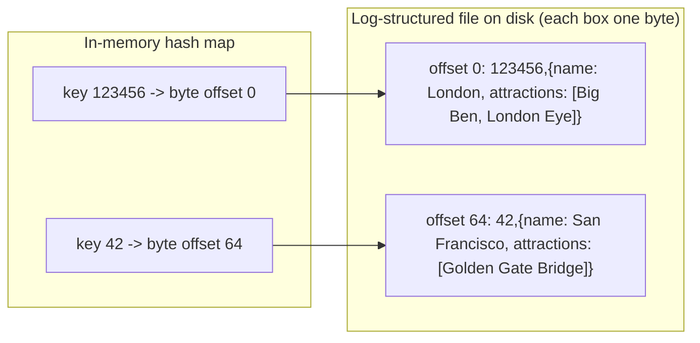

**Real system:** essentially **Bitcask**, the default storage engine of **Riak**. High-performance reads and writes **as long as all keys fit in RAM**; values may exceed memory, since a read costs one disk seek (or none if that part of the file is in the OS filesystem cache).

**Good fit:** few distinct keys, many updates each. Book example: key = cat-video URL, value = play count incremented on every play.

**Problem: the log grows forever.** Split it into **segments** (close a file at a certain size, start a new one); run **compaction** on closed segments (drop older duplicates, keep the latest value per key); and since compaction shrinks segments, **merge** several while compacting.

*Figure 3-2 (redrawn): compacting one segment of a cat-video play-count log keeps only the newest value per key*
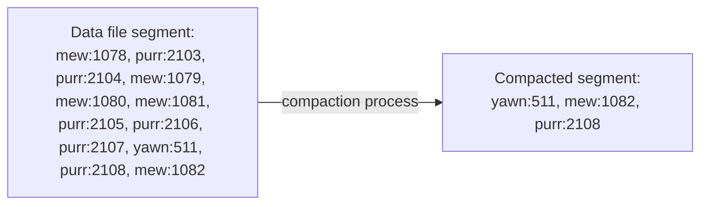

*Figure 3-3 (redrawn): compaction and merging of two segments done together, producing one new segment*
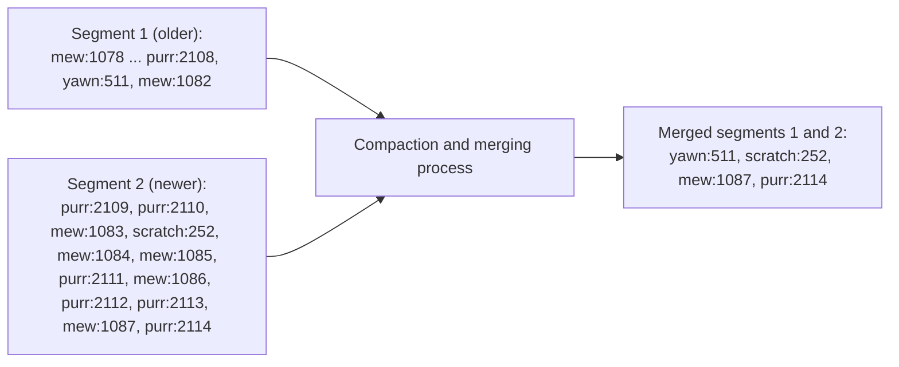

Merging details: segments are **never modified**; the result goes to a **new file**, built by a **background thread** while reads and writes continue on old segments; then reads switch over and old files are deleted. **Each segment has its own hash map**; reads check newest to oldest, and merging keeps the count small.

**Practical issues in a real implementation:**

| Issue | How it's handled |
|---|---|
| File format | Binary (length in bytes, then raw bytes) instead of CSV: faster, no escaping. |
| Deleting records | Append a **tombstone**; merging then drops all earlier values for that key. |
| Crash recovery | In-memory maps vanish on restart; rebuilding by reading whole segments is slow, so Bitcask stores a **snapshot of each segment's hash map** on disk to load quickly. |
| Partially written records | Bitcask uses **checksums** to detect and ignore corrupt tails after a crash. |
| Concurrency control | Writes are strictly sequential, so typically **one writer thread**; immutable segments allow **many concurrent readers**. |

**Why append-only instead of overwriting in place?**
- Appends and merges are **sequential writes**, much faster than random writes on HDDs and, to a lesser degree, SSDs.
- **Concurrency and crash recovery are simpler** with immutable files: no value left half old, half new by a crash mid-overwrite.
- **Merging avoids fragmentation** over time.

**Limitations:**
- **The hash table must fit in memory**; on-disk hash maps perform poorly (random I/O, costly growth, fiddly collision handling).
- **Range queries are inefficient**: scanning `kitty00000`–`kitty99999` requires looking up each key individually.

### SSTables and LSM-Trees

**The change.** Require each segment to be **sorted by key**, with each key **once** per merged segment: a **Sorted String Table (SSTable)**.

**Three advantages over hash-indexed log segments:**

1. **Merging is simple and efficient even for files bigger than memory**, like mergesort's merge step: read the inputs side by side, repeatedly emit the lowest current key; the output is sorted. For a key in several inputs, keep the **newest segment's** value (each segment covers a time period, assuming adjacent segments are merged).

   *Figure 3-4 (redrawn): merging three SSTable segments mergesort-style; for a key found in several segments, the value from the newest segment wins*
   ```mermaid
   flowchart LR
     A["Segment 1 (oldest): handbag:8786, handful:40308, handicap:65995,<br/>handkerchief:16324, handlebars:3869, handprinted:11150"] --> M["Compaction and merging process"]
     B["Segment 2: handcuffs:2729, handful:42307, handicap:67884,<br/>handiwork:16912, handkerchief:20952, handprinted:15725"] --> M
     C["Segment 3 (newest): handful:44662, handicap:70836,<br/>handiwork:45521, handlebars:3869, handoff:5741, handprinted:33632"] --> M
     M --> O["Merged 1,2,3: handbag:8786, handcuffs:2729, handful:44662, handicap:70836,<br/>handiwork:45521, handkerchief:20952, handlebars:3869, handoff:5741, handprinted:33632"]
   ```

2. **Not every key needs to be in memory.** A **sparse** index suffices: to find `handiwork` knowing only the offsets of `handbag` and `handsome`, jump to `handbag` and scan forward. One entry per **few kilobytes** is enough because scanning a few KB is fast. (With fixed-size records a binary search would need no index at all, but records vary in length.)

3. **Blocks can be compressed.** Group neighbouring records into a block and compress it before writing; each sparse-index entry points to a block start. Saves disk space *and* I/O bandwidth.

*Figure 3-5 (redrawn): an SSTable with a sparse in-memory index; each entry points to the start of a compressible block of the sorted file*
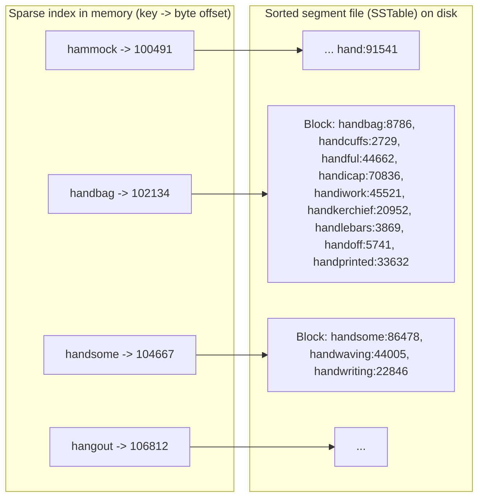

#### Constructing and maintaining SSTables

Writes arrive in random key order. A sorted structure **on disk** is possible (B-tree), but **in memory** it is easy with a self-balancing tree such as a **red-black tree** or **AVL tree**: insert in any order, read back sorted.

**How the engine works:**
1. **Write:** insert into the in-memory balanced tree, the **memtable**.
2. **Flush:** when it exceeds a threshold (typically a **few megabytes**), write it out as a new SSTable (already sorted), which becomes the newest segment; new writes go to a fresh memtable meanwhile.
3. **Read:** memtable, then newest segment, then older ones.
4. **Background:** merge and compact segments, dropping overwritten and deleted values.

**The crash problem.** A crash loses the memtable. Fix: also append every write to a separate **unsorted log** on disk, used only to rebuild the memtable after a crash and discarded once that memtable is flushed.

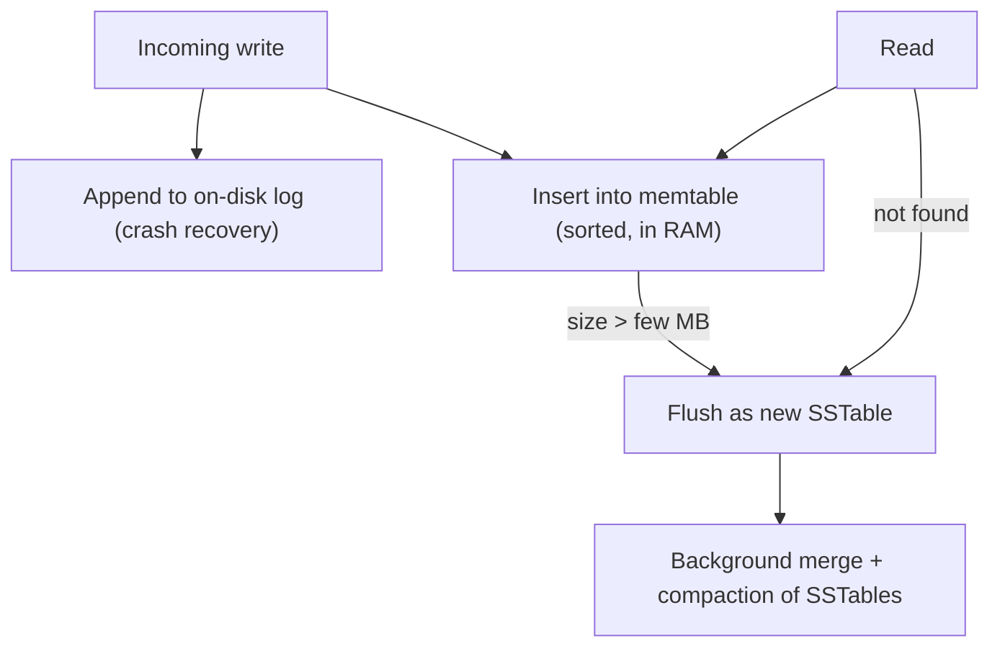

#### Making an LSM-tree out of SSTables

- This is essentially **LevelDB** and **RocksDB**, key-value engine libraries embedded into other applications; LevelDB can replace Bitcask in **Riak**.
- Similar engines power **Cassandra** and **HBase**, inspired by Google's **Bigtable** paper, which coined *SSTable* and *memtable*.
- First described by **Patrick O'Neil et al.** as the **Log-Structured Merge-Tree (LSM-Tree)**, building on log-structured filesystems; engines that merge and compact sorted files are **LSM storage engines**.
- **Lucene** (behind **Elasticsearch** and **Solr**) uses a similar approach for its **term dictionary**: a full-text index maps each word (**term**) to the IDs of documents containing it (the **postings list**), kept in SSTable-like sorted files merged in the background.

#### Performance optimizations

- **Missing-key lookups are slow** (memtable plus every segment back to the oldest, possibly disk reads each). **Bloom filters** approximate set contents and say for certain a key is *absent*, saving those reads.
- **Compaction strategies:**

| Strategy | How it works | Used by |
|---|---|---|
| Size-tiered | Newer, smaller SSTables are successively merged into older, larger ones. | HBase; Cassandra (supports both) |
| Leveled | Key range split into smaller SSTables; older data moves into separate "levels"; more incremental, less disk space. | LevelDB (hence the name), RocksDB; Cassandra |

**Why LSM-trees work well:** a simple, powerful idea (a cascade of SSTables tidied by background merging) that works with data far larger than memory, supports **range queries** (data is sorted), and gives **very high write throughput** (sequential disk writes).

### B-Trees

**What it is.** The **most widely used** index: introduced in **1970**, called "ubiquitous" less than 10 years later, still standard in almost all relational and many non-relational databases. Like SSTables, keys are sorted (efficient lookups and range queries), but the design philosophy differs:

| | Log-structured (LSM) | B-tree |
|---|---|---|
| Unit of storage | Variable-size segments (several MB+) | Fixed-size **pages** (traditionally **4 KB**, sometimes bigger) |
| Write style | Always write a whole segment sequentially | Read/write one page at a time, overwriting in place |
| Hardware match | — | Close to how disks are organised (fixed-size blocks) |

**How it works:** each page has an address, so pages reference each other like on-disk pointers, forming a **tree**. Lookups start at the **root**. A page holds keys interleaved with child references; each child covers a **continuous key range** bounded by the keys around its reference. Follow the matching reference down to a **leaf page**, which holds the keys with values inline or references to them. Book example: for key **251**, follow the root's reference between **200** and **300**, and keep descending.

*Figure 3-6 (redrawn): looking up user_id 251 by descending from the root through range boundaries to a leaf page*
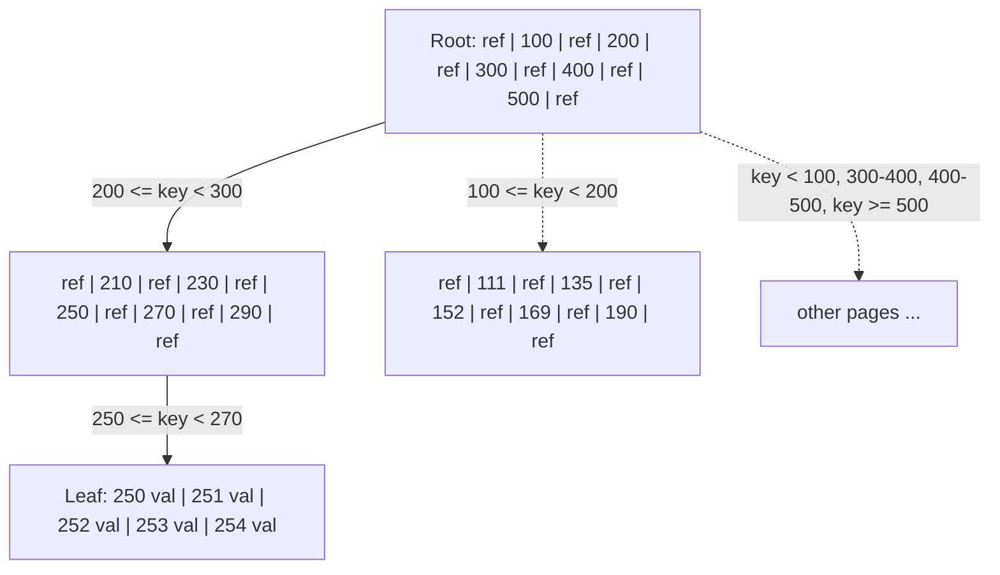

**Branching factor**: six in the figure, **several hundred** in practice (depends on the space references and boundaries take).

**Updating and inserting:** to **update**, find the leaf, change the value, write the page back (references stay valid). To **insert**, add the key to the page covering its range; if **full**, **split** it into two half-full pages and update the **parent**.

*Figure 3-7 (redrawn): adding key 334 to a full leaf splits it into two pages with spare space; the parent gains the new boundary key 337*
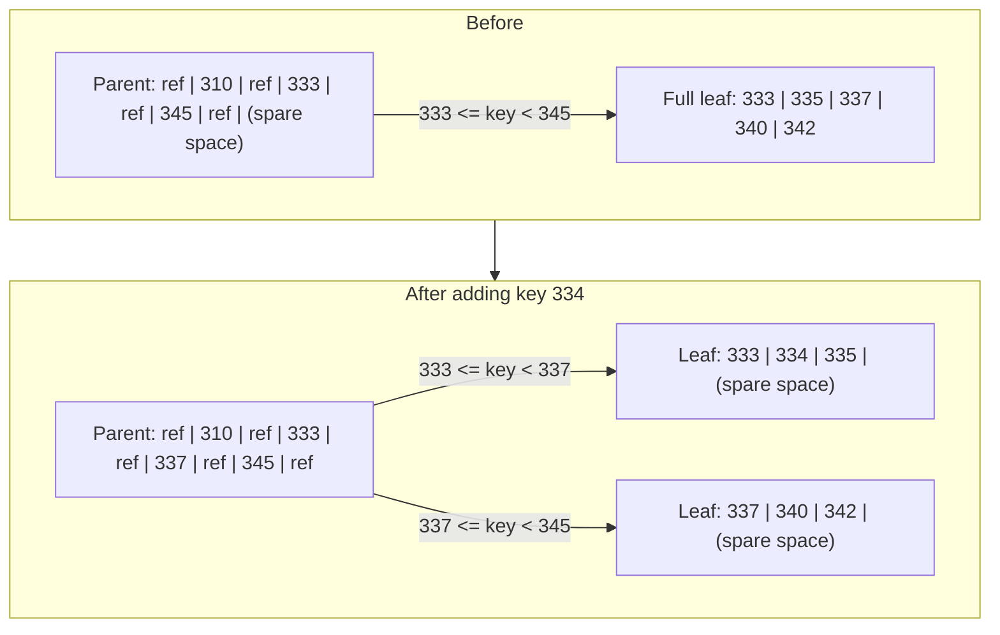

- The tree stays **balanced**: depth **O(log n)**; most databases fit in **three or four levels**.
- **Numbers to remember:** **4 KB pages**, **branching factor 500**, **four levels** → up to **256 TB**.
- Insertion is intuitive; deletion while keeping balance is more involved.

#### Making B-trees reliable

- The basic B-tree write **overwrites a page in place**, assuming its location never changes — the opposite of LSM-trees, which only append and delete whole files. On an HDD that means moving the head, waiting for the platter to rotate, and rewriting the sector; an SSD must erase and rewrite a fairly large block of its chip.
- **Multi-page operations are dangerous**: a split writes two children *and* the parent; a crash halfway can corrupt the index (e.g. an **orphan page** with no parent).
- **Fix — the write-ahead log (WAL, a.k.a. redo log):** every change is appended to it **before** touching tree pages; after a crash it is replayed to restore a consistent tree.
- **Concurrency is harder:** threads could see the tree mid-change, so B-trees use **latches**. Log-structured engines merge in the background and swap segments atomically, without disturbing queries.

#### B-tree optimizations

- **Copy-on-write (append-only B-trees)** instead of overwrite + WAL (e.g. **LMDB**): write the modified page elsewhere and create new parent versions pointing to it. Also helps concurrency control (snapshot isolation, Chapter 7).
- **Abbreviated keys:** interior pages store only enough of a key to separate ranges → higher branching factor, fewer levels (a **B+ tree**, though the optimisation is so common it is rarely singled out).
- **Sequential leaf layout:** pages can be anywhere, so range scans may seek per page; many implementations try to lay leaves out in key order, hard to maintain as the tree grows. LSM-trees do this naturally by rewriting large chunks when merging.
- **Sibling pointers:** each leaf links to its neighbours, so ordered scans need not go back up to parents.
- **Fractal trees:** B-tree variants borrowing log-structured ideas to reduce seeks (nothing to do with fractals).

### Comparing B-Trees and LSM-Trees

**Rule of thumb:** LSM-trees are usually **faster for writes**; B-trees are thought to **read faster** (LSM reads may check several structures and SSTables at different compaction stages). Benchmarks are often inconclusive and workload-dependent — test *your* workload.

#### Advantages of LSM-trees

- **Write amplification.** A B-tree writes data **at least twice** (WAL, then the page, plus more on splits), writes a **whole page** even for a few changed bytes, and some engines write a page **twice** to avoid a torn (partially written) page on power loss. LSM-trees also rewrite data repeatedly through compaction. One database write causing multiple disk writes over its lifetime is **write amplification**; it matters especially on **SSDs**, which wear out after a limited number of overwrites per block.
- **Higher write throughput.** When disk bandwidth is the bottleneck, every extra byte written costs throughput. LSM-trees often sustain more writes because they *sometimes* have lower write amplification (configuration- and workload-dependent) and write compact SSTables **sequentially** rather than overwriting scattered pages — most important on magnetic disks.
- **Better compression, smaller files.** B-trees waste space through **fragmentation** (after splits, or rows not fitting a page); LSM-trees periodically rewrite SSTables and have lower overhead, **especially with leveled compaction**.
- **On SSDs**, firmware often internally uses a log-structured algorithm to turn random writes sequential, so the engine's pattern matters less — but lower write amplification and less fragmentation still let more requests fit in the I/O bandwidth.

#### Downsides of LSM-trees

- **Compaction can interfere with live traffic:** requests may wait behind expensive compaction. Average throughput and response time barely suffer, but **high-percentile (tail) latencies** can be quite high. **B-trees are more predictable.**
- **Compaction can fall behind at high write rates.** Disk bandwidth is shared between initial writes (logging, memtable flushes) and compaction, which needs more as data grows. If it cannot keep up, **unmerged segments pile up** until the disk fills, and reads slow as they check more files. SSTable engines usually **don't throttle** incoming writes, so **monitor explicitly**.
- In a B-tree **each key lives in exactly one place**; an LSM engine may hold copies in several segments. So B-trees suit **strong transactional semantics**: many relational databases implement isolation with **locks on key ranges** attached directly to the B-tree (Chapter 7).

| Aspect | B-tree | LSM-tree |
|---|---|---|
| Typical strength | Reads, predictable latency | Writes, throughput |
| Write amplification | WAL + full page writes (sometimes twice) | Repeated compaction (sometimes lower overall, depending on configuration and workload) |
| Disk pattern | Random page overwrites | Sequential segment writes |
| Space usage | Fragmentation leaves empty space | More compact, better compression |
| Background work | No background compaction | Compaction may hurt tail latency / fall behind |
| Key location | Exactly one place (good for range locks) | Possibly many segments |
| Maturity | Very mature, ingrained in databases | Increasingly popular in new datastores |

**Conclusion:** B-trees are deeply embedded and consistently good, so they won't disappear; log-structured indexes are increasingly popular in new systems. No quick rule — test empirically.

### Other Indexing Structures

So far: **key-value indexes**, like a **primary key** index (uniquely identifying a row, document, or vertex; other records refer to it by that key).

**Secondary indexes** are very common (`CREATE INDEX`), often essential for efficient joins:

```sql
-- A secondary index on a non-unique column
CREATE INDEX idx_orders_customer ON orders (customer_id);
-- Now this query can use the index instead of scanning every order:
SELECT * FROM orders WHERE customer_id = 812;
```

The difference from a primary index: **keys are not unique**. Fix by making each value a **list of matching row IDs** (like a postings list), or making keys unique by **appending the row ID**. Either way, secondary indexes can be **B-trees or log-structured**.

#### Storing values within the index

An index entry's value is either **the row itself** or a **reference** to it.

- **Heap file:** rows stored in no particular order (append-only, or reusing deleted space). With several secondary indexes, data lives in **one place** and each index points to it. Updating a value **without changing the key** can overwrite in place if not larger; if it **grows** and moves, update **all indexes** or leave a **forwarding pointer**.
- **Clustered index:** when the extra hop to the heap hurts reads, store the **whole row in the index**. **MySQL InnoDB**: the primary key is always clustered, and secondary indexes refer to the **primary key**, not a heap location. **SQL Server**: **one** clustered index per table.
- **Covering index / index with included columns:** store **some** columns in the index so certain queries are answered from it alone (the index **covers** the query):

```sql
-- SQL Server-style covering index
CREATE INDEX idx_emp_dept ON employees (dept_id) INCLUDE (salary);
SELECT salary FROM employees WHERE dept_id = 4;  -- answered from the index alone
```

**Trade-off:** clustered and covering indexes duplicate data → faster reads but more storage, write overhead, and effort to keep transactional guarantees (no visible inconsistency from the duplication).

| Option | What the index stores | Read cost | Write/storage cost |
|---|---|---|---|
| Nonclustered (heap) | Pointer to row | Extra hop | Lowest |
| Covering | Some columns | No hop for covered queries | Medium |
| Clustered | Entire row | No hop | Highest |

#### Multi-column indexes

- **Concatenated index** (most common): several columns joined into one key in fixed order. Like a **phone book** sorted by (last name, first name): finds a last name or last+first, but is **useless for first name alone**.
- **Multi-dimensional indexes:** important for **geospatial** data. A restaurant map needs everything inside the visible rectangle — a **2D range query**:

```sql
SELECT * FROM cafes
WHERE lat BETWEEN 48.850 AND 48.862      -- north-south band
  AND lon BETWEEN 2.330  AND 2.355;      -- east-west band
```

A normal B-tree or LSM index gives all rows in the latitude band (any longitude) *or* the longitude band, not both efficiently. **Solutions:** map 2D points to one number with a **space-filling curve** and use a B-tree; or, more commonly, a spatial index like an **R-tree** — **PostGIS** builds them on PostgreSQL's **Generalized Search Tree (GiST)**.

**Not just maps:** a 3D index on **(red, green, blue)** for colour search in e-commerce; **(date, temperature)** for weather readings in **2013** between **25 and 30 ℃** without scanning all of 2013 (or vice versa). **HyperDex** uses this technique.

#### Full-text search and fuzzy indexes

The indexes above need **exact** keys or ranges; **fuzzy** querying finds **similar** keys (e.g. misspellings).

- Full-text engines expand to **synonyms**, ignore **grammatical variations**, find words **near each other**, and more.
- **Lucene** finds words within a given **edit distance** (1 = one letter added, removed or replaced).
- Lucene's term dictionary is SSTable-like with a small in-memory index: where **LevelDB** uses a sparse key set, **Lucene** uses a **finite state automaton** over the keys' characters (like a **trie**), which can be turned into a **Levenshtein automaton** to search efficiently within an edit distance.
- Other fuzzy techniques lean toward document classification and machine learning (see information-retrieval texts).

#### Keeping everything in memory

We tolerate awkward disk layouts because disks are **durable** and **cheaper per GB** than RAM. As RAM gets cheaper, many datasets fit in memory (possibly across machines): **in-memory databases**.

- **Cache-only** stores like **Memcached** accept losing data on restart.
- **Durable** ones use battery-backed RAM, a **change log** on disk, **periodic snapshots**, or **replication** (Chapter 5), reloading from disk or a replica on restart. Disk is only an append-only durability log — **all reads come from RAM** — and disk files also ease backups and external analysis.

**Named systems:** **VoltDB, MemSQL, Oracle TimesTen** (in-memory relational; vendors claim big speedups from dropping on-disk structure overhead); **RAMCloud** (open-source durable in-memory key-value store, log-structured in RAM and on disk); **Redis, Couchbase** (weak durability: write to disk **asynchronously**, so a crash can lose recent writes).

> **Common confusion:** in-memory databases are *not* fast mainly because they skip disk reads — a disk-based engine with enough RAM may never read disk either, thanks to the OS cache. The real win is avoiding **encoding in-memory structures into a disk-friendly format**.

**Richer data models:** structures hard to build on disk, e.g. **Redis** priority queues and sets, with a comparatively simple implementation.

**Anti-caching:** research suggests in-memory systems can exceed RAM by evicting **least recently used** (LRU) records to disk and reloading on access — like OS virtual memory/swap, but per **individual record** rather than whole pages. Indexes must still fit in memory (like Bitcask).

**Future:** **non-volatile memory (NVM)** may require further engine design changes; an active research area.

---

## Transaction Processing or Analytics?

Early database writes usually matched a **commercial transaction** (a sale, supplier order, salary payment). The term **transaction** stuck, now meaning a group of reads and writes forming one logical unit.

> **Note:** here a transaction need not be ACID (Chapter 7). *Transaction processing* just means **low-latency** reads and writes, versus periodic **batch processing** jobs (Chapter 10).

**OLTP.** Blog comments, game actions, contacts — all look like business transactions: find a few records by key via an index; insert or update based on user input. Interactive, hence **online transaction processing (OLTP)**.

**OLAP.** **Analytics** is different: scan a **huge number of records**, read **a few columns** each, compute **aggregates** (count, sum, average) rather than return raw rows. E.g. total revenue per store in January? Banana sales during the latest promotion vs normal? Which baby-food brand is most often bought with brand X diapers? Such queries feed **business intelligence** reports: **online analytic processing (OLAP)** (the "online" is vague; probably means interactive exploratory queries).

*Table 3-1 (paraphrased): OLTP vs OLAP characteristics*

| Property | OLTP | OLAP |
|---|---|---|
| Main read pattern | Each query fetches a few records by key | Aggregates computed across very many records |
| Main write pattern | Low-latency, random-access writes driven by user input | Event stream or bulk import (ETL) |
| Primarily used by | Customers/end users, through a web app | Internal analysts supporting decisions |
| What data represents | Latest state (current point in time) | History of events over time |
| Dataset size | GB up to TB | TB up to PB |

SQL handles both, and at first the same databases served both; from the **late 1980s and early 1990s** companies moved analytics to a **separate** database: the **data warehouse**.

### Data Warehousing

A large company may run **dozens** of OLTP systems (website, point-of-sale, inventory, route planning, supplier management, HR…), each complex, with its own team. They must be **highly available** and **low-latency**, so DBAs resist analysts running expensive **ad hoc** scans on them.

A **data warehouse** is a separate database holding a **read-only copy** of data from all OLTP systems, which analysts can query freely. Data arrives via **Extract–Transform–Load (ETL)**: **extract** from OLTP databases (periodic dump or continuous update stream), **transform** into an analysis-friendly, cleaned schema, **load** into the warehouse.

*Figure 3-8 (redrawn): simplified ETL. Each OLTP system is extracted and transformed separately, then loaded into one data warehouse that business analysts query*
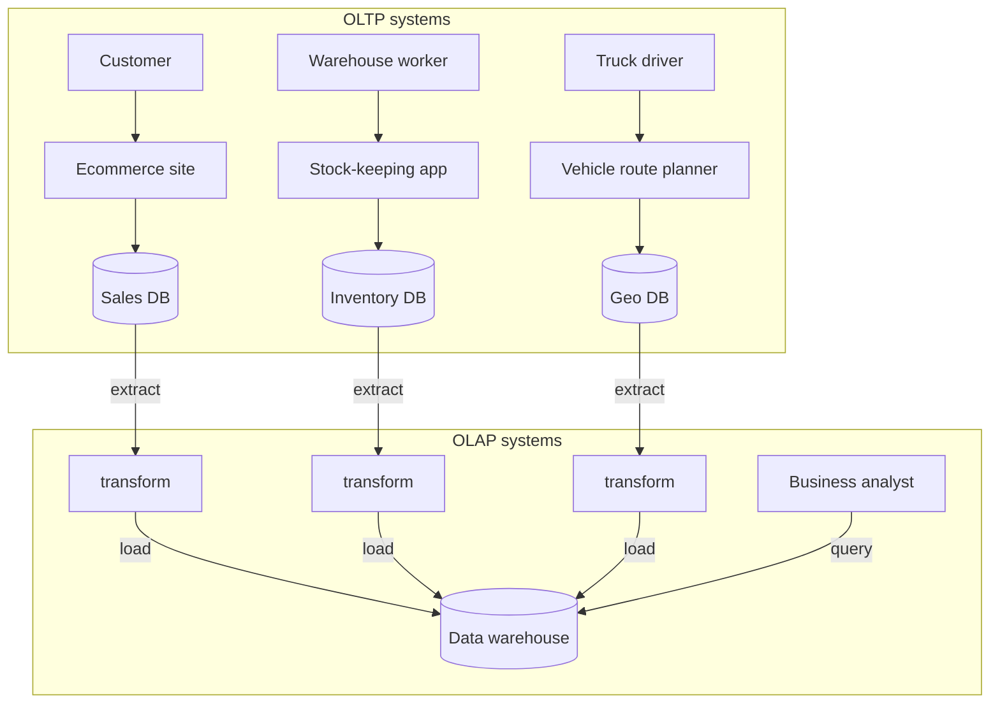

- Common in **large** enterprises, rare in **small** ones (few OLTP systems, little data — a normal SQL database or spreadsheet suffices).
- **Big advantage:** optimised for analytic access; the OLTP indexes above are **poor at analytic queries**.

#### The divergence between OLTP databases and data warehouses

- Warehouses are usually **relational** (SQL suits analytics); graphical tools generate SQL, visualise results, and support **drill-down** (from a total to its details) and **slicing and dicing** (cutting by different attributes).
- Both speak SQL, but **internals differ greatly**; vendors increasingly specialise in one. **Microsoft SQL Server** and **SAP HANA** support both, increasingly as two engines behind one SQL interface.
- **Commercial warehouses:** Teradata, Vertica, SAP HANA, ParAccel (expensive licences); **Amazon RedShift** is hosted ParAccel.
- **Open-source SQL-on-Hadoop** (younger): Spark SQL, Apache Hive, Apache Drill, Apache Tajo, Facebook Presto, Cloudera Impala; some build on Google's **Dremel**.

### Stars and Snowflakes: Schemas for Analytics

Analytics uses far fewer data models than OLTP; most warehouses use a **star schema** (**dimensional modeling**).

**Fact table** (e.g. `fact_sales` for a grocery chain): each row is an **event** at a particular time (here, a customer buying a product; in web analytics, a page view or click).
- Recording individual events maximises flexibility, but fact tables become **enormous**: **Apple, Walmart, eBay** may hold **tens of petabytes**, mostly facts.
- Some columns are **attributes** (sale price, supplier cost → profit margin); others are **foreign keys** to **dimension tables** describing the event's **who, what, where, when, how and why**.

**Dimension tables:** e.g. `dim_product`, one row per product type (SKU, description, brand, category, fat content, package size…); each fact row references the product sold (several products in one purchase = several fact rows). Even **date and time** get a dimension so extra info like **public holidays** can be attached and compared.

*Figure 3-9 (redrawn): star schema for a grocery retailer. fact_sales sits in the centre; its foreign keys point at five dimension tables (sample rows in the book: product 31 = Fish food by Aquatech, store 3 = Palo Alto CA, promotion 19 = Aquarium deal, customer 191 = Bob, date 140102 = Thu 2 Jan 2014)*
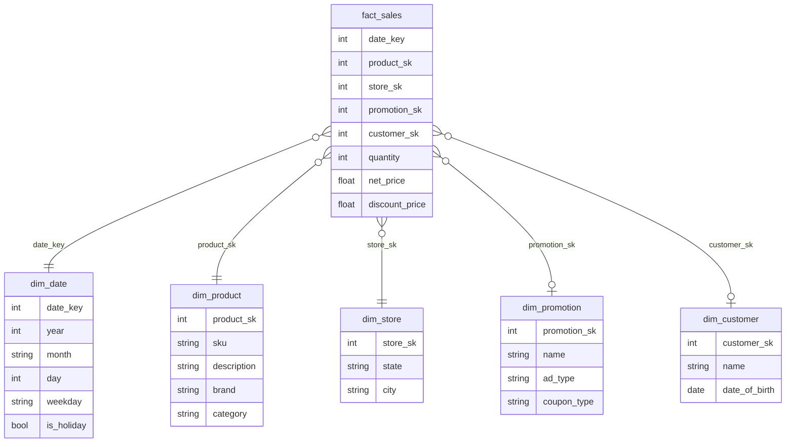

- **Why "star":** the fact table in the middle with dimensions around it like rays.
- **Snowflake schema:** dimensions split into sub-dimensions (e.g. separate `brand` and `category` tables referenced by `dim_product`): more **normalised**, but stars are usually preferred as **simpler for analysts**.
- **Tables are wide:** fact tables often exceed **100 columns**, sometimes several hundred; dimensions too (e.g. `dim_store` with services offered, in-store bakery, floor area, opening date, last remodel, distance to highway).

---

## Column-Oriented Storage

Fact tables can have **trillions of rows** and **petabytes**; dimension tables are much smaller (**millions** of rows), so focus on **facts**.

**Key observation:** a typical warehouse query touches only **4 or 5** of 100+ columns (`SELECT *` is rare). The book's Example 3-1 asks whether people prefer fresh fruit or candy by weekday across all of 2013, touching only `date_key`, `product_sk` and `quantity`. A similar query of ours:

```sql
SELECT d.month, s.region, SUM(f.net_price) AS revenue   -- only a few columns needed
FROM fact_sales f
  JOIN dim_date  d ON f.date_key = d.date_key            -- attach date details
  JOIN dim_store s ON f.store_sk = s.store_sk            -- attach store details
WHERE d.year = 2015 AND s.region IN ('North', 'West')    -- filter
GROUP BY d.month, s.region;                              -- one total per month per region
```

It reads just `date_key`, `store_sk` and `net_price` from `fact_sales`, but across a huge number of rows.

**Why row storage struggles:** OLTP databases are **row-oriented** (a row's values adjacent; document databases similarly). Even with indexes on `date_key` or `product_sk`, a row store loads whole 100+-attribute rows from disk, parses and filters them — slow.

**The column-oriented idea:** store each **column** together in its **own file**; queries read and parse only the columns they need. (Works for non-relational data too: **Parquet** is a columnar format supporting a document model, based on Google's **Dremel**.)

*Figure 3-10 (redrawn): the book's eight fact_sales rows stored as one file per column; position k in every file belongs to row k*
```mermaid
flowchart LR
  subgraph ROWS["Row-oriented (fact_sales, 8 rows; first 3 shown)"]
    R1["140102, 69, 4, NULL, NULL, 1, 13.99, 13.99"]
    R2["140102, 69, 5, 19, NULL, 3, 14.99, 9.99"]
    R3["140102, 69, 5, NULL, 191, 1, 14.99, 14.99"]
    R4["... 5 more rows"]
  end
  subgraph COLS["Column-oriented: one file per column"]
    C1["date_key: 140102, 140102, 140102, 140102, 140103, 140103, 140103, 140103"]
    C2["product_sk: 69, 69, 69, 74, 31, 31, 31, 31"]
    C3["store_sk: 4, 5, 5, 3, 2, 3, 3, 8"]
    C4["promotion_sk: NULL, 19, NULL, 23, NULL, NULL, 21, NULL"]
    C5["customer_sk: NULL, NULL, 191, 202, NULL, NULL, 123, 233"]
    C6["quantity: 1, 3, 1, 5, 1, 3, 1, 1"]
    C7["net_price: 13.99, 14.99, 14.99, 0.99, 2.49, 14.99, 49.99, 0.99"]
    C8["discount_price: 13.99, 9.99, 14.99, 0.89, 2.49, 9.99, 39.99, 0.99"]
  end
  ROWS -->|"store by column"| COLS
```

**Crucial rule:** every column file lists rows in the **same order**; row 23 = the 23rd entry of each file.

### Column Compression

Columns are often repetitive, so **compression** cuts I/O further.

**Bitmap encoding** (especially effective in warehouses):
1. Columns usually have few **distinct values** relative to rows (**billions** of sales, **100,000** products).
2. For **n distinct values**, make **n bitmaps**, **one bit per row** (1 if the row has that value).
3. Very small n (e.g. ~**200** countries): store bitmaps as-is.
4. Larger n: bitmaps are mostly zeros (**sparse**), so add **run-length encoding** (lengths of alternating runs of 0s and 1s).

*Figure 3-11 (redrawn): an 18-row product_sk column turned into one bitmap per distinct value, then run-length encoded*
```mermaid
flowchart LR
  COL["product_sk column (18 rows):<br/>69 69 69 69 74 31 31 31 31 29 30 30 31 31 31 68 69 69"]
  subgraph BM["Bitmap per value (one bit per row)"]
    B29["29: 000000000100000000"]
    B30["30: 000000000011000000"]
    B31["31: 000001111000111000"]
    B68["68: 000000000000000100"]
    B69["69: 111100000000000011"]
    B74["74: 000010000000000000"]
  end
  subgraph RLE["Run-length encoded (alternating runs, starting with zeros)"]
    E29["29: 9, 1 (then rest zeros)"]
    E30["30: 10, 2"]
    E31["31: 5, 4, 3, 3"]
    E68["68: 15, 1"]
    E69["69: 0, 4, 12, 2"]
    E74["74: 4, 1"]
  end
  COL --> BM
  BM --> RLE
```

**Bitmaps make common filters cheap:** `WHERE product_sk IN (30, 68, 69)` → bitwise **OR** of three bitmaps; `product_sk = 31 AND store_sk = 3` → bitwise **AND** of two bitmaps (works because bit k is the same row in every column). Many other compression schemes exist.

> **Column-oriented storage vs column families (common confusion):** **Cassandra** and **HBase** have *column families* from **Bigtable**, but within a family they store all of a row's columns together with a row key and use no column compression. The Bigtable model is mostly **row-oriented**.

#### Memory bandwidth and vectorized processing

Besides disk-to-memory bandwidth, analytic engines care about moving data from **RAM into the CPU cache**, avoiding **branch mispredictions** and **bubbles** in the CPU pipeline, and using **SIMD** (single-instruction-multi-data) instructions. Column layouts help: the engine takes a chunk of compressed column data that fits in the **L1 cache** and loops over it tightly with **no function calls** — far faster than per-record code full of calls and branches. Compression fits **more rows** in L1, and operators like bitwise AND/OR can run **directly on compressed chunks**. This is **vectorized processing**.

### Sort Order in Column Storage

Rows can stay in **insertion order** (insert = append to each column file), or be given a **sort order**, like SSTables, usable as an index.

- **Columns cannot be sorted independently** (you would lose which values form a row); sort **whole rows**.
- The DBA picks **sort keys** from common queries: if queries target date ranges, make `date_key` the **first** key so only that range is scanned. A **second** key orders ties, e.g. `date_key` then `product_sk` groups same-day sales of a product.

**Sorting boosts compression:** a first sort column with few distinct values forms **long runs**, so run-length encoding can shrink it to a **few kilobytes** even for **billions** of rows. The first key benefits most; later columns look nearly random. Still a net win.

#### Several different sort orders

From **C-Store**, adopted by **Vertica**: data is **replicated** to several machines anyway for fault tolerance, so store each replica **sorted differently** and let each query use the best-fitting one.

| | Multiple sort orders (column store) | Multiple secondary indexes (row store) |
|---|---|---|
| Where the full data lives | Each sorted copy contains the column values themselves | Each row in one place (heap file or clustered index) |
| What the extra structures hold | No pointers — just columns of values | Pointers to matching rows |

### Writing to Column-Oriented Storage

Columnar storage, compression and sorting speed **reads** (the main warehouse load) but make **writes harder**: **update-in-place is impossible** with compressed columns, and inserting **midway** through a sorted table would likely mean **rewriting every column file** (rows are identified by position).

**Solution: LSM-trees again.** Writes go to a sorted **in-memory store** (row- or column-oriented, it doesn't matter); when enough accumulate, they are **merged** with on-disk column files into **new files in bulk** (essentially what **Vertica** does). **Queries** combine on-disk data with recent in-memory writes, and the **query optimizer hides** this, so inserts, updates and deletes appear immediately.

### Aggregation: Data Cubes and Materialized Views

Not every warehouse is columnar, but column stores can be **much faster for ad hoc analytics** and are gaining popularity.

**Materialized aggregates.** Queries often use `COUNT`, `SUM`, `AVG`, `MIN`, `MAX`; if many reuse the same aggregates, **cache** them rather than recompute from raw data.

| | Virtual view | Materialized view |
|---|---|---|
| What it is | A named query shortcut | The query's results really stored **on disk** |
| On read | SQL engine expands it into the underlying query on the fly | Read precomputed results directly |
| On data change | Nothing to do | Must be **updated** (denormalised copy); database can do it automatically |
| Cost | Slow reads for heavy queries | More expensive **writes** |

Because of write cost, materialized views are rare in **OLTP** but more sensible in **read-heavy warehouses** (case-dependent).

```sql
-- PostgreSQL-style example
CREATE MATERIALIZED VIEW daily_store_revenue AS
  SELECT date_key, store_sk, SUM(net_price) AS revenue
  FROM fact_sales
  GROUP BY date_key, store_sk;          -- precompute totals per day per store
REFRESH MATERIALIZED VIEW daily_store_revenue;  -- recompute after new sales arrive
```

**Data cube / OLAP cube:** a materialized view that is a **grid of aggregates by several dimensions**. With two dimensions, **date** and **product**, each cell holds e.g. `SUM(net_price)` for that date–product pair; summing a row or column gives totals with one dimension removed (per date, or per product).

*Figure 3-12 (redrawn): two dimensions of a data cube (date_key by product_sk). Each cell is SUM(net_price) for that pair; summing along a row gives the per-date total, along a column the per-product total*
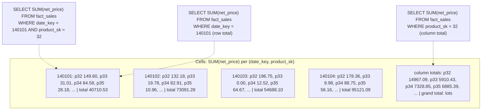

- More dimensions (Figure 3-9 has **five**: date, product, store, promotion, customer) make a **hypercube**, same idea.
- **Advantage:** some queries become near-instant (e.g. yesterday's sales per store = read totals along one dimension).
- **Disadvantage:** **less flexible** than raw data: e.g. the share of sales from items priced above **$100** is impossible if price isn't a dimension.
- So most warehouses **retain raw data** and use cubes only as a **speed-up for particular queries**.

---

## Summary

- **Two categories** of storage engines: **OLTP** (user-facing, huge request volume, each query touches few records found by key via an index; **disk seek time** is often the bottleneck) and **analytics/OLAP** (business analysts, fewer queries each scanning millions of records; the limit is **disk bandwidth**, answered by **column-oriented storage**).
- **Two OLTP schools:** **log-structured** (only append and delete obsolete files; Bitcask, SSTables, LSM-trees, LevelDB, RocksDB, HBase, Cassandra, Lucene) and **update-in-place** (fixed-size overwritable pages; **B-trees**, in all major relational and many non-relational databases). Log-structured engines turn **random writes into sequential writes**, raising write throughput on HDDs and SSDs.
- **Hash indexes** (Bitcask): keys must fit in RAM, no range queries; segments + compaction + merging, tombstones, checksums.
- **SSTables/LSM-trees:** memtable → sorted SSTables → background merging (size-tiered or leveled); sparse index, compressed blocks, Bloom filters, crash log.
- **B-trees:** 4 KB pages, in-place updates, splits keep balance (4 levels × 500 branching × 4 KB = 256 TB); WAL and latches; copy-on-write (LMDB), abbreviated keys (B+ tree), sibling pointers, fractal trees.
- **LSM vs B-tree:** LSM usually better for writes and space; B-tree for reads, predictable latency, key-range locking. Benchmark your workload.
- **Other indexes:** secondary; heap vs clustered (InnoDB, SQL Server) vs covering; concatenated vs multi-dimensional (R-trees, PostGIS, HyperDex); fuzzy (Lucene automata). **In-memory DBs** win by avoiding encoding overhead, not disk reads.
- **Warehouses** (via **ETL**, **star**/snowflake schemas): indexes matter less than **very compact encoding** — columnar storage, bitmap/RLE compression, vectorised processing, sort orders (C-Store/Vertica), LSM-style writes, and **materialized views/data cubes** trading flexibility for speed.
- **Takeaway:** knowing engine internals helps you choose tools, predict the effect of tuning parameters, and read your database's documentation.

## Interview angle

**1. B-tree vs LSM-tree — which would you pick?**
*30-second answer:* B-trees update fixed-size pages in place with a WAL; each key lives in one place, reads are fast and latency predictable — the relational default. LSM-trees buffer writes in a memtable, flush sorted SSTables sequentially, and compact in the background — higher write throughput and better compression, but reads may check several files and compaction can hurt tail latency. Write-heavy (logs, metrics, time-series) → LSM; read-heavy/transactional → B-tree. Benchmark.
- *Follow-up: What is write amplification?* One logical write causing several physical writes over time (WAL + page writes in B-trees; repeated compaction in LSM). Limits throughput and wears out SSDs.
- *Follow-up: How does an LSM avoid checking every SSTable for a missing key?* Per-SSTable Bloom filters say "definitely not here".
- *Follow-up: What if compaction can't keep up?* Unmerged segments pile up, reads slow, disk can fill; engines usually don't throttle writes, so monitor.

**2. How does an LSM-tree handle a write and survive a crash?**
*30-second answer:* The write is appended to an on-disk log and inserted into the sorted memtable; at a few MB the memtable is flushed as an immutable SSTable. After a crash the log rebuilds the memtable; after a flush it is discarded.
- *Follow-up: Deletes?* A tombstone; compaction drops older values.
- *Follow-up: Size-tiered vs leveled?* Size-tiered merges smaller/newer into bigger/older tables (HBase); leveled splits key ranges into small tables across levels, more incremental and less disk space (LevelDB, RocksDB). Cassandra supports both.

**3. How does a B-tree stay balanced and crash-safe?**
*30-second answer:* An overflowing page splits into two half-full pages with a new boundary in the parent, keeping depth O(log n), usually 3–4 levels. Changes go to a write-ahead log first so a crash mid-split can be repaired; latches protect concurrent access.
- *Follow-up: Alternative to a WAL?* Copy-on-write pages (LMDB).

**4. OLTP vs OLAP, and why a separate data warehouse?**
*30-second answer:* OLTP = many small key-based user reads/writes, latest state, GB–TB. OLAP = few large aggregate scans for analysts, event history, TB–PB. Analyst queries on OLTP databases hurt customer latency and OLTP indexes are poor for scans, so ETL copies data into a warehouse optimised for analytics (often columnar, star schema).
- *Follow-up: Star schema?* Central fact table of events with foreign keys to dimension tables; snowflake further normalises dimensions.

**5. Why are column stores fast for analytics?**
*30-second answer:* Queries touch 4–5 of 100+ columns, so reading separate column files avoids most I/O. Columns compress very well (bitmaps, RLE), especially the sort key, and compressed chunks fit CPU cache for vectorised processing.
- *Follow-up: Writes?* Buffer in memory (LSM-style) and periodically merge into new column files; queries combine both (Vertica).
- *Follow-up: Are Cassandra/HBase column stores?* No — column families are row-oriented within each family, with no column compression.

**6. Clustered vs covering vs heap-file indexes?**
*30-second answer:* Heap-file indexes point to rows stored elsewhere (no duplication, extra hop). Clustered indexes hold the full row (InnoDB primary key; one per table in SQL Server). Covering indexes hold some columns so certain queries need only the index. More duplication = faster reads, more storage and write cost.

## Self-check

1. **Why is appending to a log fast, and why is reading from an unindexed log slow?**
   Appending is a sequential write at the end of the file; reading without an index scans the whole file, O(n).

2. **What is the main limitation of Bitcask-style hash indexes, and what workload suits them?**
   All keys must fit in RAM and range queries are inefficient. Suits many updates to a modest number of keys (e.g. play counts per video URL).

3. **Why can an SSTable use a sparse index while a hash-indexed log cannot?**
   Keys are sorted, so neighbouring keys' offsets bound the range to scan; in an unsorted log a key could be anywhere.

4. **Trade-off: your service ingests millions of sensor readings per second and rarely updates old data. B-tree or LSM-tree? Why?**
   LSM-tree: sequential writes, higher write throughput, better compression. Watch compaction and tail latency.

5. **What happens in a B-tree when you insert a key into a full page, and why is that risky without a WAL?**
   The page splits and the parent is updated — several page writes. A crash in between could leave an orphan page; the WAL restores consistency.

6. **How big can a 4-level B-tree with 4 KB pages and branching factor 500 get?**
   Up to 256 TB.

7. **Scenario: a map app needs "all shops inside this rectangle". Why won't a concatenated (lat, lon) B-tree index work well, and what should you use?**
   It narrows by latitude but must then scan all longitudes in that band. Use a spatial index such as an R-tree (e.g. PostGIS on GiST) or a space-filling curve.

8. **What is the real reason in-memory databases are faster?**
   They avoid encoding in-memory structures into disk-friendly form — not just avoiding disk reads, which the OS cache already avoids for disk-based engines with enough RAM.

9. **In a column store, why can't each column be sorted independently? What benefit does sorting give?**
   Rows are reconstructed by position; independent sorting breaks alignment. Sorting whole rows speeds range filters on the sort key and creates long runs that compress extremely well.

10. **What's the downside of relying on a data cube instead of raw data?**
    Inflexibility: only questions along chosen dimensions (e.g. no share of sales for items over $100 if price isn't a dimension). Keep raw data; use cubes as a speed-up.
