# Chapter 3 — Storage and Retrieval
*Book: Chapter 3, pp. 69–110*

## Overview

Any database has two jobs at its core: accept data and keep it safe, then hand that same data back when someone asks for it later. Chapter 2 looked at this from the application developer's side (which data model and query language you use). This chapter flips the viewpoint and looks *inside* the database: how does a **storage engine** (the part of a database that actually lays bytes out on disk or in memory and finds them again) do its job?

**Why should you care if you will never write a storage engine?** Because you still have to *pick* one, and you have to *tune* it. Choosing well and tuning well both require a rough mental model of what the engine does under the hood. In particular, engines built for **transactional** workloads (a *workload* is the mix of requests a system handles; here, many small reads/writes from users) behave very differently from engines built for **analytics** (a few huge scans by analysts).

The chapter has three big parts:
1. **Indexes for OLTP-style engines** (OLTP = online transaction processing, the interactive many-small-requests style; defined fully below) — two families: *log-structured* engines (append-only files, e.g. LSM-trees) and *page-oriented* engines (update-in-place, e.g. B-trees), plus other kinds of indexes and in-memory databases.
2. **OLTP vs. analytics** — why companies build separate *data warehouses*, and how warehouse schemas (star/snowflake) look.
3. **Column-oriented storage** — how analytic engines store data by column, compress it, sort it, write to it, and pre-compute aggregates.

**Everyday analogy.** Think of a notebook where you jot down every change to your phone contacts, always on the next empty line (a *log*). Writing is instant, but finding someone's latest number means reading the whole notebook backwards. Adding an alphabetical tab index at the back (an *index*) makes lookup fast, but now every new entry also means updating the tabs. A library that wants to answer "how many books per genre per decade?" would rather keep one list per attribute (all genres in one list, all years in another) — that is column storage.

## Key terms

| Term | Plain-English meaning |
|---|---|
| Storage engine | The component of a database responsible for storing data on disk/memory and retrieving it. |
| Log | An append-only sequence of records (not necessarily human-readable text). |
| Index | An extra structure, derived from the main data, that helps find records quickly. Speeds reads, slows writes. |
| Key-value store | A database that maps a key to a value, like a dictionary/hash map. |
| Hash index | An in-memory hash map from each key to the byte offset of its value in a data file. |
| Byte offset | The position (in bytes) inside a file where a record starts. |
| Segment | One chunk of the log; a file that is closed once it reaches a certain size. |
| Compaction | Rewriting a log segment keeping only the latest value for each key. |
| Merging | Combining several segments into one new segment. |
| Tombstone | A special record meaning "this key has been deleted". |
| Checksum | A small value computed from data, used to detect corruption (e.g., half-written records). |
| SSTable (Sorted String Table) | A segment file whose key-value pairs are sorted by key, each key appearing once. |
| Memtable | An in-memory balanced tree (e.g., red-black tree) holding recent writes, sorted by key. |
| LSM-tree (Log-Structured Merge-Tree) | A storage design that keeps a memtable plus a cascade of SSTables merged in the background. |
| Bloom filter | A compact, memory-cheap data structure that can say "this key is definitely not here". |
| Size-tiered / leveled compaction | Two strategies for choosing when and which SSTables to merge. |
| B-tree | The most common index: a balanced tree of fixed-size pages (usually 4 KB) updated in place. |
| Page | A fixed-size block on disk that a B-tree reads/writes as a unit. |
| Leaf page | Bottom-level B-tree page containing the actual keys (and values or pointers to them). |
| Branching factor | How many child-page references one B-tree page holds (typically several hundred). |
| Write-ahead log (WAL) / redo log | An append-only file where each B-tree change is recorded before the tree pages are modified, for crash recovery. |
| Latch | A lightweight lock protecting an in-memory/on-disk data structure from concurrent threads. |
| Copy-on-write | Instead of overwriting a page, write a modified copy elsewhere and update parents to point at it. |
| B+ tree | B-tree variant where interior pages store abbreviated keys (only enough to separate ranges). |
| Write amplification | One logical write to the database causing multiple physical writes to disk over time. |
| Fragmentation | Unused gaps of space inside files/pages. |
| Primary key | A key that uniquely identifies one row/document/vertex. |
| Secondary index | An index on a non-unique field, used to find all records with a given value. |
| Heap file | Place where rows are stored in no particular order; indexes point into it. |
| Forwarding pointer | A note left at a record's old heap location pointing to its new location. |
| Clustered index | An index that stores the whole row inside the index itself. |
| Covering index / index with included columns | Stores some columns in the index so certain queries can be answered from the index alone. |
| Concatenated index | Multi-column index formed by joining several columns into one key, in a fixed order. |
| Multi-dimensional index | Index that can filter on several columns at once (e.g., latitude *and* longitude). |
| R-tree | A specialised spatial index for multi-dimensional range queries. |
| Space-filling curve | A way of mapping 2D (or more) points to one number so a normal B-tree can be used. |
| Edit distance | How many single-letter insertions, deletions or substitutions separate two words. |
| Levenshtein automaton | A state machine that efficiently finds words within a given edit distance. |
| In-memory database | A database that serves all reads from RAM (may still log to disk for durability). |
| Anti-caching | Evicting least-recently-used records from an in-memory database to disk and reloading them on access. |
| NVM (non-volatile memory) | Memory that keeps its contents without power; may change engine design in future. |
| Transaction | A group of reads and writes treated as one logical unit (need not be ACID here). |
| OLTP (online transaction processing) | Interactive workload: many small key-based reads/writes from users. |
| OLAP (online analytic processing) | Analytic workload: few queries that scan huge numbers of rows to compute aggregates. |
| Business intelligence | Reports and analyses that help management make decisions. |
| Data warehouse | A separate, read-only-copy database built for analysts. |
| ETL (Extract–Transform–Load) | The process of copying data from OLTP systems into the warehouse. |
| Star schema / dimensional modeling | Warehouse layout: a central fact table surrounded by dimension tables. |
| Fact table | Big central table where each row is one event (e.g., a sale). |
| Dimension table | Table describing the who/what/where/when/how/why of events (product, store, date…). |
| Snowflake schema | Star schema whose dimensions are further split into sub-dimensions. |
| Row-oriented storage | All values of one row stored next to each other. |
| Column-oriented storage | All values of one column stored together, each column in its own file. |
| Bitmap encoding | For each distinct value in a column, a bitmap with one bit per row (1 = row has that value). |
| Run-length encoding | Compressing repeated bits/values by storing "value, count" runs. |
| Vectorized processing | Running tight loops over chunks of compressed column data that fit in CPU cache. |
| SIMD | Single-instruction-multiple-data CPU instructions that process many values at once. |
| Sort key | Column(s) by which a column store orders its rows. |
| Materialized view | A stored (on-disk) copy of a query's results, kept up to date when data changes. |
| Virtual view | A saved query definition; expanded on the fly each time it is used. |
| Data cube / OLAP cube | A grid of precomputed aggregates grouped by several dimensions. |

---

## Data Structures That Power Your Database

**The world's simplest database.** The book opens with a tiny key-value store built from just two **Bash** shell functions (Bash is the standard command-line shell on Linux and macOS) (`db_set` and `db_get`), storing values such as JSON documents (text records written like `{"city": "Oslo"}`) about cities (London, San Francisco). Here is an equivalent sketch of the same idea with different names:

```bash
#!/bin/bash
put () {                       # usage: put <key> <value>
  echo "$1,$2" >> store.log     # append "key,value" as a new line at the end of the file
}
fetch () {                     # usage: fetch <key>
  grep "^$1," store.log |       # find every line whose key matches
    sed -e "s/^$1,//" |         # strip the "key," prefix, leaving only the value
    tail -n 1                   # keep only the LAST match = the newest value
}
```

- `put` never edits old lines; it only adds new ones at the end. If a key is updated three times, all three versions stay in the file.
- `fetch` has to take the **last** matching line, because the newest write wins.

For example, `put 7 '{"city":"Oslo"}'` then `put 7 '{"city":"Bergen"}'` leaves two lines for key 7; `fetch 7` returns the Bergen version.

**Why this is half good, half terrible:**

- **Writes are fast.** Appending to the end of a file is about the cheapest disk operation there is. Many real databases use exactly this internally: a **log**.
- **Reads are slow.** `fetch` scans the whole file every time. Cost is **O(n)** ("Big-O" notation describes how cost grows with input size *n*; O(n) means linearly): double the records, double the lookup time.

> **What "log" means in this book:** not the text messages an app prints for debugging, but any *append-only sequence of records*. It may be binary and meant only for programs to read.

Real databases must also deal with concurrency (several clients reading and writing at the same moment), stopping the log from growing forever, and crashes that leave half-written records — but the basic principle stays the same.

**Indexes.** To find a key without scanning everything, we keep extra metadata (data about the data) on the side that acts like a signpost: an **index**. Important properties:

1. An index is **derived** from the primary data. Adding or dropping one never changes the data, only query speed.
2. Every index must be updated on every write, so **indexes slow down writes**. Nothing beats a plain append for write speed.
3. Hence the core **trade-off**: good indexes speed up reads, but each one costs write performance. That is why databases don't index everything automatically; the developer or DBA (database administrator) picks indexes based on the application's actual query patterns.

### Hash Indexes

**What it is.** The simplest index for key-value data: keep an **in-memory hash map** (the same dictionary type found in most programming languages; it turns a key into a slot number with a *hash function*, so lookups take roughly constant time) where each key maps to the **byte offset** in the data file where its latest value begins.

**How it works:**
1. **Write:** append `key,value` to the end of the data file, then set `hashmap[key] = offset_of_that_record`. (Works for both new keys and updates.)
2. **Read:** look up the key in the hash map to get the offset, seek (jump the read position) straight to that position in the file, and read the value.

*Figure 3-1 (redrawn): an append-only CSV-like (comma-separated values) log of key-value records, with an in-memory hash map pointing at the byte offset where each key's record starts*
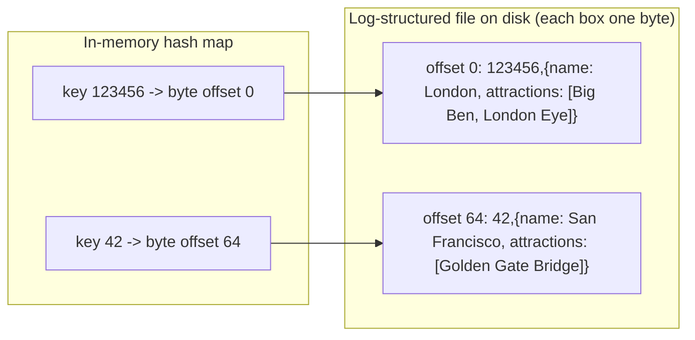

**Real system:** this is essentially **Bitcask**, the default storage engine of **Riak** (an open-source distributed key-value database). It gives high-performance reads and writes **as long as all keys fit in RAM**. Values can be larger than memory, since reading one costs only a single disk seek (and zero disk I/O, i.e. input/output, reading or writing the disk, if that part of the file is already in the operating system's filesystem cache: recently used file data the OS keeps in spare RAM).

**Good fit:** workloads with few distinct keys but many updates per key. Book example: key = URL (web address) of a cat video, value = play count, incremented every time someone presses play.

**Problem: the log grows forever.** Solution:
1. Split the log into **segments**: when a segment file reaches a certain size, close it and start writing to a new one.
2. Run **compaction** on closed segments: throw away older duplicates, keeping only the most recent value per key.
3. Because compaction usually shrinks segments a lot, **merge** several segments together while compacting.

*Figure 3-2 (redrawn): compacting one segment of a cat-video play-count log keeps only the newest value per key*
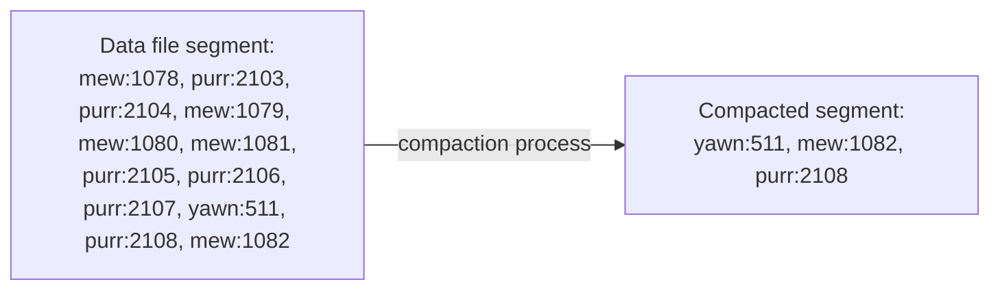

*Figure 3-3 (redrawn): compaction and merging of two segments done together, producing one new segment*
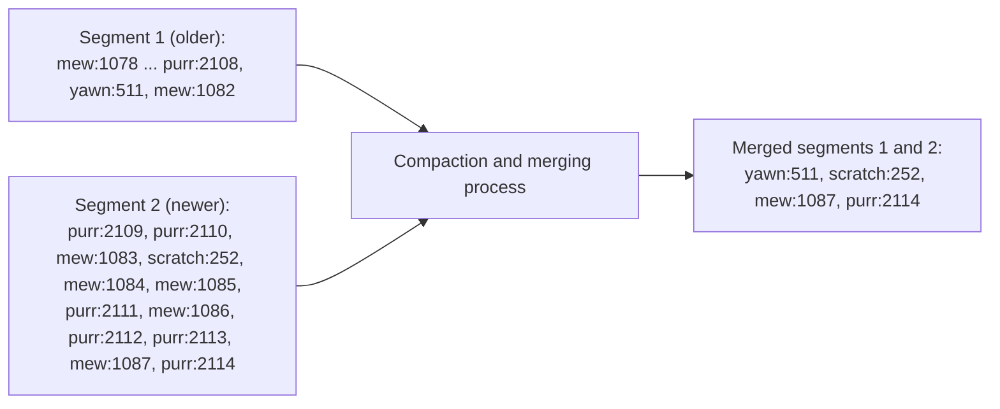

Key details of merging:
- Segments are **never modified** after being written; the merged result goes into a **new file**.
- Merging runs in a **background thread** (a *thread* is an independent sequence of execution inside one program, so this work runs alongside the main work). Meanwhile, reads and writes continue against the old segments.
- When merging finishes, reads switch to the new segment and the old files are simply deleted.
- **Each segment has its own hash map.** A read checks the newest segment's map first, then the next-newest, and so on. Merging keeps the number of segments (and so maps to check) small.

**Practical issues in a real implementation:**

| Issue | How it's handled |
|---|---|
| File format | Use a binary format (length of the string in bytes, then raw bytes) instead of CSV — faster, no escaping (marking special characters such as commas inside values) needed. |
| Deleting records | Append a **tombstone** record. During merging, the tombstone tells the process to drop all earlier values for that key. |
| Crash recovery | In-memory hash maps vanish on restart. You *could* rebuild each by reading the whole segment, but that's slow for big files. Bitcask speeds this up by persisting (saving durably) a **snapshot** (a point-in-time copy) **of every segment's hash map** to disk, which loads back much faster. |
| Partially written records | A crash can leave a half-appended record. Bitcask includes **checksums** so corrupt tails are detected and ignored. |
| Concurrency control | Writes are strictly sequential, so typically there is **one writer thread**. Segments are immutable once written, so **many threads can read** them at the same time. |

**Why append-only instead of overwriting in place?** It looks wasteful at first, but:
- Appends and merges are **sequential writes** (writing one contiguous stretch in order), which beat random writes (small writes scattered all over the disk) by a wide margin on spinning magnetic disks (HDDs, which must physically move a head to each spot) and, to a lesser degree, on SSDs (solid-state drives: flash-memory storage with no moving parts) as well.
- **Concurrency and crash recovery are simpler** with immutable files — you can never end up with a value that is half old, half new because a crash hit mid-overwrite.
- **Merging avoids fragmentation** of data files over time.

**Limitations of hash indexes:**
- **The hash table must fit in memory.** On-disk hash maps perform poorly: lots of random I/O, costly to grow, and fiddly collision handling (dealing with two keys that hash to the same slot).
- **Range queries** ("give me every key between A and B") **are inefficient.** You can't cheaply scan all keys between `kitty00000` and `kitty99999`; each key must be looked up individually.

### SSTables and LSM-Trees

**The change.** In the hash-index design, records inside a segment are in write order. Now require that each segment is **sorted by key**, and that each key appears **only once** per merged segment. This format is called a **Sorted String Table (SSTable)**.

**Three big advantages over hash-indexed log segments:**

1. **Merging is simple and efficient, even for files bigger than memory.** It works like the merge step of *mergesort* (a sorting algorithm that repeatedly merges already-sorted lists): walk through all input files in parallel, compare their current first keys, emit whichever key sorts lowest to the output, and repeat. The output is also sorted.
   - If the same key appears in several inputs, take the value from the **newest segment** and drop the older ones (each segment covers a time period, so one segment's values are all newer than an older adjacent segment's, assuming we always merge adjacent segments).

   *Figure 3-4 (redrawn): merging three SSTable segments mergesort-style; for a key found in several segments, the value from the newest segment wins*
   ```mermaid
   flowchart LR
     A["Segment 1 (oldest): handbag:8786, handful:40308, handicap:65995,<br/>handkerchief:16324, handlebars:3869, handprinted:11150"] --> M["Compaction and merging process"]
     B["Segment 2: handcuffs:2729, handful:42307, handicap:67884,<br/>handiwork:16912, handkerchief:20952, handprinted:15725"] --> M
     C["Segment 3 (newest): handful:44662, handicap:70836,<br/>handiwork:45521, handlebars:3869, handoff:5741, handprinted:33632"] --> M
     M --> O["Merged 1,2,3: handbag:8786, handcuffs:2729, handful:44662, handicap:70836,<br/>handiwork:45521, handkerchief:20952, handlebars:3869, handoff:5741, handprinted:33632"]
   ```

2. **You no longer need every key in memory.** Because keys are sorted, a **sparse** in-memory index is enough. Example from the book: to find `handiwork`, you may only know the offsets of `handbag` and `handsome`; since `handiwork` must fall between them, jump to `handbag` and scan forward. One index entry per **few kilobytes** of file is enough, because scanning a few KB is very fast.

   > **Footnote:** with fixed-size keys and values, a binary search (repeatedly jumping to the middle of the remaining range and discarding the half that cannot contain the key) over the file would work and skip the in-memory index entirely. In practice they vary in length, so you can't tell where records start without an index.

3. **Blocks can be compressed.** Since a read scans several records anyway, bundle neighbouring records into a block and compress (re-encode to take fewer bytes) that block before it goes to disk. Each sparse index entry points to the start of a compressed block. This saves disk space *and* I/O bandwidth.

*Figure 3-5 (redrawn): an SSTable with a sparse in-memory index; each entry points to the start of a compressible block of the sorted file*
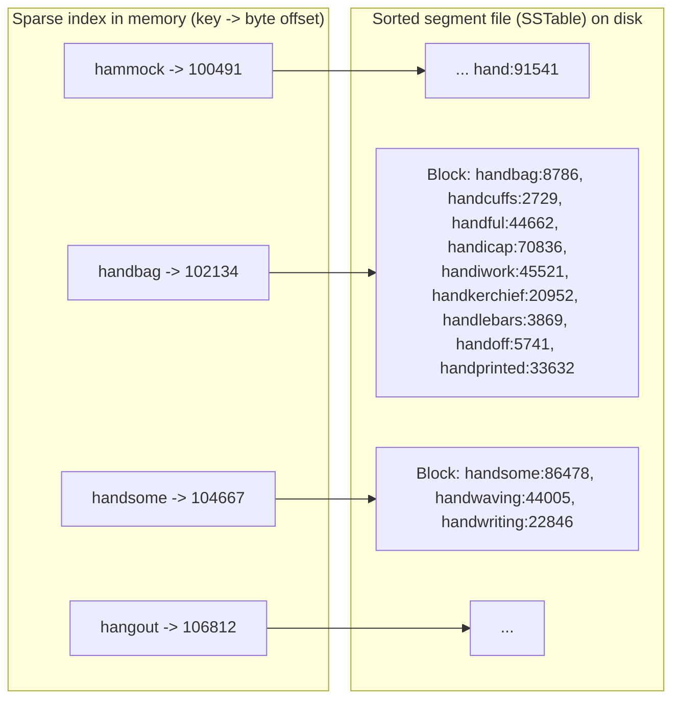

#### Constructing and maintaining SSTables

Incoming writes arrive in random key order, so how do we get sorted files? Keeping a sorted structure **on disk** is possible (that's the B-tree), but keeping one **in memory** is easy using a balanced tree (a sorted tree structure that rebalances itself so no branch gets much longer than another) like a **red-black tree** or **AVL tree** — insert in any order, read back sorted.

**How the engine works:**
1. **Write:** insert into an in-memory balanced tree called the **memtable**.
2. **Flush** (copy what is in memory out to disk): when the memtable exceeds a threshold (typically a **few megabytes**), write it to disk as a new SSTable — easy, since the tree is already sorted. That file becomes the newest segment. New writes go to a fresh memtable while the flush happens.
3. **Read:** check the memtable, then the newest on-disk segment, then the next-older one, and so on.
4. **Background:** periodically merge and compact segments, dropping overwritten and deleted values.

**The crash problem.** If the database crashes, the memtable (not yet on disk) is lost. Fix: keep a separate **unsorted append-only log** on disk; every write is appended there immediately. Its only job is rebuilding the memtable after a crash. Once a memtable has been flushed to an SSTable, its log can be thrown away.

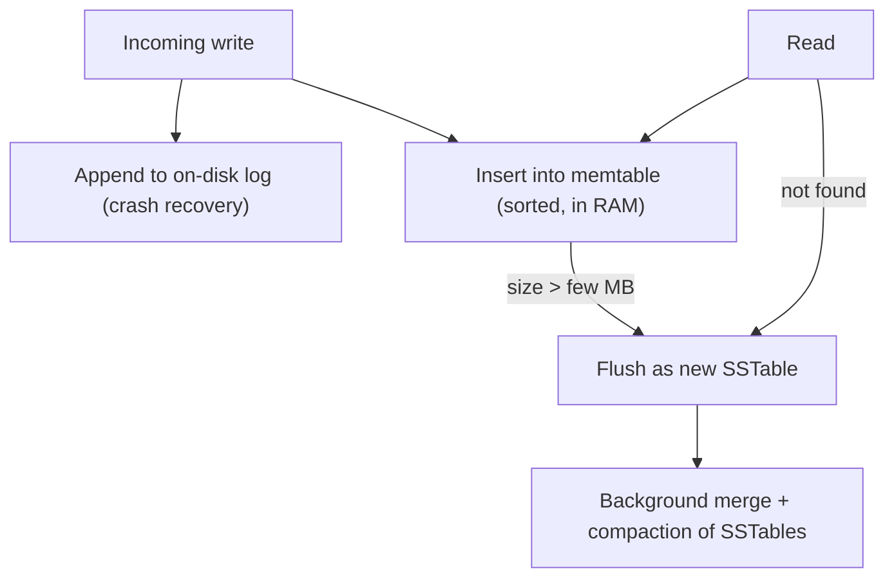

#### Making an LSM-tree out of SSTables

- This algorithm is essentially what **LevelDB** and **RocksDB** use — key-value engine libraries meant to be embedded in other applications (linked into a program as code, rather than run as a separate database server). LevelDB can replace Bitcask inside **Riak**.
- Similar engines power **Cassandra** and **HBase**, both inspired by Google's **Bigtable** paper (describing Google's large distributed storage system), which coined the terms *SSTable* and *memtable*.
- The structure was first described by **Patrick O'Neil et al.** as the **Log-Structured Merge-Tree (LSM-Tree)**, building on earlier work on log-structured filesystems (filesystems that write all changes as an append-only log). Engines based on merging and compacting sorted files are called **LSM storage engines**.
- **Lucene** (the full-text indexing engine behind **Elasticsearch** and **Solr**) uses a similar approach for its **term dictionary**. A full-text index maps a word (**term**) to the list of IDs of documents containing it (the **postings list**). Lucene keeps these term → postings mappings in SSTable-like sorted files merged in the background.

#### Performance optimizations

- **Lookups for missing keys are slow:** you'd have to check the memtable and every segment back to the oldest, possibly reading disk each time. Engines add **Bloom filters** — memory-efficient structures that approximate a set's contents and can say for certain that a key is *absent*, avoiding pointless disk reads.
- **Compaction strategies:**

| Strategy | How it works | Used by |
|---|---|---|
| Size-tiered | Newer, smaller SSTables are successively merged into older, larger ones. | HBase; Cassandra (supports both) |
| Leveled | The key range is split into smaller SSTables, and older data moves into separate "levels"; compaction is more incremental and uses less disk space. | LevelDB (hence the name), RocksDB; Cassandra |

**Why LSM-trees work well:** the core idea (a cascade of SSTables that background merging keeps tidy) is both simple and powerful; it keeps working when the data is far bigger than memory, supports **range queries** (data is sorted), and achieves **very high write throughput** (writes completed per second) because disk writes are sequential.

### B-Trees

**What it is.** The **most widely used** index structure. Introduced in **1970** and described as "ubiquitous" less than 10 years later, B-trees are still the standard index in almost all relational databases and many non-relational ones.

**Similarity to SSTables:** keys are kept sorted, so key lookups and range queries are efficient. **Difference:** a completely different design philosophy.

| | Log-structured (LSM) | B-tree |
|---|---|---|
| Unit of storage | Variable-size segments (several MB+) | Fixed-size **pages** (traditionally **4 KB**, sometimes bigger) |
| Write style | Always write a whole segment sequentially | Read/write one page at a time, overwriting in place |
| Hardware match | — | Close to how disks are physically organised (fixed-size blocks) |

**How it works:**
1. Each page has an address, so a page can refer to another page — like a pointer, but on disk. Pages form a **tree**.
2. One page is the **root**; every lookup starts there.
3. A page contains a handful of keys interleaved with child-page references. Every child is in charge of a **continuous range of keys**; the keys between references mark the boundaries.
4. Follow the reference whose range contains your key, repeatedly, until you reach a **leaf page**, which holds the keys and either the values inline or references to where values live.

Book example: looking up key **251** — at the root, follow the reference between boundaries **200** and **300**; that child splits 200–300 into smaller ranges; keep descending to the leaf.

*Figure 3-6 (redrawn): looking up user_id 251 by descending from the root through range boundaries to a leaf page*
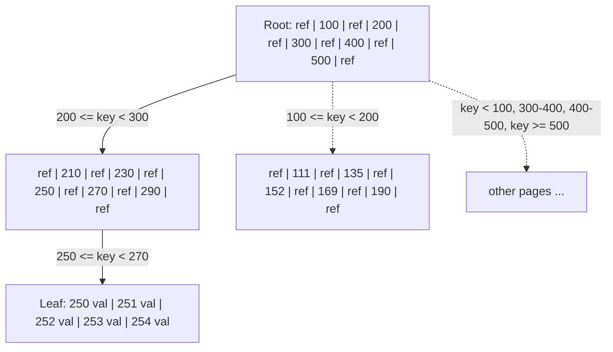

- **Branching factor** = number of child references per page. It's six in the book's figure; in practice **several hundred**, depending on how much space references and boundaries take.

**Updating and inserting:**
- **Update an existing key:** find its leaf, change the value in the page, write the page back. References to that page stay valid.
- **Insert a new key:** find the page whose range covers it and add it. If the page is **full**, **split** it into two half-full pages and update the **parent** to reflect the new division of ranges.

*Figure 3-7 (redrawn): adding key 334 to a full leaf splits it into two pages with spare space; the parent gains the new boundary key 337*
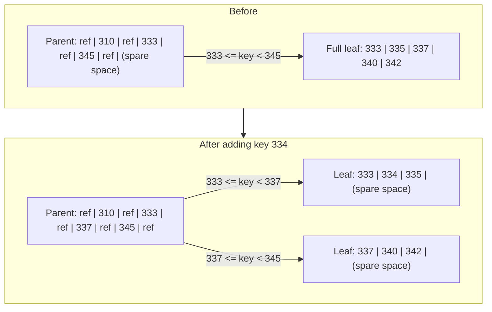

- This keeps the tree **balanced**: depth is always **O(log n)** for n keys (it grows with the logarithm of n, i.e. very slowly: each extra level multiplies capacity by the branching factor). Most databases fit in a tree **three or four levels deep**.
- **Numbers to remember:** with **4 KB pages** and a **branching factor of 500**, just **four levels** are enough for up to **256 TB** (terabytes; 1 TB is about a million megabytes) of data.

> **Footnote:** inserting is intuitive; deleting a key while keeping the tree balanced is more involved.

#### Making B-trees reliable

- The fundamental B-tree write **overwrites a page on disk in place**, assuming its location doesn't change (so all references remain valid). This is the opposite of LSM-trees, which only append and delete whole files.
- On a spinning disk, an overwrite means moving the head (the arm that reads and writes), waiting for the platter (the spinning magnetic disc) to rotate to the right spot, and rewriting the sector (the disk's smallest writable unit). SSDs are more complicated: an SSD has to erase and rewrite a fairly large block of the storage chip in one go.
- **Multi-page operations are dangerous.** A page split writes two child pages *and* the parent. If the database crashes halfway, the index is corrupted — e.g., an **orphan page** with no parent.
- **Fix — the write-ahead log (WAL, a.k.a. redo log):** an append-only file where *every* B-tree change is recorded **before** being applied to the tree pages. After a crash, the WAL is replayed (its recorded changes are applied again in order) to bring the tree back to a consistent state.
- **Concurrency is harder too:** with in-place updates, threads could see the tree mid-change. B-trees protect their structures with **latches** (lightweight locks). Log-structured engines have it easier: they merge in the background without disturbing queries and swap old segments for new ones atomically (in one indivisible step, so nobody ever sees a half-done swap).

#### B-tree optimizations

- **Copy-on-write (append-only B-trees)** instead of overwrite + WAL (e.g., **LMDB**, a small embedded key-value store): write the modified page to a new location and create new versions of parent pages pointing to it. Also helpful for concurrency control (the rules that keep simultaneous operations from corrupting each other; see snapshot isolation, Chapter 7).
- **Abbreviated keys:** interior pages only need enough of a key to separate ranges. Packing in more keys increases the branching factor → fewer levels. (This variant is sometimes called a **B+ tree**, though the optimisation is so common it's rarely singled out.)
- **Sequential leaf layout:** pages can live anywhere on disk, so a big range scan might need a seek per page. Many implementations try to place leaf pages in key order on disk, but that's hard to maintain as the tree grows. LSM-trees find this easier, since merging rewrites large chunks in one go.
- **Sibling pointers:** each leaf links to its left and right neighbours, so an ordered scan doesn't need to climb back up to parents.
- **Fractal trees:** B-tree variants that borrow log-structured ideas to reduce disk seeks (nothing to do with fractals).

### Comparing B-Trees and LSM-Trees

**Rule of thumb:** LSM-trees are usually **faster for writes**; B-trees are generally believed to **read faster**. LSM reads are slower because they may check several structures and SSTables at different compaction stages. **But:** benchmarks (standardised performance tests) are often inconclusive and depend heavily on workload — test with *your* workload.

#### Advantages of LSM-trees

- **Write amplification.** In a B-tree, every piece of data hits disk **at least twice** — first in the WAL, then in the tree page itself (plus more on splits). It also writes a **whole page** even if only a few bytes changed; some engines even write the same page **twice** to avoid a torn page (a page only partly written when the power failed) on power loss. LSM-trees also rewrite data repeatedly through compaction. The general effect — one database write causing multiple disk writes over the data's lifetime — is **write amplification**. It matters especially on **SSDs**, which wear out after a limited number of overwrites per block.
- **Higher write throughput.** In write-heavy apps, disk bandwidth can be the bottleneck, so every extra byte written costs throughput. LSM-trees often sustain more writes because they *sometimes* have lower write amplification (depends on configuration and workload) and because they write compact SSTables **sequentially** instead of overwriting scattered pages. This matters most on magnetic disks.
- **Better compression, smaller files.** B-trees leave unused space from **fragmentation** (after splits, or when a row doesn't fit a page). LSM-trees aren't page-oriented and periodically rewrite SSTables, so they have lower storage overhead — **especially with leveled compaction**.
- **On SSDs:** firmware (software built into the drive itself) often uses a log-structured algorithm internally to turn random writes into sequential ones, so the engine's write pattern matters less. Still, lower write amplification and less fragmentation help: more compact data means more requests fit in the available I/O bandwidth.

#### Downsides of LSM-trees

- **Compaction can interfere with live traffic.** Disks have finite resources, so a request may wait behind an expensive compaction. Average throughput and response time barely suffer, but **high-percentile (tail) latencies** (the slowest few percent of requests, e.g. the 99th percentile) can be quite high. **B-trees are more predictable.**
- **Compaction can fall behind at high write rates.** Disk bandwidth is shared between initial writes (logging, flushing memtables) and background compaction. On an empty database, all bandwidth goes to new writes, but as data grows, compaction needs more. If compaction can't keep up, **unmerged segments pile up** until the disk fills, and reads slow down as they must check more files. SSTable engines usually **don't throttle** (deliberately slow down) incoming writes in this case, so you need **explicit monitoring**.
- In a B-tree, **every key lives in exactly one spot** of the index, while an LSM engine may hold copies in several segments. This makes B-trees attractive for **strong transactional semantics**: many relational databases implement isolation (keeping concurrent transactions from seeing each other's half-finished work) with **locks on key ranges** (a *lock* reserves data so other transactions must wait), which can be attached directly to the B-tree (more in Chapter 7).

| Aspect | B-tree | LSM-tree |
|---|---|---|
| Typical strength | Reads, predictable latency | Writes, throughput |
| Write amplification | WAL + full page writes (sometimes twice) | Repeated compaction (sometimes lower overall, depending on configuration and workload) |
| Disk pattern | Random page overwrites | Sequential segment writes |
| Space usage | Fragmentation leaves empty space | More compact, better compression |
| Background work | No background compaction | Compaction may hurt tail latency / fall behind |
| Key location | Exactly one place (good for range locks) | Possibly many segments |
| Maturity | Very mature, ingrained in databases | Increasingly popular in new datastores |

**Conclusion:** B-trees are deeply embedded in database architecture and consistently good, so they won't disappear. Log-structured indexes are growing in popularity in new systems. There's no quick rule — test empirically.

### Other Indexing Structures

So far: **key-value indexes**, which behave like a **primary key** index — a key that uniquely identifies one row (relational), document (document DB) or vertex (graph DB). Other records refer to it by that key/ID, and the index resolves the reference.

**Secondary indexes** are very common. In relational databases you create several per table with `CREATE INDEX`; they're often essential for efficient joins (queries that combine rows from two tables sharing a value; e.g., an index on `user_id` columns to find all rows for one user).

```sql
-- A secondary index on a non-unique column
CREATE INDEX idx_orders_customer ON orders (customer_id);
-- Now this query can use the index instead of scanning every order:
SELECT * FROM orders WHERE customer_id = 812;
```
- Line 2 builds an index keyed on `customer_id`; many orders can share the same customer.
- Line 4 finds all orders for customer 812 via the index.

The only real difference from a primary index: **keys are not unique**. Two fixes:
1. Make each index value a **list of matching row IDs** (like a postings list), or
2. Make each key unique by **appending the row ID** to it.

With either trick, secondary indexes can be built on **B-trees or on log-structured indexes** alike.

#### Storing values within the index

An index entry's key is what you search by; the value is either **the row itself** or a **reference** to where the row lives.

- **Heap file:** the place where rows are stored in no particular order (may be append-only, or track deleted rows to reuse space). Common because with several secondary indexes, the data lives in **one place** and each index just points to it.
  - Updating a value **without changing the key** is efficient if the new value isn't bigger: overwrite it in place.
  - If it **grows** and must move, either update **all indexes** to the new location, or leave a **forwarding pointer** at the old spot.
- **Clustered index:** when the extra hop from index to heap hurts read performance too much, store the **whole row inside the index**.
  - **MySQL InnoDB** (MySQL's default storage engine): the primary key is always a clustered index; secondary indexes refer to the **primary key**, not a heap location.
  - **SQL Server:** you may define **one** clustered index per table.
- **Covering index / index with included columns:** a middle ground — store **some** columns in the index, so certain queries can be answered from the index alone (the index **covers** the query).

```sql
-- SQL Server-style covering index
CREATE INDEX idx_emp_dept ON employees (dept_id) INCLUDE (salary);
SELECT salary FROM employees WHERE dept_id = 4;  -- answered from the index alone
```
- `dept_id` is the search key; `salary` is copied into the index, so the query never touches the main table.

**Trade-off:** clustered and covering indexes duplicate data → faster reads, but more storage, extra write overhead, and more effort for the database to keep transactional guarantees (apps must not see inconsistencies caused by the duplication).

| Option | What the index stores | Read cost | Write/storage cost |
|---|---|---|---|
| Nonclustered (heap) | Pointer to row | Extra hop | Lowest |
| Covering | Some columns | No hop for covered queries | Medium |
| Clustered | Entire row | No hop | Highest |

#### Multi-column indexes

Single-key indexes can't handle queries on several columns at once.

- **Concatenated index** (the most common kind): joins several columns into one key in a defined order. Like a paper **phone book** indexed by (last name, first name): you can find everyone with a given last name, or a given last+first combination, but it's **useless for finding by first name alone**.
- **Multi-dimensional indexes:** a more general approach, important for **geospatial** data (positions on the Earth, such as latitude and longitude). A restaurant-map site must find restaurants inside the visible rectangle — a **2D range query**:

```sql
SELECT * FROM cafes
WHERE lat BETWEEN 48.850 AND 48.862      -- north-south band
  AND lon BETWEEN 2.330  AND 2.355;      -- east-west band
```
- A normal B-tree or LSM index could give you everything in the latitude band (any longitude) *or* everything in the longitude band (any latitude) — not both efficiently at once.

**Solutions:**
- Map 2D points to one number with a **space-filling curve**, then use a regular B-tree.
- More commonly, use a specialised spatial index such as an **R-tree**. **PostGIS** (the geographic extension for PostgreSQL) builds geospatial R-tree indexes on PostgreSQL's **Generalized Search Tree (GiST)** facility.

**Not just maps:** e-commerce could use a 3D index on **(red, green, blue)** to search by colour range; a weather database could index **(date, temperature)** to find all readings in **2013** between **25 and 30 ℃** without scanning all of 2013 and filtering (or vice versa). **HyperDex** (a research key-value store) uses this technique.

#### Full-text search and fuzzy indexes

Previous indexes need **exact** keys or ranges. They can't find **similar** keys, such as misspellings — that's **fuzzy** querying.

- Full-text engines expand searches to **synonyms**, ignore **grammatical variations**, find words **near each other**, and support other linguistic features.
- **Lucene** can find words within a given **edit distance** (distance 1 = one letter added, removed or replaced) to cope with typos.
- Lucene's term dictionary is SSTable-like and needs a small in-memory index. In **LevelDB** that index is a sparse set of keys; in **Lucene** it's a **finite state automaton** (a simple machine that moves between a fixed set of states as it reads each character) over the characters of the keys, similar to a **trie** (a tree where each level branches on the next letter, so words sharing a prefix share a path). This automaton can be turned into a **Levenshtein automaton**, which efficiently finds words within a given edit distance.
- Other fuzzy techniques lean toward document classification and machine learning (programs that learn patterns from example data) (see information-retrieval textbooks).

#### Keeping everything in memory

Everything so far works around disk limitations. Disks are awkward (data must be laid out carefully for performance), but we put up with them because they're **durable** (survive power loss) and **cheaper per GB** than RAM.

As RAM gets cheaper, many datasets fit in memory — possibly spread over several machines. Hence **in-memory databases**:

- **Cache-only** stores like **Memcached** accept losing data on restart.
- **Durable** in-memory databases use battery-backed RAM, a **log of changes** on disk, **periodic snapshots** on disk, or **replication** (keeping copies on other machines; Chapter 5) to other machines. On restart they reload state from disk or a replica (one of those copies). They are still "in-memory" because disk is used only as an append-only log for durability — **all reads come from RAM**. Disk files also make backups, inspection and analysis by external tools easy.

**Named systems:**
- **VoltDB, MemSQL, Oracle TimesTen** — in-memory, relational; vendors claim large speedups by dropping on-disk data-structure overhead.
- **RAMCloud** — an open-source, durable in-memory key-value store; it organises data log-structured style, both in RAM and on disk.
- **Redis, Couchbase** — weak durability, writing to disk **asynchronously** (in the background, after already telling the client the write succeeded, so a crash can lose recent writes).

> **Common confusion:** in-memory databases are *not* fast mainly because they skip disk reads. A disk-based engine with enough RAM may never read from disk either, because the OS caches recently used blocks. The real win is avoiding the cost of **encoding in-memory structures into a disk-friendly format**.

**Richer data models:** in-memory systems can offer structures that are hard to build on disk — e.g., **Redis** exposes priority queues (lists that always hand out the most important item first) and sets, and its implementation stays comparatively simple.

**Anti-caching:** research suggests in-memory architectures can handle data larger than RAM by evicting (pushing out of memory) **least recently used** (LRU: the records untouched for the longest time) records to disk and reloading them when accessed. It resembles OS virtual memory/swap (the operating system moving rarely used memory pages to disk to free RAM), but the database is smarter: it works on **individual records** rather than whole memory pages. Indexes must still fit in memory (like Bitcask).

**Future:** wider adoption of **non-volatile memory (NVM)** may require further changes to storage engine design; it's an active research area.

---

## Transaction Processing or Analytics?

Early on, a database write usually matched a **commercial transaction**: a sale, a supplier order, a salary payment. The word **transaction** stuck even as databases expanded to non-financial data, now meaning a group of reads and writes forming one logical unit.

> **Note:** a transaction here doesn't need full ACID guarantees (atomicity, consistency, isolation, durability — Chapter 7). *Transaction processing* simply means clients can make **low-latency** (quick-to-answer) reads and writes, in contrast to **batch processing** jobs that run only periodically, e.g. once a day (Chapter 10).

**OLTP.** Whether the data is blog comments, game actions or address-book contacts, the pattern resembles business transactions: look up a few records by key using an index; insert or update records based on user input. Because it's interactive, it's called **online transaction processing (OLTP)**.

**OLAP.** Databases also got used for **analytics**, a very different pattern: scan a **huge number of records**, read only **a few columns** each, and compute **aggregates** (one summary value computed from many rows: count, sum, average) instead of returning raw rows. Examples for a sales table:
- Total revenue per store in January?
- How did banana sales during our most recent promotion compare with normal?
- Which baby-food brand is most often bought with brand X diapers?

Analysts write such queries to produce reports that feed **business intelligence**. This pattern is called **online analytic processing (OLAP)**.

> **Footnote:** the "online" in OLAP is vague; it probably means analysts run exploratory queries interactively, not just predefined reports.

*Table 3-1 (paraphrased): OLTP vs OLAP characteristics*

| Property | OLTP | OLAP |
|---|---|---|
| Main read pattern | Each query fetches a few records by key | Aggregates computed across very many records |
| Main write pattern | Low-latency, random-access writes driven by user input | Event stream or bulk import (ETL) |
| Primarily used by | Customers/end users, through a web app | Internal analysts supporting decisions |
| What data represents | Latest state (current point in time) | History of events over time |
| Dataset size | GB up to TB | TB up to PB |

At first the same databases served both. SQL handles both kinds of queries well. But in the **late 1980s and early 1990s**, companies started running analytics on a **separate** database: the **data warehouse**.

### Data Warehousing

A large company may run **dozens** of OLTP systems: the customer website, point-of-sale (checkout) in physical stores, warehouse inventory, vehicle route planning, supplier management, HR (human resources: staff records and payroll), and more. Each is complex, has its own team, and runs mostly on its own.

These systems must be **highly available** and **low-latency** because the business depends on them. DBAs therefore guard them and don't want analysts running expensive **ad hoc** (one-off, written on the spot) queries that scan large parts of the data and slow down live transactions.

A **data warehouse** is a separate database analysts can query freely without hurting OLTP. It holds a **read-only copy** of data from all the OLTP systems. Data gets there via **Extract–Transform–Load (ETL)**:
1. **Extract** from OLTP databases (periodic dump, i.e. a full export, or continuous stream of updates).
2. **Transform** into an analysis-friendly schema and clean it up.
3. **Load** into the warehouse.

*Figure 3-8 (redrawn): simplified ETL. Each OLTP system (with its own users and database) is extracted and transformed separately, then loaded into one data warehouse that business analysts query*
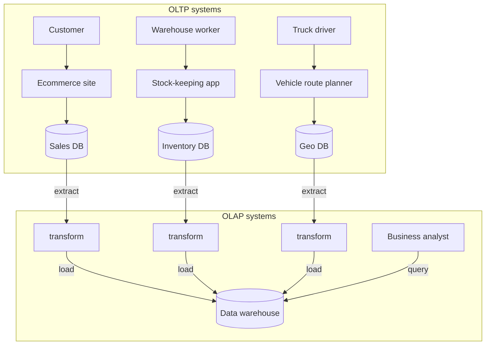

- Warehouses exist in almost all **large** enterprises but are rare in **small** companies, which have fewer OLTP systems and little enough data to query with a normal SQL database or even a spreadsheet.
- **Big advantage:** a warehouse can be optimised for analytic access. The indexes from the first half of the chapter suit OLTP but are **poor at analytic queries**.

#### The divergence between OLTP databases and data warehouses

- Warehouses are usually **relational**, since SQL suits analytics. Many graphical tools generate SQL, visualise results, and support **drill-down** (going from a total to the details behind it) and **slicing and dicing** (cutting the data by different attributes, e.g. by region, then by month).
- On the surface a warehouse and an OLTP database look alike (both speak SQL), but their **internals differ greatly** because they're optimised for different query patterns. Many vendors now focus on one or the other.
- **Microsoft SQL Server** and **SAP HANA** support both in one product, but increasingly as two separate storage/query engines behind a shared SQL interface.
- **Commercial warehouses:** Teradata, Vertica, SAP HANA, ParAccel (expensive licences). **Amazon RedShift** is ParAccel offered as a hosted service (run for you by the provider in its cloud).
- **Open-source SQL-on-Hadoop** (younger, aiming to compete): Spark SQL, Apache Hive, Apache Drill, Apache Tajo, Facebook Presto and Cloudera Impala. Some build on ideas from Google's **Dremel** (an internal system for interactive queries over huge datasets).

### Stars and Snowflakes: Schemas for Analytics

OLTP uses many different data models (Chapter 2), but analytics is much more uniform. Most warehouses use a **star schema** (a.k.a. **dimensional modeling**).

**Fact table** (at the centre, e.g. `fact_sales` for a grocery chain): each row is an **event** at a particular time — here, one customer buying one product. For web analytics (measuring how visitors use a website), a row might be a page view or click.
- Recording individual events maximises flexibility later, but fact tables become **enormous**. Companies like **Apple, Walmart, eBay** may hold **tens of petabytes** of history, mostly in fact tables.
- Some columns are **attributes** (sale price, supplier cost → profit margin).
- Others are **foreign keys** to **dimension tables**, which describe an event's **who, what, where, when, how and why**.

**Dimension tables:** e.g., `dim_product` has one row per product type with SKU (stock-keeping unit), description, brand, category, fat content, package size… Each `fact_sales` row points to the product sold. (If a customer buys several products at once, each is a separate fact row.)
- Even **date and time** get a dimension table, so extra info like **public holidays** can be attached and queries can compare holiday vs non-holiday sales.

*Figure 3-9 (redrawn): star schema for a grocery retailer. fact_sales sits in the centre; its foreign keys point at five dimension tables (sample rows in the book: product 31 = Fish food by Aquatech, store 3 = Palo Alto CA, promotion 19 = Aquarium deal, customer 191 = Bob, date 140102 = Thu 2 Jan 2014)*
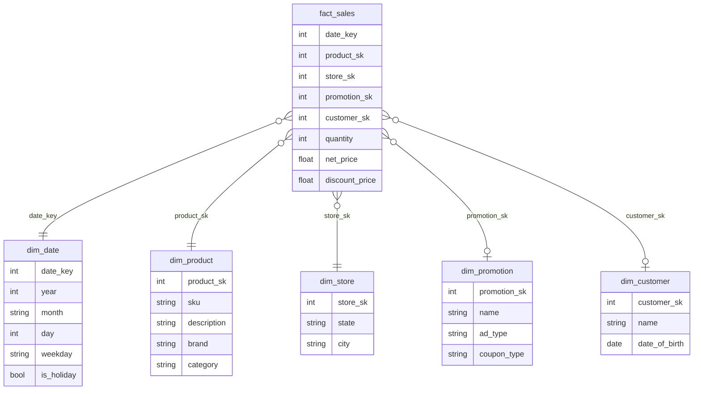

- **Why "star":** drawn out, the fact table sits in the middle with dimension tables around it, like rays of a star.
- **Snowflake schema:** dimensions are split further into sub-dimensions (e.g., separate `brand` and `category` tables referenced by `dim_product`). More **normalised** (each fact stored once and referenced by ID), but star schemas are usually preferred because they're **simpler for analysts**.
- **Tables are wide:** fact tables often exceed **100 columns**, sometimes several hundred. Dimension tables can be wide too — e.g., `dim_store` might record services offered, whether there's an in-store bakery, floor area, opening date, last remodel date, distance to the nearest highway.

---

## Column-Oriented Storage

With **trillions of rows** and **petabytes** in fact tables, storage and querying get hard. Dimension tables are much smaller (**millions** of rows), so the focus is on **facts**.

**Key observation:** although fact tables have 100+ columns, a typical warehouse query touches only **4 or 5** at a time (`SELECT *` is rare in analytics).

The book's Example 3-1 asks whether people prefer buying fresh fruit or candy depending on the weekday, touching only three `fact_sales` columns (`date_key`, `product_sk`, `quantity`) while ignoring the rest, even though it covers every fruit or candy purchase in calendar year 2013. A similar query of our own:

```sql
SELECT d.month, s.region, SUM(f.net_price) AS revenue   -- only a few columns needed
FROM fact_sales f
  JOIN dim_date  d ON f.date_key = d.date_key            -- attach date details
  JOIN dim_store s ON f.store_sk = s.store_sk            -- attach store details
WHERE d.year = 2015 AND s.region IN ('North', 'West')    -- filter
GROUP BY d.month, s.region;                              -- one total per month per region
```
- Although `fact_sales` might have 100+ columns, this reads just `date_key`, `store_sk` and `net_price` from it — yet across a huge number of rows.

**Why row storage struggles:** OLTP databases store data **row-oriented** — all values of a row are adjacent (document databases similarly store each document contiguously; see the CSV log in Figure 3-1). Even with indexes on `date_key` or `product_sk`, a row store must load whole rows (100+ attributes each) from disk, parse them, and filter — slow.

**The column-oriented idea:** store all values of each **column** together, each column in its **own file**. A query reads and parses only the columns it needs.

> **Aside:** column storage is easiest to picture in the relational model, but it works for non-relational data too. **Parquet** is a columnar (column-by-column) file format that supports a document model, based on Google's **Dremel**.

*Figure 3-10 (redrawn): the book's eight fact_sales rows stored as one file per column; position k in every file belongs to row k*
```mermaid
flowchart LR
  subgraph ROWS["Row-oriented (fact_sales, 8 rows; first 3 shown)"]
    R1["140102, 69, 4, NULL, NULL, 1, 13.99, 13.99"]
    R2["140102, 69, 5, 19, NULL, 3, 14.99, 9.99"]
    R3["140102, 69, 5, NULL, 191, 1, 14.99, 14.99"]
    R4["... 5 more rows"]
  end
  subgraph COLS["Column-oriented: one file per column"]
    C1["date_key: 140102, 140102, 140102, 140102, 140103, 140103, 140103, 140103"]
    C2["product_sk: 69, 69, 69, 74, 31, 31, 31, 31"]
    C3["store_sk: 4, 5, 5, 3, 2, 3, 3, 8"]
    C4["promotion_sk: NULL, 19, NULL, 23, NULL, NULL, 21, NULL"]
    C5["customer_sk: NULL, NULL, 191, 202, NULL, NULL, 123, 233"]
    C6["quantity: 1, 3, 1, 5, 1, 3, 1, 1"]
    C7["net_price: 13.99, 14.99, 14.99, 0.99, 2.49, 14.99, 49.99, 0.99"]
    C8["discount_price: 13.99, 9.99, 14.99, 0.89, 2.49, 9.99, 39.99, 0.99"]
  end
  ROWS -->|"store by column"| COLS
```

**Crucial rule:** every column file must list rows in the **same order**. To rebuild row 23, take the 23rd entry from each column file.

### Column Compression

Reading fewer columns already cuts disk I/O; **compression** cuts it further, and columns compress well because their values are often repetitive.

**Bitmap encoding** (especially effective in warehouses):
1. A column usually holds few **distinct values** relative to the number of rows (a retailer may have **billions** of sales but only **100,000** products).
2. For a column with **n distinct values**, create **n bitmaps** (a *bitmap* is a long row of bits, each 0 or 1) — one per value — with **one bit per row**: 1 if the row has that value, 0 otherwise.
3. If n is **very small** (e.g., a country column with about **200** values), store bitmaps as-is.
4. If n is larger, most bitmaps are mostly zeros (**sparse**), so also apply **run-length encoding**: store lengths of alternating runs of 0s and 1s.

*Figure 3-11 (redrawn): an 18-row product_sk column turned into one bitmap per distinct value, then run-length encoded*
```mermaid
flowchart LR
  COL["product_sk column (18 rows):<br/>69 69 69 69 74 31 31 31 31 29 30 30 31 31 31 68 69 69"]
  subgraph BM["Bitmap per value (one bit per row)"]
    B29["29: 000000000100000000"]
    B30["30: 000000000011000000"]
    B31["31: 000001111000111000"]
    B68["68: 000000000000000100"]
    B69["69: 111100000000000011"]
    B74["74: 000010000000000000"]
  end
  subgraph RLE["Run-length encoded (alternating runs, starting with zeros)"]
    E29["29: 9, 1 (then rest zeros)"]
    E30["30: 10, 2"]
    E31["31: 5, 4, 3, 3"]
    E68["68: 15, 1"]
    E69["69: 0, 4, 12, 2"]
    E74["74: 4, 1"]
  end
  COL --> BM
  BM --> RLE
```

**Bitmaps make common filters cheap:**
- `WHERE product_sk IN (30, 68, 69)` → fetch the bitmaps for those three products and **OR** them together bit by bit (the result bit is 1 if any input bit is 1).
- A filter on product 31 *and* store 3 (`product_sk = 31 AND store_sk = 3`) → fetch the two bitmaps and **AND** them together bit by bit (the result bit is 1 only if both input bits are 1). This works because all columns keep rows in the same order, so bit k refers to the same row in every bitmap.

There are many other compression schemes for other kinds of data.

> **Column-oriented storage vs column families (common confusion):** **Cassandra** and **HBase** have *column families*, inherited from **Bigtable**. Calling them column-oriented is very misleading: within a column family they store all columns of a row together with a row key and don't use column compression. The Bigtable model is mostly **row-oriented**.

#### Memory bandwidth and vectorized processing

For scans over millions of rows, disk-to-memory bandwidth is a big bottleneck, but not the only one. Analytic database developers also care about:
- how fast data moves from **RAM into the CPU cache** (a tiny, very fast memory on the processor chip itself),
- avoiding **branch mispredictions** (the CPU guessed wrongly which way an `if` would go and must throw away work) and **bubbles** (idle slots) in the CPU pipeline (the assembly line of instruction steps a CPU overlaps to run fast),
- using **SIMD** (single-instruction-multi-data) instructions.

Column layouts help here too: the query engine can grab a piece of compressed column data small enough for the CPU's **L1 cache** (the smallest and fastest level of CPU cache) and loop over it tightly with **no function calls** — far faster than per-record code full of calls and branches. Compression lets **more rows fit** in L1. Operators like the bitwise AND/OR above can run **directly on compressed chunks**. This is **vectorized processing**.

### Sort Order in Column Storage

Rows can be stored in **insertion order** (the order they arrived) (then inserting = appending to every column file). But we can instead impose a **sort order**, like SSTables, and use it as an index.

- **You can't sort each column independently** — you'd lose which values belong to the same row. Sort **whole rows**, even though storage is by column.
- The DBA picks **sort keys** based on common queries. If queries often target date ranges (e.g., last month), make `date_key` the **first** sort key so the engine scans only that month's rows.
- A **second** sort key orders rows that tie on the first. E.g., `date_key` then `product_sk` groups all sales of the same product on the same day together — useful for grouping/filtering by product within a date range.

**Sorting also boosts compression:** if the first sort column has few distinct values, sorting creates **long runs** of identical values. Simple run-length encoding can shrink it to a **few kilobytes** even with **billions** of rows.
- The first sort key benefits most; the second and third keys are less orderly; later columns look essentially random and compress less. Still, sorting the first few columns is a net win.

#### Several different sort orders

Introduced in **C-Store** (an academic column-store prototype) and adopted by the commercial warehouse **Vertica**: different queries prefer different sort orders, and you must **replicate** (copy) data to several machines anyway to survive failures — so store each replica **sorted differently**, and have each query use the copy that suits it best.

| | Multiple sort orders (column store) | Multiple secondary indexes (row store) |
|---|---|---|
| Where the full data lives | Each sorted copy contains the column values themselves | Each row in one place (heap file or clustered index) |
| What the extra structures hold | No pointers — just columns of values | Pointers to matching rows |

### Writing to Column-Oriented Storage

Column storage, compression and sorting make **reads** fast — ideal since warehouse load is mostly large read-only queries — but make **writes harder**.

- **Update-in-place (B-tree style) is impossible** with compressed columns.
- Placing a new row **midway through** a sorted table would probably mean **rewriting every column file**, because rows are identified by position and all columns must be updated consistently.

**Solution: LSM-trees again.**
1. Every write lands first in an **in-memory store**, where it is sorted and staged for disk. (Row- or column-oriented in memory — it doesn't matter.)
2. When enough writes accumulate, **merge** them with the on-disk column files and write **new files in bulk**. This is essentially what **Vertica** does.
3. **Queries** read both the on-disk column data and the recent in-memory writes and combine them. The **query optimizer hides** this, so analysts see inserts, updates and deletes reflected immediately.

### Aggregation: Data Cubes and Materialized Views

Not every warehouse is a column store (row-oriented and other architectures are also used), but columnar storage can be **much faster for ad hoc analytics** and is quickly gaining popularity.

**Materialized aggregates.** Warehouse queries often use `COUNT`, `SUM`, `AVG`, `MIN`, `MAX`. If many queries use the same aggregates, recomputing from raw data every time is wasteful — so **cache** the popular ones.

**Materialized view vs virtual view:**

| | Virtual view | Materialized view |
|---|---|---|
| What it is | A named query shortcut | The query's results really stored **on disk** |
| On read | SQL engine expands it into the underlying query on the fly | Read precomputed results directly |
| On data change | Nothing to do | Must be **updated** (it's a denormalised copy); database can do it automatically |
| Cost | Slow reads for heavy queries | More expensive **writes** |

Because of the write cost, materialized views are rare in **OLTP** but more sensible in **read-heavy warehouses** (whether they help depends on the case).

```sql
-- PostgreSQL-style example
CREATE MATERIALIZED VIEW daily_store_revenue AS
  SELECT date_key, store_sk, SUM(net_price) AS revenue
  FROM fact_sales
  GROUP BY date_key, store_sk;          -- precompute totals per day per store
REFRESH MATERIALIZED VIEW daily_store_revenue;  -- recompute after new sales arrive
```
- The first statement stores the grouped totals on disk; later queries read them instead of scanning `fact_sales`.
- `REFRESH` brings the stored copy up to date after the underlying data changes.

**Data cube / OLAP cube:** a special materialized view — a **grid of precomputed aggregates, laid out by several dimensions**.
1. Suppose facts reference only two dimensions, **date** and **product**. Make a 2D table: dates on one axis, products on the other.
2. Every cell holds an aggregate such as `SUM`, applied to one attribute such as `net_price`, over all facts with that date–product pair.
3. Aggregate each row or column again to get totals reduced by one dimension (sales per product regardless of date, or per date regardless of product).

*Figure 3-12 (redrawn): two dimensions of a data cube (date_key by product_sk). Each cell is SUM(net_price) for that pair; summing along a row gives the per-date total, along a column the per-product total*
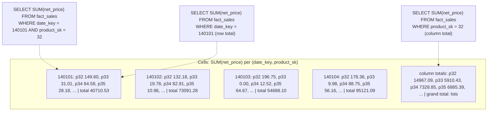

- With more dimensions (Figure 3-9 has **five**: date, product, store, promotion, customer), it becomes a **hypercube** (the same grid idea in more than three dimensions), harder to picture but the same idea: each cell holds sales for one combination, summarisable along any dimension.
- **Advantage:** some queries become near-instant because they're **precomputed** — e.g., total sales per store yesterday = read the totals along one dimension, no scanning millions of rows.
- **Disadvantage:** **less flexible** than raw data. E.g., you can't compute what share of sales came from items priced above **$100**, because price isn't a dimension.
- Therefore most warehouses **retain raw data wherever they can**, treating cubes merely as a **speed-up for particular queries**.

---

## Summary

*(Book section)* The chapter explored what a database does when you store data and when you query it later.

- **Two big categories** of storage engines: optimised for **OLTP** vs optimised for **analytics (OLAP)**.
  - **OLTP:** user-facing, huge request volume, each query touches few records found by key via an index. **Disk seek time** is often the bottleneck.
  - **Analytics/warehouses:** used by business analysts, far fewer queries, but each scans millions of records quickly. Here the usual limit is **disk bandwidth**, not seek time; **column-oriented storage** is the growing answer.
- **Two OLTP schools:**
  - **Log-structured:** only append to files and delete obsolete ones; never modify a written file. Members include Bitcask, SSTables, LSM-trees, LevelDB, HBase, Cassandra, Lucene and more.
  - **Update-in-place:** disk as fixed-size overwritable pages. **B-trees** are the main example, used in all major relational databases and many non-relational ones.
- Log-structured engines are relatively new; their key trick is turning **random writes into sequential writes**, enabling higher write throughput on HDDs (hard disk drives) and SSDs.
- The chapter also toured more complex indexes (secondary, clustered/covering, multi-dimensional, fuzzy) and **in-memory** databases.
- **Warehouses:** when queries scan many rows sequentially, indexes matter less; what matters is **very compact encoding** to minimise data read — hence columnar storage, compression, sorting.
- **Takeaway:** knowing engine internals helps you choose the right tool and reason about what a tuning parameter change will do, and helps you understand your database's documentation.

## Chapter summary

- A **log** (append-only file) gives cheap writes; an **index** gives fast reads but slows writes — choose indexes deliberately.
- **Hash indexes** (Bitcask): in-memory key → offset map; great for many updates to few keys; keys must fit in RAM; no range queries. Segments + compaction + merging reclaim space; tombstones delete; checksums catch partial writes.
- **SSTables/LSM-trees** (LevelDB, RocksDB, Cassandra, HBase, Lucene): memtable → sorted SSTables → background merging (size-tiered or leveled). Sparse index, compressed blocks, Bloom filters for missing keys, WAL-like log for crash safety. High write throughput, range queries supported.
- **B-trees**: fixed 4 KB pages, in-place updates, splits keep the tree balanced (3–4 levels; 4 levels × 500 branching × 4 KB = 256 TB). WAL and latches for reliability; copy-on-write (LMDB), abbreviated keys (B+ tree), sibling pointers, fractal trees as optimisations.
- **LSM vs B-tree**: LSM usually better for writes/space; B-tree better for reads, predictable latency, and key-range locking. Always benchmark your own workload.
- **Other indexes**: secondary (non-unique), heap file vs clustered (InnoDB, SQL Server) vs covering; concatenated vs multi-dimensional (R-trees, PostGIS, HyperDex); fuzzy (Lucene automata, edit distance). **In-memory DBs** win by avoiding encoding overhead, not disk reads.
- **OLTP vs OLAP**: different access patterns → separate **data warehouses** loaded via **ETL**, typically in **star** (or snowflake) schemas.
- **Column stores**: read only needed columns; compress (bitmaps + RLE); vectorised processing; sort rows by chosen keys (multiple sort orders in C-Store/Vertica); write via LSM-style in-memory buffer; **materialized views/data cubes** precompute aggregates at the cost of flexibility.

## Interview angle

**1. B-tree vs LSM-tree — which would you pick?**
*30-second answer:* B-trees update fixed-size pages in place with a WAL; every key lives in one place, reads are fast and latency is predictable — the default in relational databases. LSM-trees buffer writes in a memtable, flush sorted SSTables sequentially, and compact in the background — higher write throughput, better compression, but reads may check several files and compaction can hurt tail latency. Write-heavy (logs, metrics, time-series) → LSM; read-heavy/transactional → B-tree. Benchmark your workload.
- *Follow-up: What is write amplification?* One logical write causing several physical disk writes over time — WAL + page writes in B-trees, repeated compaction in LSM. It limits throughput and wears out SSDs.
- *Follow-up: How does an LSM avoid checking every SSTable for a missing key?* Bloom filters per SSTable say "definitely not here", skipping disk reads.
- *Follow-up: What happens if compaction can't keep up?* Unmerged segments pile up, reads slow down, and disk can fill; engines usually don't throttle writes, so monitor it.

**2. How does an LSM-tree handle a write and survive a crash?**
*30-second answer:* The write is appended to an on-disk log and inserted into the in-memory sorted memtable. When the memtable reaches a few MB, it's flushed as an immutable SSTable. On crash, the log is replayed to rebuild the memtable; after a flush, that log is discarded.
- *Follow-up: How are deletes done?* By writing a tombstone; compaction later drops older values for that key.
- *Follow-up: Size-tiered vs leveled?* Size-tiered merges smaller/newer tables into bigger/older ones (HBase); leveled splits key ranges into small tables across levels — more incremental, less disk space (LevelDB, RocksDB). Cassandra supports both.

**3. How does a B-tree stay balanced and crash-safe?**
*30-second answer:* When an insert overflows a page, it is split into two roughly half-empty pages and a new boundary is added to the parent, so depth stays O(log n) — usually 3–4 levels. Every change is written to a write-ahead log first, so a crash mid-split can be repaired; latches protect concurrent access.
- *Follow-up: Alternative to a WAL?* Copy-on-write pages (LMDB): write modified pages elsewhere and create new parent versions.

**4. OLTP vs OLAP, and why a separate data warehouse?**
*30-second answer:* OLTP = many small key-based reads/writes from users, latest state, GB–TB. OLAP = few large scans computing aggregates for analysts, event history, TB–PB. Running analyst queries on OLTP databases hurts customer-facing latency, and OLTP indexes are poor for scans, so data is copied via ETL into a warehouse optimised for analytics (often columnar, star schema).
- *Follow-up: What is a star schema?* A central fact table of events with foreign keys to dimension tables (date, product, store…). Snowflake further normalises dimensions.

**5. Why are column stores fast for analytics?**
*30-second answer:* Queries touch 4–5 of 100+ columns, so storing each column separately means reading only what's needed. Columns compress very well (bitmaps, run-length encoding), especially the sort key, and compressed chunks fit CPU cache for vectorised processing.
- *Follow-up: How do you write to a column store?* Buffer writes in memory (LSM-style) and periodically merge into new column files in bulk; queries combine both (Vertica).
- *Follow-up: Are Cassandra/HBase column stores?* No — their column families are still row-oriented within each family and don't use column compression.

**6. Clustered vs covering vs heap-file indexes?**
*30-second answer:* Heap-file indexes store pointers to rows kept elsewhere — no duplication but an extra hop. Clustered indexes store the full row in the index (InnoDB primary key; one per table in SQL Server). Covering indexes store some columns so certain queries need only the index. More duplication = faster reads, more storage and write cost.

## Self-check

1. **Why is appending to a log fast, and why is reading from an unindexed log slow?**
   Appending is a sequential write at the file's end — the simplest possible write. Reading without an index means scanning the whole file, O(n).

2. **What is the main limitation of Bitcask-style hash indexes, and what workload suits them?**
   All keys must fit in RAM and range queries are inefficient. They suit many updates to a modest number of keys (e.g., play counts per video URL).

3. **Why can an SSTable use a sparse index while a hash-indexed log cannot?**
   Because the keys are sorted: knowing the offsets of neighbouring keys tells you the range to scan. In an unsorted log, a key could be anywhere.

4. **Trade-off: your service ingests millions of sensor readings per second and rarely updates old data. B-tree or LSM-tree? Why?**
   LSM-tree: sequential writes, higher write throughput, better compression. Watch compaction and tail latency.

5. **What happens in a B-tree when you insert a key into a full page, and why is that risky without a WAL?**
   The page splits into two and the parent is updated — several page writes. A crash in between could leave an orphan page/corrupt index; the WAL lets you restore consistency.

6. **How big can a 4-level B-tree with 4 KB pages and branching factor 500 get?**
   Up to 256 TB.

7. **Scenario: a map app needs "all shops inside this rectangle". Why won't a concatenated (lat, lon) B-tree index work well, and what should you use?**
   A concatenated index can narrow by latitude range but then must scan all longitudes in that band. Use a spatial index such as an R-tree (e.g., PostGIS on GiST) or a space-filling curve.

8. **What is the real reason in-memory databases are faster?**
   They avoid the overhead of encoding in-memory data structures into disk-friendly form — not simply avoiding disk reads, since the OS cache already does that for disk-based engines with enough RAM.

9. **In a column store, why can't each column be sorted independently? What benefit does sorting give?**
   Rows are reconstructed by position; independent sorting would break that alignment. Sorting whole rows helps range filters on the sort key and creates long runs that compress extremely well.

10. **What's the downside of relying on a data cube instead of raw data?**
    It's inflexible: only questions along the chosen dimensions can be answered (e.g., can't compute the share of sales for items over $100 if price isn't a dimension). Keep raw data and use cubes as a speed-up.
