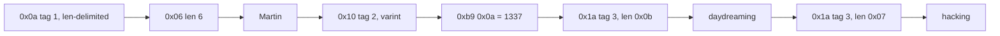
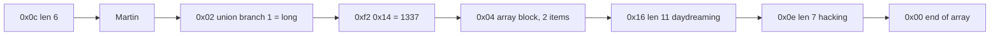
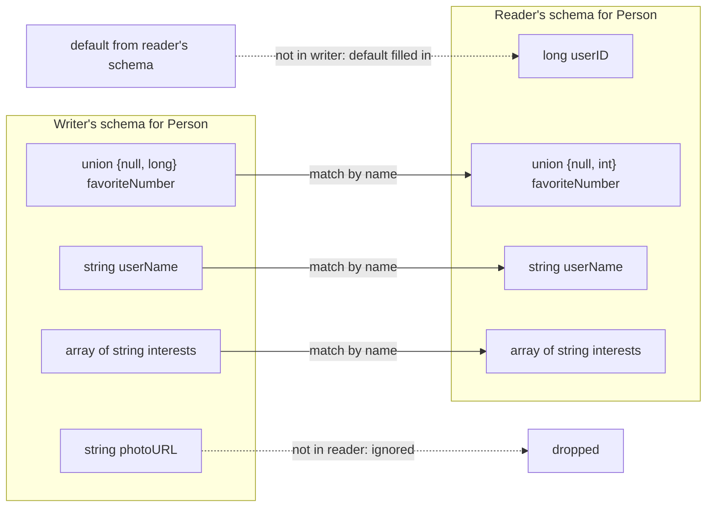
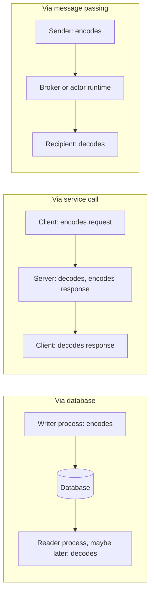
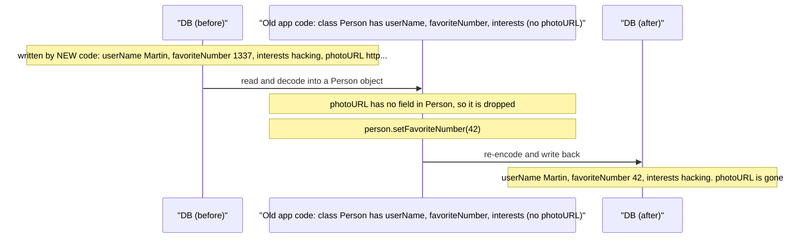
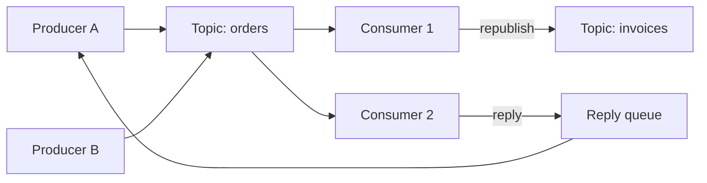

# Chapter 4 — Encoding and Evolution
*Book: Chapter 4, pp. 111–144*

## Overview

Applications change constantly, and nearly every change also changes the **data**: a new field, a new record type, old data presented differently. Chapter 1 called coping with this **evolvability**.

Chapter 2's data models handle change differently:
- **Relational databases** assume **one schema** at any moment; **schema migrations** (`ALTER TABLE`) change it, but only one version is in force at a time.
- **Schema-on-read ("schemaless") databases** enforce no schema, so old- and new-format records coexist.

Code that reads and writes the data must change too, but in a big system it **cannot change everywhere at once**:
- **Server-side:** a **rolling upgrade** (**staged rollout**): deploy to a few nodes, check, continue node by node. No downtime, so releases can be frequent.
- **Client-side:** users may not install updates for a long time.

So **old and new code, and old and new data formats, coexist**, needing compatibility **in both directions**:

| Kind | Meaning | Difficulty |
|---|---|---|
| **Backward compatibility** | *Newer* code can read data written by *older* code. | Usually easy — the new code's author knows the old format and can handle it explicitly. |
| **Forward compatibility** | *Older* code can read data written by *newer* code. | Harder — old code must *ignore* additions it has never heard of. |

Two questions:
1. How do **encoding formats** (JSON, XML, Protocol Buffers, Thrift, Avro) **handle schema changes**?
2. How are they used when **data flows** between processes — through databases, services (REST and RPC), and asynchronous messages (brokers and actors)?

## Key terms

| Term | Plain-English meaning |
|---|---|
| Evolvability | How easily a system can be changed over time. |
| Schema migration / schema-on-read | Changing a relational schema (`ALTER TABLE`) / no schema enforced on write; readers interpret structure. |
| Rolling upgrade / staged rollout | Deploying a new version gradually, a few nodes per step. |
| Backward / forward compatibility | New code reads old data / old code reads new data. |
| Encoding (serialization, marshalling) | In-memory data → self-contained byte sequence. |
| Decoding (parsing, deserialization, unmarshalling) | Byte sequence → in-memory data. |
| Language-specific format | Encoding built into one language (Java Serializable, Ruby Marshal, Python pickle). |
| Textual format | Human-readable encodings: JSON, XML, CSV. |
| Binary string | Raw bytes with no character encoding. |
| Base64 | Writes binary as text; about 33% larger. |
| Binary encoding / MessagePack | Compact non-human-readable byte format / one binary encoding of JSON. |
| Schema / IDL | Formal description of data structure and types / the language it is written in (Thrift IDL, Avro IDL). |
| Code generation | Tool turning a schema into classes in your language. |
| Field tag | Number identifying a field in Thrift/Protocol Buffers instead of its name. |
| Variable-length integer (varint) | Uses fewer bytes for small numbers. |
| Schema evolution | Changing a schema over time while keeping compatibility. |
| Writer's / reader's schema | Schema used to encode the data / schema the decoding app expects (Avro). |
| Union type | Avro type allowing one of several types, e.g. `null` or `long`. |
| Object container file | Avro file storing the writer's schema once, then many records; **self-describing**. |
| ASN.1 / DER | 1984 schema language and its binary encoding, still used for X.509 certificates. |
| Dataflow | How encoded data travels from one process to another. |
| Data outlives code | Old data keeps its original encoding long after the code that wrote it is gone. |
| Migrating data / archival storage | Rewriting stored data into a new schema / snapshots or dumps for backups or warehouses. |
| Client / server / service | Clients send requests to servers; the API a server exposes is a service. |
| Ajax | Browser JavaScript making HTTP requests (XMLHttpRequest) for data. |
| SOA / microservices | Application built from many smaller services calling each other. |
| Web service / middleware | Service accessed over HTTP / software supporting service-to-service calls inside one organisation. |
| REST / RESTful | Design philosophy built on HTTP principles / an API following it. |
| SOAP / WSDL | XML-based network API protocol with WS-* standards / XML language describing a SOAP API, enabling code generation. |
| OpenAPI (Swagger) | Format for describing RESTful APIs and generating documentation. |
| RPC (remote procedure call) / location transparency | Making a network request look like a local function call / hiding whether something is local or remote. |
| Idempotence | Doing an action twice has the same effect as once — needed for safe retries. |
| Futures / promises | Objects representing a result that will arrive later (or fail). |
| Service discovery | Finding the IP address and port a service runs on. |
| API versioning | How a client indicates which API version it wants. |
| Message broker (message queue, message-oriented middleware) | Intermediary temporarily storing messages; destinations are named **queues** or **topics**; **producers** send, **consumers (subscribers)** receive. |
| Actor model / distributed actor framework | Concurrency model of actors with private state exchanging async messages / the same across nodes (Akka, Orleans, Erlang OTP). |

---

## Formats for Encoding Data

Programs hold data in **two representations**:
1. **In memory:** objects, structs, lists, arrays, hash tables, trees, tuned for CPU access and usually full of **pointers**.
2. **On disk / on the network:** a **self-contained sequence of bytes** (e.g. JSON). Pointers mean nothing to another process, so it looks very different. (Exceptions: some memory-mapped files, or operating directly on compressed data as in Chapter 3's column compression.)

Translation: **encoding** (**serialization**, **marshalling**): in-memory → bytes; **decoding** (**parsing**, **deserialization**, **unmarshalling**): bytes → in-memory.

> **Terminology clash:** "serialization" also means something different for transactions (Chapter 7), so the book says **encoding**. Encoding is unrelated to **encryption** (not covered).

### Language-Specific Formats

**What they are.** Built-in object-to-bytes support: **Java** `java.io.Serializable`, **Ruby** `Marshal`, **Python** `pickle`; third-party ones like **Kryo** for Java. Convenient: save/restore objects with almost no code.

**Why they're a bad idea:**
1. **Tied to one language**: reading from another language is very hard, locking you in and hindering integration with other organisations.
2. **Security risk**: to rebuild objects the decoder must **instantiate arbitrary classes**; if an attacker can feed bytes to decode, this often enables **remote code execution**.
3. **Versioning is an afterthought**: forward/backward compatibility often ignored.
4. **Efficiency is an afterthought**: CPU cost and size may be poor; **Java's built-in serialization** is infamous for slowness and bloat.

**Verdict:** only for **very short-lived** purposes.

```python
import pickle
blob = pickle.dumps({"sku": "A-17", "qty": 3})  # encode a dict into Python-only bytes
item = pickle.loads(blob)                       # decode; never do this with untrusted input!
```

### JSON, XML, and Binary Variants

**JSON** and **XML** are the standard cross-language choices — widely known, supported, and disliked. XML is called verbose and needlessly complicated; JSON is popular because browsers support it natively (a subset of JavaScript) and it is simpler. **CSV** is another language-independent, less powerful format. All are **textual**, somewhat human-readable, with **subtle problems**:

1. **Number ambiguity.** **XML and CSV** cannot distinguish numbers from digit strings (without an external schema). **JSON** distinguishes strings from numbers but not **integers from floating-point** and specifies **no precision**. Integers above **2^53** cannot be represented exactly in an **IEEE 754 double**, so languages parsing JSON numbers as floats (**JavaScript**) get them wrong. **Twitter** uses **64-bit** tweet IDs, so its API returns each ID **twice**: as a JSON number and as a **decimal string**.
2. **No binary strings.** JSON and XML handle Unicode text but not raw bytes; the hacky workaround is **Base64** (marked as such in the schema), growing data by **33%**.
3. **Optional, complicated schemas.** XML and JSON schema languages are powerful and hence complex; XML schemas are fairly common, many JSON tools skip schemas. Without one, apps must **hardcode** how to interpret numbers and binary strings.
4. **CSV has no schema**: the app defines what each row and column means and handles changes manually. CSV is also **vague** about commas or newlines inside values; its escaping rules are specified but not every parser implements them correctly.

**Still good enough** for many uses, especially **data interchange formats** between organisations: agreement matters more than prettiness or efficiency, and getting organisations to agree on *anything* is the hard part.

#### Binary encoding

**Within one organisation** you can choose something more compact or faster to parse than a lowest-common-denominator format; negligible for small data, significant at **terabyte** scale.

JSON is less verbose than XML, but both are much larger than binary formats, hence many **binary encodings**: for JSON **MessagePack, BSON, BJSON, UBJSON, BISON, Smile**; for XML **Fast Infoset, WBXML**. All niche. Some add datatypes (int vs float, binary strings) but keep the JSON/XML data model; and **with no schema, they must include every field name** in the bytes.

**The running example (Example 4-1):** a person record: `userName` = "Martin", `favoriteNumber` = 1337, `interests` = ["daydreaming", "hacking"]. Our similar record:

```json
{
  "bookTitle": "Dune",
  "pageCount": 412,
  "genres": ["sci-fi", "classic"]
}
```

**MessagePack walkthrough** (book's Example 4-1):
1. First byte **0x83**: high nibble 0x80 = "object", low nibble 0x03 = **three fields**. (Objects with more than 15 fields get a different type marker and a 2- or 4-byte count.)
2. **0xa8**: high nibble 0xa0 = "string", low nibble = length **eight bytes**.
3. Eight bytes of ASCII `userName` (length known, so no terminator or escaping).
4. **0xa6** then the six-letter `Martin`; and so on.

**Result:** **66 bytes** vs **81 bytes** for whitespace-free JSON — only slightly smaller, as for all binary JSON variants; unclear whether worth losing readability. The schema-based formats below reach **32 bytes**.

*Figure 4-1 (redrawn): Example 4-1 encoded with MessagePack — every field name travels inside the bytes*

*Total: 66 bytes.*

### Thrift and Protocol Buffers

**What they are.** **Apache Thrift** (from **Facebook**) and **Protocol Buffers / protobuf** (from **Google**): binary encoding libraries on the same principle, open-sourced **2007–08**. Both **require a schema** written in an **interface definition language (IDL)**. Thrift-style, our book record — each field has a **tag number**, `required`/`optional`, a type and a name:

```thrift
struct Book {
  1: required string       bookTitle,   // tag 1, must be present
  2: optional i64          pageCount,   // tag 2, 64-bit integer, may be absent
  3: optional list<string> genres       // tag 3, list of strings
}
```

Protocol Buffers:

```protobuf
message Book {
  required string book_title = 1;   // field tag 1
  optional int64  page_count = 2;   // field tag 2
  repeated string genres     = 3;   // "repeated" = may appear many times (a list)
}
```

Each has a **code generation tool** producing classes in many languages, which your app calls to encode/decode.

**Thrift has two binary formats:** **BinaryProtocol** and **CompactProtocol** (plus **DenseProtocol**, C++ only so not cross-language, and two JSON-based encodings — "What fun!").

**Thrift BinaryProtocol — 59 bytes.** Like MessagePack, each field has a **type annotation** and, where needed, a **length**; strings are UTF-8. **Big difference: no field names** — each field carries a **field tag** (1, 2, 3), a compact **alias** for the field.

*Figure 4-2 (redrawn): Example 4-1 in Thrift BinaryProtocol — type byte, 2-byte tag, then length/value*

```mermaid
flowchart LR
  A["0x0b type string"] --> B["0x00 0x01 tag 1"]
  B --> C["len 4 bytes = 6"]
  C --> D["Martin"]
  D --> E["0x0a type i64"]
  E --> F["0x00 0x02 tag 2"]
  F --> G["8 bytes = 1337"]
  G --> H["0x0f type list"]
  H --> I["0x00 0x03 tag 3"]
  I --> J["0x0b item type string, 4-byte count = 2"]
  J --> K["4-byte len 11, daydreaming"]
  K --> L["4-byte len 7, hacking"]
  L --> M["0x00 end of struct"]
```

*Total: 59 bytes.*

**Thrift CompactProtocol — 34 bytes.** Packs **field type and tag into one byte**, and uses **variable-length integers**: 1337 takes **two bytes** instead of eight. Each byte's top bit says whether more follow, so **–64 to 63** fits in one byte, **–8192 to 8191** in two, and so on.

*Figure 4-3 (redrawn): Example 4-1 in Thrift CompactProtocol — type+tag share a byte, integers are varints*

```mermaid
flowchart LR
  A["0x18 tag+1, type string"] --> B["0x06 len 6"]
  B --> C["Martin"]
  C --> D["0x16 tag+1, type i64"]
  D --> E["0xf2 0x14 = 1337 varint"]
  E --> F["0x19 tag+1, type list"]
  F --> G["0x28 2 items of string"]
  G --> H["0x0b len 11, daydreaming"]
  H --> I["0x07 len 7, hacking"]
  I --> J["0x00 end"]
```

*Total: 34 bytes.*

**Protocol Buffers — 33 bytes.** **One** binary format, bit packing very similar to CompactProtocol.

*Figure 4-4 (redrawn): Example 4-1 in Protocol Buffers — a repeated field simply appears once per element*

*Total: 33 bytes.*

**Byte-size scoreboard for Example 4-1:**

| Encoding | Bytes |
|---|---|
| Textual JSON (whitespace removed) | 81 |
| MessagePack | 66 |
| Thrift BinaryProtocol | 59 |
| Thrift CompactProtocol | 34 |
| Protocol Buffers | 33 |
| Avro | 32 |

> **Common confusion — required vs optional:** the marker does not change the encoding. `required` only enables a **runtime check** that errors if the field is missing — useful for catching bugs.

#### Field tags and schema evolution

A record is its encoded fields concatenated, each with a **tag number** and **datatype** annotation; unset fields are **omitted**. The tags give the bytes meaning:

- **Renaming a field is fine** (names are never encoded).
- **Changing a field's tag is not** (all existing data becomes invalid).

**Adding a field:** give it a **new tag**. **Forward compatibility:** old code **ignores** unknown tags, using the datatype annotation to know **how many bytes to skip**. **Backward compatibility:** tags keep their meaning, so new code reads old data — **but** the new field **cannot be `required`** (old data lacks it, failing the check). Every field added after initial deployment must be **optional or have a default**.

**Removing a field:** only **optional** fields (never required ones), and the tag number may **never be reused** (old data with it still exists).

#### Datatypes and schema evolution

**Changing a field's type** may be possible (check the docs) but risks **lost precision or truncation**. E.g. 32-bit → 64-bit integer: new code reading old data is fine (missing bits zero-filled); old code reading new data puts the value in a **32-bit** variable and **truncates** it if too large.

**Protocol Buffers `repeated`:** protobuf has **no list type**, only a `repeated` marker (beside `required` and `optional`): the **same tag appearing multiple times** (Figure 4-4). So an **optional (single)** field can later become **repeated**: new code reading old data sees a list of **zero or one** item; old code reading new data sees only the **last** item.

**Thrift** has a real **list** type parameterised by element type (e.g. `list<string>`): no single→multi evolution, but it supports **nested lists**.

### Avro

**What it is.** **Apache Avro**, begun in **2009** as a **Hadoop** subproject because Thrift did not fit Hadoop's use cases well. Two schema languages: **Avro IDL** (human-edited) and a **JSON-based** one (machine-friendly). Our example in Avro IDL:

```avro
record Book {
  string               bookTitle;             // plain string, no tag number
  union { null, long } pageCount = null;      // may be null or a long; default null
  array<string>        genres;                // list of strings
}
```

JSON form (`["null", "long"]` is a union; `"default": null` fills the field when the writer lacked it):

```json
{
  "type": "record",
  "name": "Book",
  "fields": [
    {"name": "bookTitle", "type": "string"},
    {"name": "pageCount", "type": ["null", "long"], "default": null},
    {"name": "genres",    "type": {"type": "array", "items": "string"}}
  ]
}
```

**No tag numbers**, and Example 4-1 takes **32 bytes**, the most compact. The bytes contain **nothing identifying fields or types** — just concatenated values: a string is a length prefix plus UTF-8 bytes, but nothing says it is a string. Integers use variable-length encoding (like CompactProtocol).

*Figure 4-5 (redrawn): Example 4-1 in Avro — only values, in schema order, with no tags or type markers (lengths and counts are zigzag varints, so 0x0c means 6)*

*Total: 32 bytes.*

**Consequence:** parsing walks fields **in schema order**, using the schema for types, so data decodes correctly **only with exactly the writer's schema**. So how does Avro evolve?

#### The writer's schema and the reader's schema

- **Writer's schema:** the version the encoding app knows (perhaps compiled in).
- **Reader's schema:** the version the decoding app's code expects (perhaps generated at build time).

**Key idea:** they **need not be identical, only compatible**. The Avro library compares them **side by side** and translates writer → reader (**schema resolution**, defined in the Avro spec):

1. **Field order may differ** — fields match **by name**.
2. Field only in the **writer's** schema → **ignored**.
3. Field only in the **reader's** schema → filled with the reader's **default**.

*Figure 4-6 (redrawn): an Avro reader resolves the writer's and reader's Person schemas by field name. Order differs between the two; photoURL exists only in the writer's schema, userID only in the reader's*


#### Schema evolution rules

In Avro, **forward compatibility** = new schema as **writer**, old as **reader**; **backward compatibility** = new as **reader**, old as **writer**.

**Rule:** add or remove a field **only if it has a default** (the book's `favoriteNumber` defaults to `null`).
- **Add with default:** new readers fill the default for old records.
- **Add without default:** new readers cannot read old data → **breaks backward compatibility**.
- **Remove without default:** old readers cannot read new data → **breaks forward compatibility**.

**Null via unions.** Nothing is nullable by default in Avro; use a **union**, e.g. `union { null, long, string } field;`. **`null` can be a default only if it is a union branch** (strictly, the default must match the **first branch** — an Avro-specific limitation). Verbose, but explicit nullability prevents bugs. Hence Avro has **no `optional`/`required` markers**; it uses **unions and defaults**.

**Other changes:** **changing a type** is allowed if Avro can convert; **renaming** works via **aliases** in the reader's schema (matching old writer names), so it is **backward but not forward compatible**; **adding a union branch** is likewise **backward but not forward compatible**.

#### But what is the writer's schema?

Attaching the full schema to every record would cost more than binary encoding saves. It depends on context:

| Context | How the reader gets the writer's schema |
|---|---|
| **Large file with lots of records** (common with Hadoop; Chapter 10) | One schema for millions of records, written **once at the start of the file**: Avro **object container files**. |
| **Database with individually written records** | Records may use different schemas. Prefix each with a **version number** and keep a **list of schema versions in the database**; the reader fetches the matching writer's schema. **Espresso** works this way. |
| **Sending records over a network connection** | Two processes on a **bidirectional** connection **negotiate the schema version at setup** and use it throughout (**Avro RPC**). |

A **database of schema versions** is useful anyway as documentation and to **check compatibility** of changes. Versions can be an **incrementing integer** or a **hash of the schema**.

#### Dynamically generated schemas

Having **no tag numbers** makes Avro friendlier to **dynamically generated schemas**. **Example: dumping a relational database to a binary file:** generate an Avro schema with **one record schema per table** and **one field per column** (**column name = field name**), encode the contents into an **object container file**; when the database schema changes (a column added or removed), just **regenerate** the schema and export. Fields match **by name**, so new writers' schemas still resolve against old readers'.

**With Thrift or protobuf**, tags would likely be assigned **by hand**, requiring an administrator to update the column → tag mapping on every schema change; automation must be careful **never to reuse tags**. Dynamic generation **wasn't a design goal** for them; it **was** for Avro.

#### Code generation and dynamically typed languages

- **Thrift and protobuf rely on code generation**, which suits **statically typed** languages (**Java, C++, C#**): efficient in-memory structures, type checking, IDE autocompletion.
- In **dynamically typed** languages (**JavaScript, Ruby, Python**) there is no compile-time checker to satisfy, and a compile step is otherwise avoided, so code generation adds little; with **dynamically generated schemas** (e.g. from a database table) it just gets in the way.
- **Avro** offers **optional** code generation and works without it. An **object container file** embeds the writer's schema, so the Avro library can open and browse it like JSON — it is **self-describing**.
- Handy with dynamically typed data-processing languages like **Apache Pig**: open Avro files, analyse, write derived Avro datasets without thinking about schemas.

### The Merits of Schemas

Protobuf, Thrift and Avro schema languages are **far simpler** than **XML Schema** or **JSON Schema** (which offer elaborate validation such as regex-matched strings or integer ranges), so they are easy to implement and have libraries in many languages.

**Not a new idea:**
- **ASN.1**, standardised in **1984**, defined many network protocols; its binary encoding **DER** still encodes **SSL certificates (X.509)**. It supports evolution with **tag numbers** like protobuf/Thrift, but is very complex and badly documented — unwise for new applications.
- Many data systems use **proprietary binary encodings**, e.g. each relational database's own **network protocol**, decoded by a vendor **driver** (e.g. via **ODBC** or **JDBC** APIs).

**Benefits of schema-based binary encodings:**
1. **Much more compact** than binary JSON (no field names).
2. The schema is **documentation guaranteed up to date**, since decoding needs it.
3. A **database of schemas** allows checking forward/backward compatibility **before deploying**.
4. **Generated code** enables compile-time type checking in static languages.

**Bottom line:** schema evolution gives flexibility comparable to schemaless JSON databases **plus** stronger data guarantees and better tooling.

| Format family | Examples | Size | Human-readable | Schema | Compatibility story |
|---|---|---|---|---|---|
| Language-specific | Java Serializable, Ruby Marshal, Python pickle, Kryo | Often bloated | No | Implicit in classes | Often none; insecure |
| Textual | JSON, XML, CSV | Large | Yes | Optional (XML/JSON), none (CSV) | Depends on usage; number/binary ambiguity |
| Binary JSON/XML | MessagePack, BSON, WBXML… | Slightly smaller | No | None | Like JSON; field names still stored |
| Schema-driven binary | Thrift, Protocol Buffers | Very compact (tags) | No | Required, with tags | Clear rules via tag numbers |
| Schema-driven binary | Avro | Most compact (no tags) | No | Writer's + reader's schema | Clear rules via name matching + defaults |

---

## Modes of Dataflow

Data sent to a process you don't share memory with (over the network or via a file) must be encoded. Compatibility is a relationship between **the encoding process** and **the decoding process**, and it lets you **upgrade parts of a system independently**. Who encodes and decodes? Three common flows: **databases**, **service calls** (REST and RPC), **asynchronous message passing**.



### Dataflow Through Databases

The **writer** encodes, the **reader** decodes.

- **Single process:** the reader may be a **later version** of the same process — like **leaving a note for your future self** — so **backward compatibility** is obviously needed.
- **Many processes:** several apps or service instances access the database; during a **rolling upgrade** some run new code, some old. A value **written by new code may be read by old code**, so **forward compatibility** is needed too.

**Preserving unknown fields.** New code writes a new field; then **old code** reads the record, **modifies** something, and writes it back. Usually you want the new field **left untouched**. The formats support this, but if the app decodes into **model objects** and re-encodes, the unknown field can be **lost** — not hard to fix, just be aware.

*Figure 4-7 (redrawn): an older app version reads a record written by a newer version, updates one field through its model object, and writes it back. The newer field (`photoURL`) is silently lost.*


#### Different values written at different times

- Any value can be updated at any time, so one database holds values written **five milliseconds ago** and **five years ago**.
- A new app version replaces the old within **minutes**, but the **five-year-old data keeps its original encoding** unless rewritten: **"data outlives code."**
- **Migrating** data to a new schema is **expensive** on large datasets, so most databases avoid it. **Most relational databases** allow simple changes like **adding a column with a null default** **without rewriting** data (missing columns read as null) — except **MySQL**, which often rewrites the whole table (Chapter 2).
- **LinkedIn's Espresso** stores data in **Avro** to use its evolution rules.
- **Net effect:** the database **appears** to have one schema while storage holds many historical versions.

#### Archival storage

**Snapshots** for **backups** or loading a **data warehouse** (Chapter 3) are typically encoded with the **latest schema** (you are copying everything anyway). Written once and **immutable**, so **Avro object container files** fit well, or a **column-oriented** format like **Parquet** for analytics. More in Chapter 10.

### Dataflow Through Services: REST and RPC

**Clients and servers.** **Servers** expose an API over the network (a **service**); **clients** send requests. (Background on HTTP, proxies, load balancers, idempotency: [System Design Fundamentals](../00a-system-design-fundamentals/README.md).)

- **The web:** browsers issue **GET** requests for HTML, CSS, JavaScript and images and **POST** requests to send data, using **standard** protocols and formats (HTTP, URLs, SSL/TLS, HTML), so any browser can in principle access any site.
- **Other clients:** native mobile/desktop apps, and browser JavaScript using **XMLHttpRequest** (**Ajax**), get data (e.g. **JSON**) rather than HTML; HTTP is the transport but the API is **application-specific** and must be agreed by both sides.
- **A server can be a client** of another service (e.g. of its database). Decomposing an application by functionality into services calling each other is **service-oriented architecture (SOA)**, refined and rebranded as **microservices**.

**Services vs databases.** Databases accept **arbitrary queries**; services expose an **application-specific API** whose inputs and outputs are fixed by business logic, giving **encapsulation**: fine-grained control over what clients may do.

**Why compatibility matters:** SOA/microservices aim for services that are **independently deployable and evolvable**, each owned by **one team** releasing **without coordinating** with others. So **old and new clients and servers run simultaneously**, and encodings must be compatible across API versions.

#### Web services

A service using **HTTP** is a **web service** (a misnomer, since use extends beyond the web):
1. **Client app on a user's device** calling over the **public internet**.
2. **Service to service within one organisation**, often in the **same datacenter** (supporting software: **middleware**).
3. **Service to service across organisations**: **public APIs** such as **credit card processing**, or **OAuth** for shared access to user data.

**Two approaches, REST and SOAP**, with nearly opposite philosophies and heated debate (even within camps, e.g. over **HATEOAS**: responses carrying links to the client's next possible actions).

**REST (Representational State Transfer):** **not a protocol** but a **design philosophy** built on HTTP: **simple data formats**, **URLs identifying resources**, and **HTTP features** for cache control, authentication and content-type negotiation. Increasingly popular, especially for **cross-organisational** integration, and associated with **microservices**. An API following it is **RESTful**.

**SOAP:** an **XML-based protocol**, usually over HTTP but aiming to be **independent of it** and avoiding most HTTP features. Comes with a sprawling **web service framework, WS-\***. APIs are described in **WSDL (Web Services Description Language)**, enabling **code generation** so clients use local classes and method calls (useful in static languages, less in dynamic). WSDL is not human-readable and messages are hard to build by hand, so users depend on **tools, code generation and IDEs**; unsupported languages struggle. Despite standards, **interoperability between vendors' implementations** is often problematic. SOAP persists in **large enterprises**; most smaller companies **moved away**. (**SOAP is not required for SOA**: one technology vs a broad architectural approach.)

**RESTful APIs** favour simpler approaches with less code generation; **OpenAPI** (**Swagger**) can describe them and produce documentation.

| | REST | SOAP |
|---|---|---|
| Nature | Design philosophy on top of HTTP | XML-based protocol, HTTP-independent |
| Data format | Simple (commonly JSON) | XML |
| Uses HTTP features | Yes (URLs, caching, auth, content negotiation) | Mostly avoids them |
| Description | OpenAPI / Swagger (optional) | WSDL |
| Tooling dependence | Low | High (code generation, IDEs) |
| Where popular | Public/cross-org APIs, microservices | Large enterprises |

#### The problems with remote procedure calls (RPCs)

Web services are the latest of many hyped but flawed network-API technologies: Java's **Remote Method Invocation (RMI)** and **Enterprise JavaBeans (EJB)** (**Java-only**); **DCOM (Distributed Component Object Model)** (**Microsoft-only**); **CORBA (Common Object Request Broker Architecture)** (**excessively complex**, **no backward or forward compatibility**).

All are based on the **remote procedure call (RPC)** (since the **1970s**), which makes a remote call **look like a local function call**: **location transparency**. This is fundamentally flawed:

| Local function call | Network request |
|---|---|
| **Predictable**: succeeds or fails based only on parameters you control. | **Unpredictable**: request/response may be lost, remote machine slow or down. Failures are common, so you must expect them (e.g. **retry**). |
| Returns a result, throws an exception, or never returns. | Can also **time out** with no result — you **don't know** whether it got through (Chapter 8). |
| Calling twice is your choice. | **Retrying** may repeat an action whose response was lost, unless the protocol has **deduplication (idempotence)** (Chapter 11). |
| Roughly constant time. | **Much slower** and **wildly variable**: under a millisecond normally, **many seconds** under congestion or overload. |
| Can pass **pointers/references** efficiently. | Every parameter must be **encoded into bytes** — problematic for large objects. |
| Same language on both sides. | Possibly **different languages**, so datatypes must be translated, sometimes uglily (e.g. JavaScript and numbers above **2^53**). |

**Conclusion:** disguising a remote service as a local object is pointless. Part of REST's appeal is that it **doesn't hide** being a network protocol (though RPC libraries are built on REST too).

#### Current directions for RPC

RPC frameworks exist for every encoding here: **Thrift** and **Avro** include RPC; **gRPC** uses **Protocol Buffers**; **Finagle** uses **Thrift**; **Rest.li** uses **JSON over HTTP**.

**The new generation is more honest** that remote ≠ local: **Finagle** and **Rest.li** use **futures (promises)** for asynchronous, possibly failing calls, which also simplify calling **several services in parallel**; **gRPC** supports **streams** of many requests and responses over time in one call; some frameworks provide **service discovery** (finding a service's IP and port; see "Request Routing", Chapter 6).

**RPC vs REST trade-off:** custom binary RPC can **outperform** JSON-over-REST, but **RESTful APIs** are easy to **experiment with and debug** (a browser or **curl**, no code generation), supported in **all mainstream languages**, and have a **huge ecosystem** (servers, caches, proxies, load balancers, firewalls, monitoring, testing tools). So **REST dominates public APIs**, while **RPC frameworks** focus on requests **between services of one organisation**, usually in the **same datacenter**.

```bash
# Poking a RESTful API directly from the command line, no generated client needed
curl -H "Accept: application/json" https://api.example.com/v2/books/42
```

#### Data encoding and evolution for RPC

Services allow a **simplifying assumption**: **servers are updated first, clients second**. So you need **backward compatibility on requests** (new server reads old requests) and **forward compatibility on responses** (old client reads new responses).

Compatibility is **inherited from the encoding**: **Thrift, gRPC (Protocol Buffers), Avro RPC** follow their format's rules; **SOAP** uses **XML schemas**, evolvable with subtle pitfalls; **RESTful APIs** typically use **JSON without a formal schema** for responses and JSON or **URI-encoded / form-encoded** parameters (e.g. `?page=2`) for requests — **new optional request parameters** and **extra response fields** are generally safe.

**Harder across organisations:** providers cannot force clients to upgrade, so compatibility may be needed **for a very long time, perhaps forever**; breaking changes lead to **multiple API versions side by side**.

**API versioning** has no agreed approach: for REST, the **version in the URL** (like `/v2/` above) or in the **HTTP `Accept` header**; for services using **API keys**, the server can **store each client's chosen version**, changeable via a **separate admin interface**.

### Message-Passing Dataflow

**Asynchronous message-passing** sits **between** RPC and databases: **like RPC**, a client's **message** reaches another process with **low latency**; **like a database**, it goes via an intermediary — a **message broker** (**message queue**, **message-oriented middleware**) that **stores it temporarily**.

**Advantages of a broker over direct RPC:**
1. **Buffers** when the recipient is down or overloaded → more reliable.
2. **Redelivers** to crashed processes → no message loss.
3. Sender needn't know the recipient's **IP address and port** — useful in the cloud where **virtual machines come and go**.
4. One message can reach **several recipients**.
5. **Logically decouples** sender and recipient.

**Difference from RPC:** communication is usually **one-way**; replies, if any, go on a **separate channel**. It is **asynchronous**: the sender does not wait for delivery.

#### Message brokers

Formerly dominated by commercial **TIBCO**, **IBM WebSphere** and **webMethods**; now open-source **RabbitMQ**, **ActiveMQ**, **HornetQ**, **NATS** and **Apache Kafka** (compared in Chapter 11).

**General pattern:** a producer sends a message to a named **queue** or **topic**; the broker delivers it to one or more **consumers** or **subscribers**; a topic can have **many producers and many consumers**.

*Message broker dataflow (illustrative, not a numbered book figure)*


- Topics are **one-way**, but a consumer can **publish to another topic** (chaining, Chapter 11) or a **reply queue** for the original sender (RPC-like request/response).
- Brokers usually **don't enforce a data model** (a message is **bytes plus metadata**), so any encoding works; a **backward- and forward-compatible** one lets publishers and consumers change and deploy **in any order**.
- A consumer that **re-publishes** must **preserve unknown fields**, as with databases (Figure 4-7).

#### Distributed actor frameworks

**The actor model** is a concurrency model **within one process**. Instead of raw threads (with race conditions, locking, deadlock), logic lives in **actors**: each represents **one client or entity**, may hold **local state** not shared with others, and communicates via **asynchronous messages**. **Delivery is not guaranteed** (messages can be lost in some error cases). Each actor processes **one message at a time**, so it needs no thread handling, and the framework schedules actors independently.

**Distributed actor frameworks** scale this across **multiple nodes**: the same messaging whether actors share a node or not; across nodes the framework **encodes, sends and decodes** the message transparently.

**Location transparency fits actors better than RPC**, because actors already assume **messages may be lost**, even locally; latency is higher over the network, but local and remote are less mismatched.

Such a framework effectively **combines a message broker with the actor model**. **Rolling upgrades** still need forward and backward compatibility, since messages flow between new- and old-version nodes.

| Framework | Default encoding | Rolling upgrades |
|---|---|---|
| **Akka** | **Java's built-in serialization** — no forward/backward compatibility | Possible if you swap in e.g. **Protocol Buffers** |
| **Orleans** | A **custom** encoding without rolling-upgrade support | Set up a **new cluster**, move traffic, shut the old one down; custom serialization plug-ins possible, as with Akka. |
| **Erlang OTP** | Record schemas are surprisingly hard to change, despite many high-availability features | Possible but must be **planned carefully**; the experimental JSON-like **maps** datatype (**Erlang R17, 2014**) may ease this. |

---

## Summary

Encoding choices affect not only **efficiency** but **application architecture** and **deployment options**.

- **Rolling upgrades** spread a new version gradually across nodes: releases **without downtime** (encouraging frequent small releases) and **less risk** (bad releases caught and rolled back early) — both aiding **evolvability**. Since nodes run different versions, all flowing data needs **backward** (new reads old) and **forward** (old reads new) compatibility.
- **Language-specific formats** (Java Serializable, Ruby Marshal, Python pickle, Kryo): one language, insecure, often no compatibility, inefficient.
- **Textual formats (JSON, XML, CSV):** widespread; compatibility depends on use; optional schemas help or hinder; vague datatypes — beware **numbers** (2^53; Twitter's string IDs) and **binary strings** (Base64 +33%). Binary JSON (MessagePack: 66 vs 81 bytes) saves little.
- **Binary schema-driven formats** — compact, efficient, **clearly defined** compatibility, documentation and code generation; downside: data must be **decoded before humans can read it**:
  - **Thrift/Protocol Buffers** (BinaryProtocol 59, CompactProtocol 34, protobuf 33 bytes): **field tags**; rename freely; never change or reuse tags; new fields optional/defaulted; only optional fields removable.
  - **Avro** (32 bytes): no tags; **writer's vs reader's schema** resolved by name; add/remove only defaulted fields; nulls via unions; writer's schema via file header, per-record version, or connection negotiation; great for **dynamically generated schemas**.
- **Schemas** give compactness, up-to-date docs, compatibility checks, code generation (ASN.1 did it in 1984).
- **Dataflow:** **databases** (writer encodes, reader decodes; data outlives code; preserve unknown fields; dumps with latest schema); **RPC and REST** (client encodes request, server decodes and encodes response; REST vs SOAP; RPC's location transparency is flawed; servers upgrade first; versioning via URL, Accept header, or per-API-key); **asynchronous messages** via brokers or actors (sender encodes, recipient decodes; buffering, redelivery, decoupling, fan-out; Akka/Orleans/Erlang OTP still need compatible encodings).
- With a little care, both compatibility directions — and thus rolling upgrades — are entirely realistic.

---

## Looking ahead

That closes Part I (data on a single machine). Part II, *Distributed Data*, opens with why data is spread across machines (scalability, fault tolerance, latency) and shared-memory, shared-disk and shared-nothing architectures — summarised at the start of the [Chapter 5 notes](../05-replication/README.md), which then cover replication.

## Interview angle

**1. What are backward and forward compatibility, and why do you need both?**
*30-second answer:* Backward = new code reads old data; forward = old code reads new data. Rolling upgrades and un-updated clients mean versions coexist and read each other's data. Backward is easy (you know the old format); forward requires old code to ignore unknown additions.
- *Follow-up: Which does a database need?* Both: future versions read old data, and during rolling upgrades old instances read rows from new ones. Also preserve unknown fields on read-modify-write.
- *Follow-up: Which do services need?* Assuming servers upgrade first: backward-compatible requests, forward-compatible responses.

**2. How do Protocol Buffers / Thrift handle schema evolution?**
*30-second answer:* Each field has a numeric tag; data stores tag + type + value, never names. Old code skips unknown tags (type gives the length) → forward compatible. Tags keep their meaning → backward compatible, if new fields are optional or defaulted. Rename freely, never change or reuse tags, remove only optional fields.
- *Follow-up: int32 → int64?* New code reads old fine; old code may truncate new values.
- *Follow-up: optional → repeated in protobuf?* Allowed: new code sees 0/1-element lists, old code sees the last element.

**3. How is Avro different?**
*30-second answer:* No tags or type markers — values in schema order (32 bytes). Decoding needs the writer's schema, resolved against the reader's by field name: unknown fields ignored, missing ones defaulted. Only defaulted fields may be added/removed. The writer's schema comes from a file header, a per-record version with a schema registry, or connection negotiation. Great for auto-generated schemas, e.g. from database tables.
- *Follow-up: Null?* Via unions like `union { null, long }`; null can be the default only as a branch (strictly the first).

**4. Why is RPC's "make a remote call look local" idea flawed?**
*30-second answer:* Network calls can be lost, time out with unknown outcome, be duplicated on retry (need idempotence), have variable latency, require encoding all parameters, and cross language type systems. Modern frameworks use futures, streams and service discovery; REST is explicit about being a network protocol.
- *Follow-up: REST or RPC?* REST for public APIs (curl-debuggable, universal tooling); binary RPC (gRPC, Thrift) for internal calls where performance matters.

**5. When would you use a message broker instead of direct RPC?**
*30-second answer:* For buffering against slow/offline consumers, redelivery after crashes, not needing recipient addresses, fan-out, and decoupling. Trade-off: one-way async communication; replies need a reply queue.
- *Follow-up: Encoding pitfall?* Republishing consumers must preserve fields they don't understand.

**6. Why avoid Java Serializable / pickle for stored data?**
*30-second answer:* Language lock-in, remote-code-execution risk on untrusted bytes, weak versioning, poor efficiency (Java serialization is notoriously bloated). Only for very short-lived data.

## Self-check

1. **Define backward and forward compatibility. Which is usually harder, and why?**
   Backward: new code reads old data. Forward: old code reads new data. Forward is harder because old code must ignore unknown additions.

2. **Why can't JavaScript reliably read Twitter tweet IDs sent as JSON numbers, and how did Twitter work around it?**
   IDs are 64-bit, but JavaScript uses IEEE 754 doubles, exact only up to 2^53. Twitter sends each ID as a number and as a decimal string.

3. **Rank these by encoded size for Example 4-1: Protobuf, JSON, Avro, MessagePack, Thrift Compact, Thrift Binary.**
   Avro 32 < Protobuf 33 < Thrift Compact 34 < Thrift Binary 59 < MessagePack 66 < JSON 81.

4. **In Protocol Buffers, can you rename a field? Change its tag? Add a required field?**
   Rename: yes. Change tag: no (existing data invalid). Add required: no (new code fails on old data).

5. **Avro data has no field tags or types. How can a reader possibly decode it after the schema changes?**
   It has the writer's schema (file header, version lookup, or negotiation) and its own reader's schema; the library matches fields by name, ignores extras and fills defaults.

6. **Scenario: you add a field without a default to an Avro schema. What breaks?**
   Backward compatibility: new readers can't read old records (no value to fill in).

7. **Scenario: an old service version reads a user record, changes the email, and writes it back — and a newly added field disappears. Why, and how do you prevent it?**
   The model object had no slot for the new field, so re-encoding dropped it. Preserve unknown fields and avoid lossy model translation.

8. **Why is it reasonable to need only backward-compatible requests and forward-compatible responses for RPC?**
   Servers are upgraded before clients: new servers must accept old requests, old clients must accept new responses.

9. **Give three advantages of a message broker over direct RPC and one disadvantage.**
   Buffering, redelivery, no need for recipient addresses, fan-out, decoupling. Disadvantage: usually one-way/asynchronous.

10. **Why does location transparency work better for actors than for RPC?**
    Actors already assume messages can be lost even locally, so the network doesn't break their assumptions — unlike RPC, which pretends remote calls are as reliable as local ones.
