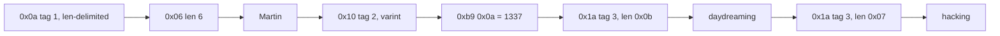
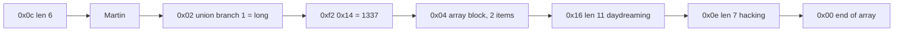
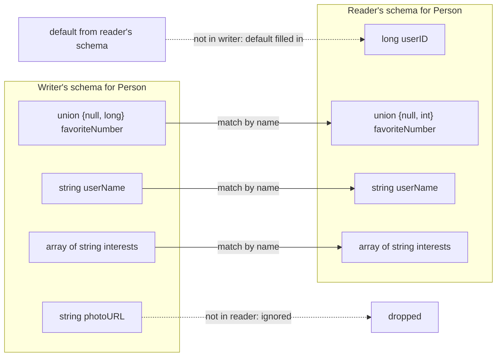
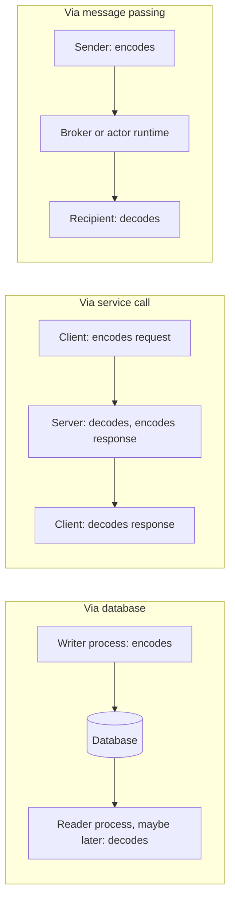
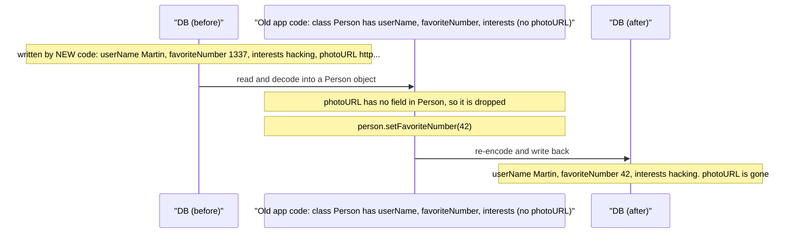
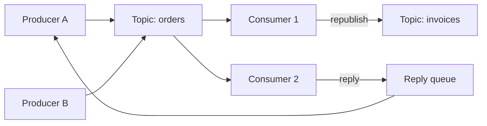

# Chapter 4 — Encoding and Evolution
*Book: Chapter 4, pp. 111–144*

## Overview

Software never stands still. New features ship, requirements become clearer, the business shifts — and nearly every such change also changes the **data** the application keeps: a new field appears, a new record type is needed, or old data must be shown differently. Chapter 1 called the ability to cope with this **evolvability**.

The data models from Chapter 2 cope with change in different ways:
- **Relational databases** assume all data follows **one schema** at any moment. You can change it with **schema migrations** (`ALTER TABLE` statements), but only one version is in force at a time.
- **Schema-on-read ("schemaless") databases** impose no schema at all, so old-format and new-format records can sit side by side.

When the data format changes, the code that reads and writes it usually has to change too. In a big system, though, code **cannot change everywhere at the same instant**:
- **Server-side:** you typically do a **rolling upgrade** (also called a **staged rollout**) — deploy the new version to a few nodes, check it behaves, then continue node by node. This avoids downtime and so encourages frequent releases.
- **Client-side:** you depend on users, who may not install an update for a long time.

So **old and new code, and old and new data formats, will coexist**. To keep working, the system needs compatibility **in both directions**:

| Kind | Meaning | Difficulty |
|---|---|---|
| **Backward compatibility** | *Newer* code can read data written by *older* code. | Usually easy — the new code's author knows the old format and can handle it explicitly (even by keeping the old reading code). |
| **Forward compatibility** | *Older* code can read data written by *newer* code. | Harder — old code must be able to *ignore* additions it has never heard of. |

The chapter answers two questions:
1. **How do encoding formats** (JSON, XML, Protocol Buffers, Thrift, Avro) **handle schema changes** so that old and new code/data can coexist?
2. **How do these formats get used when data flows** between processes — through databases, through services (REST and RPC), and through asynchronous messages (message brokers and actors)?

**Everyday analogy.** Imagine a paper form your office has used for years. A new version adds a "mobile phone" box. Staff trained on the new form must still understand old forms (backward compatibility). Staff still using old instructions must be able to process the new forms by simply skipping the box they don't recognise — and, if they re-file the form, not tear that box off (forward compatibility + preserving unknown fields).

## Key terms

| Term | Plain-English meaning |
|---|---|
| Evolvability | How easily a system can be changed over time. |
| Schema migration | Changing a relational schema, e.g. with `ALTER TABLE`. |
| Schema-on-read | No schema enforced on write; readers interpret the structure (so-called "schemaless"). |
| Rolling upgrade / staged rollout | Rolling out a new version gradually, a handful of nodes per step. |
| Backward compatibility | New code can read old data. |
| Forward compatibility | Data produced by newer code is still readable by older code. |
| Encoding (serialization, marshalling) | Converting in-memory data into a self-contained byte sequence. |
| Decoding (parsing, deserialization, unmarshalling) | Converting a byte sequence back into in-memory data structures. |
| Language-specific format | Encoding built into one programming language (Java Serializable, Ruby Marshal, Python pickle). |
| Textual format | Human-readable encodings such as JSON, XML, CSV. |
| Binary string | A sequence of raw bytes with no character encoding. |
| Base64 | A way to write binary data as text; makes it about 33% larger. |
| Binary encoding | A compact, non-human-readable byte format. |
| MessagePack | One binary encoding of JSON. |
| Schema | A formal description of the structure and types of data. |
| IDL (Interface Definition Language) | The language used to write a schema (e.g., Thrift IDL, Avro IDL). |
| Code generation | A tool turns a schema into classes in your programming language. |
| Field tag | A number identifying a field in Thrift/Protocol Buffers instead of its name. |
| Variable-length integer (varint) | An integer encoding that uses fewer bytes for small numbers. |
| Schema evolution | Changing a schema over time while keeping compatibility. |
| Writer's schema | The schema the writing application used to encode the data (Avro). |
| Reader's schema | The schema the reading application expects the data in (Avro). |
| Union type | Avro type allowing a value to be one of several types, e.g. `null` or `long`. |
| Object container file | Avro file format that stores the writer's schema once, followed by many records. |
| Self-describing file | A file that carries the metadata needed to interpret it. |
| ASN.1 / DER | Old (1984) schema language and its binary encoding, still used for X.509 certificates. |
| Dataflow | The path by which encoded data goes from one process to another. |
| Data outlives code | Old data stays in its original encoding long after the code that wrote it is gone. |
| Migrating data | Rewriting stored data into a new schema. |
| Archival storage | Snapshots/dumps of a database, e.g. for backups or warehouses. |
| Client / server / service | Clients send requests to servers; the API a server exposes is a service. |
| Ajax | JavaScript in the browser making HTTP requests (XMLHttpRequest) for data. |
| SOA / microservices | Building an application from many smaller services that call each other. |
| Web service | A service accessed over HTTP. |
| Middleware | Software supporting service-to-service calls inside one organisation. |
| REST | Design philosophy built on HTTP principles (URLs for resources, HTTP features). |
| RESTful | An API following REST principles. |
| SOAP | XML-based protocol for network API requests, with the WS-* standards. |
| WSDL | XML-based language describing a SOAP API; enables code generation. |
| OpenAPI (Swagger) | A format for describing RESTful APIs and generating documentation. |
| RPC (remote procedure call) | Making a network request look like calling a local function. |
| Location transparency | The idea of hiding whether something is local or remote. |
| Idempotence | Doing an action twice has the same effect as doing it once — needed for safe retries. |
| Futures / promises | Objects representing a result that will arrive later (or fail). |
| Service discovery | Finding which IP address and port a service is running on. |
| API versioning | How a client indicates which version of an API it wants. |
| Message broker (message queue, message-oriented middleware) | An intermediary that temporarily stores messages between sender and receiver. |
| Queue / topic | Named destinations in a message broker. |
| Producer / consumer (subscriber) | Sender / receiver of messages. |
| Actor model | Concurrency model where independent actors hold private state and exchange async messages. |
| Distributed actor framework | Actor model spread over many nodes (Akka, Orleans, Erlang OTP). |

---

## Formats for Encoding Data

Programs hold data in **at least two representations**:
1. **In memory:** objects, structs, lists, arrays, hash tables, trees… These are tuned for fast CPU access and manipulation, usually with **pointers**.
2. **On disk / on the network:** a **self-contained sequence of bytes** (e.g., a JSON document). A pointer means nothing to another process, so this form looks very different from the in-memory one.

> **Footnote:** exceptions exist, e.g. some memory-mapped files, or operating directly on compressed data (as with column compression in Chapter 3).

So we need translation in both directions:
- **Encoding** (also **serialization** or **marshalling**): in-memory → bytes.
- **Decoding** (also **parsing**, **deserialization**, **unmarshalling**): bytes → in-memory.

> **Terminology clash:** "serialization" also has a totally different meaning for transactions (Chapter 7). To avoid confusion the book says **encoding**, even though serialization is probably the more common word.
>
> **Footnote:** encoding is unrelated to **encryption**, which the book doesn't cover.

There are countless libraries and formats; here's the tour.

### Language-Specific Formats

**What they are.** Many languages have built-in ways to turn objects into bytes: **Java** has `java.io.Serializable`, **Ruby** has `Marshal`, **Python** has `pickle`. There are third-party ones too, e.g. **Kryo** for Java.

**Why people like them:** you can save and restore in-memory objects with almost no extra code.

**Why they're a bad idea (deep problems):**
1. **Tied to one language.** Reading the data from another language is very hard, so you lock yourself into your current language for a long time and make integration with other organisations (using other languages) difficult.
2. **Security risk.** To rebuild objects of the original types, the decoder must be able to **instantiate arbitrary classes**. If an attacker can feed your app arbitrary bytes to decode, they can create arbitrary classes — which often lets them do terrible things like **remote code execution**.
3. **Versioning is an afterthought.** Built for quick-and-easy encoding, these libraries often ignore forward and backward compatibility.
4. **Efficiency is an afterthought.** Both CPU cost and encoded size may be poor; **Java's built-in serialization** is infamous for being slow and producing bloated bytes.

**Verdict:** use your language's built-in encoding only for **very short-lived** purposes.

```python
import pickle
blob = pickle.dumps({"sku": "A-17", "qty": 3})  # encode a dict into Python-only bytes
item = pickle.loads(blob)                       # decode; never do this with untrusted input!
```
- Line 2 produces bytes only Python's `pickle` understands.
- Line 3 rebuilds the object; with attacker-controlled bytes, `loads` can run arbitrary code — the security problem above.

### JSON, XML, and Binary Variants

**Standardised, cross-language formats:** **JSON** and **XML** are the obvious choices — widely known, widely supported, and nearly as widely disliked. XML is often called too verbose and needlessly complicated. JSON is popular mainly because web browsers support it natively (it's a subset of JavaScript) and it's simpler than XML. **CSV** is another language-independent format, though less powerful.

All three are **textual** and so somewhat human-readable. Beyond arguments about syntax, they have **subtle problems**:

1. **Number ambiguity.**
   - In **XML and CSV**, a number and a string of digits look identical (unless you consult an external schema).
   - **JSON** separates strings from numbers, but doesn't separate **integers from floating-point numbers** and specifies **no precision**.
   - This bites with large numbers: integers above **2^53** can't be represented exactly in an **IEEE 754 double**, so languages that parse JSON numbers as floats (like **JavaScript**) get them wrong. Real example: **Twitter** uses **64-bit** numbers as tweet IDs. To stop JavaScript clients from mangling them, its API includes every tweet ID **twice**: as a JSON number and also as a **decimal string**.
2. **No binary strings.** JSON and XML handle Unicode text well but not raw bytes. The workaround is to **Base64**-encode binary data as text and use the schema to say "this is Base64". It works, but it's hacky and grows the data by **33%**.
3. **Optional, complicated schemas.** Both XML and JSON have optional schema languages; they're powerful and therefore complicated to learn and implement. XML schemas are fairly widespread; many JSON tools skip schemas entirely. Because interpreting numbers and binary strings depends on the schema, apps without one must **hardcode** the encoding/decoding logic.
4. **CSV has no schema at all.** The app decides what each row and column means; if a change adds a row or column, you handle it by hand. CSV is also **vague** — what if a value contains a comma or newline? Its escaping rules have been formally specified, but not every parser implements them correctly.

**Still good enough.** Despite the flaws, JSON, XML and CSV work for many uses, especially as **data interchange formats** between organisations. There, as long as everyone agrees on the format, prettiness and efficiency hardly matter — getting organisations to agree on *anything* is the hard part.

#### Binary encoding

Inside **one organisation**, there's less pressure to pick a lowest-common-denominator format; you can choose something more compact or faster to parse. For small datasets the gain is negligible, but at **terabyte** scale the choice matters a lot.

JSON is less verbose than XML, yet both use much more space than binary formats. This led to many **binary encodings**:
- **For JSON:** MessagePack, BSON, BJSON, UBJSON, BISON, Smile, and others.
- **For XML:** e.g. Fast Infoset and WBXML.

These found niche adoption, but none is as widespread as textual JSON/XML. Some add datatypes (e.g., integers vs floats, binary strings) but otherwise keep the JSON/XML data model. Crucially, **since they have no schema, they must include every field name** in the encoded data.

**The running example (Example 4-1)** — a person record the book encodes in several formats. Its fields are `userName` = "Martin", `favoriteNumber` = 1337, and `interests` = ["daydreaming", "hacking"]. A similar JSON record of our own:

```json
{
  "bookTitle": "Dune",
  "pageCount": 412,
  "genres": ["sci-fi", "classic"]
}
```
- `bookTitle` is a string, `pageCount` an integer, `genres` a list of strings. Any schemaless binary JSON format must still store the three field-name strings inside the bytes.

**MessagePack walkthrough** (encoding the book's Example 4-1):
1. First byte **0x83**: the high nibble 0x80 means "object", the low nibble 0x03 means it has **three fields**. (Objects with more than 15 fields don't fit in four bits; they get a different type marker and the count is stored in two or four bytes.)
2. Second byte **0xa8**: high nibble 0xa0 means "string", low nibble 0x08 gives its length of **eight bytes**.
3. The next eight bytes: the field name `userName` in ASCII. The length was already given, so no end marker or escaping is needed.
4. The next seven bytes: the six-letter value `Martin`, with the prefix **0xa6**; and so on.

**Result:** **66 bytes**, versus **81 bytes** for textual JSON with whitespace removed — only slightly smaller. All binary JSON variants are similar. It's unclear whether such a small saving (and perhaps faster parsing) is worth losing human-readability. The following formats get the same record down to **32 bytes**.

*Figure 4-1 (redrawn): Example 4-1 encoded with MessagePack — every field name travels inside the bytes*

*Total: 66 bytes.*

### Thrift and Protocol Buffers

**What they are.** **Apache Thrift** (originally from **Facebook**) and **Protocol Buffers / protobuf** (originally from **Google**) are binary encoding libraries built on the same principle. Both were open-sourced in **2007–08**.

**Both require a schema.** You write it in an **interface definition language (IDL)**. Thrift-style, for our own book record:

```thrift
struct Book {
  1: required string       bookTitle,   // tag 1, must be present
  2: optional i64          pageCount,   // tag 2, 64-bit integer, may be absent
  3: optional list<string> genres       // tag 3, list of strings
}
```
- Each field has a **tag number** (1, 2, 3), a `required`/`optional` marker, a type, and a name.

The Protocol Buffers version looks almost the same:

```protobuf
message Book {
  required string book_title = 1;   // field tag 1
  optional int64  page_count = 2;   // field tag 2
  repeated string genres     = 3;   // "repeated" = may appear many times (a list)
}
```

Each comes with a **code generation tool** that turns the schema into classes in many languages; your application calls that generated code to encode/decode records.

**Thrift has two binary formats** (confusingly): **BinaryProtocol** and **CompactProtocol**.

> **Footnote:** actually three — **DenseProtocol** too, but only the C++ implementation supports it, so it isn't cross-language. There are also two JSON-based encodings. "What fun!" as the book jokes.

**Thrift BinaryProtocol** — Example 4-1 takes **59 bytes**:
- Like MessagePack, each field has a **type annotation** (string, integer, list…) and where needed a **length** (string length, list item count). Strings (“Martin”, “daydreaming”, “hacking”) are ASCII (really UTF-8).
- **Big difference: no field names.** Instead each field carries a **field tag** — the numbers 1, 2, 3 from the schema. Tags act as compact **aliases** for fields.

*Figure 4-2 (redrawn): Example 4-1 in Thrift BinaryProtocol — type byte, 2-byte tag, then length/value*

```mermaid
flowchart LR
  A["0x0b type string"] --> B["0x00 0x01 tag 1"]
  B --> C["len 4 bytes = 6"]
  C --> D["Martin"]
  D --> E["0x0a type i64"]
  E --> F["0x00 0x02 tag 2"]
  F --> G["8 bytes = 1337"]
  G --> H["0x0f type list"]
  H --> I["0x00 0x03 tag 3"]
  I --> J["0x0b item type string, 4-byte count = 2"]
  J --> K["4-byte len 11, daydreaming"]
  K --> L["4-byte len 7, hacking"]
  L --> M["0x00 end of struct"]
```

*Total: 59 bytes.*

**Thrift CompactProtocol** — same meaning, only **34 bytes**:
- Packs the **field type and tag number into one byte**.
- Uses **variable-length integers**: 1337 takes **two bytes** instead of eight. The top bit of each byte says whether more bytes follow. So numbers from **–64 to 63** fit in one byte, **–8192 to 8191** in two bytes, and so on; bigger numbers use more bytes.

*Figure 4-3 (redrawn): Example 4-1 in Thrift CompactProtocol — type+tag share a byte, integers are varints*

```mermaid
flowchart LR
  A["0x18 tag+1, type string"] --> B["0x06 len 6"]
  B --> C["Martin"]
  C --> D["0x16 tag+1, type i64"]
  D --> E["0xf2 0x14 = 1337 varint"]
  E --> F["0x19 tag+1, type list"]
  F --> G["0x28 2 items of string"]
  G --> H["0x0b len 11, daydreaming"]
  H --> I["0x07 len 7, hacking"]
  I --> J["0x00 end"]
```

*Total: 34 bytes.*

**Protocol Buffers** — has **one** binary format; bit packing differs slightly but is very similar to CompactProtocol. **33 bytes**.

*Figure 4-4 (redrawn): Example 4-1 in Protocol Buffers — a repeated field simply appears once per element*

*Total: 33 bytes.*

**Byte-size scoreboard for Example 4-1:**

| Encoding | Bytes |
|---|---|
| Textual JSON (whitespace removed) | 81 |
| MessagePack | 66 |
| Thrift BinaryProtocol | 59 |
| Thrift CompactProtocol | 34 |
| Protocol Buffers | 33 |
| Avro | 32 |

> **Common confusion — required vs optional:** the marker doesn't change the encoding at all; nothing in the bytes says whether a field was required. All `required` does is switch on a **check at runtime**, which raises an error when the field is missing — useful for spotting bugs.

#### Field tags and schema evolution

**Schema evolution** = schemas inevitably change over time. How do Thrift and protobuf keep backward and forward compatibility?

An encoded record is just its encoded fields concatenated. Every field carries its **tag number** plus a **datatype** annotation, and fields with no value are just **left out**. Hence the tags are what give the bytes their meaning:

- **Renaming a field is fine** — encoded data never contains names.
- **Changing a field's tag is not** — it would make all existing encoded data invalid.

**Adding a field:**
1. Give it a **new tag number**.
2. **Forward compatibility:** old code reading new data sees an unknown tag and **ignores** it. The datatype annotation tells the parser **how many bytes to skip**.
3. **Backward compatibility:** since each tag still means the same thing, newer code has no trouble with older data. **But** the new field **cannot be `required`** — new code reading old data would fail the check, since old code never wrote it. So every field added after the initial deployment must be **optional or have a default**.

**Removing a field** is the mirror image:
- You may only remove an **optional** field (a required field can never be removed).
- You may **never reuse** that tag number, because old data containing it may still exist and new code must ignore it.

#### Datatypes and schema evolution

**Changing a field's type** may be possible (check the docs), but risks **losing precision or truncation**. Example: 32-bit → 64-bit integer:
- New code reading old data: fine — the parser fills missing bits with zeros.
- Old code reading new data: it still stores the value in a **32-bit** variable, so a 64-bit value that doesn't fit gets **truncated**.

**Protocol Buffers `repeated`:** protobuf has **no list/array type**; it has a `repeated` marker (a third option beside `required` and `optional`). As Figure 4-4 shows, a repeated field is just the **same tag appearing multiple times**. Handy side effect: a field that was **optional (single value)** may later become **repeated (many values)**:
- Newer code, given old records, gets a list holding **zero or one** item (depending on whether the field was set).
- Older code, given new records, just keeps the **final** item of the list.

**Thrift** has a real **list** type, parameterised by element type. It doesn't allow that single→multi evolution, but it supports **nested lists**.

### Avro

**What it is.** **Apache Avro** is another binary format, interestingly different from protobuf and Thrift. It began in **2009** as a **Hadoop** subproject because Thrift didn't fit Hadoop's use cases well.

**Two schema languages:** **Avro IDL** (for humans to edit) and a **JSON-based** one (easier for machines). Our own example in Avro IDL:

```avro
record Book {
  string               bookTitle;             // plain string, no tag number
  union { null, long } pageCount = null;      // may be null or a long; default null
  array<string>        genres;                // list of strings
}
```

The equivalent JSON schema:

```json
{
  "type": "record",
  "name": "Book",
  "fields": [
    {"name": "bookTitle", "type": "string"},
    {"name": "pageCount", "type": ["null", "long"], "default": null},
    {"name": "genres",    "type": {"type": "array", "items": "string"}}
  ]
}
```
- `"type": ["null", "long"]` is a union; `"default": null` is used when a reader expects this field but the writer didn't provide it.

**No tag numbers.** Encoding Example 4-1 takes only **32 bytes** — the most compact of all.

**How the bytes look:** there's **nothing identifying fields or their types** — just values concatenated. A string is a length prefix plus UTF-8 bytes, but nothing says it's a string; it could be an integer or anything else. Integers use variable-length encoding (same as Thrift CompactProtocol).

*Figure 4-5 (redrawn): Example 4-1 in Avro — only values, in schema order, with no tags or type markers (lengths and counts are zigzag varints, so 0x0c means 6)*

*Total: 32 bytes.*

**Consequence:** to parse, you walk the fields **in schema order**, using the schema to know each type. So data decodes correctly **only if the reader uses exactly the same schema as the writer** — any mismatch means garbage. So how does Avro allow evolution?

#### The writer's schema and the reader's schema

- **Writer's schema:** when an app encodes data (for a file, database, network…), it uses whatever schema version it knows — possibly compiled into it.
- **Reader's schema:** when an app decodes data, it expects a certain schema — the one its code relies on, perhaps generated at build time.

**Key idea:** the two **need not be identical, only compatible**. At decode time, the Avro library puts the writer's and reader's schemas **side by side** and translates data from the former into the latter (**schema resolution**, precisely defined in the Avro specification):

1. **Field order may differ** — fields are matched **by name**.
2. A field in the **writer's** schema but not the **reader's** → **ignored**.
3. A field the **reader** expects but the **writer's** schema lacks → filled with the **default** declared in the reader's schema.

*Figure 4-6 (redrawn): an Avro reader resolves the writer's and reader's Person schemas by field name. Order differs between the two; photoURL exists only in the writer's schema, userID only in the reader's*


#### Schema evolution rules

In Avro:
- **Forward compatibility** = new schema as **writer**, old schema as **reader**.
- **Backward compatibility** = new schema as **reader**, old schema as **writer**.

**Rule:** a field may be **added or removed only if it has a default value**. (In the book's schema, `favoriteNumber` defaults to `null`.)
- **Add a field with a default:** a new-schema reader reading old records fills in the default.
- **Add a field without a default:** new readers can't read old writers' data → **breaks backward compatibility**.
- **Remove a field without a default:** old readers can't read new writers' data → **breaks forward compatibility**.

**Null handling via unions.** In some languages anything can be null by default; **not in Avro**. To allow null you must use a **union**, e.g. `union { null, long, string } field;` means the field is a number, a string, or null. **`null` can only be a default if it's one of the union's branches.** More verbose, but being explicit about nullability prevents bugs.

> **Footnote:** strictly, the default must match the type of the union's **first branch** — an Avro-specific limitation, not a general property of union types.

Therefore Avro has **no `optional`/`required` markers** like protobuf/Thrift; it uses **union types and defaults** instead.

**Other changes:**
- **Changing a field's type:** allowed if Avro can convert between the types.
- **Renaming a field:** possible but tricky — the reader's schema can list **aliases**, matching an old writer's field names. So renaming is **backward compatible but not forward compatible**.
- **Adding a branch to a union:** likewise **backward compatible but not forward compatible**.

#### But what is the writer's schema?

How does a reader know which writer's schema encoded a piece of data? Attaching the full schema to every record would waste far more space than the binary encoding saves. It depends on the context:

| Context | How the reader gets the writer's schema |
|---|---|
| **Large file with lots of records** (common with Hadoop; see Chapter 10) | Millions of records share one schema, so the writer puts the schema **once at the start of the file**. Avro defines **object container files** for this. |
| **Database with individually written records** | Records written at different times may use different schemas. Simplest fix: prefix every record with a **version number** and keep a **list of schema versions in the database**. The reader extracts the version, fetches that writer's schema, and decodes the rest. **Espresso** works this way. |
| **Sending records over a network connection** | Two processes on a **bidirectional** connection **negotiate the schema version at connection setup** and use it for the whole connection. The **Avro RPC** protocol does this. |

A **database of schema versions** is useful anyway: it's documentation and lets you **check compatibility** of schema changes. The version can be a simple **incrementing integer** or a **hash of the schema**.

#### Dynamically generated schemas

Why does it matter that Avro schemas have **no tag numbers**? Because Avro is friendlier to **dynamically generated schemas**.

**Example: dumping a relational database to a binary file** (avoiding the textual-format problems of JSON, CSV, SQL):
1. Generate an Avro schema (JSON form) from the relational schema — **one record schema per table**, **one field per column**, with **column name = field name**.
2. Encode the table contents with it and dump everything into an Avro **object container file**.
3. When the database schema changes (say one column added, one removed), just **regenerate** the Avro schema and export with it. The export needn't care about the change.
4. Readers of new files see changed fields, but since fields are matched **by name**, the new writer's schema still resolves against an old reader's schema.

**With Thrift or protobuf**, field tags would probably be assigned **by hand**: every database schema change would require an administrator to update the column-name → tag mapping. Automating it is possible, but the generator must be very careful **never to reuse old tags**. Dynamic schema generation just **wasn't a design goal** of Thrift/protobuf; it **was** for Avro.

#### Code generation and dynamically typed languages

- **Thrift and protobuf rely on code generation.** That suits **statically typed** languages (**Java, C++, C#**): efficient in-memory structures for decoded data, plus type checking and IDE autocompletion.
- In **dynamically typed** languages (**JavaScript, Ruby, Python**), there's no compile-time checker to satisfy, so generated code adds little. Code generation is often frowned upon there because they otherwise avoid a compile step. When the schema itself is **generated dynamically** (say, from a database table), a code-generation step just gets in the way of reading the data.
- **Avro** offers **optional** code generation for static languages but works fine without it. An **object container file** embeds the writer's schema, so you can open it with the Avro library and browse it like a JSON file — it's **self-describing**.
- This is especially handy with dynamically typed data processing languages like **Apache Pig**: open Avro files, analyse them, and write derived datasets back as Avro, without thinking about schemas.

### The Merits of Schemas

Protobuf, Thrift and Avro all use schemas for a binary format. Their schema languages are **far simpler** than **XML Schema** or **JSON Schema**, both of which offer elaborate validation rules (e.g., "this string must match a regular expression", "this integer must be between 0 and 100"). Because they're easier to implement and use, libraries for them now exist in quite a broad set of languages.

**Not a new idea:**
- **ASN.1**, a schema definition language first standardised in **1984**, was used to define many network protocols. Its binary encoding **DER** still encodes **SSL certificates (X.509)**. ASN.1 supports schema evolution with **tag numbers**, like protobuf/Thrift — but it's very complex and badly documented, so it's unlikely to be a wise pick for a new application.
- Many data systems use their own **proprietary binary encodings**. E.g., most relational databases have a **network protocol** for queries and responses, specific to that database; the vendor supplies a **driver** (e.g., via **ODBC** or **JDBC** APIs) that decodes responses into in-memory structures.

**Nice properties of schema-based binary encodings:**
1. **Much more compact** than "binary JSON" variants, because field names can be left out.
2. The schema is **valuable documentation** — and since decoding requires it, it's guaranteed **up to date** (unlike hand-written docs that drift).
3. A **database of schemas** lets you check forward/backward compatibility **before deploying** anything.
4. For statically typed languages, **generated code** enables compile-time type checking.

**Bottom line:** schema evolution offers flexibility comparable to schemaless (schema-on-read) JSON databases, **while adding** stronger guarantees about your data and better tooling.

| Format family | Examples | Size | Human-readable | Schema | Compatibility story |
|---|---|---|---|---|---|
| Language-specific | Java Serializable, Ruby Marshal, Python pickle, Kryo | Often bloated | No | Implicit in classes | Often none; insecure |
| Textual | JSON, XML, CSV | Large | Yes | Optional (XML/JSON), none (CSV) | Depends on usage; number/binary ambiguity |
| Binary JSON/XML | MessagePack, BSON, WBXML… | Slightly smaller | No | None | Like JSON; field names still stored |
| Schema-driven binary | Thrift, Protocol Buffers | Very compact (tags) | No | Required, with tags | Clear rules via tag numbers |
| Schema-driven binary | Avro | Most compact (no tags) | No | Writer's + reader's schema | Clear rules via name matching + defaults |

---

## Modes of Dataflow

Whenever you send data to a process you don't share memory with — over the network or into a file — you must encode it as bytes. Compatibility is a relationship between **the process that encodes** and **the process that decodes**. It matters for evolvability: it lets you **upgrade parts of the system independently** instead of all at once.

But *who* encodes and *who* decodes? The rest of the chapter looks at the most common ways data flows between processes:
- **Through databases**
- **Through service calls** (REST and RPC)
- **Through asynchronous message passing**



### Dataflow Through Databases

**Who encodes/decodes:** whoever **writes** to the database does the encoding; whoever **reads** does the decoding.

- **Single process:** the reader might just be a **later version** of the same process — writing to the database is like **leaving a note for your future self**. That makes **backward compatibility** obviously necessary, or your future self can't read what you wrote.
- **Many processes:** usually several apps/services, or several instances of one service (for scale or fault tolerance), access the database at once. During a **rolling upgrade**, some run new code and some old. So a value may be **written by new code and later read by old code** → **forward compatibility** is often needed too.

**The extra snag — preserving unknown fields:**
1. A new field is introduced in the schema, and **new code** stores a value in it.
2. Then **old code**, which has never heard of that field, loads the record, **modifies** something, and saves it.
3. What you normally want: the old code **leaves the new field untouched**, despite not understanding it.

The encoding formats above support preserving unknown fields, but sometimes you must handle it **at the application level**: e.g., if you decode into **model objects** and re-encode them, the unknown field can be **lost** in that translation. Not hard to solve — just be aware of it.

*Figure 4-7 (redrawn): an older app version reads a record written by a newer version, updates one field through its model object, and writes it back. The newer field (`photoURL`) is silently lost.*


#### Different values written at different times

- A database lets **any value be updated at any time**, so one database may contain values written **five milliseconds ago** alongside values written **five years ago**.
- A new server-side app version can **fully replace** the old one within **minutes**. Database contents don't change that way: the **five-year-old data stays in its original encoding** unless explicitly rewritten. This is summed up as **"data outlives code."**
- **Migrating** (rewriting) data into a new schema is possible but **expensive** on large datasets, so most databases avoid it.
- **Most relational databases** allow simple changes, like **adding a column with a null default**, **without rewriting** existing data; when reading an old row, missing columns are filled with nulls.

> **Footnote:** except **MySQL**, which often rewrites the whole table even when not strictly needed (Chapter 2).

- **LinkedIn's Espresso** document database stores data in **Avro**, so it can use Avro's schema evolution rules.
- **Net effect:** schema evolution lets the whole database **appear** to use one schema, even though storage contains records encoded with many historical schema versions.

#### Archival storage

- You may **snapshot** the database periodically, e.g. for **backups** or loading into a **data warehouse** (Chapter 3).
- The dump is typically encoded with the **latest schema**, even if the source mixed many schema versions — since you're copying all the data anyway, you may as well encode it consistently.
- The dump is written once and then **immutable**, so **Avro object container files** fit well. It's also a chance to write the data in a **column-oriented** layout that suits analytics, such as **Parquet**.
- More on archival data in Chapter 10.

### Dataflow Through Services: REST and RPC

**Clients and servers.** The most common arrangement for network communication: **servers** expose an API over the network; **clients** connect and send requests. The API a server exposes is called a **service**.

- **The web works this way:** browsers (clients) issue **GET** requests to fetch HTML, CSS, JavaScript and images, and **POST** requests to send data to the server. The API is a set of **standard** protocols and formats (HTTP, URLs, SSL/TLS, HTML…). Because browsers, servers and site authors largely agree on these standards, any browser can in theory access any website.
- **Other clients:** native mobile/desktop apps also make network requests; client-side JavaScript in a browser can use **XMLHttpRequest** to act as an HTTP client — a technique called **Ajax**. Here the response is usually not HTML for humans but data (e.g., **JSON**) for the client code. HTTP is the transport, but the API on top is **application-specific**, and client and server must agree on it.
- **A server can itself be a client** of another service (e.g., a web app server is a client of its database). Decomposing a large application into smaller services by functionality, each calling others as needed, has long been known as **service-oriented architecture (SOA)**; a refined, renamed version of the idea is now called **microservices**.

**Services vs databases.** Both let clients submit and query data. But databases accept **arbitrary queries** (Chapter 2's query languages), while services expose an **application-specific API** where inputs and outputs are fixed by the service's business logic. This gives **encapsulation**: services can finely restrict what clients may do.

**Why compatibility matters here:** a key goal of SOA/microservices is to make applications easier to change by making services **independently deployable and evolvable** — each service owned by **one team** that can release often **without coordinating** with others. So expect **old and new versions of clients and servers running simultaneously**, and the data encoding must be compatible across API versions — exactly this chapter's theme.

#### Web services

When a service uses **HTTP** as its protocol, it's a **web service** — a slight misnomer, since it's used well beyond the web:
1. **Client app on a user's device** (native mobile app, or JavaScript web app using Ajax) calling a service over HTTP, typically across the **public internet**.
2. **Service to service within one organisation**, often in the **same datacenter**, as part of SOA/microservices. (Software supporting this is sometimes called **middleware**.)
3. **Service to service across organisations**, usually over the internet — data exchange between companies' backends. Examples are **public APIs** of online services, like **credit card processing**, or **OAuth** for letting one service access user data held by another.

**Two popular approaches: REST and SOAP** — almost diametrically opposed philosophies, and the subject of heated debate.

> **Footnote:** even inside each camp there are arguments; **HATEOAS** (short for hypermedia as the engine of application state), for instance, is a frequent source of debate.

**REST (Representational State Transfer):**
- **Not a protocol** but a **design philosophy** built on HTTP's principles.
- Emphasises **simple data formats**, **URLs to identify resources**, and **HTTP's built-in features** for caching control, authentication and negotiating content types.
- Gaining popularity over SOAP, at least for **cross-organisational** integration, and often associated with **microservices**. An API following REST is **RESTful**.

**SOAP:**
- An **XML-based protocol** for network API requests. Usually used over HTTP, but aims to be **independent of HTTP** and avoids most HTTP features.
- Comes with a sprawling, complex family of related standards — the **web service framework, WS-\*** — adding various features.
- APIs are described in **WSDL (Web Services Description Language)**, XML-based. WSDL enables **code generation** so clients can call the remote service via local classes and method calls (encoded to XML and back by the framework). Useful for static languages, less so for dynamic ones.
- WSDL isn't designed to be human-readable and SOAP messages are often too complex to build by hand, so SOAP users rely heavily on **tools, code generation and IDEs**. Languages not supported by SOAP vendors have a hard time integrating.
- Although nominally standardised, **interoperability between vendors' implementations** often causes problems.
- As a result, SOAP survives in plenty of **large enterprises** but most smaller companies have **moved away** from it.

> **Footnote:** despite similar acronyms, **SOAP is not required for SOA**. SOAP is one particular technology, while SOA is a broad way of structuring systems.

**RESTful APIs** favour simpler approaches with less code generation and automated tooling. A definition format like **OpenAPI** (also known as **Swagger**) can describe RESTful APIs and produce documentation.

| | REST | SOAP |
|---|---|---|
| Nature | Design philosophy on top of HTTP | XML-based protocol, HTTP-independent |
| Data format | Simple (commonly JSON) | XML |
| Uses HTTP features | Yes (URLs, caching, auth, content negotiation) | Mostly avoids them |
| Description | OpenAPI / Swagger (optional) | WSDL |
| Tooling dependence | Low | High (code generation, IDEs) |
| Where popular | Public/cross-org APIs, microservices | Large enterprises |

#### The problems with remote procedure calls (RPCs)

Web services are just the latest in a long line of technologies for API calls over a network — many heavily hyped but seriously flawed:
- Java's **Remote Method Invocation (RMI)** and **Enterprise JavaBeans (EJB**, part of Java Enterprise Edition): **Java-only**.
- **DCOM (Distributed Component Object Model)**: limited to **Microsoft** platforms.
- **CORBA (Common Object Request Broker Architecture)**: **excessively complex**, and provides **no backward or forward compatibility**.

All are based on the **remote procedure call (RPC)**, around since the **1970s**. RPC tries to make a remote network call **look like a local function call** in the same process — an abstraction called **location transparency**.

**Why that's fundamentally flawed — a network request differs from a local call:**

| Local function call | Network request |
|---|---|
| **Predictable**: succeeds or fails based only on parameters you control. | **Unpredictable**: request/response may be lost, remote machine slow or down — none of it under your control. Such failures happen often, so you must expect them (e.g., by **retrying**). |
| Returns a result, throws an exception, or never returns (infinite loop/crash). | Can also **time out** and return nothing — then you **don't know** whether the request got through (see Chapter 8). |
| Calling twice is something you choose to do. | **Retrying** may repeat an action whose response was lost, unless the protocol has **deduplication (idempotence)** (see Chapter 11). |
| Takes about the same time each call. | **Much slower** and **wildly variable** latency: under a millisecond at good times, **many seconds** when the network is congested or the service overloaded. |
| Can pass **pointers/references** to local objects efficiently. | Every parameter must be **encoded into bytes** — fine for numbers/strings, problematic for large objects. |
| Same language on both sides. | Client and service may be in **different languages**, so the framework must translate datatypes — can be ugly (recall JavaScript's trouble with numbers above **2^53**). |

**Conclusion:** it's pointless to disguise a remote service as a local object, because the two are fundamentally unlike each other. Part of REST's appeal is that it **doesn't hide** that it's a network protocol (though people still build RPC libraries on top of REST).

#### Current directions for RPC

RPC isn't going away. Frameworks exist on top of every encoding in this chapter:
- **Thrift** and **Avro** include RPC support.
- **gRPC** is RPC built on **Protocol Buffers**.
- **Finagle** uses **Thrift**.
- **Rest.li** uses **JSON over HTTP**.

**This new generation is more honest** that remote ≠ local:
- **Finagle** and **Rest.li** wrap asynchronous, possibly-failing actions in **futures (promises)**. Futures also make it easier to call **several services in parallel** and combine the results.
- **gRPC** supports **streams**: one call may involve a **stream** of many requests and many responses spread over time, rather than exactly one of each.
- Some frameworks provide **service discovery** — letting a client find the IP address and port of a service (more in "Request Routing", Chapter 6).

**RPC vs REST trade-off:**
- Custom RPC protocols with **binary encoding** can **outperform** generic JSON-over-REST.
- But **RESTful APIs** have big advantages: easy to **experiment and debug** (just use a browser or **curl**, no code generation or installs), supported by **all mainstream languages and platforms**, and a **huge ecosystem** of supporting tools — servers, caches, proxies, load balancers, firewalls, plus monitoring, testing and debugging tools.
- Hence **REST dominates public APIs**, while **RPC frameworks** focus on requests **between services of the same organisation**, usually in the **same datacenter**.

```bash
# Poking a RESTful API directly from the command line, no generated client needed
curl -H "Accept: application/json" https://api.example.com/v2/books/42
```
- `-H "Accept: application/json"` asks for JSON; `/v2/` shows one common way of choosing an API version (in the URL).

#### Data encoding and evolution for RPC

For evolvability, RPC clients and servers must be changeable and deployable **independently**. Services allow a **simplifying assumption** compared with databases: **servers are updated first, clients second**. So you need:
- **Backward compatibility on requests** (new server reads old client's requests),
- **Forward compatibility on responses** (old client reads new server's responses).

An RPC scheme's compatibility is **inherited from its encoding**:
- **Thrift, gRPC (Protocol Buffers), Avro RPC** evolve under their encoding's rules.
- **SOAP:** requests/responses are defined with **XML schemas**; they can evolve but there are subtle pitfalls.
- **RESTful APIs:** responses are typically **JSON with no formally specified schema**; requests use JSON or **URI-encoded / form-encoded** parameters. Changes generally seen as safe: **new optional request parameters** and **extra fields in response objects**.

**Harder across organisations:** the provider often can't control or force clients to upgrade, so compatibility may need to last a **very long time, perhaps forever**. If a breaking change is needed, providers often run **multiple API versions side by side**.

**API versioning** — no agreement on how clients should indicate a version:
- For REST, commonly: put the **version in the URL**, or put it in the **HTTP `Accept` header**.
- For services using **API keys** to identify clients: the server can **remember which API version each client asked for**, and let clients change it through a **separate admin interface**.

### Message-Passing Dataflow

So far: **REST/RPC** (one process sends a request and expects a quick response) and **databases** (one writes, another reads maybe much later). **Asynchronous message-passing** sits **between** them:
- **Like RPC:** a client's request (**message**) reaches another process with **low latency**.
- **Like a database:** the message doesn't go over a direct connection but through an intermediary — a **message broker** (other names: **message queue**, **message-oriented middleware**) that **holds on to it for a while**.

**Advantages of a broker over direct RPC:**
1. Serves as a **buffer** when the recipient is down or overwhelmed → more reliable system.
2. Can **redeliver** messages to a crashed process → prevents message loss.
3. Sender needn't know the recipient's **IP address and port** — very useful in the cloud where **virtual machines come and go**.
4. One message can go to **several recipients**.
5. **Logically decouples** sender and recipient: the sender just publishes and doesn't care who consumes.

**Difference from RPC:** communication is usually **one-way** — the sender doesn't normally expect a reply. A reply is possible but usually via a **separate channel**. This makes it **asynchronous**: the sender fires off the message and moves on without waiting to see it delivered.

#### Message brokers

- **Past:** dominated by commercial enterprise software from **TIBCO**, **IBM WebSphere** and **webMethods**.
- **Now:** open-source **RabbitMQ**, **ActiveMQ**, **HornetQ**, **NATS** and **Apache Kafka** are popular (compared in detail in Chapter 11).

**How they're used (general pattern; details vary):**
1. A producer publishes a message to a **queue** or **topic** identified by name.
2. The broker ensures it's delivered to one or more **consumers** or **subscribers** of that queue/topic.
3. One topic may have **multiple producers as well as multiple consumers**.

*Message broker dataflow (illustrative, not a numbered book figure)*


- A topic is **one-way** only. But a consumer can **publish to another topic** (chaining, see Chapter 11) or to a **reply queue** read by the original sender (giving request/response similar to RPC).
- Brokers usually **don't enforce a data model**: a message is just **bytes plus some metadata**, so any encoding works. If it's **backward and forward compatible**, publishers and consumers can change independently and deploy **in any order**.
- When a consumer **re-publishes** messages onto a further topic, take care to **preserve unknown fields** — the same issue as with databases (Figure 4-7).

#### Distributed actor frameworks

**The actor model** is a concurrency programming model **within a single process**. Instead of dealing with threads directly (with race conditions, locking and deadlock), logic lives in **actors**:
- Each actor usually represents **one client or entity**, may hold **local state** (not shared with other actors), and talks to others by sending and receiving **asynchronous messages**.
- **Message delivery is not guaranteed** — in some error cases, messages are lost.
- Each actor handles **one message at a time**, so it needn't worry about threads, and the framework can schedule actors independently.

**Distributed actor frameworks** use this model to scale across **multiple nodes**. Messaging works identically whether the two actors share a node or not; across nodes, the framework quietly **encodes the message, ships it over the network, and decodes it** at the far end.

**Location transparency fits actors better than RPC**: actors are **already designed around possible message loss**, even inside one process. Network latency is higher, but local vs remote is less fundamentally mismatched.

A distributed actor framework effectively **combines a message broker with the actor model**. For **rolling upgrades** you still need forward and backward compatibility, since messages may go from a new-version node to an old one and vice versa.

**How three popular frameworks encode messages:**

| Framework | Default encoding | Rolling upgrades |
|---|---|---|
| **Akka** | **Java's built-in serialization** — no forward/backward compatibility | Possible if you swap in e.g. **Protocol Buffers** |
| **Orleans** | A **custom** encoding without rolling-upgrade support | To upgrade: set up a **new cluster**, move traffic over, shut down the old one. Custom serialization plug-ins can be used, as with Akka. |
| **Erlang OTP** | Record schemas are surprisingly hard to change, despite many high-availability features | Possible but must be **planned carefully**. A newer experimental **maps** datatype (JSON-like; arrived in **Erlang R17, 2014**) could ease this in future. |

---

## Summary

*(Book section)* The chapter looked at how data structures become bytes on the network or on disk, and how those encoding choices affect not only **efficiency** but, more importantly, **application architecture** and **deployment options**.

- Many services need **rolling upgrades**: the new version spreads gradually across nodes instead of hitting all of them simultaneously. This allows releases **without downtime** (encouraging frequent small releases over rare big ones) and makes deployments **less risky** (bad releases can be caught and rolled back before affecting many users). Both help **evolvability**.
- Because different nodes may run different code versions, all data flowing through the system must be encoded with **backward compatibility** (new code reads old data) and **forward compatibility** (old code reads new data).

**Encoding formats and their compatibility:**
- **Language-specific encodings:** limited to one language, often without forward/backward compatibility.
- **Textual formats (JSON, XML, CSV):** widespread; compatibility depends on how you use them. Optional schema languages can help or hinder. Vague about datatypes — take care with **numbers** and **binary strings**.
- **Binary schema-driven formats (Thrift, Protocol Buffers, Avro):** compact, efficient, with **clearly defined** compatibility semantics; schemas help documentation and code generation in static languages. Downside: data must be **decoded before a human can read it**.

**Modes of dataflow:**
- **Databases:** writer encodes, reader decodes.
- **RPC and REST APIs:** client encodes a request, server decodes it and encodes a response, client decodes the response.
- **Asynchronous message passing** (brokers or actors): sender encodes, recipient decodes.

**Conclusion:** a little care makes both compatibility directions — and therefore rolling upgrades — entirely realistic.

---

## Looking ahead

That closes Part I, which dealt with data on a single machine. Part II, *Distributed Data*, opens with a short introduction on why data gets spread across several machines (scalability, fault tolerance, latency) and on shared-memory, shared-disk and shared-nothing architectures. That introduction is summarised at the start of the [Chapter 5 notes](../05-replication/README.md), which then cover replication.

---

## Chapter summary

- Old and new **code and data coexist** (rolling upgrades, slow client updates), so you need **backward** (new reads old) and **forward** (old reads new) compatibility.
- **Language-specific formats** (Java Serializable, Ruby Marshal, Python pickle, Kryo): convenient but language-locked, insecure, poor versioning and efficiency.
- **JSON/XML/CSV**: universal and readable, but ambiguous numbers (2^53 problem; Twitter's string IDs), no binary strings (Base64 +33%), optional/complex or missing schemas. Binary JSON (MessagePack: 66 vs 81 bytes) saves little.
- **Thrift/Protocol Buffers**: schema + **field tags**; Thrift BinaryProtocol 59 bytes, CompactProtocol 34, protobuf 33. Rename fields freely; never change or reuse tags; new fields must be optional/defaulted; only optional fields can be removed.
- **Avro**: no tags, 32 bytes; **writer's vs reader's schema** resolved by field name; add/remove only fields with defaults; nulls via unions; writer's schema found via container file header, per-record version number, or connection negotiation. Great for **dynamically generated schemas** and dynamic languages.
- **Schemas** give compactness, up-to-date documentation, compatibility checks and code generation (ASN.1 did it first, in 1984).
- **Dataflow via databases**: data outlives code; preserve unknown fields; add-null-column without rewrite; archive dumps with the latest schema (Avro/Parquet).
- **Dataflow via services**: REST (HTTP-based philosophy) vs SOAP (XML protocol, WSDL); RPC's location transparency is flawed; modern RPC (gRPC, Finagle, Rest.li, Thrift, Avro) is explicit about the network. Assume servers upgrade first: backward-compatible requests, forward-compatible responses. Versioning via URL, Accept header, or per-API-key settings.
- **Dataflow via messages**: brokers buffer, redeliver, decouple, fan out; one-way and async. Actor frameworks (Akka, Orleans, Erlang OTP) still need compatible encodings for rolling upgrades.

## Interview angle

**1. What are backward and forward compatibility, and why do you need both?**
*30-second answer:* Backward = new code reads old data; forward = old code reads new data. During rolling upgrades and with un-updated clients, old and new versions run at the same time and read each other's data, so both are needed. Backward is easy (you know the old format); forward requires old code to ignore unknown additions.
- *Follow-up: Which one does a database need?* Both: a future version reads old data (backward), and during a rolling upgrade old instances read rows written by new ones (forward). Also preserve unknown fields on read-modify-write.
- *Follow-up: Which one do services need?* Assuming servers upgrade first: backward compatibility for requests, forward compatibility for responses.

**2. How do Protocol Buffers / Thrift handle schema evolution?**
*30-second answer:* Each field has a numeric tag; encoded data stores tag + type + value, never names. Old code skips unknown tags (using the type to know the length) → forward compatible. New code reads old data since tags keep their meaning → backward compatible, as long as new fields are optional or have defaults. You can rename fields, but never change or reuse tags, and only optional fields may be removed.
- *Follow-up: Can you change int32 to int64?* New code reads old fine; old code reading new values may truncate them.
- *Follow-up: optional → repeated in protobuf?* Allowed: new code sees 0/1-element lists, old code sees the last element.

**3. How is Avro different?**
*30-second answer:* No tag numbers and no type markers in the data — just values in schema order (32 bytes for the example). Decoding needs the exact writer's schema, which is resolved against the reader's schema by field name: unknown fields ignored, missing fields defaulted. Only fields with defaults may be added/removed. The writer's schema is found from a file header, a per-record version number with a schema registry, or negotiation on connection. That makes Avro great for schemas generated automatically, e.g. from database tables.
- *Follow-up: How is null handled?* Via union types like `union { null, long }`; null can be the default only if it's a branch (the first one, strictly).

**4. Why is RPC's "make a remote call look local" idea flawed?**
*30-second answer:* Network calls can be lost, time out with unknown outcome, get duplicated on retry (need idempotence), have highly variable latency, require encoding all parameters, and cross language type systems. Hiding that leads to fragile systems. Modern frameworks use futures, streams, and service discovery, and REST is explicit that it's a network protocol.
- *Follow-up: REST or RPC?* REST for public APIs (debuggable with curl, universal tooling); binary RPC (gRPC, Thrift) for internal service-to-service calls where performance matters.

**5. When would you use a message broker instead of direct RPC?**
*30-second answer:* When you want buffering against slow or offline consumers, automatic redelivery after crashes, no need to know recipients' addresses, fan-out to many consumers, and decoupled producers/consumers. The trade-off is one-way, asynchronous communication; replies need a separate reply queue.
- *Follow-up: What's the encoding pitfall?* Consumers that republish messages must preserve fields they don't understand.

**6. Why avoid Java Serializable / pickle for stored data?**
*30-second answer:* Language lock-in, remote-code-execution risk from decoding untrusted bytes, weak versioning, and poor efficiency (Java serialization is notoriously bloated). Only use them for very short-lived data.

## Self-check

1. **Define backward and forward compatibility. Which is usually harder, and why?**
   Backward: new code reads old data. Forward: old code reads new data. Forward is harder because old code must ignore additions it doesn't know about.

2. **Why can't JavaScript reliably read Twitter tweet IDs sent as JSON numbers, and how did Twitter work around it?**
   Tweet IDs are 64-bit, but JavaScript parses numbers as IEEE 754 doubles, exact only up to 2^53. Twitter returns each ID both as a number and as a decimal string.

3. **Rank these by encoded size for Example 4-1: Protobuf, JSON, Avro, MessagePack, Thrift Compact, Thrift Binary.**
   Avro 32 < Protobuf 33 < Thrift Compact 34 < Thrift Binary 59 < MessagePack 66 < JSON 81.

4. **In Protocol Buffers, can you rename a field? Change its tag? Add a required field?**
   Rename: yes (names aren't encoded). Change tag: no (existing data becomes invalid). Add required: no (new code would fail on old data); new fields must be optional or have defaults.

5. **Avro data has no field tags or types. How can a reader possibly decode it after the schema changes?**
   The reader has both the writer's schema (from the file header, a version number lookup, or connection negotiation) and its own reader's schema; the Avro library matches fields by name, ignores extra fields and fills defaults for missing ones.

6. **Scenario: you add a field without a default to an Avro schema. What breaks?**
   Backward compatibility: new readers can't read records written with the old schema, because there's no value to fill in.

7. **Scenario: an old service version reads a user record, changes the email, and writes it back — and a newly added field disappears. Why, and how do you prevent it?**
   The old code decoded into a model object that had no slot for the new field, and re-encoding dropped it. Preserve unknown fields (the formats support it) and avoid lossy model translation.

8. **Why is it reasonable to need only backward-compatible requests and forward-compatible responses for RPC?**
   Because you can assume servers are upgraded before clients: new servers must accept old requests, and old clients must accept new responses.

9. **Give three advantages of a message broker over direct RPC and one disadvantage.**
   Buffers when the recipient is down/overloaded; redelivers after crashes; sender needn't know recipient's address; fan-out; decoupling. Disadvantage: usually one-way/asynchronous — no direct reply.

10. **Why does location transparency work better for actors than for RPC?**
    The actor model already assumes messages can be lost even within one process, so going over the network doesn't break its assumptions — unlike RPC, which pretends a remote call is as reliable as a local one.
