# Chapter 5 — Replication
*Book: Chapter 5, pp. 151–198 (plus the Part II introduction that precedes it)*

## Overview

### First, the Part II introduction: why spread data over many machines?

Part I covered data on one computer; Part II asks what changes when **several machines** store and serve it. Three motivations:

| Reason | What it buys you |
|---|---|
| **Scalability** | When data volume or read/write load outgrows one machine, share the work. |
| **Fault tolerance / high availability** | If a machine (or several, the network, or a whole datacenter) dies, a redundant one takes over. |
| **Latency** | Servers on several continents let each user talk to a nearby datacenter instead of sending packets across the planet. |

#### Scaling to Higher Load

| Architecture | How it works | Strengths | Weaknesses |
|---|---|---|---|
| **Shared-memory** (vertical scaling, "scaling up") | One bigger machine: many CPUs, RAM chips and disks under one OS, joined by a fast interconnect so any CPU reaches any memory or disk. | Simple: still "one machine". | Cost grows faster than linearly, and bottlenecks mean twice the hardware does not give twice the throughput. Some fault tolerance via hot-swappable parts (disks, memory, even CPUs), but in a single location. |
| **Shared-disk** | Several machines with their own CPUs and RAM sharing one disk array over a fast network (NAS = Network Attached Storage, SAN = Storage Area Network). | Used for some data-warehouse workloads. | Contention and locking overhead limit scaling. |
| **Shared-nothing** (horizontal scaling, "scaling out") | Each machine or VM running the database is a **node**, using only its own CPUs, RAM and disks; nodes coordinate in software over an ordinary network. | No special hardware, so best price/performance. Data can span regions, cutting latency and surviving loss of a whole datacenter; with cloud VMs even small companies can go multi-region. | More application complexity; can restrict usable data models. |

> **NUMA aside.** Even in one shared-memory machine, some memory banks are nearer to certain CPUs (nonuniform memory access). Using it well means splitting work so each CPU mostly touches nearby memory — partitioning even on "one machine".

Part II focuses on **shared-nothing** — not because it is always best, but because it demands the most care from developers: the database cannot hide all the constraints of distribution. A simple single-threaded program can sometimes beat a cluster of 100+ CPU cores, so distribution is not free performance.

#### Replication Versus Partitioning

- **Replication**: the *same* data copied onto several nodes, possibly in different places — redundancy (others serve data when some are down) and sometimes better performance. Chapter 5.
- **Partitioning** (**sharding**): a large database split into **partitions** placed on different nodes. Chapter 6.

Independent mechanisms, usually combined.

*Figure II-1 (redrawn): a database split into two partitions, each partition kept as two replicas holding the same records (the book shows records keyed 136, 211, 377 in partition 1 and 629, 696, 858 in partition 2).*
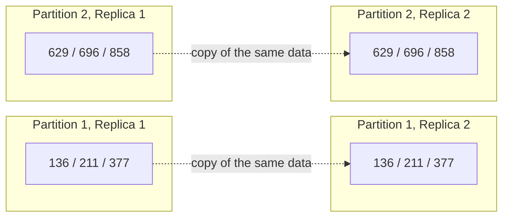

Then Chapter 7 covers transactions, Chapters 8–9 the fundamental limits of distributed systems, and Part III combining several data stores into larger systems.

### What this chapter answers

**Replication** keeps copies of the same data on several networked machines. *When data keeps changing, how do we keep the copies in step, and what goes wrong when they are not?*

Reasons to replicate: keep data near users (**latency**); keep working when parts fail (**availability**); let more machines serve reads (**read throughput**). (Primer on latency, availability, replication and sharding: [System Design Fundamentals](../00a-system-design-fundamentals/README.md).)

Assume each machine holds the whole dataset (Chapter 6 lifts this). If data never changed, replication would be trivial; the difficulty is **changes**. Three algorithms cover almost every distributed database: **single-leader**, **multi-leader**, **leaderless**. Also covered: synchronous vs asynchronous replication, failed replicas, and **eventual consistency**. The theory dates to the 1970s (network limits haven't changed); what is new is mainstream use, which causes much misunderstanding.

## Key terms

| Term | Plain-English meaning |
|---|---|
| Replica | A node holding its own full copy of the data. |
| Leader (master, primary) | The replica that accepts writes and sends them to the others. |
| Follower (read replica, slave, secondary, hot standby) | Copies changes from the leader; serves only reads. |
| Leader-based replication (active/passive, master–slave) | All writes go to one leader; followers copy them. |
| Replication log / change stream | Ordered list of changes the leader sends followers. |
| Synchronous / asynchronous / semi-synchronous | Leader waits for a follower's confirmation before reporting success / doesn't wait / one follower synchronous, rest async. |
| Chain replication | Synchronous-replication variant (e.g. Microsoft Azure Storage). |
| Snapshot | Consistent copy of the whole database at one moment. |
| Log sequence number / binlog coordinates | PostgreSQL's / MySQL's name for an exact replication-log position. |
| Caught up / catch-up recovery | Follower has applied all changes to the leader's current position / restarted follower requesting missed changes. |
| Failover | Promoting a follower to leader when the leader dies. |
| Controller node | Previously elected node that can appoint a new leader. |
| Split brain | Two nodes both believing they are leader. |
| Fencing / STONITH | Forcibly shutting down a node when two leaders are detected ("Shoot The Other Node In The Head"). |
| Statement-based replication | Sending SQL statements themselves to followers. |
| Nondeterministic function | E.g. `NOW()` or `RAND()`: may differ each call. |
| Write-ahead log (WAL) shipping | Sending the storage engine's low-level append-only log. |
| Logical (row-based) log | Row-level change log independent of storage format. |
| Change data capture | Streaming a database's changes to outside systems (Chapter 11). |
| Trigger / trigger-based replication | Custom code run automatically on data changes / using it to record changes for an external replicator. |
| Read-scaling architecture | Many followers sharing read traffic. |
| Replication lag | Delay between a write on the leader and its appearance on a follower. |
| Eventual consistency | If writes stop, replicas *eventually* agree; no time bound. |
| Read-after-write (read-your-writes) / cross-device | A user always sees their own updates / also across their devices. |
| Monotonic reads | A user never sees data go "back in time". |
| Consistent prefix reads | Writes are seen in the order they happened. |
| Multi-leader (master–master, active/active) | Several nodes accept writes; each leader follows the others. |
| Write conflict | Two leaders concurrently accept different changes to the same data. |
| Conflict avoidance | Routing all writes for a record through one leader. |
| Convergent conflict resolution | All replicas reach the same final value. |
| Last write wins (LWW) | Keep the write with the highest timestamp, discard the rest. |
| CRDT | Conflict-free replicated datatype; merges concurrent edits automatically. |
| Mergeable persistent data structure | Tracks history like Git; three-way merges. |
| Operational transformation | Conflict resolution algorithm of Google Docs and Etherpad. |
| Replication topology | Paths writes travel between leaders (circular, star, all-to-all). |
| Leaderless (Dynamo-style) replication | Any replica accepts writes; client or **coordinator node** (which imposes no order) sends to many replicas. |
| Read repair / anti-entropy | Client writes a newer value back to a stale replica seen during a read / background process fixing differences. |
| Quorum (n, w, r) | n replicas; writes need w acks, reads query r; w + r > n gives overlap. |
| Strict / sloppy quorum | Uses only a value's designated n nodes / during failures may use nodes outside them. |
| Hinted handoff | Returning temporarily held writes to their home nodes. |
| Concurrent operations / happens-before / causally dependent | Neither knows of the other / B knows about, depends on, or builds on A / B depends on A, so A applies first. |
| Siblings | Riak's name for concurrent values kept side by side. |
| Tombstone | Marker for a deleted item so deletion survives merges. |
| Version vector / dotted version vector / causal context | Per-replica version counters distinguishing overwrites from concurrent writes / variant in Riak 2.0 / Riak's string encoding of it. |

## Leaders and Followers

Every write must reach every replica. The most common approach is **leader-based replication**:

1. One replica is the **leader**; all writes go to it and it writes them to local storage first.
2. **Followers** receive each change via the **replication log** and apply changes **in the leader's order**.
3. Reads may go to leader or followers; only the leader accepts writes.

> **"Hot" vs "warm" standby.** Definitions vary; in PostgreSQL a hot standby serves reads, a warm standby applies changes but answers no queries. The book treats the difference as unimportant.

*Figure 5-1 (redrawn): leader-based replication. User 1234 changes their profile picture by writing to the leader; the leader streams the row change to both followers; user 2345 reads user 1234's profile from a follower.*
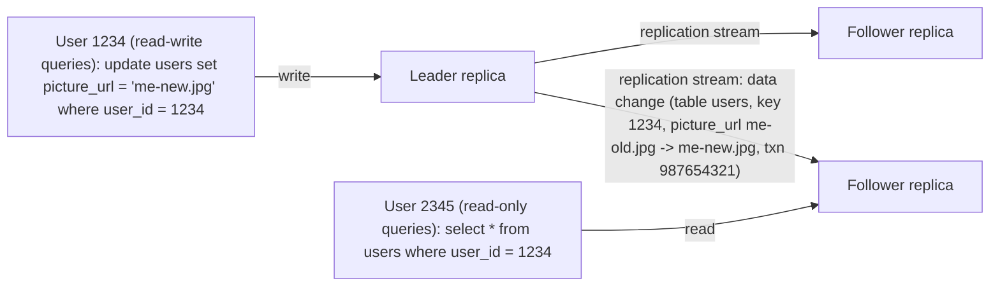

Who uses it: PostgreSQL (since 9.0), MySQL, Oracle Data Guard, SQL Server AlwaysOn Availability Groups; MongoDB, RethinkDB, Espresso; message brokers Kafka and RabbitMQ highly available queues; DRBD (replicated block device) and some network filesystems.

### Synchronous Versus Asynchronous Replication

**What it is.** Does the leader wait for a follower's confirmation before telling the client "done"? Yes → **synchronous** follower; no → **asynchronous**. Relational databases often make this configurable; other systems hard-code it.

*Figure 5-2 (redrawn): follower 1 is synchronous (leader waits for its ok before answering the user), follower 2 is asynchronous (leader answers without waiting; follower 2 applies the change and acknowledges much later).*
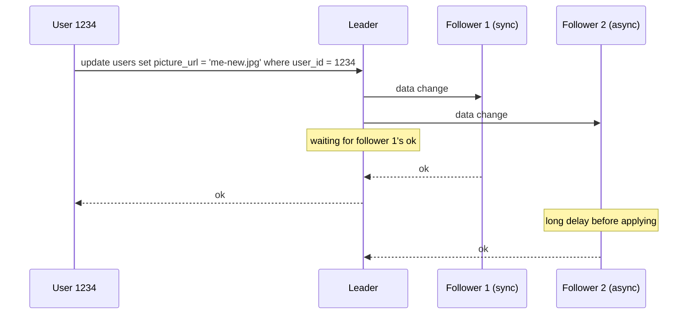

Followers usually apply changes within a second, but **there is no upper bound**: minutes behind when recovering from a crash, near maximum capacity, or under network problems.

| | Synchronous follower | Asynchronous follower |
|---|---|---|
| Up-to-date copy guaranteed? | Yes: if the leader dies, the data is safe on this follower | No: unreplicated writes can be lost |
| Effect if the follower is down/slow | Leader must **block all writes** until it returns | Leader carries on regardless |

Making *all* followers synchronous is impractical (one stuck node halts everything). The compromise is **semi-synchronous**: one synchronous follower, the rest async; if it becomes slow or unavailable, an async follower is made synchronous. Data is then current on at least two nodes.

Often replication is **fully asynchronous**: a write confirmed to the client can still be lost if the leader fails permanently before forwarding it, so durability is **not guaranteed** — but the leader keeps accepting writes even if all followers lag. This trade-off is widely accepted, especially with many or geographically distributed followers.

> **Research on replication.** **Chain replication**, a synchronous variant, has been deployed successfully in a few systems, such as Microsoft Azure Storage. Replication consistency is closely tied to **consensus** (Chapter 9).

### Setting Up New Followers

Copying data files doesn't work (writes keep arriving, so the copy mixes different moments), and locking the database kills availability. The no-downtime procedure:

1. Take a **consistent snapshot** of the leader, ideally without locking (backups need this anyway; sometimes a third-party tool such as *innobackupex* for MySQL, part of Percona XtraBackup).
2. **Copy** it to the new follower.
3. The follower **requests all changes since the snapshot**, which must be tied to an exact log position: PostgreSQL's **log sequence number**, MySQL's **binlog coordinates**.
4. After processing that backlog it has **caught up** and follows the live stream.

Some databases automate this; others need an obscure multi-step admin procedure.

### Handling Node Outages

Nodes go down from faults and planned maintenance (e.g. rebooting for a kernel security patch). Restarting individual nodes without downtime is a big operational win.

#### Follower failure: Catch-up recovery

Each follower logs received changes on local disk. After a crash, restart or network break, it finds the last transaction it processed, requests all later changes from the leader, applies them, and resumes the stream.

#### Leader failure: Failover

**Failover**: promote a follower, point client writes at it, and have other followers consume from it — manually or automatically. Automatic failover:

1. **Decide the leader has failed.** No foolproof detector, so use a **timeout**: nodes exchange messages, and one silent for, say, **30 seconds** is presumed dead (not applicable to planned shutdowns).
2. **Choose a new leader** by **election** (majority of remaining replicas) or appointment by a previously elected **controller node**. Best candidate: the replica with the most up-to-date data, minimising loss. Agreement is a **consensus** problem (Chapter 9).
3. **Reconfigure** clients to send writes to the new leader ("Request Routing", Chapter 6). If the old leader returns believing it is still leader, force it to become a follower.

What can go wrong:

- **Lost writes.** With async replication, the new leader may lack the old leader's last writes, and may have accepted conflicting writes meanwhile. Usually the old leader's unreplicated writes are **discarded**, breaking clients' durability expectations.
- **Danger with outside systems.** At **GitHub**, an out-of-date MySQL follower was promoted; its autoincrement primary-key counter lagged, so it **reused primary keys** the old leader had assigned. Those keys were also used in **Redis**, so the stores disagreed and some private data was shown to the wrong users.
- **Split brain.** Two nodes believe they are leader (Chapter 8); if both accept writes without conflict resolution, data can be lost or corrupted. Some systems shut one down (**fencing**, **STONITH**), but a badly designed mechanism can shut down *both* (the book cites a GitHub outage postmortem).
- **Choosing the timeout.** Too long: slow recovery. Too short: needless failovers from load spikes or network glitches, which usually make an already struggling system **worse**.

No easy fixes, so some teams fail over **manually** even when software could automate it. Node failures, unreliable networks, and trade-offs among consistency, durability, availability and latency recur in Chapters 8 and 9.

### Implementation of Replication Logs

Four methods are used in practice.

#### Statement-based replication

**How it works.** The leader logs every write statement (`INSERT`, `UPDATE`, `DELETE`); followers parse and execute each as if from a client. Illustrative statement log (our example):

```sql
-- statement 1: fine to replay anywhere
INSERT INTO orders (customer, item) VALUES ('ana', 'lamp');
-- statement 2: NOW() gives a different time on each replica when replayed
UPDATE orders SET shipped_at = NOW() WHERE customer = 'ana';
-- statement 3: result depends on current data and on execution order
DELETE FROM orders WHERE shipped_at < '2024-01-01';
```

**Where it breaks:**
- Nondeterministic functions (`NOW()`, `RAND()`) give different values per replica.
- Statements using an autoincrement column or depending on existing data (`UPDATE ... WHERE <condition>`) must run in **exactly** the same order everywhere — limiting with concurrent transactions.
- Side effects (triggers, stored procedures, user-defined functions) may differ unless fully deterministic.

**Workarounds** exist (e.g. the leader substitutes a fixed value for `NOW()`), but edge cases abound, so other methods are preferred.

**Who uses it:** MySQL before 5.1. Still used for compactness, but MySQL now switches to row-based replication whenever a statement is nondeterministic. **VoltDB** uses it safely by requiring deterministic transactions.

#### Write-ahead log (WAL) shipping

Storage engines append every write to a log (Chapter 3): in **log-structured** engines (SSTables/LSM-trees) the log *is* the storage, compacted and garbage-collected in the background; in **B-trees**, the **write-ahead log** records each change before the tree is touched, for crash recovery. Either way, the leader can send this byte log to followers, which replay it to build identical structures. **Used by PostgreSQL and Oracle**.

**Downside:** the WAL is very low level (which bytes changed in which disk blocks), so replication is **tightly coupled to the storage engine**. If the on-disk format changes between versions, leader and followers usually can't run different versions — ruling out **zero-downtime upgrades** (upgrade followers, then fail over to one), so upgrades need downtime.

#### Logical (row-based) log replication

Use a **separate log format for replication**, decoupled from engine internals: a **logical log**. For relational databases, a sequence of row-level records:
- **Insert:** new values of all columns.
- **Delete:** enough to identify the row — normally the primary key, else all old column values.
- **Update:** row identifier plus new values (all columns, or at least the changed ones).

A multi-row transaction produces several records plus a commit record. **MySQL's binlog** in row-based mode works like this. Illustrative records (our data):

```json
{"op": "insert", "table": "books", "row": {"id": 7, "title": "Dune", "stock": 3}}
{"op": "update", "table": "books", "key": {"id": 7}, "changed": {"stock": 2}}
{"op": "delete", "table": "books", "key": {"id": 4}}
{"op": "commit", "txid": 912}
```

**Benefits:** easier **backward compatibility**, so leader and followers can run different versions or even storage engines; easier for **external applications** to parse (data warehouses, custom indexes and caches) — **change data capture** (Chapter 11).

#### Trigger-based replication

For more flexibility — replicating a subset of data, between different databases, or with custom **conflict resolution** — move replication to the application layer:
- Tools like **Oracle GoldenGate** read the database log and expose changes to an application.
- Or use **triggers** and **stored procedures**: a trigger logs each change into a separate table, which an external process reads, applies application logic to, and replicates. **Databus for Oracle** and **Bucardo for Postgres** work this way.

Minimal illustration (PostgreSQL-style, our names); an outside process would poll `change_queue` and ship the rows:

```sql
CREATE TABLE change_queue (tbl text, row_id int, changed_at timestamptz);

CREATE FUNCTION log_change() RETURNS trigger AS $$
BEGIN
  INSERT INTO change_queue VALUES (TG_TABLE_NAME, NEW.id, now());
  RETURN NEW;
END $$ LANGUAGE plpgsql;

CREATE TRIGGER books_changes AFTER INSERT OR UPDATE ON books
  FOR EACH ROW EXECUTE FUNCTION log_change();
```

**Trade-off:** more overhead and more bug-prone than built-in replication, but flexible.

| Method | What is sent | Pros | Cons | Examples |
|---|---|---|---|---|
| Statement-based | SQL statements | Compact | Nondeterminism, ordering, side effects | MySQL < 5.1, VoltDB |
| WAL shipping | Low-level disk-block changes | Exact copy, no extra log | Tied to storage format; version upgrades need downtime | PostgreSQL, Oracle |
| Logical (row-based) | Row-level changes | Version-independent; good for CDC | Book names no specific drawback; it is simply a second log format separate from storage | MySQL binlog (row mode) |
| Trigger-based | Whatever app code records | Very flexible | Overhead, bugs | Databus, Bucardo |

## Problems with Replication Lag

Replication also serves **scalability** and **latency**. With one leader, reads can go anywhere, so read-heavy workloads (common on the web) can add many followers: a **read-scaling architecture**. This only works with **asynchronous** replication — synchronous replication to all followers would let any node failure or glitch halt writes, more likely with more nodes.

But async followers can return **outdated data**: leader and follower may answer the same query differently at the same moment. Stop writing and wait, and followers catch up: **eventual consistency** (coined by Douglas Terry et al., popularised by Werner Vogels, a NoSQL rallying cry — though async-replicated relational databases behave the same).

"Eventually" is deliberately vague: lag has no bound. Normally a fraction of a second, it can grow to seconds or minutes near capacity or with network trouble, and then the inconsistencies become real application bugs. Three examples follow.

### Reading Your Own Writes

**Problem.** A user submits data (a record, a comment) then views it; the write went to the leader but the read hits a follower that hasn't received it, so the data seems lost.

*Figure 5-3 (redrawn): user 1234 posts a comment via the leader, then immediately reads from follower 2, which has not received the insert yet, and gets no results.*
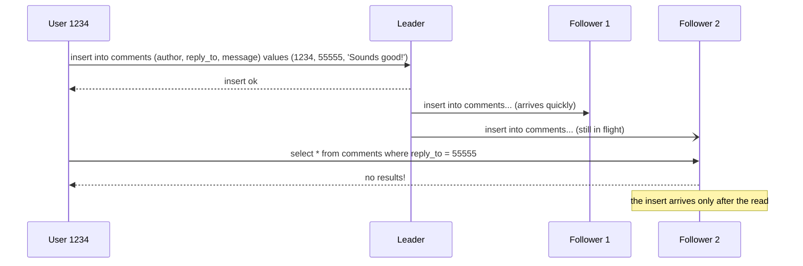

**Guarantee: read-after-write consistency** (**read-your-writes**): after reloading, users always see their *own* updates (no promise about others').

**Techniques:**
1. **Read possibly-modified data from the leader**, the rest from followers. Needs a way to know what might have changed without querying, e.g. users edit only their own profile, so read your own profile from the leader and others' from followers.
2. If most things are user-editable, that defeats read scaling; use other criteria, e.g. read from the leader for **one minute after the user's last update**, or avoid followers more than one minute behind.
3. **Client remembers its latest write's timestamp**; the serving replica must reflect at least that, else use another replica or wait. The timestamp can be **logical** (e.g. log sequence number) or the **system clock** (then clock sync matters; Chapter 8).
4. With **multiple datacenters**, requests needing the leader must be routed to its datacenter.

**Cross-device read-after-write** (enter on laptop, view on phone) adds issues: last-write metadata must be **centralised** (one device doesn't know what another wrote); and devices may reach **different datacenters** (home broadband vs mobile network), so leader-read approaches may first require routing all of a user's devices to one datacenter.

### Monotonic Reads

**Problem:** time appears to go backwards when successive reads hit a fresh then a stale follower (likely if each refresh hits a random server).

*Figure 5-4 (redrawn): user 2345 first sees user 1234's new comment on a fresh follower, then refreshes, hits a stale follower and the comment is gone.*
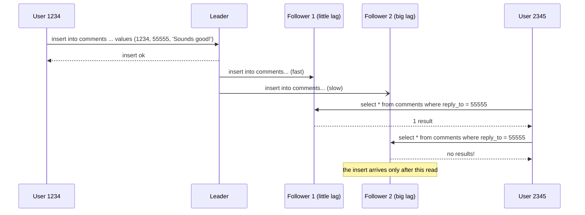

Seeing nothing twice would go unnoticed; seeing the comment appear then vanish is the confusion.

**Guarantee: monotonic reads** — weaker than strong consistency, stronger than eventual: data may be old, but one user's successive reads never move to an *older* state.

**How:** each user always reads from the **same replica** (different users may use different ones), e.g. chosen by **hashing the user ID** rather than randomly; if that replica fails, reroute.

### Consistent Prefix Reads

**Problem:** causality violated. The book's dialogue: Mr. Poons asks how far into the future Mrs. Cake can see; she answers about ten seconds. If an observer reads the answer through a fast replica and the question through a slow one, the answer appears **before** the question, as if Mrs. Cake were psychic.

*Figure 5-5 (redrawn): Mr. Poons's question goes to partition 1, whose follower lags a lot; Mrs. Cake's answer goes to partition 2, whose follower lags little. Each speaker hears the other via the leaders, but the observer, reading from the followers, receives the answer first.*
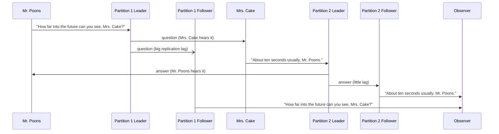

**Guarantee: consistent prefix reads** — writes made in some order are read in that order.

Mostly a problem in **partitioned (sharded)** databases (Chapter 6): a single global write order would always give consistent prefixes, but partitions operate independently with **no global order**, so a reader may see some parts old and some new.

**Fixes:** write causally related data to the **same partition** (not always efficient), or use algorithms that **track causal dependencies** (see "The happens-before relationship" below).

### Solutions for Replication Lag

- Ask: *what if lag grew to minutes or hours?* If users would suffer, design for a stronger guarantee such as read-after-write. **Pretending async replication is synchronous invites future trouble.**
- Applications can provide stronger guarantees themselves (e.g. leader reads), but it is complex and error-prone.
- Better if the database "does the right thing" — the purpose of **transactions**.
- Many distributed systems abandoned transactions, claiming they cost too much performance and availability and that eventual consistency is inevitable at scale. The book calls this partly true but **too simplistic**, revisiting it in Chapters 7, 9 and Part III.

| Anomaly | What the user sees | Guarantee | Typical fix |
|---|---|---|---|
| Own write missing | "My post disappeared" | Read-after-write | Read own data from leader; track last-write timestamp |
| Time goes backwards | Item appears, then vanishes | Monotonic reads | Pin each user to one replica (hash of user ID) |
| Effect before cause | Answer before question | Consistent prefix reads | Causally related writes in same partition; causal tracking |

## Multi-Leader Replication

Single-leader's weakness: **all writes go through one leader**; if you can't reach it (e.g. a network break), you can't write. (In a partitioned database each partition has its own single leader, possibly on different nodes, but still exactly one per partition.)

Extension: **several nodes accept writes**, each forwarding changes to all others: **multi-leader** (master–master, active/active) replication, where each leader is also a follower of the others.

### Use Cases for Multi-Leader Replication

Rarely worth the complexity within one datacenter, but useful in these cases.

#### Multi-datacenter operation

With replicas in several datacenters, single-leader forces every write to the leader's datacenter. Multi-leader gives **each datacenter its own leader**: leader–follower replication inside each, leader-to-leader replication between them.

*Figure 5-6 (redrawn): each datacenter has its own leader, which serves the local users' read-write queries and sends changes to a local follower; the two leaders replicate to each other, each passing incoming changes through a conflict-resolution step.*
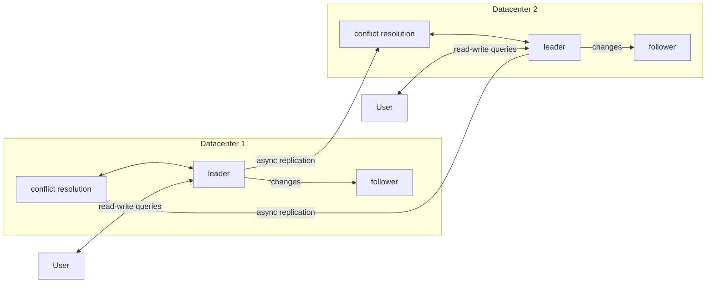

| Aspect | Single-leader across datacenters | Multi-leader |
|---|---|---|
| **Performance** | Every write crosses the internet to the leader's datacenter, adding latency and undermining multiple sites | Writes handled locally, replicated asynchronously; inter-datacenter delay hidden from users |
| **Datacenter outage** | Failover promotes a follower in another datacenter | Each datacenter runs independently; replication catches up when the failed one returns |
| **Network problems** | Very sensitive to the less reliable inter-datacenter (public internet) link, since writes cross it synchronously | Async replication tolerates temporary interruptions; writes continue |

Some databases support it natively; often it is added via external tools: **Tungsten Replicator** (MySQL), **BDR** (PostgreSQL), **GoldenGate** (Oracle).

**Big downside:** the same data can be changed concurrently in two datacenters, causing **write conflicts**. And because it is often retrofitted, it interacts badly with **autoincrementing keys, triggers, and integrity constraints**. Often regarded as dangerous territory to avoid if possible.

#### Clients with offline operation

**Offline-capable clients**, e.g. a **calendar** on phone, laptop and other devices: you must read and add meetings anytime, syncing when back online. **Each device's local database acts as a leader**, with async multi-leader replication (sync) between devices and lag of **hours or days**. It is the multi-datacenter case taken to the extreme: each device a "datacenter" on a very unreliable link. Calendar sync's history of bugs shows how hard this is. **CouchDB** was designed for this mode.

#### Collaborative editing

Real-time collaborative editors (**Etherpad**, **Google Docs**) apply each user's edits instantly to their local replica and replicate asynchronously to the server and other editors, like the offline case.
- **Guaranteeing no conflicts** means locking the document so one user edits at a time — equivalent to **single-leader replication with transactions on the leader**.
- Faster collaboration uses tiny units of change (e.g. **one keystroke**) and no locking, bringing all multi-leader challenges including conflict resolution.

### Handling Write Conflicts

Conflicts are multi-leader replication's central problem.

*Figure 5-7 (redrawn): page id=123 starts with title A. User 1 changes it to B on leader 1 while user 2 changes it to C on leader 2; both get "ok", and each leader only finds the conflict when the other's change arrives.*
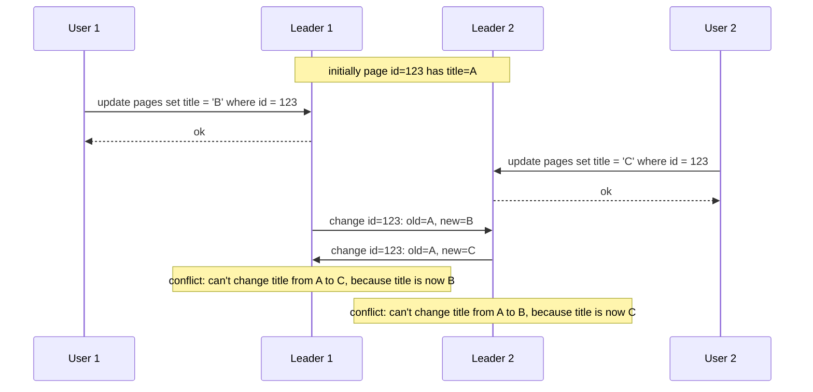

This cannot happen with a single leader.

#### Synchronous versus asynchronous conflict detection

- **Single leader:** the second writer blocks until the first completes, or is aborted and retries.
- **Multi-leader:** both writes succeed locally; the conflict is found **later, asynchronously**, when asking the user may be impossible.
- Synchronous detection (waiting for all replicas before confirming) would forfeit multi-leader's main benefit of independent writes; then just use single-leader.

#### Conflict avoidance

Simplest: route all writes for a given record through **the same leader**, so conflicts can't occur — frequently recommended, since many implementations handle conflicts poorly. E.g. give each user a **"home" datacenter** (perhaps the nearest) whose leader handles their reads and writes: single-leader from that user's view.

Breaks when the designated leader must change: a datacenter fails, or a user moves nearer another datacenter. Concurrent writes on different leaders become possible again.

#### Converging toward a consistent state

A single leader applies writes sequentially, so the last write determines the value. With multiple leaders there is **no defined order**: in Figure 5-7 leader 1 sees B then C, leader 2 sees C then B. Applying in arrival order would leave leader 1 with C and leader 2 with B — permanent inconsistency. Resolution must be **convergent**: all replicas reach the same final value once changes have replicated.

Ways to converge:
1. **Unique ID per write** (timestamp, long random number, UUID (128-bit random identifier), or hash of key and value); highest ID wins. With timestamps this is **last write wins (LWW)**: popular but **dangerously prone to data loss**.
2. **Unique ID per replica**; writes from higher-numbered replicas win. Also loses data.
3. **Merge the values**, e.g. sort and concatenate (title "B/C").
4. **Record the conflict** in a data structure preserving all information, and let application code resolve it later (perhaps by asking the user).

#### Custom conflict resolution logic

Resolution is application-specific, so most multi-leader tools accept custom code run:
- **On write:** called when replicated changes conflict. **Bucardo** allows a Perl snippet. Runs in a background process; must be fast and cannot prompt a user.
- **On read:** all conflicting versions are stored and returned on the next read; the application prompts the user or resolves automatically and writes back. **CouchDB** works this way.

Resolution usually applies **per row or document, not per transaction**: a transaction's several writes (Chapter 7) are each resolved separately.

> **Automatic Conflict Resolution.** Custom handlers get complicated and buggy; **Amazon**'s shopping cart once preserved *additions* but not *removals*, so deleted items reappeared. Research directions:
> - **CRDTs (conflict-free replicated datatypes)**: sets, maps, ordered lists, counters, etc. that resolve concurrent edits sensibly by themselves; some are in **Riak 2.0**.
> - **Mergeable persistent data structures**: track history like **Git** and use a **three-way merge** (CRDTs use two-way merges).
> - **Operational transformation**: behind **Etherpad** and **Google Docs**, designed for concurrent edits to ordered sequences such as a document's characters.
>
> Database implementations are young but promising.

#### What is a conflict?

Some are obvious (two concurrent writes giving the same field different values). Others are subtle: a **meeting-room booking system** must prevent overlapping bookings, yet two bookings made on **two different leaders** can conflict even if each checked availability. No quick answer; Chapter 7 gives more examples, Chapter 12 scalable detection and resolution.

### Multi-Leader Replication Topologies

A **replication topology** is the set of paths writes take between nodes. Two leaders have one sensible option (each sends to the other); more leaders allow several.

*Figure 5-8 (redrawn): three example topologies with four leaders each: (a) circular, (b) star (one root in the middle), (c) all-to-all.*
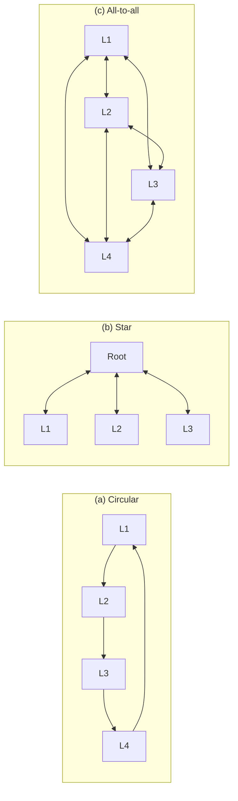

- **All-to-all:** every leader sends to every other; most general.
- **Circular:** each node receives from one neighbour and forwards those plus its own writes to the next. **MySQL supports only this by default.**
- **Star:** a root forwards writes to all others; generalises to a **tree**. (Unrelated to the warehouse *star schema*.)

**Avoiding infinite loops.** In circular and star layouts writes pass through several nodes; each write is tagged with the IDs of nodes it has passed through, and a node ignores changes tagged with its own ID.

**Fault tolerance.** In circular and star layouts **one failed node can block replication** until fixed (rerouting is usually manual). Denser topologies like all-to-all avoid this single point of failure.

**All-to-all's problem: messages overtaking each other.** Some links are faster (e.g. due to congestion elsewhere), so replication messages arrive out of order.

*Figure 5-9 (redrawn): client A inserts row x on leader 1, client B increments it on leader 3, but the insert travels slowly to leader 2, so leader 2 receives the dependent update before the insert.*
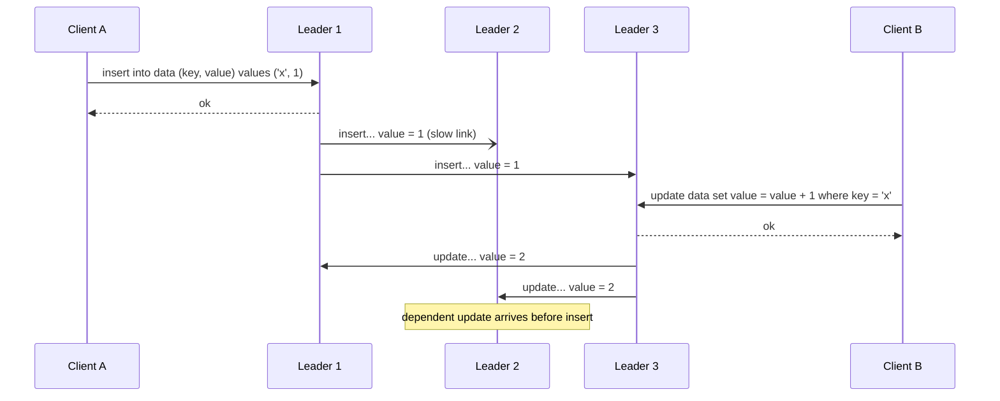

A **causality** problem like consistent prefix reads: the update depends on the insert, which must be applied first. **Timestamps are not enough** (clocks aren't reliably in sync; Chapter 8); the right tool is **version vectors** (below). Many systems handle this poorly: at the time of writing, **PostgreSQL BDR** gives no causal ordering, and **Tungsten Replicator for MySQL** doesn't even try to detect conflicts.

Advice: with multi-leader replication, know these issues, read the docs, and test that you really get the guarantees you assume.

## Leaderless Replication

Single- and multi-leader designs let a leader fix the write order. **Leaderless** systems let **any replica accept client writes directly**.

Some early replicated systems were leaderless; the idea faded during relational dominance and returned with **Amazon**'s in-house **Dynamo**. **Riak, Cassandra, and Voldemort** are open-source leaderless stores inspired by it: **Dynamo-style**. (**DynamoDB**, AWS's hosted product, is a different design using single-leader replication.)

Clients send writes to several replicas themselves, or via a **coordinator node**, which — unlike a leader — does **not impose an order** on writes, with major consequences.

### Writing to the Database When a Node Is Down

With three replicas and one down, a leader-based system might need failover. Leaderless systems have **no failover**: the client sends the write to **all three** in parallel; the two available replicas accept it; two of three acknowledgements suffice, so the write **succeeds** and the missed replica is ignored.

The returning node lacks missed writes and would serve **stale** values, so **reads also go to several nodes in parallel**; replies may differ, and **version numbers** identify the newest.

*Figure 5-10 (redrawn): user 1234 writes a new picture URL to all three replicas while replica 3 is offline; two oks are enough. Later user 2345 reads from all three, gets version 7 from replicas 1 and 2 but the old version 6 from replica 3, and repairs replica 3.*
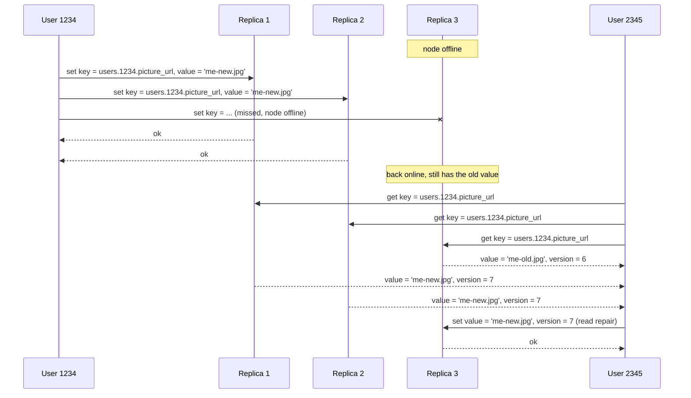

#### Read repair and anti-entropy

| Mechanism | How it works | Notes |
|---|---|---|
| **Read repair** | During a parallel read, the client spots stale replies (e.g. version 6 vs 7) and writes the newer value back to the stale replica. | Works well for frequently read values. |
| **Anti-entropy process** | Background process compares replicas and copies missing data. | Unlike a replication log, copies in **no particular order**, possibly with long delay. |

Not all systems have both: **Voldemort currently has no anti-entropy process**, so rarely read values may be missing on some replicas — **less durable**, since read repair only fixes what is read.

#### Quorums for reading and writing

If every successful write is on at least 2 of 3 replicas, at most one is stale, so reading 2 guarantees at least one fresh reply.

General rule: **n** replicas; writes confirmed by **w** nodes; reads query at least **r** nodes. If **w + r > n**, the read and write sets overlap, so some node read is up to date: **quorum reads and writes** (w and r are minimum votes; above, n = 3, w = 2, r = 2). This is a **strict quorum**, as opposed to sloppy quorums below.

Tuning (all configurable in Dynamo-style databases):
- Common: **n odd (typically 3 or 5)**, **w = r = (n + 1) / 2 rounded up**.
- Few writes, many reads: **w = n, r = 1** — fast reads, but one failed node makes **all writes fail**.
- **n is per value, not per cluster**: a cluster may have more than n nodes, each value stored on n of them — how data is partitioned across a large cluster (Chapter 6).

Fault tolerance: **w < n** lets writes proceed with a node down; **r < n** likewise for reads. **n = 3, w = 2, r = 2** tolerates **one** unavailable node; **n = 5, w = 3, r = 3** tolerates **two**. Requests go to **all n** replicas in parallel; w and r only set how many replies to **wait for**.

*Figure 5-11 (redrawn): with n = 5, w = 3, r = 3, the write is sent to all five replicas but only replicas 1-3 succeed; the read is sent to all five but only replicas 3-5 answer. Replica 3 is in both sets, so the read sees the latest write.*
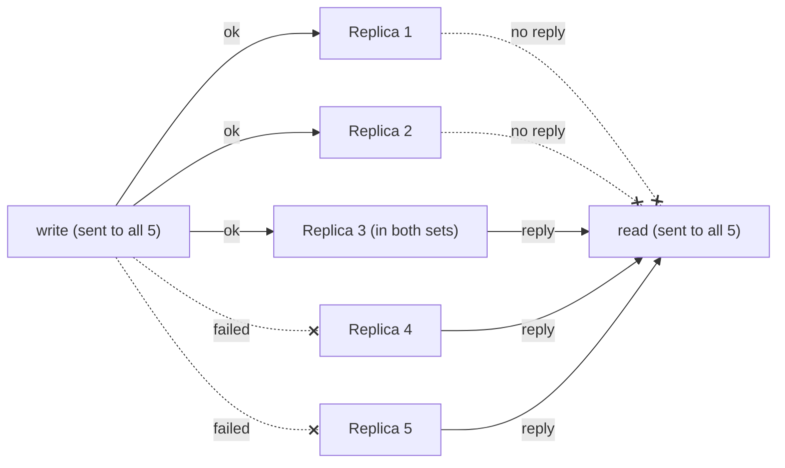

Fewer than w or r successful replies → the operation **returns an error**. Why a node failed (crash, power loss, full disk, network break) doesn't matter.

### Limitations of Quorum Consistency

**Why w + r > n usually works:** the written and read sets share at least one node with the latest value.

- w and r are often a **majority** (> n/2), satisfying w + r > n while tolerating up to n/2 failures; but quorums need only **overlap**, not be majorities, giving flexibility in algorithm design.
- **w + r ≤ n** is allowed: requests still go to n nodes but fewer successes are needed — stale reads **more likely**, but **lower latency and higher availability** (work continues until reachable replicas fall below w or r).

**Stale reads even with w + r > n:**
1. **Sloppy quorum**: writes and reads may hit different nodes, with no guaranteed overlap.
2. **Concurrent writes**: order unclear; the only safe option is merging. LWW can lose writes to **clock skew**.
3. **Write concurrent with a read**: the write may be on only some replicas; the read may return old or new.
4. **Partial write failure**: succeeded on fewer than w replicas (others e.g. had full disks); successful replicas **don't roll back**, so a "failed" write may or may not appear in later reads.
5. **Restore from a stale replica**: a node with the new value fails and is restored from one with the old value, dropping the count below w.
6. **Unlucky timing** even when all is well ("Linearizability and quorums", Chapter 9).

So quorums are not the simple guarantee they seem. Dynamo-style databases target workloads that **tolerate eventual consistency**; treat w and r as adjusting the *probability* of stale reads. The lag guarantees above (read-your-writes, monotonic reads, consistent prefix) are usually **absent**; stronger guarantees need transactions or consensus (Chapters 7, 9).

#### Monitoring staleness

Even if staleness is tolerable, you must monitor replication health and alert on large lag.

- **Leader-based:** easy: writes apply in the same order everywhere, so **lag = leader's log position minus follower's**, usually exposed as a metric.
- **Leaderless:** no fixed write order, so harder; with only read repair (no anti-entropy), nothing **limits how old** a rarely read value can be.

Research exists on measuring staleness and predicting stale-read fractions for given n, w, r, but it is not common practice. The book argues staleness should be a standard metric: you need to **quantify "eventual"**.

### Sloppy Quorums and Hinted Handoff

Quorums tolerate individual node failures **without failover** and slow nodes (only w or r replies needed), suiting **high availability, low latency, and occasional stale reads**.

But a network break can cut a client off from many nodes — alive, but effectively dead to that client — leaving fewer than w or r reachable. In a large cluster (far more than n nodes) the client can probably reach *some* nodes, just not the value's n "home" nodes. Options: fail requests that can't reach w or r, **or** accept writes on reachable nodes outside the home n.

The latter is a **sloppy quorum**: w and r successes are still required but may include non-home nodes (like sleeping on a neighbour's couch when locked out). When the network recovers, those writes are sent to the right nodes: **hinted handoff** (the neighbour sends you home when you find your keys).

**Trade-off:** better **write availability** (any w reachable nodes), but w + r > n no longer **guarantees reading the latest value**, which may sit outside the n. Until handoff completes, it is only a **durability assurance** (data stored on w nodes somewhere), not a traditional quorum.

Optional in all common Dynamo implementations: **enabled by default in Riak; disabled by default in Cassandra and Voldemort.**

#### Multi-datacenter operation

Leaderless replication also suits multiple datacenters, tolerating concurrent conflicting writes, network breaks and latency spikes.

| System | How it handles multiple datacenters |
|---|---|
| **Cassandra, Voldemort** | Normal leaderless model: n counts nodes in **all** datacenters, configurable per datacenter. Writes go to all replicas, but the client usually waits for a quorum **in its local datacenter**, unaffected by cross-datacenter delays; remote writes are often asynchronous (configurable). |
| **Riak** | Client-node traffic stays **within one datacenter**; n counts replicas there. Cross-datacenter replication between clusters is asynchronous in the background, like multi-leader. |

### Detecting Concurrent Writes

Dynamo-style databases allow concurrent writes to one key, so **conflicts occur even with strict quorums** — similar to multi-leader conflicts, and **read repair** and **hinted handoff** can create them too.

Root cause: variable network delays and partial failures deliver events to nodes in different orders. Clients A and B writing key X on three nodes: node 1 gets A's write but never B's (transient outage); node 2 gets A then B; node 3 gets B then A.

*Figure 5-12 (redrawn): clients A and B concurrently set key X; node 1 is unresponsive to B's write, and nodes 2 and 3 receive the two writes in opposite orders. If each node just overwrites on arrival, a later get X returns A, B and A from nodes 1, 2 and 3: they disagree forever.*
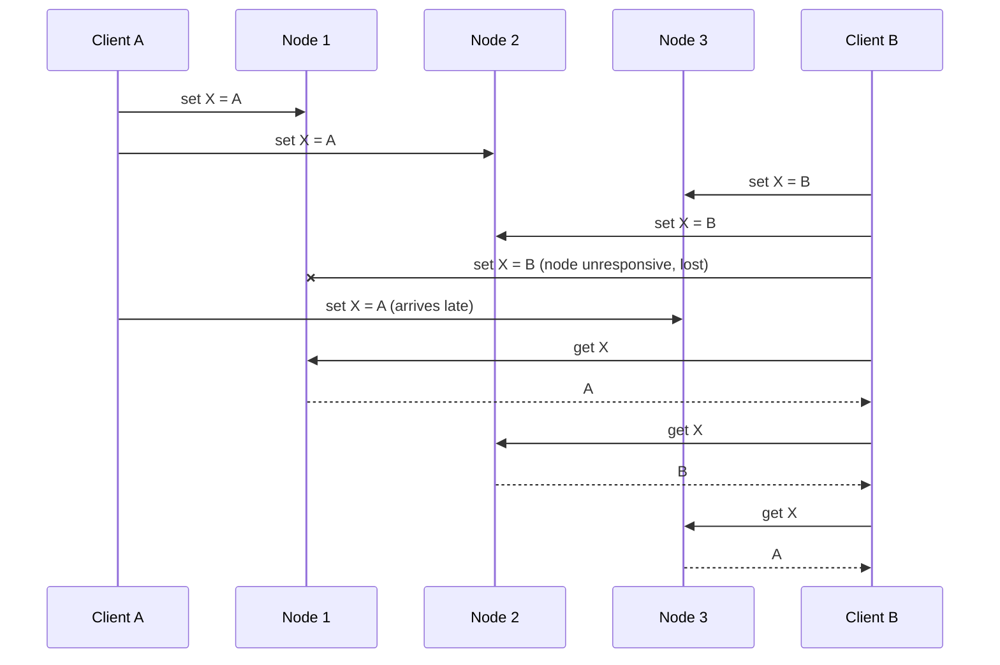

Replicas must **converge** for eventual consistency. Most implementations handle this poorly, so **developers must understand their database's conflict handling** to avoid data loss.

#### Last write wins (discarding concurrent writes)

**Idea:** each replica keeps only the "most recent" value, overwriting "older" ones; if we can always tell which write is newer and every write reaches every replica, copies converge.

**Why "recent" is quoted:** in Figure 5-12 neither client knew of the other, so neither came "first": the writes are **concurrent** and their order **undefined**. LWW **imposes** an arbitrary order, e.g. via timestamps (keep the largest).

- **Cassandra**'s only resolution method; optional in **Riak**.
- **Cost:** convergence at the expense of **durability**: of several concurrent writes, all reported successful (each reached w replicas), only one survives; the rest are **silently discarded**. LWW can even drop **non-concurrent** writes ("Timestamps for ordering events", Chapter 8).
- Acceptable for e.g. **caching**; avoid where data loss is unacceptable.
- **Only safe use:** write each key **once**, treating it as immutable. Cassandra recommends a **UUID as the key** for every write.

#### The "happens-before" relationship and concurrency

- **Figure 5-9**: **not concurrent** — B's increment builds on A's insert, so B is **causally dependent** on A.
- **Figure 5-12**: **concurrent** — neither client knew of the other.

**Definition:** A **happens before** B if B knows about, depends on, or builds on A. A and B are **concurrent** if **neither** happens before the other. So there are three cases: A before B, B before A, or concurrent. If ordered, the later overwrites; if concurrent, there is a conflict to resolve.

> **Concurrency, Time, and Relativity.** "Concurrent" doesn't mean "at the same instant" (exact simultaneity is hard to judge anyway; Chapter 8). It means each was **unaware** of the other, regardless of physical time. The analogy is special relativity: events closer in time than light could travel between them cannot affect each other. In computers, operations can be concurrent even when light would have had ample time, e.g. if a slow or broken network kept one from learning of the other.

#### Capturing the happens-before relationship

Start with a **single replica**. Two clients add items to one shopping cart (or picture two air-traffic controllers adding aircraft to a sector). Five writes:

1. **Client 1 adds milk.** First write; stored as **version 1**, value and version returned.
2. **Client 2 adds eggs**, unaware of milk. Stored as **version 2**; `[milk]` and `[eggs]` kept as **two separate values**, both returned.
3. **Client 1 adds flour**, unaware of eggs, sending `[milk, flour]` with **version 1**: supersedes `[milk]` but concurrent with `[eggs]`. Stored as **version 3**; `[milk]` dropped, `[eggs]` kept.
4. **Client 2 adds ham**: merges its last-read `[milk]` and `[eggs]`, sends `[eggs, milk, ham]` with **version 2**. Replaces `[eggs]`; `[milk, flour]` (concurrent) stays. Server holds `[milk, flour]` (v3) and `[eggs, milk, ham]` (**v4**).
5. **Client 1 adds bacon**: merges its last-read `[milk, flour]` and `[eggs]` (version 3), sends `[milk, flour, eggs, bacon]` with **version 3**. Overwrites `[milk, flour]`; `[eggs, milk, ham]` is concurrent and stays.

*Figure 5-13 (redrawn): two clients editing one cart; the server uses version numbers to decide what to overwrite and what to keep side by side.*
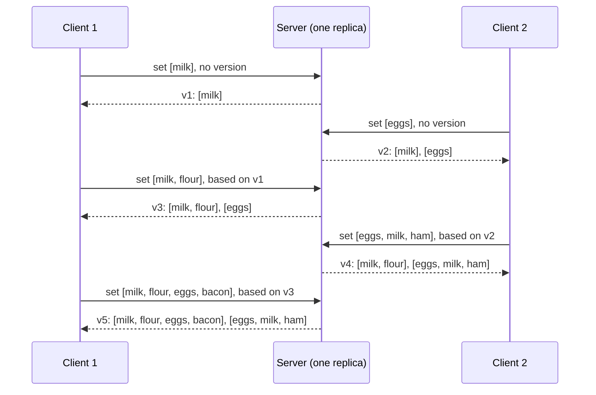

*Figure 5-14 (redrawn): the causal-dependency graph of those writes. An arrow means the later operation knew about (built on) the earlier one; edge labels show the cart value passed along, and the two arrows leaving on the right are the final siblings.*
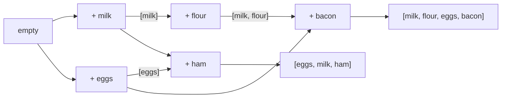

Clients are never fully current, yet old versions are overwritten and **no write is lost**. The server only compares version numbers, so values can be any data structure.

**The algorithm:**
1. The server keeps a **version number per key**, incremented on every write and stored with the value.
2. A **read** returns **all values not yet overwritten** plus the latest version. Every write **must be preceded by a read**.
3. A **write** includes the **version from the prior read** and must **merge** all values from that read. (Write responses can look like reads, allowing chained writes as above.)
4. On a write with version v, the server **overwrites all values with version ≤ v** (merged in) and **keeps higher versions** (concurrent).

A write **without a version** is concurrent with everything: it overwrites nothing and appears as another value on later reads.

#### Merging concurrently written values

No data is silently lost, but clients must **merge** the concurrent values, which **Riak calls siblings**. This is the multi-leader conflict problem again; LWW loses data, so application logic may be needed.

- **Cart:** take the **union**: `[milk, flour, eggs, bacon]` and `[eggs, milk, ham]` → `[milk, flour, eggs, bacon, ham]`, deduplicated (milk and eggs appear in both despite each being added once).
- **Removals break plain union:** an item removed in one sibling reappears (the Amazon cart problem). Fix: on removal leave a marker with a version number — a **tombstone** (as in hash-index log compaction, Chapter 3).

Manual merging is complex and error-prone; **Riak's datatype support** uses **CRDTs**, which merge siblings sensibly, **including preserving deletions**.

Tiny union-with-tombstones illustration (Python, our example); the naive rule lets a removal always beat a concurrent re-add, whereas real CRDTs use version information:

```python
a = {"pens": "added", "tape": "added"}
b = {"pens": "removed", "glue": "added"}   # "removed" acts as a tombstone
merged = {}
for k in a.keys() | b.keys():
    states = {a.get(k), b.get(k)} - {None}
    merged[k] = "removed" if "removed" in states else "added"
visible = sorted(k for k, s in merged.items() if s == "added")   # ['glue', 'tape']
```

#### Version vectors

With **multiple replicas and no leader**, one version per key is not enough: keep a **version number per replica per key**. Each replica increments its own counter on writes it processes and tracks counters seen from the others, which tells it what to overwrite and what to keep as siblings.

The collection is a **version vector**; the most interesting variant is the **dotted version vector** in **Riak 2.0**, working much like the cart example.
- Sent to clients on reads and **returned with the next write** (Riak encodes it as a string, the **causal context**).
- Distinguishes **overwrites from concurrent writes**; the application may still merge siblings.
- Makes it safe to **read from one replica and write to another**: siblings may appear, but nothing is lost if merged correctly.

> **Version vectors vs vector clocks.** Version vectors are sometimes called vector clocks, but they differ subtly; for comparing replica state, use version vectors.

## Summary

Replication serves four purposes:

| Purpose | Meaning |
|---|---|
| High availability | Keep running when a machine, several machines, or a whole datacenter fails |
| Disconnected operation | Keep working during a network interruption |
| Latency | Put data near users so interaction is faster |
| Scalability | Serve more reads than one machine could, by reading from replicas |

The simple goal is tricky: you must reason about concurrency and failures (unavailable nodes, network interruptions, even silent corruption from bugs).

| Approach | How writes flow | Pros | Cons |
|---|---|---|---|
| Single-leader | All writes to one leader, which streams changes to followers; reads anywhere (followers may be stale) | Easy to understand; no conflict resolution | Every write depends on reaching the one leader; failover is fraught |
| Multi-leader | Each write goes to one of several leaders; leaders stream changes to each other and to followers | More robust to faulty nodes, network problems, latency spikes | Conflicts; hard to reason about; weak consistency |
| Leaderless | Each write to several nodes; reads from several nodes in parallel to detect and fix stale data | Same robustness benefits; no failover | Very weak consistency guarantees; conflicts |

**Sync vs async** strongly affects fault behaviour: async is fast when healthy, but consider growing lag and failures — promoting an async follower can **lose recently committed data**.

**Consistency models for lag:** **read-after-write** (users see their own submissions), **monotonic reads** (no going back to an earlier state), **consistent prefix reads** (causally sensible order).

**Concurrency:** multi-leader and leaderless allow concurrent writes and hence conflicts; version numbers / version vectors decide whether one operation happened before another or they were concurrent, and conflicts are resolved by merging.

Next: **partitioning**.

## Interview angle

**1. Single-leader vs multi-leader vs leaderless?**
30-second answer: Single-leader routes every write through one node streaming an ordered log to followers — simple, no conflicts, but writes depend on that leader and failover is risky. Multi-leader lets several nodes (one per datacenter, or each offline device) accept writes and replicate asynchronously — better write latency and outage tolerance, but conflicts must be resolved. Leaderless (Dynamo-style: Riak, Cassandra, Voldemort) sends reads and writes to several replicas with quorums — no failover, very available, weak consistency.
- *Follow-up: why not multi-leader in one datacenter?* The complexity (conflicts, trouble with autoincrement keys, triggers, constraints) rarely pays off on a fast, reliable local network.
- *Follow-up: is DynamoDB leaderless?* No — AWS DynamoDB uses single-leader replication; Dynamo was Amazon's internal system.

**2. Synchronous vs asynchronous replication?**
30-second answer: Sync: the leader waits for a follower's ack, so that follower is current, but if it stalls all writes block. Async: no waiting — fast and available, but confirmed writes can be lost if the leader dies. In practice semi-synchronous (one sync follower) or fully async.
- *Follow-up: why not all followers sync?* Any node outage would halt writes, likelier with more nodes.

**3. What can go wrong in failover?**
30-second answer: With async replication the new leader may lack the old leader's last writes, usually discarded (durability violation). Discarded writes can clash with outside systems (GitHub reused MySQL autoincrement keys also used in Redis, leaking private data). Split brain can leave two leaders accepting writes. The timeout trades slow recovery against needless failovers that worsen overload.
- *Follow-up: split brain handling?* Fencing / STONITH shuts one down; badly designed, it can shut down both.

**4. Explain quorums (n, w, r).**
30-second answer: A value lives on n replicas; writes need w acks, reads ask r replicas. If w + r > n the sets overlap, so a read sees the latest write. Typical: n = 3 or 5, w = r = majority; n = 3, w = r = 2 tolerates one failure; n = 5, w = r = 3 tolerates two. Read repair and anti-entropy fix stale replicas.
- *Follow-up: does w + r > n guarantee fresh reads?* No: sloppy quorums, LWW on concurrent writes (clock skew), writes concurrent with reads, partially failed writes not rolled back, restores from stale replicas, timing edge cases. It is a probability knob.
- *Follow-up: sloppy quorum?* Writes go to reachable non-home nodes when home nodes are unreachable, later moved home by hinted handoff. Better write availability, no overlap guarantee. On by default in Riak, off in Cassandra and Voldemort.

**5. Replication-lag anomalies and fixes.**
30-second answer: Read-your-writes: read own editable data from the leader, or track last-write timestamp/LSN. Monotonic reads: pin each user to one replica via hash of user ID. Consistent prefix (mostly partitioned stores): keep causally related writes in one partition or track causality.
- *Follow-up: multiple devices?* Centralise last-write metadata; devices may hit different datacenters, so route all of a user's devices to one.

**6. How do you detect concurrent writes, and why not just LWW?**
30-second answer: Writes are concurrent if neither knew of the other. Servers track a version per key (per replica per key in a version vector); clients return the version they read; the server overwrites values at or below it and keeps higher ones as siblings to merge. LWW converges but silently drops all but one concurrent write — safe only for write-once keys (e.g. UUID keys in Cassandra).
- *Follow-up: deletions when merging?* Tombstones, or CRDTs (Riak) that merge automatically and preserve deletions.

## Self-check

1. **Name the four ways a leader's changes can be shipped to followers and one weakness of each.**
   Statement-based (nondeterminism, ordering, side effects); WAL shipping (coupled to storage format; upgrades may need downtime); logical/row-based (book names no specific drawback; it is the version-tolerant option decoupled from the engine); trigger-based (overhead, bug-prone).

2. **Why is copying the leader's data files not enough to set up a new follower, and what is done instead?**
   Ongoing writes make a file copy inconsistent. Take a consistent snapshot tied to a log position (LSN / binlog coordinates), copy it, then apply all later changes until caught up.

3. **Scenario: users complain that after posting a comment and reloading, it sometimes disappears. Which guarantee is missing and give two fixes.**
   Read-after-write. Read the user's own content from the leader (or for a minute after their last write), or have the client remember its last write timestamp/LSN and read only from replicas that have reached it.

4. **With n = 5, what w and r would you choose to tolerate two failed nodes while keeping the quorum condition?**
   w = 3, r = 3 (3 + 3 > 5).

5. **Trade-off: what do you gain and lose by setting w = n and r = 1?**
   Very fast reads, but any single node failure makes all writes fail.

6. **Why can timestamps not correctly order the insert and update arriving at leader 2 in Figure 5-9? What does work?**
   Clocks aren't reliably synchronised, so timestamps may misorder causally related events. Version vectors capture the dependency.

7. **What is the difference between read repair and anti-entropy, and which system lacks anti-entropy?**
   Read repair fixes stale replicas noticed during reads (good for hot data); anti-entropy is a background process copying missing data in no particular order. Voldemort lacks anti-entropy, so rarely read values can be less durable.

8. **In the version-number algorithm, what does the server do when it receives a write carrying version 3 while it holds values at versions 3 and 4?**
   Overwrites values with version ≤ 3 and keeps the version 4 value as a concurrent sibling.

9. **Why does conflict avoidance stop working sometimes?**
   It relies on a fixed home leader per record; a datacenter failure or a user moving changes the leader, allowing concurrent writes on different leaders.

10. **Scenario: an offline-first notes app syncs across phone and laptop. Which replication style is it, and what must you plan for?**
    Multi-leader (each device a leader). Plan for very long lag (hours or days) and conflict resolution, e.g. CRDTs or on-read resolution as in CouchDB.
