# Chapter 5 — Replication
*Book: Chapter 5, pp. 151–198 (plus the Part II introduction that precedes it)*

## Overview

### First, the Part II introduction: why spread data over many machines?

Part I of the book looked at data that lives on one computer. Part II asks what changes once **several machines** take part in storing and serving the data. The book gives three motivations:

| Reason | What it buys you |
|---|---|
| **Scalability** | When the amount of data, or the number of reads or writes, outgrows one machine, the work can be shared among several. |
| **Fault tolerance / high availability** (staying usable despite failures) | If one machine (or several, or the network, or a whole datacenter, i.e. a building full of servers) dies, a redundant machine can take over so the application keeps working. |
| **Latency** | With servers on several continents, each user talks to a nearby datacenter instead of waiting for packets (the small chunks data is split into on a network) to cross the planet. |

#### Scaling to Higher Load

There are three broad hardware architectures for handling more load:

| Architecture | How it works | Strengths | Weaknesses |
|---|---|---|---|
| **Shared-memory** (vertical scaling, "scaling up") | Buy one bigger machine: many CPUs (processors), RAM chips (working memory) and disks joined under one operating system; a fast interconnect (internal high-speed link) lets any CPU reach any memory or disk. It behaves like one computer. | Simple to program: it is still "one machine". | Cost rises faster than linearly (a machine twice as big costs much more than twice as much), and bottlenecks (the slowest part that limits the whole) mean twice the hardware does not give twice the throughput (work completed per second). Some fault tolerance through hot-swappable parts (disks, memory, even CPUs replaced while running), but it sits in a single location. |
| **Shared-disk** | Several machines, each with its own CPUs and RAM, all reading and writing one shared array of disks over a fast network (NAS = Network Attached Storage, or SAN = Storage Area Network). | Used for some data-warehouse workloads. | Contention (many machines competing for the same disks) and the cost of locking (coordinating so two machines do not change the same data at once) limit how far it scales. |
| **Shared-nothing** (horizontal scaling, "scaling out") | Every machine (or VM, a virtual machine: a software-simulated computer rented from a cloud provider) that runs the database software is called a **node**, and it relies solely on its own CPUs, RAM and disks. Nodes coordinate purely in software over an ordinary network. | No special hardware, so you pick whatever gives the best price/performance. Data can be spread across regions (geographic areas such as US-East or Europe, each with its own datacenters), cutting latency (the delay before a response arrives) and even surviving the loss of a whole datacenter. With cloud VMs, even small companies can run multi-region setups. | More complexity for the application; can restrict which data models you can use. |

> **NUMA aside.** Even inside one big shared-memory machine, some memory banks are physically nearer to certain CPUs (nonuniform memory access, NUMA). To use such a machine well you must split the work so each CPU mostly touches nearby memory, so a form of partitioning is needed even on "one machine".

The rest of Part II concentrates on **shared-nothing** systems. Not because they are always best, but because they are the ones where the application developer has to be most careful: the database cannot hide all the constraints of distribution from you. The book also warns that a simple single-threaded program (one doing one thing at a time) can sometimes beat a cluster (a group of networked machines) of more than 100 CPU cores (independent processing units), so distribution is not free performance.

#### Replication Versus Partitioning

There are two standard ways to lay data out across nodes:

- **Replication**: the *same* data is copied onto several nodes, possibly in different places. This gives redundancy (spare copies; if some nodes are down, others still serve the data) and can also improve performance. This is Chapter 5.
- **Partitioning** (also called **sharding**): a large database is cut into smaller pieces, called **partitions**, and different partitions go on different nodes. This is Chapter 6.

The two are independent mechanisms but are usually combined.

*Figure II-1 (redrawn): a database split into two partitions, each partition kept as two replicas holding the same records (the book shows records keyed 136, 211, 377 in partition 1 and 629, 696, 858 in partition 2).*
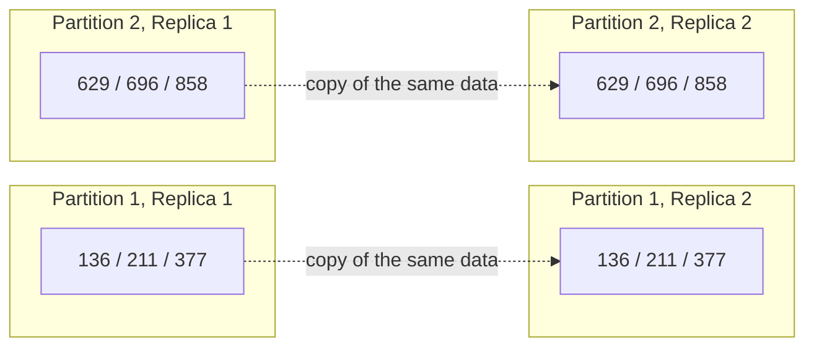

After these two chapters, Chapter 7 covers transactions, and Chapters 8 and 9 cover the fundamental limits of distributed systems. Part III then shows how to combine several data stores into a larger system.

### What this chapter answers

**Replication** means keeping copies of the same data on several networked machines. The chapter asks: *when data keeps changing, how do we keep all those copies in step, and what goes wrong when they are not?*

Reasons to replicate:
1. Keep data physically near users (lower **latency**).
2. Keep working when some parts fail (higher **availability**: the fraction of time the system is usable).
3. Let more machines answer read queries (higher **read throughput**: more reads served per second).

See also [System Design Fundamentals](../00a-system-design-fundamentals/README.md) for a primer on latency, availability, replication and sharding.

For this chapter we assume every machine can hold the entire dataset (Chapter 6 lifts that assumption). If data never changed, replication would be trivial: copy it once. All the hard parts come from **changes**. The chapter covers the three algorithms that almost every distributed database uses:

1. **Single-leader** replication
2. **Multi-leader** replication
3. **Leaderless** replication

It also covers synchronous vs asynchronous replication, handling failed replicas, and the confusing idea of **eventual consistency**. The theory dates back to the 1970s because the basic limits of networks have not changed; what is newer is that ordinary developers now use distributed databases, which has caused a lot of misunderstanding.

**Everyday analogy.** A company keeps its price list in several branch offices. One head office edits the list and mails updates (single leader). Or every branch may edit and they post changes to each other (multi-leader). Or a customer phones three branches at once and trusts the answer that most branches give (leaderless). Each scheme fails in different, instructive ways.

## Key terms

| Term | Plain-English meaning |
|---|---|
| Replica | Any node holding its own full copy of the data. |
| Leader (master, primary) | The one replica that accepts writes and sends them to the others. |
| Follower (read replica, slave, secondary, hot standby) | A replica that copies changes from the leader and only serves reads. |
| Leader-based replication (active/passive, master–slave) | The scheme where all writes go to one leader and followers copy them. |
| Replication log / change stream | The ordered list of data changes the leader sends to followers. |
| Synchronous replication | The leader waits for a follower to confirm a write before reporting success. |
| Asynchronous replication | The leader reports success without waiting for followers. |
| Semi-synchronous | One follower is synchronous, the rest asynchronous. |
| Chain replication | A synchronous-replication variant used in, e.g., Microsoft Azure Storage. |
| Snapshot | A consistent copy of the whole database as of one moment. |
| Log sequence number / binlog coordinates | PostgreSQL's / MySQL's name for a precise position in the replication log. |
| Caught up | A follower has applied all changes up to the leader's current position. |
| Catch-up recovery | A restarted follower asking the leader for changes it missed. |
| Failover | Promoting a follower to be the new leader when the old leader dies. |
| Controller node | A previously elected node that can appoint a new leader. |
| Split brain | Two nodes both believing they are leader. |
| Fencing / STONITH | Forcibly shutting down one node when two leaders are detected ("Shoot The Other Node In The Head"). |
| Statement-based replication | Sending the SQL statements themselves to followers. |
| Nondeterministic function | A function like `NOW()` or `RAND()` that may give a different result each time. |
| Write-ahead log (WAL) shipping | Sending the storage engine's low-level append-only log to followers. |
| Logical (row-based) log | A replication log describing row-level changes, independent of storage format. |
| Change data capture | Streaming a database's changes to outside systems (Chapter 11). |
| Trigger | Custom code the database runs automatically when data changes. |
| Trigger-based replication | Using triggers to record changes that an external process then replicates. |
| Read-scaling architecture | Many followers added to share read traffic. |
| Replication lag | Delay between a write on the leader and its appearance on a follower. |
| Eventual consistency | If writes stop, replicas will *eventually* agree; no bound on how long. |
| Read-after-write (read-your-writes) consistency | A user always sees their own submitted updates. |
| Cross-device read-after-write | The same guarantee across a user's different devices. |
| Monotonic reads | A user never sees data go "back in time" across successive reads. |
| Consistent prefix reads | Writes that happened in some order are seen in that same order. |
| Multi-leader (master–master, active/active) | More than one node accepts writes; each leader is also a follower of the others. |
| Write conflict | Two leaders accept different changes to the same data concurrently. |
| Conflict avoidance | Routing all writes for a record through one leader so conflicts cannot happen. |
| Convergent conflict resolution | All replicas end up with the same final value. |
| Last write wins (LWW) | Keep the write with the highest timestamp, discard the rest. |
| CRDT | Conflict-free replicated datatype; a data structure that merges concurrent edits automatically. |
| Mergeable persistent data structure | Tracks history like Git and uses three-way merges. |
| Operational transformation | Conflict resolution algorithm used in Google Docs and Etherpad. |
| Replication topology | The paths along which writes travel between leaders (circular, star, all-to-all). |
| Leaderless (Dynamo-style) replication | Any replica accepts writes; client or coordinator sends to many replicas. |
| Coordinator node | A node that forwards a client's request to replicas, without imposing an order. |
| Read repair | A client that sees a stale replica during a read writes the newer value back to it. |
| Anti-entropy | A background process that finds and fixes differences between replicas. |
| Quorum (n, w, r) | n replicas; a write needs w acks, a read queries r nodes; w + r > n gives overlap. |
| Strict quorum | A quorum using only a value's designated n nodes. |
| Sloppy quorum | During failures, writes may land on nodes outside the designated n. |
| Hinted handoff | Returning those temporarily held writes to their proper "home" nodes. |
| Concurrent operations | Two operations where neither knows about the other. |
| Happens-before | A happens before B if B knows about, depends on, or builds on A. |
| Causally dependent | B depends on A (so A must be applied first). |
| Siblings | Riak's name for concurrent values that are kept side by side. |
| Tombstone | A marker left in place of a deleted item so the deletion survives merges. |
| Version vector | One version counter per replica, used to tell overwrites from concurrent writes. |
| Dotted version vector | A version-vector variant used in Riak 2.0. |
| Causal context | Riak's string encoding of a version vector. |

## Leaders and Followers

Every write must reach every replica, otherwise the copies drift apart. The most common approach is **leader-based replication**:

1. One replica is chosen as **leader**. Clients must send all writes to it; it first writes the change to its own storage.
2. The other replicas are **followers**. Whenever the leader stores a change, it also sends it to every follower through a **replication log**. Each follower applies the changes **in the same order** the leader processed them.
3. Clients may read from the leader or any follower, but only the leader accepts writes; followers look read-only to clients.

> **"Hot" vs "warm" standby.** People define these differently. In PostgreSQL a hot standby serves client reads, while a warm standby applies the leader's changes but answers no queries. The book treats the difference as unimportant.

*Figure 5-1 (redrawn): leader-based replication. User 1234 changes their profile picture by writing to the leader; the leader streams the row change to both followers; user 2345 reads user 1234's profile from a follower.*
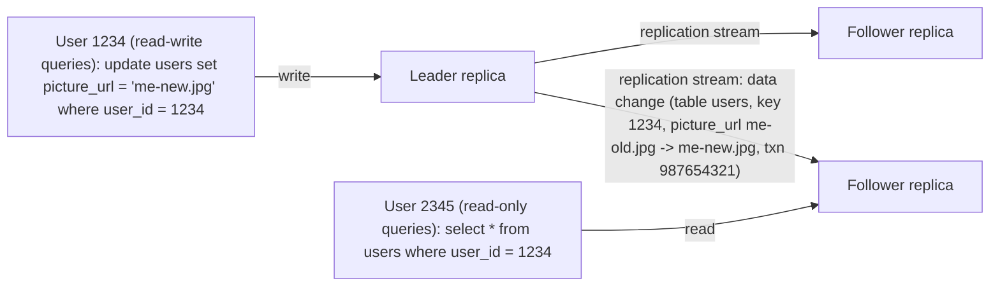

Who uses it:
- Relational: PostgreSQL (since 9.0), MySQL, Oracle Data Guard, SQL Server AlwaysOn Availability Groups.
- Non-relational: MongoDB, RethinkDB, Espresso.
- Beyond databases: message brokers (services that pass messages between programs) Kafka and RabbitMQ highly available queues. DRBD (a replicated block device, i.e. a replicated virtual disk) and some network filesystems follow a similar pattern.

### Synchronous Versus Asynchronous Replication

**What it is.** When the leader forwards a change, does it wait for the follower's confirmation before telling the client "done"? If yes, that follower is **synchronous**; if no, it is **asynchronous**. Relational databases often let you configure this; other systems hard-code (fix in the code, with no setting) one choice.

Example: a user changes their profile picture. The client sends the update to the leader; the leader forwards it to followers; at some point the leader tells the client it succeeded.

*Figure 5-2 (redrawn): follower 1 is synchronous (leader waits for its ok before answering the user), follower 2 is asynchronous (leader answers without waiting; follower 2 applies the change and acknowledges much later).*
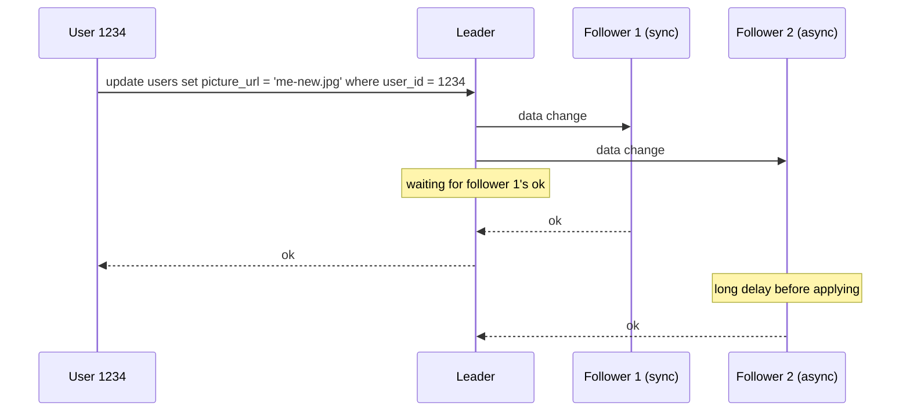

Normally followers apply changes within a second, but **there is no upper bound**. A follower can be minutes behind if it is recovering from a crash, the system is near maximum capacity, or the network is misbehaving.

| | Synchronous follower | Asynchronous follower |
|---|---|---|
| Up-to-date copy guaranteed? | Yes: if the leader dies, the data is safe on this follower | No: unreplicated writes can be lost |
| Effect if the follower is down/slow | Leader must **block all writes** until it returns | Leader carries on regardless |

Because one stuck synchronous node would halt everything, making *all* followers synchronous is impractical. The usual compromise is **semi-synchronous**: exactly one follower is synchronous and the rest asynchronous; if the synchronous one becomes slow or unavailable, one of the asynchronous followers is switched to synchronous mode. This guarantees the data is current on at least two nodes (leader plus one follower).

Very often, leader-based replication is **fully asynchronous**. Then a write the client was told succeeded can still vanish if the leader fails for good before sending it on, meaning durability (the promise that confirmed data is never lost) is **not guaranteed**. The upside: the leader keeps accepting writes even if every follower lags. This weaker durability is still widely accepted, especially with many followers or followers spread across regions.

> **Research on replication.** Losing data when an async leader fails is serious, so researchers keep looking for methods that avoid loss yet stay fast and available. **Chain replication**, a synchronous variant, has been deployed successfully in a handful of systems, Microsoft Azure Storage being one. Replication consistency is closely tied to **consensus** (getting nodes to agree on a value), covered in Chapter 9.

### Setting Up New Followers

You add followers to get more replicas or to replace dead ones. Just copying the data files does not work: writes keep arriving, so a plain file copy would capture different parts of the database at different moments, which could be nonsense. Locking the database (blocking all writes) during the copy would work but kills availability. Instead, the usual no-downtime procedure is:

1. **Snapshot** the leader's database consistently at one point in time, ideally without locking the whole database. Most databases can do this because backups need it; sometimes a third-party (from another vendor) tool is needed (e.g. *innobackupex* for MySQL, part of Percona XtraBackup).
2. **Transfer** that snapshot onto the new follower's machine.
3. The new follower **asks the leader for every change made after the snapshot**. This only works if the snapshot is tied to an exact position in the replication log: PostgreSQL calls this the **log sequence number**, MySQL the **binlog coordinates**.
4. Once the follower has worked through that backlog it has **caught up**, and from then on it just follows the live stream of changes.

How automated this is depends heavily on the database: some do it all for you, others need an admin to run an obscure multi-step procedure.

### Handling Node Outages

Nodes go down from faults and, just as often, planned maintenance (for example rebooting to apply a kernel security patch, a fix to the core of the operating system). Being able to restart individual nodes without downtime is a big operational win. The goal: keep the whole system running and minimise the impact of any single node being down.

#### Follower failure: Catch-up recovery

Each follower keeps on its local disk a log of changes received from the leader. After a crash/restart, or a temporary network break, the follower:
1. Looks in its log for the last transaction (a group of writes applied as one unit; Chapter 7) it processed.
2. Asks the leader for all changes after that point.
3. Applies them, is caught up, and resumes receiving the stream.

#### Leader failure: Failover

Harder. **Failover** means: promote a follower to leader, point clients' writes at it, and have the other followers consume from it. It can be manual (an admin is alerted and acts) or automatic. Automatic failover usually goes:

1. **Decide that the leader has failed.** Crashes, power cuts, network trouble... there is no foolproof detector, so systems use a **timeout** (a fixed waiting limit after which you give up): nodes exchange messages constantly, and a node silent for, say, **30 seconds** is presumed dead. (Planned maintenance is different; you know the leader is going down.)
2. **Pick a new leader**, either by an **election** (a majority of remaining replicas choose) or by a previously elected **controller node** appointing one. The best choice is usually whichever replica holds the freshest copy of the old leader's changes, to lose as little as possible. Getting all nodes to agree is a **consensus** problem (Chapter 9).
3. **Reconfigure the system** so clients send writes to the new leader (see "Request Routing" in Chapter 6). If the old leader returns and still thinks it is leader, the system must force it to become a follower.

What can go wrong:

- **Lost writes.** With async replication, the new leader may be missing some of the old leader's last writes. If the old leader rejoins, what to do with them? The new leader may have accepted conflicting writes meanwhile. The usual answer is to **throw the old leader's unreplicated writes away**, which can break the durability promise made to clients.
- **Danger with outside systems.** Discarding writes is worse when other storage depends on the database. In an incident at **GitHub**, a stale MySQL follower became leader. Primary keys (the unique ID of each row) came from an autoincrementing counter (the database hands out 1, 2, 3, ... to new rows), and the new leader's counter was behind, so it **reused primary keys** the old leader had already handed out. Those keys were also used in **Redis** (an in-memory key-value store, here used as a cache), so MySQL and Redis disagreed and some private data was shown to the wrong users.
- **Split brain.** In some faults (Chapter 8) two nodes both believe they are leader. If both accept writes with no conflict-resolution process, data can be lost or corrupted. Some systems shut one down when two leaders are detected (**fencing**, or **STONITH**), but a poorly designed version can end up shutting down *both* (the book cites a GitHub outage postmortem, i.e. a published write-up of what went wrong, for this).
- **Choosing the timeout.** Long timeout: slow recovery after a real failure. Short timeout: needless failovers, e.g. a load spike (a sudden burst of traffic) pushes response time past the limit, or a network glitch delays packets. A needless failover on a system already struggling with load or network trouble usually makes things **worse**.

There are no easy fixes, which is why some operations teams do failover **manually** even when the software could automate it. Node crashes, flaky networks, and the tension between replica consistency, durability, availability and latency are fundamental distributed-systems problems, revisited in Chapters 8 and 9.

### Implementation of Replication Logs

What exactly does the leader send? Four methods are used in practice.

#### Statement-based replication

**How it works.** The leader records every write statement it executes (every `INSERT`, `UPDATE`, `DELETE`) and sends that log to followers, which parse and run each statement as though a client had sent it.

Here is an illustrative statement log (my own example):

```sql
-- statement 1: fine to replay anywhere
INSERT INTO orders (customer, item) VALUES ('ana', 'lamp');
-- statement 2: NOW() gives a different time on each replica when replayed
UPDATE orders SET shipped_at = NOW() WHERE customer = 'ana';
-- statement 3: result depends on current data and on execution order
DELETE FROM orders WHERE shipped_at < '2024-01-01';
```
- Line 1 is deterministic (same inputs always give the same result), so replaying it gives the same row everywhere (except that an autoincrement ID depends on ordering).
- Line 2 calls `NOW()`, a nondeterministic function, so each follower would store a different timestamp.
- Line 3 depends on existing data; if replicas run statements in different orders, they delete different rows.

**Where it breaks:**
- Nondeterministic functions such as `NOW()` or `RAND()` produce different values per replica.
- Statements using an autoincrement column, or that depend on existing data (`UPDATE ... WHERE <condition>`), must run in **exactly** the same order on every replica, which is restrictive when many transactions run concurrently.
- Side effects (triggers; stored procedures, i.e. programs stored and run inside the database; user-defined functions) may differ per replica unless fully deterministic.

**Workarounds** exist, e.g. the leader replaces `NOW()` with a fixed value when logging, but there are so many edge cases that other methods are now preferred.

**Who uses it:** MySQL used it before version 5.1. Because it is compact it still appears today, but MySQL now switches to row-based replication by default whenever a statement is nondeterministic. **VoltDB** uses statement-based replication safely by requiring transactions to be deterministic.

#### Write-ahead log (WAL) shipping

Recall from Chapter 3 that storage engines append every write to a log:
- In a **log-structured** engine (SSTables/LSM-trees), the log *is* the main storage; background jobs compact old segments and garbage-collect them (delete them once nothing needs them).
- In a **B-tree**, each modification goes to a **write-ahead log** before touching the tree, so a crash can be recovered from.

Either way, there is an append-only byte log of all writes. The leader can simply send that same log over the network; a follower replaying it builds identical data structures. **Used by PostgreSQL and Oracle**, among others.

**Downside:** the WAL is very low level (which bytes changed in which disk blocks), so replication is **tightly coupled** (dependent in detail) **to the storage engine** (the database layer that lays data out on disk). If the on-disk format changes between versions, leader and followers usually cannot run different versions. That matters operationally: if followers *could* run a newer version, you could do a **zero-downtime upgrade** (upgrade followers first, then fail over to an upgraded one). With WAL shipping that version mismatch is often not allowed, so upgrades need downtime.

#### Logical (row-based) log replication

Use a **different log format for replication** than for storage, decoupling replication from engine internals. This is a **logical log** (as opposed to the engine's physical representation). For a relational database it is a sequence of row-level records:
- **Insert:** new values of all columns.
- **Delete:** enough to identify the row uniquely, normally the primary key; if the table has none, the old values of all columns.
- **Update:** enough to identify the row, plus the new column values (all of them, or at minimum those that changed).

A transaction touching several rows produces several records followed by a commit record (a marker saying the transaction is complete and its changes are final). **MySQL's binlog** in row-based mode works like this.

A sketch of what such records might look like (illustrative JSON, my own data):

```json
{"op": "insert", "table": "books", "row": {"id": 7, "title": "Dune", "stock": 3}}
{"op": "update", "table": "books", "key": {"id": 7}, "changed": {"stock": 2}}
{"op": "delete", "table": "books", "key": {"id": 4}}
{"op": "commit", "txid": 912}
```
- Line 1: an insert carries every column value.
- Line 2: an update names the row by primary key and gives the changed column.
- Line 3: a delete only needs the key.
- Line 4: marks the end of the transaction that produced the previous records.

**Benefits:**
- Easier to keep **backward compatible**, so leader and followers can run different software versions or even different storage engines.
- Easier for **external applications** to parse, e.g. to feed a data warehouse (a separate database for analytics) or build custom indexes and caches. This is **change data capture** (Chapter 11).

#### Trigger-based replication

The previous methods live entirely inside the database. Sometimes you need more flexibility: replicate only a subset of data, replicate between different kinds of database, or apply custom **conflict resolution** (deciding what to keep when two copies were changed differently). Then replication moves up into the application layer.

Options:
- Tools like **Oracle GoldenGate** read the database log and expose changes to an application.
- Or use **triggers** and **stored procedures**. A trigger is custom code the database runs automatically on each write. It can log the change into a separate table; an external process reads that table, applies any application logic, and replicates the change elsewhere. **Databus for Oracle** and **Bucardo for Postgres** work this way.

A minimal illustration (PostgreSQL-style SQL, my own names):

```sql
CREATE TABLE change_queue (tbl text, row_id int, changed_at timestamptz);

CREATE FUNCTION log_change() RETURNS trigger AS $$
BEGIN
  INSERT INTO change_queue VALUES (TG_TABLE_NAME, NEW.id, now());
  RETURN NEW;
END $$ LANGUAGE plpgsql;

CREATE TRIGGER books_changes AFTER INSERT OR UPDATE ON books
  FOR EACH ROW EXECUTE FUNCTION log_change();
```
- The first statement creates a side table that will collect changes.
- The function inserts one record per changed row (table name, row id, time).
- The trigger runs that function after every insert/update on `books`; an outside process would poll `change_queue` and ship the rows elsewhere.

**Trade-off:** more overhead and more prone to bugs and limitations than built-in replication, but valued for its flexibility.

| Method | What is sent | Pros | Cons | Examples |
|---|---|---|---|---|
| Statement-based | SQL statements | Compact | Nondeterminism, ordering, side effects | MySQL < 5.1, VoltDB |
| WAL shipping | Low-level disk-block changes | Exact copy, no extra log | Tied to storage format; version upgrades need downtime | PostgreSQL, Oracle |
| Logical (row-based) | Row-level changes | Version-independent; good for CDC | Book names no specific drawback; it is simply a second log format separate from storage | MySQL binlog (row mode) |
| Trigger-based | Whatever app code records | Very flexible | Overhead, bugs | Databus, Bucardo |

## Problems with Replication Lag

Replication is not only for surviving failures; it also helps **scalability** (more requests than one machine can take) and **latency** (replicas near users).

With a single leader, writes go through one node but reads can go anywhere. For read-heavy workloads (far more reads than writes, common on the web), you can create many followers and spread reads across them: a **read-scaling architecture**. Add followers to add read capacity. This really only works with **asynchronous** replication: synchronous replication to every follower would make any single node failure or network glitch stop all writes, and more nodes means more chances one is down.

But reading from an async follower can return **outdated data**. Run the same query on leader and follower at the same moment and you may get different answers. This is temporary: stop writing, wait, and followers catch up. Hence the name **eventual consistency**.

> **Origin of the term.** Douglas Terry et al. coined the phrase "eventual consistency"; it was popularised by Werner Vogels, and became a rallying cry for NoSQL projects. But async-replicated *relational* databases behave exactly the same way.

"Eventually" is intentionally vague: there is no limit on how far a replica may fall behind. Normally the **replication lag** is a fraction of a second, but near capacity or with network trouble it can grow to seconds or minutes, and then the anomalies become real application bugs. Three such anomalies follow.

### Reading Your Own Writes

**Problem.** A user submits something (a customer record, a comment) and then views it. The write goes to the leader, but the view may be served from a follower. If the follower has not received the write yet, the user thinks their data vanished.

*Figure 5-3 (redrawn): user 1234 posts a comment via the leader, then immediately reads from follower 2, which has not received the insert yet, and gets no results.*
```mermaid
sequenceDiagram
  participant U as User 1234
  participant L as Leader
  participant F1 as Follower 1
  participant F2 as Follower 2
  U->>L: insert into comments (author, reply_to, message) values (1234, 55555, 'Sounds good!')
  L-->>U: insert ok
  L->>F1: insert into comments... (arrives quickly)
  L-)F2: insert into comments... (still in flight)
  U->>F2: select * from comments where reply_to = 55555
  F2-->>U: no results!
  Note over F2: the insert arrives only after the read
```

**Guarantee needed: read-after-write consistency** (also called **read-your-writes**). If the user reloads, they always see updates *they* made. It says nothing about other users' updates.

**Techniques with a leader-based system:**
1. **Read possibly-modified data from the leader**, everything else from followers. You need a way to know what might have changed without querying. Example: on a social network only the owner edits their profile, so always read *your own* profile from the leader and other people's from followers.
2. If most things are user-editable, rule 1 sends almost everything to the leader and defeats read scaling. Use other criteria: e.g. for **one minute after the user's last update**, read from the leader; or monitor lag and avoid any follower more than one minute behind.
3. **Client remembers the timestamp of its latest write**; the system ensures the replica serving that user reflects at least that timestamp. If not, use another replica or wait until it catches up. The timestamp can be **logical** (e.g. the log sequence number) or the **system clock** (then clock synchronisation becomes critical; see Chapter 8).
4. With replicas in **several datacenters**, any request that must hit the leader has to be routed to the leader's datacenter.

**Cross-device read-after-write.** A user enters data on their laptop and checks on their phone. Extra issues:
- Timestamp-remembering approaches get harder: one device does not know what the other wrote, so this metadata must be **centralised**.
- Different devices may reach **different datacenters** (home broadband vs mobile network take different routes). If your technique relies on leader reads, you may first have to send every device belonging to that user to one common datacenter.

### Monotonic Reads

**Problem:** time appears to go backwards. A user queries twice; the first hits a fresh follower, the second a stale one (likely if each page refresh goes to a random server).

*Figure 5-4 (redrawn): user 2345 first sees user 1234's new comment on a fresh follower, then refreshes, hits a stale follower and the comment is gone.*
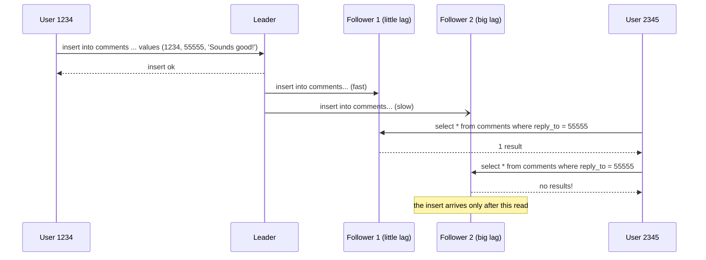

Had the first read also returned nothing, the user would not notice; seeing the comment appear and then disappear is what confuses.

**Guarantee: monotonic reads.** Weaker than strong consistency, stronger than eventual consistency. You might still read old data, but successive reads by one user never go to an *older* state after seeing a newer one.

**How:** make each user always read from the **same replica** (different users can use different replicas), e.g. choose the replica by **hashing the user ID** (feeding it through a function that turns it into a stable number, then using that number to pick a replica) rather than at random. If that replica fails, the user must be rerouted.

### Consistent Prefix Reads

**Problem:** causality (the cause-and-effect order of events) violated. The book uses a dialogue between Mr. Poons (asks how far ahead Mrs. Cake can see) and Mrs. Cake (answers about ten seconds). The answer depends on the question. If an observer reads the answer via a fast replica and the question via a slow one, they see the reply **before** the question, as though Mrs. Cake were psychic.

*Figure 5-5 (redrawn): Mr. Poons's question goes to partition 1, whose follower lags a lot; Mrs. Cake's answer goes to partition 2, whose follower lags little. Each speaker hears the other via the leaders, but the observer, reading from the followers, receives the answer first.*
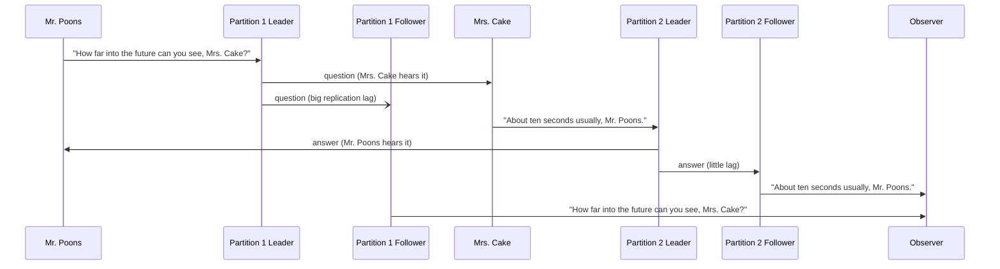

**Guarantee: consistent prefix reads.** If writes happen in a certain order, anyone reading them sees them in that order.

This is mostly a problem in **partitioned (sharded)** databases (Chapter 6). If a database applied all writes in one global order, reads would always see a consistent prefix. But partitions usually run independently with **no global order**, so a reader can see some parts old and some new.

**Fixes:** put causally related writes in the **same partition** (not always efficient), or use algorithms that **track causal dependencies** explicitly (see "The happens-before relationship" below).

### Solutions for Replication Lag

- Ask: *what if lag grew to minutes or hours?* If that is fine, great. If users would suffer, design for something stronger, for instance read-after-write. **Treating async replication as if it were synchronous is a recipe for future trouble.**
- Applications can offer stronger guarantees than the database (e.g. reading certain things from the leader), but handling it in the application is complicated and easy to get wrong.
- It would be better for the database to "do the right thing". That is the role of **transactions**: stronger guarantees from the database so applications stay simpler.
- Single-node transactions are old. Many distributed (replicated/partitioned) systems dropped them, saying they cost too much performance and availability and that eventual consistency is unavoidable at scale. The book calls this partly true but **too simplistic**; it develops a more nuanced view in Chapters 7 and 9 and Part III.

| Anomaly | What the user sees | Guarantee | Typical fix |
|---|---|---|---|
| Own write missing | "My post disappeared" | Read-after-write | Read own data from leader; track last-write timestamp |
| Time goes backwards | Item appears, then vanishes | Monotonic reads | Pin each user to one replica (hash of user ID) |
| Effect before cause | Answer before question | Consistent prefix reads | Causally related writes in same partition; causal tracking |

## Multi-Leader Replication

Single-leader's big weakness: **all writes go through one leader**. If you cannot reach it (e.g. a network break between you and it), you cannot write.

> **Partitioned note.** In a partitioned database each partition has its own single leader; different partitions' leaders may live on different nodes, but each partition still has exactly one.

The natural extension: let **several nodes accept writes**. Each node that handles a write forwards it to all others. This is **multi-leader** (master–master, active/active) replication; each leader is simultaneously a follower of the other leaders.

### Use Cases for Multi-Leader Replication

Inside a single datacenter the extra complexity is rarely worth it. It does make sense in these cases:

#### Multi-datacenter operation

Replicas in several datacenters (to survive losing one, or to be near users). With a single leader, it sits in one datacenter and all writes must travel there. With multi-leader, **every datacenter gets its own leader**: normal leader–follower replication inside each datacenter, and leader-to-leader replication between them.

*Figure 5-6 (redrawn): each datacenter has its own leader, which serves the local users' read-write queries and sends changes to a local follower; the two leaders replicate to each other, each passing incoming changes through a conflict-resolution step.*
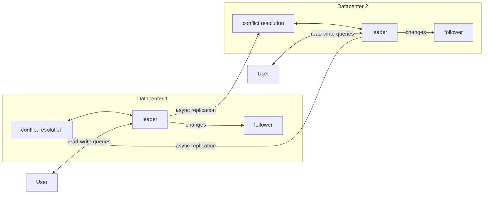

| Aspect | Single-leader across datacenters | Multi-leader |
|---|---|---|
| **Performance** | Every write crosses the internet to the leader's datacenter, adding latency and undermining the point of multiple sites | Writes handled locally, replicated asynchronously; the inter-datacenter delay is hidden from users |
| **Datacenter outage** | Failover promotes a follower in another datacenter | Each datacenter keeps running on its own; replication catches up when the failed one returns |
| **Network problems** | Very sensitive to the inter-datacenter link (public internet, less reliable than a local network), since writes go over it synchronously | Async replication tolerates temporary interruptions; writes continue |

Tools: some databases support it by default; often it is bolted on via external tools such as **Tungsten Replicator** (MySQL), **BDR** (PostgreSQL), **GoldenGate** (Oracle).

**Big downside:** the same data can be changed concurrently in two datacenters, producing **write conflicts** that need resolving. Also, because multi-leader is often retrofitted, it interacts badly with features such as **autoincrementing keys, triggers, and integrity constraints** (rules the database enforces, such as "no two rows share this value"). It is often regarded as dangerous territory to avoid if possible.

#### Clients with offline operation

Think of **stateful, offline-capable clients**: an app that must work without internet, e.g. a **calendar** on your phone, laptop and other devices. You must be able to read and add meetings anytime; changes made offline sync when you reconnect.

Here **each device has a local database acting as a leader**, and there is async multi-leader replication (sync) between devices. Lag can be **hours or days**. Architecturally it is the multi-datacenter case pushed to an extreme: treat each device as a "datacenter" joined to the others by a very unreliable link. The long history of broken calendar sync shows how hard this is. **CouchDB** was built with exactly this style of use in mind.

#### Collaborative editing

Real-time collaborative editors like **Etherpad** and **Google Docs** let several people edit at once. Each user's edits apply instantly to their local replica (the document state in their browser or app) and replicate asynchronously to the server and other editors, much like the offline case.

- To **guarantee no conflicts**, lock the document so only one user edits at a time; others wait until the lock is released. That model behaves like **single-leader replication where transactions run on the leader**.
- For faster collaboration you make the unit of change tiny (e.g. **one keystroke**) and avoid locking, which brings all the multi-leader challenges, including conflict resolution.

### Handling Write Conflicts

Conflicts are the central headache of multi-leader replication.

*Figure 5-7 (redrawn): page id=123 starts with title A. User 1 changes it to B on leader 1 while user 2 changes it to C on leader 2; both get "ok", and each leader only finds the conflict when the other's change arrives.*
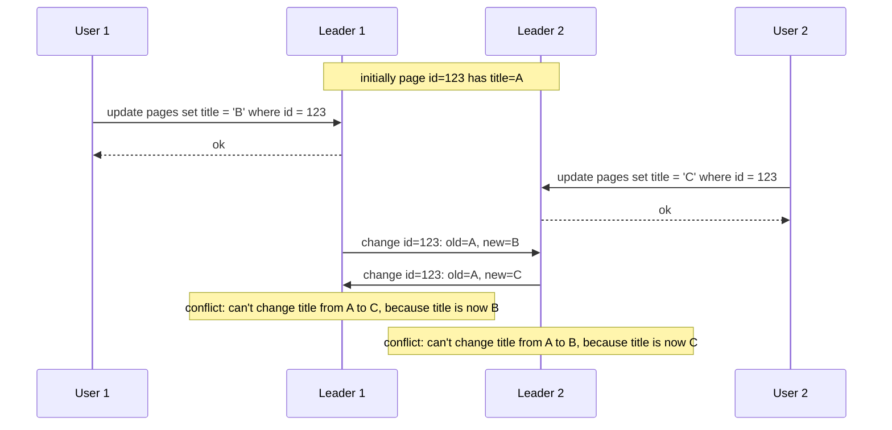

This cannot happen with a single leader.

#### Synchronous versus asynchronous conflict detection

- **Single leader:** the second writer either blocks until the first write completes, or its transaction is aborted (cancelled, with all its changes undone) and the user retries.
- **Multi-leader:** both writes succeed locally; the conflict is detected **later, asynchronously**, by which point asking the user may no longer be possible.
- You *could* detect conflicts synchronously by waiting for replication to all replicas before confirming, but that throws away multi-leader's main benefit (independent writes on each leader). If you want that, just use single-leader.

#### Conflict avoidance

Simplest strategy: make sure all writes for a given record go through **the same leader**, so conflicts cannot occur. Since many implementations handle conflicts poorly, this is frequently recommended.

Example: route each user to a **"home" datacenter** (perhaps the nearest) and use that datacenter's leader for their reads and writes. Different users have different homes, but for any one user it behaves like single-leader.

It breaks down when the designated leader must change, e.g. a datacenter fails and traffic moves, or the user relocates and is now nearer another datacenter. Then concurrent writes on different leaders become possible again.

#### Converging toward a consistent state

A single leader applies writes in sequence, so the last write to a field decides its value. With multiple leaders there is **no defined order**. In Figure 5-7, leader 1 sees B then C; leader 2 sees C then B. Neither order is "more correct". If each simply applied writes in arrival order, leader 1 would end with C and leader 2 with B: permanently inconsistent, which is unacceptable. Resolution must be **convergent**: all replicas reach the same final value once all changes have replicated.

Ways to converge:
1. **Give each write a unique ID** (timestamp, long random number, UUID (a 128-bit randomly generated identifier that is practically guaranteed unique), or hash of key and value); keep the write with the highest ID and drop the others. With timestamps this is **last write wins (LWW)**: popular but **dangerously prone to data loss**.
2. **Give each replica a unique ID**; writes from a higher-numbered replica always win. Also loses data.
3. **Merge the values**, e.g. sort alphabetically and concatenate (the title might become "B/C").
4. **Record the conflict** in a data structure that keeps all information, and let application code resolve it later (maybe by asking the user).

#### Custom conflict resolution logic

The right resolution is application-specific, so most multi-leader tools let you supply code, run either:
- **On write:** when the database finds a conflict in the incoming replicated changes, it calls your handler. **Bucardo** lets you write a Perl (a scripting language) snippet for this. The handler runs in a background process, must be quick, and cannot prompt a user.
- **On read:** all conflicting versions are stored; the next read returns them all to the application, which may ask the user or resolve automatically and write back the result. **CouchDB** works this way.

Conflict resolution usually works **per row or document, not per transaction**. So if a transaction atomically makes several writes (Chapter 7), each write is resolved separately.

> **Automatic Conflict Resolution.** Custom handlers get complicated and buggy. A well-known example is **Amazon**'s shopping cart: for a while its resolution logic preserved *additions* to a cart but not *removals*, so deleted items sometimes came back. Research directions:
> - **CRDTs (conflict-free replicated datatypes)**: sets, maps, ordered lists, counters, etc. that multiple users can edit concurrently and that resolve conflicts sensibly on their own. Some are implemented in **Riak 2.0**.
> - **Mergeable persistent data structures**: track history explicitly like **Git** (the version-control tool programmers use) and use a **three-way merge** (comparing both edited versions against their common ancestor; CRDTs use two-way merges).
> - **Operational transformation**: the algorithm behind **Etherpad** and **Google Docs**, built specifically for concurrent edits to an ordered sequence, like the characters making up a document.
>
> Database implementations are still young, but these could make multi-leader sync much easier.

#### What is a conflict?

Some are obvious: two concurrent writes set the same field of the same record to different values (Figure 5-7). Others are subtle. Example: a **meeting-room booking system** must not allow two overlapping bookings of the same room. Even if the app checks availability first, two bookings made on **two different leaders** can still conflict. There is no quick answer; Chapter 7 shows more examples and Chapter 12 discusses scalable ways to detect and resolve conflicts.

### Multi-Leader Replication Topologies

A **replication topology** is the set of paths along which writes travel between nodes. With two leaders there is only one sensible choice (each sends to the other). With more, several are possible.

*Figure 5-8 (redrawn): three example topologies with four leaders each: (a) circular, (b) star (one root in the middle), (c) all-to-all.*
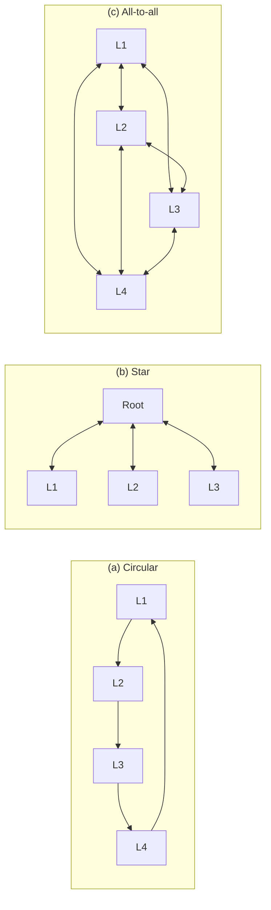

- **All-to-all:** every leader sends to every other; the most general.
- **Circular:** every node takes writes from one neighbour and passes them, together with its own writes, on to one other neighbour. **MySQL supports only this by default.**
- **Star:** one designated root forwards writes to all others; can be generalised to a **tree**. (Unrelated to the *star schema* of data warehousing, which is about data model structure, not network paths.)

**Avoiding infinite loops.** In circular and star layouts, writes pass through several nodes, so nodes forward what they receive. Each node has a unique ID, and each write in the log is tagged with the IDs of every node it has passed through. A node that receives a change tagged with its own ID ignores it, knowing it already processed it.

**Fault tolerance.** In circular and star layouts, **one failed node can block replication** between others until fixed; rerouting around it is usually manual. Denser topologies like all-to-all avoid this single point of failure (one part whose failure stops everything) because messages can take other paths.

**All-to-all's own problem: messages overtaking each other.** Some links are faster (e.g. due to congestion, i.e. traffic jams on the network, elsewhere), so replication messages can arrive out of order.

*Figure 5-9 (redrawn): client A inserts row x on leader 1, client B increments it on leader 3, but the insert travels slowly to leader 2, so leader 2 receives the dependent update before the insert.*
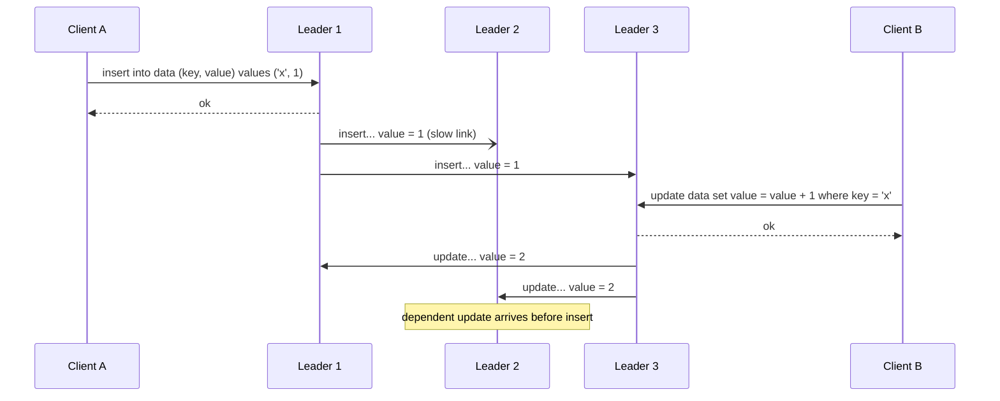

This is a **causality** issue like consistent prefix reads: the update depends on the insert, so everyone must apply the insert first. **Attaching timestamps is not enough**, because clocks are not reliably in sync (Chapter 8). The right tool is **version vectors** (later in this chapter). Yet many systems implement conflict detection poorly: at the time of writing, **PostgreSQL BDR** gives no causal ordering, and **Tungsten Replicator for MySQL** does not even try to detect conflicts.

Advice: if you use multi-leader replication, know these issues, read the docs carefully, and test thoroughly that you get the guarantees you think you do.

## Leaderless Replication

Single- and multi-leader both have a leader decide the order of writes, with followers applying that order. **Leaderless** systems drop the leader: **any replica can accept writes directly from clients**.

History: some of the earliest replicated systems were leaderless, but the idea faded while relational databases dominated. It returned after **Amazon** built its in-house **Dynamo**. **Riak, Cassandra, and Voldemort** are open-source leaderless stores inspired by it, hence the name **Dynamo-style**.

> **DynamoDB is different.** Dynamo is internal to Amazon. AWS's hosted product **DynamoDB** uses a completely different design: single-leader replication.

In some implementations the client sends writes to several replicas itself; in others a **coordinator node** does so for it. Unlike a leader, a coordinator does **not impose an order** on writes, and this has big consequences.

### Writing to the Database When a Node Is Down

Three replicas, one down (maybe rebooting for an update). In a leader-based system you might need failover to keep writing. In a leaderless system **there is no failover**:

1. User 1234's client fires the write at **all three** replicas at once.
2. The two live replicas accept it; the down one misses it.
3. If two acknowledgements out of three are enough, the write counts as **successful**, and the client ignores the missed replica.

When the down node returns, it lacks the writes it missed, so reading from it gives **stale** values. So **reads also go to several nodes in parallel**. Replies can differ (fresh from one node, old from another); **version numbers** tell it which is newer.

*Figure 5-10 (redrawn): user 1234 writes a new picture URL to all three replicas while replica 3 is offline; two oks are enough. Later user 2345 reads from all three, gets version 7 from replicas 1 and 2 but the old version 6 from replica 3, and repairs replica 3.*
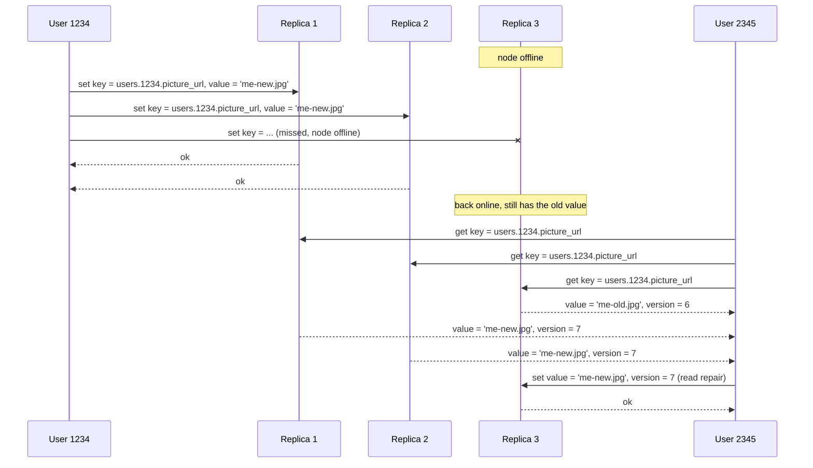

#### Read repair and anti-entropy

How does a returning node catch up? Dynamo-style stores use two mechanisms:

| Mechanism | How it works | Notes |
|---|---|---|
| **Read repair** | During a parallel read, the client spots stale replies (e.g. version 6 from replica 3 vs version 7 from replicas 1 and 2) and writes the newer value back to the stale replica. | Works well for frequently read values. |
| **Anti-entropy process** | A background process keeps comparing replicas and copying missing data across. | Unlike a replication log, it copies in **no particular order**, and there can be a long delay. |

Not all systems have both: **Voldemort currently has no anti-entropy process**. Without anti-entropy, rarely read values may be missing on some replicas, i.e. **less durable**, since read repair only fixes what gets read.

#### Quorums for reading and writing

If every successful write is on at least 2 of 3 replicas, at most one replica is stale, so reading from 2 guarantees at least one fresh answer, even if the third is down or slow.

General rule: with **n** replicas, a write must be confirmed by **w** nodes and a read must query at least **r** nodes. If **w + r > n**, the read set and write set overlap, so at least one node read is up to date. These are **quorum reads and writes**; think of w and r as the minimum votes needed. (Example above: n = 3, w = 2, r = 2.)

> **Strict vs sloppy.** This kind is sometimes called a **strict quorum**, as opposed to the sloppy quorums described below.

Tuning in Dynamo-style databases (all three are configurable):
- A common choice: **n odd (typically 3 or 5)** and **w = r = (n + 1) / 2 rounded up**.
- Few writes and many reads? Set **w = n, r = 1**: faster reads, but a single failed node makes **all writes fail**.

> **n is per value, not per cluster.** A cluster can have more than n nodes; each value is just stored on n of them. That is how the dataset gets partitioned across a big cluster (Chapter 6).

How the quorum condition tolerates failures:
- **w < n**: writes still succeed with a node down.
- **r < n**: reads still succeed with a node down.
- **n = 3, w = 2, r = 2**: tolerates **one** unavailable node.
- **n = 5, w = 3, r = 3**: tolerates **two** unavailable nodes.
- Requests are normally sent to **all n** replicas in parallel; w and r only set how many replies to **wait for**.

*Figure 5-11 (redrawn): with n = 5, w = 3, r = 3, the write is sent to all five replicas but only replicas 1-3 succeed; the read is sent to all five but only replicas 3-5 answer. Replica 3 is in both sets, so the read sees the latest write.*
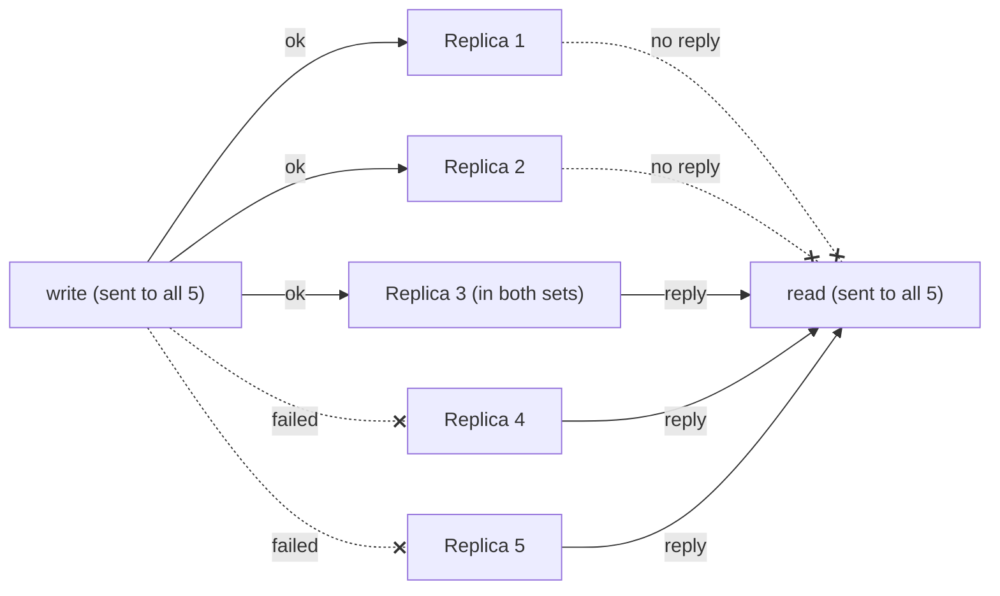

If fewer than w or r nodes respond successfully, the write or read **returns an error**. Why a node fails (crash, power loss, full disk, network break) does not matter; only whether it answered successfully.

### Limitations of Quorum Consistency

**Why w + r > n usually works:** the written set and the read set must share at least one node, which has the latest value.

- w and r are often chosen as a **majority** (more than n/2), which satisfies w + r > n while tolerating up to n/2 failures. But quorums need not be majorities; they only need to **overlap**. Other assignments give flexibility in algorithm design.
- You can also set **w + r ≤ n** (quorum condition not met). Requests still go to n nodes but fewer successes are needed. Stale reads become **more likely**, but get **lower latency and higher availability**: when many replicas are unreachable you can still work until reachable replicas fall below w or r.

**Even with w + r > n, stale reads can happen.** Edge cases:
1. **Sloppy quorum** in use: the w writes and r reads may land on different nodes, so no guaranteed overlap.
2. **Concurrent writes**: unclear which came first. The only safe option is to merge; picking a winner by timestamp (LWW) can lose writes to **clock skew** (different machines' clocks disagreeing about the time).
3. **A write concurrent with a read**: the write may be on only some replicas, so the read may return old or new.
4. **Partial write failure**: succeeded on some replicas (others had full disks), fewer than w overall. The replicas that did store it do **not undo** it, so a write reported as failed may or may not show up in later reads.
5. **Restored from stale replica**: a node holding the new value fails and is restored from a replica with an old value, so the count holding the new value may drop below w.
6. **Unlucky timing** even when all is working (see "Linearizability and quorums" in Chapter 9).

So quorums *seem* to promise the latest value but in practice it is not that simple. Dynamo-style databases are generally built for workloads that **tolerate eventual consistency**. Treat w and r as knobs on the *probability* of stale reads, not absolute guarantees. In particular, the three lag guarantees from earlier (read-your-writes, monotonic reads, consistent prefix) are usually **absent**. Stronger guarantees need transactions or consensus (Chapters 7 and 9).

#### Monitoring staleness

Even if stale reads are acceptable, you must know whether replication is healthy and get alerted if it falls far behind (e.g. network trouble, overloaded node).

- **Leader-based:** easy. Writes are applied in the same order everywhere and every node's progress can be expressed as a log position (count of writes applied). **Lag = leader's position minus follower's position.** Databases usually expose this metric (a measured number reported for monitoring).
- **Leaderless:** no fixed write order, so it is harder. If read repair is the sole repair mechanism (anti-entropy absent), nothing **limits how old** a rarely read value can be.

Research exists on measuring staleness in leaderless systems and on forecasting what fraction of reads will be stale for given n, w and r, but it is not yet common practice. The book argues staleness should be a standard metric: eventual consistency is vague, but for operations you need to **quantify "eventual"**.

### Sloppy Quorums and Hinted Handoff

Properly configured quorums tolerate individual node failures **without failover**, and tolerate slow nodes because they only wait for w or r replies. That makes leaderless databases attractive for **high availability, low latency, and tolerance of occasional stale reads**.

But quorums are less fault-tolerant than they could be. A network break can cut a client off from many nodes; those nodes are alive, but to that client they may as well be dead, and fewer than w or r may be reachable.

In a large cluster (many more than n nodes), the client can probably reach *some* nodes, just not the particular n "home" nodes for this value. Designers then choose:
- Fail every request that cannot gather w (or r) responses? **Or**
- Accept the writes anyway, storing them on reachable nodes that are **not** among the value's n home nodes?

The second is a **sloppy quorum**: reads and writes still need w and r successes, but these can include non-home nodes. The book's analogy: locked out of your house, you ask to sleep on a neighbour's couch.

When the network recovers, writes a node held on another's behalf are sent to the correct home nodes: **hinted handoff** (you found your keys, and the neighbour politely sends you home).

**Trade-off:** great for **write availability** (any w reachable nodes suffice), but w + r > n no longer **assures you of reading the newest value**, since it may sit on nodes outside the n. A sloppy quorum is really just a **durability assurance** (the data is on w nodes *somewhere*), not a quorum in the traditional sense, until hinted handoff finishes.

Configuration: optional in all common Dynamo implementations. **Enabled by default in Riak; disabled by default in Cassandra and Voldemort.**

#### Multi-datacenter operation

Leaderless replication also suits multiple datacenters, since it is built to tolerate conflicting concurrent writes, network breaks, and latency spikes.

| System | How it handles multiple datacenters |
|---|---|
| **Cassandra, Voldemort** | Stay within the normal leaderless model: n counts nodes in **all** datacenters, and you configure how many of the n live in each. Each write goes to all replicas, but the client usually waits only for a quorum **in its local datacenter**, so it is unaffected by cross-datacenter delays. Remote writes are often configured to be asynchronous (with some flexibility). |
| **Riak** | Keeps client-to-node traffic **inside one datacenter**; n is the number of replicas within that datacenter. Replication between datacenter clusters happens asynchronously in the background, similar to multi-leader. |

### Detecting Concurrent Writes

Dynamo-style databases let several clients write the same key concurrently, so **conflicts occur even with strict quorums**. It resembles multi-leader conflicts, and in Dynamo-style stores **read repair** and **hinted handoff** can create conflicts as well.

Root cause: because of variable network delays and partial failures, events reach different nodes in different orders. Example with clients A and B writing key X on a three-node store:
- Node 1 gets A's write but never B's (transient outage).
- Node 2 gets A then B.
- Node 3 gets B then A.

*Figure 5-12 (redrawn): clients A and B concurrently set key X; node 1 is unresponsive to B's write, and nodes 2 and 3 receive the two writes in opposite orders. If each node just overwrites on arrival, a later get X returns A, B and A from nodes 1, 2 and 3: they disagree forever.*
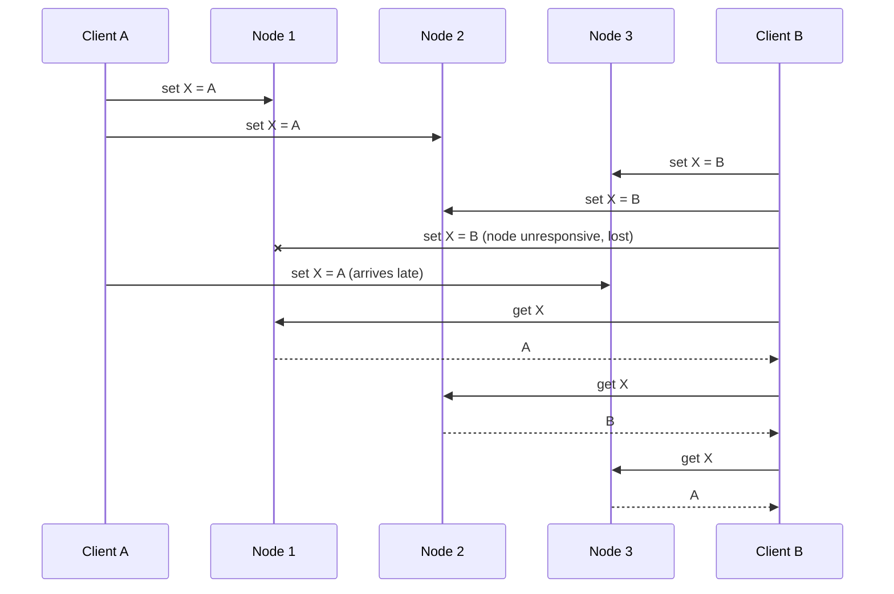

To be eventually consistent, replicas must **converge**. Unfortunately most implementations handle this poorly, so **you, the developer, must understand your database's conflict handling** to avoid losing data.

#### Last write wins (discarding concurrent writes)

**Idea:** each replica keeps only the "most recent" value and lets "older" ones be overwritten. Provided we can always decide which of two writes is newer, and every write eventually reaches every replica, all copies converge.

**Why the quotes around "recent":** in Figure 5-12 the two clients were unaware of each other, so calling either one "first" is meaningless. The writes are **concurrent**, and their order is **undefined**. LWW **forces** an arbitrary order, e.g. by attaching a timestamp and keeping the largest.

- **Used by:** the only conflict-resolution method in **Cassandra**; optional in **Riak**.
- **Cost:** convergence at the expense of **durability**. Of several concurrent writes, all reported successful (each reached w replicas), only one survives; the rest are **silently discarded**. LWW can even drop **non-concurrent** writes (see "Timestamps for ordering events" in Chapter 8).
- Acceptable in some cases, like **caching**. Where data loss is unacceptable, avoid LWW.
- **Only safe usage:** write each key **once** and treat it as immutable, so there are no concurrent updates to the same key. Recommended Cassandra practice: use a **UUID as the key**, giving every write its own key.

#### The "happens-before" relationship and concurrency

How do we tell whether two operations are concurrent?
- In **Figure 5-9**, the writes are **not concurrent**: B's increment operates on the value A inserted, so B builds on A and must be later. B is **causally dependent** on A.
- In **Figure 5-12**, the writes **are concurrent**: neither client knew of the other, so there is no causal dependency.

**Definition:** operation A **happens before** B if B knows about A, depends on A, or builds on A. Two operations are **concurrent** when **neither** one happens before the other, i.e. each is unaware of the other.

So for any A and B there are exactly three cases: A before B, B before A, or concurrent. We need an algorithm to tell which. If one happened before the other, the later one should overwrite; if concurrent, there is a conflict to resolve.

> **Concurrency, Time, and Relativity.** "Concurrent" does not mean "at literally the same instant". Clocks in distributed systems make exact simultaneity hard to judge anyway (Chapter 8). What matters is only whether each operation was **unaware** of the other, regardless of physical time. Some compare this to special relativity (Einstein's physics of space and time): information cannot travel faster than light, so two distant events closer in time than light needs to travel between them cannot influence each other. In computers, two operations can be concurrent even when light would easily have had time, e.g. if a slow or broken network prevented one from learning of the other.

#### Capturing the happens-before relationship

Start with a **single replica**, then generalise. Two clients add items to the same shopping cart (the book notes you could picture two air-traffic controllers adding aircraft to a sector instead). The cart starts empty; five writes occur:

1. **Client 1 adds milk.** First write to the key; server stores it as **version 1** and echoes the value and version back.
2. **Client 2 adds eggs**, unaware of milk. Server assigns **version 2** and keeps `[milk]` and `[eggs]` as **two separate values**, returning both with version 2.
3. **Client 1 adds flour**, unaware of eggs, sending `[milk, flour]` with **version 1**. The server sees this supersedes `[milk]` (version 1) but is concurrent with `[eggs]`. It stores `[milk, flour]` as **version 3**, drops `[milk]`, keeps `[eggs]`, and returns both.
4. **Client 2 adds ham.** It last received `[milk]` and `[eggs]`, so it merges them, adds ham, and sends `[eggs, milk, ham]` with **version 2**. The server treats it as replacing `[eggs]`; `[milk, flour]` stays because it is concurrent, so the server now holds `[milk, flour]` (v3) and `[eggs, milk, ham]` (**v4**).
5. **Client 1 adds bacon.** It last received `[milk, flour]` and `[eggs]` at version 3, merges, adds bacon, sends `[milk, flour, eggs, bacon]` with **version 3**. This overwrites `[milk, flour]` (`[eggs]` was already gone) while `[eggs, milk, ham]` is concurrent with it and stays: two values remain.

*Figure 5-13 (redrawn): two clients editing one cart; the server uses version numbers to decide what to overwrite and what to keep side by side.*
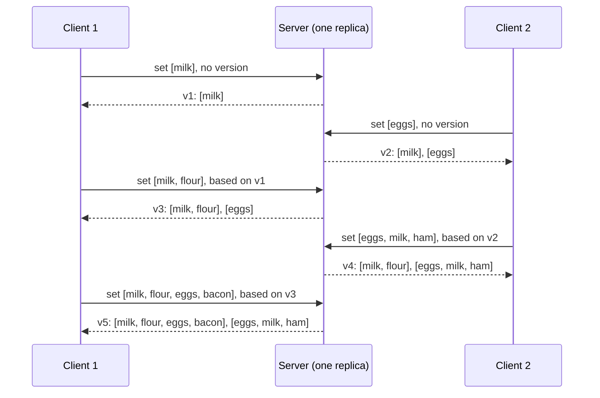

*Figure 5-14 (redrawn): the causal-dependency graph of those writes. An arrow means the later operation knew about (built on) the earlier one; edge labels show the cart value passed along, and the two arrows leaving on the right are the final siblings.*
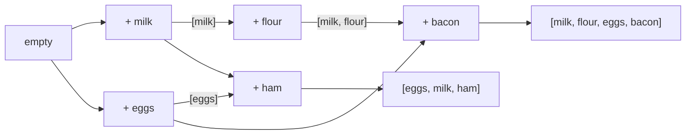

The clients are never fully current (there is always a concurrent operation), yet old versions are eventually overwritten and **no write is lost**. The server does not need to understand the value; it only looks at version numbers, so the value can be any data structure.

**The algorithm:**
1. The server keeps a **version number per key**, increments it on every write, and stores it with the written value.
2. On a **read**, the server returns **all values not yet overwritten** along with the newest version number. Every write **must be preceded by a read**.
3. On a **write**, the client includes the **version from its prior read** and must **merge** all values it received in that read. (A write's response can look like a read, returning current values, which lets writes be chained as in the cart example.)
4. When the server gets a write with version v, it may **overwrite all values with version ≤ v** (they have been merged in), but must **keep values with higher versions** (they are concurrent).

A write with **no version number** is concurrent with everything: it overwrites nothing and simply appears as another value on later reads.

#### Merging concurrently written values

No data is silently lost, but clients must **clean up** by merging the concurrent values. **Riak calls these concurrent values siblings.**

Merging siblings is the same problem as multi-leader conflict resolution. Picking one by version or timestamp (LWW) loses data, so something smarter in application code may be needed.

- **Cart example:** take the **union** (every item that appears in any sibling). The last two siblings, `[milk, flour, eggs, bacon]` plus `[eggs, milk, ham]`, merge into `[milk, flour, eggs, bacon, ham]` with duplicates removed (milk and eggs show up in both siblings despite each being added only once).
- **Removals break plain union:** if an item was removed in only one sibling, the union brings it back (the Amazon cart problem). Fix: on removal, leave a marker with a suitable version number saying the item was deleted. This deletion marker is a **tombstone** (seen before in log compaction for hash indexes, Chapter 3).

Merging by hand is complex and error-prone, so there are efforts at data structures that merge automatically. **Riak's datatype support** uses **CRDTs**, which merge siblings sensibly, **including preserving deletions**.

A tiny illustration of union-with-tombstones (Python, my own example):

```python
a = {"pens": "added", "tape": "added"}
b = {"pens": "removed", "glue": "added"}   # "removed" acts as a tombstone
merged = {}
for k in a.keys() | b.keys():
    states = {a.get(k), b.get(k)} - {None}
    merged[k] = "removed" if "removed" in states else "added"
visible = sorted(k for k, s in merged.items() if s == "added")   # ['glue', 'tape']
```
- `a` and `b` are two sibling versions of a cart; `b` removed pens.
- The loop visits every item mentioned in either sibling.
- If any sibling holds a tombstone for an item, the merged state is "removed", so the deletion survives the merge.
- `visible` lists what the user should see: pens stays deleted. (This naive rule means a removal always beats a concurrent re-add; real CRDTs use version information to decide.)

#### Version vectors

With **multiple replicas and no leader**, one version number per key is not enough. Instead keep a **version number per replica, per key**. Each replica increments its own counter when it processes a write and also tracks the counters it has seen from every other replica. That tells it which values to overwrite and which to keep as siblings.

The set of counters from all replicas is a **version vector**. The most interesting variant is the **dotted version vector**, used in **Riak 2.0**, and it works much like the cart example.

- Like the single version number, the version vector is sent to clients on reads and must be **sent back on the next write**. Riak encodes it as a string called the **causal context**.
- It lets the database tell **overwrites from concurrent writes**.
- The application may still have to merge siblings.
- It makes it safe to **read from one replica and write back to another**: siblings may appear, but nothing is lost as long as they are merged correctly.

> **Version vectors vs vector clocks.** A version vector is sometimes called a vector clock, but they are not quite the same thing. The distinction is subtle; when what you are comparing is replica state, use version vectors.

## Summary

Replication serves four purposes:

| Purpose | Meaning |
|---|---|
| High availability | Keep running when a machine, several machines, or a whole datacenter fails |
| Disconnected operation | Keep working during a network interruption |
| Latency | Put data near users so interaction is faster |
| Scalability | Serve more reads than one machine could, by reading from replicas |

A simple goal (same data on several machines) turns out to be very tricky: you must reason about concurrency and everything that can fail, at minimum unavailable nodes and network interruptions, not to mention nastier faults like silent corruption from software bugs.

**Three approaches:**

| Approach | How writes flow | Pros | Cons |
|---|---|---|---|
| Single-leader | All writes to one leader, which streams changes to followers; reads anywhere (followers may be stale) | Easy to understand; no conflict resolution | Every write depends on reaching the one leader; failover is fraught |
| Multi-leader | Each write goes to one of several leaders; leaders stream changes to each other and to followers | More robust to faulty nodes, network problems, latency spikes | Conflicts; hard to reason about; weak consistency |
| Leaderless | Each write to several nodes; reads from several nodes in parallel to detect and fix stale data | Same robustness benefits; no failover | Very weak consistency guarantees; conflicts |

**Sync vs async** strongly affects behaviour under faults. Async is fast when all is well, but think through what happens when lag grows and servers fail: promoting an async follower after a leader failure can **lose recently committed data**.

**Consistency models for lag:**
- **Read-after-write:** users always see what they themselves submitted.
- **Monotonic reads:** after seeing data at one point in time, users never later see an earlier state.
- **Consistent prefix reads:** data appears in causally sensible order (question before answer).

**Concurrency:** multi-leader and leaderless allow concurrent writes, hence conflicts. We saw an algorithm (version numbers / version vectors) to decide whether one operation happened before another or they were concurrent, and ways to resolve conflicts by merging.

Next chapter: the counterpart of replication, **partitioning** a large dataset.

## Interview angle

**1. Single-leader vs multi-leader vs leaderless?**
30-second answer: Single-leader sends every write through one node that streams an ordered log to followers; simple, no conflicts, but writes depend on that one leader and failover is risky. Multi-leader lets several nodes (typically one per datacenter, or each offline device) accept writes and replicate asynchronously to each other; better write latency and outage tolerance, but you must resolve conflicts. Leaderless (Dynamo-style: Riak, Cassandra, Voldemort) sends writes and reads to several replicas and uses quorums; no failover needed, very available, but only weak consistency.
- *Follow-up: why not multi-leader in one datacenter?* The added complexity (conflicts, trouble with autoincrement keys, triggers, constraints) rarely pays off when all nodes share a fast, reliable local network.
- *Follow-up: is DynamoDB leaderless?* No. Despite the name, the book notes AWS DynamoDB uses single-leader replication; Dynamo was Amazon's internal system.

**2. Synchronous vs asynchronous replication?**
30-second answer: Sync means the leader waits for a follower's ack before confirming, so that follower is guaranteed current, but if it stalls all writes block. Async means the leader does not wait: fast and available, but confirmed writes can be lost if the leader dies. In practice you use semi-synchronous (one sync follower, the rest async) or fully async.
- *Follow-up: why not make all followers sync?* Any one node outage would halt all writes; with more nodes, the chance something is down rises.

**3. What can go wrong in failover?**
30-second answer: With async replication the new leader may lack the old leader's last writes, which are usually discarded (durability violation). Discarded writes can clash with outside systems (GitHub reused MySQL autoincrement keys that Redis also used, leaking private data). Split brain can leave two leaders accepting writes. Choosing the timeout is a trade-off between slow recovery and needless failovers that worsen overload.
- *Follow-up: how do systems deal with split brain?* Fencing / STONITH shuts one node down; if badly designed it can shut down both.

**4. Explain quorums (n, w, r).**
30-second answer: A value lives on n replicas; a write needs w acks and a read asks r replicas. If w + r > n, the sets overlap so at least one replica read has the latest write. Typical: n = 3 or 5, w = r = majority. n = 3, w = r = 2 tolerates one failure; n = 5, w = r = 3 tolerates two. Read repair and anti-entropy bring stale replicas up to date.
- *Follow-up: does w + r > n guarantee fresh reads?* No: sloppy quorums, concurrent writes resolved by LWW (clock skew), writes concurrent with reads, partially failed writes not rolled back, restores from stale replicas, and timing edge cases can all produce stale reads. Treat it as a probability knob.
- *Follow-up: what is a sloppy quorum?* When home nodes are unreachable, writes go to other reachable nodes and are later sent home by hinted handoff. Improves write availability but breaks the overlap guarantee. On by default in Riak, off in Cassandra and Voldemort.

**5. Replication-lag anomalies and fixes.**
30-second answer: Read-your-writes (user does not see own update): read own editable data from the leader, or track last-write timestamp/LSN. Monotonic reads (data goes backwards on refresh): pin each user to one replica via hash of user ID. Consistent prefix (answer before question, mostly in partitioned stores): keep causally related writes in one partition or track causality.
- *Follow-up: what extra issues come with multiple devices?* Last-write metadata must be centralised, and devices may hit different datacenters, so you may need to steer every device of that user to one datacenter.

**6. How do you detect concurrent writes, and why not just LWW?**
30-second answer: Two writes are concurrent if neither knew about the other. Servers track a version per key (per replica per key in a version vector); clients send back the version they read, the server overwrites values at or below it and keeps higher ones as siblings for the app to merge. LWW converges but silently drops all but one concurrent write, so it is only safe when keys are written once (e.g. UUID keys in Cassandra).
- *Follow-up: how do you handle deletions when merging siblings?* Leave tombstones; or use CRDTs (as in Riak) that merge automatically and preserve deletions.

## Self-check

1. **Name the four ways a leader's changes can be shipped to followers and one weakness of each.**
   Statement-based (nondeterministic functions, ordering, side effects); WAL shipping (coupled to storage format, upgrades may need downtime); logical/row-based (the book lists no specific drawback; its point is that it is decoupled from the storage engine, so it is the version-tolerant built-in option); trigger-based (overhead and bug-prone).

2. **Why is copying the leader's data files not enough to set up a new follower, and what is done instead?**
   Writes keep happening, so a file copy captures inconsistent moments. Instead take a consistent snapshot tied to a log position (LSN / binlog coordinates), copy it, then request and apply all changes since that position until caught up.

3. **Scenario: users complain that after posting a comment and reloading, it sometimes disappears. Which guarantee is missing and give two fixes.**
   Read-after-write consistency. Fixes: read the user's own content from the leader (or for one minute after their last write), or have the client remember its last write timestamp/LSN and only read from replicas that have reached it.

4. **With n = 5, what w and r would you choose to tolerate two failed nodes while keeping the quorum condition?**
   w = 3, r = 3 (3 + 3 > 5; each operation can proceed with two nodes down).

5. **Trade-off: what do you gain and lose by setting w = n and r = 1?**
   Very fast reads (one reply suffices), but any single node failure makes all writes fail.

6. **Why can timestamps not correctly order the insert and update arriving at leader 2 in Figure 5-9? What does work?**
   Clocks across nodes are not reliably synchronised, so timestamps may misorder causally related events. Version vectors can capture the causal dependency.

7. **What is the difference between read repair and anti-entropy, and which system lacks anti-entropy?**
   Read repair fixes stale replicas when a client notices them during a read (good for hot data). Anti-entropy is a background process comparing replicas and copying missing data in no particular order. Voldemort has no anti-entropy, so rarely read values can be less durable.

8. **In the version-number algorithm, what does the server do when it receives a write carrying version 3 while it holds values at versions 3 and 4?**
   It overwrites values with version ≤ 3 (they were merged into the new write) and keeps the version 4 value as a concurrent sibling.

9. **Why does conflict avoidance stop working sometimes?**
   It depends on each record having a fixed home leader; if a datacenter fails or a user moves closer to another one, the leader changes and concurrent writes on different leaders become possible.

10. **Scenario: an offline-first notes app syncs across phone and laptop. Which replication style is it, and what must you plan for?**
    Multi-leader (each device is a leader). Plan for very long lag (hours or days) and conflict resolution, e.g. CRDTs or on-read resolution as in CouchDB.
