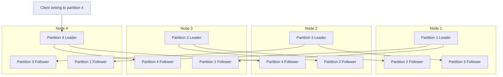
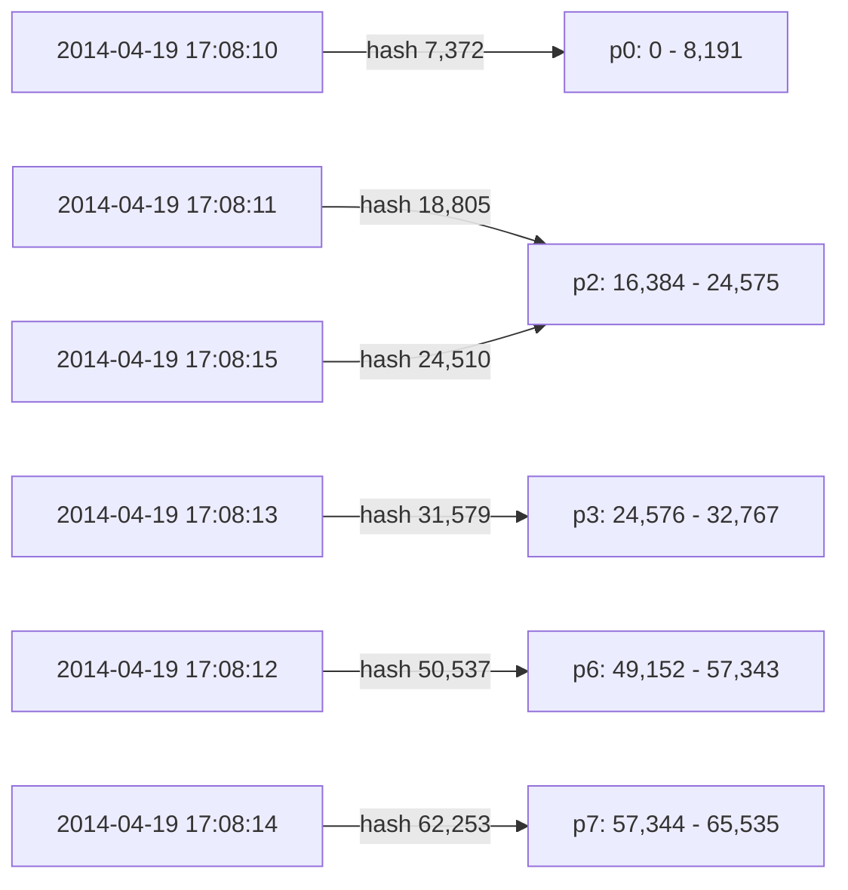
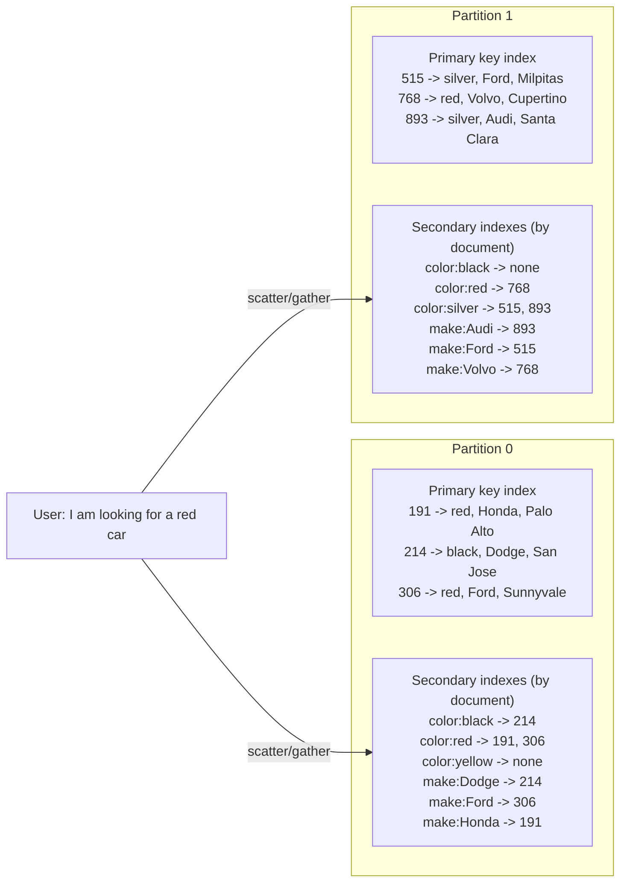
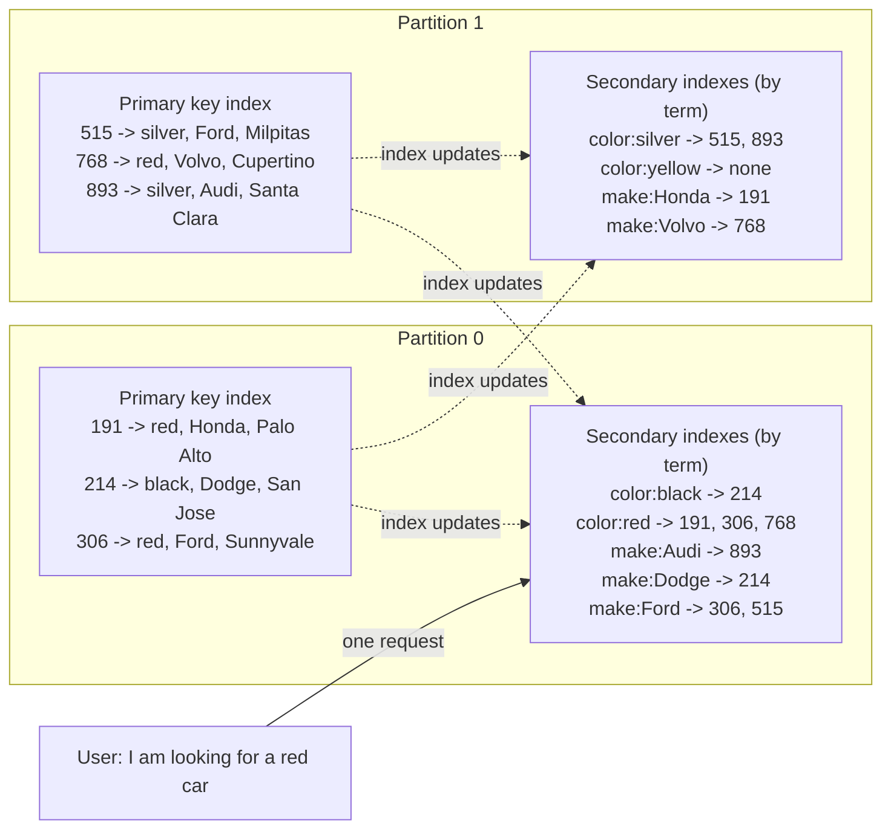
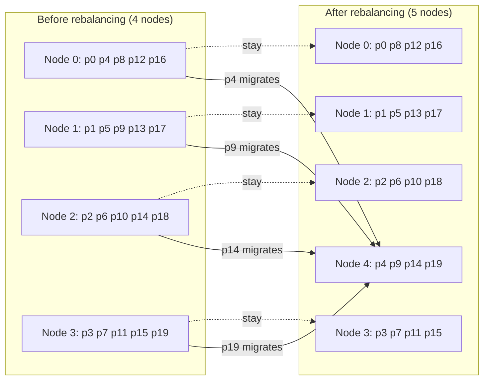
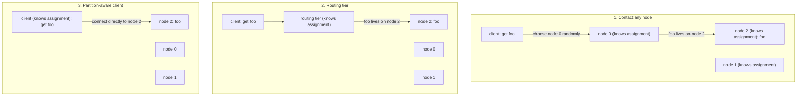
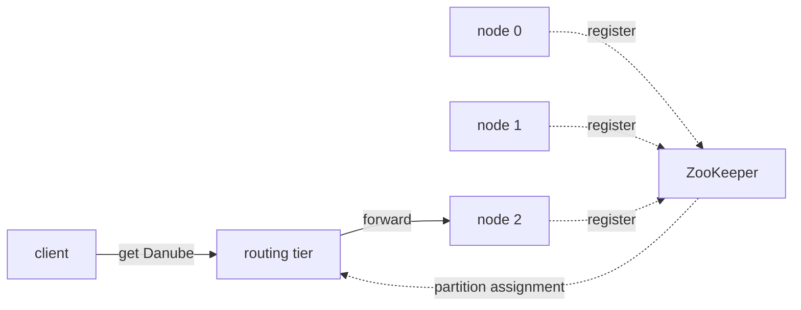

# Chapter 6 — Partitioning
*Book: Chapter 6, pp. 199–220*

## Overview

Chapter 5 kept full copies of the data on several nodes. That is not enough when the dataset is **too big for one machine** or the **query rate too high**: the data must be split into **partitions** (**sharding**) spread over many nodes. (Primer: [System Design Fundamentals](../00a-system-design-fundamentals/README.md).)

This chapter answers: *which record lives on which node, how do secondary indexes keep working, how is data moved when nodes join or leave, and how does a request find the right node?*

> **Terminology zoo.** A partition is a **shard** in MongoDB, Elasticsearch and SolrCloud, a **region** in HBase, a **tablet** in Bigtable, a **vnode** in Cassandra and Riak, a **vBucket** in Couchbase. The book uses **partition**.

> **Not a network partition.** Here partitioning means deliberately splitting a database; it is unrelated to *network partitions* (netsplits, a network fault; Chapter 8).

Key ideas:
- Usually each record belongs to **exactly one** partition, which acts like a small database of its own (some operations span partitions).
- The goal is **scalability**: in a shared-nothing cluster, partitions on different nodes spread data over many disks and queries over many processors.
- Single-partition queries are answered by one node, so adding nodes raises throughput; large complex queries can in principle be parallelised across nodes, but that is much harder.
- History: **Teradata** and **Tandem NonStop SQL** pioneered partitioned databases in the 1980s; NoSQL stores and Hadoop-based data warehouses rediscovered the idea. Transactional vs analytic workloads change tuning, not the fundamentals.

## Key terms

| Term | Plain-English meaning |
|---|---|
| Partition (shard, region, tablet, vnode, vBucket) / sharding | A subset of the data; each record belongs to exactly one / partitioning. |
| Skew / hot spot | Some partitions get more data or queries than others / a partition with disproportionately high load. |
| Key-range partitioning | Each partition owns a continuous key range, like encyclopedia volumes. |
| Partition boundaries | Key (or hash) values where one partition ends and the next begins. |
| Range scan / range query | Fetch all keys between a lower and upper bound. |
| Concatenated index | Multi-part key used as one sortable index, fetching related records in one query. |
| Hash partitioning | Each partition owns a range of **hash values**. |
| Consistent hashing | Karger et al.'s random-boundary method; the book prefers "hash partitioning" for databases. |
| Compound primary key | Cassandra key whose first part is hashed for the partition, rest used for sorting within it. |
| Secondary index | Finds records by a non-key value (e.g. all red cars). |
| Document-partitioned (local) / term-partitioned (global) index | Each partition indexes only its documents / one index over all partitions, itself partitioned by term. |
| Term | In full-text search a word; here a value like `color:red`. |
| Scatter/gather | Query all partitions and combine results. |
| Tail latency amplification | Waiting on many sub-requests, the slowest dictates total time. |
| Rebalancing | Moving load (data and requests) between nodes. |
| Hash mod N | Node = `hash(key) % N`; a bad rebalancing approach. |
| Fixed number of partitions / dynamic partitioning | Many more partitions than nodes, moved whole / split big partitions, merge small ones. |
| Pre-splitting | Configuring initial partitions on an empty database. |
| Partitioning proportionally to nodes | Fixed number of partitions per node (Cassandra, Ketama). |
| Cascading failure | Overload spreading from node to node, e.g. via automatic rebalancing. |
| Request routing / service discovery | Getting a request to the node owning its partition / the general problem of finding which address serves something. |
| Routing tier | Partition-aware load balancer that forwards but handles no requests. |
| ZooKeeper | Coordination service storing cluster metadata such as the partition-to-node map. |
| Gossip protocol | Nodes spreading cluster-state changes to each other directly. |
| MPP (massively parallel processing) | Analytic relational databases running complex query stages in parallel across nodes. |

## Partitioning and Replication

Partitioning is usually **combined with replication**: each record is in one partition, but that partition is stored on several nodes for fault tolerance. A node can hold many partitions. With leader–follower replication, each partition has its **leader on one node and followers on others**, so a node can be leader for some partitions and follower for others.

*Figure 6-1 (redrawn): four nodes, four partitions, each partition with one leader and two followers. Every node leads one partition and follows two others; a client writing to partition 4 goes to its leader on node 4. Arrows are per-partition replication streams.*


Chapter 5 applies equally to replicating partitions; since the partitioning scheme is mostly independent of replication, the rest of the chapter ignores replication.

## Partitioning of Key-Value Data

**Goal:** spread data and query load **evenly**: 10 nodes could then handle 10x the data and throughput of one (ignoring replication).

Unfair partitioning is **skewed** and much less effective; in the extreme all load hits one partition, **9 of 10 nodes sit idle**, and the busy one is the bottleneck. A partition with disproportionate load is a **hot spot**.

**Why not random assignment?** Data would be even, but you wouldn't know where an item lives and would have to **query every node in parallel**.

Better: assume a **key-value** model where records are accessed by primary key, like entries in a paper **encyclopedia** sorted by title.

### Partitioning by Key Range

**What it is.** Each partition gets a **continuous key range** (min to max), like printed encyclopedia volumes. Knowing the boundaries tells you the partition; knowing the partition's node lets you go straight there.

*Figure 6-2 (redrawn): a 12-volume print encyclopedia partitioned by key range; each volume covers an uneven span of titles.*

```mermaid
flowchart LR
  V1["1: A-ak - Bayes"] --- V2["2: Bayeu - Ceanothus"] --- V3["3: Ceara - Deluc"] --- V4["4: Delusion - Frenssen"]
  V4 --- V5["5: Freon - Holderlin"] --- V6["6: Holderness - Krasnoje"] --- V7["7: Krasnokamsk - Menadra"] --- V8["8: Menage - Ottawa"]
  V8 --- V9["9: Otter - Rethimnon"] --- V10["10: Reti - Solovets"] --- V11["11: Solovyov - Truck"] --- V12["12: Trudeau - Zywiec"]
```


**Ranges need not be equal**: data isn't evenly spread over the alphabet (volume 1 holds A and B; volume 12 holds T, U, V, X, Y, Z), so boundaries must **adapt to the data**, set by an administrator or automatically (see Rebalancing).

**Used by:** Bigtable, HBase (its open-source counterpart), RethinkDB, MongoDB before 2.4.

**Benefit: sorted keys and range scans.** Keys within a partition can be kept sorted (SSTables/LSM-trees, Chapter 3), so range scans are easy and the key can serve as a **concatenated index**. E.g. a **sensor network** keyed by timestamp (year-month-day-hour-minute-second): one month's readings are one range scan.

**Downside: hot spots from access patterns.** With timestamp keys, partitions correspond to time ranges (e.g. one per day), and since sensors write as they measure, **every write goes to today's partition** while others idle.

**Fix:** put something else first, e.g. **the sensor name before the timestamp**, partitioning by sensor then time; many active sensors spread writes. Cost: reading several sensors over a time range needs **one range query per sensor**. Illustrative layout (our example):

```text
key = <device_id> + ":" + <timestamp>
therm-07:2024-03-01T10:00:00   -> partition holding therm-00 .. therm-09
therm-42:2024-03-01T10:00:00   -> partition holding therm-40 .. therm-49
```

### Partitioning by Hash of Key

To avoid skew and hot spots, many distributed datastores choose the partition with a **hash function** of the key.

> **Key term — hash function:** turns any input into a fixed-size, random-looking number; the same input always gives the same number, but near-identical inputs give very different numbers, so similar keys no longer cluster.

A good hash makes skewed input uniform: a 32-bit hash maps any string to a seemingly random number in 0 to 2^32 − 1, evenly spread even for near-identical strings.

**Choosing the hash function.** It need not be cryptographically strong: **Cassandra and MongoDB use MD5**, **Voldemort uses Fowler–Noll–Vo**. Built-in language hashes (for hash tables) may be **unsuitable**: Java's `Object.hashCode()` and Ruby's `Object#hash` can give the same key different hashes in different processes.

**How it works:** give each partition a **range of hashes** and store each key in the partition whose range contains `hash(key)`.

*Figure 6-3 (redrawn): six consecutive timestamp keys, one second apart, hash (first 2 bytes of MD5, so 0..65,535) to scattered values; the hash space is cut into eight equal ranges p0..p7, and each key lands in the partition whose range contains its hash.*


Boundaries can be **evenly spaced** or **chosen pseudorandomly** — the latter sometimes called **consistent hashing**.

> **Consistent Hashing.** Karger et al. defined it for balancing load across internet-wide caches such as a **CDN** (content delivery network), using random boundaries so no central control or distributed consensus (Chapter 9) is needed. "Consistent" here is unrelated to replica consistency (Chapter 5) or ACID consistency (Chapter 7); it describes a rebalancing approach. It works poorly for databases and is rarely used in practice (docs that say "consistent hashing" are often inaccurate), so the book says **hash partitioning**.

**The cost: no efficient range queries** — adjacent keys are scattered. **MongoDB** with hash sharding sends range queries to **all** partitions; **Riak, Couchbase and Voldemort** don't support range queries on the primary key.

**Cassandra's compromise: compound primary keys.** **Only the first column is hashed** to pick the partition; the **remaining columns form a concatenated index** sorting data within SSTables. You can't range-scan the first column, but with it fixed you can range-scan the others efficiently.

This suits **one-to-many** data: with key `(user_id, update_timestamp)` you can fetch one user's updates in a time window, sorted; different users are on different partitions, but each user's updates are together in time order. Our CQL (Cassandra Query Language) illustration — `driver_id` is hashed, `event_time` sorts within the partition, so the query touches one partition and range-scans it (a time range without `driver_id` could not use this layout):

```sql
CREATE TABLE ride_events (
  driver_id  uuid,
  event_time timestamp,
  status     text,
  PRIMARY KEY ((driver_id), event_time)
);

SELECT status FROM ride_events
WHERE driver_id = 5b1c0f2e-7a3d-4c1e-9f00-1a2b3c4d5e6f
  AND event_time >= '2024-05-01' AND event_time < '2024-05-02';
```

### Skewed Workloads and Relieving Hot Spots

Hashing reduces hot spots but **cannot eliminate them**: if all requests target the **same key**, they all hit one partition. E.g. a **celebrity** with millions of followers triggers a storm of writes to one key (their user ID, or the ID of the action being commented on); identical IDs hash identically. Most data systems **cannot compensate automatically**, so the application must.

**Technique: split the hot key.** For a known-hot key, **add a random number to the start or end**; a **two-digit decimal** (00–99) spreads writes over **100 different keys** on different partitions.

**Costs:** **reads** must fetch all 100 keys and combine; **bookkeeping** is needed to track which few keys are split (pointless overhead for low-traffic keys). Future systems may handle skew automatically; for now, weigh the trade-offs per application.

Sketch (Python, our example) — `HOT` is the bookkeeping, `read_keys` shows the read penalty:

```python
import random
HOT = {"post:9001"}                       # keys known to be hot

def write_key(key):
    if key in HOT:
        return f"{key}#{random.randint(0, 99):02d}"   # one of 100 sub-keys
    return key

def read_keys(key):
    return [f"{key}#{i:02d}" for i in range(100)] if key in HOT else [key]
```

## Partitioning and Secondary Indexes

Primary-key access identifies the partition directly. **Secondary indexes** usually don't identify a record uniquely; they find all records with a value: all actions by user 123, all articles containing *hogwash*, all red cars.

- The **bread and butter** of relational databases; common in document databases.
- Many key-value stores (**HBase, Voldemort**) avoid them due to complexity; others (**Riak**) are adding them for their modelling value.
- The **whole reason for existing** of search servers like **Solr and Elasticsearch**.

They **don't map neatly onto partitions**. Two approaches: **document-based** and **term-based** partitioning.

### Partitioning Secondary Indexes by Document

**Book example: a used-car website.** Each listing has a **document ID**; the database is partitioned by ID (0–499 in partition 0, 500–999 in partition 1, …). Users filter by **color** and **make**, so secondary indexes exist on those fields; adding a red car makes its partition add its ID to `color:red`.

> **Rolling your own index.** In a pure key-value store you might map values to document IDs in application code, but race conditions and partial write failures easily leave the index out of sync (see multi-object transactions, Chapter 7).

*Figure 6-4 (redrawn): each partition keeps a primary-key index and its own secondary indexes covering only its own cars, so a search for red cars must scatter to both partitions and gather the results.*


**How it works.** Each partition is independent and indexes **only its own documents**; a write touches **only the partition holding that document**: a **local index**.

**Reads:** cars of one color are spread across partitions, so a query must go to **all partitions** and combine results: **scatter/gather**.
- Makes secondary-index reads **expensive**; even in parallel, **tail latency amplification** applies.
- **Widely used** anyway: MongoDB, Riak, Cassandra, Elasticsearch, SolrCloud, VoltDB.
- Vendors advise partitioning so index queries hit **one partition**, often impossible with **several secondary indexes in one query** (color **and** make).

### Partitioning Secondary Indexes by Term

**Idea.** A **global index** covering all partitions, which itself must be **partitioned** (one node would be a bottleneck), differently from the primary key.

*Figure 6-5 (redrawn): the same cars, but the secondary indexes are global and partitioned by term: color:black, color:red and makes Audi to Ford live on partition 0; color:silver, color:yellow and makes Honda to Volvo on partition 1. Writing one car may update index entries on both partitions (dashed), while a search for red cars reads one index partition.*


In the book's figure, colors **a to r** are in index partition 0 and **s to z** in partition 1; makes split between **f and h**. The searched **term** (e.g. `color:red`) decides the index partition (term comes from **full-text indexes**, where terms are words).

**By the term itself** helps **range scans** (e.g. asking price); **by hash of the term** spreads load **more evenly**.

| | Document-partitioned (local) | Term-partitioned (global) |
|---|---|---|
| Where the index lives | With each data partition, covering only its documents | Separately, partitioned by indexed value |
| Writes | Touch one partition: fast and simple | One document may touch **several index partitions**, maybe on several nodes: slower, more complex |
| Reads | **Scatter/gather** to all partitions | Only the partition(s) holding the term |
| Freshness | Updated with the document | Often **asynchronous**; may lag |
| Examples | MongoDB, Riak, Cassandra, Elasticsearch, SolrCloud, VoltDB | DynamoDB global secondary indexes, Riak search, Oracle data warehouse (choice of local or global) |

**Keeping a global index up to date.** Immediate consistency would need a **distributed transaction** across all affected index partitions, which not every database supports (Chapters 7, 9). In practice updates are often **asynchronous**: a read right after a write may miss it. **Amazon DynamoDB** global secondary indexes normally update within **a fraction of a second**, longer during infrastructure faults. Also used by **Riak's search feature** and the **Oracle data warehouse** (local or global). Chapter 12 revisits implementation.

## Rebalancing Partitions

Over time query throughput rises (**more CPUs**), data grows (**more disks and RAM**), and machines **fail** (others take over). Moving load between nodes is **rebalancing**. Minimum requirements:
1. Afterwards, load (storage, reads, writes) is **shared fairly**.
2. During it, the database **keeps accepting reads and writes**.
3. **No more data than necessary** moves, keeping it fast and limiting network and disk I/O.

### Strategies for Rebalancing

#### How not to do it: hash mod N

Figure 6-3 assigned **ranges** of hashes to partitions (partition 0 if 0 ≤ hash(key) < b0, partition 1 if b0 ≤ hash(key) < b1, …). Why not **mod**? `hash(key) mod 10` gives 0–9, seemingly a neat way to pick among 10 nodes.

**The problem:** when **N** changes, **most keys move**. Book example, hash(key) = 123456:

| Nodes | 123456 mod N | Key lives on |
|---|---|---|
| 10 | 6 | node 6 |
| 11 | 3 | node 3 |
| 12 | 0 | node 0 |

That makes rebalancing far too expensive. Quick demonstration (Python, our numbers; Python randomises string hashes per process — the same pitfall as Java and Ruby — but the proportion moved is what matters):

```python
keys = range(100_000)
moved = sum(1 for k in keys if hash(str(k)) % 4 != hash(str(k)) % 5)
print(moved / len(keys))   # roughly 0.8: about 80% of keys change node going from 4 to 5 nodes
```

#### Fixed number of partitions

**Idea:** create **many more partitions than nodes** up front, several per node — e.g. a **10-node** cluster with **1,000 partitions**, ~**100 per node**. A new node **takes a few partitions from each existing node** until even; removal reverses this.

*Figure 6-6 (redrawn): 20 fixed partitions on a 4-node cluster; when node 4 joins, it takes one partition from each existing node (p4, p9, p14, p19). All other partitions stay where they were, and no key changes partition.*


- **Only whole partitions move**; the partition count and key-to-partition mapping never change, only the **partition-to-node** assignment.
- Transfer takes time, so the **old assignment serves** reads and writes meanwhile.
- **Uneven hardware**: give stronger nodes more partitions.
- **Used by:** Riak, Elasticsearch, Couchbase, Voldemort.

**Choosing the number:** usually **fixed at setup** (splitting/merging is possible but often not implemented, for simplicity), so it caps the **maximum number of nodes** — choose high enough for growth. But each partition has **management overhead**. With highly variable total data it is hard to size, since partition size grows with the dataset: **very large partitions** make rebalancing and recovery expensive, **very small** ones add overhead.

#### Dynamic partitioning

Fixed boundaries are awkward for **key-range** partitioning (bad boundaries could put all data in one partition; manual reconfiguration is tedious). So **HBase and RethinkDB** create partitions **dynamically**:
1. A partition exceeding a configured size (**10 GB by default in HBase**) **splits into two** halves.
2. One shrinking below a threshold (after heavy deletes) can **merge** with its neighbour.
3. Similar to the top level of a **B-tree** splitting full pages.
4. As with fixed partitioning, a node holds many partitions and a split half can **move to another node**; in HBase, partition files move via **HDFS** (Hadoop Distributed File System).

**Advantage:** partition count **adapts to data volume**: few partitions (low overhead) when small, size capped when large.

**Caveat:** an empty database starts with **one partition** (no information about boundaries), so **one node takes all writes** until the first split. **HBase and MongoDB** allow **pre-splitting** an empty database, which for key ranges requires knowing the key distribution in advance.

Dynamic partitioning also works for hashed data: **MongoDB since 2.4** supports key-range and hash partitioning, splitting dynamically in either.

#### Partitioning proportionally to nodes

- **Dynamic partitioning:** partition count proportional to **dataset size**.
- **Fixed number of partitions:** partition size proportional to **dataset size**.
- In both, partition count is **independent of node count**.

**Third option (Cassandra, Ketama):** a **fixed number of partitions per node**.
- Partition size grows with data at fixed node count and shrinks as nodes are added; since more data usually means more nodes, size stays **fairly stable**.
- A **new node** picks a fixed number of existing partitions **at random**, **splits** each, and takes **one half**.
- Random splits can be **unfair**, but averaged over many partitions (**256 per node by default in Cassandra**) the share is fair; **Cassandra 3.0** added an algorithm avoiding unfair splits.
- Random boundaries require **hash-based partitioning**; this is closest to the **original definition of consistent hashing**. Newer hash functions achieve similar effects with less metadata overhead.

| Strategy | Number of partitions | Partition size | Who uses it | Watch out for |
|---|---|---|---|---|
| hash mod N | = nodes | varies | (avoid) | Most keys move when N changes |
| Fixed number of partitions | Fixed at setup | Grows with data | Riak, Elasticsearch, Couchbase, Voldemort | Choosing the count; caps node count |
| Dynamic partitioning | Grows with data | Bounded (e.g. HBase 10 GB split) | HBase, RethinkDB, MongoDB | Starts with one partition; pre-split |
| Proportional to nodes | Fixed per node | Stable-ish | Cassandra (256/node), Ketama | Random splits can be unfair |

### Operations: Automatic or Manual Rebalancing

From **fully automatic** (system moves partitions itself) to **fully manual** (admin configures the assignment). In between, **Couchbase, Riak, and Voldemort** generate a **suggested** assignment that an administrator must **commit**.

| | Fully automatic | Human in the loop |
|---|---|---|
| Convenience | Less routine operational work | Slower |
| Predictability | Can be unpredictable | Helps avoid operational surprises |

**Why automation can hurt.** Rebalancing is **expensive** (rerouting, moving lots of data) and can overload the network or nodes. Combined with **automatic failure detection**: an overloaded, temporarily slow node is declared dead; load is rebalanced away from it, adding load to it, the other nodes and the network — possibly a **cascading failure**. A **human in the loop** is slower but safer.

## Request Routing

How does a client know **which node to contact** for key "foo" (which IP address and port), when assignments change with rebalancing? This is **service discovery**, common to any networked software, especially highly available redundant systems; many in-house and open-source tools exist.

Three approaches:
1. **Contact any node** (e.g. via a **round-robin load balancer**); if it owns the partition it handles the request, else it **forwards** to the right node and relays the reply.
2. **Routing tier**: requests first go to a **partition-aware load balancer** that forwards them and handles none itself.
3. **Partition-aware client**: connects **directly** to the right node.

*Figure 6-7 (redrawn): three ways to route a request for key "foo", which lives on node 2. The component that knows the partition-to-node assignment is, in turn, every node (1), a routing tier (2), or the client itself (3).*


**The core difficulty:** how does the routing component **learn** of partition moves? All participants must agree or requests go astray; consensus protocols exist but are hard to implement (Chapter 9).

**Using a coordination service (ZooKeeper).** Each node **registers** in ZooKeeper, which keeps the **authoritative partition-to-node mapping**; routing tiers or partition-aware clients **subscribe**, and ZooKeeper **notifies** them when a partition changes owner or a node joins or leaves.

*Figure 6-8 (redrawn): the nodes register with ZooKeeper, which holds the authoritative table of key range -> partition -> node -> IP address; the routing tier keeps its copy in sync with ZooKeeper and forwards a client's get "Danube" to node 2.*


| Key range | Partition | Node | IP address |
|---|---|---|---|
| A-ak - Bayes | partition 0 | node 0 | 10.20.30.100 |
| Bayeu - Ceanothus | partition 1 | node 1 | 10.20.30.101 |
| Ceara - Deluc | partition 2 | node 2 | 10.20.30.102 |
| Delusion - Frenssen | partition 3 | node 0 | 10.20.30.100 |
| Freon - Holderlin | partition 4 | node 1 | 10.20.30.101 |
| Holderness - Krasnoje | partition 5 | node 2 | 10.20.30.102 |
| Krasnokamsk - Menadra | partition 6 | node 0 | 10.20.30.100 |
| Menage - Ottawa | partition 7 | node 1 | 10.20.30.101 |
| Otter - Rethimnon | partition 8 | node 2 | 10.20.30.102 |
| Reti - Solovets | partition 9 | node 0 | 10.20.30.100 |
| Solovyov - Truck | partition 10 | node 1 | 10.20.30.101 |
| Trudeau - Zywiec | partition 11 | node 2 | 10.20.30.102 |

| System | Routing approach |
|---|---|
| **LinkedIn Espresso** | **Helix** for cluster management (on ZooKeeper), with a routing tier as in Figure 6-8 |
| **HBase, SolrCloud, Kafka** | ZooKeeper tracks partition assignment |
| **MongoDB** | Similar, but its own **config server** implementation and **mongos** daemons as the routing tier |
| **Cassandra, Riak** | **Gossip protocol** spreads cluster-state changes; any node accepts and forwards requests (approach 1). More node complexity, but no external dependency like ZooKeeper |
| **Couchbase** | No automatic rebalancing (simpler); usually a routing tier called **moxi** that learns routing changes from cluster nodes |

**Finding IP addresses.** Clients still need node IPs, but these change far less often than assignments, so **DNS** usually suffices.

### Parallel Query Execution

So far: simple single-key queries (plus scatter/gather for local indexes), roughly what most **NoSQL** datastores support. **Massively parallel processing (MPP)** relational databases, used for **analytics**, support complex warehouse queries with **joins, filters, groupings and aggregations**: the MPP **query optimizer** splits them into **execution stages and partitions** run **in parallel on different nodes**, benefiting queries that scan large parts of the data. A specialised, commercially important area; Chapter 10 discusses some techniques.

## Summary

- **Why partition:** too much data to store and process on one machine. **Goal:** spread data and load evenly, avoiding **hot spots**, with a suitable scheme and **rebalancing** as nodes change.

| | Key range partitioning | Hash partitioning |
|---|---|---|
| How | Keys sorted; a partition owns all keys from some minimum to some maximum | Hash each key; a partition owns a range of hashes |
| Range queries | Efficient | Inefficient (key order destroyed) |
| Hot-spot risk | High if the app often accesses keys close together in sort order | Lower; load more evenly spread |
| Typical rebalancing | Dynamic: split a range in two when a partition grows too big | Fixed number of partitions created in advance, several per node, whole partitions moved; dynamic also possible |

- **Hybrid:** a **compound key**, one part for the partition, another for sort order (Cassandra).
- **Secondary indexes:** **document-partitioned (local)** — stored with the data; writes update one partition, reads **scatter/gather**; **term-partitioned (global)** — partitioned by indexed value; writes may update **several** index partitions, reads hit **one**.
- **Routing:** from partition-aware load balancing to elaborate **parallel query execution** engines.
- Partitions operate mostly independently, which enables scaling; but writes spanning **several partitions** are hard to reason about (what if one succeeds and another fails?), addressed in later chapters.

## Interview angle

**1. Key-range vs hash partitioning?**
30-second answer: Key-range assigns contiguous sorted ranges (Bigtable, HBase, RethinkDB, MongoDB before 2.4): cheap range scans, but sequential keys like timestamps create hot spots. Hash partitioning assigns hash ranges (MD5 in Cassandra and MongoDB, Fowler–Noll–Vo in Voldemort): even load, no efficient range queries. Cassandra's compound key hashes the first column and sorts by the rest.
- *Follow-up: timestamp hot spot for sensor data?* Put the sensor name before the timestamp; reading many sensors then needs one range query each.
- *Follow-up: why not Java's `hashCode()`?* The same key can hash differently in different processes.

**2. Why is hash mod N bad for rebalancing, and what do real systems do?**
30-second answer: Changing N moves most keys (123456 → node 6, 3, 0 for N = 10, 11, 12). Instead: a fixed large partition count, moving whole partitions (Riak, Elasticsearch, Couchbase, Voldemort); dynamic split/merge (HBase at 10 GB default, RethinkDB, MongoDB); or fixed partitions per node (Cassandra 256/node, Ketama).
- *Follow-up: fixed count downside?* Caps node count; hard to size with variable data (too big = costly rebalancing/recovery, too small = overhead).
- *Follow-up: dynamic downside?* Starts with one partition, so one node takes all writes until the first split; pre-split (HBase, MongoDB) if you know the key distribution.

**3. Local vs global secondary indexes?**
30-second answer: Local (document-partitioned) indexes live with each partition: writes touch one partition, reads scatter/gather with tail-latency amplification (MongoDB, Riak, Cassandra, Elasticsearch, SolrCloud, VoltDB). Global (term-partitioned) indexes are partitioned by term: reads hit one partition, writes touch several and are usually asynchronous (DynamoDB GSIs: a fraction of a second normally, longer during faults).
- *Follow-up: why not synchronous?* It would need a distributed transaction across affected index partitions, which many databases lack.

**4. How do you handle a celebrity hot key?**
30-second answer: Hashing can't help (same key, same hash). Append a random two-digit number to spread writes over 100 keys; reads fetch and combine all 100, and you must track which keys are split. Only for the few hot keys.

**5. How does a request find the right partition?**
30-second answer: Any node forwards (Cassandra, Riak with gossip), a routing tier (Espresso via Helix/ZooKeeper, MongoDB mongos with config servers, Couchbase moxi), or partition-aware clients. The hard part is agreement on the partition map; many systems keep it in ZooKeeper, which notifies routers. DNS suffices for node IPs.
- *Follow-up: automatic rebalancing?* Combined with automatic failure detection it can turn a slow node into a cascading failure; human-committed suggested plans (Couchbase, Riak, Voldemort) are slower but safer.

## Self-check

1. **What is skew, and what is a hot spot?**
   Skew: some partitions get more data or queries than others. Hot spot: a partition with disproportionately high load; in the extreme 9 of 10 nodes idle while one is the bottleneck.

2. **Why not just assign records to random nodes?**
   Even load, but you wouldn't know where records live and would query all nodes for every read.

3. **Scenario: an IoT (Internet of Things: networked sensors and devices) system keys readings by timestamp in a key-range-partitioned store and one node is overloaded. Why, and what change fixes it?**
   All current writes fall in the current time range's partition. Prefix keys with the sensor name; reading many sensors then needs one range query per sensor.

4. **In Cassandra with primary key (user_id, update_timestamp), which queries are efficient?**
   Fixing user_id and scanning a timestamp range (one partition, sorted). A range over user_id is not efficient because it is hashed.

5. **Trade-off: document-partitioned vs term-partitioned index for a read-heavy search page with many filters?**
   Term-partitioned makes each term lookup a single-partition read instead of scatter/gather; costs are slower multi-partition writes and often asynchronous (briefly stale) index updates.

6. **With hash(key) = 123456, where does the key go with 10, 11, and 12 nodes under mod N?**
   Nodes 6, 3, and 0 — why mod N moves too much data.

7. **In a fixed-partition scheme, what changes when a node is added, and what never changes?**
   Only the partition-to-node assignment; the partition count and key-to-partition mapping never change. The old assignment serves requests during transfer.

8. **What is pre-splitting and why is it needed?**
   Configuring initial partitions on an empty database (HBase, MongoDB); otherwise dynamic partitioning starts with one partition on one node. For key ranges you must know the key distribution.

9. **How do Cassandra and Riak learn about partition assignment changes, compared with HBase?**
   Gossip among nodes, with any node forwarding requests; HBase (like SolrCloud and Kafka) uses ZooKeeper.

10. **Scenario: an overloaded but alive node triggers automatic rebalancing. What can happen?**
    Others think it is dead and move its load, adding load to it, the other nodes and the network — a possible cascading failure. A human in the loop reduces this risk.
