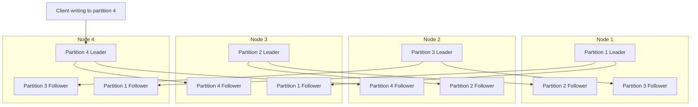
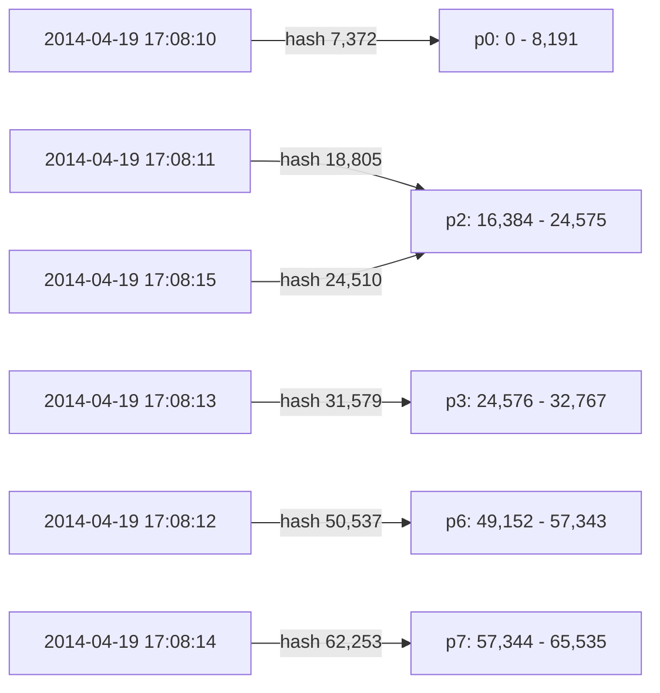
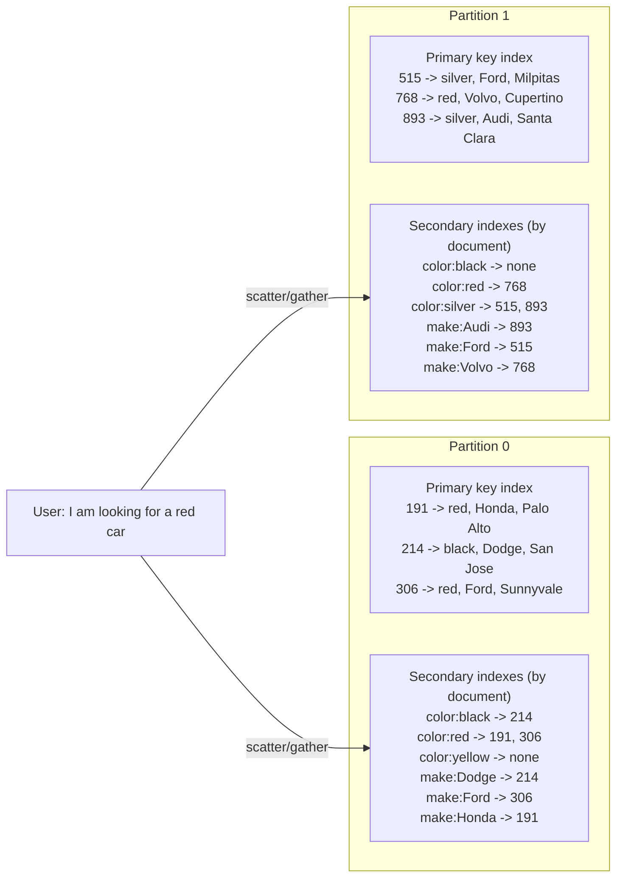
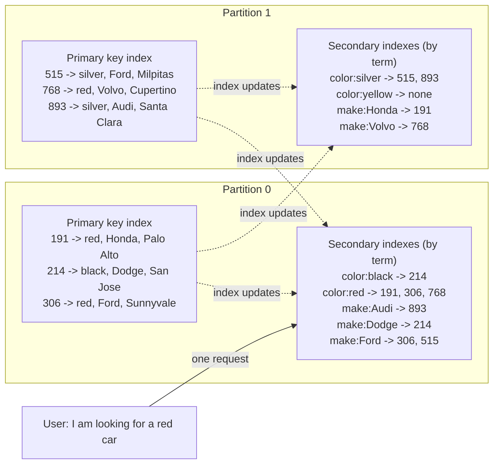
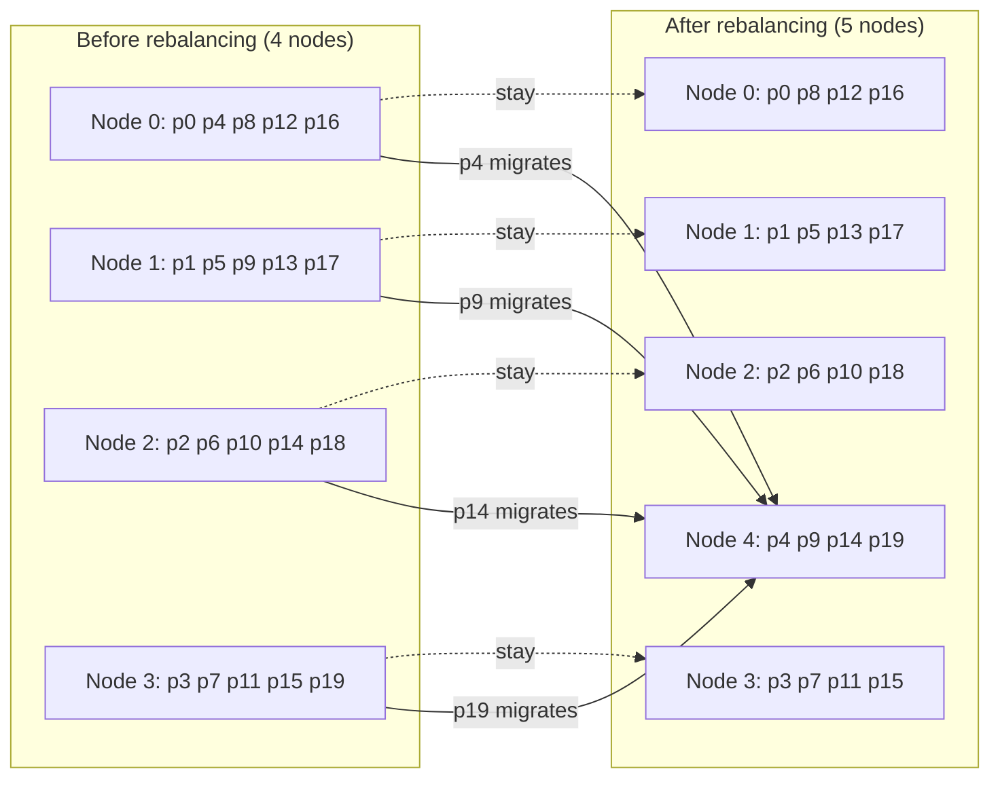
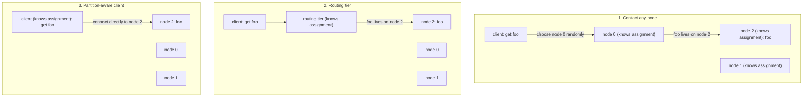
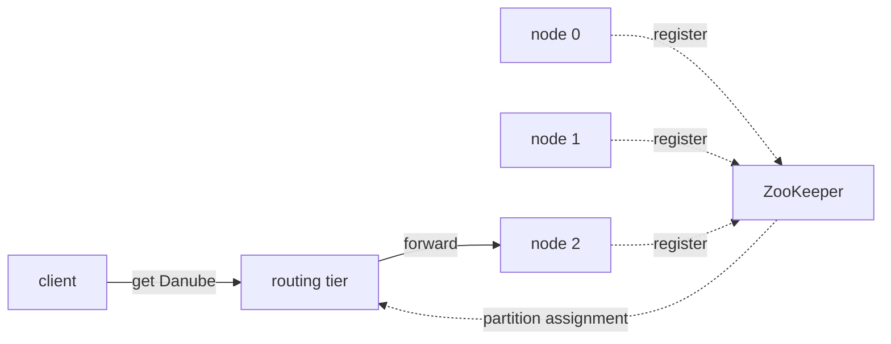

# Chapter 6 — Partitioning
*Book: Chapter 6, pp. 199–220*

## Overview

Chapter 5 kept whole copies of the data on several nodes. That stops being enough when the dataset is **too big for one machine** or the **query rate is too high** for one machine. The answer is to break the data into **partitions** (also called **sharding**) and spread them over many nodes.

This chapter answers: *how do you decide which record lives on which node, how do you keep secondary indexes working, how do you move data around when nodes join or leave, and how does a request find the right node?*

> **Terminology zoo.** The same idea has many names: a **shard** in MongoDB, Elasticsearch and SolrCloud; HBase says **region**, Bigtable says **tablet**, Cassandra and Riak say **vnode**, and Couchbase says **vBucket**. The book sticks with **partition**, the most established term.

> **Not a network partition.** Partitioning here means deliberately splitting a large database into smaller ones. It is unrelated to *network partitions* (netsplits), which are a kind of network fault covered in Chapter 8.

Key ideas:
- Usually each record (row, document) belongs to **exactly one** partition. Each partition acts like a small database of its own, though some operations may span several partitions.
- The main goal is **scalability**. In a shared-nothing cluster (see the Part II introduction), partitions sit on different nodes, so the data is spread over many disks and the queries over many processors.
- A query that touches one partition can be answered by that partition's node alone, so adding nodes raises throughput. Large, complex queries can in principle be parallelised across nodes, but that is much harder.
- History: **Teradata** and **Tandem NonStop SQL** led the way with partitioned databases in the 1980s; the idea was later rediscovered by NoSQL stores and by data warehouses built on Hadoop. Some systems target transactions and others analytics; that changes tuning, but the partitioning fundamentals are the same.

**Everyday analogy.** A library too big for one room is split across several rooms. You need a rule for which book goes in which room (partitioning scheme), a way to search by topic across rooms (secondary indexes), a plan for moving shelves when a new room opens (rebalancing), and a directory at the entrance telling visitors which room to go to (request routing).

## Key terms

| Term | Plain-English meaning |
|---|---|
| Partition (shard, region, tablet, vnode, vBucket) | A subset of the data; each record belongs to exactly one. |
| Sharding | Another name for partitioning. |
| Skew | Unfair partitioning where some partitions get more data or queries than others. |
| Hot spot | A partition with disproportionately high load. |
| Key-range partitioning | Each partition owns a continuous range of keys, like encyclopedia volumes. |
| Partition boundaries | The key (or hash) values where one partition ends and the next begins. |
| Range scan / range query | Fetching all keys between a lower and upper bound. |
| Concatenated index | Treating a multi-part key as one sortable index, so related records can be fetched in one query. |
| Hash partitioning | Each partition owns a range of **hash values**; a key goes where its hash falls. |
| Consistent hashing | Karger et al.'s method of choosing partition boundaries randomly; the book advises calling database schemes "hash partitioning" instead. |
| Compound primary key | Cassandra key of several columns: first part hashed to choose the partition, the rest used for sorting within it. |
| Secondary index | An index for finding records by a non-key value (e.g. all red cars). |
| Document-partitioned (local) index | Each partition indexes only its own documents. |
| Term-partitioned (global) index | One index covering all partitions, itself partitioned by the indexed term. |
| Term | In full-text search, a word in a document; here, a value like `color:red`. |
| Scatter/gather | Sending a query to all partitions and combining the results. |
| Tail latency amplification | When a request waits on many sub-requests, the slowest one dictates the total time. |
| Rebalancing | Moving load (data and requests) from one node to another. |
| Hash mod N | Assigning a key to node `hash(key) % N`; a bad rebalancing approach. |
| Fixed number of partitions | Create many more partitions than nodes up front; move whole partitions. |
| Dynamic partitioning | Split partitions that grow too big, merge ones that shrink. |
| Pre-splitting | Configuring an initial set of partitions on an empty database. |
| Partitioning proportionally to nodes | A fixed number of partitions per node (Cassandra, Ketama). |
| Cascading failure | Overload spreading from node to node, e.g. triggered by automatic rebalancing. |
| Request routing | Getting each request to the node that owns the relevant partition. |
| Service discovery | The general problem of finding which network address serves something. |
| Routing tier | A partition-aware load balancer that forwards requests but handles none itself. |
| ZooKeeper | A coordination service that stores cluster metadata such as the partition-to-node map. |
| Gossip protocol | Nodes spreading cluster-state changes to each other directly. |
| MPP (massively parallel processing) | Analytic relational databases that split complex queries into stages run in parallel across nodes. |

## Partitioning and Replication

Partitioning is normally **combined with replication**: every record is in exactly one partition, but that partition is copied onto several nodes for fault tolerance. A node can hold many partitions.

With leader–follower replication, each partition has its **leader on one node and followers on others**. Any given node can therefore be leader for some partitions and follower for others.

*Figure 6-1 (redrawn): four nodes, four partitions, each partition with one leader and two followers. Every node leads one partition and follows two others; a client writing to partition 4 goes to its leader on node 4. Arrows are per-partition replication streams.*


Everything from Chapter 5 applies equally to replicating partitions. Since the choice of partitioning scheme is largely independent of the replication scheme, the rest of the chapter ignores replication for simplicity.

## Partitioning of Key-Value Data

**Goal:** spread data and query load **evenly**. With every node carrying a fair share, 10 nodes could in theory handle 10 times the data and 10 times the read/write throughput of one node (ignoring replication).

If partitioning is unfair, it is **skewed**, and much less effective. In the extreme, all load hits one partition: **9 of 10 nodes sit idle** and the one busy node is your bottleneck. A partition with disproportionately high load is a **hot spot**.

**Why not assign records to nodes at random?** Data would be spread evenly, but to read a particular item you would not know where it is and would have to **query every node in parallel**.

Better: assume a simple **key-value** model where records are always accessed by primary key. The book compares this to an old paper **encyclopedia**, where entries are sorted by title so you can find one quickly.

### Partitioning by Key Range

**What it is.** Give each partition a **continuous range of keys**, from a minimum to a maximum, like the volumes of a printed encyclopedia. If you know the boundaries you know which partition has a key; if you also know which node holds that partition, you go straight there (or pull the right volume off the shelf).

*Figure 6-2 (redrawn): a 12-volume print encyclopedia partitioned by key range; each volume covers an uneven span of titles.*

```mermaid
flowchart LR
  V1["1: A-ak - Bayes"] --- V2["2: Bayeu - Ceanothus"] --- V3["3: Ceara - Deluc"] --- V4["4: Delusion - Frenssen"]
  V4 --- V5["5: Freon - Holderlin"] --- V6["6: Holderness - Krasnoje"] --- V7["7: Krasnokamsk - Menadra"] --- V8["8: Menage - Ottawa"]
  V8 --- V9["9: Otter - Rethimnon"] --- V10["10: Reti - Solovets"] --- V11["11: Solovyov - Truck"] --- V12["12: Trudeau - Zywiec"]
```


**Ranges need not be equal.** Data is rarely spread evenly across the alphabet: in Figure 6-2 volume 1 holds A and B, but volume 12 holds T, U, V, X, Y and Z. Giving every two letters their own volume would make some volumes huge. Boundaries must **adapt to the data**, chosen either by an administrator or automatically by the database (see Rebalancing below).

**Used by:** Bigtable and HBase (Bigtable's open-source counterpart), RethinkDB, and MongoDB before version 2.4.

**Benefit: sorted keys and range scans.** Within each partition, keys can be kept sorted (as in SSTables/LSM-trees, Chapter 3). Range scans become easy, and the key can act as a **concatenated index** to fetch related records in one query. Example: a **sensor network** whose key is the measurement timestamp (year-month-day-hour-minute-second); fetching, say, all readings for one month is a simple range scan.

**Downside: hot spots from access patterns.** With a timestamp key, partitions correspond to time ranges, e.g. one per day. Since sensors write data as it is measured, **every write goes to today's partition**, which is overloaded while the others idle.

**Fix:** put something other than the timestamp first in the key. For instance, **put the sensor name in front of the timestamp**, so data is partitioned by sensor first and time second. With many sensors active at once, writes spread across partitions. The cost: fetching several sensors over a time range now needs **one range query per sensor**.

An illustrative key layout (my own example):

```text
key = <device_id> + ":" + <timestamp>
therm-07:2024-03-01T10:00:00   -> partition holding therm-00 .. therm-09
therm-42:2024-03-01T10:00:00   -> partition holding therm-40 .. therm-49
```
- The first line gives the key format: device first, then time.
- Two writes at the same moment from different devices land in different partitions, spreading write load.
- A report on `therm-07` for March is still one range scan, but a report over all devices needs one scan per device.

### Partitioning by Hash of Key

Since key ranges invite skew and hot spots, lots of distributed datastores pick the partition with a **hash function** applied to the key.

**How a good hash helps.** It turns skewed input into a uniform output. A 32-bit hash function given any string produces what looks like a random number in the range 0 to 2^32 − 1; even near-identical strings produce hashes spread evenly over that range.

**Choosing the hash function.** It need not be cryptographically strong: **Cassandra and MongoDB use MD5**, **Voldemort uses the Fowler–Noll–Vo** function. Built-in language hash functions (used for hash tables) may be **unsuitable**: with Java's `Object.hashCode()` or Ruby's `Object#hash`, one process may compute a different hash for a key than another process does.

**How it works:**
1. Pick a suitable hash function.
2. Give each partition a **range of hashes** instead of a range of keys.
3. Store each key in the partition whose range contains `hash(key)`.

*Figure 6-3 (redrawn): six consecutive timestamp keys, one second apart, hash (first 2 bytes of MD5, so 0..65,535) to scattered values; the hash space is cut into eight equal ranges p0..p7, and each key lands in the partition whose range contains its hash.*


This spreads keys fairly. Boundaries can be **evenly spaced** or **chosen pseudorandomly**; the latter is sometimes called **consistent hashing**.

> **Consistent Hashing.** Karger et al. defined consistent hashing as a technique for balancing load across caches spread over the internet, such as a **CDN** (content delivery network), using randomly chosen partition boundaries so no central control or distributed consensus is needed. The word "consistent" is unrelated to replica consistency (Chapter 5) or ACID consistency (Chapter 7); it describes a particular approach to rebalancing. As the rebalancing section shows, it works poorly for databases and is rarely used in practice (some databases' docs still say "consistent hashing", often inaccurately). To avoid confusion, the book recommends just saying **hash partitioning**.

**The cost: no efficient range queries.** Keys that were neighbours are now scattered over all partitions, so sort order is gone.
- In **MongoDB** with hash-based sharding, any range query goes to **all** partitions.
- **Riak, Couchbase and Voldemort** do not support range queries on the primary key.

**Cassandra's compromise: compound primary keys.** A table can have a primary key of several columns. **Only the first column is hashed** to choose the partition; the **remaining columns form a concatenated index** that sorts data within Cassandra's SSTables. So you cannot range-scan over the first column, but if you fix the first column's value you can efficiently range-scan the others.

This suits **one-to-many** data. Example from the book: on a social media site one user posts many updates. With primary key `(user_id, update_timestamp)`, you can fetch all of one user's updates in a time window, sorted by time. Different users live on different partitions, but each user's updates sit together, in time order, on one partition.

A Cassandra-style illustration (CQL, my own table):

```sql
CREATE TABLE ride_events (
  driver_id  uuid,
  event_time timestamp,
  status     text,
  PRIMARY KEY ((driver_id), event_time)
);

SELECT status FROM ride_events
WHERE driver_id = 5b1c0f2e-7a3d-4c1e-9f00-1a2b3c4d5e6f
  AND event_time >= '2024-05-01' AND event_time < '2024-05-02';
```
- `PRIMARY KEY ((driver_id), event_time)`: `driver_id` is the part that is hashed (decides the partition); `event_time` sorts rows inside that partition.
- The `SELECT` fixes `driver_id`, so only one partition is contacted, and the time condition is an efficient range scan within it.
- A query giving only a time range and no `driver_id` could not use this layout efficiently.

### Skewed Workloads and Relieving Hot Spots

Hashing reduces hot spots but **cannot eliminate them**: if every read and write targets the **same key**, all requests still go to one partition.

This is unusual but real. Example: a **celebrity** on a social media site with millions of followers does something and triggers a storm of activity, i.e. a flood of writes to one key (maybe the celebrity's user ID, or the ID of the action people are commenting on). Hashing does not help, because identical IDs hash identically.

Today most data systems **cannot compensate for this automatically**, so the application must.

**Technique: split the hot key.**
1. For a key known to be very hot, **add a random number to the start or end** of it.
2. Just a **two-digit decimal** random number spreads writes evenly across **100 different keys**, which can live on different partitions.

**Costs:**
- **Reads** must now fetch from all 100 keys and combine the results.
- **Bookkeeping**: only do this for the few hot keys (for the vast majority of low-traffic keys it is pointless overhead), so you must track which keys are split.

The book expects that future systems may detect and handle skew automatically, but for now it is up to you to weigh the trade-offs for your particular application.

A sketch of the split (Python, my own example):

```python
import random
HOT = {"post:9001"}                       # keys known to be hot

def write_key(key):
    if key in HOT:
        return f"{key}#{random.randint(0, 99):02d}"   # one of 100 sub-keys
    return key

def read_keys(key):
    return [f"{key}#{i:02d}" for i in range(100)] if key in HOT else [key]
```
- `HOT` is the bookkeeping: the set of keys that have been split.
- `write_key` appends a random two-digit suffix to hot keys, so writes spread over 100 keys.
- `read_keys` shows the read penalty: a hot key must be read as 100 keys and combined; ordinary keys are untouched.

## Partitioning and Secondary Indexes

So far records were found only by **primary key**, which directly identifies the partition. **Secondary indexes** complicate this. A secondary index usually does not identify a record uniquely; it finds all records with a given value: all actions by user 123, all articles containing the word *hogwash*, all cars whose color is red.

- Relational databases rely on them heavily (the book calls them the **bread and butter** there), and document databases use them a lot too.
- Many key-value stores (e.g. **HBase, Voldemort**) avoid them because of implementation complexity; others (e.g. **Riak**) have begun to add them since they help so much with data modelling.
- They are the **whole reason for existing** of search servers like **Solr and Elasticsearch**.

The problem: secondary indexes **do not map neatly onto partitions**. Two main approaches: **document-based** and **term-based** partitioning.

### Partitioning Secondary Indexes by Document

**Example from the book: a used-car sales website.** Each listing has a unique **document ID**, and the database is partitioned by it (IDs 0–499 in partition 0, 500–999 in partition 1, etc.). Users filter by **color** and **make**, so you declare secondary indexes on those fields (columns in a relational database). The database then indexes automatically: when a red car is added, its partition adds its ID to the index entry `color:red`.

> **Rolling your own index.** In a pure key-value store you might build a secondary index yourself in application code by mapping values to document IDs. Be very careful: race conditions and partial write failures (some changes saved, others not) can easily leave the index out of sync with the data (see multi-object transactions, Chapter 7).

*Figure 6-4 (redrawn): each partition keeps a primary-key index and its own secondary indexes covering only its own cars, so a search for red cars must scatter to both partitions and gather the results.*


**How it works.** Each partition is completely independent and maintains secondary indexes **only for its own documents**, ignoring the rest. A write (add, remove, update) touches **only the partition holding that document ID**. Hence the name **local index** (vs. global index, next section).

**Reading needs care.** Unless you did something special with document IDs, cars of a given color or make are spread across partitions (red cars appear in partitions 0 and 1). So a query for red cars must go to **all partitions** and the results must be combined. This is **scatter/gather**.

- It can make secondary-index reads **expensive**. Even in parallel, it suffers from **tail latency amplification** (the slowest partition decides the response time).
- Still **widely used**: MongoDB, Riak, Cassandra, Elasticsearch, SolrCloud, and VoltDB all use document-partitioned secondary indexes.
- Vendors usually advise designing partitioning so secondary-index queries hit **one partition**, but that is often impossible, especially with **several secondary indexes in one query** (e.g. filtering by color **and** make).

### Partitioning Secondary Indexes by Term

**Idea.** Build a **global index** covering all partitions. It cannot live on a single node (it would become a bottleneck and defeat partitioning), so the global index is **itself partitioned**, but differently from the primary key.

*Figure 6-5 (redrawn): the same cars, but the secondary indexes are global and partitioned by term: color:black, color:red and makes Audi to Ford live on partition 0; color:silver, color:yellow and makes Honda to Volvo on partition 1. Writing one car may update index entries on both partitions (dashed), while a search for red cars reads one index partition.*


In the book's figure, colors starting **a to r** are in index partition 0 and **s to z** in partition 1; the make index is split between **f and h**. This is a **term-partitioned** index: the term being searched for (e.g. `color:red`) decides which index partition holds it. The word *term* comes from **full-text indexes**, where terms are the words in documents.

**By term or by hash of term?**
- **By the term itself**: helps with **range scans**, for instance over a numeric property like a car's asking price.
- **By hash of the term**: spreads load **more evenly**.

| | Document-partitioned (local) | Term-partitioned (global) |
|---|---|---|
| Where the index lives | With each data partition, covering only its documents | Separately, partitioned by indexed value |
| Writes | Touch one partition: fast and simple | One document may touch **several index partitions**, maybe on several nodes: slower, more complex |
| Reads | **Scatter/gather** to all partitions | Only the partition(s) holding the term |
| Freshness | Updated with the document | Often **asynchronous**; may lag |
| Examples | MongoDB, Riak, Cassandra, Elasticsearch, SolrCloud, VoltDB | DynamoDB global secondary indexes, Riak search, Oracle data warehouse (choice of local or global) |

**Keeping a global index up to date.** Ideally every write would appear in the index immediately. For a term-partitioned index that would need a **distributed transaction** across all affected index partitions, which not every database supports (Chapters 7 and 9). In practice, global secondary index updates are often **asynchronous**: reading the index right after a write may not show it yet. **Amazon DynamoDB** says its global secondary indexes normally update within **a fraction of a second**, but propagation can take longer during infrastructure faults.

Other users of global term-partitioned indexes: **Riak's search feature**, and the **Oracle data warehouse**, where you can pick between local and global indexing. Chapter 12 returns to implementing term-partitioned secondary indexes.

## Rebalancing Partitions

Things change over time:
- Query throughput rises, so you want **more CPUs**.
- The dataset grows, so you want **more disks and RAM**.
- A machine **fails** and others must take over its work.

Each requires moving data and requests between nodes. Moving load from one node to another is **rebalancing**. Whatever the partitioning scheme, rebalancing is expected to meet some minimum requirements:
1. Afterwards, load (storage, reads, writes) is **shared fairly** among nodes.
2. During it, the database **keeps accepting reads and writes**.
3. **No more data than necessary** moves, to keep rebalancing fast and limit network and disk I/O.

### Strategies for Rebalancing

#### How not to do it: hash mod N

Earlier (Figure 6-3) the advice was to split hash values into **ranges** and assign ranges to partitions (partition 0 if 0 ≤ hash(key) < b0, partition 1 if b0 ≤ hash(key) < b1, and so on). Why not just use **mod** (the `%` operator)? `hash(key) mod 10` gives 0–9 (the last decimal digit of the hash), which seems a neat way to pick among 10 nodes numbered 0–9.

**The problem:** when the number of nodes **N** changes, **most keys must move**. The book's example with hash(key) = 123456:

| Nodes | 123456 mod N | Key lives on |
|---|---|---|
| 10 | 6 | node 6 |
| 11 | 3 | node 3 |
| 12 | 0 | node 0 |

Such constant moving makes rebalancing far too expensive. We need a method that moves only what is necessary.

A quick demonstration (Python, my own numbers):

```python
keys = range(100_000)
moved = sum(1 for k in keys if hash(str(k)) % 4 != hash(str(k)) % 5)
print(moved / len(keys))   # roughly 0.8: about 80% of keys change node going from 4 to 5 nodes
```
- Each key's node is `hash % N`; we compare N = 4 against N = 5.
- `moved` counts keys whose node changes; the result shows most keys would have to migrate for a single added node. (Python randomises string hashes per process, the same pitfall the book notes for Java and Ruby, but the proportion moved is what matters here.)

#### Fixed number of partitions

**Idea:** create **many more partitions than nodes** from the start and give each node several. E.g. a **10-node** cluster might start with **1,000 partitions**, about **100 per node**.

**Adding a node:** the newcomer **takes a few partitions away from each existing node** until the distribution is even again. Removing a node does the reverse.

*Figure 6-6 (redrawn): 20 fixed partitions on a 4-node cluster; when node 4 joins, it takes one partition from each existing node (p4, p9, p14, p19). All other partitions stay where they were, and no key changes partition.*


Key points:
- **Only whole partitions move.** The number of partitions and the key-to-partition mapping never change; only the **partition-to-node** assignment does.
- Reassignment is **not instant** (lots of data crosses the network), so the **old assignment keeps serving** reads and writes during the transfer.
- You can account for **uneven hardware** by giving more powerful nodes more partitions.
- **Used by:** Riak, Elasticsearch, Couchbase, Voldemort.

**Choosing the number:**
- It is usually **fixed at setup** and never changed. Splitting and merging are possible in principle, but fixed counts are operationally simpler, so many such databases do not implement splitting.
- So the count you choose at the start also caps the **number of nodes** the cluster can ever grow to: pick it high enough for future growth.
- But each partition has **management overhead**, so too many is counterproductive.
- If total data size varies a lot (small now, maybe huge later), it is hard to get right: each partition holds a fixed fraction of all data, so partition size grows with the dataset. **Very large partitions** make rebalancing and recovery expensive; **very small** ones add overhead. Performance is best when partitions are "just right", which is hard with a fixed count and changing data volume.

#### Dynamic partitioning

For **key-range** partitioning, fixed partitions with fixed boundaries are awkward: wrong boundaries could put all data in one partition and leave the rest empty, and fixing boundaries by hand is tedious.

So key-range databases such as **HBase and RethinkDB** create partitions **dynamically**:
1. When a partition exceeds a configured size (**10 GB by default in HBase**), it **splits into two**, roughly half the data each.
2. If heavy deletion makes a partition fall under some threshold, it can **merge** with its neighbouring range.
3. The book compares this to a **B-tree** at its top level, where full pages are split in two.
4. Each partition is on one node, and a node can hold many partitions, as with fixed partitioning. After a split, one half can **move to another node** to balance load. In HBase, partition files move via **HDFS**, the underlying distributed filesystem.

**Advantage:** the number of partitions **adapts to data volume**: few partitions (low overhead) when data is small; with huge data, each partition's size is capped at a configurable maximum.

**Caveat:** an empty database starts with **one partition**, since there is no prior information about where boundaries should go. Until the first split, **one node handles all writes** while others idle. Mitigation: **HBase and MongoDB** allow **pre-splitting** (configuring an initial set of partitions on an empty database). With key-range partitioning, pre-splitting requires knowing the key distribution in advance.

Dynamic partitioning is not limited to key ranges; hashed data works too. **MongoDB since version 2.4** offers key-range and hash partitioning alike, and splits partitions dynamically under either.

#### Partitioning proportionally to nodes

Compare the approaches:
- **Dynamic partitioning:** number of partitions is proportional to **dataset size** (split/merge keeps each partition between a min and max size).
- **Fixed number of partitions:** size of each partition is proportional to **dataset size**.
- In both, how many nodes you run has **no bearing on how many partitions exist**.

**Third option, used by Cassandra and Ketama:** tie the partition count to the node count, i.e. keep a **fixed number of partitions per node**.
- With a fixed node count, partition size grows with the data; adding nodes makes partitions smaller again. Since more data usually means more nodes anyway, partition size stays **fairly stable**.
- **When a new node joins**, it picks a fixed number of existing partitions **at random**, **splits** each, and takes **one half** of each, leaving the other halves in place.
- Random choices can make **unfair splits**, but averaged over many partitions (**256 per node by default in Cassandra**) the new node gets a fair share. **Cassandra 3.0** introduced an alternative rebalancing algorithm that avoids unfair splits.
- Random boundaries require **hash-based partitioning** (boundaries are picked from the hash function's output range). This is the closest match to the **original definition of consistent hashing**. Newer hash functions can do something similar with lower metadata overhead.

| Strategy | Number of partitions | Partition size | Who uses it | Watch out for |
|---|---|---|---|---|
| hash mod N | = nodes | varies | (avoid) | Most keys move when N changes |
| Fixed number of partitions | Fixed at setup | Grows with data | Riak, Elasticsearch, Couchbase, Voldemort | Choosing the count; caps node count |
| Dynamic partitioning | Grows with data | Bounded (e.g. HBase 10 GB split) | HBase, RethinkDB, MongoDB | Starts with one partition; pre-split |
| Proportional to nodes | Fixed per node | Stable-ish | Cassandra (256/node), Ketama | Random splits can be unfair |

### Operations: Automatic or Manual Rebalancing

Rebalancing ranges from **fully automatic** (the system decides when to move partitions, no admin involved) to **fully manual** (an admin explicitly sets the assignment and it changes only when they reconfigure). In between: **Couchbase, Riak, and Voldemort** generate a **suggested** assignment automatically, but an administrator must **commit** it before it takes effect.

| | Fully automatic | Human in the loop |
|---|---|---|
| Convenience | Less routine operational work | Slower |
| Predictability | Can be unpredictable | Helps avoid operational surprises |

**Why automation can hurt.** Rebalancing is **expensive**: requests are rerouted and lots of data moves. Done carelessly, it can overload the network or nodes and hurt other requests. Worse combined with **automatic failure detection**:
1. A node is overloaded and temporarily slow.
2. Other nodes decide it is dead.
3. They automatically rebalance load away from it.
4. That adds load to the overloaded node, the other nodes and the network, making things worse, possibly a **cascading failure**.

So having a **human in the loop** can be good: slower, but safer.

## Request Routing

With data spread over nodes, how does a client know **which node to contact**? Assignments change as partitions are rebalanced, so something must track them to answer: *to read or write key "foo", which IP address and port do I connect to?*

This is an example of **service discovery**, a problem for any networked software, especially highly available software running redundantly on several machines. Many companies have built in-house service discovery tools, and many are open source.

Three high-level approaches:
1. **Contact any node**, for example through a **round-robin load balancer**. If it owns the partition, it handles the request; otherwise it **forwards** to the right node, gets the reply, and passes it back.
2. **Routing tier**: all requests go first to a routing tier that decides the right node and forwards the request. It handles no requests itself; it is a **partition-aware load balancer**.
3. **Partition-aware client**: clients know the partitioning and assignment and connect **directly** to the right node.

*Figure 6-7 (redrawn): three ways to route a request for key "foo", which lives on node 2. The component that knows the partition-to-node assignment is, in turn, every node (1), a routing tier (2), or the client itself (3).*


**The core difficulty** in all three: how does the routing decision-maker (a node, the routing tier, or the client) **find out** when partitions move to different nodes? All participants must agree, or requests go to the wrong nodes. Distributed consensus protocols exist but are hard to implement correctly (Chapter 9).

**Using a coordination service (ZooKeeper).** Many systems rely on **ZooKeeper** to track cluster metadata:
1. Each node **registers** itself in ZooKeeper.
2. ZooKeeper keeps the **authoritative mapping** of partitions to nodes.
3. Routing tiers or partition-aware clients **subscribe** to it.
4. Whenever a partition changes owner or a node is added/removed, ZooKeeper **notifies** the routing tier so it stays current.

*Figure 6-8 (redrawn): the nodes register with ZooKeeper, which holds the authoritative table of key range -> partition -> node -> IP address; the routing tier keeps its copy in sync with ZooKeeper and forwards a client's get "Danube" to node 2.*


| Key range | Partition | Node | IP address |
|---|---|---|---|
| A-ak - Bayes | partition 0 | node 0 | 10.20.30.100 |
| Bayeu - Ceanothus | partition 1 | node 1 | 10.20.30.101 |
| Ceara - Deluc | partition 2 | node 2 | 10.20.30.102 |
| Delusion - Frenssen | partition 3 | node 0 | 10.20.30.100 |
| Freon - Holderlin | partition 4 | node 1 | 10.20.30.101 |
| Holderness - Krasnoje | partition 5 | node 2 | 10.20.30.102 |
| Krasnokamsk - Menadra | partition 6 | node 0 | 10.20.30.100 |
| Menage - Ottawa | partition 7 | node 1 | 10.20.30.101 |
| Otter - Rethimnon | partition 8 | node 2 | 10.20.30.102 |
| Reti - Solovets | partition 9 | node 0 | 10.20.30.100 |
| Solovyov - Truck | partition 10 | node 1 | 10.20.30.101 |
| Trudeau - Zywiec | partition 11 | node 2 | 10.20.30.102 |

Who does what:

| System | Routing approach |
|---|---|
| **LinkedIn Espresso** | Uses **Helix** for cluster management (Helix relies on ZooKeeper), with a routing tier as in Figure 6-8 |
| **HBase, SolrCloud, Kafka** | Use ZooKeeper to track partition assignment |
| **MongoDB** | Similar architecture, but its own **config server** implementation and **mongos** daemons as the routing tier |
| **Cassandra, Riak** | **Gossip protocol** among nodes spreads cluster-state changes; requests can go to any node, which forwards them (approach 1). More complexity inside the nodes, but no dependency on an external service like ZooKeeper |
| **Couchbase** | Has no automatic rebalancing, keeping its design simpler; usually configured with a routing tier called **moxi** that learns routing changes from cluster nodes |

**Finding the IP addresses.** Even with a routing tier or random-node approach, clients must find IPs to connect to. These change much less often than partition assignments, so **DNS** is usually good enough.

### Parallel Query Execution

So far the focus has been simple queries that read or write **one key** (plus scatter/gather for document-partitioned indexes), which is roughly what most **NoSQL** distributed datastores support.

**Massively parallel processing (MPP)** relational databases, often used for **analytics**, support far richer queries. A typical data warehouse query has several **joins, filters, groupings and aggregations**. The MPP **query optimizer** splits it into **execution stages and partitions**, many of which run **in parallel on different nodes**. Queries that scan large parts of the dataset benefit most.

Fast parallel execution of warehouse queries is a specialised area with much commercial interest given how important analytics is to business. Chapter 10 discusses some techniques.

## Summary

- **Why partition:** when there is too much data to store and process on one machine.
- **Goal:** spread data and query load evenly, avoiding **hot spots**. That needs a scheme suited to your data and **rebalancing** when nodes are added or removed.

**Two main partitioning approaches:**

| | Key range partitioning | Hash partitioning |
|---|---|---|
| How | Keys sorted; a partition owns all keys from some minimum to some maximum | Hash each key; a partition owns a range of hashes |
| Range queries | Efficient | Inefficient (key order destroyed) |
| Hot-spot risk | High if the app often accesses keys close together in sort order | Lower; load more evenly spread |
| Typical rebalancing | Dynamic: split a range in two when a partition grows too big | Fixed number of partitions created in advance, several per node, whole partitions moved; dynamic also possible |

**Hybrid:** a **compound key**, one part identifying the partition and another giving sort order (Cassandra).

**Secondary indexes must also be partitioned:**
- **Document-partitioned (local):** index stored alongside the primary key and value in the same partition. Writes update one partition; reads need **scatter/gather** across all partitions.
- **Term-partitioned (global):** index partitioned separately by indexed value; an entry may point to records in all partitions. Writes may update **several** index partitions; reads are served from **one**.

**Routing:** approaches span everything from a basic partition-aware load balancer up to elaborate **parallel query execution** engines.

By design, partitions operate mostly independently, which is what lets a partitioned database scale. But operations that write to **several partitions** are hard to reason about: what if the write to one partition succeeds and another fails? Later chapters address this.

## Interview angle

**1. Key-range vs hash partitioning?**
30-second answer: Key-range assigns contiguous sorted key ranges to partitions (Bigtable, HBase, RethinkDB, MongoDB before 2.4). Range scans are cheap, but sequential keys like timestamps create hot spots. Hash partitioning assigns ranges of hash values (MD5 in Cassandra and MongoDB, Fowler–Noll–Vo in Voldemort), spreading load evenly but losing efficient range queries. Cassandra's compound key hashes the first column and sorts by the rest, getting some of both.
- *Follow-up: how would you avoid the timestamp hot spot for sensor data?* Put the sensor name before the timestamp so writes spread across partitions; the price is one range query per sensor when reading many sensors.
- *Follow-up: why not use Java's `hashCode()`?* The same key can hash differently in different processes, so nodes would disagree about where a key lives.

**2. Why is hash mod N bad for rebalancing, and what do real systems do?**
30-second answer: Changing N moves most keys (hash 123456 goes to node 6, 3, 0 for N = 10, 11, 12). Instead: a fixed large number of partitions with whole partitions moved (Riak, Elasticsearch, Couchbase, Voldemort); dynamic splitting and merging (HBase at 10 GB by default, RethinkDB, MongoDB); or a fixed number of partitions per node (Cassandra with 256 per node, Ketama).
- *Follow-up: downside of a fixed partition count?* It caps the number of nodes and is hard to size when data volume varies: too big makes rebalancing and recovery costly, too small adds overhead.
- *Follow-up: downside of dynamic partitioning?* An empty database starts with one partition, so one node takes all writes until the first split; pre-splitting (HBase, MongoDB) helps if you know the key distribution.

**3. Local vs global secondary indexes?**
30-second answer: Local (document-partitioned) indexes live with each partition's data: writes touch one partition, reads must scatter/gather and suffer tail-latency amplification (MongoDB, Riak, Cassandra, Elasticsearch, SolrCloud, VoltDB). Global (term-partitioned) indexes are partitioned by term: reads hit one partition, but writes touch several index partitions and are usually applied asynchronously (DynamoDB global secondary indexes update within a fraction of a second normally, longer during faults).
- *Follow-up: why not update global indexes synchronously?* It would need a distributed transaction across all affected index partitions, which many databases do not support.

**4. How do you handle a celebrity hot key?**
30-second answer: Hashing cannot help because the same key always hashes the same. Append a random two-digit number to split writes across 100 keys; reads then fetch all 100 and combine, and you must track which keys are split. Only do this for the few hot keys.

**5. How does a request find the right partition?**
30-second answer: Three options: any node forwards (Cassandra, Riak with gossip), a routing tier (Espresso via Helix/ZooKeeper, MongoDB mongos with config servers, Couchbase moxi), or partition-aware clients. The hard part is keeping everyone's view of the partition map in agreement; many systems store it in ZooKeeper, which notifies routers of changes. DNS is fine for finding node IPs.
- *Follow-up: should rebalancing be automatic?* Fully automatic rebalancing plus automatic failure detection can turn a slow node into a cascading failure; a human committing suggested plans (Couchbase, Riak, Voldemort) is slower but safer.

## Self-check

1. **What is skew, and what is a hot spot?**
   Skew is unfair partitioning where some partitions get more data or queries than others; a hot spot is a partition with disproportionately high load. In the extreme, 9 of 10 nodes idle while one is the bottleneck.

2. **Why not just assign records to random nodes?**
   Load would be even, but you would not know where any record lives and would have to query all nodes in parallel for every read.

3. **Scenario: an IoT system keys readings by timestamp in a key-range-partitioned store and one node is overloaded. Why, and what change fixes it?**
   All current writes fall into the partition for the current time range (e.g. today). Prefix the key with the sensor name so writes spread across partitions; reading many sensors then needs one range query per sensor.

4. **In Cassandra with primary key (user_id, update_timestamp), which queries are efficient?**
   Queries fixing a user_id and scanning a range of timestamps: they touch one partition and use the sorted order. A range over user_id itself is not efficient because user_id is hashed.

5. **Trade-off: document-partitioned vs term-partitioned index for a read-heavy search page with many filters?**
   Term-partitioned makes each term lookup a single-partition read instead of scatter/gather, which suits read-heavy use; the costs are slower multi-partition writes and index updates that are often asynchronous (stale shortly after a write).

6. **With hash(key) = 123456, where does the key go with 10, 11, and 12 nodes under mod N?**
   Nodes 6, 3, and 0 respectively, which is why mod N moves too much data.

7. **In a fixed-partition scheme, what changes when a node is added, and what never changes?**
   Only the partition-to-node assignment changes (the new node takes a few partitions from each existing node). The number of partitions and the key-to-partition mapping never change. The old assignment serves requests while data transfers.

8. **What is pre-splitting and why is it needed?**
   Configuring an initial set of partitions on an empty database (HBase, MongoDB). Without it, dynamic partitioning starts with one partition, so a single node handles all writes until the first split. For key ranges you must know the key distribution in advance.

9. **How do Cassandra and Riak learn about partition assignment changes, compared with HBase?**
   Cassandra and Riak use a gossip protocol among nodes and let any node forward requests; HBase (like SolrCloud and Kafka) uses ZooKeeper to track assignments.

10. **Scenario: an overloaded but alive node triggers automatic rebalancing. What can happen?**
    Other nodes think it is dead and move its load, adding load to it, the other nodes and the network, which can cause a cascading failure. A human in the loop reduces this risk.
