# Chapter 7 — Transactions
*Book: Chapter 7, pp. 221–272*

## Overview

**The question:** when many things can fail (crashes, network cuts, users touching the same data), how can a database let applications act as if most of those problems don't happen? The industry's long-standing answer is the **transaction**.

What goes wrong in real data systems:

- Database software or hardware can fail at any moment, even mid-write.
- The application can crash partway through a series of operations.
- The network can cut the app off from the database, or one database node from another.
- Several clients can write at once and overwrite each other's changes.
- A client can read half-updated, meaningless data.
- Race conditions between clients cause odd bugs.

Hand-building fault tolerance for all this takes careful thought and testing. A **transaction** groups reads and writes into one logical unit that either **commits** (succeeds) or **aborts** / **rolls back** (fails, leaving no trace), so the app can simply retry — no **partial failure**.

Framing points:

- Transactions were *designed* to simplify programming; their **safety guarantees** let the database handle certain faults and concurrency problems for the app.
- Not every app needs them; sometimes they are weakened or dropped for performance or availability, and some safety properties are achievable without them.
- Deciding requires knowing exactly what they guarantee and cost; the details are subtle.
- Most of the chapter covers **concurrency control**: the race conditions possible and the isolation levels that prevent them (read committed, snapshot isolation, serializability).
- Applies to single-node and distributed databases alike; Chapter 8 covers distributed-only problems.

The epigraph (Google Spanner paper, 2012): better for programmers to deal with performance problems from *overusing* transactions than to always code around their *absence*.

## Key terms

| Term | Plain-English meaning |
|---|---|
| Transaction | Group of reads and writes treated as one unit: all or nothing. |
| Commit / abort (rollback) | Succeeded, writes permanent and visible / failed, all writes discarded. |
| Partial failure | Some operations in a group succeeded, others not. |
| Safety guarantees | Promises (atomicity, isolation…) letting the app ignore certain errors. |
| ACID / BASE | Atomicity, Consistency, Isolation, Durability (coined 1983) / Basically Available, Soft state, Eventual consistency — effectively "not ACID". |
| Atomicity (ACID) | If a transaction can't finish, all its writes are undone ("abortability"). |
| Consistency (ACID) | Application-defined **invariants** (statements that must always hold) stay true — an app property. |
| Isolation (ACID) | Concurrent transactions don't interfere. |
| Serializability | Usually the strongest isolation: same result as some one-at-a-time order. |
| Durability (ACID) | Committed data isn't lost even if the machine crashes. |
| Write-ahead log (WAL) | Append-only log of changes used for crash recovery. |
| Race condition | Bug depending on unlucky timing of concurrent operations. |
| Multi-object transaction / single-object operation | Changes several rows/documents together / atomic change to one object. |
| Denormalization | Storing a redundant copy or derived value (e.g. counter) that must be kept in sync. |
| Compare-and-set (CAS) | Write only if the value is still what you read. |
| Isolation level | How strongly concurrent transactions are separated. |
| Read uncommitted / read committed | Prevents dirty writes only / prevents dirty reads and dirty writes. |
| Dirty read / dirty write | Seeing / overwriting another transaction's uncommitted data. |
| Row-level lock | Lock on one row/document held by a writer until commit or abort. |
| Read skew (nonrepeatable read) | Reading parts of the database at different moments, giving an inconsistent picture. |
| Snapshot isolation | Each transaction reads a consistent snapshot as of its start. |
| MVCC | Multi-version concurrency control: several committed versions per object. |
| Transaction ID (txid) | Unique, ever-increasing number per transaction. |
| Garbage collection (MVCC) | Removing old versions no one can see. |
| Append-only / copy-on-write B-tree | B-tree never overwriting pages; each write creates new pages and a new root. |
| Repeatable read | SQL-standard level name, meaning varies by vendor (often snapshot isolation). |
| Lost update / read-modify-write cycle | Concurrent read-modify-write cycles where one clobbers the other / read, compute in app, write back. |
| Atomic write operation | Database-provided safe update (e.g. `value = value + 1`). |
| Cursor stability | Atomic updates via an exclusive lock taken at read time. |
| Explicit locking | App locks specific rows (e.g. `SELECT ... FOR UPDATE`). |
| Siblings | Conflicting versions kept side by side in a replicated DB, merged later. |
| Commutative operation | Result independent of order (increment, add to set). |
| Last write wins (LWW) | Keep only the "latest" write — loses updates. |
| Write skew | Two transactions read the same data, then update *different* objects, together breaking a rule. |
| Phantom | One transaction's write changes the result of another's search. |
| Materializing conflicts | Creating artificial rows just to have something to lock. |
| Actual serial execution | Running one transaction at a time on one thread. |
| Stored procedure | Transaction code submitted to and run inside the database. |
| OLTP | Online transaction processing: many short user-facing reads/writes. |
| Anti-caching | Abort a transaction needing on-disk data, load it in the background, restart. |
| Cross-partition transaction | Touches several partitions; needs coordination. |
| Two-phase locking (2PL) | Readers and writers block each other; locks held until transaction end. |
| Shared / exclusive lock | Many holders (readers) / one holder blocking all others. |
| Deadlock | Two transactions each waiting for the other's lock; the DB aborts one. |
| Predicate lock / index-range (next-key) lock | Lock on all objects matching a condition, including future ones / cheaper approximation attached to an index range. |
| Pessimistic / optimistic concurrency control | Wait whenever something might go wrong (2PL, serial) / proceed, check at commit, abort if needed. |
| Serializable snapshot isolation (SSI) | Optimistic algorithm on snapshot isolation that detects conflicts and aborts to ensure serializability. |
| Premise | A fact a transaction read and acted on (e.g. "two doctors on call"). |
| Contention | Many transactions competing for the same objects. |

## The Slippery Concept of a Transaction

Nearly all relational and some non-relational databases support transactions in a style from **IBM System R** (**1975**, the first SQL database); **MySQL, PostgreSQL, Oracle and SQL Server** transactions still closely resemble it 40 years later.

Late-2000s **NoSQL** databases brought new data models (Chapter 2) and built-in replication (Chapter 5) and partitioning (Chapter 6), but often dropped transactions or redefined the word as something much weaker.

Two exaggerated views followed: "transactions kill scalability; large systems must abandon them for performance and availability" vs "serious applications with valuable data *need* transactions" (some vendors' line). The book calls both hype: transactions have benefits and limits that must be weighed in detail.

### The Meaning of ACID

**ACID** = **Atomicity, Consistency, Isolation, Durability**, coined by **Theo Härder and Andreas Reuter** in **1983** to name database fault-tolerance mechanisms.

**Common confusion:** implementations differ widely, especially on isolation, so "ACID compliant" says little — largely a marketing term.

> **BASE.** Non-ACID systems are sometimes called BASE (*Basically Available, Soft state, Eventual consistency*), which is even vaguer; it reliably means only "not ACID".

#### Atomicity

*What it is.* "Atomic" means indivisible, but differs by field:

- In **multi-threaded programming**, an atomic operation can't be seen half-done by another thread.
- In **ACID**, atomicity is **not** about concurrency (that's isolation) but about **a fault occurring after only some of a client's writes were applied**.

*How it works.* A client groups writes into a transaction; partway through, something fails (process crash, network drop, full disk, violated integrity constraint such as uniqueness); the transaction can't commit, so the database aborts it and **discards or undoes all its writes so far**.

*Why it matters.* Without atomicity you can't tell which changes landed, and retrying might duplicate or corrupt data. With it, an aborted transaction changed nothing, so retrying is safe. The book suggests **"abortability"** as a better name.

#### Consistency

"Consistency" is heavily overloaded:

| Where | What "consistency" means there |
|---|---|
| Replication (Chapter 5) | Replica consistency, and *eventual consistency* in asynchronously replicated systems. |
| Partitioning (Chapter 6) | *Consistent hashing*, a rebalancing technique. |
| CAP theorem (Chapter 9) | Linearizability (every read sees the latest write, as if one copy). |
| ACID | The database being in an application-defined "good state". |

*ACID consistency.* You have **invariants**, e.g. in accounting, credits and debits across all accounts must balance. If each transaction starts valid and preserves validity, invariants always hold.

*The catch.* Only the **application** knows its invariants and must write transactions that preserve them; the database can't stop data that violates your rules. Some rules can be enforced by the database (**foreign key constraints**, **uniqueness constraints**), but generally the app defines validity. So A, I and D are **database properties**, while consistency is an **application property** relying on A and I — the "C" doesn't really belong. (Joe Hellerstein remarked that the C was added mainly to make the acronym work and wasn't considered important in the original paper.)

#### Isolation

*The problem.* Clients accessing the **same records** concurrently cause **race conditions**.

*The book's example (Figure 7-1).* Two clients increment a counter by reading, adding 1 in code, and writing back (no built-in increment). From 42, two increments should give 44, but both read 42 first, so it ends at **43**.

*Figure 7-1 (redrawn): two clients increment the same counter concurrently and one increment is lost*
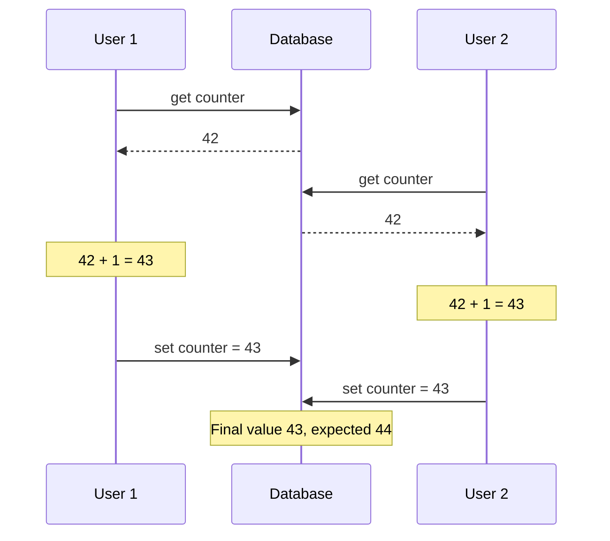

*ACID isolation:* concurrent transactions don't interfere. Textbooks formalise it as **serializability**: each transaction can act as if it runs alone, and the committed result equals *some* serial order, though they actually overlapped.

*Common confusion.* Serializable isolation is **rarely used** in practice due to its performance cost; some databases lack it: **Oracle 11g**'s "serializable" is actually the weaker **snapshot isolation** (covered below).

#### Durability

*What it is.* Once committed, data won't be forgotten despite hardware failure or crashes.

*How:* on a **single node**, written to **non-volatile storage** (hard drive or SSD), usually with a **write-ahead log** (Chapter 3) to recover corrupted structures; in a **replicated** database, copied to **some number of nodes**. Either way, the database must **wait** for this before reporting a commit.

*Limitation.* **Perfect durability doesn't exist**: if all disks and backups are destroyed at once, nothing helps.

> **Replication and Durability (sidebar).** Durability historically meant archive tape, then disk/SSD, now replication. None is perfect:
> - A dead machine's disk is safe but *unreachable* until repaired or moved; replicated systems stay available.
> - A **correlated fault** (power outage, a bug crashing all nodes on one input) can take out all replicas at once, losing anything only in memory — so disk writes matter even for in-memory databases.
> - With **asynchronous replication**, recent writes can be lost if the leader fails.
> - On sudden power loss **SSDs** sometimes violate their guarantees; even `fsync` isn't guaranteed to work correctly; disk **firmware has bugs**.
> - Subtle storage-engine/**filesystem** interactions can cause hard-to-find bugs and corrupted files after a crash.
> - Disk data can **silently rot**; if unnoticed, replicas and recent backups may be corrupt too, requiring an older backup.
> - One study: **30% to 80% of SSDs** develop at least one bad block in their **first four years**; magnetic disks have fewer bad sectors but fail completely more often.
> - An **unpowered** SSD may start losing data within **a few weeks**, depending on temperature.
>
> Takeaway: no absolute guarantees, only combinable risk-reduction techniques (disk writes, remote replication, backups). Treat theoretical "guarantees" sceptically.

### Single-Object and Multi-Object Operations

For **several writes in one transaction**: **atomicity** = all-or-nothing on failure; **isolation** = another transaction sees **all or none** of the writes, never a subset. These assume a **multi-object transaction**, needed whenever several pieces of data must stay in sync.

*The book's email example.* Show a user's unread count with a query (ours):

```sql
SELECT COUNT(*) FROM messages
WHERE owner_id = 7 AND is_read = false;
```

With many messages this is too slow, so you **denormalize** with an `unread_count` field, incremented on arrival and decremented on read — now two things must change together.

*Figure 7-2 — isolation violated.* User 1 inserts an email then increments the counter; between those writes, User 2 sees the new unread email but a counter of 0 — a **dirty read**. Isolation guarantees both changes or neither. (Trivial for a counter; serious for an account balance and a payment.)

*Figure 7-2 (redrawn): a reader sees the new email but not the updated counter (dirty read)*
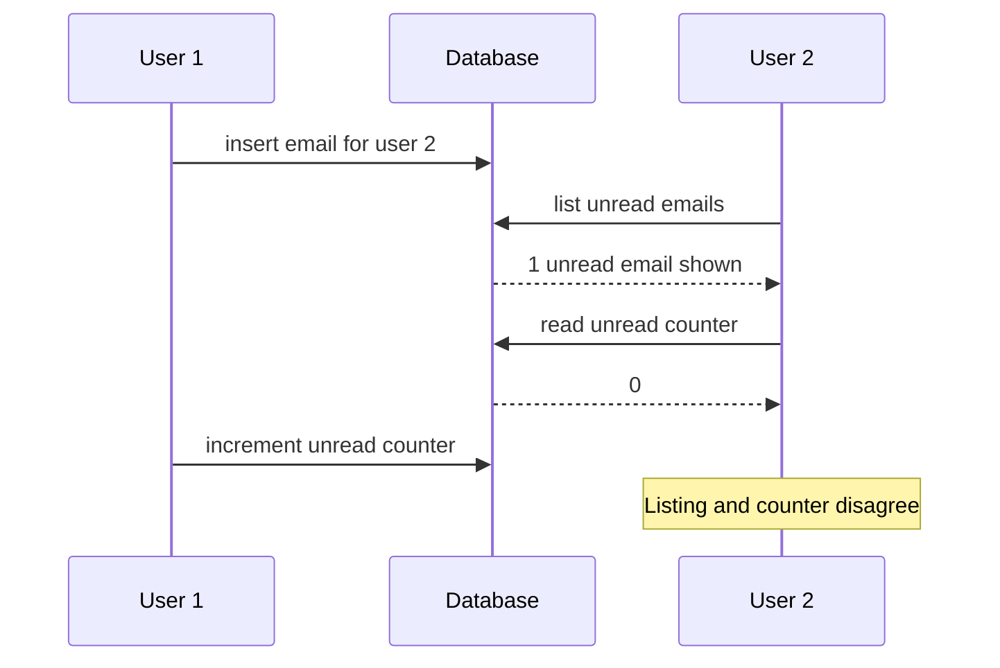

*Figure 7-3 — atomicity needed.* The email insert succeeds but the counter update fails; with atomicity the whole transaction aborts and the insert is **rolled back**, keeping them in sync.

*Figure 7-3 (redrawn): an error during the counter update causes the earlier email insert to be undone*
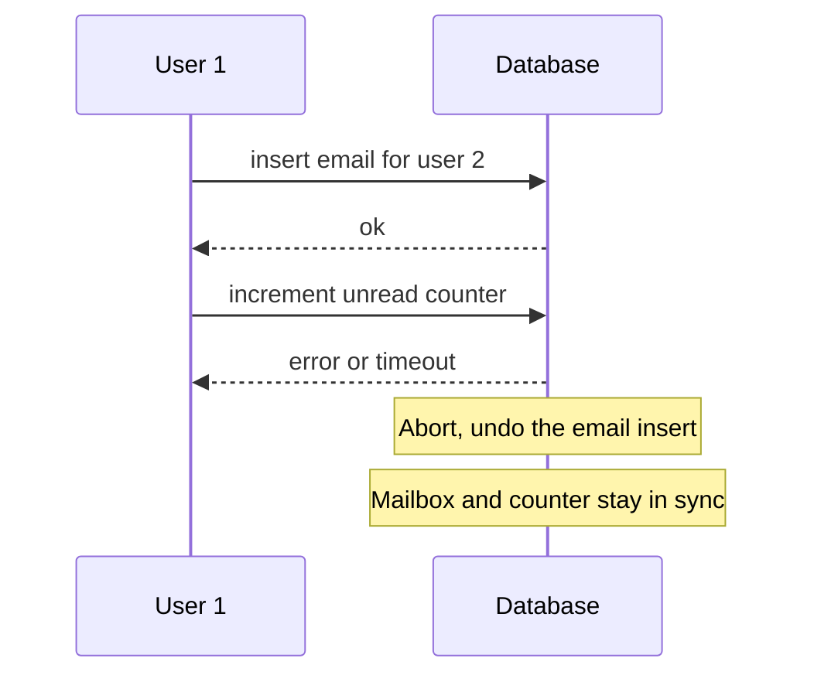

*Grouping operations.* In relational databases a transaction is usually tied to the client's **TCP connection**: everything between `BEGIN TRANSACTION` and `COMMIT` on that connection. (Not ideal: if the connection drops after the commit request but before confirmation, the client can't tell whether it committed. A transaction manager can use a connection-independent **transaction ID** — Chapter 12, "The End-to-End Argument for Databases".)

Many **non-relational** databases can't group operations; even a **multi-put** may lack transaction semantics, leaving some keys updated and others not.

#### Single-object writes

Atomicity and isolation matter even for **one** object. Writing a **20 KB JSON document**: what if the network drops after **10 KB**, power fails mid-overwrite (old and new bytes spliced?), or another client reads mid-write? So storage engines almost always give **single-object atomicity** (via a **crash-recovery log**, Chapter 3) and **isolation** (via a **per-object lock**, one thread at a time) on one node.

Some databases add **more complex single-object atomic operations**: an **increment** (avoiding Figure 7-1's read-modify-write), and **compare-and-set** (write only if unchanged). These prevent lost updates, but calling them **transactions** — as vendors do with "lightweight transactions" or even "ACID" — is misleading: a transaction normally groups **several operations on several objects**. (Strictly, "atomic increment" uses the threading sense; in ACID terms it would be *isolated* or *serializable* — a nitpick.)

#### The need for multi-object transactions

Many distributed datastores dropped multi-object transactions because they are **hard across partitions** and can hurt very-high-availability or performance needs — but distributed transactions aren't *impossible* (Chapter 9). Cases needing several objects to change together:

1. **Foreign keys / graph edges:** records referencing each other must have correct references.
2. **Denormalized documents:** single-document updates need no multi-object transaction, but document databases without joins encourage denormalization, and updating copies (like Figure 7-2) touches several documents.
3. **Secondary indexes:** must be updated with every value change; each index is a separate object, so without isolation a record may appear in one index but not another.

These apps can work without transactions, but error handling gets much harder without atomicity, and missing isolation causes concurrency bugs (next; Chapter 12 explores alternatives).

#### Handling errors and aborts

*Philosophy.* Transactions **can be aborted and safely retried**; ACID databases abandon a transaction entirely rather than leave it half done.

*Not universal.* **Leaderless replication** datastores (Chapter 5) work on a **"best effort"** basis: they won't undo what already happened after an error; recovery is the app's job.

*Common mistake.* Developers code for the happy path. Popular **ORM** frameworks (**ActiveRecord** in Rails, **Django**) **don't retry** aborted transactions: the exception bubbles up, user input is lost, and an error page is shown — defeating the purpose of aborts.

*Retrying is useful but imperfect* (also see [System Design Fundamentals](../00a-system-design-fundamentals/README.md)):

| Problem with retry | Why / what to do |
|---|---|
| The commit actually succeeded, but the acknowledgement was lost on the network | Retrying runs it twice, unless the app has its own **deduplication**. |
| The error was caused by **overload** | Retrying makes it worse. Limit retries, use **exponential backoff** (wait 1 s, then 2 s, then 4 s, … between attempts), and handle overload errors specially. |
| The error is **permanent** (e.g. constraint violation) | Retrying is pointless. Only retry **transient** errors: deadlock, isolation violation, brief network glitches, failover. |
| The transaction has **side effects outside the database** (e.g. sending an email) | They may happen even if it aborts; don't resend on each retry. For multi-system commit/abort, see **two-phase commit** (Chapter 9). |
| The **client process dies** while retrying | Whatever it was trying to write is lost. |

## Weak Isolation Levels

*When concurrency issues arise.* Transactions on disjoint data can run in parallel safely; trouble starts when one **reads data another is modifying**, or both **modify the same data**.

*Why they're nasty.* **Hard to find by testing** (only with unlucky, rare, hard-to-reproduce timing) and **hard to reason about**, especially in large codebases where you don't know what else touches the data.

**Serializable isolation** would let you ignore concurrency entirely, but costs performance, so many systems use **weaker isolation levels** that prevent some issues but not all — harder to understand, causing subtle bugs, yet widely used.

*Real damage.* Weak-isolation bugs have caused **large financial losses** (e.g. bitcoin stolen from the Poloniex exchange in 2014), **financial auditor investigations**, and **corrupted customer data**. "Use an ACID database for money!" misses the point: many popular relational databases default to weak isolation and wouldn't have prevented these bugs.

So **understand the kinds of race conditions** and how to prevent them. The book covers weak (non-serializable) levels informally; rigorous definitions are in the literature.

### Read Committed

The most basic level. Two guarantees:

1. **No dirty reads:** reads see only committed data.
2. **No dirty writes:** writes overwrite only committed data.

(Some databases offer a weaker **read uncommitted**, preventing dirty writes but allowing dirty reads.)

#### No dirty reads

*What it is.* A **dirty read** sees another transaction's uncommitted writes. Under read committed, writes become visible **only at commit, all at once**.

*Figure 7-4.* User 1 sets `x = 3` and `y = 3` without committing; User 2 keeps reading the old value **2** until User 1 commits.

*Figure 7-4 (redrawn): no dirty reads, the new x becomes visible to user 2 only once user 1 commits*
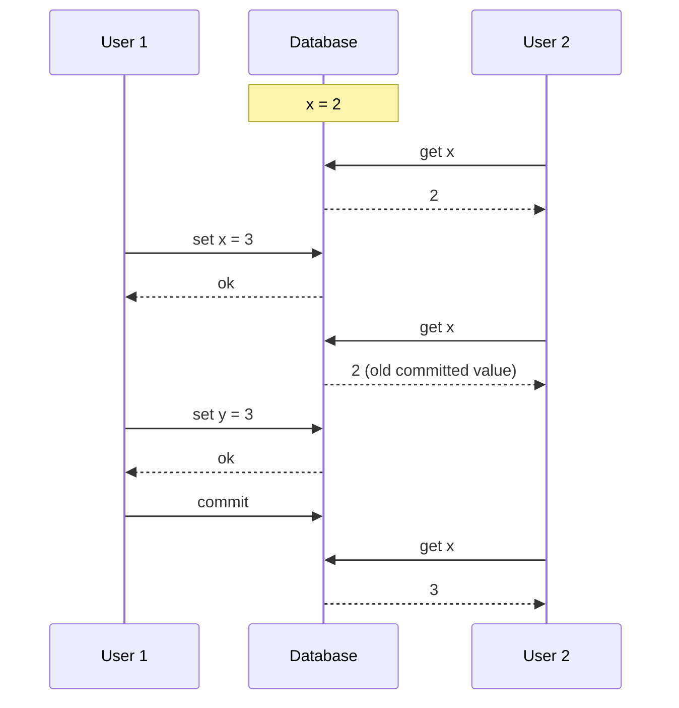

*Why prevent them?* A dirty read can show **some of a transaction's updates but not others** (Figure 7-2's mismatch), confusing users and misleading other transactions. And if the transaction **aborts** (Figure 7-3), a dirty reader saw data **never committed**, which is very hard to reason about.

#### No dirty writes

*What it is.* A **dirty write** overwrites a value written by a transaction that **hasn't committed**. Read committed prevents it, usually by **delaying the second write** until the first transaction commits or aborts.

*What it prevents:* **mixing up multi-object writes.** Book example (Figure 7-5): Alice and Bob buy the same car; a purchase updates the **listing** and sends the **invoice**. With dirty writes, Bob wins the listing but Alice gets the invoice.

*What it doesn't prevent:* Figure 7-1's counter race — the second write comes after the first transaction commits, so it isn't a dirty write; it's a **lost update** (below).

*Figure 7-5 (redrawn): with dirty writes, Bob ends up with the listing while Alice gets the invoice*
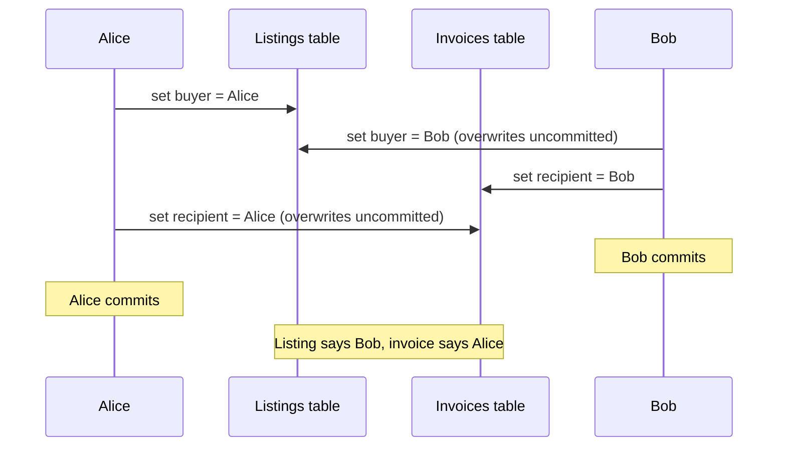

#### Implementing read committed

**Very popular**: the default in **Oracle 11g**, **PostgreSQL**, **SQL Server 2012**, **MemSQL** and others.

*Dirty writes — row-level locks:* a transaction **acquires a lock** on an object before modifying it and **holds** it until commit or abort; only one transaction can hold it, others **wait**. Done **automatically** at read committed and above.

*Dirty reads — option 1: read locks (rarely used).* Readers briefly take the same lock. **Problem:** one long write transaction makes many read-only transactions wait, hurting response times and operability (slowdowns spread across the app). When the book was written, only **IBM DB2** and **Microsoft SQL Server with `read_committed_snapshot=off`** did this.

*Dirty reads — option 2: remember old values (most databases).* For each object being written, keep **the old committed value and the new uncommitted one**; others read the **old** value until the writer commits, then the **new** one (Figure 7-4).

### Snapshot Isolation and Repeatable Read

Read committed supports aborts, hides incomplete transactions, and prevents interleaved writes — real improvements — but many concurrency bugs remain.

*Figure 7-6 — read skew.* Alice has **$1,000** in two accounts, **$500** each. A transfer moves **$100** from account 2 to account 1. She reads account 1 *before* the transfer (**$500**) and account 2 *after* (**$400**): apparently only **$900**.

*Figure 7-6 (redrawn): Alice reads the two accounts at different moments during a transfer and sees only 900 dollars total*
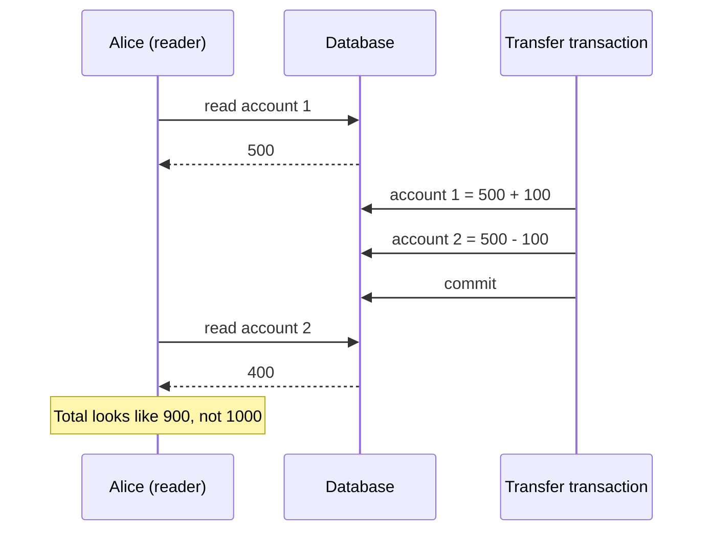

This is **read skew** (**nonrepeatable read**): re-reading account 1 at the end would give **$600**. Read committed **allows** it, since each value was committed when read. ("Skew" here is a **timing anomaly**, unlike Chapter 6's unbalanced load.)

For Alice it's temporary, but some cases **can't tolerate** temporary inconsistency:
- **Backups:** copying a large database takes **hours** while writes continue; a restored backup makes inconsistencies (vanished money) **permanent**.
- **Analytic queries and integrity checks:** large scans give **nonsense** if they see different parts at different times.

*The fix — snapshot isolation:* each transaction reads a **consistent snapshot** of everything committed **when it started**, unaffected by later changes. Ideal for long read-only jobs like backups and analytics, which are hard to reason about on changing data. Supported by **PostgreSQL, MySQL with InnoDB, Oracle, SQL Server**, and others.

#### Implementing snapshot isolation

*Writes:* like read committed, typically **write locks** prevent dirty writes (a writer can block another writer on the same object).

*Reads:* **no locks**. Key principle:

> **A reader never has to wait for a writer, and a writer never has to wait for a reader.**

So long reads on a consistent snapshot run alongside normal writes without lock contention.

*MVCC.* Generalising Figure 7-4: since in-progress transactions may need the database at **different points in time**, keep **several committed versions** per object: **multi-version concurrency control (MVCC)**.

| Level | Versions needed | Snapshot scope (typical MVCC implementation) |
|---|---|---|
| Read committed | Two are enough: committed + not-yet-committed | A new snapshot for **each query** |
| Snapshot isolation | Many committed versions | One snapshot for the **whole transaction** |

Engines supporting snapshot isolation usually implement read committed with MVCC too.

*PostgreSQL's implementation (Figure 7-7; others similar):*
1. Each transaction gets a unique, **always-increasing transaction ID (txid)**; its writes are **tagged with it**.
2. Each row has **`created_by`** (inserting txid) and **`deleted_by`** (initially empty).
3. **Delete** sets `deleted_by` instead of removing the row.
4. **Update** = **delete + create**: in Figure 7-7, transaction 13 takes $100 from account 2, leaving the **$500** row with `deleted_by = 13` and a new **$400** row with `created_by = 13`.
5. **Garbage collection** removes deleted rows once no transaction can see them.

(PostgreSQL txids are **32-bit**, overflowing after about **4 billion** transactions; its **vacuum** process prevents this from affecting data.)

*Figure 7-7 (redrawn): MVCC in PostgreSQL, an update creates a new row version and marks the old one deleted*
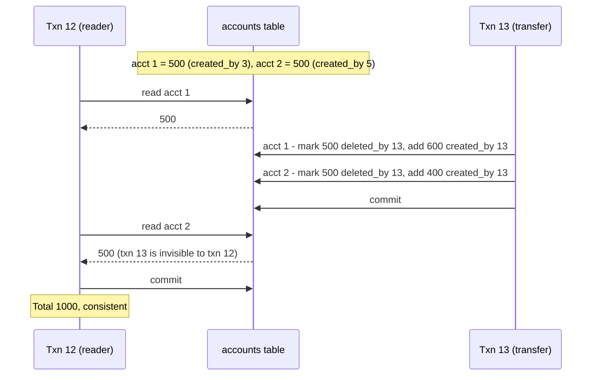

#### Visibility rules for observing a consistent snapshot

1. At transaction **start**, list all transactions **in progress**; ignore their writes even if they later commit.
2. Ignore writes by **aborted** transactions.
3. Ignore writes by transactions with a **later txid**, **whether or not** committed.
4. **Everything else** is visible.

These apply to creations and deletions. In Figure 7-7, transaction 12 sees **$500** for account 2: rule 3 hides both transaction 13's deletion and its new $400 row.

Equivalently, an object is **visible** if **both**: its creator **had committed** when the reader started; and it is **not deleted**, or its deleter **hadn't committed** when the reader started.

A long transaction may keep reading long-overwritten versions; since values are never updated in place (each update creates a new version), consistent snapshots are cheap.

#### Indexes and snapshot isolation

- **Approach 1:** the index points to **all versions**; lookups **filter out** invisible ones, and garbage collection removes index entries with old versions. Implementation details matter, e.g. **PostgreSQL** skips index updates when an object's versions fit on the **same page**.
- **Approach 2 — append-only / copy-on-write B-trees** (**CouchDB, Datomic, LMDB**): pages are never overwritten; a changed page is **copied**, and its parents up to the **root** are copied to point at it, while untouched pages are shared. Each write transaction (or batch) creates a **new root**, which *is* a consistent snapshot — no txid filtering needed, since later writes only create new roots. Requires background **compaction and garbage collection**.

#### Repeatable read and naming confusion

| Database | Name used for snapshot isolation |
|---|---|
| Oracle | "serializable" |
| PostgreSQL, MySQL | "repeatable read" |
| IBM DB2 | uses "repeatable read" to mean **serializability** (not snapshot isolation) |

*Why the mess?* The **SQL standard**'s isolation definitions come from **System R (1975)**, before snapshot isolation existed. It defines **repeatable read**, superficially similar, so PostgreSQL and MySQL use that name to claim compliance. The standard's definitions are **flawed** (vague, imprecise, implementation-dependent), so "repeatable read" databases give very different guarantees; a **formal** research definition exists, but most implementations don't meet it. Punchline: **no one really knows what "repeatable read" means.**

### Preventing Lost Updates

So far: what **read-only** transactions see during concurrent writes. Concurrent **writing** transactions (beyond dirty writes) bring the best-known conflict, the **lost update** (Figure 7-1).

*What it is.* In a **read-modify-write cycle** (read, change in code, write back), two concurrent cycles let the later write **clobber** the earlier, since it didn't include it.

*Where it occurs:* incrementing a counter or updating a balance; editing part of a complex value (appending to a list inside a JSON document); two users editing a **wiki page** and each saving the **whole page**.

#### Atomic write operations

**Atomic update operations** remove the read-modify-write cycle from app code; when they fit, they are usually the **best solution**. Ours:

```sql
UPDATE page_views SET hits = hits + 1 WHERE page = '/home';
```

Concurrency-safe in most relational databases. **MongoDB** offers atomic partial-document updates; **Redis** atomic operations on structures like **priority queues**. Not everything fits (wiki edits are arbitrary text; expressing them as atomic mutations is possible but complex — "Automatic Conflict Resolution", Chapter 5).

*Implementation:* take an **exclusive lock** on the object when read so no one else reads it until the update is applied (**cursor stability**), or run all atomic operations on a **single thread**.

*Common pitfall.* **ORM frameworks** make it easy to write unsafe read-modify-write code instead of using atomic operations — a source of subtle bugs tests rarely catch.

#### Explicit locking

If built-in atomic operations don't suffice, the **application explicitly locks** objects to be updated; other transactions reading them wait until the cycle finishes.

*Book example:* a multiplayer game where several players may move the **same piece**; the move must be **validated against game rules** (not expressible as a query), so lock the row. Ours — `FOR UPDATE` locks every row the query returns until commit:

```sql
BEGIN TRANSACTION;

SELECT * FROM tokens
  WHERE label = 'knight' AND match_id = 51
  FOR UPDATE;

-- app checks the move is legal, then:
UPDATE tokens SET square = 'e5' WHERE id = 908;

COMMIT;
```

Works, but forgetting a lock anywhere reintroduces the race.

#### Automatically detecting lost updates

Instead of forcing cycles to run **one at a time**, let them **run in parallel**; when the transaction manager **detects** a lost update, it **aborts** the offending transaction for retry. This check can run **efficiently with snapshot isolation**.

| Database / level | Detects lost updates automatically? |
|---|---|
| PostgreSQL repeatable read | Yes |
| Oracle serializable | Yes |
| SQL Server snapshot isolation | Yes |
| MySQL/InnoDB repeatable read | **No** |

Some argue a database must prevent lost updates to count as snapshot isolation; by that definition **MySQL doesn't provide snapshot isolation**. Benefit: **no special app code**, so **less error-prone** than remembering locks or atomic operations.

#### Compare-and-set

Databases **without** transactions may offer atomic **compare-and-set**: update only if **unchanged since read**, else retry the cycle. Ours — check the affected row count afterwards; zero means someone else edited it, so re-read and retry:

```sql
-- Safe or not depends on the database implementation
UPDATE notes SET body = 'edited text'
  WHERE id = 77 AND body = 'text I originally read';
```

**Warning:** if the `WHERE` clause may read from an **old snapshot**, the condition can pass despite a concurrent write, so lost updates are **not** prevented. Verify your database's compare-and-set is safe.

#### Conflict resolution and replication

With replicas on several nodes changed concurrently:

- **Locks and compare-and-set assume one up-to-date copy.** Multi-leader and leaderless replication allow concurrent async writes with no single up-to-date copy, so these **don't apply** (more under linearizability, Chapter 9).
- **Common approach:** let concurrent writes create conflicting versions (**siblings**) and merge them later in app code or with special data structures (Chapter 5).
- **Atomic operations work well** if **commutative** (any order on different replicas gives the same result), e.g. incrementing a counter, adding to a set. **Riak 2.0 datatypes** merge concurrent updates automatically so none are lost.
- **Last write wins (LWW)** is **prone to lost updates**, yet it is the **default** in many replicated databases.

### Write Skew and Phantoms

Dirty writes and lost updates involve writes to the **same** object; subtler conflicts exist.

*Hospital example (Figure 7-8).* Doctors manage **on-call shifts**; at least **one** must be on call, and a doctor can go off call if a colleague remains. **Alice and Bob**, the only two on call, both feel ill and request off call almost simultaneously:

1. Each transaction counts on-call doctors; under **snapshot isolation** **both see 2**.
2. Both decide it's safe.
3. Alice's transaction updates **her** record, Bob's **his**.
4. Both commit: **zero** doctors on call — rule broken.

*Figure 7-8 (redrawn): Alice and Bob both see two doctors on call, both go off call, leaving nobody*
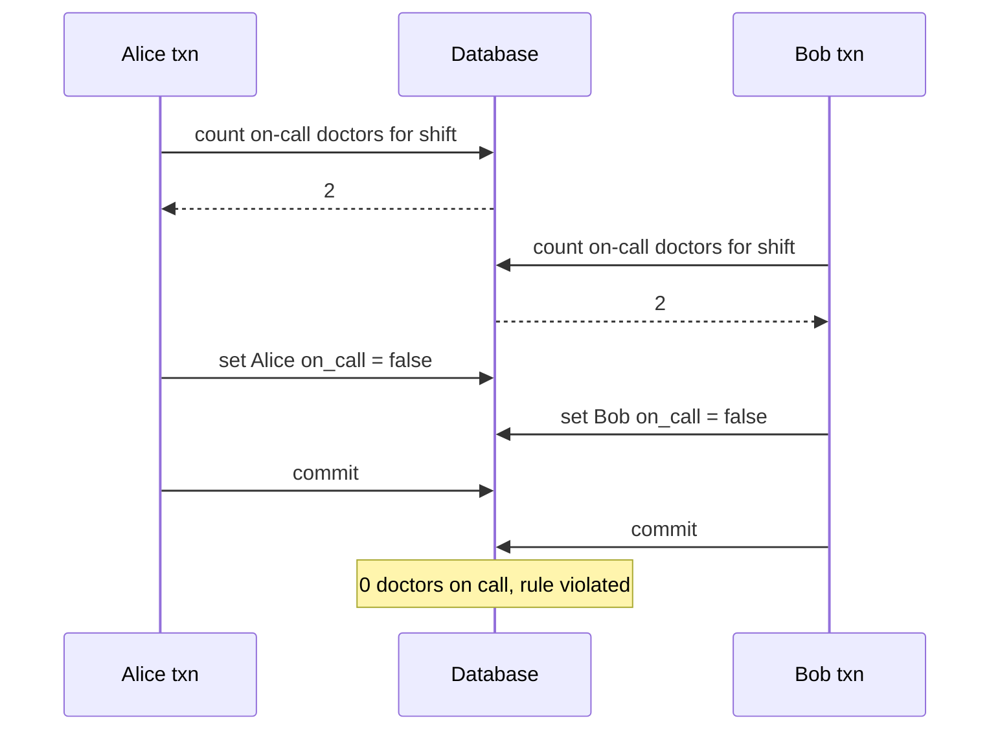

#### Characterizing write skew

*What it is.* **Write skew**: not a dirty write or lost update, since the transactions update **different** objects (Alice's and Bob's rows), but clearly a race — run serially, the second would have been refused.

*Mental model:* a **generalisation of lost update**: two transactions **read an overlapping set of objects** and each **modifies some of them** (possibly different ones). If they modify the same object, it's a dirty write or lost update depending on timing.

*Fewer options than for lost updates:*

| Technique | Helps with write skew? |
|---|---|
| Atomic single-object operations | **No** — several objects are involved. |
| Automatic lost-update detection in snapshot isolation | **No** — not detected in PostgreSQL repeatable read, MySQL/InnoDB repeatable read, Oracle serializable, or SQL Server snapshot isolation. Only **true serializable** isolation prevents it automatically. |
| Database constraints | Only for a **multi-object** constraint ("at least one on call"), which most databases lack; **triggers** or **materialized views** may work, depending on the database. |
| Explicitly locking the rows the transaction depends on | **Yes** — the second-best option if serializable is unavailable. |

Our locking fix for an on-call rota — the `FOR UPDATE` locks every available engineer in slot 42, so a concurrent check waits; the app verifies at least 2 before updating:

```sql
BEGIN TRANSACTION;

SELECT * FROM rota
  WHERE available = true
  AND slot_id = 42 FOR UPDATE;

UPDATE rota
  SET available = false
  WHERE engineer = 'Priya'
  AND slot_id = 42;

COMMIT;
```

#### More examples of write skew

- **Meeting room booking.** No two overlapping bookings for one room: check for overlaps, then insert. Snapshot isolation doesn't stop a concurrent clashing insert; serializable isolation is needed. Ours — an existing booking overlaps if it ends after our start *and* starts before our end; two concurrent transactions can both count zero and both insert:

  ```sql
  BEGIN TRANSACTION;

  -- Any booking for desk 9 that overlaps 09:00-11:00?
  SELECT COUNT(*) FROM desk_bookings
    WHERE desk_id = 9 AND
      ends_at > '2024-03-04 09:00' AND starts_at < '2024-03-04 11:00';

  -- If the count was zero:
  INSERT INTO desk_bookings (desk_id, starts_at, ends_at, person_id)
    VALUES (9, '2024-03-04 09:00', '2024-03-04 11:00', 314);

  COMMIT;
  ```

  (PostgreSQL's **range types** make this more elegant but aren't widely supported elsewhere.)

- **Multiplayer game.** The earlier lock stops two players moving the **same** piece, not moving **different pieces to the same square** or other rule violations; a unique constraint may help for some rules, otherwise write skew is possible.
- **Claiming a username.** Two simultaneous sign-ups each check the name is free; unsafe under snapshot isolation. **Fix:** a **unique constraint** aborts the second insert.
- **Preventing double-spending.** Insert a tentative spend, list all items, check the balance stays positive; two concurrent spends can drive it negative unnoticed.

#### Phantoms causing write skew

The common pattern:

1. A `SELECT` checks a **requirement** via rows matching a condition (≥ 2 doctors on call, no overlapping booking, square empty, username free, enough money).
2. App code **decides** to proceed or abort based on the result.
3. It **writes** (`INSERT`, `UPDATE`, `DELETE`) and commits, **changing the precondition** of step 2 (rerunning step 1 would now differ).

Steps may be reordered (e.g. write first, then query, then decide).

*Why locking doesn't always work.* In the doctors case, the updated row was **among those step 1 returned**, so `SELECT FOR UPDATE` could lock it. The other examples check for **absence** of rows and then **add** one; if step 1 returns nothing, there is **nothing to lock**.

*Definition.* A **phantom**: one transaction's write changes the result of another's **search query**. Snapshot isolation prevents phantoms in **read-only** queries; in **read-write** transactions they can cause especially tricky write skew.

#### Materializing conflicts

If the problem is **no object to lock**, **create one artificially**. For meeting rooms: a table of **time slots × rooms** (e.g. **15-minute** slots), **pre-populated** for, say, the **next six months**. A booking transaction first locks (`SELECT FOR UPDATE`) the slot rows for its room and time range, then checks overlaps and inserts. The slots table holds **no booking data** — it's purely locks.

This is **materializing conflicts**: turning a phantom into a lock conflict on concrete rows. **Downsides:** hard and error-prone to design, and leaks concurrency control into the data model. A **last resort**; serializable isolation is usually far better.

## Serializability

Read committed and snapshot isolation prevent some races but not others (write skew, phantoms). The situation is grim:

- Isolation levels are **hard to understand** and **inconsistently implemented** (e.g. "repeatable read").
- It's **hard to tell from app code** whether it's safe at a given level, especially in large apps.
- **No good tools** detect race conditions; static analysis might help in principle but hasn't reached practice, and testing is hard because problems are **nondeterministic**.

True since weak isolation appeared in the **1970s**; researchers' answer has always been **serializable isolation**.

*What it guarantees.* Usually the **strongest** level: parallel transactions produce the same result as running **one at a time** in some order, so transactions correct alone stay correct concurrently — **all** race conditions prevented.

*Why not everyone uses it:* implementation cost. Three techniques: **actual serial execution**; **two-phase locking (2PL)** (for decades the only viable option); **optimistic concurrency control** such as **serializable snapshot isolation (SSI)**. This chapter covers single nodes; Chapter 9 generalises.

### Actual Serial Execution

*The idea.* Eliminate concurrency: run **one transaction at a time, in serial order, on a single thread** — serializable **by definition**.

*Why only recently?* Only around **2007** did designers decide a single-threaded loop was feasible; for **30 years** before, multi-threading was considered essential. What changed:

- **RAM got cheap** enough that the **active dataset often fits in memory** (Chapter 3), so transactions run much faster without disk waits.
- **OLTP transactions are usually short** (few reads and writes); long analytic queries are usually read-only and can run on a **consistent snapshot** **outside** the serial loop.

*Who:* **VoltDB/H-Store, Redis, Datomic**. Single-threaded systems can **outperform** concurrent ones by avoiding locking overhead, but throughput is limited to **one CPU core**, and transactions must be structured differently.

#### Encapsulating transactions in stored procedures

*History.* Early designers hoped a transaction could cover a **whole user flow** (e.g. booking a flight: search, choose, book legs, passenger details, pay).

*Problem:* **humans are slow**; databases can't efficiently handle huge numbers of mostly **idle** open transactions. So OLTP apps keep transactions short and never wait for users inside one; on the web, a transaction **commits within one HTTP request**.

*Still interactive.* Statements are usually sent **one at a time**: app sends a query, reads the result, sends another — many **network round trips**. A one-transaction-at-a-time database would mostly sit **idle waiting** for the app, giving terrible throughput, which is why such databases run many transactions concurrently.

*The fix.* Single-threaded serial systems **disallow interactive multi-statement transactions**; the app submits the **entire transaction code up front** as a **stored procedure**, which runs very fast if all data is in memory (no network or disk waits).

*Figure 7-9 (redrawn): interactive transaction with many round trips vs a stored procedure sent in one call (using the on-call example)*
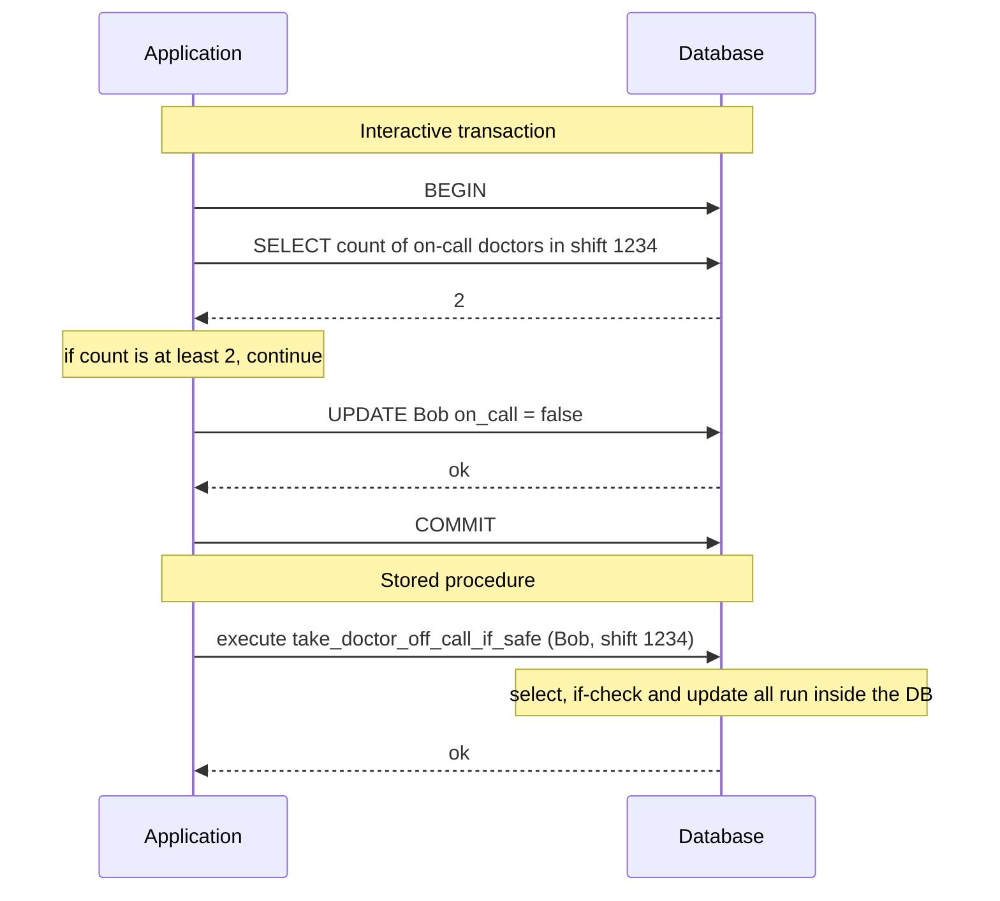

#### Pros and cons of stored procedures

Stored procedures are long-standing (in the SQL standard as **SQL/PSM** since **1999**) but have a poor reputation:

- **Vendor-specific languages** — **Oracle: PL/SQL**, **SQL Server: T-SQL**, **PostgreSQL: PL/pgSQL** — dated, with weak library ecosystems.
- **Code in the database is hard to manage**: debugging, version control, deployment, testing, and metrics/monitoring are harder.
- **Databases are more performance-sensitive** than app servers (one database serves many app servers), so a badly written procedure does more damage.

*These are surmountable* with **general-purpose languages**:

| System | Stored procedure language |
|---|---|
| VoltDB | Java or Groovy |
| Datomic | Java or Clojure |
| Redis | Lua |

With stored procedures and **in-memory** data, single-threaded execution avoids I/O waits and concurrency-control overhead, giving good throughput on one thread.

*Replication with procedures.* **VoltDB** replicates by running the **same stored procedure on each replica** rather than copying writes, so procedures must be **deterministic**; current date/time must come from special **deterministic APIs**.

#### Partitioning

*Problem.* Serial execution limits throughput to **one CPU core on one machine**; read-only transactions can run elsewhere on snapshots, but **write-heavy** apps bottleneck.

*Solution: partition the data* (Chapter 6), as **VoltDB** supports: if **each transaction touches a single partition**, each partition gets its **own single-threaded transaction processor**, and assigning one per CPU core makes throughput **scale linearly** with cores.

*Catch — cross-partition transactions* need **coordination** across all touched partitions, running the procedure **in lock-step** on each to stay serializable. They are **vastly slower**: VoltDB reports about **1,000 cross-partition writes per second**, orders of magnitude below single-partition throughput, and **not improved** by adding machines.

Single-partition feasibility depends on **data structure**: simple key-value data partitions easily; data with **multiple secondary indexes** likely needs much cross-partition coordination (Chapter 6).

#### Summary of serial execution

Serial execution achieves serializable isolation **under constraints**:

- **Every transaction must be small and fast** — one slow one stalls all.
- **The active dataset must fit in memory**; rarely accessed data could be on disk, but a single-threaded transaction touching it would grind everything to a halt.
- **Write throughput must fit one CPU core**, or transactions must partition **without** cross-partition coordination.
- **Cross-partition transactions** are possible only up to a hard limit.

> **Anti-caching (footnote).** If a transaction needs data not in memory, **abort** it, **load** the data in the background while others continue, then **restart** it.

### Two-Phase Locking (2PL)

For about **30 years**, **two-phase locking (2PL)** was the only widely used serializability algorithm.

> **2PL is not 2PC.** Two-phase locking and two-phase commit (2PC, Chapter 9) are completely different. (The variant here is also called **strong strict two-phase locking (SS2PL)**.)

*What it is.* Locks already prevent dirty writes; 2PL makes them **much stronger**. Concurrent **reads** of an object are allowed if no one writes it, but **writes** need **exclusive** access:

- If **A has read** an object and **B wants to write** it, B waits until A commits or aborts.
- If **A has written** an object and **B wants to read** it, B waits until A commits or aborts (reading an old version isn't allowed).

So **writers block writers *and* readers, and readers block writers** — the opposite of snapshot isolation's principle, and the key difference. In return, 2PL is **serializable**, preventing **all** races including lost updates and write skew.

#### Implementation of two-phase locking

*Used by* **MySQL (InnoDB)** and **SQL Server** for **serializable**, and **DB2** for its level called **repeatable read**.

*Mechanism:* each object's lock is in **shared** or **exclusive** mode.
1. **Read** → acquire **shared** (many may share; wait if someone holds exclusive).
2. **Write** → acquire **exclusive** (wait if any lock exists).
3. **Read then write** → **upgrade** shared to exclusive.
4. Locks are **held until the transaction ends**: **phase one** acquires locks during execution, **phase two** releases them all at the end.

*Deadlocks.* A waits for B while B waits for A: the database **detects** this and **aborts one**, which the **app must retry**.

#### Performance of two-phase locking

*The big downside* (why it isn't universal since the 1970s): throughput and response times are **significantly worse** than under weak isolation.

- Overhead of acquiring and releasing many locks.
- More importantly, **reduced concurrency**: any potential race makes one transaction **wait**.
- Traditional databases **don't limit transaction duration** (designed for interactive apps waiting on humans), so waits are **unbounded**; even short transactions can **queue** on a popular object.
- Hence **unstable latencies** and very slow **high percentiles** under contention; one slow transaction, or one grabbing many locks, can **halt** the system.
- **Deadlocks** occur under lock-based read committed too, but **far more often** under 2PL serializable; each abort wastes work.

#### Predicate locks

*The gap.* The above ignores **phantoms**, which a serializable database **must** prevent. Meeting rooms: if one transaction searched a room's bookings in a time window, another must not concurrently **insert or update** an overlapping booking for that room (other rooms or non-overlapping times are fine).

*Predicate lock:* like a shared/exclusive lock, but on **all objects matching a search condition** — e.g. (ours) the whole `WHERE` clause below, "desk 9, overlapping 09:00–11:00":

```sql
SELECT * FROM desk_bookings
  WHERE desk_id = 9 AND
    ends_at > '2024-03-04 09:00' AND
    starts_at < '2024-03-04 11:00';
```

*Rules:*
1. To **read** matching objects, A takes a **shared-mode predicate lock**; if B holds an **exclusive lock** on any matching object, A waits.
2. Before A **inserts, updates or deletes**, it checks the object's **old and new values** against existing predicate locks; if B's matches, A waits.

*Key idea:* predicate locks cover objects that **don't exist yet** (phantoms). **2PL plus predicate locks** prevents all write skew and races: truly **serializable**.

#### Index-range locks

*Problem:* predicate locks **perform poorly** (checking many active locks is slow), so most 2PL databases use **index-range locking** (**next-key locking**), a **simplified approximation**.

*Why safe:* approximate a predicate with a **broader** one — "room 123, noon–1pm" → "room 123, any time" or "all rooms, noon–1pm"; any write matching the original matches the broader one.

*Mechanism:* the bookings table likely has indexes on `room_id` and/or `start_time`/`end_time`. Using the **`room_id` index**, attach a **shared lock to that index entry** ("someone searched room 123"); using a **time index**, lock a **range of index values** ("bookings overlapping noon–1pm on **January 1, 2018**"). Any transaction inserting/updating/deleting a matching booking must **update the same index part**, hits the lock, and **waits**.

*Trade-off.* Prevents phantoms and write skew; **less precise** (may lock more than necessary) but **much lower overhead** — a good compromise.

*Fallback.* With **no suitable index**, take a **shared lock on the whole table** — safe but bad for performance, blocking all other writers.

### Serializable Snapshot Isolation (SSI)

So far: serializability that **performs poorly** (2PL) or **doesn't scale** (serial execution), vs weak levels that perform well but allow races. Must we choose?

Perhaps not: **serializable snapshot isolation (SSI)** offers full serializability with only a **small performance penalty** over snapshot isolation. First described in **2008** (**Michael Cahill**'s PhD thesis). Used in **PostgreSQL's serializable level since 9.1** (single-node) and by **FoundationDB** (distributed, a similar algorithm). Still proving itself, but may become the **default**.

#### Pessimistic versus optimistic concurrency control

| | Pessimistic | Optimistic |
|---|---|---|
| Idea | If anything *might* go wrong (someone else holds a lock), **wait** until safe | **Carry on**, hoping all is well; at **commit**, check whether isolation was violated and **abort** if so |
| Analogy | **Mutual exclusion** (only one thread at a time may enter a protected section, usually via a lock or *mutex*) in multi-threaded programming | "Ask forgiveness, not permission" |
| Examples | 2PL; serial execution (extremely pessimistic) | SSI |
| Weakness | Waiting and reduced concurrency | Performs badly under **high contention** — many aborts; retries add load when near max throughput |
| When it does well | Serial execution: when every transaction is tiny and fast. (For 2PL the book mainly stresses the costs: blocking, unstable latency, deadlocks.) | With **spare capacity** and **low contention**, usually **faster** than pessimistic methods |

*Serial execution as extreme pessimism:* like each transaction holding an exclusive lock on the whole database (or partition), compensated by making transactions **very fast**.

*Optimistic concurrency control is an old, long-debated idea.* **Commutative atomic operations** reduce contention: concurrent increments to a counter don't conflict (as long as the counter isn't also read in the same transaction).

*What's new in SSI:* it builds on **snapshot isolation** (all reads from a consistent snapshot), unlike earlier optimistic techniques, adding an algorithm to **detect serialization conflicts among writes** and choose **which transactions to abort**.

#### Decisions based on an outdated premise

In write skew, a transaction reads, examines the result, and **acts** on it; under snapshot isolation, by commit time the result may be **stale**. It acts on a **premise** (e.g. "two doctors are on call") that may have become **false**.

The database can't see how app logic uses query results, so it must assume **any change to the premise may invalidate the writes** (a possible **causal dependency** between reads and writes). For serializability it must **detect** transactions that may have acted on an outdated premise and **abort** them. Two cases:
1. **Reads of a stale MVCC version** (an uncommitted write occurred **before** the read).
2. **Writes that affect earlier reads** (the write occurs **after** the read).

#### Detecting stale MVCC reads

*Situation (Figure 7-10).* MVCC snapshots ignore writes by transactions uncommitted at snapshot time. Transaction **43** sees Alice `on_call = true` because transaction **42** (which changed her) hasn't committed; by the time 43 commits, **42 has committed**, so 43's premise is false.

*Figure 7-10 (redrawn): txn 43 read a value that txn 42 had changed but not committed, so 43 aborts at commit. In the book's table, shift 1234 holds two versions of Alice (on_call true, created_by 1, deleted_by 42; and on_call false, created_by 42), plus Bob (true) and Carol (false); after the abort, 43 retries.*
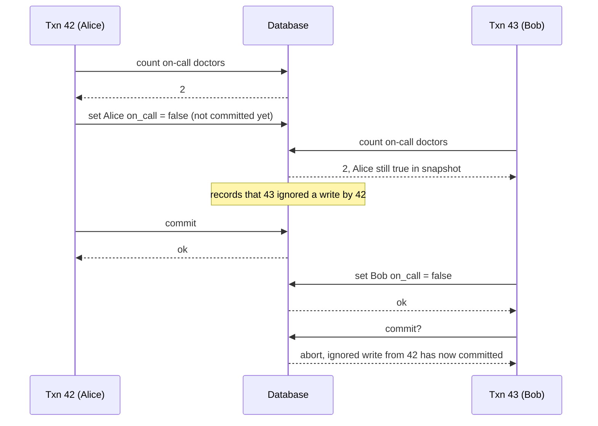

*Detection:* the database **records** whenever MVCC visibility makes a transaction **ignore** another's write; at **commit**, it checks whether any ignored writes **have since committed**, and if so **aborts**.

*Why wait until commit?* If 43 is **read-only**, there's no write skew risk, and at read time the database can't know whether 43 will write. Also 42 might still **abort** or be **uncommitted** when 43 commits, so the read may not be stale. Avoiding needless aborts preserves snapshot isolation's support for **long-running reads**.

#### Detecting writes that affect prior reads

*Situation (Figure 7-11):* another transaction modifies data **after** it was read.

*Detection* borrows **index-range locks** from 2PL, but they **don't block**:
1. Transactions 42 and 43 both query on-call doctors for **shift 1234**; with a `shift_id` index, the database records on **index entry 1234** that 42 and 43 **read** it (without an index, track at **table** level).
2. These records are kept only until the transaction ends **and all transactions concurrent with it have ended**.
3. A **writing** transaction looks in the indexes for transactions that **recently read** the affected data — like taking a write lock on the range, but as a **tripwire** that **notifies** readers their data may be stale instead of blocking.
4. In Figure 7-11, 43 notifies 42 and 42 notifies 43.
5. **42 commits first** successfully: 43's write hasn't taken effect since 43 hasn't committed.
6. When **43 commits**, 42's conflicting write is already committed, so **43 is aborted**.

*Figure 7-11 (redrawn): SSI records reads on index entry shift 1234 and aborts the second committer*
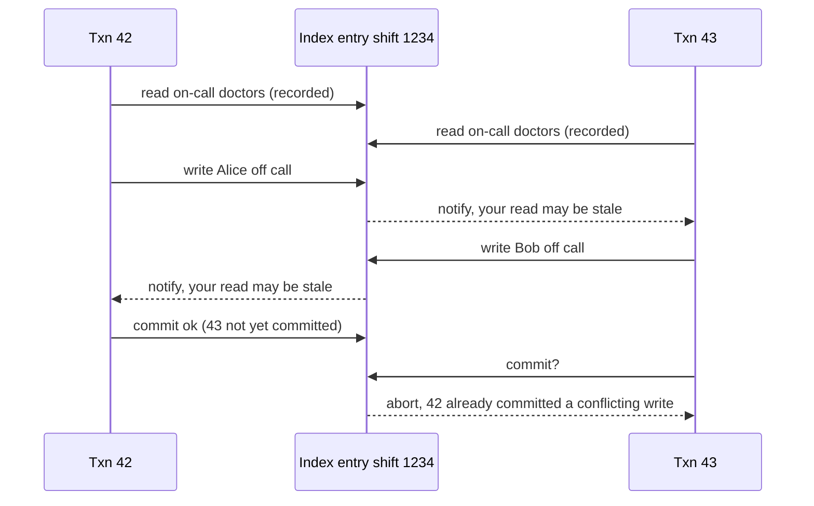

#### Performance of serializable snapshot isolation

*Tracking granularity trade-off:* **detailed** tracking aborts precisely but costs bookkeeping; **coarser** tracking is faster but may abort **more than necessary**.

*Smarter analysis:* sometimes reading overwritten data is provably still serializable; **PostgreSQL** uses this theory to **reduce unnecessary aborts**.

*Versus 2PL:* transactions **don't block on locks**; as in snapshot isolation, **readers and writers never wait for each other**, making latency **more predictable and less variable**, and **read-only queries run lock-free on a snapshot** — great for read-heavy workloads.

*Versus serial execution:* **not limited to one CPU core**; **FoundationDB** distributes conflict detection over **multiple machines** for very high throughput, and transactions can span **multiple partitions** while staying serializable.

*Abort rate* strongly affects performance: long-running read-write transactions likely conflict and abort, so SSI needs **short read-write transactions** (long **read-only** ones are fine). Still, slow transactions probably hurt SSI **less** than 2PL or serial execution.

| Approach | How it serializes | Main strengths | Main weaknesses |
|---|---|---|---|
| Actual serial execution | One transaction at a time, single thread, stored procedures, in-memory | Simple; no lock overhead | Limited to one core per partition; transactions must be tiny; data must fit in RAM; cross-partition is slow (~1,000 writes/s in VoltDB) |
| Two-phase locking | Shared/exclusive locks held to end; predicate or index-range locks for phantoms | Decades of use; prevents all anomalies | Readers and writers block each other; unstable, high tail latency; frequent deadlocks |
| SSI | Snapshot isolation + detect conflicts, abort at commit | No blocking; predictable latency; scales across machines (FoundationDB) | Aborts under high contention; long read-write transactions likely to abort; relatively new |

## Chapter summary

*(Book section: Summary)*

- **Transactions are an abstraction** letting apps pretend certain concurrency problems and hardware/software faults don't exist: many errors reduce to a simple **abort**, and the app retries.
- Apps with very simple access patterns (single-record reads/writes) may not need them; for complex access patterns they **greatly reduce** the error cases to consider.
- Without them, crashes, network interruptions, power outages, full disks and unexpected concurrency can leave data inconsistent (e.g. **denormalized data drifting** from its source).
- Three widely used isolation levels: **read committed**, **snapshot isolation** (sometimes called repeatable read), **serializable**, characterised by these races:

| Anomaly | What happens | What prevents it |
|---|---|---|
| **Dirty reads** | Reading another client's uncommitted writes | Read committed and stronger |
| **Dirty writes** | Overwriting another client's uncommitted write | Almost all transaction implementations |
| **Read skew (nonrepeatable read)** | Seeing different parts of the DB at different moments | Snapshot isolation, usually via MVCC |
| **Lost updates** | Two concurrent read-modify-write cycles; one overwrites the other | Some snapshot isolation implementations detect it automatically; others need a manual lock (`SELECT FOR UPDATE`) |
| **Write skew** | A decision based on a read whose premise is no longer true by write time | Only serializable isolation |
| **Phantom reads** | Another client's write changes the result of your search | Snapshot isolation handles simple phantoms; phantoms causing write skew need things like index-range locks |

- Weak levels leave some anomalies to the app (e.g. explicit locking); **only serializable isolation** covers all. Implementations: **literal serial execution** (if transactions are very fast and throughput fits one core); **two-phase locking** (standard for decades, often avoided for performance); **SSI** (new, optimistic, non-blocking, checks at commit and aborts non-serializable transactions).
- Examples were relational, but transactions matter **for any data model**.
- All of this assumed a **single machine**; distributed transactions bring new challenges (Chapters 8, 9).

## Interview angle

**1. What does ACID mean, and which letter is misleading?**
*30-second answer:* Atomicity = abort on failure and undo everything ("abortability"). Consistency = app-defined invariants hold — the app's job, so the C barely belongs. Isolation = concurrent transactions don't interfere; the ideal is serializability, but most DBs default weaker. Durability = committed data survives crashes, via disk + WAL or replication — never perfect.
- *Follow-up: Is "ACID compliant" meaningful?* Not really; implementations differ, especially on isolation. Oracle's "serializable" is snapshot isolation.
- *Follow-up: ACID atomicity vs threading atomicity?* Threading: no one sees a half-done state (concurrency). ACID: undoing partial work after a fault.

**2. Explain read committed vs snapshot isolation.**
*30-second answer:* Read committed prevents dirty reads and writes (row locks for writes; readers see the last committed value) but allows read skew. Snapshot isolation gives each transaction a consistent snapshot from its start via MVCC (txid-tagged versions plus visibility rules); readers and writers never block each other — great for backups and analytics.
- *Follow-up: Why not read locks against dirty reads?* A long write would stall many readers and spread slowdowns.
- *Follow-up: "Repeatable read"?* Interpreted differently: snapshot isolation in PostgreSQL/MySQL, serializability in DB2 (and Oracle calls snapshot isolation "serializable").

**3. What is a lost update and how do you prevent it?**
*30-second answer:* Concurrent read-modify-write cycles where one write clobbers the other. Fixes: atomic updates (`SET x = x + 1`), explicit locks (`SELECT ... FOR UPDATE`), automatic detection (PostgreSQL repeatable read, Oracle serializable, SQL Server snapshot isolation — not MySQL/InnoDB repeatable read), compare-and-set, and in replicated systems commutative operations or sibling merging. LWW loses updates.
- *Follow-up: Is compare-and-set always safe?* No — if its WHERE reads an old snapshot it can pass despite a concurrent write.

**4. What is write skew? Give an example and fix.**
*30-second answer:* Two transactions read the same data, decide, then write *different* objects, together breaking an invariant — e.g. two on-call doctors both going off call. Snapshot isolation misses it. Fixes: serializable isolation; `FOR UPDATE` on the rows depended on; multi-object constraints via triggers/materialized views; for absence checks (bookings, usernames), unique constraints, materializing conflicts, or serializable.
- *Follow-up: Why can't FOR UPDATE fix bookings?* The check looks for rows that don't exist — nothing to lock: a phantom.

**5. Compare the three ways to implement serializability.**
*30-second answer:* Serial execution — single thread, stored procedures, in-memory; simple but one core per partition and slow cross-partition. 2PL — shared/exclusive locks held to commit plus predicate or index-range locks; correct but blocking, deadlock-prone, bad tail latency. SSI — snapshot isolation plus conflict detection and abort at commit; non-blocking, predictable latency, but aborts rise with contention and long read-write transactions.
- *Follow-up: 2PL vs 2PC?* Unrelated: 2PL is isolation on one DB; 2PC is atomic commit across nodes (Chapter 9).
- *Follow-up: When is optimistic worse?* Under high contention near max throughput — aborts and retries add load.

**6. Why should apps retry aborted transactions, and when is retrying dangerous?**
*30-second answer:* Aborts exist to enable safe retries, yet many ORMs (ActiveRecord, Django) don't retry. Dangers: commit succeeded but the ack was lost (double execution — dedupe); overload (backoff, limits); permanent errors (pointless); external side effects like emails; client dying mid-retry.

## Self-check

1. **Why does the book suggest "abortability" as a better name for atomicity?**
   The defining feature is that a failed transaction is aborted with all writes discarded, making retry safe — not concurrency.

2. **Which ACID property is the application's job rather than the database's, and why?**
   Consistency: only the app knows its invariants; the DB can check some (foreign keys, uniqueness) but generally stores what it's given.

3. **Under read committed, can a transaction see $900 instead of $1,000 during a transfer? What is this called and what fixes it?**
   Yes — read skew (nonrepeatable read). Snapshot isolation fixes it.

4. **In PostgreSQL's MVCC, what happens physically when a row is updated?**
   The old row gets `deleted_by = txid` and a new row with `created_by = txid` is added; garbage collection later removes invisible versions.

5. **List the four visibility rules for a snapshot.**
   Ignore writes of transactions in progress at start; ignore aborted transactions' writes; ignore writes of later txids; everything else is visible.

6. **Scenario:** your app adds a tag to a JSON array by reading the document, appending in code, and writing it back. Two users do it at once and one tag disappears. Name the anomaly and two fixes.
   Lost update. Use an atomic document operation (e.g. MongoDB's) or lock with `SELECT FOR UPDATE`; or rely on automatic lost-update detection if available.

7. **Why is materializing conflicts a last resort?**
   Hard and error-prone to design, and it leaks concurrency control into the data model; serializable isolation is usually better.

8. **Trade-off:** why does 2PL have unstable high-percentile latency?
   Readers and writers block each other, waits are unbounded, queues form on hot objects, one big or slow transaction stalls many, and deadlocks force redone work.

9. **Why does SSI wait until commit to abort a transaction that read a stale value?**
   It may be read-only (no risk), and the other writer may still abort or be uncommitted; waiting avoids needless aborts and keeps long reads working.

10. **Scenario:** a workload has high write throughput, many secondary indexes and frequent cross-entity transactions. Would actual serial execution be a good fit?
    Probably not: one core per partition, many secondary indexes imply cross-partition coordination, and cross-partition transactions are slow (~1,000 writes/s in VoltDB) and don't scale with machines. SSI or 2PL fit better.
