# Chapter 7 — Transactions
*Book: Chapter 7, pp. 221–272*

## Overview

**The question this chapter answers:** when many things can fail at once (crashes, network cuts, several users touching the same data), how can a database let an application act as if most of those problems simply do not happen? The answer the industry settled on decades ago is the **transaction**.

The chapter opens with a list of what goes wrong in real data systems:

- The database software or its hardware can die at any moment, even halfway through writing something.
- The application itself can crash in the middle of a sequence of steps.
- The network can drop, cutting the app off from the database, or one database node off from another.
- Several clients can write at the same moment and clobber each other's changes.
- A client can read data that is only half-updated and therefore makes no sense.
- Race conditions between clients can produce strange bugs.

Building fault-tolerance by hand for all of this is hard work that needs careful thought and lots of testing. A **transaction** packages a group of reads and writes into one logical unit. Either the whole unit **commits** (succeeds) or it **aborts** / **rolls back** (fails, and nothing it did survives). If it fails, the app can just try again. This removes the nightmare of **partial failure** — some steps done, some not.

Key framing points from the book:

- Nobody discovered transactions in nature; engineers *designed* them to make programming against a database simpler. The guarantees they give are called **safety guarantees**: the database handles certain faults and concurrency problems so the app does not have to.
- Not every app needs them. Sometimes you deliberately weaken or drop transactions to get more speed or availability, and some safety properties can be had without transactions at all.
- To decide whether you need them, you must know exactly what they guarantee and what they cost. The details are subtle.
- The chapter spends most of its time on **concurrency control**: the race conditions that can happen and the isolation levels (read committed, snapshot isolation, serializability) that guard against them.
- Everything here applies to single-node and distributed databases alike; Chapter 8 then covers problems unique to distributed systems.

The chapter's epigraph (from the Google Spanner paper, 2012) argues that it is better to let programmers deal with performance problems caused by *too many* transactions than to make them constantly work around *not having* transactions.

**Everyday analogy:** a transaction is like a bank teller processing a transfer on paper. The teller does not hand you a receipt until both the withdrawal from one account and the deposit into the other are written in the ledger. If the phone rings halfway through and the teller forgets, the half-finished entry is crossed out, and you simply start over. Meanwhile, other customers are not allowed to peek at the ledger while it shows a half-done transfer.

## Key terms

| Term | Plain-English meaning |
|---|---|
| Transaction | A group of reads and writes the database treats as one unit: all of it happens or none of it does. |
| Commit | The transaction finished successfully; its writes are now permanent and visible. |
| Abort / rollback | The transaction failed; the database throws away every write it made. |
| Partial failure | Some operations in a group succeeded while others did not — the mess transactions exist to prevent. |
| Safety guarantees | Promises the database makes (e.g., atomicity, isolation) so the application can ignore certain errors. |
| ACID | Atomicity, Consistency, Isolation, Durability — the classic label for transaction guarantees (coined 1983). |
| BASE | Basically Available, Soft state, Eventual consistency — a vague label that effectively means "not ACID". |
| Atomicity (ACID) | If a transaction cannot finish, all its writes are undone. Better thought of as "abortability". |
| Consistency (ACID) | Application-defined rules (invariants) about the data stay true. Really a property of the app, not the DB. |
| Invariant | A statement about the data that must always hold (e.g., debits and credits balance). |
| Isolation (ACID) | Transactions running at the same time do not interfere with each other. |
| Serializability | Usually regarded as the strongest isolation: the outcome is the same as if transactions ran one after another. |
| Durability (ACID) | Once committed, data is not lost even if the machine crashes. |
| Write-ahead log (WAL) | An append-only file of intended changes, used to recover after a crash. |
| Race condition | A bug whose appearance depends on the unlucky timing of concurrent operations. |
| Multi-object transaction | A transaction that changes several rows/documents/records together. |
| Single-object operation | An atomic change to just one object (e.g., one key-value pair). |
| Denormalization | Storing a copy or derived value (like a counter) to avoid expensive queries; must be kept in sync. |
| Compare-and-set (CAS) | Write only if the current value is still what you read earlier. |
| Isolation level | How strongly a database separates concurrent transactions (read committed, snapshot, serializable, ...). |
| Read uncommitted | A very weak level: prevents dirty writes but allows dirty reads. |
| Read committed | Prevents dirty reads and dirty writes. |
| Dirty read | Seeing another transaction's writes before it has committed. |
| Dirty write | Overwriting another transaction's value before it has committed. |
| Row-level lock | A lock on one row/document that a writer holds until it commits or aborts. |
| Read skew / nonrepeatable read | Reading different parts of the database at different moments, so the combined picture is inconsistent. |
| Snapshot isolation | Each transaction reads from a frozen, consistent picture of the database as of its start. |
| MVCC | Multi-version concurrency control: keeping several committed versions of each object so readers can see old snapshots. |
| Transaction ID (txid) | A unique, ever-increasing number the database gives each transaction. |
| Garbage collection (in MVCC) | A background process that deletes old row versions no one can see anymore. |
| Append-only / copy-on-write B-tree | A B-tree that never overwrites pages; each write creates new pages and a new root. |
| Repeatable read | An SQL-standard isolation name whose meaning differs by vendor; often actually snapshot isolation. |
| Lost update | Two read-modify-write cycles run concurrently and one silently overwrites the other's change. |
| Read-modify-write cycle | Read a value, compute a new one in app code, write it back. |
| Atomic write operation | A database-provided update (like `value = value + 1`) that is safe under concurrency. |
| Cursor stability | Implementing atomic updates by taking an exclusive lock on an object when it is read. |
| Explicit locking | The app asks the DB to lock specific rows (e.g., `SELECT ... FOR UPDATE`). |
| Siblings | Conflicting versions of a value kept side by side in a replicated DB, to be merged later. |
| Commutative operation | An operation whose result does not depend on order (e.g., increment, add to set). |
| Last write wins (LWW) | Conflict resolution that keeps only the "latest" write, discarding others — loses updates. |
| Write skew | Two transactions read the same data, then each updates *different* objects, together breaking a rule. |
| Phantom | One transaction's write alters which rows another transaction's search would match. |
| Materializing conflicts | Creating artificial rows purely so there is something concrete to lock. |
| Actual serial execution | Literally running one transaction at a time on a single thread. |
| Stored procedure | Transaction code submitted to and run entirely inside the database. |
| OLTP | Online transaction processing: many short reads/writes typical of user-facing apps. |
| Anti-caching | Abort a transaction needing on-disk data, load the data in the background, then restart it. |
| Cross-partition transaction | A transaction that touches data on more than one partition; needs coordination. |
| Two-phase locking (2PL) | Readers and writers block each other; locks are held until the transaction ends. |
| Shared lock / exclusive lock | Shared: many readers may hold it. Exclusive: only one holder, blocks everyone else. |
| Deadlock | Two transactions each wait for a lock the other holds; the DB aborts one. |
| Predicate lock | A lock on *all objects matching a condition*, including ones not yet inserted. |
| Index-range lock (next-key lock) | A cheaper approximation of a predicate lock, attached to a range in an index. |
| Pessimistic concurrency control | Wait whenever something might go wrong (2PL, serial execution). |
| Optimistic concurrency control | Proceed without waiting; check at commit time and abort if something went wrong. |
| Serializable snapshot isolation (SSI) | Optimistic algorithm on top of snapshot isolation that detects conflicts and aborts to guarantee serializability. |
| Premise | A fact a transaction read and based its decision on (e.g., "two doctors are on call"). |
| Contention | Lots of transactions competing for the same objects simultaneously. |

## The Slippery Concept of a Transaction

Nearly every relational database today, and some non-relational ones, support transactions. Their style goes back to **IBM System R** in **1975**, the first SQL database. Although the internals have evolved, the transaction support you find in **MySQL, PostgreSQL, Oracle and SQL Server** looks remarkably like System R's, even 40 years later.

In the late 2000s, **NoSQL** (non-relational) databases became popular. They offered new data models (Chapter 2) and shipped with replication (Chapter 5) and partitioning (Chapter 6) built in. The biggest casualty was transactions: many of these systems dropped them entirely or used the word "transaction" for something much weaker than before.

Two exaggerated opinions grew out of this:

- "Transactions kill scalability; any big system must give them up for speed and availability."
- "Serious apps with valuable data *must* have transactions" (a line favoured by some database vendors).

The book calls both views hype. Like any design choice, transactions have benefits and limits, and you need to know the details to weigh them.

### The Meaning of ACID

**ACID** stands for **Atomicity, Consistency, Isolation, Durability**. **Theo Härder and Andreas Reuter** coined it in **1983** to give precise names to database fault-tolerance mechanisms.

**Common confusion:** in practice, "ACID" means different things in different products. Isolation in particular is interpreted in many ways. So when a vendor says its system is "ACID compliant", you still do not know exactly what you get — the term has become largely marketing.

> **BASE.** Systems that are not ACID are sometimes labelled BASE: *Basically Available, Soft state, Eventual consistency*. This is even fuzzier than ACID; the only reliable meaning of BASE is "not ACID".

#### Atomicity

*What it is.* In general, "atomic" means "cannot be split into smaller pieces". But the word means slightly different things in different fields:

- In **multi-threaded programming**, an atomic operation means no other thread can observe it half-done; you only ever see the state before or after.
- In **ACID**, atomicity is **not** about concurrency at all (that is the "I", isolation). ACID atomicity is about **what happens when a fault strikes after only some of a client's writes have been applied**.

*How it works.*
1. A client groups several writes into a transaction.
2. Partway through, something goes wrong — the process crashes, the network drops, the disk fills up, or an integrity constraint is violated.
3. Because the transaction cannot commit, the database aborts it and **discards or undoes every write it already made**.

*Why it matters.* Without atomicity, after an error you cannot tell which changes landed and which did not. Retrying could apply the same change twice (duplicates or wrong data). With atomicity, an aborted transaction is guaranteed to have changed nothing, so retrying is safe.

The book suggests **"abortability"** would have been a more accurate name: the defining feature is the ability to abort on error and have all writes thrown away.

#### Consistency

The word "consistency" is badly overloaded. The book lists at least four meanings:

| Where | What "consistency" means there |
|---|---|
| Replication (Chapter 5) | Replica consistency, and *eventual consistency* in asynchronously replicated systems. |
| Partitioning (Chapter 6) | *Consistent hashing*, a technique some systems use for rebalancing. |
| CAP theorem (Chapter 9) | Linearizability. |
| ACID | The database being in an application-defined "good state". |

*ACID consistency explained.* You have **invariants** — facts about your data that must always be true. Example from the book: in an accounting system, total credits and debits across all accounts must balance. If each transaction starts from a valid state and its writes keep things valid, the invariants always hold.

*The catch.* Only the **application** knows what the invariants are, so it is the app's job to write transactions that preserve them. The database cannot stop you writing data that breaks your own rules. A few rule types *can* be enforced by the database itself — **foreign key constraints** and **uniqueness constraints** — but in general the app decides what counts as valid; the database just stores it.

So A, I and D are **guarantees the database provides**, while consistency is a **property of the application** (which relies on A and I to achieve it). The "C" does not really belong in ACID.

> **Aside:** Joe Hellerstein has commented that the C was added mainly so the acronym would work, and that it was not considered important in the original paper.

#### Isolation

*The problem.* Many clients use the database at once. That is fine when they touch different data, but when they touch the **same records** you get **race conditions**.

*The book's example (Figure 7-1).* Two clients each want to increment a counter. Each reads the current value, adds 1 in its own code, and writes the result back (assume there is no built-in increment). The counter starts at 42; after two increments it should be 44, but because both read 42 before either wrote, it ends at **43**. One increment vanished.

*Figure 7-1 (redrawn): two clients increment the same counter concurrently and one increment is lost*
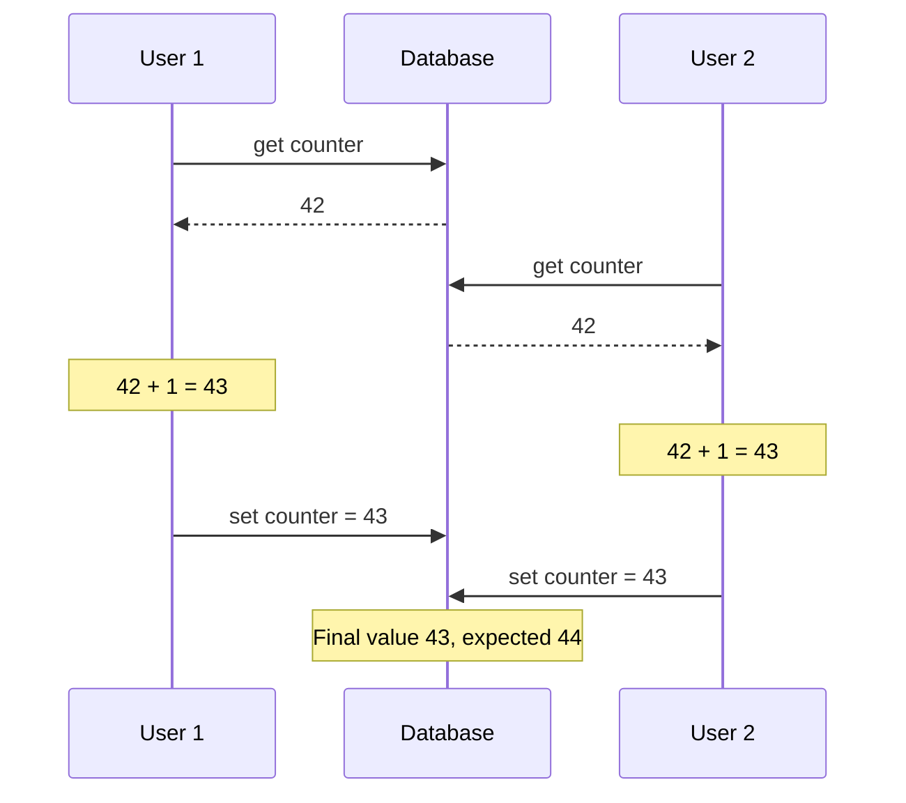

*What isolation means in ACID.* Concurrent transactions must not interfere with each other. Classic database textbooks formalise this as **serializability**: every transaction may behave as if it is the only one running; the database makes sure that the final committed result equals *some* one-after-another (serial) order, even though the transactions actually overlapped.

*Common confusion.* In practice, full serializable isolation is **rarely used** because it costs performance. Some popular databases do not even implement it: **Oracle 11g** has a level named "serializable", but it actually provides **snapshot isolation**, which is weaker. (Snapshot isolation is covered under Weak Isolation Levels below.)

#### Durability

*What it is.* A database should be a safe place to keep data. **Durability** promises that once a transaction has committed, its data will not be forgotten, even if hardware fails or the database crashes.

*How it is achieved.*
- **Single-node database:** the data has been written to **non-volatile storage** (hard drive or SSD), usually together with a **write-ahead log** (see Chapter 3) so the on-disk structures can be recovered if they get corrupted.
- **Replicated database:** the data has been copied to **some number of nodes**.
- In both cases, the database must **wait** until those writes or copies finish before it tells the client "committed".

*Limitation.* **Perfect durability does not exist.** If every disk and every backup is destroyed simultaneously, nothing can save you.

> **Replication and Durability (sidebar).** Durability used to mean writing to archive tape, then to disk/SSD, and more recently to replicas. None is perfect:
> - Data on the disk of a dead machine is safe but *unreachable* until the machine is fixed or the disk moved; replicated systems can stay available.
> - A **correlated fault** — say, a power outage, or a bug that makes all nodes crash when fed one particular input — can take out all replicas at once and wipe anything held only in memory — so disk writes still matter even for in-memory databases.
> - With **asynchronous replication**, recent writes can be lost if the leader fails.
> - On sudden power loss, **SSDs** have been shown to sometimes break their promises; even `fsync` is not guaranteed to work correctly. Disk **firmware has bugs** too.
> - Tricky interplay between the storage engine and the **filesystem** can produce hard-to-find bugs and corrupted files after a crash.
> - Data on disk can **silently rot**. If it went unnoticed for a while, replicas and recent backups may be corrupt too, so you may need an older historical backup.
> - One study found that **30% to 80% of SSDs** develop at least one bad block in their **first four years**. Magnetic disks have fewer bad sectors but fail completely more often than SSDs.
> - An **unpowered** SSD may begin to lose data after **a few weeks**; how fast depends on temperature.
>
> Takeaway: there are no absolute guarantees, only risk-reduction techniques — disk writes, replication to remote machines, and backups — which should be combined. Treat theoretical "guarantees" sceptically.

### Single-Object and Multi-Object Operations

A quick recap of the two ACID properties that describe what happens when a client makes **several writes in one transaction**:

- **Atomicity:** if something fails midway, abort and discard all writes so far — an **all-or-nothing** guarantee, so you never deal with partial failure.
- **Isolation:** concurrent transactions do not interfere. If one transaction makes several writes, another transaction sees **all of them or none**, never a subset.

These definitions assume you are changing **several objects** (rows, documents, records) at once — a **multi-object transaction**. That is needed whenever several pieces of data must stay in sync.

*The book's email example.* To show a user's unread count you could run a counting query. Here is an equivalent query of my own:

```sql
SELECT COUNT(*) FROM messages
WHERE owner_id = 7 AND is_read = false;
```
- `SELECT COUNT(*)` — count matching rows.
- `FROM messages` — look in the messages table.
- `WHERE owner_id = 7 AND is_read = false` — only this user's unread messages.

With lots of mail this can be too slow, so you might **denormalize**: keep an `unread_count` field that you increment when a message arrives and decrement when one is read. Now two things must change together.

*Figure 7-2 — isolation violated.* User 1 inserts a new email and then increments the counter. Between those two writes, User 2 reads: the mailbox shows the new unread email, but the counter still says 0. That is a **dirty read** (reading uncommitted data). Isolation would guarantee User 2 sees both changes or neither.

*Figure 7-2 (redrawn): a reader sees the new email but not the updated counter (dirty read)*
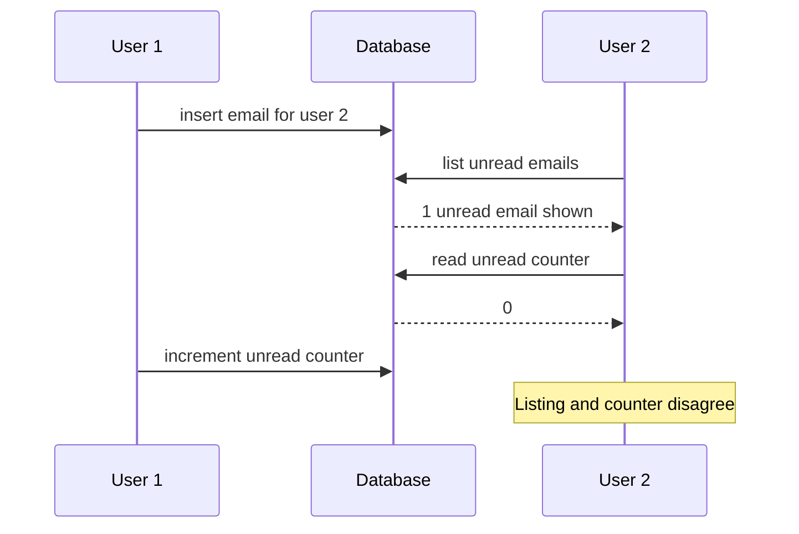

> **Footnote:** a wrong unread counter is not a big deal. But swap in a customer's account balance and a payment, and the same anomaly is serious.

*Figure 7-3 — atomicity needed.* The email is inserted, but the counter update fails (error). Without atomicity the mailbox and counter drift apart. With an atomic transaction, the failure aborts the whole thing and the inserted email is **rolled back**.

*Figure 7-3 (redrawn): an error during the counter update causes the earlier email insert to be undone*
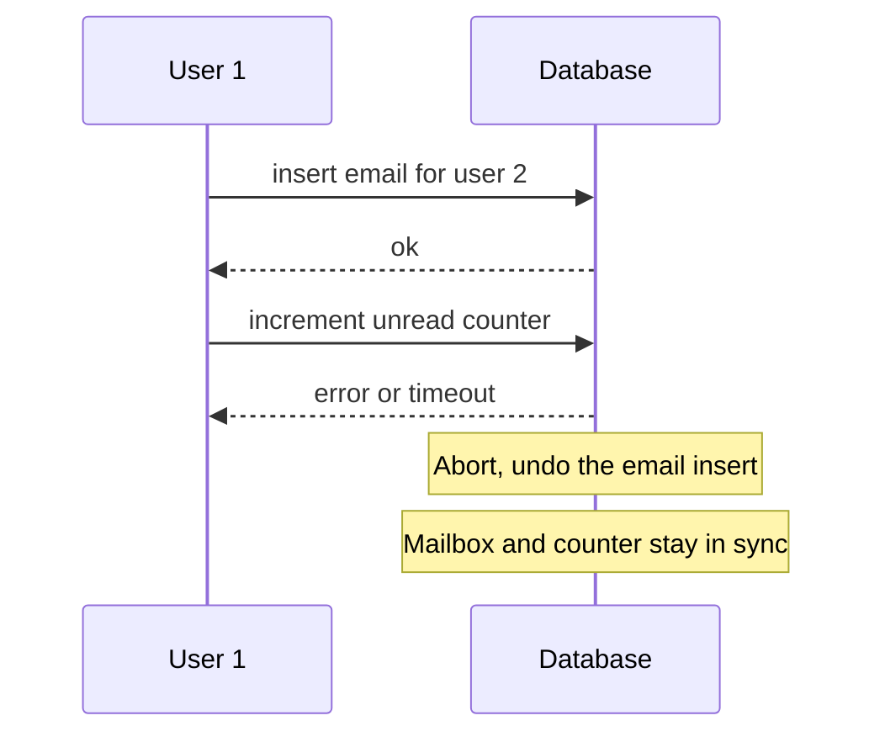

*How does the database know which operations belong together?* In relational databases it is usually tied to the client's **TCP connection**: on a given connection, everything between `BEGIN TRANSACTION` and `COMMIT` is one transaction.

> **Footnote:** tying transactions to a TCP connection is not ideal. If the connection breaks, the transaction must abort. If it breaks *after* the client asked to commit but *before* the server confirmed, the client cannot tell whether it committed. A transaction manager can fix this with a unique **transaction ID** that is independent of the connection (revisited in Chapter 12, "The End-to-End Argument for Databases").

Many **non-relational** databases have no way to group operations like this. Even a **multi-put** (update several keys in one call) may lack transaction semantics: some keys may be written while others fail, so you end up half-updated.

#### Single-object writes

Atomicity and isolation matter even for **one** object. Imagine writing a **20 KB JSON document**:

- The network drops after **10 KB** — does the database store a broken half-document?
- Power fails while overwriting the old value on disk — do you get old and new bytes spliced together?
- Another client reads mid-write — does it see a half-updated value?

Because those outcomes would be baffling, storage engines almost always provide **atomicity and isolation for a single object** (such as one key-value pair) on one node:
- **Atomicity** via a **log for crash recovery** (see Chapter 3).
- **Isolation** via a **lock on each object**, so only one thread touches it at a time.

Some databases go further with **more complex single-object atomic operations**:
- An **increment** operation, which avoids the read-modify-write cycle of Figure 7-1.
- **Compare-and-set**, which writes only if nobody else changed the value in the meantime.

These help prevent lost updates, but calling them **transactions** stretches the usual meaning. Vendors have marketed compare-and-set and friends as "lightweight transactions" or even "ACID", which the book calls misleading. The normal understanding is that a transaction bundles **several operations across several objects** into a single unit of execution.

> **Footnote:** strictly, "atomic increment" uses "atomic" in the multi-threading sense. In ACID terms it would be an *isolated* or *serializable* increment — but that is nitpicking.

#### The need for multi-object transactions

Many distributed datastores dropped multi-object transactions because they are **hard across partitions** and can hurt when very high availability or performance is needed. But nothing makes distributed transactions *impossible* (Chapter 9 covers how).

Could every app get by with just key-value, single-object operations? Sometimes yes, but often several objects must change together:

1. **Foreign keys / graph edges.** In relational models, rows point to rows in other tables; in graph models, vertices have edges to other vertices. When inserting several records that reference each other, the references must be correct, or the data stops making sense.
2. **Denormalized documents.** In a document model, fields that change together are often in one document, so no multi-object transaction is needed for that. But document databases without joins push you toward denormalization, and updating denormalized copies (like Figure 7-2) means touching several documents at once. Transactions keep those copies in sync.
3. **Secondary indexes.** Almost every database except pure key-value stores has them, and they must be updated whenever a value changes. From a transaction's viewpoint an index is a separate object, so without isolation a record might appear in one index but not yet in another.

You *can* build these apps without transactions, but error handling gets much harder without atomicity, and missing isolation causes concurrency bugs (discussed next; Chapter 12 explores alternatives).

#### Handling errors and aborts

*Philosophy.* A key feature of transactions is that they **can be aborted and safely retried**. ACID databases would rather abandon a transaction completely than leave it half done and risk breaking atomicity, isolation or durability.

*Not everyone follows it.* Databases with **leaderless replication** (Chapter 5) work on a **"best effort"** basis: the database does what it can, and if it hits an error it will not undo what already happened. Recovery is the application's job.

*Common mistake.* Developers often think only about the happy path. Popular **ORM** (object-relational mapping) frameworks (the book names **ActiveRecord** from Rails, and **Django**) do **not retry** aborted transactions; the error bubbles up as an exception, user input is lost, and the user sees an error page. That wastes the whole point of aborts, which is to allow safe retries.

*Retrying is useful but not perfect:*

| Problem with retry | Why / what to do |
|---|---|
| The commit actually succeeded, but the acknowledgement was lost on the network | Retrying runs it twice, unless the app has its own **deduplication**. |
| The error was caused by **overload** | Retrying makes it worse. Limit retries, use **exponential backoff**, and treat overload errors specially. |
| The error is **permanent** (e.g., constraint violation) | Retrying is pointless. Only retry **transient** errors: deadlock, isolation violation, brief network glitches, failover. |
| The transaction has **side effects outside the database** (e.g., sending an email) | Those may happen even if the transaction aborts; you do not want to resend the email on each retry. To make several systems commit or abort together, see **two-phase commit** (Chapter 9). |
| The **client process dies** while retrying | Whatever it was trying to write is lost. |

## Weak Isolation Levels

*When do concurrency issues arise?* Two transactions that touch different data can safely run in parallel. Trouble only starts when one transaction **reads data another is modifying**, or two transactions **modify the same data** at once.

*Why they are nasty.*
- They are **hard to find by testing**: they only appear when the timing is unlucky, which may be rare and hard to reproduce.
- They are **hard to reason about**, especially in big codebases where you do not know what other code touches the same data. With many concurrent users, any value might change under you at any time.

Databases have long tried to hide this with **transaction isolation**. **Serializable isolation** would let you pretend there is no concurrency at all. But it has a **performance cost**, so many systems instead use **weaker isolation levels** that stop some problems but not all. These are harder to understand and cause subtle bugs, yet they are widely used.

*Real damage.* Weak-isolation bugs have caused **large financial losses** (the book's references include bitcoin stolen from an exchange, e.g. Poloniex in 2014), triggered **investigations by financial auditors**, and **corrupted customer data**. The usual reaction — "use an ACID database for money!" — misses the point, because many popular relational ("ACID") databases also default to weak isolation and would not have prevented those bugs.

So instead of trusting labels, you need to **understand the kinds of race conditions** and how to prevent them. The book walks through weak (non-serializable) levels informally with examples; rigorous definitions live in the academic literature.

### Read Committed

The most basic isolation level is **read committed**. It makes two promises:

1. **No dirty reads:** when you read, you only see committed data.
2. **No dirty writes:** when you write, you only overwrite committed data.

> **Footnote:** some databases offer an even weaker level, **read uncommitted**, which prevents dirty writes but *allows* dirty reads.

#### No dirty reads

*What it is.* A **dirty read** happens if a transaction can see data written by another transaction that has not yet committed or aborted. Under read committed, a transaction's writes become visible to others **only when it commits**, and then **all at once**.

*Figure 7-4.* User 1's transaction sets `x = 3` and then `y = 3` but has not committed. Each time User 2 reads `x` in the meantime it still gets the old value **2**. Only after User 1 commits does User 2 see 3.

*Figure 7-4 (redrawn): no dirty reads, the new x becomes visible to user 2 only once user 1 commits*
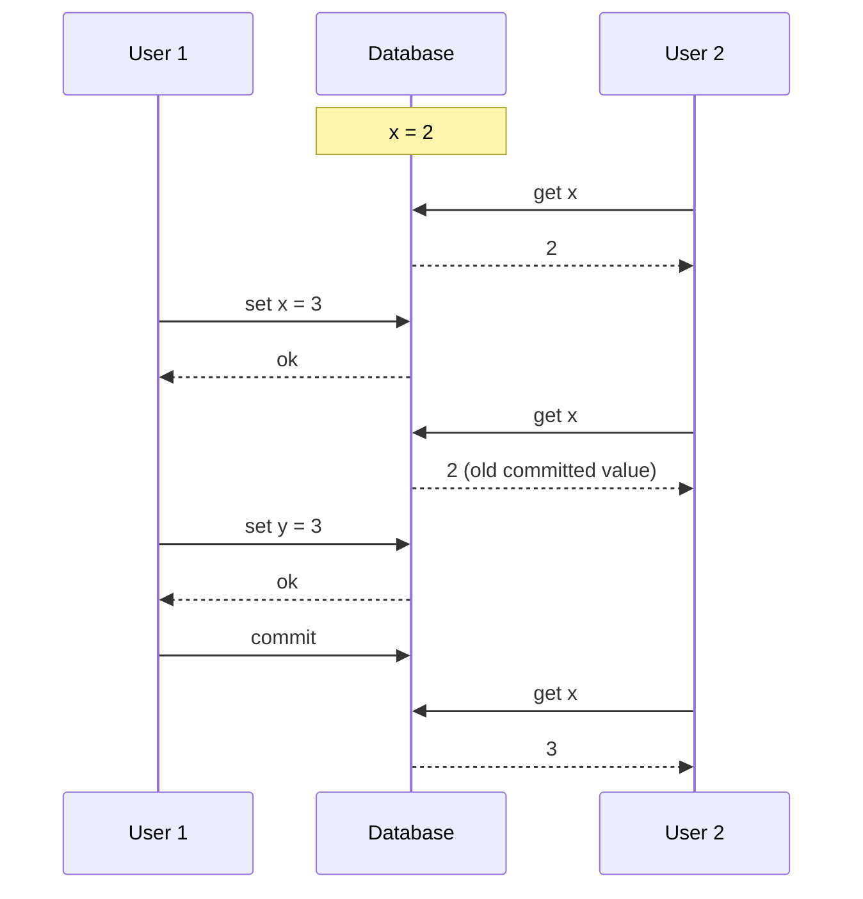

*Why prevent dirty reads?*
- If a transaction updates several objects, a dirty read can show **some updates but not others** — exactly the unread-email-vs-counter mismatch in Figure 7-2. Seeing a half-done state confuses users and can make other transactions decide wrongly.
- If a transaction **aborts**, its writes are rolled back (Figure 7-3). With dirty reads allowed, someone may have read data that **never actually got committed**, which gets very hard to reason about.

#### No dirty writes

*What it is.* Normally, when two transactions write the same object, the later write overwrites the earlier one. A **dirty write** is when the earlier write belongs to a transaction that **has not committed yet**, and the later write overwrites that uncommitted value. Read committed prevents this, typically by **making the second writer wait** until the first transaction commits or aborts.

*What it protects against.*
- **Mixing up multi-object writes.** The book's used-car website example (Figure 7-5): Alice and Bob try to buy the same car at the same time. A purchase needs two writes: update the **listing** to the buyer, and send the **invoice** to the buyer. With dirty writes, Bob wins the listings update but Alice wins the invoices update — the car goes to Bob while Alice gets the bill. Read committed stops that.
- **What it does *not* stop:** the counter race in Figure 7-1. In that case the second writer only writes once the first transaction has already committed, so no dirty write occurs. It is still wrong, but for a different reason (a **lost update**, covered below).

*Figure 7-5 (redrawn): with dirty writes, Bob ends up with the listing while Alice gets the invoice*
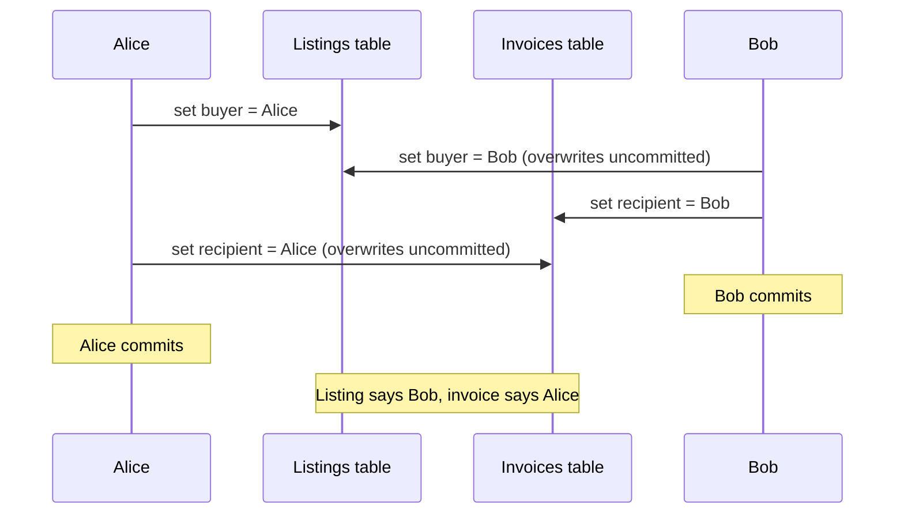

#### Implementing read committed

Read committed is **very popular**: it is the default level in plenty of databases, including **Oracle 11g**, **PostgreSQL**, **SQL Server 2012** and **MemSQL**.

*Preventing dirty writes — row-level locks.*
1. A transaction that wants to modify an object (row or document) first **acquires a lock** on it.
2. It **holds** that lock until it commits or aborts.
3. Only one transaction can hold the lock on a given object; another writer must **wait** until the first finishes.
4. The database does this **automatically** at read committed and stronger levels.

*Preventing dirty reads — option 1: read locks (rarely used).* Make readers briefly take the same lock and release it right after reading. A read then cannot happen while an uncommitted value exists. **Problem:** one long-running write transaction would force many read-only transactions to wait, hurting their response time. It also harms operability: a slowdown in one part of the app spreads to unrelated parts via lock waits.

*Preventing dirty reads — option 2: remember old values (what most databases do).* For every object being written, the database keeps **both the old committed value and the new uncommitted value** set by the lock-holding transaction. While the writer is still running, other readers get the **old** value. Once it commits, readers switch to the **new** value. This is the approach shown in Figure 7-4.

> **Footnote:** when the book was written, just two mainstream databases implemented read committed with locks: **IBM DB2** and **Microsoft SQL Server with `read_committed_snapshot=off`**.

### Snapshot Isolation and Repeatable Read

Read committed looks like it covers everything: it supports aborts (for atomicity), hides half-finished transactions, and stops writes from interleaving. Those are real improvements over having no transactions. But plenty of concurrency bugs remain.

*Figure 7-6 — read skew.* Alice has **$1,000** split across two accounts, **$500** each. A transaction moves **$100** from account 2 to account 1. Alice checks her balances at an unlucky moment: she reads account 1 *before* the incoming $100 arrives (sees **$500**) and account 2 *after* the $100 left (sees **$400**). It looks like she has only **$900** — $100 has disappeared.

*Figure 7-6 (redrawn): Alice reads the two accounts at different moments during a transfer and sees only 900 dollars total*
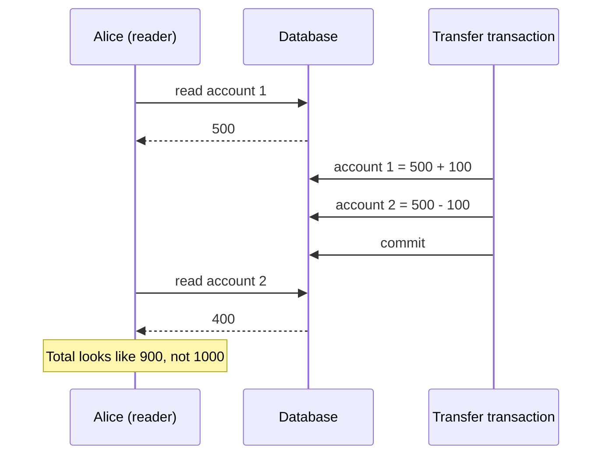

The name for this is **read skew** (also **nonrepeatable read**): if Alice re-read account 1 at the end she would see **$600**, a different value. Read committed **allows** this, because each value she saw really was committed when she read it.

> **"Skew" is overloaded.** Earlier (Chapter 6) skew meant an unbalanced workload with hot spots. Here it means a **timing anomaly**.

For Alice this is temporary — reloading the page shortly after shows consistent balances. But some situations **cannot tolerate** even temporary inconsistency:

- **Backups.** Copying a large database can take **hours** while writes keep arriving. Parts of the backup may be older and parts newer. If you ever restore it, the inconsistencies (like vanished money) become **permanent**.
- **Analytic queries and integrity checks.** Big scans for analytics (Chapter 3) or periodic checks for corruption give **nonsense** if they see different parts of the database at different moments.

*The fix — snapshot isolation.* Each transaction reads from a **consistent snapshot**: it sees everything that was committed **when the transaction started**. Even if others change data later, the transaction keeps seeing the old data from that point in time.

*Why it helps.* It is ideal for long-running, read-only jobs like backups and analytics. Reasoning about a query while its data changes underneath it is very hard; a frozen snapshot is easy to understand.

*Who supports it:* **PostgreSQL, MySQL with InnoDB, Oracle, SQL Server**, and others.

#### Implementing snapshot isolation

*Writes:* like read committed, snapshot isolation typically uses **write locks** to stop dirty writes, so a writer can block another writer on the same object.

*Reads:* **no locks at all.** The key performance principle is:

> **A reader never has to wait for a writer, and a writer never has to wait for a reader.**

This lets the database serve long-running reads on a consistent snapshot while processing writes normally, with no lock contention between them.

*MVCC.* Snapshot isolation generalises the Figure 7-4 trick. Because different in-progress transactions may need to see the database at **different points in time**, the database may keep **several committed versions** of each object side by side. This is **multi-version concurrency control (MVCC)**.

| Level | Versions needed | Snapshot scope (typical MVCC implementation) |
|---|---|---|
| Read committed | Two are enough: committed + not-yet-committed | A new snapshot for **each query** |
| Snapshot isolation | Many committed versions | One snapshot for the **whole transaction** |

Storage engines that support snapshot isolation usually implement read committed with MVCC too.

*How PostgreSQL does it (Figure 7-7; others are similar).*
1. When a transaction starts it gets a unique, **always-increasing transaction ID (txid)**.
2. Anything it writes is **tagged with its txid**.
3. Each row has a **`created_by`** field (the txid that inserted it) and a **`deleted_by`** field (initially empty).
4. **Delete:** the row is not removed; its `deleted_by` is set to the deleting txid.
5. **Update:** translated into a **delete plus a create**. In Figure 7-7, transaction 13 takes $100 from account 2, so the table now holds two rows for account 2: the **$500** row with `deleted_by = 13`, and a new **$400** row with `created_by = 13`.
6. Later, once no transaction can possibly see the deleted data, a **garbage collection** process removes those rows and frees space.

> **Footnote:** PostgreSQL txids are **32-bit**, so they wrap around after about **4 billion** transactions. PostgreSQL's **vacuum** process does cleanup so that the overflow does not affect data.

*Figure 7-7 (redrawn): MVCC in PostgreSQL, an update creates a new row version and marks the old one deleted*
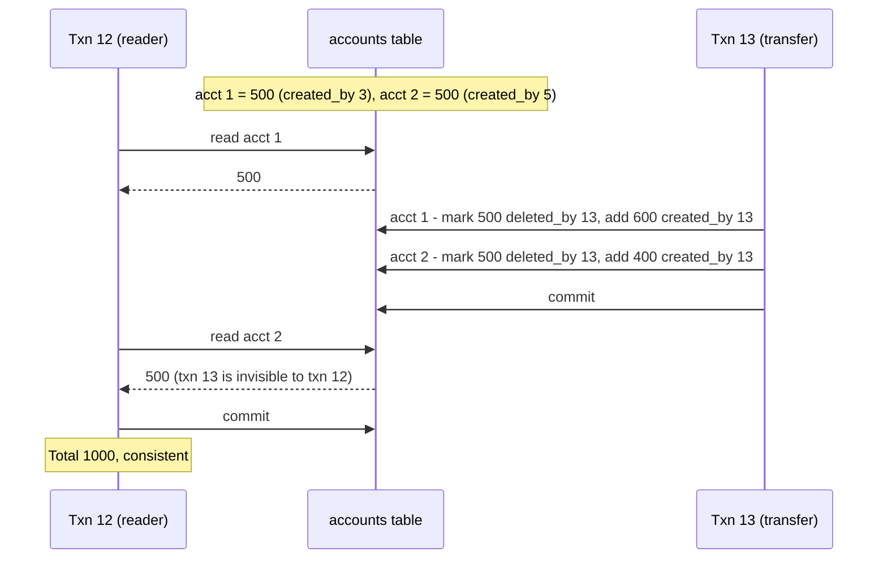

#### Visibility rules for observing a consistent snapshot

When a transaction reads, txids decide what it may see. The rules:

1. At the **start** of a transaction, the database lists every other transaction still **in progress**. Their writes are **ignored**, even if they commit later.
2. Writes by **aborted** transactions are ignored.
3. Writes by transactions with a **later txid** (started after this one) are ignored, **whether or not** they committed.
4. **Everything else** is visible.

These apply to both creations and deletions. In Figure 7-7, transaction 12 reading account 2 sees **$500**: the deletion of the $500 row was done by transaction 13 (rule 3 hides it), and the $400 row created by 13 is also hidden by rule 3.

Equivalently, an object is **visible** if **both** hold:
- The transaction that **created** it had **already committed** when the reader started.
- The object is **not marked deleted**, or the deleter had **not yet committed** when the reader started.

A long-running transaction may keep reading versions that others have long since overwritten or deleted. Because values are never updated in place — a new version is created each time — the database can offer consistent snapshots at only a small cost.

#### Indexes and snapshot isolation

How do indexes work when there are many versions?

- **Approach 1:** the index points to **all versions** of an object, and an index lookup **filters out** versions invisible to the current transaction. When garbage collection removes an old version, its index entries go too. Many implementation details affect MVCC performance; for example, **PostgreSQL** avoids index updates when the versions of an object fit on the **same page**.
- **Approach 2 — append-only / copy-on-write B-trees:** used by **CouchDB, Datomic and LMDB**. Pages are never overwritten. Changing a page makes a **new copy**; its parents up to the **root** are copied and updated to point at the new children. Untouched pages are shared and stay immutable. Each write transaction (or batch) produces a **new root**, and each root *is* a consistent snapshot as of when it was made. No txid filtering is needed, because later writes cannot alter an existing tree — they only create new roots. The cost: you need background **compaction and garbage collection**.

#### Repeatable read and naming confusion

Snapshot isolation is useful, especially for read-only transactions, but vendors call it different things:

| Database | Name used for snapshot isolation |
|---|---|
| Oracle | "serializable" |
| PostgreSQL, MySQL | "repeatable read" |
| IBM DB2 | uses "repeatable read" to mean **serializability** (not snapshot isolation) |

*Why the mess?*
- The **SQL standard** takes its isolation definitions from **System R (1975)**, before snapshot isolation was invented, so the standard has no concept of it.
- The standard defines **repeatable read**, which looks superficially like snapshot isolation. PostgreSQL and MySQL use that name because their snapshot isolation satisfies the standard's requirements, letting them claim compliance.
- The standard's definitions are themselves **flawed**: vague, imprecise, and more tied to particular implementations than a standard ought to be. So databases that all claim "repeatable read" give quite different guarantees.
- Research literature has a **formal** definition of repeatable read, but most implementations do not meet it.

The book's punchline: in effect, **no one really knows what "repeatable read" means.**

### Preventing Lost Updates

Read committed and snapshot isolation mostly describe what a **read-only** transaction can see while writes are happening. Apart from dirty writes, we have not yet looked at **two transactions writing concurrently**. The most famous such conflict is the **lost update** (Figure 7-1).

*What it is.* It happens with a **read-modify-write cycle**: read a value, change it in app code, write it back. If two transactions do this concurrently, one change can vanish, since the second write was computed without seeing the first — the later write **clobbers** the earlier one.

*Where it shows up:*
- Bumping a counter, or changing an account balance.
- Editing part of a complex value, such as appending an item to a list inside a JSON document (parse, modify, write back).
- Two people editing a **wiki page** at once, each saving by sending the **whole page**, overwriting whatever is there.

Since it is so common, there are several solutions.

#### Atomic write operations

Many databases offer **atomic update operations** so you do not need a read-modify-write cycle in app code. When your logic can be expressed with them, they are usually the **best solution**. My own example:

```sql
UPDATE page_views SET hits = hits + 1 WHERE page = '/home';
```
- `UPDATE page_views` — the table holding counters.
- `SET hits = hits + 1` — the database reads and increments in one safe step.
- `WHERE page = '/home'` — only this page's counter.

This is concurrency-safe in most relational databases. Similarly, **MongoDB** has atomic operations for modifying part of a JSON document, and **Redis** has atomic operations on data structures like **priority queues**. Not everything fits — a wiki edit is arbitrary text editing — but when atomic operations fit, use them.

> **Footnote:** you *can* express text editing as a stream of atomic mutations, but it is fairly complicated (see "Automatic Conflict Resolution" in Chapter 5).

*How they are implemented.*
- Grab an **exclusive lock** on the object at read time, so other transactions cannot read it until the update has been applied. This is sometimes called **cursor stability**.
- Or run all atomic operations on a **single thread**.

*Common pitfall.* **ORM frameworks** make it easy to accidentally write unsafe read-modify-write code instead of using the database's atomic operations. Experts can avoid this, but it is a common source of subtle bugs that tests seldom reveal.

#### Explicit locking

If built-in atomic operations are not enough, the **application can lock** the objects it will update. It then does its read-modify-write, and any other transaction trying to read the same object waits until the first is done.

*The book's example:* a multiplayer game where several players can move the **same piece**. An atomic operation is not enough because the move must also be **checked against the game rules** — logic you cannot reasonably express in a query. So you lock the piece's row. My own version:

```sql
BEGIN TRANSACTION;

SELECT * FROM tokens
  WHERE label = 'knight' AND match_id = 51
  FOR UPDATE;

-- app checks the move is legal, then:
UPDATE tokens SET square = 'e5' WHERE id = 908;

COMMIT;
```
- `BEGIN TRANSACTION` — start the transaction.
- `SELECT ... FOR UPDATE` — read the knight's row **and lock it**; `FOR UPDATE` tells the DB to lock every row this query returns.
- The comment — app code validates the move while holding the lock.
- `UPDATE tokens SET square = 'e5'` — write the new position.
- `COMMIT` — make it permanent and release the lock.

It works, but you must think carefully about your logic; forgetting a lock somewhere reintroduces the race.

#### Automatically detecting lost updates

Atomic operations and locks prevent lost updates by making read-modify-write cycles happen **one at a time**. The alternative: allow them to **run concurrently**; when the transaction manager **notices** a lost update, it **aborts** the guilty transaction, which then retries.

*Advantage:* databases can do this check **efficiently alongside snapshot isolation**.

| Database / level | Detects lost updates automatically? |
|---|---|
| PostgreSQL repeatable read | Yes |
| Oracle serializable | Yes |
| SQL Server snapshot isolation | Yes |
| MySQL/InnoDB repeatable read | **No** |

Some authors argue a database must prevent lost updates to count as snapshot isolation — by that definition, **MySQL does not provide snapshot isolation**.

Why this feature is great: it needs **no special code** in the app. You might forget a lock or an atomic operation, but detection happens automatically, so it is **less error-prone**.

#### Compare-and-set

Databases **without** transactions sometimes offer an atomic **compare-and-set**: update only if the value is **unchanged since you read it**; otherwise the update does nothing and you must retry the cycle.

My own example, for a shared note:

```sql
-- Safe or not depends on the database implementation
UPDATE notes SET body = 'edited text'
  WHERE id = 77 AND body = 'text I originally read';
```
- `UPDATE notes SET body = 'edited text'` — the new value.
- `WHERE id = 77` — the target note.
- `AND body = 'text I originally read'` — the compare part: only apply if nobody changed it.
- After running it, check how many rows changed; if zero, someone else edited it — re-read and retry.

**Warning:** if the database lets the `WHERE` clause read from an **old snapshot**, the condition can still be true while another write is in flight, so lost updates are **not** prevented. Check that your database's compare-and-set is actually safe.

#### Conflict resolution and replication

Replication adds a new dimension: copies live on several nodes and can be changed concurrently on different nodes.

- **Locks and compare-and-set assume a single up-to-date copy.** Multi-leader and leaderless replication allow concurrent writes that replicate asynchronously, so there is no single up-to-date copy and these techniques **do not apply**. (Revisited under linearizability in Chapter 9.)
- **Common approach instead:** let concurrent writes create multiple conflicting versions (**siblings**) and merge them afterwards using app code or special data structures (Chapter 5).
- **Atomic operations can work well** if they are **commutative** — you can apply them in any order on different replicas and get the same result. Incrementing a counter and adding to a set are examples. **Riak 2.0 datatypes** build on this idea: concurrent updates from different clients are merged automatically so that nothing is lost across replicas.
- **Last write wins (LWW)** is **prone to lost updates** — and unfortunately it is the **default** in many replicated databases.

### Write Skew and Phantoms

Dirty writes and lost updates are races where transactions write the **same** object. There are subtler conflicts.

*The book's hospital example (Figure 7-8).* An app lets doctors manage **on-call shifts**. The hospital wants several doctors on call but **must have at least one**. A doctor may give up a shift if at least one colleague remains on call. **Alice and Bob** are the only two on call for a shift; both feel ill and click "go off call" at almost the same moment.

1. Each transaction checks how many doctors are on call. Under **snapshot isolation**, **both see 2**.
2. Both conclude it is safe for one doctor to leave.
3. Alice's transaction updates **her** record; Bob's updates **his**.
4. Both commit. Now **zero** doctors are on call — the rule is broken.

*Figure 7-8 (redrawn): Alice and Bob both see two doctors on call, both go off call, leaving nobody*
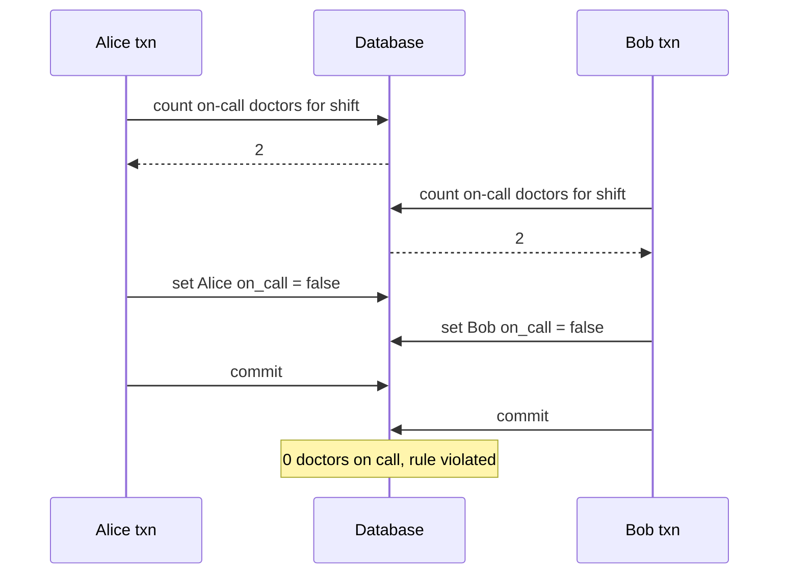

#### Characterizing write skew

*What it is.* This anomaly is **write skew**. It is not a dirty write or a lost update, because the two transactions update **different** objects (Alice's row and Bob's row). The conflict is less obvious, but it is clearly a race: run one after the other, the second doctor would have been refused.

*A useful mental model:* write skew is a **generalisation of lost update**. It can arise whenever two transactions **read an overlapping set of objects** and each then **modifies some of those objects** (maybe not the same ones). In the special case where both modify an identical object, the result is instead a dirty write or a lost update, depending on timing.

*Your options are narrower than for lost updates:*

| Technique | Helps with write skew? |
|---|---|
| Atomic single-object operations | **No** — several objects are involved. |
| Automatic lost-update detection in snapshot isolation | **No** — not detected in PostgreSQL repeatable read, MySQL/InnoDB repeatable read, Oracle serializable, or SQL Server snapshot isolation. Only **true serializable** isolation prevents it automatically. |
| Database constraints | Only if you can express a **multi-object** constraint ("at least one on call"). Most databases lack built-in support, but **triggers** or **materialized views** may work, depending on the database. |
| Explicitly locking the rows the transaction depends on | **Yes** — the second-best option if serializable is unavailable. |

My own version of the locking fix for an on-call rota:

```sql
BEGIN TRANSACTION;

SELECT * FROM rota
  WHERE available = true
  AND slot_id = 42 FOR UPDATE;

UPDATE rota
  SET available = false
  WHERE engineer = 'Priya'
  AND slot_id = 42;

COMMIT;
```
- `SELECT ... WHERE available = true AND slot_id = 42 FOR UPDATE` — read *and lock* every engineer currently available in slot 42. A second transaction doing the same check must wait.
- The app checks the count is at least 2 before continuing.
- `UPDATE rota SET available = false WHERE engineer = 'Priya'` — take one person off.
- `COMMIT` — release the locks; the waiting transaction now sees the new count.

#### More examples of write skew

Once you know the pattern, you see it everywhere:

- **Meeting room booking.** You must never have two bookings for the same room at the same time. The app checks for overlapping bookings, and if none, inserts one. Snapshot isolation does **not** stop another user inserting a clashing booking concurrently; you need serializable isolation. My own illustration:

  ```sql
  BEGIN TRANSACTION;

  -- Any booking for desk 9 that overlaps 09:00-11:00?
  SELECT COUNT(*) FROM desk_bookings
    WHERE desk_id = 9 AND
      ends_at > '2024-03-04 09:00' AND starts_at < '2024-03-04 11:00';

  -- If the count was zero:
  INSERT INTO desk_bookings (desk_id, starts_at, ends_at, person_id)
    VALUES (9, '2024-03-04 09:00', '2024-03-04 11:00', 314);

  COMMIT;
  ```
  - The `SELECT COUNT(*)` finds overlaps: an existing booking overlaps if it ends after our start *and* starts before our end.
  - The `INSERT` adds the booking if nothing overlapped.
  - Two concurrent transactions can both count zero and both insert — a double booking.

  > **Footnote:** PostgreSQL's **range types** make this more elegant, but they are not widely supported elsewhere.

- **Multiplayer game.** The lock in the earlier example stops two players moving the **same** piece, but not moving **two different pieces to the same square**, or other rule-breaking combinations. A unique constraint might help for some rules; otherwise you are exposed to write skew.
- **Claiming a username.** Two people sign up with the same name at once; each transaction checks it is free and then creates the account. Not safe under snapshot isolation. **Fix:** a **unique constraint** — the second insert violates it and is aborted.
- **Preventing double-spending.** A service lets users spend money or points and must stop them overspending. One approach: insert a tentative spending item, list all items in the account, and check the total stays positive. With write skew, two spending items inserted concurrently can push the balance negative without either transaction noticing.

#### Phantoms causing write skew

All these examples share a shape:

1. A `SELECT` checks a **requirement** by searching for rows matching a condition (at least two doctors on call; no overlapping booking; the square is empty; the username is free; enough money remains).
2. Based on the result, app code **decides** whether to proceed or report an error and abort.
3. If proceeding, it **writes** (`INSERT`, `UPDATE` or `DELETE`) and commits. That write **changes the precondition** of step 2 — rerunning the step 1 query after commit would now give a different answer (one fewer doctor, room now booked, square occupied, name taken, less money).

The steps can be reordered — e.g., write first, then query, then decide to commit or abort.

*Why locking does not always work.* In the doctors case, the row changed in step 3 was **among the rows the step 1 query found**, so `SELECT FOR UPDATE` could lock it. The other four examples check for the **absence** of rows, and the write **adds** a matching row. If step 1 returns nothing, `SELECT FOR UPDATE` has **nothing to lock**.

*Definition.* A **phantom** is the effect where one transaction's write alters what another transaction's **search query** would return. Snapshot isolation already protects **read-only** queries from phantoms; the trouble is **read-write** transactions, where phantoms can produce particularly nasty write skew.

#### Materializing conflicts

If phantoms are a problem because there is **no object to lock**, why not **create one artificially**?

*How it works (meeting rooms).*
1. Create a table of **time slots × rooms** — each row is one room for one period (say **15 minutes**).
2. **Pre-populate** it for all combinations for some time ahead (e.g., the **next six months**).
3. A booking transaction first locks (`SELECT FOR UPDATE`) the slot rows for its room and time range.
4. With those locks held, it checks for overlaps and inserts the booking as before.

The slots table stores **no booking data** — it is purely a set of locks that stops concurrent changes to the same room and time.

This is **materializing conflicts**: turning a phantom into a lock conflict on concrete rows. **Downsides:** working out how to materialize conflicts is hard and error-prone, and letting concurrency control leak into your data model is ugly. Treat it as a **last resort**; a serializable isolation level is usually much better.

## Serializability

The chapter so far has shown race conditions that read committed and snapshot isolation prevent, and others (write skew, phantoms) they do not. The situation is grim:

- Isolation levels are **hard to understand** and **implemented inconsistently** across databases (e.g., "repeatable read" varies a lot).
- Looking at app code, it is **hard to tell** whether it is safe at a given level, especially in large apps where you do not know everything running concurrently.
- There are **no good tools** for detecting race conditions. Static analysis might help in principle, but research has not reached practice. Testing is hard because the problems are **nondeterministic**.

This has been true since weak isolation levels appeared in the **1970s**. Researchers' answer has always been: **use serializable isolation**.

*What it guarantees.* **Serializable isolation** is usually considered the **strongest** level. Even if transactions run in parallel, the outcome equals running them **one at a time** in some order. So if each transaction is correct on its own, it stays correct under concurrency — the database prevents **all** race conditions.

*So why doesn't everyone use it?* Because of how it has to be implemented. Most serializable databases today use one of three techniques:

1. **Actual serial execution** — literally one at a time.
2. **Two-phase locking (2PL)** — for decades the only viable option.
3. **Optimistic concurrency control**, such as **serializable snapshot isolation (SSI)**.

This chapter treats them on a single node; Chapter 9 generalises to multiple nodes.

### Actual Serial Execution

*The idea.* Remove concurrency entirely: run **one transaction at a time, in order, on a single thread**. Conflicts cannot happen, so isolation is serializable **by definition**.

*Why only recently?* Designers decided a single-threaded transaction loop was feasible only around **2007**. For the previous **30 years**, multi-threading was considered essential for performance. Two things changed:

- **RAM got cheap** enough that for many uses the whole **active dataset fits in memory** (Chapter 3). With no waiting for disk, transactions run much faster.
- Designers realised **OLTP transactions are usually short**, with only a few reads and writes. Long analytic queries are typically read-only and can run on a **consistent snapshot** (snapshot isolation) **outside** the serial loop.

*Who does it:* **VoltDB/H-Store, Redis and Datomic**. A single-threaded system can sometimes **beat** a concurrent one because it skips locking overhead. But its throughput is capped at **one CPU core**, and transactions must be structured differently to use that thread well.

#### Encapsulating transactions in stored procedures

*History.* Early database designers hoped a transaction could cover a **whole user flow**. Booking a flight, for instance, means searching routes, fares and seats; choosing an itinerary; booking each leg; entering passenger details; paying. Making all that one atomic transaction seemed appealing.

*Problem:* **humans are slow.** If a transaction waits on user input, the database must juggle huge numbers of mostly **idle** concurrent transactions, which most cannot do efficiently. So nearly all OLTP apps keep transactions short and never wait for a user inside one. On the web, a transaction **commits within one HTTP request**; a new request starts a new transaction.

*Still interactive, though.* Even without the human, transactions are usually executed **one statement at a time** in an interactive client/server style: the app sends a query, reads the result, maybe sends another based on it, and so on — lots of **network round trips** between the app server and the database server. If the database allowed only one transaction at a time, it would sit idle much of the time, **waiting** on the app's next query, and throughput would be terrible. That is why such databases must run many transactions concurrently.

*The fix.* Single-threaded serial systems **forbid interactive multi-statement transactions**. The app must send the **entire transaction code up front** as a **stored procedure**. If all needed data is in memory, the procedure runs very fast with no network or disk waits.

*Figure 7-9 (redrawn): interactive transaction with many round trips vs a stored procedure sent in one call (using the on-call example)*
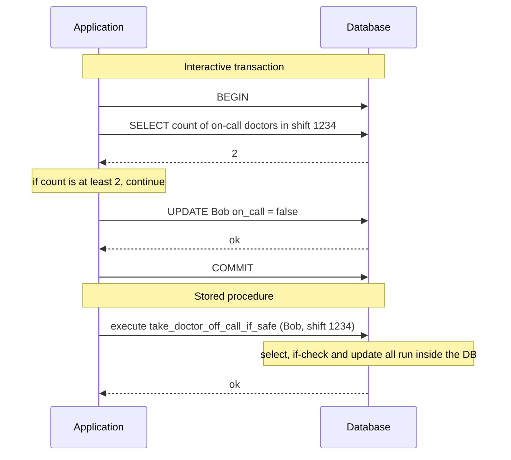

#### Pros and cons of stored procedures

Stored procedures have existed in relational databases for a long time and were added to the SQL standard as **SQL/PSM** in **1999**. They earned a bad reputation because:

- **Each vendor has its own language** — **Oracle: PL/SQL**, **SQL Server: T-SQL**, **PostgreSQL: PL/pgSQL**, etc. These have not kept pace with general-purpose languages, look dated, and lack good library ecosystems.
- **Code inside the database is hard to manage**: harder to debug, awkward for version control and deployment, trickier to test, and hard to hook into metrics/monitoring.
- **Databases are more performance-sensitive** than app servers, since one database often serves many app servers. A badly written procedure (heavy on memory or CPU) causes more damage than the same bad code in an app server.

*These can be overcome.* Modern systems use **general-purpose languages**:

| System | Stored procedure language |
|---|---|
| VoltDB | Java or Groovy |
| Datomic | Java or Clojure |
| Redis | Lua |

With stored procedures and **in-memory** data, single-threaded execution works: no I/O waits and no concurrency-control overhead, so throughput on one thread is quite good.

*Replication with procedures.* **VoltDB** replicates by running the **same stored procedure on each replica** instead of copying the resulting writes. So procedures must be **deterministic** (same result on every node). If a transaction needs the current date/time, it must use special **deterministic APIs**.

#### Partitioning

*Problem.* Serial execution simplifies concurrency but limits throughput to **one CPU core on one machine**. Read-only transactions can run elsewhere on snapshots, but **write-heavy** apps can bottleneck on the single thread.

*Solution: partition the data* (Chapter 6), which **VoltDB** supports.
1. Find a partitioning where **each transaction reads and writes within a single partition**.
2. Give each partition its **own single-threaded transaction processor**, independent of the others.
3. Assign each CPU core its own partition → throughput **scales linearly** with cores.

*Catch — cross-partition transactions.* A transaction touching several partitions must be **coordinated** across all of them, with the stored procedure running **in lock-step** on each to keep serializability. That overhead makes them **vastly slower**: VoltDB reports a rate of roughly **1,000 writes per second** for cross-partition transactions, which is several orders of magnitude lower than it achieves within one partition, and more machines **do not** increase it.

Whether transactions can stay within one partition depends on the **data's structure**. Simple key-value data partitions easily; data with **multiple secondary indexes** tends to need lots of cross-partition coordination (Chapter 6).

#### Summary of serial execution

Serial execution gives serializable isolation **within certain limits**:

- **Every transaction must be small and fast** — one slow transaction stalls everything.
- **The active dataset must fit in memory.** Rarely used data could live on disk, but if a single-threaded transaction needed it, everything would slow to a crawl.
- **Write throughput must fit on one CPU core**, or transactions must be partitionable **without** cross-partition coordination.
- **Cross-partition transactions** are possible, but only up to a hard limit.

> **Anti-caching (footnote).** If a transaction needs data not in memory, a good approach may be to **abort** it, **load** the data into memory in the background while other transactions continue, then **restart** it once the data is there.

### Two-Phase Locking (2PL)

For about **30 years**, **two-phase locking (2PL)** was the only widely used serializability algorithm.

> **2PL is not 2PC.** Two-phase locking and two-phase commit (2PC) sound alike but are completely different. 2PC is covered in Chapter 9.

> **Footnote:** the variant described here is also known as **strong strict two-phase locking (SS2PL)**, a name that separates it from other flavours of 2PL.

*What it is.* We already saw locks preventing dirty writes: a second writer waits until the first transaction finishes. 2PL makes the lock rules **much stricter**. Many transactions may **read** the same object together if nobody is writing it, but **writing** (modify or delete) needs **exclusive** access:

- If **A has read** an object and **B wants to write** it, B waits until A commits or aborts (so B cannot change it behind A's back).
- If **A has written** an object and **B wants to read** it, B waits until A commits or aborts (reading an old version, as in Figure 7-1, is **not** allowed under 2PL).

So in 2PL, **writers block writers *and* readers, and readers block writers.** Snapshot isolation promises the opposite (no reader/writer blocking in either direction), and that contrast is the essential difference between the two. In return, 2PL is **serializable**, so it prevents **all** the races above, including lost updates and write skew.

#### Implementation of two-phase locking

*Who uses it:* **MySQL (InnoDB)** and **SQL Server** use 2PL for their **serializable** level; **DB2** uses it for its level called **repeatable read**.

*How it works.* Each object has a lock that can be in **shared** or **exclusive** mode.
1. **To read**, acquire the lock in **shared** mode. Many transactions can share it, but if someone holds it **exclusively**, readers wait.
2. **To write**, acquire it in **exclusive** mode. No one else may hold it in any mode, so if any lock exists, the writer waits.
3. If a transaction **reads then writes** an object, it can **upgrade** its shared lock to exclusive (same as acquiring exclusive directly).
4. Once acquired, a lock is **held until the transaction ends** (commit or abort). This gives the name: **phase one** — acquiring locks while running; **phase two** — releasing them all at the end.

*Deadlocks.* With so many locks, it is easy for A to wait on B while B waits on A — a **deadlock**. The database **detects** deadlocks automatically and **aborts one** transaction so the rest can proceed. The aborted one must be **retried by the app**.

#### Performance of two-phase locking

*The big downside* — and why not everyone has used it since the 1970s — is **performance**: throughput and query response times are **significantly worse** than with weak isolation.

*Reasons:*
- Overhead of acquiring and releasing many locks.
- More importantly, **reduced concurrency**: whenever two transactions might race in any way, one must **wait** for the other.
- Traditional relational databases **do not cap transaction duration** (they were designed for interactive apps waiting on humans), so a wait has **no upper bound**. Even with short transactions, a **queue** can form on a popular object, so one transaction may wait for several others.
- So 2PL databases can have **unstable latencies** and be very slow at **high percentiles** when there is contention. One slow transaction, or one that touches lots of data and grabs many locks, can bring the rest of the system to a **halt** — bad when robust operation matters.
- **Deadlocks** can happen under lock-based read committed too, but are **much more frequent** under 2PL serializable (depending on access patterns). Each deadlock abort means redoing the work; frequent deadlocks waste a lot of effort.

#### Predicate locks

*The gap.* The lock description above skips **phantoms** — one transaction changing the results of another's **search query**. A serializable database **must** prevent them.

*Meeting rooms again.* If one transaction has searched for bookings of a room in some time window, another transaction must not concurrently **insert or update** a booking for that room and overlapping time. (Other rooms, or the same room at a non-overlapping time, are fine.)

*The concept: a predicate lock.* Like a shared/exclusive lock, but instead of belonging to one object, it belongs to **all objects matching a search condition** — for example (my own query):

```sql
SELECT * FROM desk_bookings
  WHERE desk_id = 9 AND
    ends_at > '2024-03-04 09:00' AND
    starts_at < '2024-03-04 11:00';
```
- The whole `WHERE` condition is the **predicate** that gets locked: desk 9, overlapping 09:00–11:00.

*How it restricts access:*
1. If **A wants to read** objects matching a condition, it takes a **shared-mode predicate lock** on that condition. If **B holds an exclusive lock** on any matching object, A waits.
2. Before A may **insert, update or delete** anything, it must check the object's **previous and new values** against all existing predicate locks. If one held by B matches, A waits for B to commit or abort.

*Key idea:* a predicate lock covers objects that **do not exist yet** but might be added (phantoms). **2PL plus predicate locks** prevents all write skew and other races, so it is truly **serializable**.

#### Index-range locks

*Problem:* predicate locks **perform poorly** — with many active locks, checking for matches is slow. So most 2PL databases use **index-range locking** (also called **next-key locking**), a **simplified approximation**.

*Why approximation is safe:* you can widen a predicate to match **more** objects. A lock on "room 123, noon–1pm" can be approximated by "room 123 at any time" or "all rooms, noon–1pm". Any write matching the original also matches the wider version.

*How it works.* The bookings table probably has an index on `room_id` and/or on `start_time`/`end_time` (otherwise the query would be very slow):
- If the database used the **`room_id` index** to find room 123's bookings, it attaches a **shared lock to that index entry**, meaning "someone searched room 123".
- If it used a **time index**, it puts a shared lock on a **span of that index's values**, meaning "someone searched bookings overlapping noon–1pm on **January 1, 2018**".

Either way, an approximation of the search is attached to an index. Any transaction that wants to insert/update/delete a booking for that room or an overlapping time must **update the same part of the index**, meets the shared lock, and **waits**.

*Trade-off.* This protects against phantoms and write skew. It is **less precise** than predicate locks (may lock more than strictly needed) but has **much lower overhead** — a good compromise.

*Fallback.* If there is **no suitable index**, the database can take a **shared lock on the whole table**. Safe, but bad for performance, since it blocks all other writers to that table.

### Serializable Snapshot Isolation (SSI)

The picture so far is bleak: serializability implementations that **don't perform well** (2PL) or **don't scale well** (serial execution), versus weak levels that perform well but allow races (lost updates, write skew, phantoms). Must we choose?

Maybe not. **Serializable snapshot isolation (SSI)** is **very promising**: full serializability with only a **small performance penalty** over snapshot isolation. It is fairly new: first published in **2008**, it was the topic of **Michael Cahill's** PhD thesis.

*Where it is used:* single-node — the **serializable** level of **PostgreSQL since version 9.1**; distributed — **FoundationDB** uses a similar algorithm. Being young, it is still proving itself in practice, but it may become fast enough to be the **default** in the future.

#### Pessimistic versus optimistic concurrency control

| | Pessimistic | Optimistic |
|---|---|---|
| Idea | If anything *might* go wrong (someone else holds a lock), **wait** until safe | **Carry on**, hoping all is well; at **commit**, check whether isolation was violated and **abort** if so |
| Analogy | **Mutual exclusion** in multi-threaded programming | "Ask forgiveness, not permission" |
| Examples | 2PL; serial execution (extremely pessimistic) | SSI |
| Weakness | Waiting and reduced concurrency | Performs badly under **high contention** — many aborts; retries add load when near max throughput |
| When it does well | Serial execution: when every transaction is tiny and fast. (For 2PL the book mainly stresses the costs: blocking, unstable latency, deadlocks.) | With **spare capacity** and **low contention**, usually **faster** than pessimistic methods |

*Serial execution as extreme pessimism:* it is like every transaction holding an exclusive lock on the whole database (or partition) for its duration. It compensates by making transactions **very fast**, so the "lock" is held only briefly.

*Optimistic concurrency control is an old idea*, debated for a long time.

*Reducing contention:* **commutative atomic operations** help. If many transactions increment a counter, the order does not matter (as long as the counter is not also read in the same transaction), so they can all apply without conflicting.

*What is new in SSI:* it is built on **snapshot isolation** — all reads come from a consistent snapshot. That is the main difference from earlier optimistic techniques. On top of it, SSI adds an algorithm to **detect serialization conflicts among writes** and decide **which transactions to abort**.

#### Decisions based on an outdated premise

*Recall the write-skew pattern:* a transaction reads data, looks at the result, and **acts** (writes) based on it. Under snapshot isolation, by commit time that result may be **out of date**.

The transaction is acting on a **premise** — a fact true at the start (e.g., "two doctors are on call"). By commit time the premise may be **false**.

The database cannot see how app logic uses a query result. To be safe, it must assume **any change to the query result (premise) may invalidate the transaction's writes** — i.e., there may be a **causal dependency** between reads and writes. For serializability, the database has to **spot** any transaction that might have relied on a premise that is no longer true, and **abort** it.

How can it tell a query result might have changed? Two cases:
1. **Reads of a stale MVCC version** — an uncommitted write happened **before** the read.
2. **Writes that affect earlier reads** — the write happens **after** the read.

#### Detecting stale MVCC reads

*The situation (Figure 7-10).* Under MVCC snapshots, a transaction ignores writes by transactions that had not committed when its snapshot was taken. Transaction **43** sees Alice with `on_call = true` because transaction **42** (which changed Alice's status) has not committed. But by the time 43 wants to commit, **42 has committed** — the write 43 ignored is now real, and 43's premise is false.

*Figure 7-10 (redrawn): txn 43 read a value that txn 42 had changed but not committed, so 43 aborts at commit. In the book's table, shift 1234 holds two versions of Alice (on_call true, created_by 1, deleted_by 42; and on_call false, created_by 42), plus Bob (true) and Carol (false); after the abort, 43 retries.*
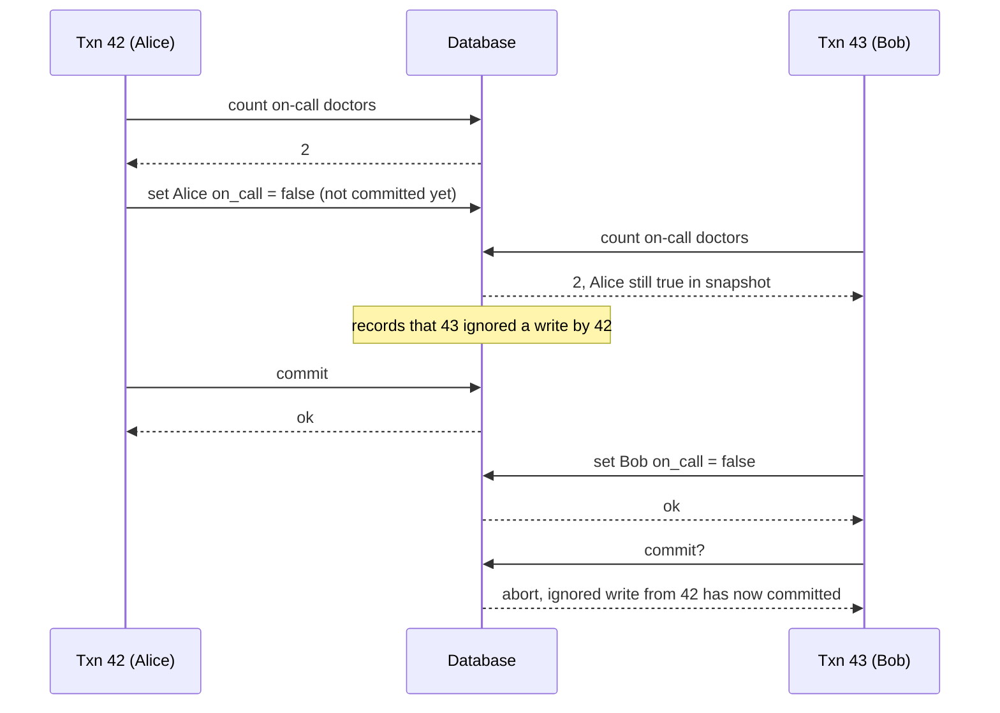

*How SSI detects it:*
1. Whenever MVCC visibility rules cause a transaction to **skip over** someone else's write, the database **records** that fact.
2. When the transaction **commits**, the database checks whether any of those ignored writes **have since committed**.
3. If so, it **aborts** the transaction.

*Why wait until commit instead of aborting at the stale read?*
- If 43 is **read-only**, it never needs aborting — no write, so no write skew risk — and at read time the database cannot know whether 43 will write later.
- Transaction 42 might still **abort**, or still be **uncommitted** when 43 commits, so the read may not be stale after all.
- By not aborting unnecessarily, SSI keeps snapshot isolation's big benefit: **long-running reads** on a consistent snapshot still work.

#### Detecting writes that affect prior reads

*The situation (Figure 7-11):* another transaction modifies data **after** it was read.

*How SSI detects it:* it borrows the idea of **index-range locks** from 2PL, but these locks **do not block**.
1. Transactions 42 and 43 each query the on-call doctors for **shift 1234**. If `shift_id` is indexed, the database can note on **index entry 1234** that 42 and 43 **read** it. (With no index, it can track this at the **table** level.)
2. These notes are temporary: after a transaction ends and **every transaction that ran concurrently with it has also ended**, its read records can be dropped.
3. When a transaction **writes**, it looks in the indexes for other transactions that **recently read** the affected data. This resembles taking a write lock on the key range, but instead of blocking, it acts as a **tripwire**: it **notifies** those readers that their data may be out of date.
4. In Figure 7-11, 43 notifies 42 that its read is outdated, and 42 notifies 43 likewise.
5. **42 commits first** and succeeds: 43's write affected 42, but 43 has not committed, so that write has not taken effect yet.
6. By the time **43 attempts to commit**, 42's conflicting write is already committed, so **43 is aborted**.

*Figure 7-11 (redrawn): SSI records reads on index entry shift 1234 and aborts the second committer*
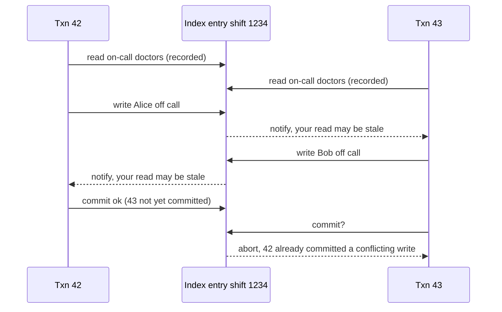

#### Performance of serializable snapshot isolation

*Tracking granularity trade-off.* Tracking reads and writes **in detail** lets the database be precise about who must abort, but bookkeeping becomes expensive. **Coarser** tracking is faster but may abort **more transactions than necessary**.

*Smarter analysis.* Sometimes a transaction reading overwritten data is still fine — it can be proven the result is serializable anyway. **PostgreSQL** uses this theory to **reduce unnecessary aborts**.

*Versus 2PL:* the big win is that transactions **don't block waiting for locks**. Just like plain snapshot isolation, **readers and writers never wait for each other**, so latency is **more predictable and less variable**. **Read-only queries run on a consistent snapshot with no locks**, great for read-heavy workloads.

*Versus serial execution:* SSI is **not limited to one CPU core**. **FoundationDB** spreads conflict detection over **multiple machines**, reaching very high throughput. Even with data partitioned across machines, transactions can read and write **multiple partitions** while staying serializable.

*Abort rate matters.* The rate of aborts strongly affects SSI performance. A transaction that reads and writes over a **long time** is likely to hit conflicts and abort, so SSI needs **read-write transactions to be fairly short** (long **read-only** ones are OK). Even so, slow transactions probably hurt SSI **less** than they hurt 2PL or serial execution.

| Approach | How it serializes | Main strengths | Main weaknesses |
|---|---|---|---|
| Actual serial execution | One transaction at a time, single thread, stored procedures, in-memory | Simple; no lock overhead | Limited to one core per partition; transactions must be tiny; data must fit in RAM; cross-partition is slow (~1,000 writes/s in VoltDB) |
| Two-phase locking | Shared/exclusive locks held to end; predicate or index-range locks for phantoms | Decades of use; prevents all anomalies | Readers and writers block each other; unstable, high tail latency; frequent deadlocks |
| SSI | Snapshot isolation + detect conflicts, abort at commit | No blocking; predictable latency; scales across machines (FoundationDB) | Aborts under high contention; long read-write transactions likely to abort; relatively new |

## Chapter summary

*(Book section: Summary)*

- **Transactions are an abstraction**: they let an app pretend certain concurrency problems and certain hardware/software faults do not exist. Many kinds of error collapse into one simple outcome — **abort** — and the app just retries.
- Not every app needs them: very simple access patterns (read/write a single record) may be fine without. For complex access patterns, they **greatly shrink** the number of error cases to think about.
- Without transactions, crashes, network interruptions, power outages, full disks and unexpected concurrency can leave data inconsistent — e.g., **denormalized data drifting** from its source — and reasoning about complex interacting accesses gets very hard.
- The chapter focused on **concurrency control** and three widely used isolation levels: **read committed**, **snapshot isolation** (which some vendors label repeatable read), and **serializable**, characterised by these races:

| Anomaly | What happens | What prevents it |
|---|---|---|
| **Dirty reads** | Reading another client's uncommitted writes | Read committed and stronger |
| **Dirty writes** | Overwriting another client's uncommitted write | Almost all transaction implementations |
| **Read skew (nonrepeatable read)** | Seeing different parts of the DB at different moments | Snapshot isolation, usually via MVCC |
| **Lost updates** | Two concurrent read-modify-write cycles; one overwrites the other | Some snapshot isolation implementations detect it automatically; others need a manual lock (`SELECT FOR UPDATE`) |
| **Write skew** | A decision based on a read whose premise is no longer true by write time | Only serializable isolation |
| **Phantom reads** | Another client's write changes the result of your search | Snapshot isolation handles simple phantoms; phantoms causing write skew need things like index-range locks |

- Weak levels protect against some anomalies and leave the rest to you (e.g., explicit locking). **Only serializable isolation** covers all of them. Three ways to implement it:
  - **Literally serial execution** — simple and effective if each transaction is very fast and throughput fits on one core.
  - **Two-phase locking** — the standard for decades, but many apps avoid it for performance reasons.
  - **Serializable snapshot isolation (SSI)** — fairly new; optimistic, lets transactions run without blocking, checks at commit and aborts if not serializable.
- The examples used the relational model, but transactions are valuable **whatever the data model**.
- Everything here assumed a **single machine**; distributed transactions raise new challenges, covered in Chapters 8 and 9.

## Interview angle

**1. What does ACID mean, and which letter is misleading?**
*30-second answer:* Atomicity = abort on failure and undo everything (really "abortability"). Consistency = app-defined invariants hold; that is the app's responsibility, not the DB's, so the C barely belongs. Isolation = concurrent transactions don't interfere; the textbook ideal is serializability, but most DBs default to weaker levels. Durability = committed data survives crashes, via disk + WAL or replication — never perfect.
- *Follow-up: Is "ACID compliant" a meaningful claim?* Not really; implementations differ, especially on isolation. Oracle's "serializable" is actually snapshot isolation.
- *Follow-up: How is ACID atomicity different from atomic operations in threading?* Threading atomicity is about no one seeing a half-done state (concurrency). ACID atomicity is about undoing partial work after a fault.

**2. Explain read committed vs snapshot isolation.**
*30-second answer:* Read committed stops dirty reads and dirty writes: row locks for writes, and readers get the last committed value. It still allows read skew — different parts read at different moments. Snapshot isolation gives each transaction a consistent snapshot from its start, implemented with MVCC (versions tagged with txids plus visibility rules). Readers never block writers and vice versa, which makes it great for backups and analytics.
- *Follow-up: Why not use read locks to prevent dirty reads?* A long write would stall many readers and spread slowdowns across the app.
- *Follow-up: What is "repeatable read"?* A standard name that vendors interpret differently — snapshot isolation in PostgreSQL/MySQL, serializability in DB2 (and Oracle calls its snapshot isolation "serializable").

**3. What is a lost update and how do you prevent it?**
*30-second answer:* Two concurrent read-modify-write cycles; one write clobbers the other. Fixes: atomic updates (`SET x = x + 1`), explicit locks (`SELECT ... FOR UPDATE`), automatic detection (PostgreSQL repeatable read, Oracle serializable, SQL Server snapshot isolation — not MySQL/InnoDB repeatable read), compare-and-set, and in replicated systems commutative operations or sibling merging. LWW loses updates.
- *Follow-up: Is compare-and-set always safe?* No — if the WHERE clause reads from an old snapshot, it can pass despite a concurrent write.

**4. What is write skew? Give an example and fix.**
*30-second answer:* Two transactions read the same data, each decides based on it, then write *different* objects; together they break an invariant. Example: two on-call doctors both go off call. Snapshot isolation doesn't catch it. Fixes: serializable isolation; or lock the rows you depend on with `FOR UPDATE`; or a multi-object constraint via triggers/materialized views; for "absence" checks (bookings, usernames), unique constraints, materializing conflicts, or serializable.
- *Follow-up: Why can't FOR UPDATE fix the booking case?* The check looks for rows that don't exist; there's nothing to lock. That's a phantom.

**5. Compare the three ways to implement serializability.**
*30-second answer:* Serial execution — single thread, stored procedures, in-memory data; simple but capped at one core per partition and cross-partition is slow. 2PL — shared/exclusive locks held to commit, plus predicate or index-range locks; correct but slow, blocking, deadlock-prone, bad tail latency. SSI — snapshot isolation plus conflict detection, aborting at commit; no blocking, predictable latency, but aborts rise with contention and long read-write transactions.
- *Follow-up: 2PL vs 2PC?* Completely different: 2PL is for isolation on one DB; 2PC is atomic commit across nodes (Chapter 9).
- *Follow-up: When is optimistic worse than pessimistic?* Under high contention near max throughput — aborts and retries add load.

**6. Why should apps retry aborted transactions, and when is retrying dangerous?**
*30-second answer:* Aborts exist to enable safe retries; many ORMs (ActiveRecord, Django) don't retry. Dangers: the commit may have succeeded but the ack was lost (double execution — dedupe needed); overload (use backoff and limits); permanent errors (pointless); external side effects like emails; the client dying mid-retry.

## Self-check

1. **Why does the book suggest "abortability" as a better name for atomicity?**
   Because the defining feature is that a failed transaction can be aborted and all its writes discarded, making retry safe — not anything about concurrency.

2. **Which ACID property is the application's job rather than the database's, and why?**
   Consistency. Only the app knows its invariants; the DB can check some (foreign keys, uniqueness) but generally just stores what it is given.

3. **Under read committed, can a transaction see $900 instead of $1,000 during a transfer? What is this called and what fixes it?**
   Yes — read skew (nonrepeatable read). Snapshot isolation fixes it by reading everything from one consistent snapshot.

4. **In PostgreSQL's MVCC, what happens physically when a row is updated?**
   The old row gets `deleted_by = txid`, and a new row with `created_by = txid` is added. Garbage collection later removes invisible old versions.

5. **List the four visibility rules for a snapshot.**
   Ignore writes by transactions in progress at start; ignore aborted transactions' writes; ignore writes by transactions with a later txid; everything else is visible.

6. **Scenario:** your app adds a tag to a JSON array by reading the document, appending in code, and writing it back. Two users do it at once and one tag disappears. Name the anomaly and two fixes.
   Lost update. Use the database's atomic document operation (e.g., MongoDB's), or lock the document with `SELECT FOR UPDATE`; or rely on automatic lost-update detection if the DB has it.

7. **Why is materializing conflicts a last resort?**
   It is hard and error-prone to design, and it leaks concurrency control into the data model. Serializable isolation is usually better.

8. **Trade-off:** why does 2PL have unstable high-percentile latency?
   Readers and writers block each other, waits are unbounded, queues form on hot objects, one big or slow transaction can stall many, and deadlocks force redo work.

9. **Why does SSI wait until commit to abort a transaction that read a stale value?**
   The transaction may be read-only (no risk), and the other writer might still abort or stay uncommitted. Waiting avoids needless aborts and keeps long reads working.

10. **Scenario:** a workload has high write throughput, many secondary indexes and frequent cross-entity transactions. Would actual serial execution be a good fit?
    Probably not: throughput is limited to one core per partition, data with many secondary indexes tends to need cross-partition coordination, and cross-partition transactions are slow (about 1,000 writes/s in VoltDB) and do not scale by adding machines. SSI or 2PL would fit better.
