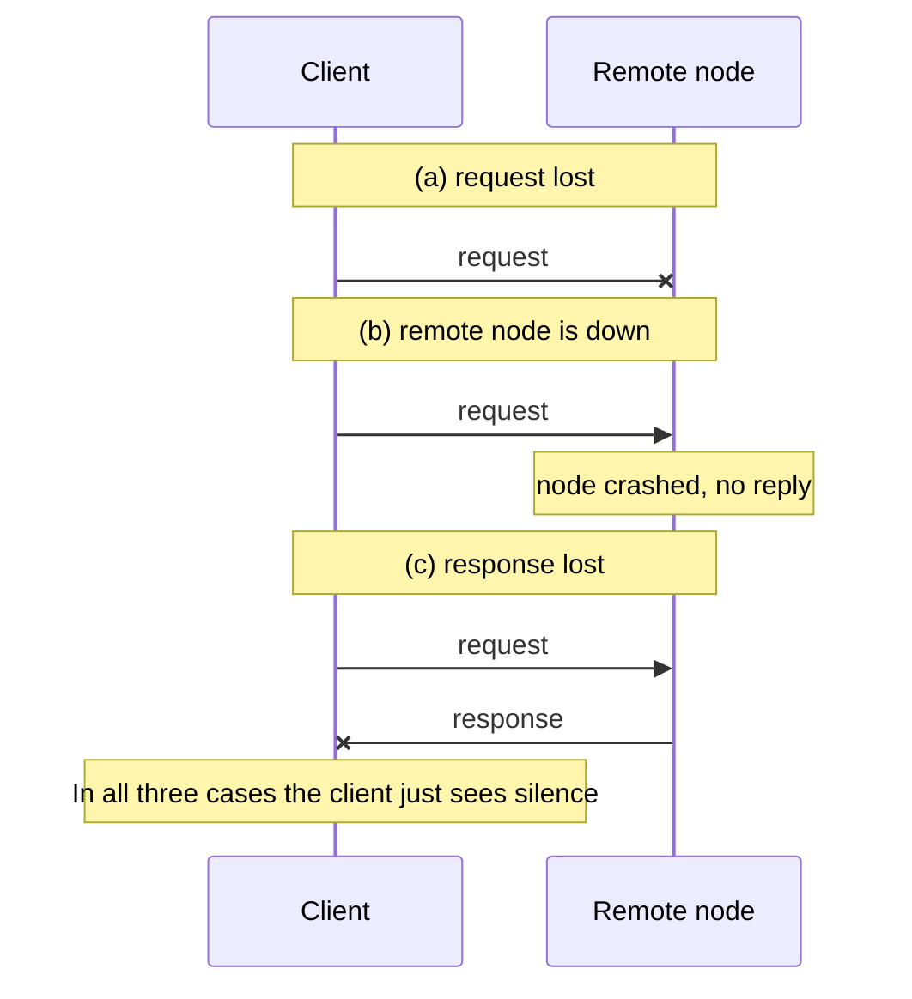
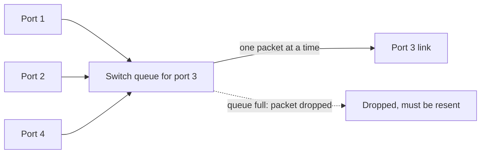
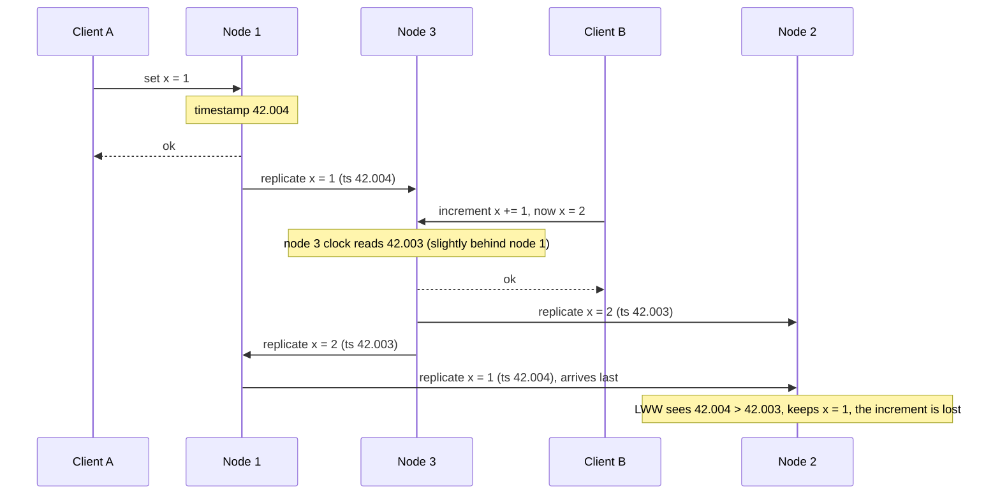
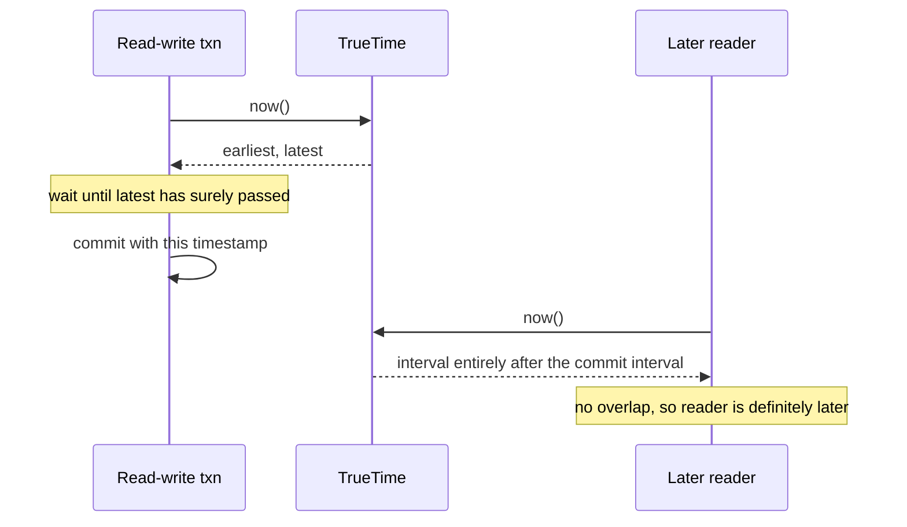
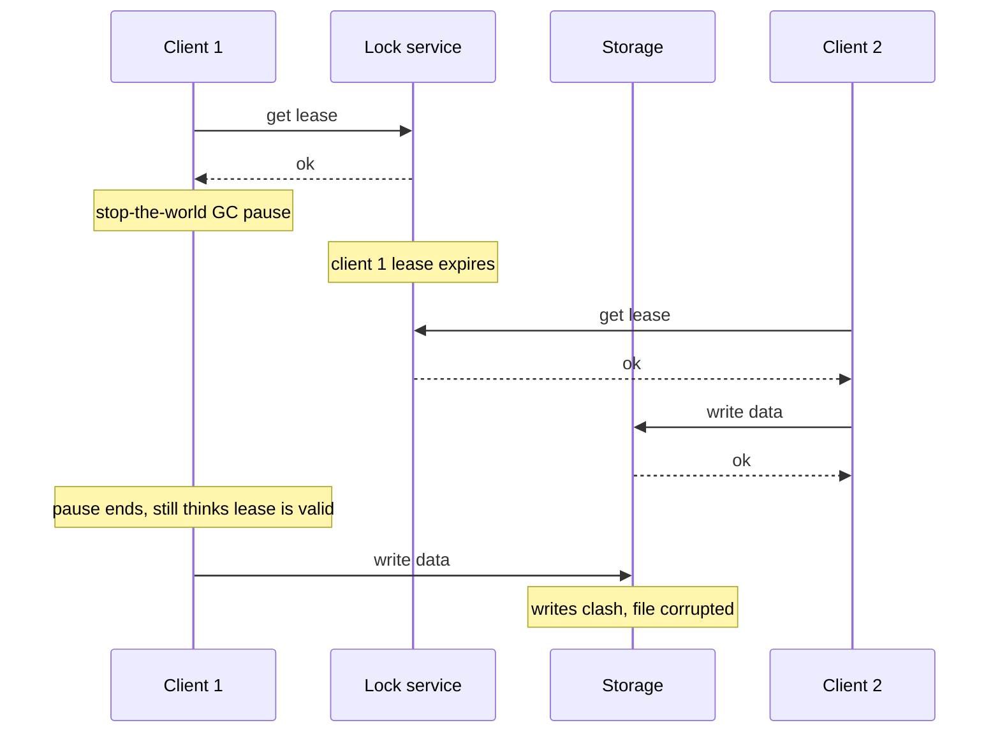
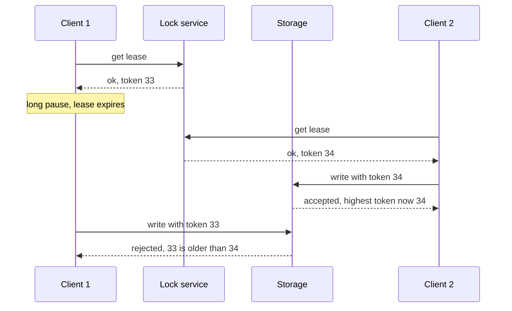

# Chapter 8 — The Trouble with Distributed Systems
*Book: Chapter 8, pp. 273–320*

## Overview

**The question this chapter answers:** once your software runs on many machines connected by a network, what exactly can go wrong, what can you rely on, and what can you *never* be sure of?

Earlier chapters already dealt with faults: replica failover and replication lag (Chapter 5) and concurrency control in transactions (Chapter 7). The book now says those chapters were still *too optimistic*. This chapter turns pessimism up to the maximum and adopts a Murphy's-law stance: **whatever can fail, will fail** — which, the book notes, experienced operators consider a reasonable assumption.

> **Footnote:** the one exception: the chapter assumes faults are **non-Byzantine** (nodes may fail but do not lie). Byzantine faults are discussed near the end.

Working across many computers is *fundamentally* different from writing software for one computer, mainly because there are so many new ways for things to fail. The chapter is deliberately gloomy; it surveys:

1. **Unreliable networks** — messages can be lost or delayed, and you cannot tell which.
2. **Unreliable clocks** — every machine's idea of the time is a bit (or a lot) wrong.
3. **Process pauses** — a program can freeze for seconds or minutes without noticing.
4. **Knowledge, truth and lies** — how a node can reason about the state of the system when it cannot trust its own view, and how we define "correct" algorithms using *system models*.

The goal of engineers is still to build systems that meet users' expectations *despite* all this. Chapter 9 presents algorithms that do so; this chapter first maps out the enemy.

The chapter's epigraph is a joke by Kyle Kingsbury (2013) that rewrites a pop lyric into a plea about laggy networks and data that may or may not be stored.

**Everyday analogy:** imagine coordinating a group project only by posting letters. Letters can get lost, arrive late, or arrive in any order. If a friend does not reply, you cannot tell whether your letter was lost, their reply was lost, or they are simply on holiday. Everyone's wristwatch shows a slightly different time. Sometimes a friend falls asleep for an hour mid-sentence and wakes up thinking nothing happened. That is distributed computing.

## Key terms

| Term | Plain-English meaning |
|---|---|
| Distributed system | Software running on several computers that talk only by sending messages over a network. |
| Deterministic | Same input, same operation → always the same result. Single computers aim for this. |
| Partial failure | Some parts of the system are broken while others work fine — unpredictably. |
| Nondeterministic | May sometimes work and sometimes fail, with no way to predict which. |
| High-performance computing (HPC) | Supercomputers with thousands of CPUs for heavy scientific jobs (weather, molecular dynamics). |
| Cloud computing | Multi-tenant datacenters of commodity machines on IP/Ethernet, elastic resources, metered billing. |
| Checkpoint | Saving the state of a long computation to durable storage so it can restart from there. |
| Commodity machines | Ordinary, cheap servers — cheaper per unit of performance but they fail more often. |
| RDMA | Remote direct memory access — one machine reading another's memory directly; used in supercomputers. |
| Clos topology | A datacenter network layout that gives high bisection bandwidth. |
| Rolling upgrade | Restarting nodes one at a time to upgrade software without downtime. |
| Error-correcting codes | Encoding that lets data survive a channel that occasionally flips bits. |
| IP / TCP | IP delivers packets unreliably; TCP builds a reliable, ordered stream on top of it. |
| Shared-nothing | Each machine has its own CPU, memory and disk; they cooperate only via the network. |
| Asynchronous packet network | A network that promises nothing about when (or whether) a packet arrives. |
| Timeout | Giving up waiting for a reply after a chosen time and assuming it will not come. |
| Network partition / netsplit | Part of the network cut off from the rest. The book mostly says "network fault" instead. |
| Chaos Monkey | Netflix's tool for deliberately causing failures to test resilience. |
| RST / FIN packet | TCP packets that reset or close a connection; an OS sends them if no process listens on a port. |
| ICMP Destination Unreachable | A router's reply saying an IP address cannot be reached. |
| Cascading failure | Overloaded nodes wrongly declared dead push load onto others, which then also fail. |
| Unbounded delay | No upper limit on how long a packet or request can take. |
| Network congestion | Packets waiting because a link is busy. |
| Queueing delay | Time spent waiting in a switch, OS or VM buffer before being handled. |
| Flow control (congestion avoidance, backpressure) | A sender slowing itself down to avoid overloading the network or receiver. |
| UDP | A transport protocol without flow control or retransmission; used when late data is useless. |
| VoIP | Voice over IP — phone calls over the internet. |
| Noisy neighbor | Another customer on shared hardware who hogs resources and makes your latency vary. |
| Jitter | Variability of response times / delays. |
| Phi Accrual failure detector | A failure detector that adapts timeouts to the measured distribution of response times. |
| Synchronous network | A network with reserved bandwidth per connection and therefore bounded delay (e.g., telephone circuits). |
| Circuit switching | Reserving a fixed amount of bandwidth along a whole route for the duration of a call. |
| Packet switching | Sending packets that share bandwidth opportunistically (Ethernet, IP). |
| Bounded delay | A guaranteed maximum end-to-end latency. |
| Bursty traffic | Data transfers with no fixed bandwidth need, which want to finish as fast as possible. |
| ATM (Asynchronous Transfer Mode) | A 1980s hybrid circuit/packet network technology that competed with Ethernet. |
| InfiniBand | A network with link-layer end-to-end flow control, reducing queueing. |
| Quality of service (QoS) | Prioritising and scheduling packets. |
| Admission control | Rate-limiting senders. |
| Duration | A time interval (e.g., how long a request took). |
| Point in time | A specific date and time (e.g., when an article was published). |
| Quartz crystal oscillator | The hardware that drives a computer's clock; not perfectly accurate. |
| NTP | Network Time Protocol — adjusts a computer's clock using time from a group of servers. |
| Time-of-day clock (wall-clock time) | Returns current date and time; can jump backward or forward. |
| Epoch | Midnight UTC, January 1, 1970 — the reference point for Unix timestamps. |
| Leap second | An extra (or missing) second making a minute 61 (or 59) seconds long. |
| Monotonic clock | Always moves forward; good for measuring durations but its absolute value is meaningless. |
| Slewing | NTP speeding up or slowing down a clock's rate slightly instead of jumping it. |
| Clock drift | A clock running faster or slower than it should. |
| ppm (parts per million) | Unit for drift; 200 ppm is the figure Google assumes. |
| Smearing | Spreading a leap-second adjustment gradually over a day. |
| PTP (Precision Time Protocol) | A more precise clock-synchronisation protocol than NTP. |
| Clock skew | The difference between two machines' clocks. |
| Last write wins (LWW) | Keep the write with the highest timestamp, discard the rest. |
| Causality | "B depended on A, so B happened after A". |
| Version vectors | A way of tracking causality between writes (Chapter 5). |
| Logical clock | A counter-based clock that orders events without measuring real time. |
| Physical clock | A clock measuring real elapsed time (time-of-day or monotonic). |
| Confidence interval (clocks) | A range of times the real time probably lies in, e.g., 95% sure it is between 10.3 and 10.5 s. |
| TrueTime | Google Spanner's clock API that returns `[earliest, latest]` for the current time. |
| Lease | A lock with a timeout; the holder must renew it before it expires. |
| Stop-the-world GC pause | The garbage collector halting all application threads. |
| Live migration | Moving a running VM to another host; causes a pause. |
| Steal time | CPU time a VM loses to other VMs on the same host. |
| Page fault / swapping / paging | Accessing memory that was moved to disk, forcing slow disk I/O. |
| Thrashing | The OS spending nearly all its time swapping pages rather than doing work. |
| SIGSTOP / SIGCONT | Unix signals that freeze and resume a process. |
| Preempt | Interrupt a running thread so something else can run. |
| Hard real-time system | A system that *must* respond before a deadline or the whole system fails. |
| RTOS | Real-time operating system — guarantees CPU time allocations in set intervals. |
| System model | A formal statement of what an algorithm may assume about timing and failures. |
| Asymmetric fault | A node can receive messages but its outgoing messages are lost (or vice versa). |
| Quorum | A vote among nodes; decisions need a minimum number of votes (often a majority). |
| Split brain | Two nodes both believing they are the leader. |
| Fencing token | An increasing number issued with each lock/lease, which the resource checks to reject stale holders. |
| zxid / cversion | ZooKeeper's transaction ID and node version, usable as fencing tokens. |
| Byzantine fault | A node sending arbitrary, faulty or deliberately misleading messages ("lying"). |
| Byzantine Generals Problem | Reaching agreement when some participants may be traitors. |
| Two Generals Problem | Two parties agreeing via messengers who may be delayed or lost. |
| Byzantine fault-tolerant | Keeps working correctly even when some nodes misbehave or attackers interfere. |
| Supermajority | More than two-thirds of nodes. |
| Synchronous / partially synchronous / asynchronous model | Timing assumptions: always bounded / usually bounded / no timing assumptions at all. |
| Crash-stop / crash-recovery / Byzantine (arbitrary) faults | Node failure assumptions: crash forever / crash and maybe come back with disk intact / do anything. |
| Stable storage | Non-volatile disk storage assumed to survive crashes. |
| Safety property | "Nothing bad happens" — once violated, you can point to the moment it broke, and it cannot be undone. |
| Liveness property | "Something good eventually happens" — may be unmet now but can still be satisfied later. |
| Limping node | A node that is degraded (e.g., very slow) but not dead. |

## Faults and Partial Failures

*On a single computer.* A program on one machine usually behaves predictably: it works or it does not. When a computer seems to be "having a bad day" (often fixed by a reboot), that is mostly bad software. There is no fundamental reason for flakiness: with working hardware, the same operation always gives the same result — it is **deterministic**. If the hardware fails (memory corruption, a loose connector), the typical result is a **total** failure — kernel panic, "blue screen of death", failure to boot. A good single computer is either fully working or fully broken, not in between.

*This is intentional.* Computers are designed to **crash rather than return a wrong answer**, since wrong answers are confusing and hard to handle. They hide messy physics behind an **idealised system model** that looks mathematically perfect: every CPU instruction behaves identically each time, and data written to memory or disk stays intact. This goal of always-correct computation dates back to the **very first digital computer**.

*With many computers connected by a network, this breaks down.* You can no longer hide in the idealised model; you face the physical world, where a surprising variety of things fail. The book quotes an anecdote by **Coda Hale** listing things he had dealt with: long network partitions inside one datacenter, **PDU** (power distribution unit) failures, switch failures, whole racks accidentally power-cycled, whole-datacenter backbone and power failures, and a driver with low blood sugar crashing a **Ford pickup truck** into a datacenter's **HVAC** (heating, ventilation and air conditioning) system — and he notes he is not even an operations person.

*Definition — partial failure.* In a distributed system, some parts may be broken in unpredictable ways while others are fine. Partial failures are **nondeterministic**: an operation involving several nodes and the network may work sometimes and fail unpredictably at other times. It may even be impossible to **tell whether an operation succeeded**, because the time a message spends in transit is itself nondeterministic. This combination is what makes distributed systems hard.

### Cloud Computing and Supercomputing

There is a spectrum of philosophies for building large-scale computing:

| | High-performance computing (HPC) | Cloud computing |
|---|---|---|
| Typical use | Compute-heavy science: **weather forecasting**, **molecular dynamics** (simulating atoms and molecules) | Online internet services |
| Hardware | **Specialised**, each node quite reliable; communicate via **shared memory** and **RDMA** | **Commodity** machines: same performance for less money (economies of scale), but **higher failure rates** |
| Network | Special layouts like **multi-dimensional meshes** and **toruses**, which suit known HPC communication patterns | **IP and Ethernet**, arranged in **Clos topologies** for high bisection bandwidth |
| Other traits | Nodes assumed close together | Loosely defined; **multi-tenant datacenters**, **elastic/on-demand** resources, **metered billing** |

**Traditional enterprise datacenters** sit somewhere in between.

*How supercomputers handle faults.*
1. A job periodically **checkpoints** its state to durable storage.
2. If a node fails, the usual approach is to **stop the whole cluster workload**.
3. Once the faulty node is repaired, the computation **restarts from the last checkpoint**.

So a supercomputer behaves more like a **single computer** than a distributed system: it turns a partial failure into a **total failure** (like a kernel panic).

*Why internet services must be different.* The book focuses on systems for internet services, which differ from supercomputers in several ways:

- **Online, low latency, always.** Taking the service down to fix a node is unacceptable. By contrast, an offline (batch) job such as a weather simulation can be halted and rerun with little harm.
- **Commodity hardware** fails more often than specialised supercomputer hardware.
- **Different networks** (IP/Ethernet in Clos topologies vs. meshes/toruses).
- **Something is always broken.** The bigger the system, the likelier some component is faulty. Once you have **thousands of nodes**, you should simply expect that some part is broken at any given moment. If the error handling is just "give up", a large system may spend most of its time recovering instead of working.
- **Fault tolerance helps operations.** If the system tolerates failed nodes, you can perform **rolling upgrades** (Chapter 4): nodes restart in turn while the service keeps running. In the cloud, if a VM performs badly you can kill it and request another, hoping it is faster.
- **Geographic distribution.** To keep data near users for lower latency, communication often crosses the **internet**, which is slower and less reliable than local networks. Supercomputers assume all nodes are close together.

*Consequence.* To make distributed systems work, you must **accept partial failure** and build **fault tolerance into the software** — building a **reliable system from unreliable components**. Perfect reliability is impossible (Chapter 1), so you also need to understand the limits of what you can promise.

*Even small systems.* In a system of only a few nodes, most parts work most of the time, but eventually something breaks, and the software must handle it. Fault handling must be **part of the design**, and operators need to know what the software will do in a fault.

It is unwise to assume faults are rare and hope for the best. Consider a **wide range** of faults, even unlikely ones, and **deliberately create them in testing**. In this field, being **suspicious, pessimistic and even paranoid is rewarded**.

> **Building a Reliable System from Unreliable Components (sidebar).** It seems a system can be no more reliable than its weakest part — but that is false; building something more reliable on a less reliable base is an old idea in computing. Examples:
> - **Error-correcting codes** let digital data cross a channel that sometimes flips bits (e.g., radio interference on wireless networks).
> - **IP** is unreliable: packets can vanish, arrive late, arrive twice, or arrive out of order. **TCP**, layered above it, retransmits missing packets, removes duplicates, and puts packets back in sending order.
>
> There is always a **limit**: error-correcting codes handle a few single-bit errors, but if interference swamps the signal there is a fundamental cap on how much data gets through. TCP hides loss, duplication and reordering, but **cannot remove network delay**. Still, the higher layer handles tricky low-level faults so the remaining ones are easier to reason about (revisited in Chapter 12's end-to-end argument).

## Unreliable Networks

*Setting.* The book focuses on **shared-nothing** systems (Part II introduction): a set of machines connected by a network, where each has its **own memory and disk** and cannot touch another's except by sending requests over the network.

*Why shared-nothing dominates internet services:* it is **comparatively cheap** (no special hardware), it can use **commoditised cloud services**, and it can reach high reliability through **redundancy across geographically distributed datacenters**.

*The network is asynchronous.* The internet and most datacenter networks (often **Ethernet**) are **asynchronous packet networks**: a node can send a packet to another node, but there is **no guarantee when — or whether — it will arrive**. When you send a request and wait for an answer, lots can go wrong (Figure 8-1 shows some cases):

1. The **request was lost** (maybe someone unplugged a cable).
2. The request is **stuck in a queue** and will arrive later (network or recipient overloaded).
3. The **remote node failed** (crashed or powered down).
4. The remote node **temporarily stopped responding** (e.g., a long **garbage collection pause**) but will resume later.
5. The remote node **processed the request, but the response was lost** (e.g., a misconfigured switch).
6. The remote node processed it, but the **response is delayed** (network or your own machine overloaded).

*Figure 8-1 (redrawn): after sending a request with no reply, the sender cannot tell which of these happened*


The sender cannot even tell if its packet arrived; only a reply could say so, and the reply can be lost or delayed too. In an asynchronous network these cases are **indistinguishable**: all you know is that you have **not received a response yet**, and you cannot tell why.

*The usual approach: a **timeout**.* After a while you stop waiting and assume no response is coming. But when the timeout fires, you **still do not know** whether the remote node got the request — and if it is still queued somewhere, it may be delivered later even though you gave up.

### Network Faults in Practice

After decades of building networks, you might expect them to be reliable by now. They are not.

*Evidence (systematic studies and many anecdotes):* network problems are surprisingly common, even in a datacenter run by a single company.
- A study of one **medium-sized datacenter** counted roughly **12 network faults a month**: **half** disconnected a **single machine**, **half** disconnected an **entire rack**.
- A different study looked at how often **load balancers**, **aggregation switches** and **top-of-rack switches** fail. It found that adding **redundant networking gear** reduces faults less than you would hope, because it does not protect against **human error** (e.g., misconfigured switches), a **major cause** of outages.
- **Public clouds such as EC2** are notorious for frequent **transient network glitches**; well-run private datacenter networks can be more stable.
- Nobody is immune: a problem during a **switch software upgrade** triggered a network topology reconfiguration during which packets were delayed for **more than a minute**. (The body text does not name the incident; the book's references include a GitHub downtime post-mortem for it, and the index lists it as split brain caused by a 1-minute packet delay.)
- **Sharks** may bite **undersea cables** and damage them.
- A network interface was seen **dropping all inbound packets while sending outbound ones fine** — a link working in one direction says nothing about the other.

> **Network partitions.** A fault that isolates one section of the network from the others is often called a **network partition** or **netsplit**. The book prefers the more general phrase **network fault**, so readers don't mix it up with the partitions (shards) of a database from Chapter 6.

*Your software must handle them.* Even if faults are rare where you run, they *can* happen, so any network communication may fail — no way around it.

Without **defined and tested** handling for network faults, anything at all can go wrong: a cluster may **deadlock** and stay unable to serve requests even after the network recovers, or it may even **delete all your data**. Software in unanticipated situations may do arbitrary unexpected things.

*Handling ≠ tolerating.* If your network is usually reliable, it can be valid to just **show users an error** during network trouble. But you must **know how your software reacts** and make sure it **recovers**. Intentionally **causing** network failures to see how the system copes can be worthwhile — the idea behind **Chaos Monkey** (Chapter 1).

### Detecting Faults

Many systems must detect faulty nodes automatically:
- A **load balancer** must stop sending requests to a dead node (take it **out of rotation**).
- In **single-leader replication**, if the leader fails, a follower must be **promoted** (Chapter 5).

Network uncertainty makes it hard to know whether a node works. Sometimes you **do** get explicit feedback:

| Situation | Feedback you might get | Limitation |
|---|---|---|
| Machine reachable, but **no process listening** on the port (e.g., it crashed) | The OS closes/refuses the TCP connection with a **RST** or **FIN** packet | If the node crashed *mid-request*, you cannot know how much it processed |
| Node **process crashed** (or killed by an admin) but the **OS still runs** | A script can **notify other nodes** so one takes over quickly without waiting for a timeout — **HBase** does this | Needs the OS to be alive |
| You can access the **switch management interface** | Query switches for **hardware-level link failures** (e.g., machine powered off) | Not possible over the internet, in a shared datacenter without switch access, or if a network problem blocks the management interface |
| A **router** is sure the IP is unreachable | It may send an **ICMP Destination Unreachable** packet | Routers have no magic failure detection either |

*Key lessons.*
- Fast feedback about a dead node is useful but **cannot be relied on**.
- Even if **TCP acknowledges** delivery, the **application** may crash before handling the packet. Only an explicit **success reply from the application** proves a request worked.
- If something goes wrong you *might* get an error somewhere in the stack, but generally you should plan for **silence**. You may retry a few times (TCP already retries invisibly, and you can add application-level retries), wait for a timeout, and finally **declare the node dead** if you hear nothing.

### Timeouts and Unbounded Delays

If a timeout is the only reliable fault detector, **how long should it be?** There is no simple answer.

| Timeout | Benefit | Cost |
|---|---|---|
| **Long** | Fewer false alarms | Long wait before a node is declared dead; users wait or see errors |
| **Short** | Faster detection | Higher risk of wrongly declaring a node dead when it was only briefly slow (load spike on node or network) |

*Dangers of declaring a node dead too early:*
- If the node is in fact alive and partway through something (the book's example: **sending an email**), a second node taking over may cause it to be **done twice** (discussed later in this chapter and in Chapters 9 and 11).
- The "dead" node's work is handed to other nodes, loading them and the network further; in a system already under strain this makes matters **worse**. If the "dead" node was only **slow due to overload**, moving its load elsewhere may trigger a **cascading failure**; at worst every node pronounces every other node dead and the whole system halts.

*An imaginary ideal.* Suppose a network guaranteed that every packet is either delivered within time **d** or lost (never later), and every non-failed node handled a request within time **r**. Then every successful request would get a reply within **2d + r**, and no reply by then would prove the network or node was broken. **2d + r** would be a sensible timeout.

*Reality.* Most systems have **neither** guarantee:
- Asynchronous networks have **unbounded delays**: they try to deliver quickly, but there is **no upper limit**.
- Most servers **cannot guarantee** handling requests within a maximum time (see "Response time guarantees" below).

For failure detection, being fast **most** of the time is not enough: with a low timeout, one **transient spike** in round-trip times can throw the system off balance.

#### Network congestion and queueing

Like road travel times, which vary mostly because of **traffic jams**, packet delay variability is mostly due to **queueing**:

1. **Switch queues.** If several nodes send to the **same destination** at once, the switch must queue the packets and feed them onto the destination link **one at a time** (Figure 8-2). On a busy link a packet may wait for a slot — **network congestion**. If the queue **fills up**, the packet is **dropped** and must be resent, even though the network is technically working.
2. **OS queues.** At the destination, if all **CPU cores are busy**, the OS queues the incoming request until the app can take it — for an arbitrary time depending on load.
3. **VM pauses.** Under virtualisation, a guest OS is frequently **frozen for tens of milliseconds** so another VM can use the CPU core. Meanwhile the VM cannot read network data, so the **virtual machine monitor buffers** it, adding more variability.
4. **TCP flow control** (also called **congestion avoidance** or **backpressure**): a node limits its own sending rate to avoid overloading a link or the receiver, which means **extra queueing at the sender** before data even enters the network.

*Figure 8-2 (redrawn): ports 1, 2 and 4 all send to port 3, so the switch queue for port 3 fills up*


*TCP retransmission adds delay too.* TCP treats a packet as **lost** if it is not acknowledged within a timeout (computed from observed round-trip times) and **retransmits** it automatically. The app does not see the loss, but it **does see the delay** (waiting for the timeout, then for the retransmission to be acknowledged).

> **TCP Versus UDP.** Latency-sensitive apps like **videoconferencing** and **VoIP** use **UDP**. It trades reliability for less delay variability: UDP has **no flow control** and **no retransmission**, avoiding some causes of variable delay (though switch queues and scheduling delays still apply). UDP fits when **late data is worthless**. In a VoIP call, there is no time to resend a lost packet before its audio must play, so the app plays **silence** for that slot (a brief glitch) and moves on. The retry happens at the **human layer** — someone asks the other person to repeat what they said.

*Utilisation matters.* All these factors make delays variable. Queueing delays vary **most** when a system is **near maximum capacity**: with spare capacity, queues drain quickly; in a heavily used system, long queues form fast.

*Shared environments.* In **public clouds and multi-tenant datacenters**, customers share network links, switches, and even each machine's **network interface and CPUs** (on VMs). **Batch jobs like MapReduce** (Chapter 10) can easily **saturate** links. Since you cannot control or see other customers' usage, delays can vary wildly if a **noisy neighbor** uses lots of resources.

*Choosing timeouts in practice.*
1. Choose them **experimentally**: measure the **distribution of round-trip times** over a long period and across many machines to learn the expected variability.
2. Considering your app's needs, pick a trade-off between **detection delay** and **risk of premature timeouts**.
3. **Better still:** rather than hard-coding a timeout, the system can **keep measuring response times and how much they vary (jitter)** and **tune the timeout on the fly**. The **Phi Accrual failure detector** does this and is used in **Akka** and **Cassandra**. **TCP retransmission timeouts** work in a similar way.

### Synchronous Versus Asynchronous Networks

*Why not fix it in hardware?* Distributed systems would be far simpler if networks delivered packets with a **fixed maximum delay** and **never dropped** them. Could we build that?

*Compare with the telephone network.* The traditional **fixed-line telephone network** (not cellular, not VoIP) is **extremely reliable**: delayed audio and dropped calls hardly ever happen. A phone call requires **consistently low latency end to end**, plus enough bandwidth to carry the voice samples.

*How it works — a circuit.*
1. Dialling sets up a **circuit**: a **set, guaranteed slice of bandwidth** is reserved along the **entire route** between the callers.
2. The circuit stays until the call ends.
3. Example: **ISDN** operates at a constant **4,000 frames per second**. A call is given **16 bits** in each frame, in each direction. So for the whole call, each side can send exactly **16 bits of audio every 250 microseconds**.

This network is **synchronous**: even across several routers, data does not queue, because the call's 16 bits are **already reserved** in the next hop. Since nothing queues, the **worst-case end-to-end latency is a known constant** — a **bounded delay**.

#### Can we not simply make network delays predictable?

*Circuit vs. TCP connection.*

| Circuit (telephone) | TCP connection (packet-switched) |
|---|---|
| Fixed reserved bandwidth that **nobody else can use** while the circuit exists | Packets **opportunistically use whatever bandwidth is available** |
| Suits constant-rate data (audio/video calls) | Suits variable-sized blocks (an email, a web page), sent as fast as possible |
| Uses bandwidth for the whole call | Uses **no bandwidth when idle** (except perhaps an occasional **TCP keepalive** packet) |

Were datacenter networks and the internet **circuit-switched**, a maximum round-trip time could be promised whenever a circuit was created. But they aren't: **Ethernet and IP use packet switching**, suffer from queueing and hence **unbounded delays**, and have **no concept of a circuit**.

*Why packet switching?* Because it is optimised for **bursty traffic**. A circuit suits audio/video calls needing a steady bit rate. But fetching a web page, sending email or transferring a file has **no particular bandwidth requirement** — you just want it done **as fast as possible**.

Transferring a file over a circuit would require **guessing a bandwidth**:
- **Too low:** the transfer is needlessly slow and capacity sits unused.
- **Too high:** the network **refuses to create the circuit**, because it only builds circuits whose bandwidth it can promise.

So circuits for bursty transfers **waste capacity** and **slow transfers down**. TCP instead **adapts its rate** to the capacity available.

*Hybrids.* There have been attempts at networks supporting both circuit and packet switching, such as **ATM**. **InfiniBand** has similarities: it does **flow control end to end at the link layer**, which cuts down queueing in the network, though link congestion can still cause delays. With careful **quality of service** (QoS: prioritising and scheduling packets) and **admission control** (rate-limiting senders), you can **emulate circuit switching** on packet networks or give **statistically bounded delay**.

> **Footnote — ATM.** Asynchronous Transfer Mode competed with Ethernet in the **1980s** but was rarely used except in the **core switches of telephone networks**. Despite the acronym, it is unrelated to cash machines. The book muses that in a parallel universe where the internet ran on something like ATM, video calls would probably be far more reliable.

> **Latency and Resource Utilization (sidebar).** Variable delays come from **dynamic resource partitioning**.
> - Imagine a cable linking two telephone exchanges with capacity for **10,000 calls at once**. Every circuit switched over it occupies one slot. The wire is split **statically**: even if you are the only caller and **9,999 slots are empty**, your circuit gets the same fixed bandwidth as when the wire is full.
> - The **internet shares bandwidth dynamically**: senders jostle to get packets onto the wire fast, and switches decide moment by moment which packet goes next. The downside is **queueing**; the upside is **maximum utilisation**. Since the wire has a fixed cost, better utilisation makes each byte **cheaper**.
> - **CPUs** are similar: sharing a core dynamically among threads means a thread sometimes waits in the OS **run queue** and is paused for varying times, but hardware is used better than with a static CPU-cycle allocation per thread. Better utilisation is also a big reason for **virtual machines**.
> - **Latency guarantees** are possible with **static partitioning** (dedicated hardware, exclusive bandwidth) — at the cost of lower utilisation, i.e., **more expensive**. Multi-tenancy with dynamic partitioning is **cheaper** but has **variable delays**.
> - So variable network delay is **not a law of nature**, just the outcome of a **cost/benefit trade-off**.

*Current reality.* Such QoS is **not enabled** in multi-tenant datacenters, public clouds, or across the internet. Deployed technology gives **no guarantees** on network delay or reliability; you must **assume congestion, queueing and unbounded delays**. Therefore there is **no "correct" timeout value** — determine it **experimentally**.

> **Footnote — BGP.** Peering agreements between ISPs and routes set up through the **Border Gateway Protocol (BGP)** resemble circuit switching more than IP does; at that level you can buy **dedicated bandwidth**. But internet routing works at the level of **networks**, not individual host connections, and on a **much longer timescale**.

## Unreliable Clocks

Applications use clocks to answer questions like these (the book's list):

1. Has this request timed out yet?
2. What is the service's **99th percentile** response time?
3. How many queries per second did it handle on average over the **last five minutes**?
4. How much time did a visitor spend on the website?
5. When was this article published?
6. When should the reminder email go out?
7. When does this cache entry expire?
8. What is the timestamp on this log error?

Items **1–4 measure durations** (intervals, e.g., from request to response). Items **5–8 describe points in time** (events at a particular date and time).

*Why time is tricky in distributed systems.*
- **Communication is not instantaneous.** A message is always received *after* it was sent, but because network delay varies, you do not know **how much** after. That makes it hard to determine the **order** of events across machines.
- **Each machine has its own clock**, a physical device — usually a **quartz crystal oscillator**. These are **not perfectly accurate**, so each machine's time may be a bit fast or slow compared with others.
- Clocks can be **synchronised to a degree**. The usual tool is the **Network Time Protocol (NTP)**; it corrects a computer's clock using time reported by a group of servers, which in turn get time from a more accurate source such as a **GPS receiver**.

### Monotonic Versus Time-of-Day Clocks

Modern computers have at least **two** kinds of clock. Both measure time, but they serve **different purposes**.

#### Time-of-day clocks

*What it is.* A **time-of-day clock** behaves the way you intuitively expect a clock to: it tells you today's date and the current time according to a calendar (**wall-clock time**).

*Examples:* `clock_gettime(CLOCK_REALTIME)` on Linux and `System.currentTimeMillis()` in Java. Both give the number of seconds (or milliseconds) elapsed since the **epoch** — **00:00 UTC on 1 January 1970** in the Gregorian calendar — **ignoring leap seconds**. Some systems use other reference dates.

> **Footnote:** the "real-time" in `CLOCK_REALTIME` is unrelated to real-time operating systems (discussed under "Response time guarantees").

*Properties and pitfalls.*
- Usually **synchronised with NTP**, so ideally a timestamp on one machine means the same as on another.
- A local clock that has run **well ahead** of the NTP server can be **reset by force**, so it seems to **leap back in time**.
- Such jumps, together with the usual **disregard of leap seconds**, mean time-of-day clocks are **a poor choice for timing how long something took**.
- Historically they had **coarse resolution** — e.g., stepping in **10 ms** increments on older Windows systems. Less of a problem on recent systems.

#### Monotonic clocks

*What it is.* A **monotonic clock** is for measuring a **duration**, such as a timeout or response time. On Linux that is `clock_gettime(CLOCK_MONOTONIC)`; in Java, `System.nanoTime()`. "Monotonic" refers to the promise that it **never goes backward**, unlike a time-of-day clock.

*How to use it.*
1. Read the monotonic clock.
2. Do some work.
3. Read it again. The **difference** is the elapsed time.

*Caveats.*
- The **absolute value is meaningless** — e.g., nanoseconds since boot. **Never compare** monotonic values **across two computers**.
- On servers with **multiple CPU sockets**, each CPU may have its own **unsynchronised timer**. The OS compensates to present a monotonic view to threads moving between CPUs, but the book advises treating that guarantee with **some scepticism**.
- **NTP slewing:** if NTP sees the local quartz running fast or slow, it may **adjust the rate** of the monotonic clock. By default NTP allows speeding up or slowing down by **up to 0.05%**, but it **cannot make the monotonic clock jump**.
- **Resolution** is usually good: **microseconds or finer** on most systems.

*In distributed systems,* measuring elapsed time (such as timeouts) with a monotonic clock **generally works well**: it assumes no synchronisation across nodes and tolerates small measurement inaccuracies.

| | Time-of-day clock | Monotonic clock |
|---|---|---|
| Answers | "What date/time is it?" (point in time) | "How much time passed?" (duration) |
| Linux / Java | `CLOCK_REALTIME` / `System.currentTimeMillis()` | `CLOCK_MONOTONIC` / `System.nanoTime()` |
| Can jump backward? | Yes (NTP reset) | No (only slewed up to 0.05%) |
| Comparable across machines? | Ideally yes, if synced | No — absolute value is arbitrary |
| Needs NTP? | Yes, to be useful | No |

### Clock Synchronization and Accuracy

Monotonic clocks need no synchronisation, but time-of-day clocks must be set from NTP or another external source to be useful. Unfortunately, getting the right time is **far less reliable** than you would hope. The book's examples:

- **Quartz drift.** A computer's quartz clock **drifts** (runs fast or slow), varying with **temperature**. **Google assumes 200 ppm** drift for its servers — equal to **6 ms** of drift if resynced every **30 seconds**, or **17 seconds** if resynced **once a day**. Drift caps the best possible accuracy even when everything works.
- **Forced resets.** If a clock differs too much from the NTP server, the client may **refuse to sync** or the clock is **forcibly reset**. Apps watching the time may see it **go backward or jump forward**.
- **Firewalled from NTP.** A node accidentally cut off from NTP servers may go **unnoticed** for a while; anecdotes suggest this really happens.
- **Network delay limits NTP.** NTP can be no better than the network delay. One experiment achieved a **minimum error of 35 ms** syncing **over the internet**, but occasional delay spikes caused errors of **about a second**. With large delays, the NTP client may **give up** entirely, depending on configuration.
- **Wrong NTP servers.** Some servers are wrong or misconfigured, off by **hours**. NTP clients are fairly robust — they query **several servers and ignore outliers** — but it is unsettling to stake correctness on time told to you by **a stranger on the internet**.
- **Leap seconds** make a minute **59 or 61 seconds** long, breaking timing assumptions in systems not designed for them. Leap seconds have **crashed many large systems** (the body text names no specific incident; the book's references and index include a 2012 report of a leap second — via a Linux bug — crashing "half the internet", and Cloudflare DNS being affected in 2017), showing how easily wrong clock assumptions creep in. The best approach may be to have NTP servers **"lie"** by applying the leap second **gradually over a day** — called **smearing** — though real NTP server behaviour varies.
- **Virtual machines.** The hardware clock is **virtualised**, creating extra problems for accurate timekeeping. When VMs share a CPU core, each VM is **paused for tens of milliseconds** while another runs; to the app this looks like the clock **suddenly jumping forward**.
- **Devices you don't control** (mobile, embedded): you probably **cannot trust the hardware clock at all**. Certain users **set incorrect dates on purpose**, for instance to dodge time limits in **games**, so the clock may be wildly in the past or future.

*High accuracy is possible, at a price.* The **MiFID II** draft European regulation requires **high-frequency trading funds** to sync clocks **within 100 microseconds of UTC**, so that odd market events like **"flash crashes"** can be investigated and **market manipulation** spotted. That accuracy is reachable with **GPS receivers**, the **Precision Time Protocol (PTP)**, and careful deployment and monitoring — but it takes significant effort and expertise, and many things can go wrong. A misconfigured NTP daemon or a firewall blocking NTP traffic can let drift errors grow large quickly.

### Relying on Synchronized Clocks

Clocks look simple but hide pitfalls: a day is **not always exactly 86,400 seconds** long, a time-of-day clock can **run backward**, and one node's time may differ a lot from another's.

*Same attitude as for networks.* Networks behave well most of the time, but software must assume occasional faults and handle them gracefully. Likewise, clocks work well most of the time, but **robust software must be prepared for wrong clocks**.

*Why clock faults are sneaky.* A defective CPU or misconfigured network usually stops a machine working entirely, so it is noticed and fixed fast. A defective quartz clock or misconfigured NTP client lets most things **appear fine** while the clock **drifts further and further** from reality. Software relying on accurate clocks then tends to suffer **silent, subtle data loss** rather than a dramatic crash.

*What to do.* If your software needs synchronised clocks, **monitor clock offsets between all machines**. A node whose clock wanders too far from the rest should be **treated as dead and kicked out of the cluster**, so broken clocks are caught before they do much damage.

#### Timestamps for ordering events

*The tempting mistake.* Relying on clocks to decide the order of events on different nodes — e.g., when two clients write to a distributed database, whose write came first, and which is the latest?

*Figure 8-3* illustrates a risky reliance on time-of-day clocks in a **multi-leader** replicated database (similar to Figure 5-9 in Chapter 5):
1. On **node 1**, **client A** sets `x = 1`.
2. That write is replicated to **node 3**.
3. On **node 3**, **client B** increments x, making it `x = 2`.
4. Both writes are replicated to **node 2**.

Each write is tagged with a timestamp from the **time-of-day clock of the node where it originated**. Synchronisation in this example is **excellent**: nodes 1 and 3 differ by **less than 3 ms** — probably better than you'd get in practice. Yet the timestamps order events **wrongly**: `x = 1` has timestamp **42.004 s**, while `x = 2` has **42.003 s**, even though `x = 2` clearly happened later. Node 2 concludes `x = 1` is newer and **drops `x = 2`** — client B's increment is **lost**.

*Figure 8-3 (redrawn): client B's write is causally later but gets an earlier timestamp, so node 2 discards it under LWW*


*This is last write wins (LWW)*, common in multi-leader setups and in leaderless databases like **Cassandra** and **Riak** (Chapter 5). Some implementations generate timestamps on the **client** instead of the server, but that does not fix LWW's basic problems:

- **Writes can mysteriously vanish.** If one node's clock **runs behind**, its writes cannot replace values written earlier by a node whose clock **runs ahead** until enough time to cover the skew has passed. Arbitrary amounts of data can be **silently dropped** with no error reported.
- **LWW cannot tell sequential from concurrent writes.** In Figure 8-3, B's increment definitely came after A's write; truly concurrent writes are ones where neither writer knew of the other. Telling them apart needs extra **causality tracking** such as **version vectors** (Chapter 5).
- **Identical timestamps.** Two nodes can generate writes with the **same timestamp**, especially with **millisecond** resolution. A **tiebreaker** (even just a large random number) is needed, but that can also **violate causality**.

So "keep the most recent value" sounds good, but what counts as "recent" is decided by the **time-of-day clock on one machine, and it may be off**. Even with closely NTP-synced clocks, a packet stamped **100 ms** by its sender could be received at **99 ms** by the receiver's clock — apparently arriving before departure, which cannot happen.

*Could NTP be made accurate enough?* Probably **not**: NTP's accuracy is limited by **network round-trip time** plus quartz drift and other errors. Correct ordering would need a clock source **much more accurate** than the thing being measured (network delay).

*The safer alternative: logical clocks.* **Logical clocks** are based on **incrementing counters** rather than a quartz oscillator. They measure neither time of day nor elapsed seconds — only **relative order** (did one event happen before another?). Time-of-day and monotonic clocks, which do track real elapsed time, are grouped together as **physical clocks**. (More on ordering in Chapter 9.)

#### Clock readings have a confidence interval

*Precision is not accuracy.* You may read a clock with **microsecond or nanosecond resolution**, but that does not make the value that accurate — it almost certainly is not. Quartz drift can easily be **several milliseconds** even when syncing with a **local-network NTP server every minute**. With a **public-internet** NTP server, the best is probably **tens of milliseconds**, and errors can spike to **over 100 ms** under network congestion.

*So think of a reading as a range.* A reading is better viewed as an interval than a point, with a **confidence level** attached — e.g., a system might be **95% sure** the current time lies between **10.3 s and 10.5 s** after the minute, and have no finer knowledge than that. When your uncertainty is **±100 ms**, the microsecond part of a timestamp tells you **nothing useful**.

*Calculating the uncertainty:*
- With a **GPS receiver** or **atomic (caesium) clock** attached directly, the manufacturer reports the expected error.
- When getting time from a **server**, uncertainty ≈ **expected quartz drift since the last sync** + **the NTP server's own uncertainty** + **network round-trip time** to the server (roughly speaking, and only if the server is trustworthy).

*Problem:* most systems **don't expose this uncertainty**. The value returned by `clock_gettime()` gives no hint whether its error is **five milliseconds or five years**.

*Exception — Google's TrueTime API in Spanner.* It **explicitly reports** the confidence interval. Asking for the current time returns **two values, `[earliest, latest]`** — the earliest and latest possible timestamps. The clock knows the real time lies somewhere in that range. The interval's width depends partly on **how long since the local quartz clock last synced** with a more accurate source.

#### Synchronized clocks for global snapshots

*Recap.* **Snapshot isolation** (Chapter 7) is valuable when a database has to handle **quick, small read-write transactions** alongside **big, slow read-only ones** (backups, analytics). Read-only transactions see a consistent state at one point in time without locking or interfering with writers.

*How it's usually done:* a **monotonically increasing transaction ID**. A write with a greater ID than the snapshot is **invisible** to the snapshot. On a single node, a **simple counter** suffices.

*The distributed problem.* Across many machines and possibly multiple datacenters, producing one **global, ever-increasing transaction ID** that spans all partitions is difficult, since it requires **coordination**. The IDs must respect **causality**: whenever B reads something A wrote, B's ID has to be **larger** than A's, otherwise the snapshot is inconsistent. With many small, fast transactions, generating IDs becomes an **untenable bottleneck**.

> **Footnote — Snowflake.** Distributed sequence generators like **Twitter's Snowflake** produce **approximately** increasing unique IDs scalably (for example, by handing out **ranges of IDs** to different nodes). But they usually **cannot guarantee causally consistent ordering**, because blocks are handed out on a longer timescale than database reads and writes happen.

*Idea: use synchronised clock timestamps as transaction IDs.* If sync were good enough, later transactions would have higher timestamps — exactly what we need. The obstacle is **clock uncertainty**.

*How Spanner does it* (snapshot isolation **across datacenters**), using TrueTime confidence intervals:
1. Each timestamp is an interval: A = [A_earliest, A_latest], B = [B_earliest, B_latest].
2. If the intervals **do not overlap** (A_earliest < A_latest < B_earliest < B_latest), then **B definitely happened after A**.
3. Only if they **overlap** is the order uncertain.
4. So that timestamps respect causality, Spanner **pauses for the width of the confidence interval before it commits any read-write transaction**. Any later transaction that could read its data is then far enough in the future that their intervals don't overlap.
5. To keep that wait short, Spanner keeps clock uncertainty small: Google installs a **GPS receiver or an atomic clock in every datacenter**, keeping clocks synced to roughly **7 ms**.

*Spanner commit-wait (illustrative diagram of the steps above, not a book figure)*


Using clock sync for distributed transaction semantics is an **active research area**; the ideas have **not yet appeared in mainstream databases outside Google**.

### Process Pauses

*Another dangerous use of clocks.* Consider a database with **one leader per partition**; only the leader accepts writes. How does a node know it is **still the leader** (not declared dead by others) and may safely accept writes?

*Leases.* The leader can get a **lease** from the other nodes — like a **lock with a timeout**. Only one node holds the lease at a time, so the holder knows it is leader **until the lease expires**. To stay leader, it must **renew** the lease before expiry. If it fails, it stops renewing and another node takes over when the lease expires.

The book shows a request-handling loop for this. Here is my own version of the same idea, in the same Java-like style:

```java
while (running) {
    Job job = queue.nextJob();

    // Renew early: keep at least 5 seconds of lease left
    long remaining = myLease.expiresAtMillis() - System.currentTimeMillis();
    if (remaining < 5000) {
        myLease = myLease.extend();
    }

    if (myLease.stillValid()) {
        handle(job);
    }
}
```
- `while (running)` — loop forever handling work.
- `queue.nextJob()` — take the next incoming request.
- `remaining = expiresAtMillis() - System.currentTimeMillis()` — compares an expiry time **set by another machine** with the **local time-of-day clock**.
- `if (remaining < 5000) extend()` — renew when little time is left.
- `if (stillValid()) handle(job)` — only process while we think we hold the lease.

(The book's version uses a **10-second** buffer, and imagines the expiry being computed on another machine as, for example, **current time plus 30 seconds**.)

*What is wrong with it?*
1. **It relies on synchronised clocks.** The expiry is set by a **different machine** but compared against the **local** clock. If clocks differ by **more than a few seconds**, the code misbehaves.
2. **Even with only a local monotonic clock**, it assumes very little time passes between **checking the time** and **processing the request**. Normally that is true, so the 10-second buffer is plenty. But imagine the thread **freezes for 15 seconds** near the `lease.isValid()` check (the book's code; `stillValid()` in mine). By the time it handles the request, the lease has most likely **lapsed** and a **different node may have become leader**. Nothing tells the thread it was paused, so it will not notice until the **next loop iteration** — after it may already have done something **unsafe**.

*Is a 15-second pause realistic? Unfortunately yes.* Causes:

- **Garbage collection.** Many runtimes (e.g., the **JVM**) have a GC that sometimes **stops all threads**. These **"stop-the-world" pauses** have been known to last **several minutes**. Even "concurrent" collectors like **HotSpot JVM's CMS** must stop the world occasionally. Tuning allocation patterns or GC settings can shorten pauses, but for robust guarantees you must **assume the worst**.
- **VM suspend/resume.** A VM can be **suspended** (all processes paused, memory saved to disk) and **resumed** at any point, for any length of time. This is used for **live migration** between hosts without reboot; the pause length then depends on how fast processes are writing to memory.
- **End-user devices** such as laptops can be suspended arbitrarily, e.g., when the **lid is closed**.
- **Context switches.** When the OS switches to another thread, or the **hypervisor** switches to another VM, the current thread can pause at **any point** in the code. For VMs, CPU time spent in other VMs is **steal time**. Under heavy load (long run queue), the paused thread may wait a while to run again.
- **Synchronous disk I/O.** A thread may wait on a slow disk. Disk access can happen **unexpectedly** — e.g., the **Java classloader lazily loads class files** on first use, at any time. **I/O pauses and GC pauses can combine**. When what looks like a local disk is really a **network filesystem** or a **network block device** (for example **Amazon's EBS**), I/O latency also inherits **network delay variability**.
- **Swapping (paging).** If the OS may swap to disk, a simple memory access can cause a **page fault** requiring a page to be loaded from disk, pausing the thread. Under high memory pressure, another page may need to be swapped out. In extreme cases the OS spends most of its time swapping — **thrashing**. So paging is often **disabled on servers** (preferring to kill a process to free memory over risking thrashing).
- **SIGSTOP.** A Unix process can be paused with **SIGSTOP** (e.g., **Ctrl-Z** in a shell) until resumed with **SIGCONT**. Even if your environment never uses it, an operations engineer might send it **by accident**.

*The core problem.* All of these can **preempt** a thread at any point and resume it later **without it noticing**. It resembles making multi-threaded code thread-safe on one machine: you can assume **nothing about timing**. On one machine you have good tools — **mutexes, semaphores, atomic counters, lock-free data structures, blocking queues** — but these **don't translate directly** to distributed systems, which have **no shared memory**, only messages over an unreliable network.

Every node has to assume it might be **frozen for a long stretch at any instant**, even halfway through a function. While it is frozen, other nodes carry on and may **decide it has died**. On waking, it may have no idea anything happened until it next looks at its clock.

#### Response time guarantees

Threads and processes may pause for **unbounded** time in many languages and OSes — but those causes **can be eliminated** with enough effort.

*Hard real-time systems.* Some software must respond within a specified time or cause serious damage: computers that steer **aircraft, rockets, robots, cars** and other physical machinery have to react to sensor input fast and predictably. There is a **deadline**; missing it may cause **failure of the whole system**. The book's example: if a car's sensors detect a crash, you would not want the **airbag release delayed by a GC pause**.

> **Is real-time really real?** For **embedded systems**, "real-time" describes a system engineered and tested so that it **always meets its timing guarantees**. On the **web**, "real-time" is used loosely for servers pushing data to clients and for stream processing, with **no hard response-time constraints** (Chapter 11).

*What real-time guarantees require (every layer of the stack):*
1. A **real-time operating system (RTOS)** that schedules processes with **guaranteed CPU time in specified intervals**.
2. **Library functions** that document their **worst-case execution times**.
3. **Dynamic memory allocation** restricted or **forbidden** (real-time garbage collectors exist, but the app must not give the GC too much work).
4. An **enormous amount of testing and measurement** to confirm the guarantees hold.

*Costs.* Lots of extra work, and a sharply limited choice of languages, libraries and tools (most offer no real-time guarantees). So real-time systems are **very expensive**, used mainly in **safety-critical embedded devices**. Also, **"real-time" ≠ "high-performance"**: real-time systems can deliver **less throughput**, because meeting deadlines outranks everything else (compare the Latency and Resource Utilization sidebar).

For most **server-side data systems**, real-time guarantees are **not economical or appropriate**, so these systems must **live with** pauses and clock instability.

#### Limiting the impact of garbage collection

You can reduce the harm of pauses **without** real-time scheduling. Language runtimes have some freedom in **when** they schedule GC, since they can track allocation rate and remaining free memory.

*Idea 1 — treat GC as a planned outage.*
1. The runtime **warns** the application that a node will soon need a GC pause.
2. The app **stops sending new requests** to that node.
3. It **waits** for outstanding requests to finish.
4. The node runs GC with **no requests in progress**.

This hides GC pauses from clients and reduces **high-percentile response times**. Some **latency-sensitive financial trading systems** use this approach.

*Idea 2 — only collect short-lived objects, and restart.* Use the GC only for **short-lived objects** (fast to collect) and **restart processes periodically**, before enough long-lived objects pile up to need a **full GC**. Restart **one node at a time**, shifting traffic away first, like a **rolling upgrade** (Chapter 4).

These measures **cannot fully prevent** GC pauses but usefully **reduce their impact**.

## Knowledge, Truth, and Lies

*Recap of what's different.* Distributed systems have **no shared memory**, only **message passing over an unreliable network with variable delays**, and suffer **partial failures, unreliable clocks and processing pauses**.

*The consequence is disorienting.* No node can be **certain** of anything; all it can do is **infer** from which messages arrive (or fail to). It learns another node's state (what data it holds, whether it works) only by **exchanging messages**. If a remote node does not respond, there is **no way to know its state**, since network problems cannot reliably be told apart from node problems.

The discussion drifts toward philosophy: what counts as true in the system, how confident can we be when our means of observing and measuring are flawed, should software obey physical laws such as **cause and effect**?

*The practical answer: system models.* We don't need to solve philosophy. We **state our assumptions** about behaviour — the **system model** — and design the system to meet them. **Algorithms can be proved correct within a given system model**, so reliable behaviour is achievable even when the model guarantees very little. It is **not straightforward**, though. The rest of this chapter explores knowledge and truth; Chapter 9 gives algorithms that provide specific guarantees under specific assumptions.

### The Truth Is Defined by the Majority

The book tells three scenarios:

1. **Asymmetric fault.** A node can **receive** all messages, but its **outgoing** messages are dropped or delayed. It works perfectly and gets requests, but others cannot hear its replies. After a timeout they **declare it dead**. The book's image: the node is carried to the graveyard shouting that it is alive, but nobody hears, so the funeral goes ahead.
2. **Aware but powerless.** A slightly better case: the semi-disconnected node notices its messages are not acknowledged and realises there is a network fault. It is still wrongly declared dead and **can do nothing** about it.
3. **Long GC pause.** A node hits a stop-the-world GC; **all threads pause for one minute**, so no requests are processed and no responses sent. Others wait, retry, lose patience and declare it dead. Then the GC ends and the node carries on as though nothing happened — to everyone's surprise, like a corpse sitting up in its coffin and chatting. At first the node doesn't even realise a whole minute passed or that it was declared dead; from its viewpoint, hardly any time has elapsed.

*Moral:* a node **cannot necessarily trust its own judgement**. A distributed system cannot rely exclusively on a **single node**, which may fail at any time and leave the system stuck.

*Solution: quorums.* Many distributed algorithms rely on a **quorum** — **voting** among nodes (Chapter 5). Decisions need a **minimum number of votes** from several nodes, reducing dependence on any one.

- This includes **declaring nodes dead**: if a quorum says a node is dead, it **must be considered dead**, even if it feels very much alive. The individual node must **accept the decision and step down**.
- Usually the quorum is a strict **majority** — over half the nodes — although other quorum types exist.
- With a majority quorum the system survives individual node failures: **3 nodes survive 1 failure**, and **5 nodes survive 2**.
- It is still **safe**, because there can be **only one majority** at a time — never two majorities with conflicting decisions. (More on quorums with consensus in Chapter 9.)

#### The leader and the lock

Often a system needs **exactly one** of something:
- Only **one leader** per database partition, to avoid **split brain** (Chapter 5).
- Only **one transaction or client** may hold the **lock** for a resource/object, so concurrent writes don't corrupt it.
- Only **one user** may register a given **username**, since it must uniquely identify a user.

*The trap.* A node may **believe it is "the chosen one"** (partition leader, lock holder, the handler that grabbed the username) while a **quorum disagrees**. It may once have been leader, but if the others pronounced it dead in the meantime (because of a **network interruption** or a **GC pause**, say), it may have lost the role and a replacement may already have been **elected**. If it keeps acting as the chosen one, it can send messages in its self-appointed role; if others believe them, the system may do something wrong.

*Figure 8-4 — a real bug.* An incorrect distributed lock caused data corruption; **HBase used to have this problem**. Goal: a file in a storage service may be accessed by only **one client at a time**, since concurrent writes would corrupt it. The attempted fix: before touching the file, a client first acquires a **lease** from a **lock service**.

What goes wrong (the "Process Pauses" problem):
1. Client 1 gets the lease.
2. Client 1 **pauses** (e.g., GC) for too long; its **lease expires**.
3. Client 2 gets a lease for the same file and **starts writing**.
4. Client 1 resumes, **wrongly believes** its lease is still valid, and **also writes**.
5. The writes clash and the file is **corrupted**.

*Figure 8-4 (redrawn): client 1's lease expires during a GC pause, but it still writes, corrupting the file*


#### Fencing tokens

*Goal.* When a lock or lease protects a resource (like the storage in Figure 8-4), a node that **falsely believes** it is the chosen one must be **unable to disrupt** the system. A fairly simple technique is **fencing** (Figure 8-5).

*How it works.*
1. Whenever the lock service hands out a lock or lease, it includes a **fencing token** — a number that **increases on every grant** (e.g., incremented by the lock service).
2. Every write request a client sends to the storage service must **include its current token**.
3. The storage service **remembers the highest token it has processed** and **rejects** any write with an **older (lower) token**.

*In Figure 8-5:* client 1 gets the lease with token **33**, then pauses long and the lease expires. Client 2 gets the lease with token **34** and writes with 34. Client 1 wakes and writes with **33**. The storage server has already seen **34**, so it **rejects 33**.

*Figure 8-5 (redrawn): storage accepts writes only in increasing token order, so the stale token 33 is rejected*


*With ZooKeeper* as the lock service, the transaction ID **`zxid`** or node version **`cversion`** can serve as the fencing token, since both are guaranteed to be **monotonically increasing**.

*Key requirement:* the **resource itself** must **actively check tokens** and reject older ones. It is **not enough** to rely on clients checking their own lock status. For resources that don't support fencing tokens, you may work around it (e.g., for a file storage service, put the **token in the filename**). But **some check** is needed so requests outside the lock's protection are not processed.

*Is server-side checking a burden?* Arguably it's **good**: a service shouldn't assume clients always behave, since clients are often run by people with **very different priorities** from the service operators. Every service should **protect itself from accidentally abusive clients**.

### Byzantine Faults

*Limit of fencing.* Fencing tokens catch a node acting wrongly **by accident** (e.g., it hasn't learned its lease expired). But a node that **deliberately** wanted to break the guarantees could simply send a **fake token**.

*The book's assumption:* nodes can be **unreliable, yet they are honest**. A node might be slow or never answer (a fault), and might hold outdated state (after a GC pause or network delay), but **whatever it does say is "true"** — as far as it knows, it is obeying the protocol.

*Byzantine faults.* Problems become far harder when nodes might **"lie"** — return arbitrary, broken, or corrupted answers, e.g., claim to have received a message they never got. That is a **Byzantine fault**, and reaching consensus in such an untrusting setting is the **Byzantine Generals Problem**.

> **The Byzantine Generals Problem (sidebar).** It generalises the **Two Generals Problem**: two army generals camped at different sites must agree on a battle plan but can only communicate by **messengers** who may be delayed or lost (like network packets); consensus is covered in Chapter 9. In the Byzantine version there are **n generals**, some of them **traitors**. Loyal generals send truthful messages; traitors try to deceive and confuse with fake messages while staying hidden, and **nobody knows in advance** who the traitors are.
>
> *Name origin:* **Byzantium**, an ancient Greek city, was later renamed **Constantinople**; today it is **Istanbul**, Turkey. There's no historical evidence its generals were more scheming than others; the name comes from "Byzantine" meaning **excessively complicated, bureaucratic, devious**, used in politics long before computers. **Lamport** was looking for a nationality nobody would be offended by, and someone warned him off the alternative name "**The Albanian Generals Problem**".

*Byzantine fault tolerance.* We call a system **Byzantine fault-tolerant** when it still behaves correctly even if some nodes **malfunction and disobey the protocol**, or **malicious attackers** interfere with the network. It matters in specific settings:

- **Aerospace.** **Radiation** can corrupt data in memory or CPU registers, making a computer respond unpredictably. Failure would be catastrophic (an aircraft crashing and killing everyone aboard, or a **rocket crashing into the International Space Station**), so **flight control systems must tolerate Byzantine faults**.
- **Multiple organisations.** Some participants may **cheat or defraud** others, so a node cannot simply trust another's messages. **Bitcoin and other blockchain peer-to-peer networks** can be viewed as a mechanism letting parties who distrust each other agree on whether a transaction took place, **without a central authority**.

*Why this book usually ignores them.*
- In **your own datacenter**, all nodes are controlled by your organisation (so hopefully trustworthy), and **radiation** is low enough that memory corruption isn't a major issue.
- Byzantine fault-tolerant protocols are **quite complicated**, and fault-tolerant embedded systems need **hardware-level support**. For most server-side data systems, the **cost makes them impractical**.
- **Web applications** certainly must anticipate arbitrary, even **malicious, behaviour from clients** (e.g., from browsers under users' control). That's why **input validation, sanitisation and output escaping** matter — which guard against attacks like **SQL injection** and **cross-site scripting**. But we don't use Byzantine protocols for that; the **server is the authority** deciding what clients may do. In **peer-to-peer networks** with no central authority, BFT is more relevant.
- **Software bugs** could count as Byzantine faults, but if **every node runs the same software**, a BFT algorithm can't help. Most BFT algorithms need a **supermajority — more than two-thirds** — of nodes working correctly (with **four nodes, at most one** may malfunction). Using this against bugs would require **four independent implementations** of the same software, hoping the bug is only in one.
- It would be nice if a protocol protected against **vulnerabilities, security compromises and attacks**, but that's unrealistic too: an attacker who compromises one node can probably compromise **all**, since they run the same software. **Traditional mechanisms** — **authentication, access control, encryption, firewalls**, etc. — remain the main defence.

#### Weak forms of lying

Even assuming honest nodes, it can pay to guard against **weak forms of "lying"** — invalid messages from **hardware issues, software bugs, misconfiguration**. These are not full BFT and would not stop a determined adversary, but they're **simple, pragmatic** steps:

- **Corrupted packets.** Packets occasionally get corrupted by faulty hardware or by bugs in OSes, drivers, routers and so on. **TCP and UDP checksums** usually catch this, but sometimes miss it. Simple fixes suffice, like **checksums in the application-level protocol**.
- **Input sanitising.** A **public** application must carefully check user input — e.g., values within a **reasonable range**, and **string length limits** to prevent **denial of service** through huge memory allocations. A service that is only reachable **internally**, behind a firewall, may relax these checks, but **basic sanity checks** (e.g., in protocol parsing) are still a good idea.
- **Multiple NTP servers.** NTP clients can be configured with **several server addresses**. It queries every one, **estimates how wrong each is**, and verifies that **most of them agree** on a time window. As long as most are fine, a misconfigured server reporting wrong time is detected as an **outlier** and excluded. Multiple servers make NTP **more robust** than a single one.

### System Model and Reality

Many algorithms exist for distributed problems (e.g., **consensus**, Chapter 9). To be useful they must tolerate the faults described in this chapter, and they must be written **without depending too much on specific hardware and software details**. That requires **formalising** the faults we expect, via a **system model** — an abstraction describing **what an algorithm may assume**.

*Timing assumptions — three common models:*

| Model | Assumption | Realistic? |
|---|---|---|
| **Synchronous** | **Bounded** network delay, **bounded** process pauses, **bounded** clock error. (Not perfectly synced clocks or zero delay — just a known fixed upper bound that is never exceeded.) | **No** for most practical systems — unbounded delays and pauses do happen |
| **Partially synchronous** | Behaves synchronously **most of the time**, but **sometimes exceeds** the bounds for delay, pauses and drift; then they can become **arbitrarily large** | **Yes** — a realistic model of many systems |
| **Asynchronous** | **No timing assumptions** at all — the algorithm **has no clock**, hence **no timeouts** | Possible to design for, but **extremely limiting** |

*Node failure assumptions — three common models:*

| Model | Assumption |
|---|---|
| **Crash-stop faults** | A node fails only by **crashing**: it stops responding at some moment and is **gone forever**, never returning. |
| **Crash-recovery faults** | Nodes may crash at any moment and **maybe resume** after an unknown time. They have **stable storage** (non-volatile disk) that **survives crashes**, but **in-memory state is lost**. |
| **Byzantine (arbitrary) faults** | Nodes may behave in **any way whatsoever**, even attempting to mislead other nodes. |

When modelling actual systems, the combination that usually serves best is **partial synchrony plus crash-recovery faults**. But how do algorithms cope with it?

#### Correctness of an algorithm

To say what "correct" means, describe the algorithm's **properties**. For a **sorting algorithm**, the output has the property that for any two distinct elements, the one further **left is smaller** than the one further right — a formal definition of "sorted".

Likewise for a distributed algorithm. For **generating fencing tokens** for a lock, we might require:

- **Uniqueness:** no two token requests return the **same value**.
- **Monotonic sequence:** if request x returned token t_x and request y returned t_y, and **x completed before y began**, then **t_x < t_y**.
- **Availability:** a node that requests a token and **doesn't crash** **eventually** gets a response.

We call an algorithm **correct within a system model** when its properties hold in **every** scenario that the model permits. Yet if every node crashes, or every network delay becomes infinite, no algorithm can do anything — so how can this make sense?

#### Safety and liveness

Distinguish two kinds of properties. In the example, **uniqueness** and **monotonic sequence** are **safety** properties; **availability** is a **liveness** property.

*A giveaway:* liveness properties often contain the word **"eventually"**. (Yes — **eventual consistency is a liveness property**.)

*Informal definitions:* safety = **nothing bad happens**; liveness = **something good eventually happens**. Don't lean on these too hard, since "good" and "bad" are subjective. The **precise, mathematical** definitions are:

| | Safety | Liveness |
|---|---|---|
| When violated | You can **point to a specific moment** it broke (e.g., the operation that returned a duplicate token) | It may be unmet at some moment (a request sent, no reply yet) |
| Can it recover? | **No** — once violated, the damage is done | **Yes** — there's always hope it will be satisfied later (the reply arrives) |
| Typical requirement | Must **always** hold in **all** situations of the system model — even if all nodes crash or the whole network fails, the algorithm must **never return a wrong result** | May come with **caveats** — e.g., a request must get a reply only if a **majority of nodes haven't crashed** and the network **eventually recovers** |

The **partially synchronous model's definition** requires the system to **eventually return to a synchronous state** — any network interruption lasts only a **finite** time and then is repaired.

#### Mapping system models to the real world

System models and safety/liveness properties help reason about correctness, but when implementing, **messy reality bites again**: the model is a **simplification**.

- Crash-recovery algorithms usually assume data in **stable storage survives crashes**. But what if the **disk data is corrupted**, or **wiped** by hardware error or misconfiguration? Or suppose a **firmware bug** makes a server **not detect its own hard drives after rebooting**, although they are properly attached? (The body text does not name this incident; the book's references include a GitHub incident report for it.)
- **Quorum algorithms** (Chapter 5) depend on every node **retaining the data it said it stored**. If a node can suffer **amnesia** and forget data, the quorum condition breaks, and so does correctness. A new model might assume stable storage **mostly** survives but **sometimes** is lost — but that model is **harder to reason about**.

*Theory vs. implementation.* A theoretical description may simply **assume** certain things don't happen — and in non-Byzantine systems we must make some assumptions. But a real implementation may still need code for the "impossible" case, even if it just prints a rude message and exits with an odd error code — i.e., lets a **human operator** clean up. (The book suggests this may be exactly what separates **computer science** from **software engineering**.)

A tiny illustration of that "handle the impossible" idea (my own, in C):

```c
if (stored_version > proposed_version && is_leader) {
    fprintf(stderr, "invariant broken: stale leader wrote\n");
    exit(99);   /* stop and let an operator investigate */
}
```
- The condition describes a situation the algorithm's model says **cannot happen**.
- Instead of silently continuing, the program logs it and exits so a **human** can fix things.

*Models are still valuable.* Abstract system models are **incredibly helpful** for distilling real-world complexity into a **manageable set of faults** to reason about and solve systematically. Showing that an algorithm's properties always hold in a given model is how we **prove it correct**.

Proving correctness doesn't guarantee a real implementation always behaves correctly, but it is an **excellent starting point**: analysis can expose flaws that might stay hidden in a real system for a long time and bite only when assumptions (e.g., about timing) fail in unusual circumstances. **Theory and real-world testing matter just as much as each other.**

## Chapter summary

*(Book section: Summary)*

Problems covered:
- **Networks:** any packet may be **lost or arbitrarily delayed**, and so may the reply. With no reply, you **can't tell** whether your message got through.
- **Clocks:** a node's clock can be **far out of step** with others even with NTP configured, may **jump forward or backward**, and relying on it is dangerous since you usually **don't know its error interval**.
- **Process pauses:** a process may **pause for a long time** at any point (e.g., stop-the-world GC), be **declared dead**, then come back **unaware** it was paused.

*Partial failure* is the **defining characteristic** of distributed systems: anything involving other nodes may occasionally fail, randomly slow down, or not respond (and eventually time out). We build **tolerance of partial failures** into software so the whole keeps working even when parts are broken.

- **Detecting faults is hard.** Most systems lack accurate failure detection, so most algorithms rely on **timeouts** — which **can't distinguish network from node failures**, and variable delays sometimes cause **false suspicion** of a crash.
- **Limping nodes.** A node can be **degraded** rather than dead — e.g., because of a **driver bug**, a **Gigabit network interface** abruptly falling to **1 Kb/s** of throughput. Such a "limping" node can be harder to handle than a cleanly failed one.
- **Tolerating faults is hard too.** There is **no global variable, shared memory, common knowledge or shared state** between machines. Nodes can't even agree on the **time**. Information flows only over the unreliable network. **Major decisions can't be made safely by one node**, so we need protocols that get a **quorum** to agree.
- **The shock.** Coming from a single computer's idealised, deterministic world, distributed systems' messy reality is jarring. Conversely, distributed-systems engineers often consider a problem **trivial if it can be solved on one computer** — and one computer can do a lot today. **If staying on one machine lets you keep Pandora's box shut, that is usually the better choice.**
- **But scalability isn't the only reason to distribute** (Part II introduction): **fault tolerance** and **low latency** (data near users) are equally important and **can't be achieved with one node**.
- **Unreliability isn't a law of nature.** Hard real-time response guarantees and bounded network delays are **possible**, but **very expensive** and lower hardware utilisation. Outside safety-critical domains, most systems pick **cheap but unreliable** rather than **reliable but costly**.
- **Supercomputers** assume reliable components and must be **stopped and restarted entirely** on a component failure. **Distributed systems can run forever** without service-level interruption, since faults and maintenance are handled **per node** — at least in theory (in practice, rolling a **bad configuration change to all nodes** still brings a distributed system to its knees).
- This chapter was all problems; **Chapter 9 moves to solutions** — algorithms designed to cope with them.

## Interview angle

**1. Why is a timeout the only practical way to detect failures, and how do you choose one?**
*30-second answer:* In an asynchronous network, a lost request, a dead node, a paused node and a lost reply all look identical: silence. Explicit signals (TCP RST/FIN, HBase-style crash scripts, switch queries, ICMP unreachable) help sometimes but can't be relied on. Too short a timeout causes false positives, duplicate actions and cascading failures; too long delays recovery. Measure round-trip distributions and choose experimentally, or adapt automatically with jitter-aware detectors like Phi Accrual (Akka, Cassandra).
- *Follow-up: Why can't we get bounded delays like the phone network?* Ethernet/IP are packet-switched for bursty traffic; circuits reserve fixed bandwidth (e.g., ISDN, 16 bits every 250 µs) and waste capacity. Bounded delay is possible with static partitioning or QoS, but it's a cost/utilisation trade-off not enabled in clouds.
- *Follow-up: If TCP acked my packet, did the server process it?* Not necessarily — the app may crash first. You need an application-level positive response.

**2. Time-of-day vs monotonic clocks — which for what?**
*30-second answer:* Time-of-day (wall clock, `System.currentTimeMillis()`) gives a point in time since the 1970 epoch; synced by NTP, can jump backward, ignores leap seconds — bad for durations. Monotonic (`System.nanoTime()`) only moves forward, may be slewed up to 0.05%, meaningless absolute value, can't compare across machines — use it for timeouts and durations.
- *Follow-up: How accurate is NTP?* Limited by network delay: ~35 ms minimum over the internet with spikes around a second; drift at Google's assumed 200 ppm is 6 ms per 30 s or 17 s per day.

**3. Why is last-write-wins with timestamps dangerous?**
*30-second answer:* Clock skew can make a causally later write carry an earlier timestamp (Figure 8-3: 42.003 vs 42.004 with under 3 ms skew), so it's silently dropped. LWW can't tell sequential from concurrent writes, and ties need tiebreakers that can also break causality. Cassandra and Riak use LWW. Use logical clocks/version vectors for ordering.
- *Follow-up: How does Spanner use clocks safely?* TrueTime returns [earliest, latest]; Spanner waits out the interval before committing so non-overlapping intervals give a definite order; GPS/atomic clocks per datacenter keep uncertainty around 7 ms.

**4. How can a leader or lock holder be wrong about still holding its lease? How do you fix it?**
*30-second answer:* Process pauses — GC (sometimes minutes), VM suspend/live migration, context switches/steal time, disk I/O (even lazy classloading, EBS), swapping/thrashing, SIGSTOP. The node resumes believing its lease is valid and writes, as in the HBase bug. Fix: fencing tokens — monotonically increasing numbers issued with each lease (e.g., ZooKeeper zxid/cversion) that the storage checks, rejecting stale ones (33 after 34).
- *Follow-up: Do fencing tokens stop malicious nodes?* No — a lying node can fake a token. That's Byzantine fault tolerance, which needs >2/3 honest nodes and is usually not worth it inside one datacenter.

**5. What system model do real systems use, and what are safety vs liveness?**
*30-second answer:* Usually partially synchronous timing with crash-recovery faults. Safety ("nothing bad happens") must always hold, and a violation is permanent and pinpointable (e.g., duplicate token). Liveness ("something good eventually happens") can have caveats like "if a majority is up and the network recovers". Eventual consistency is a liveness property.
- *Follow-up: Why use a majority quorum?* Only one majority can exist at a time, so decisions can't conflict; 3 nodes tolerate 1 failure, 5 tolerate 2.

## Self-check

1. **List the six things that can happen when you send a request and get no reply.**
   Request lost; request queued for later; remote node crashed; remote node temporarily paused (e.g., GC); request processed but reply lost; request processed but reply delayed.

2. **How do supercomputers handle a node failure, and why doesn't that work for internet services?**
   They checkpoint, stop the whole job, fix the node and restart from the checkpoint — turning partial failure into total failure. Internet services must stay online with low latency, run on failure-prone commodity hardware, and at thousands of nodes something is always broken.

3. **What did the medium-sized datacenter study find?**
   About 12 network faults per month; half disconnected a single machine and half an entire rack.

4. **Scenario:** you set a very short timeout on an overloaded cluster. What might happen?
   Slow-but-alive nodes are declared dead, their load shifts to others, which then get slower and are also declared dead — a cascading failure; actions like sending emails may also be performed twice.

5. **Why is the ISDN phone network able to guarantee delay while Ethernet can't?**
   ISDN reserves 16 bits per frame (4,000 frames/s) along the whole route for each call, so there's no queueing and delay is bounded. Ethernet/IP are packet-switched, sharing bandwidth dynamically, so queues form and delays are unbounded.

6. **Trade-off:** why would a VoIP app choose UDP over TCP?
   Late audio is worthless; UDP avoids retransmission and flow control delays, and the app fills gaps with silence instead.

7. **Why does Google's 200 ppm drift assumption matter, and what are the numbers?**
   It bounds achievable accuracy: 6 ms drift with resync every 30 s, 17 s with resync once a day.

8. **What is a clock confidence interval and which API exposes it?**
   A range in which the true time lies (e.g., 95% sure it's 10.3–10.5 s past the minute). Google Spanner's TrueTime returns [earliest, latest]; `clock_gettime()` doesn't expose it.

9. **Scenario:** a storage service receives a write with fencing token 41 after already processing one with token 42. What should it do and why must the storage do it?
   Reject it — token 41 comes from a holder whose lease has expired. The resource itself must check, because a paused client can't know its lease has lapsed.

10. **Classify: "no two nodes are ever leader for the same term" and "every request eventually gets a response." Which can have caveats?**
    The first is safety (must always hold); the second is liveness, which may be conditioned on a majority being up and the network eventually recovering.
