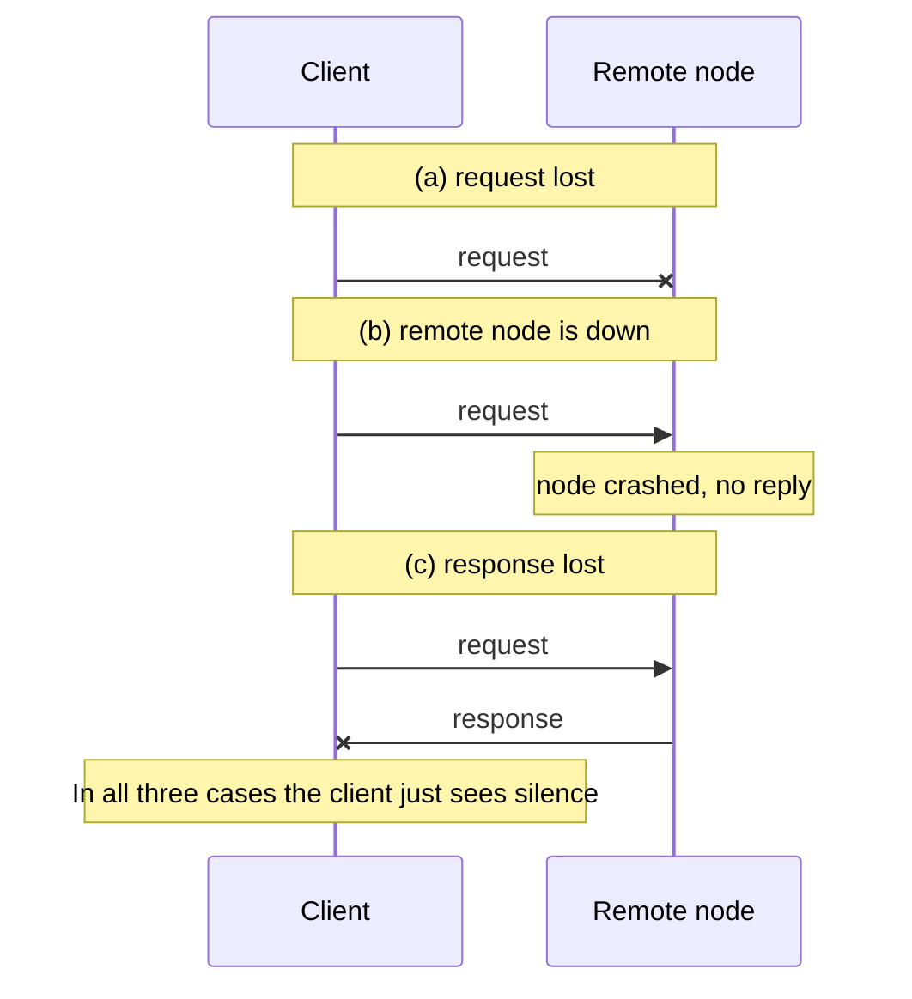
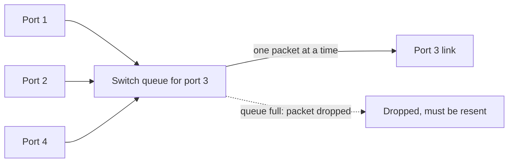
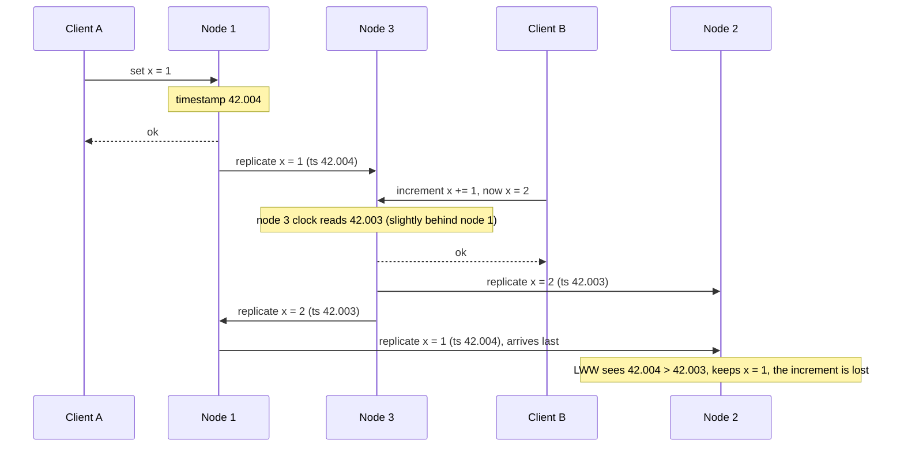
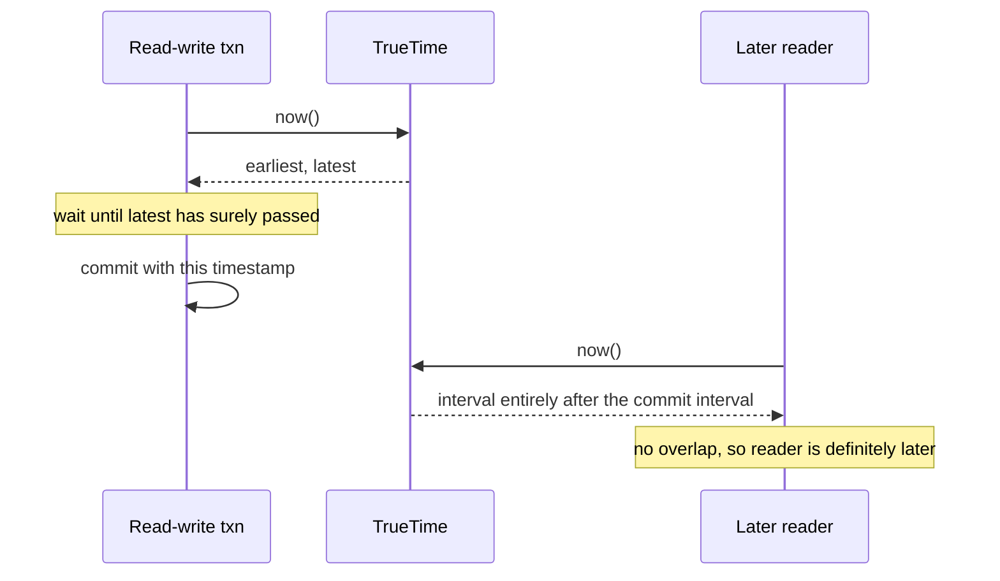
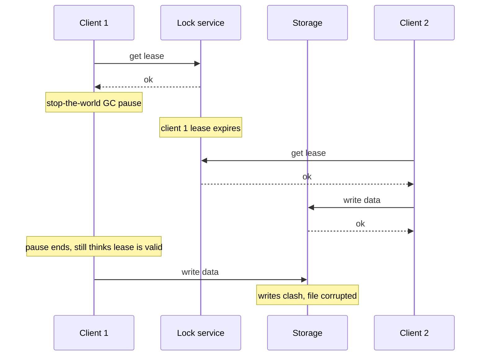
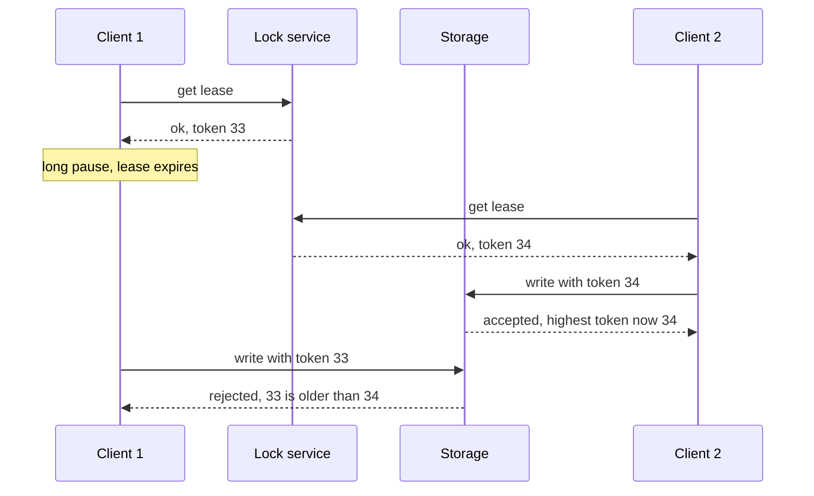

# Chapter 8 — The Trouble with Distributed Systems
*Book: Chapter 8, pp. 273–320*

## Overview

**The question this chapter answers:** once software runs on many machines connected by a network, what can go wrong, what can you rely on, and what can you *never* be sure of?

Chapter 5 (replica failover, replication lag) and Chapter 7 (concurrency control) already dealt with faults, but the book now calls them *too optimistic* and adopts Murphy's law: **whatever can fail, will fail** (experienced operators consider this reasonable). The one exception: faults are assumed **non-Byzantine** — a **node** (one machine or process in the system) may fail but does not lie; Byzantine faults come near the end. (The epigraph is a Kyle Kingsbury 2013 joke rewriting a pop lyric about laggy networks.)

The chapter surveys four enemies; Chapter 9 gives algorithms that cope with them:

1. **Unreliable networks** — messages can be lost or delayed, and you cannot tell which.
2. **Unreliable clocks** — every machine's time is a bit (or a lot) wrong.
3. **Process pauses** — a program can freeze for seconds or minutes without noticing.
4. **Knowledge, truth and lies** — how a node reasons when it cannot trust its own view, and how *system models* define "correct".

**Analogy:** coordinating a project by post — letters get lost, arrive late or out of order, silence is ambiguous, every wristwatch differs, and friends occasionally fall asleep mid-sentence.

## Key terms

Terms defined in the body are listed here only as a quick index; full definitions are in [Chapter 13](../13-glossary/README.md).

| Term | Meaning |
|---|---|
| Distributed system | Software on several computers that communicate only by messages over a network. |
| Deterministic / nondeterministic | Same input always gives the same result / may work or fail unpredictably. |
| Partial failure | Some parts broken while others work, unpredictably. |
| HPC vs cloud computing | Supercomputers for scientific batch jobs vs multi-tenant datacenters of commodity machines with elastic resources and metered billing. |
| Checkpoint | Saving a long computation's state to durable storage so it can restart from there. |
| Commodity machines | Cheap ordinary servers; better cost/performance, higher failure rates. |
| RDMA | Remote direct memory access — reading another machine's memory directly. |
| Clos topology | Datacenter network layout with high bisection bandwidth. |
| Rolling upgrade | Restarting nodes one at a time to upgrade without downtime. |
| Shared-nothing | Each machine has its own CPU, memory, disk; cooperation only via network. |
| Asynchronous packet network | Promises nothing about when or whether a packet arrives. |
| Timeout | Giving up waiting for a reply after a chosen time. |
| Network partition / netsplit | Part of the network cut off from the rest (book prefers "network fault"). |
| Cascading failure | Overloaded nodes wrongly declared dead push load onto others, which then fail too. |
| Unbounded delay | No upper limit on how long a packet or request can take. |
| Queueing delay / congestion | Time waiting in switch, OS or VM buffers because a resource is busy. |
| Flow control (congestion avoidance, backpressure) | Sender slows itself to avoid overloading the network or receiver. |
| UDP | Transport without flow control or retransmission; for when late data is useless. |
| Noisy neighbor | Another tenant hogging shared resources, making your latency vary. |
| Jitter | Variability of delays/response times. |
| Phi Accrual failure detector | Adapts timeouts to the measured response-time distribution. |
| Synchronous network / circuit switching | Bandwidth reserved along a route per connection, giving bounded delay (telephone). |
| Packet switching | Packets share bandwidth opportunistically (Ethernet, IP). |
| Bursty traffic | Transfers with no fixed bandwidth need that want to finish ASAP. |
| QoS / admission control | Prioritising and scheduling packets / rate-limiting senders. |
| Duration vs point in time | A time interval vs a specific date and time. |
| NTP / PTP | Network Time Protocol / the more precise Precision Time Protocol for clock sync. |
| Time-of-day clock | Wall-clock date and time; can jump. |
| Monotonic clock | Always moves forward; for durations; absolute value meaningless. |
| Epoch | 00:00 UTC, 1 January 1970 — reference point of Unix timestamps. |
| Leap second / smearing | A 59- or 61-second minute / spreading that adjustment over a day. |
| Slewing | NTP adjusting a clock's rate slightly instead of jumping it. |
| Clock drift / skew | A clock running fast or slow / difference between two machines' clocks. |
| Last write wins (LWW) | Keep the write with the highest timestamp, discard the rest. |
| Logical vs physical clock | Counter that orders events vs a clock measuring real time. |
| TrueTime | Spanner's clock API returning `[earliest, latest]`. |
| Lease | A lock with a timeout; the holder must renew it. |
| Stop-the-world GC pause | Garbage collector halting all application threads. |
| Steal time | CPU time a VM loses to other VMs on the same host. |
| Thrashing | OS spending nearly all its time swapping pages. |
| Hard real-time system / RTOS | Must meet deadlines or fail / OS guaranteeing CPU time in set intervals. |
| System model | Formal statement of what an algorithm may assume about timing and failures. |
| Quorum | Decision requiring a minimum number of votes (often a majority). |
| Split brain | Two nodes both believing they are leader. |
| Fencing token | Increasing number issued with each lock/lease; the resource rejects stale ones. |
| Byzantine fault | A node sending arbitrary or deliberately misleading messages. |
| Supermajority | More than two-thirds of nodes. |
| Safety / liveness property | "Nothing bad happens" (violation is permanent) / "something good eventually happens". |
| Limping node | Degraded (e.g. very slow) but not dead. |

## Faults and Partial Failures

*Single computer.* With working hardware, the same operation always gives the same result — it is **deterministic**. When hardware fails (memory corruption, loose connector), the result is usually **total** failure: kernel panic, "blue screen of death", failure to boot. Computers are designed to **crash rather than return a wrong answer**, hiding physics behind an **idealised system model** of perfect instructions and intact memory — a goal dating back to the **very first digital computer**. A flaky single machine usually means bad software.

*Many computers.* The idealisation breaks down. Coda Hale's anecdote lists long network partitions inside one datacenter, **PDU** (power distribution unit) failures, switch failures, whole racks accidentally power-cycled, whole-datacenter backbone and power failures, and a driver with low blood sugar crashing a **Ford pickup truck** into a datacenter's **HVAC** system — and he is not even an ops person.

*Partial failure:* some parts break unpredictably while others work. It is **nondeterministic** — an operation spanning nodes may work sometimes and fail other times — and you may not even **know whether an operation succeeded**, because message transit time is itself nondeterministic. That combination is what makes distributed systems hard.

### Cloud Computing and Supercomputing

| | High-performance computing (HPC) | Cloud computing |
|---|---|---|
| Typical use | Compute-heavy science: **weather forecasting**, **molecular dynamics** | Online internet services |
| Hardware | **Specialised**, reliable nodes; **shared memory** and **RDMA** | **Commodity** machines: cheaper (economies of scale), **higher failure rates** |
| Network | **Multi-dimensional meshes** and **toruses** suited to HPC patterns | **IP and Ethernet** in **Clos topologies** (high bisection bandwidth) |
| Other traits | Nodes close together | **Multi-tenant**, **elastic/on-demand**, **metered billing** |

**Traditional enterprise datacenters** sit in between.

*Supercomputer fault handling:* periodically **checkpoint** to durable storage; on node failure **stop the whole workload**; after repair **restart from the last checkpoint**. This turns partial failure into **total failure** — it behaves like a single computer.

*Why internet services differ:*
- **Online, low latency, always** ([latency](../00a-system-design-fundamentals/README.md) = time for one request). Stopping the service to fix a node is unacceptable; a batch weather simulation can just be rerun.
- **Commodity hardware** fails more often; **different networks** (IP/Ethernet vs meshes).
- **Something is always broken:** at **thousands of nodes**, assume some part is faulty at any moment. If error handling is "give up", a large system spends most of its time recovering.
- **Fault tolerance aids operations:** **rolling upgrades** (Chapter 4); a badly performing VM (**virtual machine**, a software-simulated computer sharing a physical host) can be killed and replaced.
- **Geographic distribution:** keeping data near users means crossing the slower, less reliable **internet**.

*Consequence:* **accept partial failure** and build **fault tolerance into software** — a **reliable system from unreliable components**. Even small systems eventually hit faults, so fault handling must be **part of the design**, operators must know what the software does in a fault, and faults should be **deliberately created in testing**. Being **suspicious, pessimistic and paranoid is rewarded**.

> **Building a Reliable System from Unreliable Components (sidebar).** A system *can* be more reliable than its parts: **error-correcting codes** carry data across a channel that flips bits (e.g. radio interference); **TCP** over unreliable **IP** retransmits lost packets, removes duplicates and restores order. There is always a **limit** — codes handle a few bit errors, not a swamped signal; TCP **cannot remove network delay** — but the higher layer leaves fewer, simpler faults to reason about (revisited in Chapter 12's end-to-end argument).

## Unreliable Networks

The book focuses on **shared-nothing** systems: each machine has its **own memory and disk**, reachable only via network requests. It dominates because it is **cheap** (no special hardware), uses **commoditised cloud services**, and gains reliability through **redundancy across geographically distributed datacenters**.

The internet and most datacenter networks (often **Ethernet**) are **asynchronous packet networks**: **no guarantee when — or whether — a packet arrives**. After sending a request, any of these may have happened (Figure 8-1):

1. The **request was lost** (unplugged cable).
2. The request is **stuck in a queue** (network or recipient overloaded).
3. The **remote node failed** (crashed or powered down).
4. The remote node **temporarily stopped responding** (e.g. a long **garbage collection pause** — the runtime freezing the program to reclaim memory) but will resume.
5. The node **processed it, but the response was lost** (e.g. misconfigured switch).
6. The node processed it, but the **response is delayed**.

*Figure 8-1 (redrawn): after sending a request with no reply, the sender cannot tell which of these happened*


These cases are **indistinguishable**: you only know you have **not received a response yet**. The usual approach is a **timeout** — but when it fires you **still do not know** whether the request arrived, and a queued request may be delivered later anyway.

### Network Faults in Practice

Networks are still not reliable after decades of engineering:
- A **medium-sized datacenter** saw about **12 network faults a month**: **half** disconnected a **single machine**, **half** an **entire rack**.
- A study of **load balancers**, **aggregation switches** (connect racks) and **top-of-rack switches** found **redundant gear** helps less than hoped, because it doesn't protect against **human error** (misconfigured switches), a **major cause** of outages.
- **Public clouds such as EC2** are notorious for **transient network glitches**; well-run private networks can be more stable.
- A **switch software upgrade** triggered a topology reconfiguration delaying packets **more than a minute** (the book's references cite a GitHub post-mortem; the index lists it as split brain from a 1-minute delay).
- **Sharks** bite **undersea cables**.
- A NIC **dropped all inbound packets while sending outbound fine** — one working direction says nothing about the other.

> **Network partitions.** A fault isolating one part of the network is a **network partition** or **netsplit**; the book says **network fault** to avoid confusion with database partitions (shards, Chapter 6). See also [System Design Fundamentals](../00a-system-design-fundamentals/README.md).

Without **defined and tested** handling, anything can happen: a cluster may **deadlock** and stay unusable after the network recovers, or even **delete all your data**. Handling ≠ tolerating: on a usually reliable network it is fine to **show users an error**, but you must **know how the software reacts** and ensure it **recovers**. Deliberately **causing** network failures — the **Chaos Monkey** idea (Chapter 1) — is worthwhile.

### Detecting Faults

Systems must detect faulty nodes: a **load balancer** takes dead nodes **out of rotation**; in **single-leader replication** (one leader takes writes, followers copy) a follower must be **promoted** when the leader fails (Chapter 5). Sometimes there is explicit feedback:

| Situation | Feedback | Limitation |
|---|---|---|
| Machine reachable, **no process listening** on the port | OS refuses/closes the TCP connection with **RST** or **FIN** | If it crashed *mid-request*, you don't know how much was processed |
| **Process crashed** but **OS alive** | A script **notifies other nodes** to take over without waiting for a timeout — **HBase** does this | Needs the OS alive |
| Access to **switch management interface** | Query for **hardware-level link failures** (machine powered off) | Not over the internet, in shared datacenters, or if the problem blocks the interface |
| **Router** sure the IP is unreachable | **ICMP Destination Unreachable** | Routers have no magic detection either |

*Lessons:* fast feedback is useful but **cannot be relied on**. A **TCP ack** doesn't mean the **application** handled the request — only an **application-level success reply** does. Plan for **silence**: retry a few times (TCP retries invisibly too), wait for a timeout, then **declare the node dead**.

### Timeouts and Unbounded Delays

| Timeout | Benefit | Cost |
|---|---|---|
| **Long** | Fewer false alarms | Slow detection; users wait or see errors |
| **Short** | Faster detection | Node wrongly declared dead during a brief slowdown |

*Declaring a node dead too early is dangerous:* if it was mid-action (e.g. **sending an email**), the takeover node may **do it twice**. Its load shifts to others; if it was only **slow due to overload**, this can cause a **cascading failure** — at worst every node declares every other dead and the system halts.

*Ideal vs reality.* If every packet were delivered within **d** or lost, and every live node answered within **r**, then **2d + r** would be a perfect timeout. Real systems have **neither** guarantee: asynchronous networks have **unbounded delays**, and most servers can't bound handling time. Being fast *most* of the time isn't enough — one **transient spike** in round-trip time can destabilise a system with a low timeout.

#### Network congestion and queueing

Delay variability, like road traffic, comes mostly from **queueing**:

1. **Switch queues:** several senders to one destination are fed onto its link **one at a time** (Figure 8-2) — **network congestion**. A **full queue drops** the packet, which must be resent though the network "works".
2. **OS queues:** if all **CPU cores are busy**, the incoming request waits for the application.
3. **VM pauses:** a guest is often **frozen for tens of milliseconds** while another VM uses the core; the **virtual machine monitor** (hypervisor) **buffers** incoming data meanwhile.
4. **TCP flow control** (**congestion avoidance**, **backpressure**): the sender limits its own rate, queueing **at the sender** before data enters the network.

*Figure 8-2 (redrawn): ports 1, 2 and 4 all send to port 3, so the switch queue for port 3 fills up*


*TCP retransmission:* a packet not acknowledged within a timeout (computed from observed round-trip times) is **retransmitted**; the app doesn't see the loss but **does see the delay**.

> **TCP Versus UDP.** **Videoconferencing** and **VoIP** use **UDP**: **no flow control**, **no retransmission**, so less delay variability (switch queues and scheduling still apply). It fits when **late data is worthless** — a lost VoIP packet becomes a moment of **silence**, and the retry happens at the **human layer** ("could you repeat that?").

*Utilisation:* queueing delays vary **most** near **maximum capacity**. *Shared environments:* in **public clouds and multi-tenant datacenters**, customers share links, switches, NICs and CPUs; **batch jobs like MapReduce** (Chapter 10) can **saturate** links, and a **noisy neighbor** makes delays vary wildly.

*Choosing timeouts:* measure the **round-trip distribution** over time and machines, then trade **detection delay** against **premature timeouts**. Better: **continuously measure response times and jitter and adapt** — the **Phi Accrual failure detector** does this in **Akka** (JVM message-passing toolkit) and **Cassandra**; **TCP retransmission timeouts** work similarly.

### Synchronous Versus Asynchronous Networks

Why not build a network with **fixed maximum delay** that **never drops** packets? Compare the **fixed-line telephone network**, which is **extremely reliable**: dialling sets up a **circuit** — a **guaranteed slice of bandwidth** reserved along the **entire route** until the call ends. **ISDN** runs at **4,000 frames per second** and gives each call **16 bits per frame** in each direction, i.e. **16 bits every 250 microseconds**. Since space in the next hop is already reserved, nothing queues and the **worst-case latency is a known constant** — a **synchronous** network with **bounded delay**.

#### Can we not simply make network delays predictable?

| Circuit (telephone) | TCP connection (packet-switched) |
|---|---|
| Fixed reserved bandwidth **nobody else can use** | **Opportunistically uses whatever bandwidth is available** |
| Suits constant-rate audio/video | Suits variable-sized blocks (email, web page) sent ASAP |
| Uses bandwidth for the whole call | **No bandwidth when idle** (except occasional **TCP keepalive**) |

**Ethernet and IP are packet-switched** — queueing, **unbounded delays**, **no concept of a circuit** — because they are optimised for **bursty traffic**. A file transfer over a circuit needs a **bandwidth guess**: too low wastes capacity and is slow; too high and the network **refuses the circuit**. TCP instead **adapts its rate**.

*Hybrids:* **ATM** supported both. **InfiniBand** does **end-to-end flow control at the link layer**, reducing queueing (link congestion still delays). Careful **QoS** and **admission control** can **emulate circuit switching** or give **statistically bounded delay**.

> **Footnote — ATM.** Asynchronous Transfer Mode competed with Ethernet in the **1980s** but survived mainly in **telephone core switches**; unrelated to cash machines. The book muses video calls would be more reliable in a universe where the internet ran on it.

> **Latency and Resource Utilization (sidebar).** Variable delay comes from **dynamic resource partitioning**. A cable for **10,000 simultaneous calls** is split **statically**: your circuit gets the same bandwidth even if **9,999 slots are empty**. The **internet shares bandwidth dynamically** — switches pick the next packet moment by moment: **queueing** in exchange for **maximum utilisation**, making each byte **cheaper**. **CPUs** are the same: dynamic sharing of a core means threads wait in the OS **run queue**, but hardware is used better (also a big reason for **VMs**). **Static partitioning** gives latency guarantees at lower utilisation (**more expensive**). Variable delay is **not a law of nature**, just a **cost/benefit trade-off**.

*Reality:* such QoS is **not enabled** in multi-tenant datacenters, public clouds or the internet, so **assume congestion, queueing and unbounded delays**; there is **no "correct" timeout** — determine it **experimentally**.

> **Footnote — BGP.** ISP peering and **Border Gateway Protocol** routes resemble circuit switching more than IP does (you can buy **dedicated bandwidth**), but at the level of **networks**, not host connections, and on a **much longer timescale**.

## Unreliable Clocks

Clocks answer questions such as: (1) has this request timed out? (2) what is the **99th percentile** response time (only the slowest 1% take longer)? (3) average QPS over the **last five minutes**? (4) how long did a visitor stay? (5) when was this article published? (6) when should the reminder email go out? (7) when does this cache entry expire? (8) what is this log error's timestamp? Items **1–4 measure durations**; **5–8 are points in time**.

*Why time is tricky:* messages arrive after they're sent, but by a **variable** amount, so cross-machine **ordering** is hard. Each machine has its own **quartz crystal oscillator**, which is **not perfectly accurate**. Clocks are synchronised only **to a degree**, usually via the **Network Time Protocol (NTP)**, which takes time from a group of servers that in turn use an accurate source such as a **GPS receiver**.

### Monotonic Versus Time-of-Day Clocks

#### Time-of-day clocks

Returns the calendar date and time (**wall-clock time**): `clock_gettime(CLOCK_REALTIME)` on Linux, `System.currentTimeMillis()` in Java — seconds/ms since the **epoch** (**00:00 UTC, 1 January 1970**, Gregorian), **ignoring leap seconds**. (The "real-time" in `CLOCK_REALTIME` is unrelated to real-time OSes.)
- Usually **NTP-synced**, so timestamps are ideally comparable across machines.
- A clock far **ahead** of the NTP server may be **forcibly reset**, appearing to **jump back in time**. Jumps plus ignored leap seconds make it **a poor choice for measuring durations**.
- Historically **coarse resolution** (e.g. **10 ms** steps on older Windows).

#### Monotonic clocks

For **durations** (timeouts, response times): `clock_gettime(CLOCK_MONOTONIC)` on Linux, `System.nanoTime()` in Java. Guaranteed to **never go backward**. Read it, do work, read again — the **difference** is elapsed time.
- **Absolute value is meaningless** (e.g. ns since boot) — **never compare across computers**.
- On multi-**socket** servers each CPU may have its own unsynchronised timer; the OS compensates, but treat that with **some scepticism**.
- **NTP slewing** may change its **rate** by **up to 0.05%**, but **cannot make it jump**.
- Resolution is usually **microseconds or finer**.

Monotonic clocks are **generally fine** for timeouts in distributed systems — no cross-node sync needed.

| | Time-of-day clock | Monotonic clock |
|---|---|---|
| Answers | "What time is it?" (point in time) | "How much time passed?" (duration) |
| Linux / Java | `CLOCK_REALTIME` / `System.currentTimeMillis()` | `CLOCK_MONOTONIC` / `System.nanoTime()` |
| Can jump backward? | Yes (NTP reset) | No (only slewed up to 0.05%) |
| Comparable across machines? | Ideally, if synced | No |
| Needs NTP? | Yes | No |

### Clock Synchronization and Accuracy

Getting the right time is **far less reliable** than hoped:

- **Quartz drift** varies with **temperature**. **Google assumes 200 ppm** — **6 ms** if resynced every **30 seconds**, **17 seconds** if resynced **once a day**. Drift caps accuracy even when all works.
- **Forced resets:** if a clock differs too much from NTP, the client may **refuse to sync** or **reset** it; apps see time **jump backward or forward**.
- **Firewalled from NTP:** a node may silently lose NTP access for a while.
- **Network delay limits NTP:** one experiment got a **minimum error of 35 ms** over the internet, with spikes to **about a second**; with large delays the client may **give up**.
- **Wrong NTP servers** can be off by **hours**. Clients query **several servers and ignore outliers**, but correctness still rests on **a stranger on the internet**.
- **Leap seconds** (59- or 61-second minutes) have **crashed many large systems** (the book's references include a 2012 Linux-bug leap second that crashed "half the internet", and Cloudflare DNS in 2017). Best fix may be NTP servers **"lying"** by **smearing** the second over a day; real behaviour varies.
- **VMs:** the hardware clock is **virtualised**; a VM paused **tens of milliseconds** sees its clock **jump forward**.
- **Devices you don't control:** don't trust the clock — some users **set wrong dates on purpose** (e.g. to dodge **game** time limits).

*High accuracy costs effort:* the **MiFID II** draft European regulation requires **high-frequency trading funds** to be **within 100 microseconds of UTC**, to investigate **"flash crashes"** and detect **market manipulation**. Achievable with **GPS receivers**, the **Precision Time Protocol (PTP)**, careful deployment and monitoring — but a misconfigured NTP daemon or a firewall blocking NTP lets drift grow fast.

### Relying on Synchronized Clocks

A day is **not always 86,400 seconds**, time-of-day clocks can **run backward**, and nodes' clocks can differ a lot. As with networks, **robust software must be prepared for wrong clocks**.

*Clock faults are sneaky:* a bad CPU or network gets noticed fast, but a bad quartz or NTP config leaves things **looking fine** while the clock **drifts further**, causing **silent, subtle data loss** rather than a crash. If you depend on synced clocks, **monitor offsets between all machines** and **kick out** any node that drifts too far.

#### Timestamps for ordering events

*Figure 8-3* — a **multi-leader** database (several nodes accept writes and replicate to each other; cf. Figure 5-9): **client A** sets `x = 1` on **node 1**; it replicates to **node 3**; **client B** increments x on node 3 to `x = 2`; both replicate to **node 2**. Each write carries its **origin node's time-of-day timestamp**. Even with **< 3 ms** skew (better than typical), `x = 1` gets **42.004 s** and `x = 2` gets **42.003 s**. Node 2 keeps `x = 1` and **drops B's increment**.

*Figure 8-3 (redrawn): client B's write is causally later but gets an earlier timestamp, so node 2 discards it under LWW*


This is **last write wins (LWW)**, used in multi-leader and leaderless databases (any replica accepts writes) such as **Cassandra** and **Riak**. Generating timestamps on the **client** doesn't fix its problems:
- **Writes mysteriously vanish:** a node whose clock is **behind** can't overwrite values from a node **ahead** until the skew elapses — data **silently dropped**.
- **Can't tell sequential from concurrent writes** — that needs **causality tracking** such as **version vectors** (Chapter 5).
- **Identical timestamps** (likely at **millisecond** resolution) need a **tiebreaker** (e.g. random number), which can also **violate causality**.

"Most recent" is decided by **one machine's possibly wrong clock**: a packet sent at **100 ms** may be received at **99 ms** by the receiver's clock. NTP can't fix this — its accuracy is bounded by **network round-trip time**, the very thing you'd need to beat.

*Safer: **logical clocks*** — **incrementing counters** that capture only **relative order**, not time. Time-of-day and monotonic clocks are **physical clocks**. (More in Chapter 9.)

#### Clock readings have a confidence interval

**Resolution ≠ accuracy.** Drift can be **several ms** even with **local NTP every minute**; via **public-internet** NTP, **tens of ms** at best, spiking **over 100 ms** under congestion. Treat a reading as an **interval with a confidence level** (e.g. **95% sure** it's **10.3–10.5 s** past the minute); with **±100 ms** uncertainty the microsecond digits mean nothing.

*Uncertainty:* a directly attached **GPS receiver** or **atomic (caesium) clock** has a manufacturer-stated error; from a **server**, it is roughly **drift since last sync + server uncertainty + round-trip time**. Most systems **don't expose** it — `clock_gettime()` can't tell you if it's off by **five ms or five years**.

*Exception — Google's **TrueTime** API in **Spanner*** returns **`[earliest, latest]`**; the true time lies inside. Width depends on **time since the last sync** with an accurate source.

#### Synchronized clocks for global snapshots

**Snapshot isolation** (Chapter 7 — each transaction reads a consistent snapshot as of its start) lets **small read-write** transactions coexist with **large read-only** ones (backups, analytics) without locking. It usually uses a **monotonically increasing transaction ID**: writes with a larger ID are **invisible** to the snapshot. A **counter** works on one node.

*Distributed problem:* a **global** ID across partitions and datacenters needs **coordination** and must respect **causality** (if B read A's write, B's ID must be larger). With many small transactions this becomes an **untenable bottleneck**.

> **Footnote — Snowflake.** Generators like **Twitter's Snowflake** scalably produce **approximately** increasing IDs (e.g. by handing **ID ranges** to nodes), but usually **can't guarantee causal order**, since blocks are allocated on a longer timescale than reads/writes.

*Use clock timestamps as transaction IDs?* Works if sync is good enough — the obstacle is uncertainty. **Spanner's approach** (snapshot isolation **across datacenters**):
1. Each timestamp is an interval: A = [A_earliest, A_latest], B = [B_earliest, B_latest].
2. If they **don't overlap** (A_earliest < A_latest < B_earliest < B_latest), **B definitely followed A**; if they overlap, order is uncertain.
3. Spanner **waits for the interval width before committing a read-write transaction**, so any later reader's interval cannot overlap.
4. To keep the wait short, Google puts a **GPS receiver or atomic clock in every datacenter**, keeping uncertainty around **7 ms**.

*Spanner commit-wait (illustrative, not a book figure)*


Clock-based distributed transaction semantics are an **active research area**, **not yet in mainstream databases outside Google**.

### Process Pauses

How does a partition **leader** know it is **still leader** and may accept writes? It holds a **lease** from the other nodes — a **lock with a timeout**. Only one node holds it; the holder must **renew** before expiry, and if it fails, another node takes over after expiry.

A request loop in that style (my own version; the book's uses a **10-second** buffer and expiry computed elsewhere as e.g. **now + 30 s**):

```java
while (running) {
    Job job = queue.nextJob();

    // Renew early: keep at least 5 seconds of lease left
    long remaining = myLease.expiresAtMillis() - System.currentTimeMillis();
    if (remaining < 5000) {
        myLease = myLease.extend();
    }

    if (myLease.stillValid()) {
        handle(job);
    }
}
```

*What is wrong with it?*
1. **It relies on synchronised clocks:** the expiry was set by **another machine** but compared with the **local** clock; a few seconds of skew breaks it.
2. **Even with a local monotonic clock**, it assumes little time passes between **checking** and **handling**. If the thread **freezes for 15 seconds** right after the validity check (the book's `lease.isValid()`), the lease has lapsed and **another node may be leader** — and the thread won't notice until the **next iteration**, after doing something **unsafe**.

*Are 15-second pauses realistic? Yes:*
- **Garbage collection:** **stop-the-world** pauses in runtimes like the **JVM** have lasted **several minutes**. Even "concurrent" collectors like **HotSpot JVM's CMS** (Concurrent Mark Sweep) stop the world sometimes. Tuning helps, but **assume the worst**.
- **VM suspend/resume:** a VM can be suspended (memory saved to disk) for any length of time — used for **live migration**, where pause length depends on how fast processes write memory.
- **End-user devices** suspend arbitrarily (laptop **lid closed**).
- **Context switches:** the OS or **hypervisor** can preempt a thread anywhere; CPU time lost to other VMs is **steal time**; a long run queue lengthens the wait.
- **Synchronous disk I/O**, sometimes unexpected — e.g. the **Java classloader lazily loads class files** on first use. **I/O and GC pauses combine.** If the "disk" is a **network filesystem** or **network block device** (e.g. **Amazon EBS**), I/O inherits **network delay variability**.
- **Swapping (paging):** a memory access can trigger a **page fault** and disk load; under pressure the OS may **thrash**. Hence paging is often **disabled on servers** (better to kill a process).
- **SIGSTOP** (e.g. **Ctrl-Z**) pauses a process until **SIGCONT** — possibly sent **by accident** by an ops engineer.

*The core problem:* a thread can be **preempted** anywhere and resumed **without noticing**. On one machine, thread-safety tools exist — **mutexes**, **semaphores**, **atomic counters**, **lock-free data structures**, **blocking queues** — but they **don't translate** to distributed systems, which have **no shared memory**. Each node must assume it may be **frozen at any instant**, even mid-function, while others **declare it dead**.

#### Response time guarantees

These pauses **can be eliminated** with enough effort. **Hard real-time systems** — controlling **aircraft, rockets, robots, cars** — have **deadlines** whose violation may fail the whole system (you don't want the **airbag delayed by a GC pause**).

> **Is real-time really real?** In **embedded systems**, "real-time" means engineered and tested to **always meet timing guarantees**. On the **web** it loosely means pushing data to clients or stream processing, with **no hard constraints** (Chapter 11).

*Requirements (every layer):* (1) a **real-time operating system (RTOS)** guaranteeing CPU time in specified intervals; (2) **library functions** documenting **worst-case execution times**; (3) **dynamic memory allocation** restricted or **forbidden** (real-time GCs exist, but must not be overloaded); (4) **enormous testing and measurement**.

*Costs:* much extra work and a narrow choice of languages/tools, so it is **very expensive** and used mainly in **safety-critical embedded devices**. **"Real-time" ≠ "high-performance"** — throughput may be **lower** since deadlines come first. For **server-side data systems** it is **not economical**, so they **live with** pauses and clock instability.

#### Limiting the impact of garbage collection

Runtimes can choose **when** to collect (they know allocation rate and free memory):
- **GC as a planned outage:** the runtime **warns** the app a pause is coming; the app **stops routing new requests** to that node, **waits** for in-flight ones, then the node collects with nothing in progress. Hides pauses from clients and cuts **high-percentile latency**; used in some **latency-sensitive financial trading systems**.
- **Only collect short-lived objects, restart periodically** before long-lived objects need a **full GC** — **one node at a time**, shifting traffic away first, like a **rolling upgrade**.

These **reduce** but **cannot fully prevent** pauses.

## Knowledge, Truth, and Lies

With **no shared memory**, only **message passing over an unreliable network**, plus **partial failures, unreliable clocks and pauses**, no node can be **certain** of anything — it can only **infer** from messages received (or not). If a remote node is silent, its state is **unknowable**: network problems can't be told from node problems.

*The practical answer: system models.* State assumptions about behaviour — the **system model** — and design to meet them. **Algorithms can be proved correct within a system model**, so reliability is possible even when the model promises little. Chapter 9 gives such algorithms.

### The Truth Is Defined by the Majority

1. **Asymmetric fault:** a node **receives** fine but its **outgoing** messages are lost. It is **declared dead** — carried to the graveyard shouting it's alive, unheard.
2. **Aware but powerless:** it notices its messages aren't acked and realises there's a network fault, but **can do nothing**.
3. **Long GC pause:** all threads stop for **one minute**; others declare it dead. It then resumes as if nothing happened — a corpse sitting up in its coffin — unaware a minute passed.

*Moral:* a node **cannot trust its own judgement**, and the system must not depend on **any single node**.

*Quorums* (Chapter 5): decisions need a **minimum number of votes**. This includes **declaring nodes dead** — if a quorum says so, the node **must step down** even if it feels alive. Usually a strict **majority**: **3 nodes survive 1 failure**, **5 survive 2**. It is **safe** because there can be **only one majority** at a time. (Quorums for consensus: Chapter 9.)

#### The leader and the lock

Systems often need **exactly one** of something: **one leader** per partition (avoid **split brain**), **one lock holder** per resource, **one owner** per **username**. A node may **believe it is "the chosen one"** while a **quorum** has declared it dead (network interruption, GC pause) and **elected** a replacement; if it keeps acting the part, others may believe it.

*Figure 8-4 — a real bug (**HBase used to have it**).* A storage file must be written by **one client at a time**; clients get a **lease** from a **lock service** first:
1. Client 1 gets the lease, then **pauses** (GC) until it **expires**.
2. Client 2 gets the lease and **writes**.
3. Client 1 resumes, **thinks its lease is valid**, and **also writes** — the file is **corrupted**.

*Figure 8-4 (redrawn): client 1's lease expires during a GC pause, but it still writes, corrupting the file*


#### Fencing tokens

A node that **falsely believes** it holds the lock must be **unable to disrupt** the system. **Fencing** (Figure 8-5):
1. Each lock/lease grant includes a **fencing token** that **increases on every grant**.
2. Every write to storage **includes the token**.
3. Storage **remembers the highest token processed** and **rejects lower ones**.

Client 1 gets token **33**, pauses, its lease expires; client 2 gets **34** and writes; client 1 then writes with 33, which storage **rejects** because it has seen 34.

*Figure 8-5 (redrawn): storage accepts writes only in increasing token order, so the stale token 33 is rejected*


With **ZooKeeper** (coordination service offering locks, leader election, small config data), the transaction ID **`zxid`** or node version **`cversion`** serve as tokens — both **monotonically increasing**.

*Key requirement:* the **resource itself must check tokens**; clients checking their own lock status is **not enough**. For resources without support, work around it (e.g. **token in the filename**). Server-side checking is **good practice** anyway: services should **protect themselves from accidentally abusive clients**, often run by people with different priorities.

### Byzantine Faults

Fencing catches nodes wrong **by accident**; a **deliberately** malicious node could send a **fake token**. The book assumes nodes are **unreliable but honest**: slow, silent or outdated, but whatever they say is "true" as far as they know.

A **Byzantine fault** is a node **"lying"** — arbitrary or corrupted responses, e.g. claiming to have received a message it never got. Reaching consensus despite this is the **Byzantine Generals Problem**.

> **The Byzantine Generals Problem (sidebar).** It generalises the **Two Generals Problem** — two generals agreeing on a plan via **messengers** who may be delayed or lost (consensus: Chapter 9). Here there are **n generals**, some **traitors** sending fake messages, and **nobody knows in advance** who. *Name:* **Byzantium** became **Constantinople**, now **Istanbul**; "Byzantine" means **excessively complicated, bureaucratic, devious** — no evidence its generals were worse. **Lamport** wanted a nationality nobody would be offended by; he was warned off "**The Albanian Generals Problem**".

A **Byzantine fault-tolerant** system works correctly even if some nodes **disobey the protocol** or **attackers** interfere. Relevant in:
- **Aerospace:** **radiation** corrupts memory/registers; failure is catastrophic (a crash, or a **rocket hitting the ISS**), so **flight control must tolerate Byzantine faults**.
- **Multiple organisations** who may **cheat**: **Bitcoin and other blockchains** (peer-to-peer networks sharing a tamper-evident ledger) let mutually distrusting parties agree on transactions **without a central authority**.

*Why the book usually ignores them:*
- In **your own datacenter** nodes are yours and **radiation** is low.
- BFT protocols are **complicated** and embedded BFT needs **hardware support** — **impractical cost** for most server-side systems.
- **Web apps** must expect **malicious clients**, hence **input validation, sanitisation and output escaping** (against **SQL injection** and **cross-site scripting**) — but the **server is the authority**, so no BFT protocol is needed. BFT matters more in **peer-to-peer** networks.
- **Software bugs** could be Byzantine faults, but BFT needs a **supermajority (> 2/3)** of correct nodes (**4 nodes tolerate 1** bad), so you'd need **four independent implementations**.
- Against **attacks**, an intruder who compromises one node can likely compromise **all** (same software). **Authentication, access control, encryption, firewalls** remain the main defence.

#### Weak forms of lying

Cheap pragmatic guards against invalid messages from **hardware issues, bugs, misconfiguration** (not full BFT):
- **Corrupted packets:** **TCP/UDP checksums** usually catch them but sometimes miss — add **application-level checksums**.
- **Input sanitising:** public apps check value **ranges** and **string length limits** (preventing **denial of service** via huge allocations). Internal services may relax this, but keep **basic sanity checks** in protocol parsing.
- **Multiple NTP servers:** the client queries all, **estimates each one's error**, checks that **most agree**, and excludes an **outlier**.

### System Model and Reality

Algorithms for problems like **consensus** (nodes agreeing on one value, Chapter 9) must tolerate these faults without depending on specific hardware, so we formalise faults in a **system model** — what an algorithm may assume.

*Timing models:*

| Model | Assumption | Realistic? |
|---|---|---|
| **Synchronous** | **Bounded** delay, pauses and clock error (a known upper bound, not zero) | **No** for most systems |
| **Partially synchronous** | Synchronous **most of the time**, but bounds are **sometimes exceeded arbitrarily** | **Yes** — realistic for many systems |
| **Asynchronous** | **No timing assumptions** — **no clock**, hence **no timeouts** | Possible but **extremely limiting** |

*Node failure models:*

| Model | Assumption |
|---|---|
| **Crash-stop** | A node fails only by **crashing** and is **gone forever**. |
| **Crash-recovery** | Nodes crash and **maybe resume**; **stable storage** survives, **in-memory state is lost**. |
| **Byzantine (arbitrary)** | Nodes may do **anything**, including mislead others. |

The most useful combination for real systems is **partial synchrony + crash-recovery**.

#### Correctness of an algorithm

Define correctness by **properties** (as "sorted" means each element is smaller than those to its right). For **fencing-token generation**:
- **Uniqueness:** no two requests get the **same value**.
- **Monotonic sequence:** if request x **completed before** y began, then **t_x < t_y**.
- **Availability:** a non-crashed requester **eventually** gets a response.

An algorithm is **correct within a system model** if its properties hold in **every** scenario the model permits. But if all nodes crash, nothing can work — hence the next distinction.

#### Safety and liveness

Uniqueness and monotonic sequence are **safety**; availability is **liveness**. Liveness properties often contain **"eventually"** — **eventual consistency is a liveness property**. Informally: safety = **nothing bad happens**; liveness = **something good eventually happens**. Precisely:

| | Safety | Liveness |
|---|---|---|
| When violated | You can **point to the moment** it broke (the duplicate token) | May be unmet now (no reply yet) |
| Recoverable? | **No** — damage done | **Yes** — may still be satisfied later |
| Requirement | Must **always** hold, even if all nodes crash or the network fails — **never a wrong result** | May have **caveats**, e.g. only if a **majority is up** and the network **eventually recovers** |

The **partially synchronous** model requires the system to **eventually return to synchrony** — any interruption lasts a **finite** time.

#### Mapping system models to the real world

Models simplify; reality bites:
- Crash-recovery assumes **stable storage survives** — but disks can be **corrupted or wiped**, or a **firmware bug** may stop a server **detecting its own drives after reboot** (the book's references cite a GitHub incident).
- **Quorum algorithms** assume nodes **retain data they claimed to store**; a node with **amnesia** breaks correctness. Modelling "storage usually survives" is **harder to reason about**.

A real implementation may still need code for the "impossible" case, even just exiting with an error for a **human** to clean up — perhaps the difference between **computer science** and **software engineering**. My own illustration:

```c
if (stored_version > proposed_version && is_leader) {
    fprintf(stderr, "invariant broken: stale leader wrote\n");
    exit(99);   /* stop and let an operator investigate */
}
```

Models are still **incredibly helpful**: they reduce reality to a **manageable set of faults**, and proving properties within a model is how algorithms are **proved correct**. A proof doesn't guarantee a correct implementation, but it exposes flaws that might hide for years. **Theory and real-world testing matter equally.**

## Chapter summary

*(Book section: Summary)*

- **Networks:** any packet or reply may be **lost or arbitrarily delayed**; with no reply you **can't tell** what happened.
- **Clocks:** can be **far out of sync** despite NTP, **jump**, and usually have an **unknown error interval**.
- **Process pauses:** a process can **pause for a long time** (GC), be **declared dead**, and resume **unaware**.
- **Partial failure** is the **defining characteristic** of distributed systems; we build **tolerance** into software.
- **Detecting faults is hard:** **timeouts** can't distinguish network from node failure and cause **false suspicion**. **Limping nodes** — e.g. a **driver bug** dropping a **Gigabit NIC to 1 Kb/s** — can be harder to handle than dead ones.
- **Tolerating faults is hard:** no **shared memory, global state, or agreed time**; **major decisions can't be made by one node**, so we need **quorum** protocols.
- **If one machine suffices, keep Pandora's box shut** — but distribution is also needed for **fault tolerance** and **low latency**, not only **scalability**.
- **Unreliability isn't a law of nature:** bounded delays and real-time guarantees are **possible but expensive**; most systems choose **cheap but unreliable**.
- **Supercomputers** stop entirely on a fault; **distributed systems can run forever**, handling faults **per node** (though a **bad config rolled to all nodes** still brings them down).
- **Chapter 9** moves to solutions.

## Interview angle

**1. Why is a timeout the only practical way to detect failures, and how do you choose one?**
*30-second answer:* In an asynchronous network a lost request, dead node, paused node and lost reply all look like silence. Explicit signals (TCP RST/FIN, HBase-style crash scripts, switch queries, ICMP unreachable) help but can't be relied on. Too short a timeout causes false positives, duplicate actions and cascading failures; too long delays recovery. Measure round-trip distributions and choose experimentally, or adapt with jitter-aware detectors like Phi Accrual (Akka, Cassandra).
- *Follow-up: Why not bounded delays like the phone network?* Ethernet/IP are packet-switched for bursty traffic; circuits reserve fixed bandwidth (ISDN: 16 bits every 250 µs) and waste capacity. Bounded delay via static partitioning or QoS is a cost/utilisation trade-off not enabled in clouds.
- *Follow-up: If TCP acked my packet, did the server process it?* Not necessarily — the app may crash first. You need an application-level response.

**2. Time-of-day vs monotonic clocks — which for what?**
*30-second answer:* Time-of-day (`System.currentTimeMillis()`) gives a point in time since the 1970 epoch; NTP-synced, can jump backward, ignores leap seconds — bad for durations. Monotonic (`System.nanoTime()`) only moves forward, slewed at most 0.05%, meaningless absolute value, not comparable across machines — use it for timeouts and durations.
- *Follow-up: How accurate is NTP?* Limited by network delay: ~35 ms minimum over the internet, spikes around a second; Google's 200 ppm drift is 6 ms per 30 s or 17 s per day.

**3. Why is last-write-wins with timestamps dangerous?**
*30-second answer:* Skew can give a causally later write an earlier timestamp (Figure 8-3: 42.003 vs 42.004 with < 3 ms skew), so it's silently dropped. LWW can't tell sequential from concurrent writes, and tiebreakers can break causality. Cassandra and Riak use LWW. Use logical clocks/version vectors for ordering.
- *Follow-up: How does Spanner use clocks safely?* TrueTime returns [earliest, latest]; Spanner waits out the interval before committing so intervals don't overlap; GPS/atomic clocks per datacenter keep uncertainty ~7 ms.

**4. How can a leader or lock holder be wrong about holding its lease? How do you fix it?**
*30-second answer:* Process pauses — GC (sometimes minutes), VM suspend/live migration, context switches/steal time, disk I/O (lazy classloading, EBS), swapping/thrashing, SIGSTOP. It resumes believing its lease is valid and writes (the HBase bug). Fix: fencing tokens — increasing numbers per lease (ZooKeeper zxid/cversion) checked by storage, rejecting stale ones (33 after 34).
- *Follow-up: Do fencing tokens stop malicious nodes?* No — a liar can fake a token. That needs Byzantine fault tolerance (>2/3 honest nodes), rarely worth it inside one datacenter.

**5. What system model do real systems use, and what are safety vs liveness?**
*30-second answer:* Partially synchronous timing with crash-recovery faults. Safety ("nothing bad happens") must always hold; a violation is permanent and pinpointable. Liveness ("something good eventually happens") can have caveats like "if a majority is up and the network recovers". Eventual consistency is liveness.
- *Follow-up: Why a majority quorum?* Only one majority can exist at a time, so decisions can't conflict; 3 nodes tolerate 1 failure, 5 tolerate 2.

## Self-check

1. **List the six things that can happen when you send a request and get no reply.**
   Request lost; request queued; remote node crashed; remote node paused (e.g. GC); processed but reply lost; processed but reply delayed.

2. **How do supercomputers handle a node failure, and why doesn't that work for internet services?**
   Checkpoint, stop the whole job, fix, restart from checkpoint — partial becomes total failure. Internet services must stay online with low latency on failure-prone commodity hardware, and at thousands of nodes something is always broken.

3. **What did the medium-sized datacenter study find?**
   About 12 network faults per month; half disconnected one machine, half a whole rack.

4. **Scenario:** a very short timeout on an overloaded cluster. What might happen?
   Slow-but-alive nodes are declared dead, their load shifts to others, which slow down and are declared dead too — cascading failure; actions like sending emails may run twice.

5. **Why can ISDN guarantee delay while Ethernet can't?**
   ISDN reserves 16 bits per frame (4,000 frames/s) along the whole route, so nothing queues. Ethernet/IP share bandwidth dynamically, so queues form and delay is unbounded.

6. **Trade-off:** why would a VoIP app choose UDP over TCP?
   Late audio is worthless; UDP avoids retransmission and flow-control delays, and the app fills gaps with silence.

7. **Google's 200 ppm drift — what are the numbers?**
   6 ms drift with resync every 30 s, 17 s with resync once a day.

8. **What is a clock confidence interval and which API exposes it?**
   A range containing the true time (e.g. 95% sure it's 10.3–10.5 s past the minute). Spanner's TrueTime returns [earliest, latest]; `clock_gettime()` doesn't.

9. **Scenario:** storage receives a write with token 41 after processing token 42. What should it do and why must storage do it?
   Reject it — 41 comes from a holder whose lease expired. The resource must check because a paused client can't know its lease lapsed.

10. **Classify: "no two nodes are ever leader for the same term" and "every request eventually gets a response." Which can have caveats?**
    The first is safety (always holds); the second is liveness, which may be conditioned on a majority being up and the network eventually recovering.
