# Chapter 9 — Consistency and Consensus
*Book: Chapter 9, pp. 321–383*

## Overview

Chapter 8 catalogued what breaks: packets dropped, duplicated, reordered or delayed; clocks drift; processes pause (garbage collection) or crash. Chapter 9 asks: **given all that, how do we build systems that still behave correctly?** The cheap answer is to let the service fail; otherwise we need *fault tolerance*.

The strategy mirrors transactions (Chapter 7), which let an app *pretend* crashes don't happen (atomicity), nobody else touches the data (isolation), and disks don't lose data (durability). Chapter 9 looks for **general-purpose abstractions for distributed systems**, implemented once and relied on by many applications.

The most important is **consensus**: getting nodes to agree on something. Classic use: a single-leader database (the *leader* accepts all writes and copies them to *followers*) loses its leader and the rest must agree on *one* new leader. Two self-declared leaders (**split brain**) usually lose data. Doing consensus correctly despite faults is surprisingly hard.

The chapter builds up in three steps:
1. **Linearizability** — among the strongest consistency models (precise promises about what reads may return): replicated data behaves like one copy.
2. **Ordering guarantees** — causality, total orders, Lamport timestamps, and **total order broadcast**, which is deeply linked to linearizability and consensus.
3. **Distributed transactions and consensus** — two-phase commit (2PC), why it is a weak form of consensus, and real fault-tolerant algorithms (Paxos, Raft, Zab, Viewstamped Replication) and services built on them (ZooKeeper, etcd).

It also explains the *limits* of what is possible (CAP theorem, FLP result — see [System Design Fundamentals](../00a-system-design-fundamentals/README.md)) intuitively, without proofs. The epigraph (Jay Kreps, 2013) asks whether it is better to be available but wrong or correct but down — the tension running through the chapter.

**Analogy.** Friends picking a restaurant over a flaky group chat. *Linearizability* = everyone reads one shared whiteboard. *Causality* = nobody sees "see you there!" before the message naming the place. *Consensus* = the group settles on one restaurant, nobody changes their mind later, and it still works if a couple of phones die.

## Key terms

| Term | Plain-English meaning |
|---|---|
| Fault tolerance | Working correctly although some components have failed. |
| Consensus | Several nodes irrevocably agree on one value despite failures. |
| Split brain | Two nodes both act as leader; data diverges. |
| Eventual consistency (convergence) | If writes stop, replicas *eventually* return the same value — no bound on when. |
| Consistency model | A promise about what values reads may return under replication and concurrency. |
| Linearizability | Aka atomic, strong, immediate or external consistency: behaves like one copy with each operation atomic at one instant; a *recency* guarantee. |
| Register | Theory term for one readable/writable object — a key, row or document. |
| Regular register | Reads overlapping a write may return old or new (and flip-flop); weaker than linearizable. |
| Compare-and-set (CAS) | Atomically "set x to *new* only if x equals *old*, else fail". |
| Serializability | Transactions behave as if run one after another in *some* order (Chapter 7). |
| Strict serializability (strong-1SR) | Serializability plus linearizability. |
| Quorum | Subset of nodes (usually a majority) whose agreement is required; Dynamo-style: w + r > n. |
| CAP theorem | Brewer, 2000: under a network partition, choose linearizability or total availability. |
| Network partition | Nodes alive but unable to talk (not data partitioning). |
| CP / AP | "Consistent but unavailable when partitioned" / "available but inconsistent"; the book advises avoiding these labels. |
| Memory barrier / fence | CPU instruction forcing caches/memory to sync so another core sees a write. |
| Causality / happens-before | Cause before effect; A happened before B if B could have known about or depended on A. |
| Concurrent operations | Neither happened before the other. |
| Causally consistent | Respects the order imposed by causality. |
| Total vs partial order | Every pair comparable (numbers) vs only some pairs (sets, causality). |
| Version vector | Per-node counters telling concurrent from causally related operations (Chapter 5). |
| Sequence number / logical clock | Counter-based number ordering operations without physical clocks. |
| Lamport timestamp | (counter, node ID), counters bumped to the max seen; total order consistent with causality. |
| Total order broadcast (atomic broadcast, total order multicast) | Every node receives the same messages in the same order, none lost. |
| State machine replication | Replicas stay identical by applying the same deterministic writes in the same order. |
| Fencing token / zxid | Number increasing per lock grant, used to reject stale holders / ZooKeeper's monotonically increasing transaction ID. |
| Sequential consistency (timeline consistency) | Same order for everyone, but reads may be stale; slightly weaker than linearizability. |
| Chain replication | Reads go to a replica updated synchronously on writes. |
| Atomic commit | All nodes of a distributed transaction commit, or all abort. |
| Two-phase commit (2PC) | *Prepare* (vote) phase, then *commit/abort* phase. |
| Coordinator (transaction manager) / participant | Runs 2PC and records the decision / a database node in the transaction. |
| Commit point | When the coordinator durably logs its decision. |
| In doubt (uncertain) | Voted "yes" but hasn't heard the decision; can't commit or abort alone. |
| Blocking atomic commit | Can get stuck waiting for a crashed node (2PC). |
| Three-phase commit (3PC) | Nonblocking alternative that needs bounded delays and response times. |
| Perfect failure detector | Always correctly tells whether a node crashed; impossible with unbounded delay. |
| XA (X/Open eXtended Architecture) | 1991 C API standard for 2PC across heterogeneous technologies. |
| JTA / JDBC / JMS | Java Transaction API (Java's XA binding); Java database and messaging driver APIs supporting it. |
| Heterogeneous vs database-internal distributed transaction | Spans different systems (DB + broker) vs nodes of one database product. |
| Exactly-once processing | A message's effects happen once in total despite retries. |
| Heuristic decision | XA escape hatch: a participant decides an in-doubt transaction alone — "probably breaking atomicity". |
| Orphaned transaction | In-doubt transaction whose outcome can't be determined; needs manual resolution. |
| FLP result | Fischer, Lynch, Paterson: no deterministic algorithm always reaches consensus if a node may crash, in the asynchronous model. |
| Uniform agreement / integrity / validity / termination | The four consensus properties (below). |
| Safety vs liveness | "Nothing bad ever happens" vs "something good eventually happens". |
| Byzantine fault | A node behaving arbitrarily or maliciously. |
| Epoch number (ballot / view / term) | Monotonically increasing leadership period; leader unique within an epoch. |
| Multi-Paxos | Paxos deciding a sequence of values. |
| Dynamic membership | Consensus extensions allowing the voter set to change. |
| Lease | Lock with an expiry, released automatically if the holder dies. |
| Ephemeral node | ZooKeeper entry tied to a session; disappears on session timeout. |
| Watch | Subscription notifying a client when a ZooKeeper value changes. |
| Service discovery | Finding the network address for a named service. |
| Membership service | Decides which nodes are currently live cluster members. |

## Consistency Guarantees

Two replicas looked at the same instant often differ, because writes reach replicas at different times — with *every* replication style: single-leader, multi-leader (several nodes accept writes) and leaderless (any **replica** — copy of the data on its own node — accepts writes) (Chapter 5, "Problems with Replication Lag").

**Eventual consistency:** stop writing, wait an unspecified time, and all reads return the same value. The book suggests **convergence** as a better name. It is **weak** because it says nothing about *when*; until then a read may return anything or nothing — e.g. you may not **read your own write** (Chapter 5). It is **hard for developers**: a database looks like a variable, but unlike `x = 5; read x` in single-threaded code, you may get the old value. Such bugs are subtle and appear only under faults or heavy concurrency.

**Stronger models** are easier to program correctly but may perform worse or tolerate fewer faults.

> **Consistency models vs isolation levels.** Some overlap with Chapter 7's isolation hierarchy, but largely separate: *isolation* avoids race conditions between concurrent transactions; *distributed consistency* coordinates replica state despite delays and faults.

Roadmap: linearizability → ordering (causality, total order) → atomic commit of distributed transactions → consensus. These turn out to be tightly connected.

## Linearizability

What if the database could pretend there is **a single copy** of the data? That illusion is **linearizability** (also *atomic*, *strong*, *immediate* or *external consistency*): the system appears to hold **one copy**, and every operation appears to take effect **atomically at one instant**.

**Recency guarantee:** once a write *completes*, every later read by any client must see it (or newer) — never a stale cache or lagging replica.

*Figure 9-1 (redrawn): a non-linearizable sports website. The referee's final score reaches follower 1 quickly but follower 2 late; Alice reads follower 1 and announces the result, then Bob reads the lagging follower 2 and is told the game is still on.*
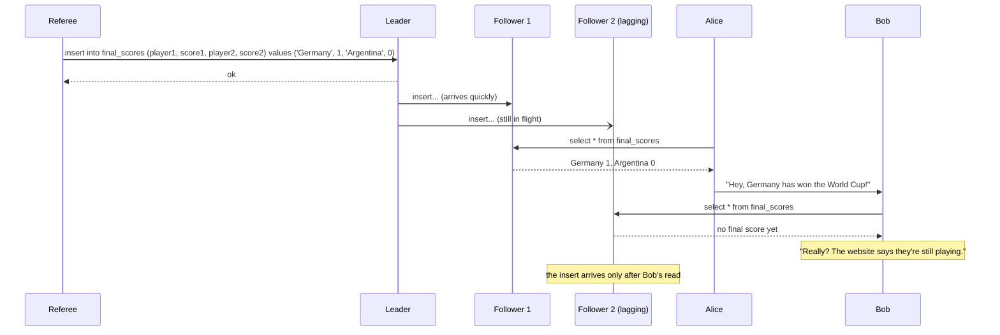

Alice and Bob, in the same room, watch for the 2014 World Cup final result. Alice refreshes, sees the winner and tells Bob; Bob's refresh hits a lagging replica that says the match is still on. Simultaneous refreshes with different results would be unsurprising, but Bob *knows* he refreshed *after* Alice spoke, so an older answer is a **linearizability violation**.

### What Makes a System Linearizable?

**Setup.** Clients read and write a key `x` — a **register** (in practice a key in a key-value store, a row, or a document). Each operation is a **bar** from when the request was *sent* to when the response *arrived*; the database executed it somewhere inside the bar.

> **Aside: the imaginary global clock.** Diagrams assume a perfect global time axis for *analysis*; the algorithm itself can only use imperfect local clocks (quartz + NTP).

Notation: `read(x) ⇒ v` (read returned `v`); `write(x, v) ⇒ r` (`r` is `ok` or `error`).

*Figure 9-2 (redrawn): client C writes x = 1 while A and B keep reading. A's first read ends before the write starts (0); A's last read starts after the write ended (1); the three reads that overlap the write may return either 0 or 1.*
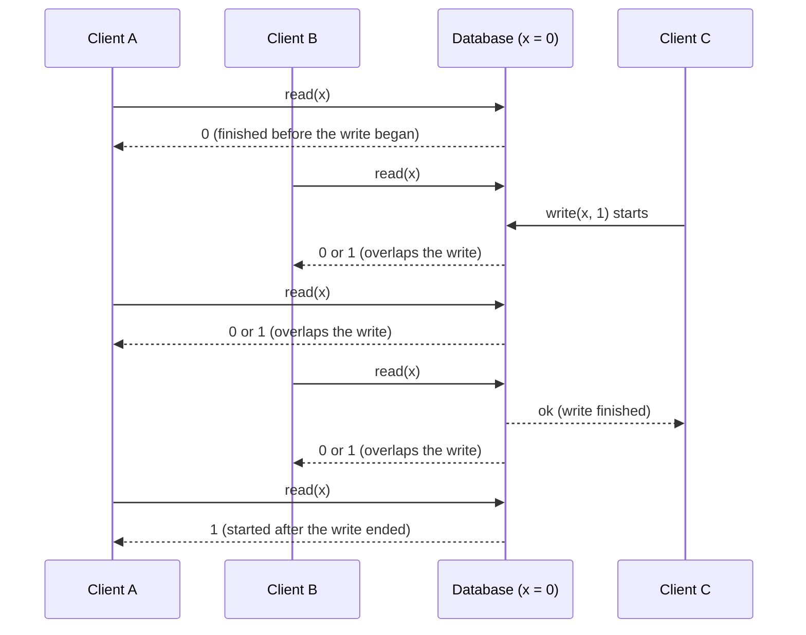

With `x = 0` and C writing 1:
1. A read **finishing before the write starts** returns **0**.
2. A read **starting after the write finishes** returns **1** (both took effect inside their bars, and the bars don't overlap).
3. A read **overlapping** the write (*concurrent* with it) may return **0 or 1**.

That alone would let a reader see 0 → 1 → 0 → 1 during the write — no single copy does that.

> **Regular register.** A register whose overlapping reads may return old or new value. Weaker than linearizable.

*Figure 9-3 (redrawn): same clients as Figure 9-2, with the extra linearizability constraint. A's second read is the first to return 1; B's second read starts after that and so must also return 1, although C's write has not been acknowledged yet; all later reads return 1.*
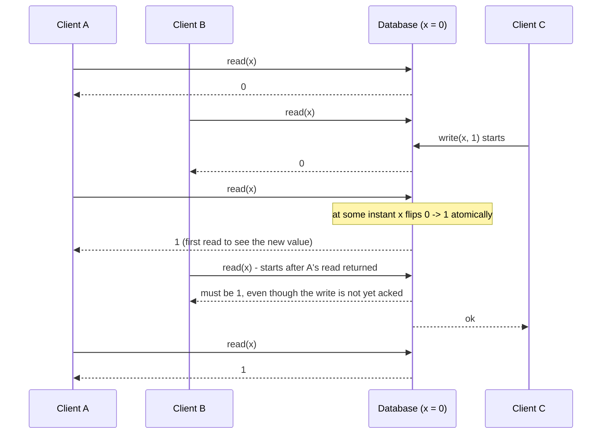

**The extra rule (Figure 9-3):** `x` **flips atomically** at some instant inside the write's bar, so:

> Once any read has returned the new value, every read beginning *after that read completed* must also see it — even if the write is still unacknowledged.

**Adding compare-and-set (Figure 9-4):** `cas(x, v_old, v_new) ⇒ r` sets `x` to `v_new` only if it equals `v_old`, else returns `error`. Mark inside each bar the instant the operation *appears* to execute and join the markers. Requirements: (1) the sequence is a **valid sequential history** (each read returns the latest preceding write); (2) the joining line **always moves forward in time**. Rule 2 enforces recency: once a value is written *or read*, later reads see it until overwritten.

*Figure 9-4 (redrawn): the order in which the database appears to execute operations; B's last read violates linearizability*
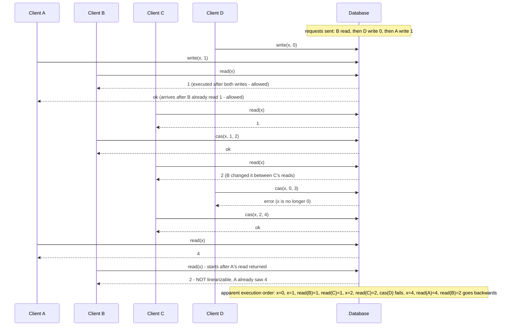

**Details in Figure 9-4:**
- **Processing order ≠ sending order:** B's read was sent before D's and A's writes yet returned 1 — the concurrent requests may be processed in any order (B's may have been delayed).
- **A read can see a write before the writer gets "ok":** A's acknowledgment was just delayed.
- **No transaction isolation assumed:** C read 1 then 2 because B changed it. CAS detects interference: B's and C's succeed, D's fails (x was no longer 0).
- **B's last read breaks linearizability:** it overlaps C's `cas(x, 2, 4)`, so 2 would be fine alone — but A already read 4 before B's read began.

**Testing:** the formal definition is in Herlihy and Wing (1990). You can check a recorded history by searching for a valid sequential order — possible but **computationally expensive** (the book cites Kingsbury's Knossos checker; such checkers search possible orderings, which grows costly with history size).

> **Linearizability versus serializability** (sidebar):
>
> | | Serializability | Linearizability |
> |---|---|---|
> | Guarantee | *Isolation* of **transactions** | *Recency* of reads/writes on a **single register** |
> | Scope | Many objects per transaction | One object; no transactions |
> | Promise | Same result as *some* serial order — may differ from real order | Each operation takes effect at one instant between start and end, respecting real time |
> | Prevents write skew? | Yes | No, not by itself (unless e.g. materialising conflicts — creating rows just to lock them) |
>
> Both together = *strict serializability* (*strong one-copy serializability*, strong-1SR). **Two-phase locking** or **actual serial execution** are typically linearizable too. **Serializable snapshot isolation (SSI) is not**: it deliberately reads from a snapshot (avoiding reader/writer lock contention), which excludes newer writes.

### Relying on Linearizability

A score seen late does no harm. Linearizability matters in three areas.

#### Locking and leader election

A single-leader system must have **one** leader. A common way is a **lock** every node tries to grab at startup; it **must be linearizable** so all nodes agree who holds it.
- **Coordination services** like **Apache ZooKeeper** and **etcd** provide distributed locks and **leader election**, using consensus internally for fault-tolerant linearizable operations.
- Traps remain (e.g. **fencing**, Chapter 8); **Apache Curator** adds higher-level recipes over ZooKeeper.

> **Footnote: ZooKeeper/etcd reads can be stale.** Their *writes* are linearizable, but by default reads may hit any replica. For a linearizable read: etcd **quorum read**; ZooKeeper **`sync()`** before reading.

Locks can be very fine-grained: **Oracle Real Application Clusters (RAC)** locks **each disk page** (a fixed-size block, often a few KB), with several nodes sharing one storage system. Since these locks are on every transaction's critical path, RAC deployments usually have a **dedicated cluster interconnect network**.

#### Constraints and uniqueness guarantees

Enforcing a unique username/email or file path **at write time** (one of two simultaneous attempts gets an error) needs linearizability — it is a **lock** on the name, or a **CAS** "set `username → user_id` only if unclaimed". Likewise: balance never negative, don't oversell stock, don't double-book a seat — all need **one up-to-date value every node agrees on**.

Some constraints can be **loose** (overbooked flights compensate passengers) and avoid linearizability (Chapter 12, "Timeliness and Integrity"). But a **hard uniqueness constraint** requires it. **Foreign keys** and **attribute constraints** (e.g. age ≥ 0) can be enforced *without* it.

Own SQL illustration:

```sql
CREATE TABLE accounts (
  handle  TEXT PRIMARY KEY,    -- hard uniqueness constraint
  user_id BIGINT NOT NULL
);

-- Two sign-ups race for the same handle:
INSERT INTO accounts VALUES ('river_otter', 101);  -- session 1
INSERT INTO accounts VALUES ('river_otter', 202);  -- session 2
-- Exactly one succeeds; the other gets a unique-violation error.
```

One node decides the winner locally; in a replicated system, deciding "who was first" *immediately* everywhere is what needs linearizability (effectively CAS on the key).

#### Cross-channel timing dependencies

Bob only noticed the stale score because of a **second channel** (Alice's voice). Software has the same issue: a photo site with a background thumbnail job.

*Figure 9-5 (redrawn): web server and image resizer communicate through two channels, file storage and a message queue, so the message can outrun the storage's replication.*
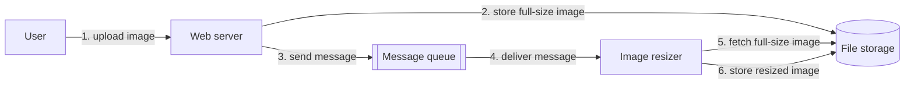

The web server writes the photo to **file storage** (not the queue — brokers are designed for small messages, photos can be megabytes), then enqueues "resize photo X" on a **message queue** (Chapter 11); the resizer fetches the photo. If storage isn't linearizable, the queue may **outrun storage replication**: the resizer gets an old version or nothing, and full-size and thumbnail become **permanently inconsistent**.

Linearizability is the *simplest* fix. If you control the second channel, techniques like **read-your-own-writes** (Chapter 5) also work, with more complexity. (*Own illustration, not the book's:* put the photo's version number in the message and have the resizer wait until it can read at least that version.)

### Implementing Linearizable Systems

Literally keeping one copy isn't fault-tolerant, so which replication methods (Chapter 5) can be linearizable?

| Replication method | Linearizable? | Why |
|---|---|---|
| **Single-leader** | *Potentially* | Reading from the leader or synchronously updated followers can be. Not all are (snapshot isolation by design, concurrency bugs). Relies on knowing the leader: a **delusional leader** (Chapter 8, "The Truth Is Defined by the Majority") breaks it. With **asynchronous replication**, failover can lose committed writes, violating durability and linearizability. |
| **Consensus algorithms** | *Yes* | Resemble single-leader but guard against split brain and stale replicas. **ZooKeeper**, **etcd**. |
| **Multi-leader** | *No* | Concurrent writes on several nodes, replicated asynchronously, create conflicts — precisely because there is no single copy. |
| **Leaderless (Dynamo-style)** | *Probably not* | Quorum "strong consistency" claims aren't quite true. **LWW** with time-of-day clocks (**Cassandra**) is almost certainly non-linearizable (clock skew). **Sloppy quorums** (writes to substitute nodes) destroy it. Even strict quorums can fail (below). |

> **Footnote: sharding doesn't break it.** Linearizability is a *single-object* guarantee, so per-partition leaders are fine; cross-partition transactions are another matter.

#### Linearizability and quorums

*Figure 9-6 (redrawn): a non-linearizable execution despite a strict quorum (n = 3, w = 3, r = 2). The write reaches replica 3 early but replicas 1 and 2 late; reader A sees 1 via replica 3, then reader B, starting after A finished, reads replicas 1 and 2 and gets 0 from both.*
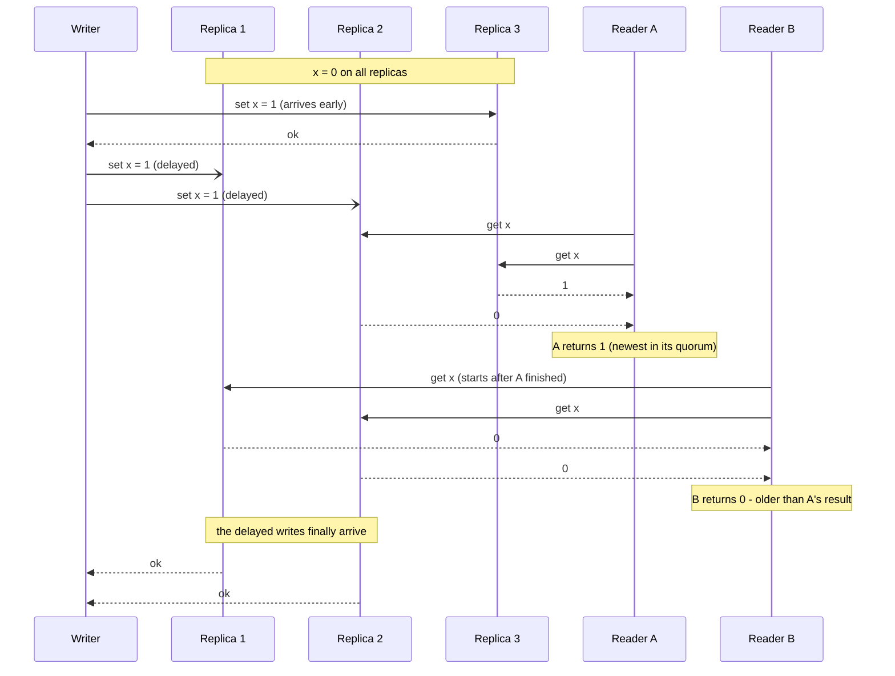

With n = 3, w = 3, r = 2 (3 + 2 > 3), reader A sees 1 from replica 3 mid-write; reader B starts after A finished, reads two replicas still at 0, and returns the *older* value. Not linearizable.

**Fix (at a performance cost):** readers do **synchronous read repair** (write the newest value back to stale replicas) before returning; writers **read the latest state from a quorum** before writing.
- **Riak** skips synchronous read repair (performance).
- **Cassandra** waits for read repair on quorum reads but still breaks linearizability with concurrent writes to one key, because of **LWW**.
- Only linearizable **reads and writes** can be built this way — **not CAS**, which needs consensus.

**Assume leaderless Dynamo-style systems are not linearizable.**

### The Cost of Linearizability

*Figure 9-7 (redrawn): two datacenters, each with an application server and a database replica; the replication connection between the databases is cut by a network partition, while clients can still reach their local datacenter.*
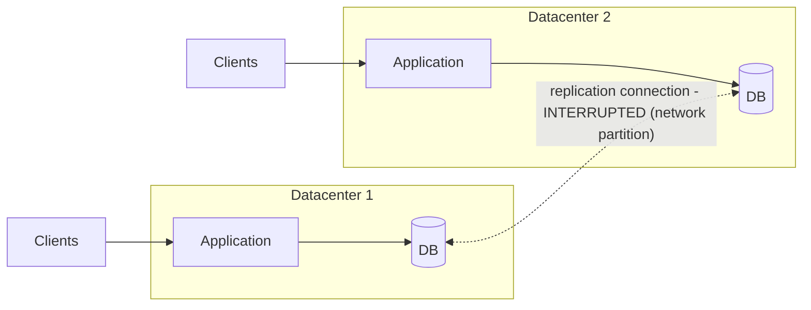

If the inter-datacenter link breaks:
- **Multi-leader** (suited to multi-datacenter, Chapter 5): each datacenter carries on; writes queue up and sync later.
- **Single-leader:** clients in the follower datacenter must reach the leader for writes and linearizable reads. Cut off, they **can't write or read linearizably** — stale local reads only — so the app is **unavailable** there until the link is repaired.

#### The CAP theorem

This applies to **any linearizable database**, and to any unreliable network, even within one datacenter:
- **Require linearizability** → disconnected replicas **can't process requests** (wait or error): *unavailable*.
- **Don't require it** → each replica serves requests independently (e.g. multi-leader): *available*, not linearizable.

> **Footnote: CP and AP.** The first is sometimes called **CP**, the second **AP**; the book says this classification is flawed and best avoided.

This is the **CAP theorem**, named by **Eric Brewer in 2000**, though known to designers **since the 1970s**. It began as a deliberately imprecise *rule of thumb* to start discussion. When many distributed databases targeted linearizability on **shared-storage** clusters (the book cites an Oracle RAC reference), CAP nudged engineers toward **shared-nothing** designs (each machine its own CPU, memory, disk) for web-scale services — credit for the culture shift behind mid-2000s **NoSQL** databases.

> **The unhelpful CAP theorem** (sidebar). "Pick 2 of 3" misleads: a partition is a *fault*, not a choice. When the network works you can have both; only during a fault must you choose — **"either Consistent or Available when Partitioned"**. Discussions also use contradictory definitions of "availability", and the formal one doesn't match common usage; many "highly available" systems don't meet it. The book recommends **avoiding CAP**.

**Limited practical value:** formally (Gilbert and Lynch, 2002) it covers only **one consistency model** (linearizability) and **one fault** (network partitions) — nothing about delays, crashed nodes or other trade-offs. It has been **superseded by more precise results** and is mostly of historical interest.

> **Footnote: two meanings of "partition".** The book's *partitioning* means sharding (Chapter 6); a *network partition* is a fault. The clash is unavoidable here because it is CAP's "P".

#### Linearizability and network delays

Few systems are linearizable in practice. Even **RAM on a multi-core CPU isn't**: one core's write may not be visible to another core's subsequent read without a **memory barrier (fence)**, because each core has its own **cache** and **store buffer** (pending writes) that sync to main memory asynchronously (keeping them in sync is *cache coherence* — general background). That trade is made for **performance**; CAP is irrelevant, since we don't expect a core to keep running when cut off from the machine.

Likewise many distributed databases drop linearizability mainly for **speed**. **Linearizability is slow — all the time, not only during faults.** **Attiya and Welch** proved linearizable read/write **latency is at least proportional to network delay uncertainty**, so on real networks (highly variable delays, Chapter 8) it is inevitably slow; weaker models can be much faster. Chapter 12 discusses avoiding linearizability without losing correctness.

## Ordering Guarantees

A linearizable register implies a **well-defined order** of operations (the joined markers of Figure 9-4). Ordering recurs throughout the book:
- **Chapter 5:** the single leader fixes the **order of writes** in the replication log; without one, concurrent writes conflict.
- **Chapter 7:** serializability means behaving *as if* in some sequential order (literally serial, or concurrent with conflicts prevented by locks/aborts).
- **Chapter 8:** timestamps and clocks try to impose order (which write came later?).

Ordering, linearizability and consensus are **deeply connected**.

### Ordering and Causality

Ordering matters because it **preserves causality** — causes before effects. Earlier examples:
- **Consistent prefix reads (Figure 5-5):** an observer saw an answer before its question — a **causal dependency** was violated.
- **Multi-leader replication (Figure 5-9):** an update arrived before the row's creation.
- **Detecting concurrent writes (Chapter 5):** A before B, B before A, or concurrent — the **happens-before** relation *is* causality.
- **Snapshot isolation (Chapter 7):** a "consistent" snapshot **respects causality** (an answer implies its question is visible). **Read skew** (Figure 7-6) is reading a causality-violating state.
- **Write skew (Figure 7-8, doctors on call):** going off call was *causally dependent* on who was on call; **SSI** detects this by tracking causal dependencies between transactions.
- **Alice and Bob (Figure 9-1)** and the image resizer: **causality violations**.

Chains of dependent operations define the system's **causal order**. A system obeying it is **causally consistent** — e.g. **snapshot isolation provides causal consistency**: reading some data means you also see everything causally before it (unless deleted).

#### The causal order is not a total order

- **Total order:** any two elements comparable (13 > 5).
- **Partial order:** some pairs **incomparable** — is {a, b} bigger than {b, c}? Neither contains the other.

| | Linearizability | Causality |
|---|---|---|
| Kind of order | **Total** | **Partial** |
| Why | One copy + atomic ops ⇒ any two operations are ordered | Ordered only if one happened before the other; **concurrent** = **incomparable** |
| Concurrency? | None — one timeline | Yes — timeline **branches and merges** |

So **a linearizable datastore has no concurrent operations**: requests may wait, but each is handled atomically on one timeline. Concurrency means branches whose operations can't be compared (Figure 5-14).

> **Git analogy.** Version history in **Git** is a causal dependency graph: mostly linear, but **branches** when people work concurrently and **merge** commits rejoin them.

#### Linearizability is stronger than causal consistency

**Linearizability implies causality**, even across multiple channels (Figure 9-5) with no extra machinery — which makes it easy to reason about, but it costs performance and availability, especially with large delays.

**The middle ground:** a system can be **causally consistent without linearizability's performance cost**, and **CAP does not apply** to it. **No consistency model stronger than causal consistency can avoid being slowed by network delays while staying available through network failures.** Many systems that *seem* to need linearizability only need causality. Research on causality-preserving databases with eventual-consistency-like performance is recent, little is in production, but it's promising.

#### Capturing causal dependencies

Key ideas (only sketched in the book):
1. Know **what happened before what** (a partial order): concurrent operations may go in any order, but causally ordered ones must be applied in that order on every replica.
2. **Wait for predecessors** before applying an operation.
3. **Track each node's knowledge**: if a node had seen X when it wrote Y, Y may depend on X ("did the CEO know about X when deciding Y?").
4. **Generalise version vectors** from one key (Chapter 5, "Detecting Concurrent Writes") to **the whole database**.
5. **Know which version the application read** — hence passing the previously read version number back with writes (Figure 5-13); SSI similarly tracks what each transaction read and checks it at commit.

### Sequence Number Ordering

Tracking *every* causal dependency is impractical (apps read lots before writing). Instead, give operations **sequence numbers or timestamps** from a **logical clock** (usually counters incremented per operation), not a physical time-of-day clock. They are **compact** (a few bytes) and **totally ordered**. We want a total order **consistent with causality**: if A happened before B, A's number is lower; concurrent operations are ordered arbitrarily (more ordering than strictly needed).

> **Footnote:** a total order ignoring causality is easy but useless — e.g. sorting random **UUIDs** (128-bit random IDs).

**Single-leader case:** the leader increments a counter per write, giving **monotonically increasing** numbers; followers applying the log in order are **causally consistent** even while lagging.

#### Noncausal sequence number generators

Without a single leader (multi-leader, leaderless, partitioned):
1. **Per-node sequences** — e.g. one node odd, one even; generally reserve bits for a **unique node ID**.
2. **Physical-clock timestamps** — high enough resolution may totally order operations; **LWW** relies on this.
3. **Pre-allocated blocks** — node A takes **1–1,000**, B takes **1,001–2,000**, each grabbing a new block when low.

All **perform and scale better** than one leader's counter, but **aren't consistent with causality**:

| Method | Why causality breaks |
|---|---|
| Odd/even | Nodes process at different rates, so one counter lags; odd vs even tells you nothing. |
| Physical timestamps | **Clock skew** can give a later operation a lower timestamp (Figure 8-3). |
| Blocks | A later operation may get a number from 1–1,000 while the earlier got 1,001–2,000. |

> **Footnote: Spanner's exception.** **Spanner** estimates clock skew and **waits out the uncertainty interval** before committing, so causally later transactions get larger timestamps (Chapter 8). Most clocks can't supply the needed uncertainty metric.

#### Lamport timestamps

Proposed by **Leslie Lamport in 1978** in one of the field's most-cited papers:
1. Each node has a **unique ID** and a **counter** of operations processed.
2. Timestamp = **(counter, node ID)** — unique even if counters tie.
3. Compare: larger counter wins; tie → larger node ID. A **total order**, unrelated to physical time.
4. **Key trick:** every node *and client* tracks the **largest counter seen** and sends it with each request; a node receiving a larger maximum **raises its counter to it immediately**.

Steps 1–3 alone equal the odd/even scheme; step 4 makes **every causal dependency yield a larger timestamp**.

*Figure 9-8 (redrawn): Lamport timestamps (counter, node ID). Each client sends the maximum counter it has seen; a node first raises its counter to that maximum, then increments it. The result is a total order consistent with causality.*
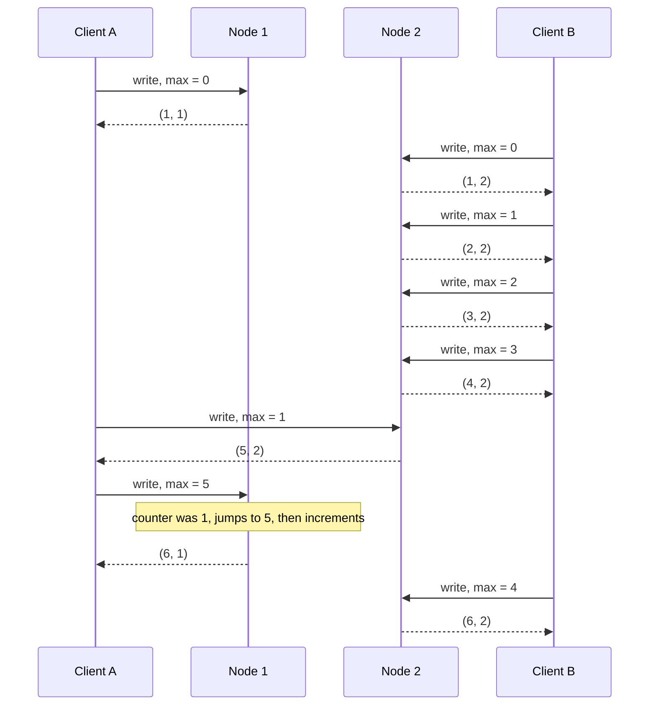

Node 2 gives client A counter **5**; A passes 5 to node 1, whose counter was **1** — it jumps to 5, so its next operation gets **6**.

Own code:

```python
class LamportNode:
    def __init__(self, node_id):
        self.node_id = node_id
        self.counter = 0

    def handle(self, request_max_seen):
        # 1. catch up to anything the caller has already seen
        self.counter = max(self.counter, request_max_seen)
        # 2. this operation gets the next value
        self.counter += 1
        # 3. timestamp = (counter, node_id); caller remembers counter as its new max
        return (self.counter, self.node_id)

n1, n2 = LamportNode(1), LamportNode(2)
print(n1.handle(0))   # (1, 1)
n2.counter = 4        # pretend node 2 has already handled 4 operations (as in the diagram)
print(n2.handle(1))   # (5, 2)  client A only knew max 1; node 2's own counter wins
print(n1.handle(5))   # (6, 1)  A passes max 5; node 1 jumps from 1 to 5, then +1
```

`max(...)` is the catch-up step; tuples compare counter then node ID — the Lamport rule.

| | Version vectors | Lamport timestamps |
|---|---|---|
| Purpose | Tell **concurrent** from **dependent** | Always impose a **total order** |
| Detect concurrency? | Yes | **No** |
| Size | One counter per node | **More compact** — one pair |

#### Timestamp ordering is not sufficient

**Unique usernames:** "lowest timestamp wins" works only **after the fact**, once all creation operations are collected. A node receiving a sign-up must decide **now**, without knowing whether another node is concurrently claiming the name with a lower timestamp. Asking every node means **any failure halts the system**.

The total order only *emerges* after gathering all operations; unknown operations might slot in anywhere. For uniqueness you also need to know **when the order is finalised** — what **total order broadcast** provides.

### Total Order Broadcast

On one core, the order is just execution order. Single-leader replication gets a total order by sequencing on **one CPU core** of the leader; the hard parts are **scaling** past one leader's throughput and **failover**. This problem is **total order broadcast** or **atomic broadcast**.

> **Footnote on naming.** "Atomic broadcast" is unrelated to ACID's A and only loosely to atomic operations or atomic registers. **Total order multicast** is a synonym.

> **Scope of ordering guarantee** (sidebar). Partitioned databases with per-partition leaders usually order **only within a partition**, so no cross-partition guarantees (consistent snapshots, foreign keys); a cross-partition total order needs extra coordination.

**Definition** — two **safety** properties that must hold despite faults:
1. **Reliable delivery:** if any node gets a message, all do.
2. **Totally ordered delivery:** all nodes get messages in the **same order**.

During a network outage nothing is delivered, but the algorithm retries until messages get through, still in order.

#### Using total order broadcast

- **ZooKeeper and etcd implement it** — a hint of its link to consensus.
- **Database replication:** all replicas apply the same writes in the same order — **state machine replication** (Chapter 11).
- **Serializable transactions:** each message is a **deterministic stored-procedure transaction** processed in the same order everywhere (Chapter 7, "Actual Serial Execution").
- **Order is fixed at delivery:** a node may **not insert** a message earlier once later ones were delivered — *why it is stronger than timestamp ordering*.
- **It's a log** (like replication, transaction or write-ahead logs): delivering = appending; every node reads the same sequence.
- **Fencing tokens:** append each lock request; its sequence number is a monotonically increasing token — ZooKeeper's **zxid**.

#### Implementing linearizable storage using total order broadcast

Not the same thing, but closely linked: total order broadcast is **asynchronous** (order guaranteed, **not *when*** — nodes may lag); linearizability guarantees **recency**.

> **Footnote: formal relationship.** Total order broadcast ≡ consensus, which **can't be solved deterministically in the asynchronous crash-stop model** — yet a plain linearizable read-write register *can* be. A register with **CAS** or **increment-and-get** is equivalent to consensus.

**Linearizable CAS for usernames via a log.** Each username has a register, initially `null`; claiming = CAS from `null` to your account ID. Using total order broadcast as an **append-only log**:
1. **Append** a message tentatively claiming the name.
2. **Read** the log and **wait until your message is delivered back**.
3. Check claims for that name: if the **first** is yours, **commit** (e.g. append a commit message) and acknowledge; otherwise **abort**.

All nodes see the same order, so all agree which claim won. A log can similarly support **serializable multi-object transactions**.

> **Footnote: why wait in step 2.** Acknowledging as soon as it's queued gives something like the **multi-core x86** memory model — **neither linearizable nor sequentially consistent**.

Own pseudocode:

```python
def claim_username(log, name, account_id):
    my_msg = log.append({"claim": name, "by": account_id})   # step 1
    log.wait_until_delivered(my_msg)                          # step 2
    first = next(m for m in log.read_all()                    # step 3
                 if m.get("claim") == name)
    if first is my_msg:
        log.append({"commit": name, "by": account_id})
        return "ok"
    return "error: name taken"
```

**Reads are still a problem:** this makes **writes** linearizable, but reads from an asynchronously updated store may be stale — the result is **sequential consistency** (**timeline consistency**). Options for linearizable reads:

| Option | How | Example |
|---|---|---|
| Sequence reads through the log | Append a message; do the read when it comes back (its log position = read time) | **etcd quorum reads** (somewhat) |
| Fetch latest log position | Linearizably get the latest position, wait until delivered up to it, then read | **ZooKeeper `sync()`** |
| Read from a synchronously updated replica | That replica must be current | **Chain replication** |

#### Implementing total order broadcast using linearizable storage

Given a linearizable register with atomic **increment-and-get** (or CAS):
1. For each message, **increment-and-get** the register.
2. Attach the value as the **sequence number**.
3. **Send** to all nodes, retransmitting losses.
4. Recipients **deliver consecutively by sequence number**.

**No gaps** — unlike Lamport timestamps. A node that delivered 4 and receives 6 knows to **wait for 5**. *That gap-awareness is what separates total order broadcast from timestamp ordering.*

```python
def broadcast(counter, nodes, payload):
    seq = counter.increment_and_get()          # linearizable, gap-free
    for n in nodes:
        n.send_with_retry(seq, payload)

class Receiver:
    def __init__(self): self.next_seq, self.buffer = 1, {}
    def on_message(self, seq, payload):
        self.buffer[seq] = payload
        while self.next_seq in self.buffer:     # deliver strictly in order
            deliver(self.buffer.pop(self.next_seq))
            self.next_seq += 1                  # a gap means "wait"
```

A linearizable increment-and-get is trivial with no failures (a variable on one machine); handling network breaks and **recovering the value when the node fails** inevitably **leads to a consensus algorithm**. Indeed, it is proven that **consensus, total order broadcast, and a linearizable CAS (or increment-and-get) register are equivalent** — a solution to one converts to the others.

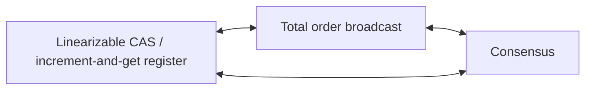
*(Diagram, not a book figure: the three problems proven equivalent.)*

## Distributed Transactions and Consensus

Consensus — getting nodes to **agree on something** — sounds easy, and many broken systems assumed so. It is among the most fundamental problems in the field; its subtleties need replication (Ch. 5), transactions (Ch. 7), system models (Ch. 8), linearizability and total order broadcast first. Researchers took **decades** to understand it fully.

**Where nodes must agree:**
- **Leader election:** a bad failover under a network fault causes **split brain** — two leaders accept writes, data diverges and is lost.
- **Atomic commit:** a transaction spanning nodes/partitions may succeed on some and fail on others; to keep atomicity, **all commit or all abort** — the **atomic commit problem**.

> **Footnote: atomic commit vs consensus.** Atomic commit may commit **only if all vote yes** and must abort if any needs to; consensus may decide **any proposed value**. They are **reducible to each other**; *nonblocking* atomic commit is harder than consensus.

> **The Impossibility of Consensus** (sidebar). The **FLP result** (**Fischer, Lynch, Paterson**) proves **no algorithm always reaches consensus if any node may crash** — but in the **asynchronous model** (deterministic, **no clocks or timeouts**). Allow **timeouts** or any way to *suspect* crashes (even occasionally wrong), or just **random numbers**, and consensus is solvable. Important in theory; in practice systems reach consensus.

Plan: atomic commit and **2PC** (common in databases, messaging systems, app servers) — *a consensus algorithm of sorts, but a poor one* — then better algorithms like **Zab (ZooKeeper)** and **Raft (etcd)**.

### Atomic Commit and Two-Phase Commit (2PC)

Atomicity (Chapter 7): a transaction either **commits** (all writes durable) or **aborts** (all rolled back), preventing half-finished state. It matters for **multi-object transactions** and **secondary indexes** (separate structures that must stay **consistent with the primary data**).

#### From single-node to distributed atomic commit

**Single node** (storage engine):
1. Client requests commit.
2. Node makes writes durable (usually a **write-ahead log**).
3. Appends a **commit record** to the log.
4. On crash recovery: commit record on disk → **committed**; else **rolled back**.

The decisive moment is the **commit record reaching disk**; atomicity rests on **one device** (one disk controller).

**Multiple nodes** — e.g. a multi-object transaction in a sharded database, or a **term-partitioned** secondary index (split by indexed value, so entries live on other nodes). Most NoSQL stores **don't support** this; some clustered relational systems do. Sending "commit" to each node independently fails because:
- some nodes hit a **constraint violation or conflict** and abort;
- some commit requests are **lost** and time out;
- some nodes **crash** before writing the commit record.

Nodes become inconsistent (cf. Figure 7-3), and a commit **can't be retracted**. So **a node may commit only once sure all others will too.**

**Why commits are irrevocable:** committed data is **visible** and others build on it — the basis of **read committed**. Retracting would require reverting everything that read it.

> **Compensating transactions** can undo a committed transaction's *effects*, but the database sees a separate transaction; cross-transaction correctness is the **application's** problem.

#### Introduction to two-phase commit

**2PC** achieves atomic commit across nodes — used **internally** by some databases and exposed as **XA transactions** (e.g. **Java Transaction API**) or **WS-AtomicTransaction** for **SOAP** (an older XML-based standard for services calling each other). Commit happens in **two phases**.

*Figure 9-9 (redrawn): a successful two-phase commit. Data is written on both databases, then phase 1 asks each to prepare (both vote yes) and phase 2 tells each to commit. Each database holds the transaction's locks from its write until its commit (the book's shaded bars).*
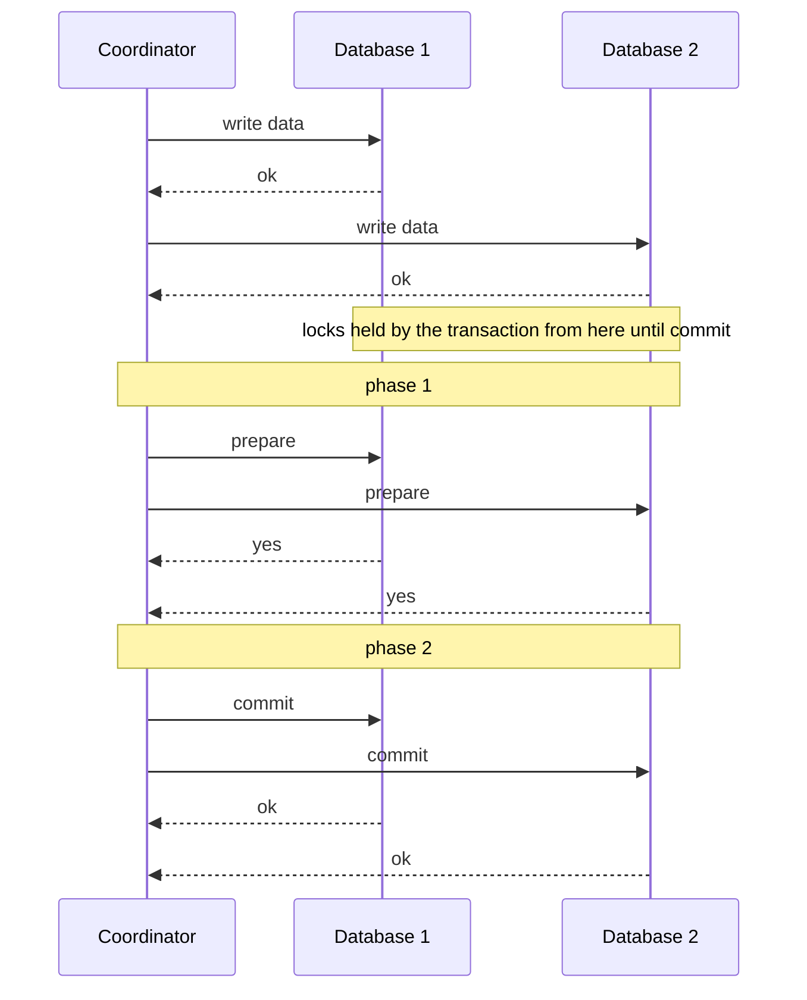

> **Don't confuse 2PC and 2PL** (sidebar). Two-phase **commit** = atomic commit across nodes; two-phase **locking** (Chapter 7) = serializable isolation. Unrelated.

The **coordinator** (**transaction manager**) is new. Often a **library in the application process** (e.g. a **Java EE container**), or a separate service. Examples: **Narayana, JOTM, BTM, MSDTC**.

**Flow:** the app reads/writes on several nodes (**participants**); at commit, the coordinator sends **prepare** (phase 1); if **all** say **yes**, it sends **commit** (phase 2), else **abort** to all.

> **Wedding analogy.** The minister asks each partner "do you?"; with both "I do"s, declares them married (commit) and announces it; if either says no, the ceremony aborts.

#### A system of promises

Messages can be lost in 2PC too; atomicity comes from the details:
1. **Global transaction ID** from the coordinator.
2. **Local transactions** on each participant, tagged with it. If anything fails now, the coordinator **or any participant** may abort.
3. **Prepare**, tagged with the ID, sent to all; if any **fails or times out**, the coordinator sends **abort** to all.
4. **Participant's promise:** it writes all data to disk and checks constraints/conflicts so it can **commit under all circumstances** (crash, power loss or full disk are not excuses later). Voting **yes** **surrenders the right to abort** — without committing yet.
5. **Commit point:** the coordinator decides (commit only if **all** voted yes) and **writes the decision durably to its log**.
6. **Enforce forever:** it then sends commit/abort, **retrying forever** on failure. A participant that crashed commits **on recovery** — it voted yes.

**Two points of no return:** a participant's **yes vote**, and the coordinator's **decision**. (Single-node commit merges both into writing the commit record.)

**Wedding, continued:** after "I do" you can't take it back; if you faint before the pronouncement you're still married, and on waking can ask the minister about your global transaction ID or wait for the retried commit.

Own coordinator pseudocode:

```python
def two_phase_commit(coord_log, participants, txid):
    # Phase 1: collect votes
    votes = []
    for p in participants:
        try:
            votes.append(p.prepare(txid))       # participant fsyncs, then votes
        except Timeout:
            votes.append("no")
    decision = "commit" if all(v == "yes" for v in votes) else "abort"

    coord_log.write_and_fsync(txid, decision)   # COMMIT POINT

    # Phase 2: enforce the decision, forever if necessary
    for p in participants:
        while True:
            try:
                p.finish(txid, decision); break
            except Timeout:
                continue                          # retry until success
```

A phase-1 timeout counts as "no" (safe — nobody committed); `write_and_fsync` is the commit point; the phase-2 loop keeps the promise.

**Own example, not from the book** — PostgreSQL exposes the participant side as SQL (the basis of its XA support in drivers such as JDBC); it requires `max_prepared_transactions` > 0 (default 0):

```sql
BEGIN;
UPDATE stock SET qty = qty - 1 WHERE sku = 'lamp-42';
PREPARE TRANSACTION 'order-7781';   -- phase 1: durable, votes "yes"
-- ... later, when the coordinator has decided:
COMMIT PREPARED 'order-7781';       -- phase 2 (or ROLLBACK PREPARED)
```

- `PREPARE TRANSACTION` persists state and keeps locks without committing (success = "yes"; failure rolls back = "no"). The prepared transaction detaches from the session and survives a restart.
- `COMMIT PREPARED` / `ROLLBACK PREPARED` (any session) applies the decision; until then it is *in doubt*, holding locks, listed in `pg_prepared_xacts`.

#### Coordinator failure

Participant/network failures are handled (prepare failure → abort; commit/abort failure → retry). If the **coordinator** crashes: before prepare, participants can abort; **after voting yes**, a participant **can't abort alone** and must **wait** — it is **in doubt** (**uncertain**).

*Figure 9-10 (redrawn): the coordinator crashes after both participants voted yes. Database 2 gets the commit and commits; the commit for database 1 is never sent, so database 1 is stuck in the "prepared" state, unable to decide on its own.*
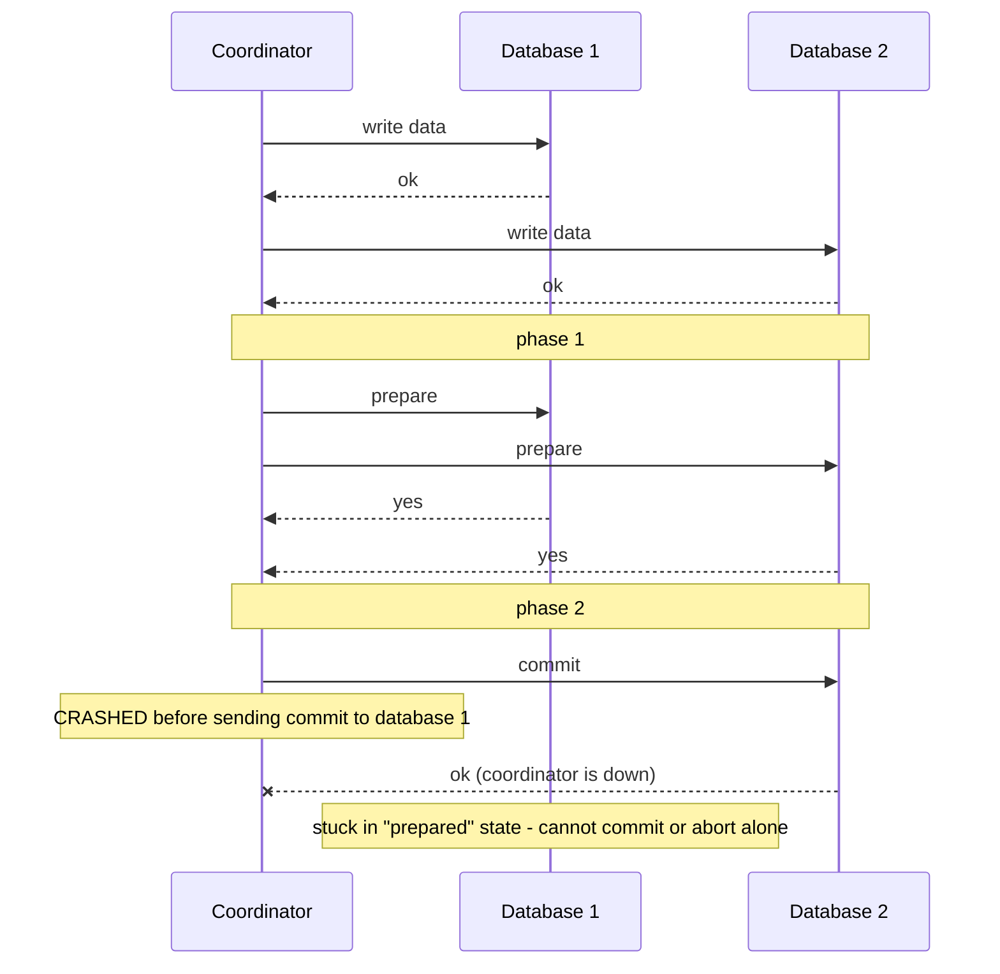

Database 2 committed; database 1 never got the commit. A **timeout doesn't help**: aborting would contradict DB2, committing is unsafe because another participant might have aborted. Participants could in principle ask each other, but **that's not part of 2PC**.

**2PC completes only when the coordinator recovers**, reading its log (hence logging the decision *before* sending it). **No commit record in the log ⇒ abort.** So 2PC's commit point is ultimately a **single-node atomic commit on the coordinator**.

#### Three-phase commit

2PC is **blocking**. A **nonblocking** protocol is possible in theory; **3PC** was proposed, but it assumes **bounded network delay and response times**; with unbounded delays and pauses it **can't guarantee atomicity**. Nonblocking atomic commit needs a **perfect failure detector**, and timeouts can't reliably detect crashes. So **2PC is still used**.

### Distributed Transactions in Practice

Distributed transactions have a **mixed reputation**: an important safety guarantee, but operational pain, poor performance and over-promising; **many cloud services don't offer them**. **MySQL** distributed transactions are reported **more than 10× slower** than single-node ones; 2PC's inherent cost is **extra `fsync`s** (forcing writes to disk for crash recovery) and **extra network round-trips**.

| | Database-internal | Heterogeneous |
|---|---|---|
| Participants | Nodes of **one** distributed database, **same software** | **Different technologies** — different vendors' databases, **message brokers** |
| Examples | **VoltDB**, **MySQL Cluster's NDB** | Database + message queue in one transaction |
| Protocol freedom | Any protocol, technology-specific optimisations | Must work across very different systems |
| How well | Often **quite well** | **Much harder** |

#### Exactly-once message processing

A queue message can be acknowledged **exactly when** the database transaction processing it **commits**, by atomically committing the **ack and the DB writes** together. If either fails, **both abort** and the broker redelivers; the message is processed **exactly once in effect**, however many retries.

**Catch:** every affected system must support the **same atomic commit protocol**. If processing also **sends an email** via a non-2PC server, a retry may send it **twice or more**. (Exactly-once returns in Chapter 11.)

#### XA transactions

**X/Open XA** (1991) — 2PC across heterogeneous technologies, widely implemented: **PostgreSQL, MySQL, DB2, SQL Server, Oracle**; brokers **ActiveMQ, HornetQ, MSMQ, IBM MQ**.
- **Not a network protocol** — a **C API** to the coordinator. In **Java EE** it is the **Java Transaction API (JTA)**, supported by many **JDBC** and **JMS** drivers.
- XA-aware **drivers/client libraries** tell the server when an operation belongs to a distributed transaction and expose **callbacks** for the coordinator to **prepare, commit or abort**.
- The **coordinator** implements the API — usually a **library in the application process**, tracking participants and logging decisions on the **local disk**.

**If the application crashes**, the coordinator dies with it; prepared participants are **in doubt**. Since the log is on that server's disk, **the same server must restart** and the library read its log before telling participants the outcome via callbacks. **The database can't contact the coordinator directly** — only through the client library.

#### Holding locks while in doubt

The problem is **locks**: **row-level exclusive locks** on modified rows (against dirty writes — overwriting uncommitted data, Chapter 7) and, under **two-phase locking**, **shared locks** on read rows. They are held **until commit/abort** (Figure 9-9), i.e. **for as long as the transaction is in doubt** — **20 minutes** if the coordinator takes 20 minutes to restart; **forever** if its log is **lost** (until manual repair). Others **can't modify** (and sometimes can't **read**) those rows, so **large parts of the application** may block.

#### Recovering from coordinator failure

**Orphaned in-doubt transactions** occur when the outcome can't be determined (e.g. log **lost or corrupted by a bug**). They **sit forever**, holding locks. **Rebooting databases won't help**: correct 2PC **keeps in-doubt locks across restarts**. An **administrator** must examine participants and apply a consistent outcome — likely **under stress** mid-outage.

**Heuristic decisions** let a participant **unilaterally** commit or abort an in-doubt transaction. **"Heuristic" is a euphemism for "probably breaking atomicity"** — for **catastrophes** only.

#### Limitations of distributed transactions

**The coordinator is itself a database** (it stores outcomes) and needs the same care:
1. **Single point of failure:** unreplicated coordinators block other app servers behind in-doubt locks; **many implementations lack high availability** out of the box, or replicate only basically.
2. **App servers stop being stateless:** the coordinator's **logs are crucial durable state**, so servers can no longer be added/removed freely (as the stateless, HTTP-friendly model assumes).
3. **Lowest common denominator:** XA **can't detect deadlocks across systems** (no standard lock-wait exchange) and **doesn't work with SSI** (no cross-system conflict protocol).
4. **Failure amplification:** even database-internal transactions (where **distributed SSI is possible**) need **all participants to respond**, so any broken component fails the transaction — the opposite of fault tolerance.

Alternatives that keep systems consistent without heterogeneous transactions come in Chapters 11 and 12.

### Fault-Tolerant Consensus

**Informally:** nodes agree on something — e.g. who gets the **last flight seat**, a **theatre seat**, or a **username**. **Formally:** nodes **propose** values and the algorithm **decides** one.

| Property | Meaning | Type |
|---|---|---|
| **Uniform agreement** | No two nodes decide differently. | Safety |
| **Integrity** | No node decides twice. | Safety |
| **Validity** | A decided value was proposed by some node. | Safety |
| **Termination** | Every non-crashed node eventually decides. | **Liveness** |

> **Footnote:** this is **uniform consensus**, equivalent to regular consensus in asynchronous systems with unreliable failure detectors. Papers say *processes* rather than *nodes*.

- **Agreement + integrity** = everyone decides the same and nobody changes their mind.
- **Validity** rules out trivial answers (always deciding `null`).
- **Termination** = **fault tolerance**. Without it, a hard-coded **"dictator"** node suffices — until it fails, which is **2PC's** situation when the coordinator dies. The algorithm must **make progress** despite failures.

**Crash model:** a crashed node **never returns** — picture it under **30 feet of mud** after a landslide. An algorithm that waits for recovery can't terminate; **2PC does not satisfy termination**.

**Tolerance:** termination provably needs **a majority functioning** (a **quorum**), i.e. **fewer than half** crashed or unreachable. But **safety** (agreement, integrity, validity) is kept **always** — a big outage stops processing but **can't cause invalid decisions**.

**Byzantine faults:** most algorithms assume none; a protocol-violating node may break safety. Byzantine-robust consensus is possible if **under one-third** of nodes are Byzantine (not covered in detail).

#### Consensus algorithms and total order broadcast

Best known: **Viewstamped Replication (VSR)**, **Paxos**, **Raft**, **Zab** — similar, not identical. High-level ideas suffice unless you build one, which the book **doesn't recommend**.

Most decide a **sequence of values** — they are **total order broadcast algorithms**, equivalent to **repeated consensus** (each round decides the next message):

| Consensus property | Total order broadcast consequence |
|---|---|
| Agreement | All nodes deliver **the same messages in the same order** |
| Integrity | Messages **not duplicated** |
| Validity | Messages **not corrupted or invented** |
| Termination | Messages **not lost** |

**VSR, Raft and Zab** do total order broadcast **natively** (more efficient than repeated single-value consensus); for **Paxos** this is **Multi-Paxos**.

#### Single-leader replication and consensus

Single-leader replication sends writes in one order — isn't that total order broadcast? It depends on leader selection:
- **Manual** (operators): a **dictatorial** consensus; works in practice but **fails termination** (needs humans).
- **Automatic failover:** closer to fault-tolerant total order broadcast, hence consensus.

**Chicken-and-egg:** avoiding split brain requires consensus on the leader; consensus is total order broadcast, which looks like single-leader replication, which needs a leader…

#### Epoch numbering and quorums

These protocols use a leader but only promise **at most one leader per epoch**:

| Algorithm | Epoch number name |
|---|---|
| Paxos | **ballot number** |
| Viewstamped Replication | **view number** |
| Raft | **term number** |

1. **New election ⇒ new epoch:** when the leader is *suspected* dead, a vote is held with an **incremented epoch** — totally ordered, monotonically increasing.
2. **Higher epoch wins** a conflict between leaders.
3. **A leader can't trust itself:** before deciding, it must check no higher-epoch leader exists (truth is decided by the majority, Chapter 8).
4. **Quorum vote per proposal:** the leader waits for a quorum (typically **but not always** a majority) in favour; a node votes yes **only if it knows of no higher epoch**.
5. **Two overlapping votes:** one **elects** the leader, one **approves** a proposal. Because the **quorums overlap**, at least one approving node took part in the **latest election**; if none reports a higher epoch, the leader knows **no newer election happened** and can safely **decide**.

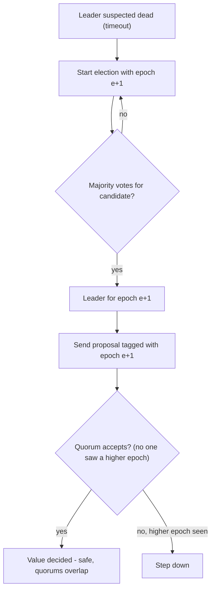
*(Diagram, not a book figure: the epoch-and-quorum idea in flowchart form.)*

| | Two-phase commit | Fault-tolerant consensus |
|---|---|---|
| Who leads | Coordinator **not elected** | Leader **elected** per epoch |
| Votes needed | **"Yes" from every** participant | A **majority** (quorum) |
| After failure | Wait for coordinator | Defined **recovery procedure** under a new leader, preserving safety |

These differences make consensus correct and fault-tolerant.

#### Limitations of consensus

Consensus is a **huge breakthrough** — safety amid uncertainty, progress with a majority, and **fault-tolerant linearizable atomic operations** via total order broadcast — but it has costs:
1. **Synchronous replication cost:** voting before deciding is synchronous; many databases choose **asynchronous** replication for performance, accepting some loss on failover.
2. **Strict majority:** **1 failure needs ≥ 3 nodes**, **2 failures ≥ 5**. On a network split, **only the majority side progresses**.
3. **Fixed membership:** most assume a fixed voter set; **dynamic membership** extensions are less well understood.
4. **Timeouts and false elections:** with variable delays (especially **geo-distributed**), transient glitches trigger elections; safety holds, but **frequent elections ruin performance**.
5. **Network sensitivity:** **Raft** has edge cases — with **one consistently unreliable link**, leadership can **bounce between two nodes** or the leader is repeatedly forced out, so it **never makes progress**. Robust algorithms are **an open research question**.

### Membership and Coordination Services

**ZooKeeper** and **etcd** look like key-value stores (read/write values, iterate keys). Why consensus, and how do they differ?

You rarely use ZooKeeper directly (it's not a general-purpose database); you rely on it **indirectly** via **HBase**, **Hadoop YARN** (cluster resource manager), **OpenStack Nova** (cloud VM manager) and **Kafka**.

**Design:** **small data fitting entirely in memory** (also written to disk), replicated with **fault-tolerant total order broadcast**. ZooKeeper is modelled on **Google's Chubby lock service** and adds:

| Feature | What it gives you |
|---|---|
| **Linearizable atomic operations** | Atomic CAS builds a **lock** — only one concurrent attempt succeeds, guaranteed by consensus despite faults. Locks are usually **leases** that expire if the client fails. |
| **Total ordering of operations** | **Fencing tokens** against clashes after process pauses: every operation gets an increasing **zxid** and **cversion**. |
| **Failure detection** | Clients hold **long-lived sessions** with **heartbeats**; brief drops or a server failure don't kill the session, but silence past the **session timeout** does. Session locks can auto-release — **ephemeral nodes**. |
| **Change notifications** | Clients **watch** values and learn when others join (write a value) or fail (session expires, ephemeral nodes vanish) — no polling. |

**Only the linearizable atomic operations truly need consensus**, but the **combination** is what makes it useful.

#### Allocating work to nodes

1. **Leader/primary selection** among instances of a service (single-leader databases, **job schedulers**).
2. **Partition assignment** for databases, message streams, file storage, **actor systems** (programs of independent message-passing actors): rebalance when nodes **join** (Chapter 6), take over when they **leave or fail**.

Done with **atomic operations, ephemeral nodes and notifications**, the app **recovers automatically**. Not easy even with **Apache Curator**, but far better than writing consensus yourself (a **poor track record**).

Own sketch of leader election with ZooKeeper-style primitives:

```python
# Every candidate creates an EPHEMERAL + SEQUENTIAL node under /election
me = zk.create("/election/candidate-", data=my_address,
               ephemeral=True, sequential=True)    # e.g. candidate-0000000017

def check_leadership():
    children = sorted(zk.get_children("/election"))
    if children[0] == me.name:
        become_leader()                            # lowest number wins
    else:
        # watch the candidate just ahead of me; if its session dies,
        # its ephemeral node disappears and I get notified
        prev = children[children.index(me.name) - 1]
        zk.exists("/election/" + prev, watch=lambda _: check_leadership())

check_leadership()
```

**Ephemeral** = failure detection; **sequential** numbers come from the total order so all agree who's lowest; the **watch** avoids polling.

**Scale:** majority votes across thousands of nodes would be hopeless, so ZooKeeper runs on a **small fixed set (typically three or five)** serving many clients — **outsourcing** consensus, ordering and failure detection.

**Slow-changing data:** facts like "**node 10.1.1.23 leads partition 7**", changing over **minutes or hours** — **not** runtime state changing **thousands or millions of times per second**; use e.g. **Apache BookKeeper** (replicated log storage) for that.

#### Service discovery

ZooKeeper, etcd and **Consul** also do **service discovery**: services **register their endpoints** at startup (VMs come and go, so IPs aren't known in advance). **Does it need consensus? Less clear.** **DNS** ([System Design Fundamentals](../00a-system-design-fundamentals/README.md)) uses heavy **caching**; its **reads are absolutely not linearizable** and slight staleness is fine — **availability and robustness** matter more. But **leader election needs consensus**, so a consensus system can also tell others **who the leader is**. Some offer **read-only caching replicas** that receive the decision log asynchronously, **don't vote**, and serve non-linearizable reads.

#### Membership services

ZooKeeper continues research on **membership services** dating to the **1980s**, important for systems like **air traffic control**. A membership service decides **which nodes are live members**. You can't be certain a node failed, but **coupling failure detection with consensus** lets nodes **agree** on it. A live node may still be wrongly declared dead, but **agreed membership** is valuable — e.g. leader = **lowest-numbered current member** works only if all agree on membership.

## Chapter summary

- **Eventual consistency** only promises convergence "some time"; stronger models are easier to use but cost performance/availability.
- **Linearizability** = one copy + atomic operations + real-time recency: once any read sees a new value, all later reads must. Easy to reason about (like a variable), but **slow**. Needed for **locks/leader election**, **hard uniqueness constraints**, and avoiding **cross-channel races**.
- It's **not** serializability; both = **strict serializability**. SSI isn't linearizable.
- **Linearizable replication:** single-leader (potentially), consensus (yes), multi-leader (no), leaderless (probably not — even strict quorums fail under variable delay).
- **CAP:** under a partition, linearizability *or* availability; too narrow and confusing to be useful. The deeper cost is **latency** (Attiya and Welch); even multi-core RAM gives it up for **speed**.
- **Causality** is a **partial** order (timeline branches and merges); linearizability a **total** order. Linearizable ⇒ causal. **Causal consistency** is the strongest model that stays fast and available under faults.
- **Lamport timestamps** give a causally consistent total order but can't tell when it is **final** → can't enforce uniqueness on the spot. That leads to consensus.
- **Total order broadcast** (reliable, same-order delivery fixed at delivery) = a replicated log: state machine replication, fencing tokens (zxid), linearizable CAS.
- **2PC:** prepare (promises) → coordinator logs decision (commit point) → retried forever. Coordinator crash leaves participants **in doubt** holding locks; 3PC needs bounded delays; XA coordinators are single points of failure; heuristic decisions break atomicity.
- **Consensus:** agreement, integrity, validity (safety) + termination (liveness, needs a majority). VSR, Paxos (Multi-Paxos), Raft, Zab use **epochs** and **overlapping quorums**.

**Problems equivalent to consensus** (a solution to one converts to the others):

| Problem | What must be decided |
|---|---|
| **Linearizable CAS registers** | Whether to set the value, atomically, given the current value |
| **Atomic transaction commit** | Commit or abort |
| **Total order broadcast** | Message delivery order |
| **Locks and leases** | Which racing client got the lock |
| **Membership/coordination service** | Which nodes are alive (via a failure detector such as timeouts) |
| **Uniqueness constraint** | Which of several concurrent conflicting writes succeeds |

All are easy on **one node** or by giving one node all the power — a **single-leader database**. If the leader fails, the options are:
1. **Wait for recovery** (many **XA/JTA coordinators**) — violates **termination**; may block forever.
2. **Manual failover** (many **relational databases**) — consensus by **"act of God"**, at human speed.
3. **Automatic election** — needs a **proven consensus algorithm** that handles adverse networks.

A single-leader database avoids a consensus round per write but **still needs consensus to keep and hand over leadership** — the leader **"kicks the can down the road"**. **ZooKeeper** provides **outsourced consensus, failure detection and membership**; use something like it for anything **reducible to consensus** that must be **fault-tolerant**. Not every system needs it: **leaderless and multi-leader** systems avoid global consensus and live with **branching and merging histories**. Theory papers, though hard and sometimes unrealistic, show what is and isn't possible. This ends **Part II**; **Part III** builds applications from heterogeneous building blocks.

## Interview angle

**1. "What is linearizability?"**
*30-second answer:* A replicated system behaving like one copy, with each operation taking effect atomically between request and response. Once a write completes — or *anyone* has read the new value — every later read returns it or newer. A recency guarantee on single objects.
- *Follow-up: vs serializability?* Serializability: multi-object transactions as if in some serial order (not necessarily real-time). Linearizability: single-register real-time recency. Both = strict serializability; SSI is serializable but not linearizable (reads snapshots).
- *Follow-up: do quorums (w + r > n) give it?* Not necessarily: one reader sees the new value on one replica while a later reader hits two stale ones. Needs synchronous read repair and read-before-write; Cassandra still breaks with LWW, and CAS can't be done this way.

**2. "Explain the CAP theorem."**
*30-second answer:* During a network partition, refuse some requests to stay linearizable, or keep serving and give it up. "Pick 2 of 3" misleads — partitions aren't optional — so it's "consistent or available *when partitioned*".
- *Follow-up: why do many databases avoid linearizability?* Mainly performance: it is slow all the time, with latency at least proportional to delay uncertainty. Multi-core CPUs drop it for the same reason.
- *Follow-up: strongest model that stays available?* Causal consistency.

**3. "How does two-phase commit work, and what's its main weakness?"**
*30-second answer:* Coordinator assigns a global ID; participants work; on *prepare* each durably writes data, checks constraints and votes yes (a promise). If all vote yes, the coordinator logs "commit" (commit point) and sends commit, retrying forever. Weakness: if it crashes after yes votes, participants are *in doubt*, holding locks until it recovers.
- *Follow-up: why not time out?* Aborting might contradict a committed participant; committing might contradict an aborted one.
- *Follow-up: does 3PC fix it?* Only with bounded delays and response times; nonblocking commit needs a perfect failure detector.
- *Follow-up: XA's practical problems?* Coordinator often an unreplicated library in the app server (SPOF, app no longer stateless), lowest common denominator (no cross-system deadlock detection, no SSI), failure amplification, orphaned transactions needing manual/heuristic resolution; MySQL distributed transactions reported >10× slower.

**4. "What is consensus and what properties must it have?"**
*30-second answer:* Nodes propose values and all decide one. Uniform agreement, integrity (decide once), validity (value was proposed) are safety; termination (every non-crashed node eventually decides) is liveness and needs a majority up.
- *Follow-up: isn't it impossible (FLP)?* Only in the asynchronous model without clocks, timeouts or randomness.
- *Follow-up: how do Raft/Paxos avoid split brain?* One leader per epoch (term/ballot/view); each decision needs a quorum overlapping the election quorum, so a stale leader learns of a higher epoch.
- *Follow-up: nodes to tolerate 2 failures?* Five.

**5. "Relationship between total order broadcast, linearizability and consensus?"**
*30-second answer:* Total order broadcast is a replicated log with order fixed at delivery. Linearizable CAS can be built from it (append claim, wait, first claim wins), and it can be built from a linearizable increment-and-get counter (gap-free numbers). Linearizable CAS, total order broadcast and consensus are equivalent; Raft and Zab are really total order broadcast.
- *Follow-up: why aren't Lamport timestamps enough?* The order is never known to be final — another node may later produce a lower timestamp, and gaps can't be detected.

**6. "What is ZooKeeper used for?"**
*30-second answer:* Outsourced coordination running consensus (Zab) on 3 or 5 nodes: linearizable atomic operations for locks/leases, zxid ordering for fencing tokens, session heartbeats with ephemeral nodes for failure detection, watches for notifications. HBase, Hadoop YARN, OpenStack Nova and Kafka use it for leader election, partition assignment and membership.
- *Follow-up: store application data in it?* No — small, slow-changing data (minutes/hours); use e.g. Apache BookKeeper for high-rate replicated state.

## Self-check

1. **Why is eventual consistency hard to program against?**
   No bound on convergence; you may not even read your own write. Bugs appear only under faults or high concurrency.

2. **In Figure 9-4, why is B's final read not linearizable though it overlaps C's `cas(x, 2, 4)`?**
   A already read 4 before B's read began; after any read returns a new value, later reads must too.

3. **Thumbnails occasionally show an old photo. What's happening; two fixes?**
   A cross-channel race: the queue outran file-storage replication. Fix with linearizable storage, or a read-your-own-writes-style technique on the queue you control (own illustration: include the photo's version in the message and have the resizer wait for at least that version).

4. **Does a Dynamo-style store with n = 3, w = 3, r = 2 give linearizability?**
   No — a later reader can hit two replicas lacking the in-flight write. Synchronous read repair plus read-before-write fixes reads/writes at a cost, not CAS.

5. **Why don't odd/even counters give causal order, and how do Lamport timestamps fix it?**
   Nodes run at different rates, so numbers ignore cross-node causality. Lamport timestamps carry the max counter seen and bump local counters to it, so causal successors get larger timestamps.

6. **Why can't Lamport timestamps enforce unique usernames immediately?**
   A node can't know whether another is concurrently assigning a lower timestamp to the same name; checking with every node halts on any failure.

7. **The two points of no return in 2PC?**
   A participant's "yes" vote, and the coordinator logging its decision.

8. **The coordinator's log is lost. What happens?**
   In-doubt transactions become orphaned, holding locks indefinitely (even across database restarts); an admin must resolve them manually, or use a heuristic decision (probably breaking atomicity).

9. **How does a Raft leader know it's still leader when deciding?**
   Its proposal needs a quorum, and nodes accept only if they know no higher term; the proposal quorum overlaps the latest election quorum, so no higher term means no newer election.

10. **Does a 4-node consensus cluster tolerate more failures than 3 nodes?**
    No. Majority of 4 is 3, so it tolerates 1 — same as 3 nodes. Five nodes tolerate 2.
