# Chapter 9 — Consistency and Consensus
*Book: Chapter 9, pp. 321–383*

## Overview

Chapter 8 was a catalogue of everything that breaks in a distributed system: packets get dropped, duplicated, reordered or delayed for an unknown time; clocks drift; processes freeze for garbage collection (the runtime pausing the program to reclaim unused memory) or crash outright. Chapter 9 asks the constructive follow-up question: **given all of that, how do we build systems that keep working correctly anyway?**

The cheapest answer is "just let the whole service go down and show an error". When that is not acceptable, we need *fault tolerance* — the service keeps behaving correctly even though some parts inside it have failed.

The book's strategy mirrors what it did with transactions in Chapter 7. A transaction lets an application *pretend* that crashes don't happen (atomicity), that nobody else is touching the data at the same time (isolation), and that disks never lose data (durability). The faults still happen; the abstraction just hides them. Chapter 9 hunts for similar **general-purpose abstractions for distributed systems**: guarantees that are implemented once, carefully, and then relied on by many applications.

The single most important such abstraction is **consensus**: getting several nodes to agree on something. A classic use: a single-leader database (one node, the *leader*, accepts all writes and copies them to *follower* replicas) loses its leader, and the remaining nodes must agree on *one* new leader. If two nodes both think they are leader (**split brain**), both accept writes and data is usually lost. Consensus done correctly prevents that — but doing it correctly despite network faults and crashes turns out to be surprisingly hard.

The chapter builds up to consensus in three steps:

1. **Linearizability** — among the strongest consistency models (precise promises about what a read may return) that real systems offer: replicated data behaves as if there were only one copy. What it buys you and what it costs.
2. **Ordering guarantees** — causality, total orders, Lamport timestamps, and **total order broadcast**, which turns out to be deeply linked to both linearizability and consensus.
3. **Distributed transactions and consensus** — how two-phase commit (2PC) makes a transaction atomic across several nodes, why 2PC is a weak form of consensus, and how real fault-tolerant consensus algorithms (Paxos, Raft, Zab, Viewstamped Replication — well-known step-by-step protocols for agreement) and services built on them (ZooKeeper, etcd — small, highly reliable coordination databases) work.

Along the way the chapter also explains the *limits* of what is possible — results such as the CAP theorem and the FLP impossibility result (both defined in the Key terms table below; see also [System Design Fundamentals](../00a-system-design-fundamentals/README.md)) — at an intuitive level rather than with formal proofs.

> **Opening epigraph.** The chapter opens with a quote from Jay Kreps (2013) asking, roughly, whether it is better to be available but wrong or correct but down. That tension — correctness vs. availability — runs through the entire chapter.

**Everyday analogy.** Imagine a group of friends deciding where to eat over a flaky group chat. Messages arrive late or out of order, and some friends' phones die mid-conversation. *Linearizability* is like everyone reading from one shared whiteboard: whatever is written there is the single truth. *Causality* is the rule that nobody should see "Great, see you there!" before seeing the message naming the restaurant. *Consensus* is the group actually settling on one restaurant — everyone ends up with the same answer, nobody changes their mind later, and the group can still decide even if a couple of phones die.

## Key terms

| Term | Plain-English meaning |
|---|---|
| Fault tolerance | Keeping the service working correctly even though some components (nodes, network links) have failed. |
| Consensus | Getting several nodes to agree on one value (e.g. who the leader is), irrevocably, even when some nodes fail. |
| Split brain | Two nodes both believe they are the leader; both accept writes and the data diverges. |
| Eventual consistency (convergence) | If writes stop, all replicas will *eventually* return the same value — but with no bound on when. |
| Consistency model | A precise promise about what values reads can return when data is replicated and accessed concurrently. |
| Linearizability | Also called atomic consistency, strong consistency, immediate consistency or external consistency. The system behaves as if there were one copy of the data and every operation happens atomically at a single instant; a *recency* guarantee. |
| Register | In the theory literature, a single object that can be read and written — one key, one row, or one document. |
| Regular register | A register whose reads, if they overlap a write, can give back the previous value or the new one (and may flip-flop). Weaker than linearizable. |
| Compare-and-set (CAS) | Atomic operation: "set x to *new* only if x currently equals *old*; otherwise fail". |
| Serializability | Transaction isolation property: transactions behave as if run one after another in *some* order (Chapter 7). |
| Strict serializability / strong one-copy serializability (strong-1SR) | Serializability and linearizability together. |
| Quorum | A subset of nodes (usually a majority) whose agreement is required; in Dynamo-style systems, w + r > n. |
| CAP theorem | Informal rule, named by Eric Brewer in 2000: when the network is partitioned you must choose between linearizability and total availability. |
| Network partition | A network fault where nodes are alive but can't talk to each other. (Not the same as data partitioning/sharding.) |
| CP / AP | Labels for "consistent but not available when partitioned" vs. "available but not consistent when partitioned". The book advises avoiding them. |
| Memory barrier / fence | A CPU instruction that forces caches and memory to be synchronised so another core sees the write. |
| Causality | Cause-before-effect ordering: a question before its answer, a row's creation before its update. |
| Happens-before | A happened before B if B could have known about, depended on, or built upon A. |
| Concurrent operations | Neither happened before the other; there is no causal link. |
| Causally consistent | A system that respects the order imposed by causality. |
| Total order | Any two elements can be compared (like numbers). |
| Partial order | Some pairs are comparable, some are not (like sets; like causality). |
| Version vector | Per-node counters used to tell whether two operations are concurrent or causally related (Chapter 5). |
| Sequence number / logical clock | A counter-based number that orders operations without relying on a physical time-of-day clock. |
| Lamport timestamp | A pair (counter, node ID) where every node bumps its counter to the largest value it has seen; gives a total order consistent with causality. |
| Total order broadcast (atomic broadcast, total order multicast) | A messaging protocol guaranteeing every node receives the same messages in the same order, with none lost. |
| State machine replication | Replicas stay identical by applying the same deterministic writes in the same order. |
| Fencing token | A number that increases each time a lock is granted, used to reject requests from stale lock holders. |
| zxid | ZooKeeper's monotonically increasing transaction ID, usable as a fencing token. |
| Sequential consistency (timeline consistency) | Everyone sees operations in the same order, but reads may be stale; slightly weaker than linearizability. |
| Chain replication | A replication scheme where reads can go to a replica that is updated synchronously on writes. |
| Atomic commit | Getting every node in a distributed transaction to agree to all commit or all abort. |
| Two-phase commit (2PC) | The classic atomic commit algorithm: a *prepare* phase (vote) then a *commit/abort* phase. |
| Coordinator (transaction manager) | The component that runs 2PC, collects votes and records the decision. |
| Participant | A database node taking part in a distributed transaction. |
| Commit point | The moment the coordinator durably writes its commit/abort decision to its log. |
| In doubt (uncertain) | A participant that voted "yes" but hasn't heard the coordinator's decision; it can neither commit nor abort on its own. |
| Blocking atomic commit | A protocol (like 2PC) that can get stuck waiting for a crashed node to recover. |
| Three-phase commit (3PC) | A nonblocking alternative to 2PC that only works if network delays and response times are bounded. |
| Perfect failure detector | A mechanism that always correctly tells whether a node has crashed; impossible with unbounded network delay. |
| XA (X/Open eXtended Architecture) | A 1991 standard C API for running 2PC across different technologies (databases, message brokers). |
| JTA / JDBC / JMS | Java Transaction API (Java's XA binding), and the Java database and messaging driver APIs that support it. |
| Heterogeneous distributed transaction | A distributed transaction spanning different systems (e.g. a database and a message broker). |
| Database-internal distributed transaction | A distributed transaction among nodes of the same database software. |
| Exactly-once processing | Ensuring a message's effects happen once in total, even if processing is retried. |
| Heuristic decision | An XA escape hatch letting a participant commit or abort an in-doubt transaction on its own — a polite word for "probably breaking atomicity". |
| Orphaned transaction | An in-doubt transaction whose outcome the coordinator can no longer determine; needs manual resolution. |
| FLP result | Fischer, Lynch and Paterson's proof that no deterministic algorithm can always reach consensus if a node may crash, in the asynchronous model (no clocks/timeouts). |
| Uniform agreement / Integrity / Validity / Termination | The four formal properties of consensus (explained below). |
| Safety vs. liveness | Safety = "nothing bad ever happens"; liveness = "something good eventually happens". Termination is liveness; the rest are safety. |
| Byzantine fault | A node that behaves arbitrarily or maliciously (e.g. sends contradictory messages). |
| Epoch number (ballot / view / term number) | A monotonically increasing number identifying a leadership period; the leader is unique within an epoch. |
| Multi-Paxos | The optimisation of Paxos that decides a sequence of values instead of one. |
| Dynamic membership | Consensus extensions that let the set of voting nodes change. |
| Lease | A lock with an expiry time, so it is released automatically if the holder dies. |
| Ephemeral node | A ZooKeeper entry tied to a client session; it disappears when the session times out. |
| Watch / change notification | A subscription that tells a client when a ZooKeeper value changes. |
| Service discovery | Finding which network address to connect to for a named service. |
| Membership service | A service that decides which nodes are currently alive members of a cluster. |

## Consistency Guarantees

**The problem.** In Chapter 5 ("Problems with Replication Lag") we saw that if you look at two replicas at the same instant you will often see different data, because each write reaches each replica at a slightly different time. This happens with *every* replication style — single-leader, multi-leader (several nodes accept writes) and leaderless (any replica accepts writes; no leader at all). A **replica** is one copy of the data, kept on its own node.

**Eventual consistency.** Most replicated databases promise at least *eventual consistency*: stop writing, wait some unspecified amount of time, and eventually every read returns the same value. The inconsistency is temporary and heals itself (once any network faults are repaired too). The book suggests **convergence** would be a better name, since what is promised is that replicas converge to one value.

**Why it is a weak guarantee.** It says nothing about *when* convergence happens. Until then a read could return anything — or nothing. For example, you write a value and immediately read it back, but the read goes to another replica and you don't see your own write (the "read your own writes" problem from Chapter 5).

**Why it is hard for developers.** A database looks like a variable you can assign and read, but it doesn't behave like one. In an ordinary single-threaded program, if you set `x = 5` and then read `x`, you never get the old value, and the read never fails. With eventual consistency you might. Bugs caused by this are subtle, rarely show up in testing (things usually work), and appear only under faults such as a network interruption or under heavy concurrency.

**Stronger models cost something.** The chapter explores *stronger* consistency models. They are easier to program against correctly, but they may perform worse or be less fault-tolerant. Seeing several models lets you pick the one that fits your needs.

> **Consistency models vs. isolation levels.** There is some resemblance to the hierarchy of transaction isolation levels in Chapter 7, and some overlap, but they are largely separate concerns. *Isolation* is about avoiding race conditions (bugs where the outcome depends on the unlucky timing of two operations) between concurrently running transactions. *Distributed consistency* is about coordinating the state of replicas despite delays and faults.

**Roadmap of the chapter** (these topics look separate but turn out to be tightly connected):

- Linearizability — one of the strongest common models — and its pros and cons.
- Ordering of events, especially causality and total ordering.
- Atomically committing a distributed transaction, which leads to solutions for consensus.

## Linearizability

**The idea.** With eventual consistency, asking two replicas the same question at the same time can give two different answers. What if the database could fake having *just a single replica* — a single copy of everything? Every client would then see identical data and nobody has to think about replication lag.

That illusion is **linearizability** (also called *atomic consistency*, *strong consistency*, *immediate consistency*, or *external consistency*). Informally:

- the system appears to hold a **single copy** of the data, and
- every operation on it appears to happen **atomically**, at one instant.

In reality there may be many replicas, but the application can ignore them.

**Recency guarantee.** In a linearizable system, the moment one client's write *completes successfully*, every client that reads afterwards must see that value (or a newer one). Reads must never come from a stale cache (a quick-access copy that may be out of date) or lagging replica. So linearizability is best understood as a **recency guarantee**.

*Figure 9-1 (redrawn): a non-linearizable sports website. The referee's final score reaches follower 1 quickly but follower 2 late; Alice reads follower 1 and announces the result, then Bob reads the lagging follower 2 and is told the game is still on.*
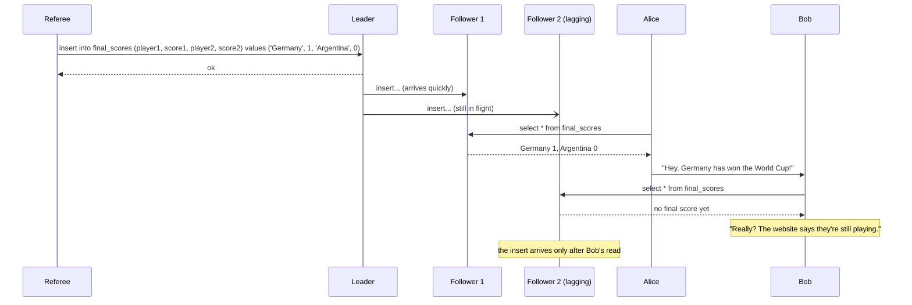

**The example (Figure 9-1).** Alice and Bob sit in the same room, both watching for the result of the 2014 FIFA World Cup final on their phones. Just after the result is published, Alice refreshes, sees the winner, and tells Bob. Bob refreshes too, but his request lands on a replica that is lagging, so his phone says the match is still being played.

If they had refreshed at *exactly* the same time, getting different answers would be less surprising — neither knows precisely when the server handled their request. But Bob *knows* he refreshed *after* hearing Alice, so he reasonably expects a result at least as fresh as hers. Getting an older answer is a **violation of linearizability**.

### What Makes a System Linearizable?

"Behave as if there is one copy" sounds simple, but pinning down exactly what it means takes care. The book works through timing diagrams.

**Setup.** Three clients read and write the same key `x`. Theory papers call `x` a **register**. In a real system it might be a single key (key-value store — a database that maps each key to a value, like a giant dictionary), a single row (relational table — SQL-style rows and columns) or a single document (document database — stores self-contained JSON-like records).

In the diagrams, each operation is a **bar**: the left end is when the client *sent* the request and the right end is when it *received* the response. Because network delays vary, the client doesn't know exactly when the database actually executed the request — only that it happened *somewhere between* sending and receiving.

> **Aside: the imaginary global clock.** These diagrams draw a horizontal time axis as if a perfect global clock existed. Real systems don't have one (Chapter 8), but for *analysing* an algorithm it is fine to pretend such a clock exists, as long as the algorithm itself cannot use it — the algorithm only sees the imperfect local clocks (quartz oscillator plus NTP — the Network Time Protocol that nudges clocks toward a time server).

Operation notation:

- `read(x) ⇒ v` — the client read register `x` and the database returned `v`.
- `write(x, v) ⇒ r` — the client asked to set `x` to `v`, and the database replied `r` (`ok` or `error`).

*Figure 9-2 (redrawn): client C writes x = 1 while A and B keep reading. A's first read ends before the write starts (0); A's last read starts after the write ended (1); the three reads that overlap the write may return either 0 or 1.*
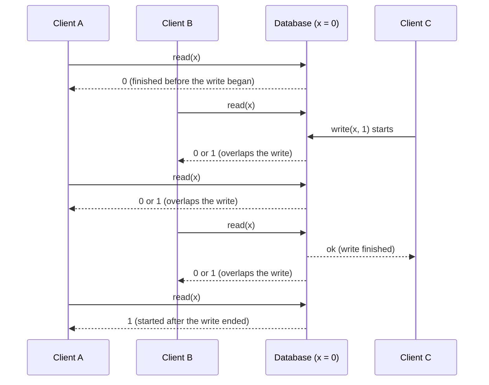

**Walking through Figure 9-2.** Initially `x = 0`. Client C writes `x = 1`, while clients A and B keep polling `x`:

1. A read that **finishes before the write starts** must return the old value, **0**.
2. A read that **starts after the write has finished** must give back **1**, assuming the database is linearizable. Reasoning: the write took effect somewhere inside its bar; the read took effect somewhere inside its bar; if the read's bar begins after the write's bar ends, the read necessarily happened after the write.
3. A read whose bar **overlaps** the write's bar may return **either 0 or 1**, because we can't tell whether the write had taken effect when the read was processed. Such reads are *concurrent* with the write.

**That's not enough yet.** If overlapping reads can return old *or* new, a reader could watch `x` flip 0 → 1 → 0 → 1 while the write is in progress. A true "single copy" would never do that.

> **Regular register.** If reads that overlap a write are allowed to give back either the previous or the new value, the register is called a *regular register*. It is weaker than a linearizable one.

*Figure 9-3 (redrawn): same clients as Figure 9-2, with the extra linearizability constraint. A's second read is the first to return 1; B's second read starts after that and so must also return 1, although C's write has not been acknowledged yet; all later reads return 1.*
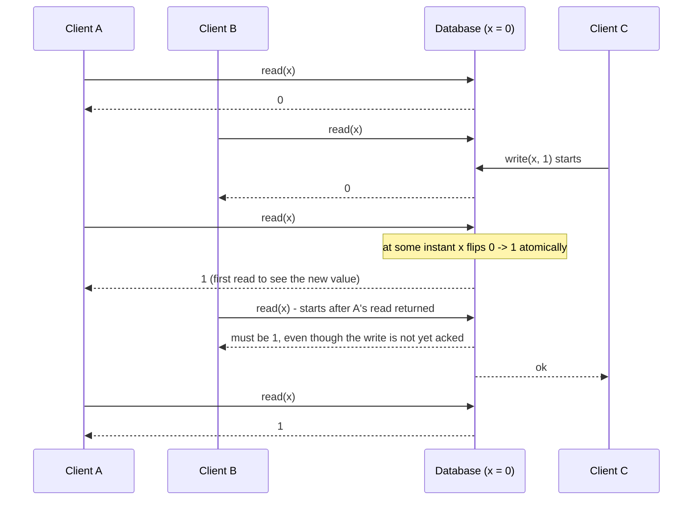

**The extra rule (Figure 9-3).** In a linearizable system we imagine an instant — somewhere inside the write's bar — at which `x` **flips atomically** from 0 to 1. Therefore:

> If any client's read has returned the new value, every read beginning *after that read completed* has to see the new value as well — even while the write itself is still unacknowledged.

In the figure, A is first to read 1. B's read starts strictly after A's read returned, so B must also see 1, though C's write is still in flight. This is exactly the Alice-and-Bob situation.

**Adding compare-and-set (Figure 9-4).** A third operation type:

- `cas(x, v_old, v_new) ⇒ r` — atomic compare-and-set: if `x` currently equals `v_old`, set it to `v_new`; if not, leave `x` unchanged and return an error. `r` is `ok` or `error`.

The book then marks, inside each bar, a vertical line at the instant the operation *appears* to have executed, and joins these markers in order. Two requirements:

1. The joined-up sequence must be a **valid sequential history** for a register: each read returns the value of the most recent write before it.
2. The line joining the markers must **always move forward in time** (left to right), never backwards.

Requirement 2 is what enforces recency: once a value has been written *or read*, all later reads see it until it is overwritten.

*Figure 9-4 (redrawn): the order in which the database appears to execute operations; B's last read violates linearizability*
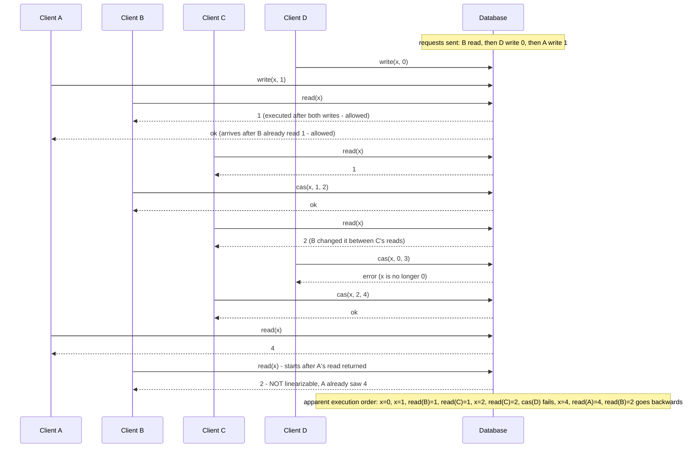

**Interesting details in Figure 9-4:**

- **Order of processing ≠ order of sending.** B sent a read first, then D sent `write(x, 0)`, then A sent `write(x, 1)`. Yet B's read returned 1. That's fine: the database handled D's write first, A's write second, and B's read last. Because the three requests were concurrent, any order is acceptable — perhaps B's request was delayed in the network.
- **A read can see a write before the writer hears "ok".** B read 1 *before* A got its `ok`. That's not reading a value before it exists — A's acknowledgment was merely delayed on its way back.
- **No transaction isolation is assumed.** Other clients may change the value at any time: C read 1 and later 2, because B changed it in between. A `cas` lets you check nobody else changed the value: B's and C's `cas` succeed, D's fails because `x` was no longer 0 when D's request was processed.
- **B's last read breaks linearizability.** It overlaps C's `cas` from 2 to 4, so on its own returning 2 would be fine. But A had already read 4 *before B's read began*, so B must not see anything older than 4. Same pattern as Alice and Bob.

**Testing for linearizability.** The formal definition is more precise than this intuition (the paper the book cites for it, in its reference list, is Herlihy and Wing's 1990 "Linearizability" paper). You *can* check whether a system behaved linearizably by recording the timing of every request and response and searching for a valid sequential order that fits — possible, but computationally expensive.

(Not from the book text — context: the book's reference for this is Kyle Kingsbury's write-up on his Knossos checker. In general such checkers have to search through the possible orderings of the recorded operations, which is why the check gets expensive as histories grow.)

> **Linearizability versus serializability** (a sidebar the book stresses). Both sound like "can be put in a sequential order", but they are very different guarantees:
>
> | | Serializability | Linearizability |
> |---|---|---|
> | Kind of guarantee | *Isolation* property of **transactions** | *Recency* guarantee on reads/writes of a **single register** |
> | Scope | Transactions that read/write **many** objects | One object at a time; no grouping into transactions |
> | Promise | Result equals *some* serial order of transactions — which may differ from the real order they ran in | Every operation appears to take effect at one instant between its start and end, respecting real time |
> | Prevents write skew (two transactions each read, then write different rows, together breaking a rule)? | Yes | No, not by itself (unless you add something like materialising conflicts — creating rows purely so they can be locked) |
>
> A database offering **both** is said to provide *strict serializability* (also called *strong one-copy serializability*, strong-1SR). Serializability implemented via **two-phase locking** (transactions take locks and hold them until they finish) or **actual serial execution** (literally running one transaction at a time on one thread) is typically linearizable too. **Serializable snapshot isolation (SSI) is not** (SSI lets transactions run on snapshots and aborts any whose reads turn out to be outdated at commit): it reads from a consistent snapshot on purpose (to avoid reader/writer lock contention), and a snapshot by definition excludes writes newer than itself.

### Relying on Linearizability

Seeing a football score a few seconds late causes no real harm. So when does linearizability actually *matter*? The book gives three areas.

#### Locking and leader election

A single-leader system must make sure there is really just **one** leader (no split brain). One way to elect a leader is with a **lock**: every node tries to acquire it at startup, and whoever succeeds becomes leader. However the lock is built, it **must be linearizable** — every node has to agree who holds it, or the lock is useless.

- **Coordination services** like **Apache ZooKeeper** and **etcd** are often used for distributed locks and leader election. Internally they use consensus algorithms to provide linearizable operations in a fault-tolerant way. (A **distributed lock** is a lock that machines, not just threads, compete for; **leader election** is choosing which node is in charge.)
- Getting locks and leader election right still has subtle traps — e.g. the *fencing* problem from Chapter 8 ("The leader and the lock"). Libraries such as **Apache Curator** (a Java helper library for ZooKeeper) add higher-level recipes on top of ZooKeeper.
- Still, a linearizable storage service is the foundation all of this is built on.

> **Footnote: ZooKeeper/etcd reads can be stale.** Strictly speaking these systems make *writes* linearizable, but by default a read may be served by any replica and therefore be stale. You can ask for a linearizable read: etcd calls it a **quorum read**; in ZooKeeper you call **`sync()`** before reading.

Locks can also be very fine-grained. **Oracle Real Application Clusters (RAC)** (Oracle's multi-server database product) takes out a separate lock for **each disk page** (a fixed-size block, often a few KB, that the database reads and writes as a unit); several database nodes share access to one disk storage system. Because these linearizable locks sit on the critical path (the steps that every transaction must wait for) of every transaction, RAC deployments usually have a **dedicated cluster interconnect network** (a separate fast network) just for traffic between database nodes.

#### Constraints and uniqueness guarantees

Typical uniqueness constraints: a username or email address identifies exactly one user; a file storage service cannot hold two files with the same path and name. If you want to enforce this **at write time** — so that when two people try to create the same name simultaneously, one gets an error — you need linearizability.

- This is really a lock: registering a username is like taking a "lock" on that name.
- It is also like a **compare-and-set**: set `username → user_id` only if the username is currently unclaimed.

Similar constraints: a bank balance must never go negative; you must not sell more items than are in stock; a flight seat or theatre seat must not be sold to two people at once. All of these need **one up-to-date value that every node agrees on** (the balance, the stock level, the seat's occupant).

In practice some such constraints can be treated *loosely* — an overbooked flight can move passengers and compensate them — and then linearizability may not be needed (Chapter 12, "Timeliness and Integrity"). But a **hard uniqueness constraint**, like those in relational databases, does require linearizability. Other constraints, such as **foreign keys** (a column that must refer to an existing row in another table) or **attribute constraints** (rules on one value, e.g. "age ≥ 0"), can be enforced *without* linearizability.

A small SQL illustration (own example):

```sql
CREATE TABLE accounts (
  handle  TEXT PRIMARY KEY,    -- hard uniqueness constraint
  user_id BIGINT NOT NULL
);

-- Two sign-ups race for the same handle:
INSERT INTO accounts VALUES ('river_otter', 101);  -- session 1
INSERT INTO accounts VALUES ('river_otter', 202);  -- session 2
-- Exactly one succeeds; the other gets a unique-violation error.
```

- `PRIMARY KEY` declares that `handle` must be unique.
- On a single node the database decides the winner locally. On a replicated system, deciding "who was first" *immediately* for every node is the job that needs linearizability (effectively a compare-and-set on the key).

#### Cross-channel timing dependencies

Notice in Figure 9-1 that Bob only *noticed* the stale result because Alice told him out loud. Without that, he'd have refreshed again later and seen the score. The violation was visible only because there was a **second communication channel** (Alice's voice) running alongside the database.

The same thing happens in software. Example: a website where users upload photos, and a background job (work done later, outside the user's request) makes smaller thumbnail versions.

*Figure 9-5 (redrawn): web server and image resizer communicate through two channels, file storage and a message queue, so the message can outrun the storage's replication.*
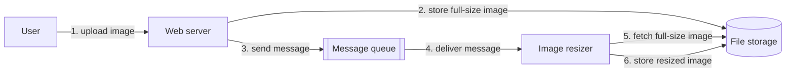

How it works:

1. The web server writes the full photo to the **file storage** service. (The photo isn't put on the queue itself, since brokers (the servers that run message queues) are designed around small messages, whereas a photo can be several megabytes.)
2. Once that write is done, the web server puts a small "please resize photo X" message on the **message queue** (a service that holds messages until a consumer picks them up; Chapter 11).
3. The resizer receives the message and fetches the photo from file storage.

**The race.** If the file storage is linearizable, all is well. If it isn't, the queue (steps 3–4) might be *faster than the storage service's internal replication*. At step 5 the resizer may then get a previous version of the image, or find nothing at all. If it resizes an old version, the full-size and thumbnail images become **permanently inconsistent**.

The root cause: two channels (storage and queue) between the same two components, and without linearizability's recency guarantee they can race. It's the Alice-and-Bob situation again (database replication vs. a spoken voice).

Linearizability is the *simplest* fix but not the only one. If you control the second channel (you control the queue; you don't control Alice's voice), you can use techniques similar to those for "read your own writes" in Chapter 5, at the price of extra complexity. (**Own illustration, not from the book:** the web server could put the stored photo's version number in the queue message; the resizer then checks that the copy it fetched is at least that version, and waits/retries if it is older. The book only says "techniques similar to read-your-own-writes" and gives no concrete mechanism.)

### Implementing Linearizable Systems

Since linearizability means "act as if there is one copy and operations are atomic", the most obvious implementation is to **literally keep one copy**. But then a single node failure loses the data, or at least makes it unavailable until the node returns. So we need replication — and the question becomes which replication methods from Chapter 5 *can* be linearizable:

| Replication method | Linearizable? | Why |
|---|---|---|
| **Single-leader** | *Potentially* | Reading from the leader (or from followers updated synchronously, i.e. the write waits until they confirm) can be linearizable. But not every single-leader database is (e.g. it uses snapshot isolation by design, or has concurrency bugs). It also relies on knowing for sure who the leader is: a node may wrongly believe it is still leader ("The Truth Is Defined by the Majority", Chapter 8), and a delusional leader serving requests will likely break linearizability. With asynchronous replication (the leader does not wait for followers to confirm), failover (switching to a new leader) can even lose committed writes, violating both durability and linearizability. |
| **Consensus algorithms** | *Yes* | Some resemble single-leader replication, but include safeguards against split brain and stale replicas, so they can implement linearizable storage safely. **ZooKeeper** and **etcd** work this way. |
| **Multi-leader** | *No* | Writes are processed concurrently on several nodes and replicated asynchronously, producing conflicting writes that need resolution — conflicts that exist precisely because there's no single copy. |
| **Leaderless (Dynamo-style, after Amazon's Dynamo design)** | *Probably not* | People sometimes claim quorum reads/writes (w + r > n) give "strong consistency", but this isn't quite true. **Last write wins** using time-of-day clock timestamps (as in **Cassandra**) is almost certainly non-linearizable, because clock skew means timestamps may not match the real order. **Sloppy quorums** (letting writes land on substitute nodes when the usual ones are unreachable) destroy any chance of linearizability. Even *strict* quorums can behave non-linearizably (next section). |

> **Footnote: sharding doesn't break it.** Splitting a single-leader database into partitions, each with its own leader, doesn't affect linearizability, because linearizability is a *single-object* guarantee. Transactions that span partitions are a different matter (covered later in the chapter).

#### Linearizability and quorums

It feels as if strict quorums in a Dynamo-style system should be linearizable. With variable network delays, they aren't.

*Figure 9-6 (redrawn): a non-linearizable execution despite a strict quorum (n = 3, w = 3, r = 2). The write reaches replica 3 early but replicas 1 and 2 late; reader A sees 1 via replica 3, then reader B, starting after A finished, reads replicas 1 and 2 and gets 0 from both.*
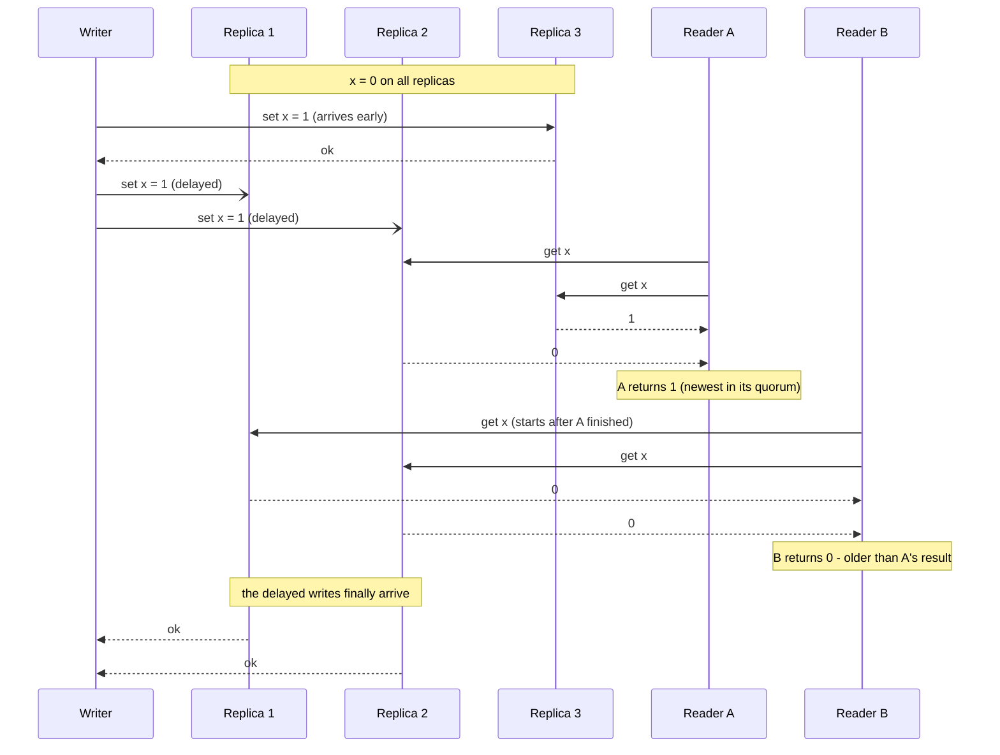

Step by step:

1. `x = 0` everywhere. A writer updates `x` to 1, sending the write to each of the three replicas (n = 3, w = 3).
2. While the write is in progress, reader A reads from two replicas (r = 2). One of them already has 1, so A sees the new value.
3. Also during the write, but *after A's read finished*, reader B reads from a different pair of replicas, both still holding 0, so B sees the old value.
4. The quorum condition w + r > n holds (3 + 2 > 3) — yet B started after A completed and got an *older* value. Not linearizable. Alice and Bob again.

**Can it be fixed?** Yes, at a performance cost:

- A **reader** must perform **read repair synchronously** (read repair = when a read spots an out-of-date replica, it writes the newer value back to it) — push the newest value to stale replicas — *before* returning its result.
- A **writer** must **read the latest state from a quorum** before sending its write.

What real systems do:

- **Riak** (an open-source Dynamo-style key-value database) does *not* do synchronous read repair, because of the performance penalty.
- **Cassandra** (a widely used Dynamo-style database) *does* wait for read repair on quorum reads, but still loses linearizability when several clients write the same key concurrently, because it uses last-write-wins conflict resolution.
- Even with these fixes, only linearizable **reads and writes** can be built this way. A linearizable **compare-and-set** cannot, because CAS requires a consensus algorithm.

**Bottom line:** it is safest to assume a leaderless Dynamo-style system is **not** linearizable.

### The Cost of Linearizability

Some replication methods can be linearizable and some can't. What do you give up by insisting on it?

Recall from Chapter 5 that **multi-leader replication** suits deployments spanning **multiple datacenters**.

*Figure 9-7 (redrawn): two datacenters, each with an application server and a database replica; the replication connection between the databases is cut by a network partition, while clients can still reach their local datacenter.*
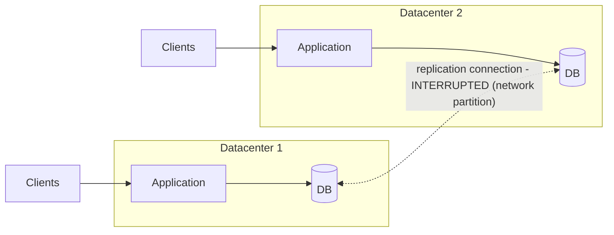

Suppose the link *between* the two datacenters breaks, but inside each datacenter the network is fine and clients can still reach their local datacenter.

- **Multi-leader:** each datacenter keeps working normally. Writes are replicated asynchronously anyway, so they just queue up and are exchanged when the link returns.
- **Single-leader:** the leader lives in one datacenter. All writes and all linearizable reads must go to it, so clients attached to the *follower* datacenter must send those requests over the inter-datacenter link. When the link breaks, those clients **cannot write and cannot do linearizable reads**. They can still read from the local follower, but those reads may be stale. If the application needs linearizable reads and writes, it is **unavailable** in any datacenter cut off from the leader. Clients that can reach the leader's datacenter directly are fine; the others suffer an outage until the link is repaired.

#### The CAP theorem

This isn't a quirk of single- vs. multi-leader: **any linearizable database** has this problem, whatever its implementation. And it isn't specific to multiple datacenters — it can happen on any unreliable network, even inside one datacenter. The trade-off:

- **If you require linearizability** and some replicas are cut off from the others by a network problem, then those replicas **can't process requests** while disconnected — they must wait for the network to heal or return an error. Either way they are *unavailable*.
- **If you don't require linearizability**, you can design the system so each replica handles requests on its own even when disconnected (e.g. multi-leader). It stays *available* during the network problem, but its behaviour isn't linearizable.

> **Footnote: CP and AP.** People sometimes call the first choice **CP** (stays consistent, gives up availability during a network partition) and the second **AP** (stays available, gives up consistency during a partition). The book says this classification has several flaws and is best avoided.

So applications that don't need linearizability tolerate network problems better. This is popularly known as the **CAP theorem**, named by **Eric Brewer in 2000** — although distributed database designers had known the trade-off **since the 1970s**.

**History.** CAP was first offered as a *rule of thumb*, deliberately without precise definitions, to start a conversation about database trade-offs. At the time many distributed databases aimed at linearizability on clusters with **shared storage** (all servers attached to one common disk system) (the reference the book cites here is an Oracle RAC book). CAP nudged engineers to explore **shared-nothing** designs (each machine has its own CPU, memory and disk and talks only over the network) better suited to large web services, and deserves credit for that culture shift — witness the wave of new databases from the mid-2000s known as **NoSQL** (non-relational databases such as key-value, document and wide-column stores).

> **The unhelpful CAP theorem** (sidebar). CAP is often stated as "Consistency, Availability, Partition tolerance — pick 2 of 3". That phrasing misleads, because a network partition is a *fault*, not an option you choose: you'll get partitions regardless of your preferences. When the network works, a system can be both linearizable and fully available. Only *when a fault occurs* must you pick one. A better phrasing is **"either Consistent or Available when Partitioned"**. A more reliable network just forces this choice less often. On top of that, discussions of CAP use several contradictory definitions of "availability", and the formal theorem's definition doesn't match everyday usage; many systems called "highly available" don't meet CAP's peculiar definition. Given all this confusion, the book recommends avoiding CAP altogether.

**Why CAP is of limited practical value.** As formally defined it is very narrow (the formal proof the book cites, from its reference list, is Gilbert and Lynch's 2002 paper):

- it considers **one consistency model** — linearizability;
- and **one kind of fault** — network partitions (nodes alive but unable to talk to each other).

It is silent about network delays, crashed nodes and every other trade-off. So despite its historical influence it offers little help in designing real systems. There are many other impossibility results in distributed computing, and CAP has been **superseded by more precise results**; today it is mostly of historical interest.

> **Footnote: two meanings of "partition".** This book uses *partitioning* to mean deliberately splitting a big dataset into shards (Chapter 6). A *network partition* is a type of network fault. The book normally doesn't single it out from other faults, but since it's the "P" in CAP, the clash of terms can't be avoided here.

#### Linearizability and network delays

Surprisingly few systems are linearizable in practice. Even the **RAM (main memory) in a modern multi-core CPU (a processor chip with several independent cores) isn't linearizable**: if one core writes to a memory address and another core reads that address shortly afterward, the reader is **not guaranteed** to see the new value — unless a **memory barrier (fence)** is used.

Why? Every CPU core keeps a private memory **cache** (a small, very fast copy of recently used memory) plus a **store buffer** (a queue of pending writes not yet sent to memory) (general background, not the book's wording: keeping these copies in sync is the job of *cache coherence*). Memory accesses hit the cache first, and changes reach main memory asynchronously. Cache access is much faster than main memory, so this is essential for performance — but it creates several copies of the data (main memory plus caches) updated asynchronously, so linearizability is lost.

Crucially, it makes no sense to justify this with CAP: inside one computer we assume communication is reliable, and we don't expect a core to keep running normally if disconnected from the rest of the machine. **The reason for dropping linearizability here is performance, not fault tolerance.**

Likewise, many distributed databases that forgo linearizability do so chiefly for **speed**, not so much for fault tolerance. **Linearizability is slow — all the time, not just during a network fault.**

Could a cleverer algorithm make it fast? Apparently not. **Attiya and Welch** proved that for linearizability, the **latency (time taken) of reads and writes can be no smaller than something proportional to how uncertain network delays are**. On networks with highly variable delays (most real networks, Chapter 8) linearizable operations will inevitably be slow. No quicker linearizable algorithm exists, whereas weaker models can run far faster — which is why this trade-off matters for latency-sensitive systems. Chapter 12 discusses ways to avoid linearizability without sacrificing correctness.

## Ordering Guarantees

A linearizable register acts like a single copy where each operation takes effect at one instant. That automatically means operations happen in **some well-defined order** — the order we drew by joining the markers in Figure 9-4.

Ordering keeps coming up throughout the book, which hints that it is a fundamental idea. Recap of where it has appeared:

- **Chapter 5 (replication):** in single-leader replication, the leader's main job is fixing the **sequence of writes** in the replication log (the ordered list of changes the leader sends to followers), i.e. the sequence followers apply them in. Without a single leader, concurrent operations can conflict.
- **Chapter 7 (serializability):** transactions must behave *as if* executed in some sequential order — either literally running them one at a time, or running them concurrently while preventing serialization conflicts (with locks or aborts).
- **Chapter 8 (clocks):** timestamps and clocks are another attempt to impose order on a messy world, e.g. deciding which of two writes came later.

Ordering, linearizability and consensus turn out to be **deeply connected**. This part is more abstract than most of the book, but it clarifies what systems can and cannot do.

### Ordering and Causality

One big reason ordering matters is that it **preserves causality** — the idea that causes come before effects. The book lists earlier examples where causality mattered:

- **Consistent prefix reads (Chapter 5, Figure 5-5):** an observer of a conversation saw the *answer* before the *question*. That breaks our sense of cause and effect: whoever answered must have seen the question first (unless psychic). There is a **causal dependency** between question and answer.
- **Multi-leader replication among three leaders (Figure 5-9):** some writes "overtook" others because of network delays, so a replica could see an *update* to a row that didn't yet exist. Causality: a row must be created before it can be updated.
- **Detecting concurrent writes (Chapter 5):** given operations A and B, exactly one of three things holds — A happened before B, B happened before A, or they are concurrent. This **happens-before** relation *is* causality: if A happened before B, B might have known about A, built on A, or depended on A. If they are concurrent, neither knew about the other.
- **Snapshot isolation (Chapter 7):** a transaction reads from a "consistent snapshot". *Consistent* here means **respecting causality**: a snapshot that includes an answer has to include the question it answers. Viewing the whole database at a single point in time guarantees this — everything that causally came before that point is visible, nothing that came after is. **Read skew** (non-repeatable reads — seeing parts of the database at different points in time, Figure 7-6) is precisely reading a state that violates causality.
- **Write skew (Chapter 7, Figure 7-8, the doctors-on-call example):** Alice left the on-call rota because her transaction thought Bob was covering, and Bob did the same thinking Alice was. Going off call was *causally dependent* on observing who was on call. **Serializable snapshot isolation (SSI)** detects write skew by tracking causal dependencies between transactions.
- **Alice and Bob's football score (Figure 9-1):** Bob getting a stale result *after hearing Alice* is a **causality violation** — Alice's exclamation depended on the score being announced, so after hearing her, Bob should be able to see the score too. The image-resizing example (cross-channel timing dependencies) is the same pattern in disguise.

**Causal order.** Causality orders events: cause before effect; a message is sent before it is received; a question precedes its answer. And chains form: one node reads data and writes something as a result; another node reads *that* and writes something else; and so on. These chains of dependent operations define the **causal order** of the system — what happened before what.

A system that obeys this ordering is **causally consistent**. Example: **snapshot isolation provides causal consistency** — if you read some data, you can also see all data that causally precedes it (unless it has since been deleted).

#### The causal order is not a total order

Two kinds of order:

- A **total order** lets you compare *any* two elements. Natural numbers are totally ordered: given 5 and 13, you can always say 13 is bigger.
- A **partial order** lets you compare *some* pairs but not others. Mathematical sets are the example: is {a, b} bigger than {b, c}? Neither contains the other, so they are **incomparable**. One set is "greater" only when it contains all the elements of the other.

This difference maps onto consistency models:

| | Linearizability | Causality |
|---|---|---|
| Kind of order | **Total** order of operations | **Partial** order |
| Why | Single copy + atomic operations ⇒ for any two operations you can say which came first (the timeline in Figure 9-4) | Two operations are ordered if one happened before the other; if they are **concurrent** they are **incomparable** |
| Concurrency? | None — everything lies on one timeline | Yes — the timeline branches and merges |

So by this definition, **a linearizable datastore has no concurrent operations**: there is one timeline along which every operation is totally ordered. Many requests may be *waiting*, but the datastore handles each one atomically at a single instant, on a single copy, on a single timeline.

Concurrency means the timeline **branches and merges**, and operations on different branches can't be compared. Chapter 5's Figure 5-14 showed this: not a straight line but a tangle of concurrent operations, with arrows showing causal dependencies — the partial order.

> **Git analogy.** Version history in a distributed version control system (a tool that records every change to a set of files, with a full copy on each developer's machine) like **Git** looks just like a causal dependency graph. Commits often follow each other in a straight line, but when several people work at once the history **branches**, and **merge** commits join those concurrent lines back together.

#### Linearizability is stronger than causal consistency

**Linearizability implies causality**: any linearizable system preserves causality correctly. In particular, when a system has several communication channels (like the message queue and file storage of Figure 9-5), linearizability makes causality hold automatically, with no extra machinery such as passing timestamps between components.

That is what makes linearizable systems easy to reason about and attractive. But, as shown in "The Cost of Linearizability", it hurts performance and availability, especially with large network delays (e.g. geographically distributed systems). That's why some distributed systems have dropped linearizability — gaining performance but becoming harder to work with.

**The middle ground.** Linearizability isn't the only way to preserve causality. A system can be **causally consistent without paying linearizability's performance price** — and **CAP does not apply** to it. In fact, **no consistency model stronger than causal consistency can avoid being slowed by network delays while staying available through network failures.**

In many cases, systems that *seem* to need linearizability really only need causal consistency, which is cheaper to implement. Researchers are designing new causality-preserving databases whose performance and availability resemble those of eventually consistent systems. This research is recent, not much has reached production yet, and challenges remain — but it is a promising direction.

#### Capturing causal dependencies

The book only sketches the key ideas of how a non-linearizable system keeps causal consistency:

1. **You must know what happened before what.** This is a partial order: concurrent operations can be processed in any order, but if one happened before another, every replica must process them in that order.
2. **Wait for predecessors.** Before a replica applies an operation, every operation that causally precedes it must already have been applied. If one is missing, the later operation waits.
3. **Track each node's "knowledge".** If a node had seen value X at the time it issued write Y, then Y might depend causally on X. The book likens this to questions in a fraud trial: *did the CEO know about X when making decision Y?*
4. **Use generalised version vectors.** The techniques resemble "Detecting Concurrent Writes" in Chapter 5, which found concurrent writes to a *single key* in a leaderless store to avoid lost updates. Causal consistency needs more: tracking dependencies **across the whole database**. **Version vectors** can be generalised to do this.
5. **Know which version the application read.** That's why, in Chapter 5's Figure 5-13, the version number from the previous read is passed back to the database with each write. SSI uses a similar idea: at commit time the database checks whether the data the transaction read is still up to date, which requires tracking which data each transaction read.

### Sequence Number Ordering

**The problem with tracking causality exactly.** Causality is a great concept, but tracking *every* causal dependency is often impractical. Applications typically read lots of data before writing, and it's unclear whether the write depends on all of those reads or just some. Recording every read would be a large overhead.

**A better way: sequence numbers or timestamps.** Give each operation a number that orders it. This number need not come from a physical **time-of-day clock** (which has many problems, Chapter 8). It can come from a **logical clock** — an algorithm that generates a sequence of numbers identifying operations, usually counters incremented on every operation.

Properties of such numbers:

- **Compact** — just a few bytes.
- **Totally ordered** — every operation gets a unique number, and any two can be compared to see which is later.

We specifically want a total order **consistent with causality**: if A causally happened before B, A gets a *lower* number than B. Concurrent operations can be ordered arbitrarily. Such an order captures all causal information but also imposes *more* ordering than causality strictly needs.

> **Footnote: a total order that ignores causality is easy but useless.** For instance, give each operation a random UUID (a 128-bit randomly generated ID that is practically guaranteed to be unique) and sort UUIDs alphabetically. It's a valid total order, but tells you nothing about what actually happened first or what was concurrent.

**Single-leader case.** The replication log of a single-leader database already defines a total order of writes consistent with causality. The leader just increments a counter per operation, giving each a **monotonically increasing** sequence number. A follower applying writes in log order is always **causally consistent** — even while lagging behind.

#### Noncausal sequence number generators

Without a single leader (multi-leader or leaderless replication, or a partitioned database), how do you generate sequence numbers? Three methods seen in practice:

1. **Per-node independent sequences.** E.g. with two nodes, one hands out **odd** numbers only and the other **even** numbers only. More generally, reserve some bits of the number for a **unique node ID** so two nodes can never produce the same number.
2. **Physical-clock timestamps.** Attach a time-of-day timestamp to each operation. Not sequential, but with high enough resolution they may totally order operations. The **last write wins** conflict resolution method relies on this.
3. **Pre-allocated blocks.** Node A claims numbers **1 to 1,000**, node B claims **1,001 to 2,000**. Each hands out numbers from its own block independently and grabs a new block when running low.

All three **perform and scale better** than routing every operation through one leader's counter, and they give each operation a unique, roughly increasing number. But they share a flaw: **the numbers are not consistent with causality**, because they don't capture ordering *across* nodes:

| Method | Why causality breaks |
|---|---|
| Odd/even (per-node) | Nodes process different numbers of operations per second, so the even counter may lag the odd one (or vice versa). Given an odd- and an even-numbered operation, you can't tell which really came first. |
| Physical timestamps | **Clock skew** (two machines' clocks disagreeing) can give a causally later operation a *lower* timestamp (Chapter 8, Figure 8-3). |
| Block allocator | A causally later operation might get a number from 1–1,000 while the earlier one got a number from 1,001–2,000. |

> **Footnote: Spanner's exception.** Physical timestamps *can* be made causally consistent: **Google's Spanner** estimates how far clocks may be skewed and **deliberately waits for that uncertainty interval to pass** before a write commits, ensuring a causally later transaction gets a larger timestamp (Chapter 8, "Synchronized clocks for global snapshots"). But most clocks can't provide the uncertainty metric this needs.

#### Lamport timestamps

There *is* a simple way to generate sequence numbers consistent with causality: the **Lamport timestamp**, proposed by **Leslie Lamport in 1978**, in a paper that has become among the most frequently cited in the distributed systems field.

**How it works:**

1. Every node has a **unique ID**, and keeps a **counter** of operations it has processed.
2. A Lamport timestamp is the pair **(counter, node ID)**. Two nodes may share a counter value, but adding the node ID makes every timestamp unique.
3. **Comparing** two timestamps: the larger counter wins; if counters tie, the larger node ID wins. This gives a **total order**. It has nothing to do with physical time.
4. **The key trick:** every node *and every client* tracks the **largest counter value it has come across** and attaches it to each request. Whenever a node gets a request or response whose attached maximum exceeds its own counter, it **immediately raises its counter to that maximum**.

Steps 1–3 alone would be no better than the odd/even scheme. Step 4 is what makes Lamport timestamps causally consistent: as long as the maximum travels with every operation, **every causal dependency leads to a larger timestamp**.

*Figure 9-8 (redrawn): Lamport timestamps (counter, node ID). Each client sends the maximum counter it has seen; a node first raises its counter to that maximum, then increments it. The result is a total order consistent with causality.*
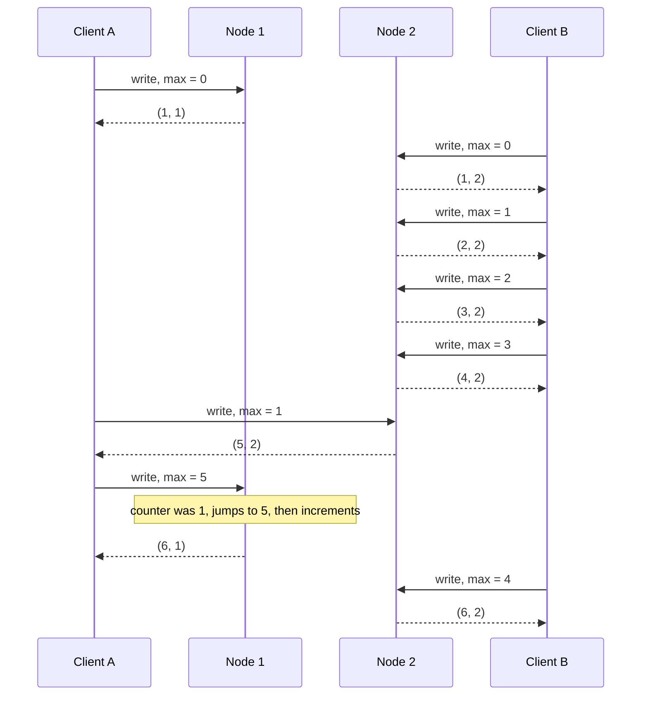

In the book's figure, node 2 hands client A a counter of **5**; A then passes 5 along to node 1. Node 1 had only reached **1**, yet it leaps to 5 at once, so the operation it stamps next gets **6**.

Own-code illustration of the rule:

```python
class LamportNode:
    def __init__(self, node_id):
        self.node_id = node_id
        self.counter = 0

    def handle(self, request_max_seen):
        # 1. catch up to anything the caller has already seen
        self.counter = max(self.counter, request_max_seen)
        # 2. this operation gets the next value
        self.counter += 1
        # 3. timestamp = (counter, node_id); caller remembers counter as its new max
        return (self.counter, self.node_id)

n1, n2 = LamportNode(1), LamportNode(2)
print(n1.handle(0))   # (1, 1)
n2.counter = 4        # pretend node 2 has already handled 4 operations (as in the diagram)
print(n2.handle(1))   # (5, 2)  client A only knew max 1; node 2's own counter wins
print(n1.handle(5))   # (6, 1)  A passes max 5; node 1 jumps from 1 to 5, then +1
```

- `max(...)` is the catch-up step: a node never issues a number lower than something its caller already knows about.
- `+= 1` gives the new operation a fresh value.
- Tuples compare counter first, then node ID — exactly the Lamport ordering rule.

**Lamport timestamps vs. version vectors** (commonly confused):

| | Version vectors | Lamport timestamps |
|---|---|---|
| Purpose | Tell whether two operations are **concurrent** or one **depends** on the other | Always impose a **total order** |
| Can detect concurrency? | Yes | **No** — from the total order you can't tell concurrent from causally dependent |
| Size | One counter per node | **More compact** — a single pair |

#### Timestamp ordering is not sufficient

Lamport timestamps give a total order consistent with causality — but that still isn't enough for many common problems.

**Example: unique usernames.** If two users try to create accounts with the same username at the same time, exactly one should succeed.

*Tempting idea:* totally order all operations with Lamport timestamps, and if two accounts claim the same name, the one with the lower timestamp wins and the other fails. Since timestamps always compare, this seems fine.

*Why it fails:* it works only **after the fact**, once you've collected every username-creation operation in the system. But a node that just received a sign-up request must decide **right now** whether to accept it. At that moment it doesn't know whether another node is concurrently creating the same name, nor what timestamp that node will assign.

To be sure no other node is creating the same name with a lower timestamp, the node would have to **ask every other node**. If any node has failed or is unreachable, the whole system **grinds to a halt** — not fault-tolerant at all.

**The underlying issue:** a total order of operations only *emerges* once you've gathered all operations. Operations you don't yet know about might need to be slotted in at various places in the order.

**Conclusion:** to implement something like a uniqueness constraint, a total order isn't enough — you also need to know **when the order is finalised**. Once you are certain nobody can slip a claim to the same username in *before* yours, declaring success is safe. This idea — knowing when the total order is final — is what **total order broadcast** provides.

### Total Order Broadcast

On a single CPU core, the total order is just the order the CPU ran the operations. Across many machines, making **every node agree on one total order** is difficult. Timestamps/sequence numbers turned out weaker than single-leader replication (using timestamp ordering for uniqueness can't tolerate any faults).

Single-leader replication gets a total order by picking one node as leader and sequencing everything on **one CPU core** of that node. The hard questions are:

- how to **scale** when throughput (operations per second) exceeds what one leader can handle, and
- how to **fail over** when the leader dies.

In the literature this problem is called **total order broadcast** or **atomic broadcast**.

> **Footnote on naming.** "Atomic broadcast" is the traditional name but confusing: it is unrelated to the A in ACID (Atomicity, Consistency, Isolation, Durability — the classic transaction guarantees), and only loosely connected to atomic operations in multithreaded code or to atomic (linearizable) registers. **Total order multicast** is another synonym.

> **Scope of ordering guarantee** (sidebar). Partitioned databases with one leader per partition often keep order **only within each partition**, so they can't provide consistency guarantees (such as consistent snapshots or foreign-key references) **across** partitions. A total order spanning every partition can be achieved, but only with additional coordination.

**Definition.** Total order broadcast is normally framed as a protocol for passing messages between nodes, with two **safety** properties that must always hold:

1. **Reliable delivery** — no messages are lost: if any node gets a message, every node gets it.
2. **Totally ordered delivery** — every node receives messages in the **same order**.

A correct algorithm must keep both properties even when nodes or the network are faulty. Of course nothing is delivered while the network is down, but the algorithm keeps retrying so that messages get through once it is repaired — still in the correct order.

#### Using total order broadcast

- **ZooKeeper and etcd implement total order broadcast** — a clue that it is closely tied to consensus.
- **Database replication:** if every message is a write, and all replicas apply an identical sequence of writes, the replicas stay in step (apart from temporary lag). This is **state machine replication** (revisited in Chapter 11).
- **Serializable transactions:** as in "Actual Serial Execution" (Chapter 7), if each message is a **deterministic transaction run as a stored procedure** (code stored and executed inside the database itself), and every node processes the messages in the same order, all partitions and replicas stay consistent.
- **Order is fixed at delivery time.** A node may **not retroactively insert** a message earlier in the order once later messages have been delivered. *This is exactly why it is stronger than ordering by timestamps.*
- **It's a log.** Think of total order broadcast as building a **log** — the same idea as a replication log, a transaction log, or a write-ahead log (a file where changes are recorded *before* being applied, so they can be replayed after a crash) — where delivering a message means appending it. Since every node gets identical messages in identical order, every node reads an identical sequence.
- **Lock service with fencing tokens.** Every lock-acquire request is appended to the log; messages are numbered sequentially in log order; that sequence number, being monotonically increasing, serves as a **fencing token** (Chapter 8). In ZooKeeper this number is the **zxid**.

#### Implementing linearizable storage using total order broadcast

Linearizability has a total order of operations (Figure 9-4). Is it the same thing as total order broadcast? **Not quite, but they are closely linked.**

- Total order broadcast is **asynchronous**: messages are delivered reliably in a fixed order, but there's **no promise about *when***, so one node may lag behind the others.
- Linearizability promises **recency**: any read sees the most recent write.

> **Footnote: formal relationship.** In formal terms, a plain linearizable read-write register is the *easier* problem. Total order broadcast is equivalent to consensus, and consensus **can't be solved deterministically in the asynchronous crash-stop model** (no timing guarantees; crashed nodes never return) — yet a linearizable read-write register *is* achievable in that same model. But once the register supports atomic operations like **compare-and-set** or **increment-and-get**, it becomes equivalent to consensus. So consensus and linearizable registers are closely related.

**Building linearizable CAS on top of total order broadcast — the username example.**
Imagine each possible username has a linearizable register with an atomic CAS, initially `null` (name not taken). To claim a name, run CAS on its register: set it to the user's account ID **only if it is currently `null`**. If several users race, only one CAS succeeds; the rest see a non-null value.

Implementing that CAS with total order broadcast used as an **append-only log**:

1. **Append** a message to the log that provisionally names the username you are after.
2. **Read** the log and **wait until your own message is delivered back** to you.
3. **Look at all messages claiming that username.** If the **first** such message is yours, you've won: commit the claim (maybe by appending another message) and acknowledge the client. If the first one is someone else's, **abort**.

Because every node sees log entries in the same order, when there are concurrent writes all nodes agree which came first. Choosing the first conflicting write as winner and aborting the rest means all nodes agree whether each write committed or aborted. A log can support **serializable multi-object transactions** in a similar way.

> **Footnote: why you must wait in step 2.** If you acknowledge the write as soon as it's queued, without waiting for it to come back, you get something like the memory model (the rules for when one core sees another's writes) of **multi-core x86 processors** (the Intel/AMD chip family in most PCs and servers) — which is **neither linearizable nor sequentially consistent**.

Own pseudocode:

```python
def claim_username(log, name, account_id):
    my_msg = log.append({"claim": name, "by": account_id})   # step 1
    log.wait_until_delivered(my_msg)                          # step 2
    first = next(m for m in log.read_all()                    # step 3
                 if m.get("claim") == name)
    if first is my_msg:
        log.append({"commit": name, "by": account_id})
        return "ok"
    return "error: name taken"
```

- `append` puts the request into the single agreed order.
- `wait_until_delivered` ensures we've seen everything that was ordered before our own message.
- Picking the *first* claim is deterministic, so every node reaches the same verdict.

**Reads are still a problem.** This procedure makes **writes** linearizable but not reads: reading from a store that is updated asynchronously from the log may return stale data. Precisely, the procedure gives **sequential consistency** (also called **timeline consistency**), slightly weaker than linearizability. Three ways to make reads linearizable:

| Option | How | Real system example |
|---|---|---|
| Sequence reads through the log | Append a message, read the log, do the actual read when your message comes back. The message's log position defines when the read happened. | **etcd quorum reads** work somewhat like this |
| Fetch the latest log position | If the log lets you fetch the latest position linearizably, get it, wait until everything up to it has been delivered to you, then read. | Idea behind **ZooKeeper's `sync()`** |
| Read from a synchronously updated replica | Read from a replica that is updated synchronously on writes, so it must be current. | **Chain replication** |

#### Implementing total order broadcast using linearizable storage

Now the reverse: given linearizable storage, build total order broadcast.

**Algorithm.** Suppose you have a linearizable integer register supporting atomic **increment-and-get** (an atomic compare-and-set would also work).

1. For every message to broadcast, **increment-and-get** the register.
2. Attach the returned value to the message as its **sequence number**.
3. **Send** it to every node, retransmitting whatever gets lost.
4. Recipients **deliver messages consecutively by sequence number**.

**Key difference from Lamport timestamps: no gaps.** Numbers from a linearizable counter form a sequence **without gaps**. So if a node has delivered message 4 and receives message 6, it knows it must **wait for message 5** before delivering 6. With Lamport timestamps you can't know whether a gap is real — and *that gap-awareness is precisely what separates total order broadcast from timestamp ordering.*

```python
def broadcast(counter, nodes, payload):
    seq = counter.increment_and_get()          # linearizable, gap-free
    for n in nodes:
        n.send_with_retry(seq, payload)

class Receiver:
    def __init__(self): self.next_seq, self.buffer = 1, {}
    def on_message(self, seq, payload):
        self.buffer[seq] = payload
        while self.next_seq in self.buffer:     # deliver strictly in order
            deliver(self.buffer.pop(self.next_seq))
            self.next_seq += 1                  # a gap means "wait"
```

- The receiver holds message 6 in `buffer` until 5 arrives, because it *knows* 5 must exist.

**How hard is a linearizable increment-and-get?** Trivial if nothing ever fails — just hold the number in a variable on a single machine. The difficulty is coping when the network to that node breaks and **recovering the value when the node fails**. Think the problem of linearizable sequence-number generation through carefully and you **always arrive at a consensus algorithm**.

That's no accident: there is a proof that **consensus, total order broadcast, and a linearizable register offering compare-and-set (or increment-and-get) are all equivalent**. A solution to any one of them can be converted into a solution to the others — a profound and surprising result. Time to tackle consensus directly.

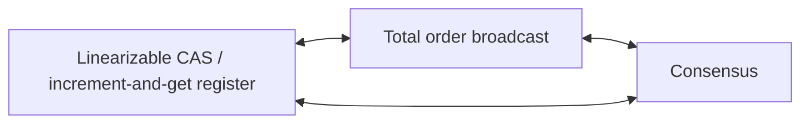
*(Diagram, not a book figure: the three problems proven equivalent.)*

## Distributed Transactions and Consensus

**What consensus is.** Informally: get several nodes to **agree on something**. It sounds easy, and many broken systems were built by people who assumed it was. It ranks among the most fundamental and important problems in the field.

The book deliberately puts consensus late, because its subtleties only make sense after replication (Ch. 5), transactions (Ch. 7), system models (Ch. 8), plus this chapter's linearizability and total order broadcast. Even researchers took **decades** to fully understand it, with many misunderstandings along the way.

**Where nodes need to agree:**

- **Leader election.** In single-leader replication, all nodes must agree who the leader is. A network fault can make leadership contested (some nodes can't talk to others). Consensus prevents a bad failover leading to **split brain**, where two leaders both accept writes, their data diverges, and you get inconsistency and data loss.
- **Atomic commit.** In a database with transactions spanning several nodes or partitions, a transaction might succeed on some nodes and fail on others. To keep ACID atomicity, all nodes must agree on the outcome: **all abort/roll back** if anything went wrong, or **all commit** if nothing did. This is the **atomic commit problem**.

> **Footnote: atomic commit vs. consensus.** They're formalised a little differently. Atomic commit may commit **only when all participants vote to commit**, and is obliged to abort if even one participant needs to. Consensus may decide **any value proposed by one of the participants**. Still, the two are **reducible to each other**. *Nonblocking* atomic commit is a harder problem than consensus (see three-phase commit below).

> **The Impossibility of Consensus** (sidebar). The **FLP result** — after **Fischer, Lynch and Paterson** — proves that **when any node might crash, no algorithm is guaranteed to always reach consensus**. Since nodes can always crash, is consensus impossible? The catch: FLP is proved in the **asynchronous system model** (Chapter 8), a very restrictive model where the algorithm is **deterministic and can't use clocks or timeouts**. Allow the algorithm **timeouts**, or any other means of *suspecting* that a node has crashed (even a means that is occasionally mistaken), and consensus becomes solvable. Even just letting the algorithm use **random numbers** is enough to escape the impossibility. So FLP matters a lot in theory, but in practice distributed systems can usually reach consensus.

**Plan for this section:** first the atomic commit problem and the **two-phase commit (2PC)** algorithm — the most common solution, implemented in many databases, messaging systems and application servers. 2PC turns out to be *a consensus algorithm of sorts — just a rather poor one*. Learning from its weaknesses leads to better algorithms such as those in **ZooKeeper (Zab)** and **etcd (Raft)**.

### Atomic Commit and Two-Phase Commit (2PC)

Recap from Chapter 7: atomicity gives simple semantics when something fails halfway through a set of writes. A transaction either **commits** (all its writes become durable) or **aborts** (all its writes are rolled back — undone or discarded).

Atomicity stops failed transactions leaving half-finished results and half-updated state lying around. It is particularly important for **multi-object transactions** and for databases with **secondary indexes** (extra lookup structures that let you find rows by a column other than the primary key): every secondary index is its own data structure, separate from the main data, so a data change must be mirrored in the index. Atomicity keeps the index **consistent with the primary data** (an inconsistent index would be of little use).

#### From single-node to distributed atomic commit

**On one node**, atomicity is usually handled by the storage engine (the part of a database that actually stores and retrieves data on disk):

1. The client asks the node to commit.
2. The node first makes the transaction's writes durable (usually via a **write-ahead log**).
3. Next it adds a **commit record** to that on-disk log.
4. If it crashes midway, recovery on restart reads the log: if the commit record reached disk before the crash, the transaction **counts as committed**; otherwise its writes are **rolled back**.

So single-node commit depends on the **order of durable writes: data first, then the commit record**. The decisive instant is when the **commit record has been fully written to disk**: up to then, a crash means abort; after that, the transaction is committed even if the database crashes. Atomicity is ultimately provided by **one device** — the controller of one disk drive on one node.

**On several nodes** — e.g. a transaction touching several objects in a sharded database, or a secondary index that is **term-partitioned** (the index is split by the indexed value, so an entry may live on a different node) whose entry sits on another node than the primary data — things are harder. Most "NoSQL" distributed datastores **don't support** such distributed transactions, but various clustered relational systems do.

Just sending "commit" to every node and letting each commit independently is **not enough**; commit could succeed on some nodes and fail on others:

- some nodes detect a **constraint violation or conflict** and must abort while others commit fine;
- some commit requests are **lost in the network** and time out (abort) while others arrive;
- some nodes **crash** before writing the commit record and roll back on recovery, while others commit.

Then the nodes become inconsistent with each other (like Figure 7-3). And a commit, once made on one node, **can't be retracted** if another node later aborts. Therefore **a node may commit only once it is sure all other nodes in the transaction will also commit.**

**Why commits must be irrevocable.** Once committed, data is **visible to other transactions**, and other clients may start relying on it — the foundation of **read committed** isolation (you only ever see data that has been committed). If a committed transaction could later be aborted, every transaction that read its data would be built on data that "never existed" and would need reverting too.

> **Compensating transactions.** The *effects* of a committed transaction can later be undone by another, **compensating transaction**. But to the database that's a separate transaction, so any correctness requirements spanning the two are the **application's** problem.

#### Introduction to two-phase commit

**Two-phase commit (2PC)** achieves atomic commit across multiple nodes: either all commit or all abort. It's a classic algorithm in distributed databases. It's used **internally** by some databases and also exposed to applications as **XA transactions** (supported, for example, by the **Java Transaction API**) or through **WS-AtomicTransaction** in the world of **SOAP** web services (an older XML-based standard for services calling each other over a network).

Rather than one commit request, commit/abort happens in **two phases**, which is where the name comes from.

*Figure 9-9 (redrawn): a successful two-phase commit. Data is written on both databases, then phase 1 asks each to prepare (both vote yes) and phase 2 tells each to commit. Each database holds the transaction's locks from its write until its commit (the book's shaded bars).*
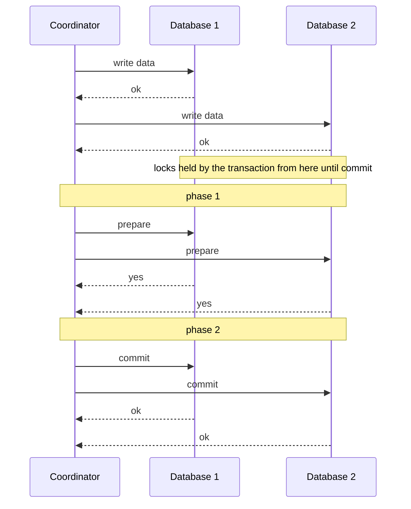

> **Don't confuse 2PC and 2PL** (sidebar). Two-phase **commit** gives **atomic commit** in a distributed database. Two-phase **locking** (Chapter 7) gives **serializable isolation**. They are completely different; best to treat them as unrelated and ignore the unlucky name similarity.

**New component: the coordinator** (also called **transaction manager**). It doesn't exist in single-node transactions. It frequently lives as a **library inside the same application process** that asked for the transaction (for instance inside a **Java EE container** — an application server that hosts enterprise Java apps); it may also run as its own process or service. Examples: **Narayana, JOTM, BTM, MSDTC**.

**Basic flow:**

1. The application reads and writes data on several database nodes as usual. These nodes are the **participants**.
2. At commit time, the coordinator begins **phase 1** by asking every participant, via a **prepare** request, whether it is able to commit.
3. The coordinator collects responses:
   - if **all** say **"yes"**, it sends **commit** in **phase 2**, and the commit actually happens;
   - if **any** says **"no"**, it sends **abort** to all nodes in phase 2.

> **The wedding analogy.** Like a traditional Western wedding: the minister asks the bride and the groom, one at a time, whether they wish to marry, and usually both answer "I do". Having both acknowledgments, the minister declares them married — the transaction commits and the happy news is broadcast to all attendees. If either says no, the ceremony is aborted.

#### A system of promises

Why does 2PC guarantee atomicity when a one-phase commit across nodes doesn't? Prepare and commit messages can get lost too. The answer is in the detail:

1. **Global transaction ID.** When the application starts a distributed transaction, it asks the coordinator for a **globally unique transaction ID**.
2. **Local transactions tagged with it.** The application starts a single-node transaction on each participant, tagged with that global ID. All reads and writes happen in these local transactions. Should something fail at this stage (a crashed node, a timed-out request), either the coordinator **or any participant** is free to abort.
3. **Prepare.** When the application is ready, the coordinator sends **prepare**, tagged with the global ID, to every participant. If any prepare request **fails or times out**, the coordinator sends **abort** for that ID to all participants.
4. **Participant's promise.** On receiving prepare, a participant makes sure it can **definitely commit under all circumstances**: it writes all the transaction's data to disk (a crash, power failure or full disk are *not* acceptable excuses to refuse later) and checks for conflicts or constraint violations. By replying **"yes"**, it **promises** to commit without error if asked. It **gives up the right to abort** — but hasn't committed yet.
5. **Coordinator's decision = the commit point.** Having received all prepare responses, the coordinator decides definitively: **commit only if every participant voted yes**. It has to **record this decision durably in its on-disk transaction log**, so it survives a coordinator crash. This write is the **commit point**.
6. **Enforce the decision forever.** Only after the decision is on disk does the coordinator send commit/abort to all participants. If a request fails or times out, it **must retry forever** until it succeeds. There's no turning back: a commit decision is enforced no matter how many attempts are needed. Should a participant crash in the meantime, the transaction is committed **when it recovers** — having voted yes, it can't refuse.

**Two points of no return:**

- When a **participant votes "yes"**, it promises it will be able to commit later (though the coordinator may still choose to abort).
- Once the **coordinator decides**, that decision is **irrevocable**.

These promises are what make 2PC atomic. (A single-node commit merges both into one event: writing the commit record to the log.)

**Wedding analogy, continued.** Before "I do", either of you can abort ("No way!"). After "I do", you can't take it back. If you faint after saying it and miss the minister's pronouncement, you're still married. On waking, you can ask the minister what happened to your global transaction ID, or simply wait for the minister to repeat the commit — those retries kept going while you were out cold.

Pseudocode of the coordinator (own example):

```python
def two_phase_commit(coord_log, participants, txid):
    # Phase 1: collect votes
    votes = []
    for p in participants:
        try:
            votes.append(p.prepare(txid))       # participant fsyncs, then votes
        except Timeout:
            votes.append("no")
    decision = "commit" if all(v == "yes" for v in votes) else "abort"

    coord_log.write_and_fsync(txid, decision)   # COMMIT POINT

    # Phase 2: enforce the decision, forever if necessary
    for p in participants:
        while True:
            try:
                p.finish(txid, decision); break
            except Timeout:
                continue                          # retry until success
```

- A timeout during phase 1 counts as "no" — safe, because nobody has committed yet.
- The `write_and_fsync` line is the commit point; a crash before it means abort, after it means the decision stands.
- The endless retry loop in phase 2 is the coordinator keeping its promise.

**Own example, not from the book** — in PostgreSQL the participant side of 2PC is exposed directly as SQL (this is what PostgreSQL's XA support in drivers such as JDBC is built on). It only works if the server setting `max_prepared_transactions` is above 0 (the default is 0):

```sql
BEGIN;
UPDATE stock SET qty = qty - 1 WHERE sku = 'lamp-42';
PREPARE TRANSACTION 'order-7781';   -- phase 1: durable, votes "yes"
-- ... later, when the coordinator has decided:
COMMIT PREPARED 'order-7781';       -- phase 2 (or ROLLBACK PREPARED)
```

- `PREPARE TRANSACTION` writes the transaction's state durably and keeps its locks, but doesn't commit — the participant's promise. If it succeeds, that is a "yes" vote; if it fails, the transaction is rolled back (a "no" vote). The prepared transaction is detached from the session and survives a server restart.
- `COMMIT PREPARED` / `ROLLBACK PREPARED` (which any session may issue) carries out the coordinator's decision. Until one of them runs, the prepared transaction is *in doubt* and holds its locks — exactly the problem described below. Prepared-but-unresolved transactions are listed in the `pg_prepared_xacts` view.

#### Coordinator failure

Failures of participants or the network are handled: if any **prepare** fails/times out → abort; if any **commit/abort** request fails → retry indefinitely. But what if the **coordinator** crashes?

- **Before sending prepare:** a participant can safely abort.
- **After a participant voted "yes":** it can **no longer abort on its own** — it must wait to hear from the coordinator. Should the coordinator crash, or the network break, at this point, all the participant can do is **wait**. Its transaction is **in doubt** (or **uncertain**).

*Figure 9-10 (redrawn): the coordinator crashes after both participants voted yes. Database 2 gets the commit and commits; the commit for database 1 is never sent, so database 1 is stuck in the "prepared" state, unable to decide on its own.*
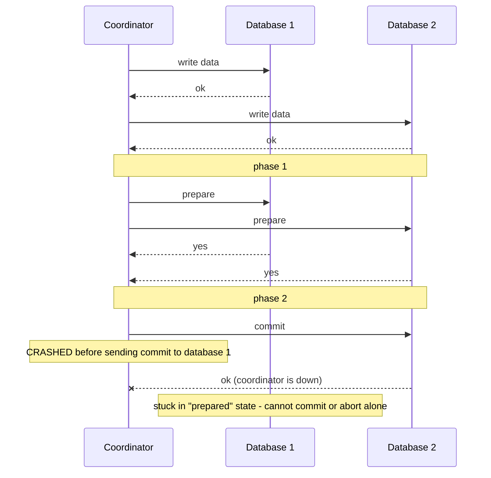

In the book's example, the coordinator decided **commit**, and **database 2 received the commit**. The coordinator crashed **before sending commit to database 1**, so database 1 doesn't know what to do. A **timeout doesn't help**: aborting unilaterally would make it inconsistent with database 2 (which committed); committing unilaterally is unsafe too, because another participant might have aborted.

Without the coordinator, a participant **can't know** the outcome. In principle participants could talk among themselves to learn how each voted, but **that's not part of 2PC**.

**2PC can only finish once the coordinator has recovered.** That's why the coordinator must write its decision to its log **before** sending commit/abort: on recovery, it reads the log to resolve all in-doubt transactions. **If the coordinator's log holds no commit record for a transaction, that transaction is aborted.** So 2PC's commit point boils down to an ordinary **single-node atomic commit on the coordinator**.

#### Three-phase commit

2PC is a **blocking** atomic commit protocol, since it may hang until the coordinator comes back. Theoretically, an atomic commit protocol can be **nonblocking** (doesn't get stuck when a node fails), but making that work in practice isn't easy.

**Three-phase commit (3PC)** was proposed as an alternative. However, 3PC relies on **network delays being bounded** and **node response times being bounded**. In most real systems — unbounded network delays and process pauses (Chapter 8) — it **can't guarantee atomicity**.

In general, nonblocking atomic commit needs a **perfect failure detector**: a reliable way to tell whether a node has crashed. With unbounded delays, **timeouts can't reliably detect failures** — a request may time out because of a network problem even though no node crashed. That's why **2PC is still used**, despite the known coordinator-failure problem.

### Distributed Transactions in Practice

Distributed transactions — especially 2PC — have a **mixed reputation**. They provide an important safety guarantee that is hard to get otherwise; yet critics say they create operational headaches, ruin performance and over-promise. **Many cloud services deliberately don't offer distributed transactions** because of the operational trouble they bring.

**Performance.** Some implementations are very slow: **MySQL**'s distributed transactions have been reported as **more than 10 times slower** than its single-node transactions. Much of 2PC's inherent cost comes from the **extra disk forcing (`fsync` — a system call that makes the OS actually write buffered data to disk)** needed for crash recovery, plus **extra network round-trips**.

Rather than dismiss them, the book examines them, because there are lessons to learn. First, two quite different things get called "distributed transactions":

| | Database-internal distributed transactions | Heterogeneous distributed transactions |
|---|---|---|
| Participants | Nodes of **one** distributed database (which replicates/partitions by default), all running the **same software** | **Two or more different technologies** — e.g. databases from different vendors, or non-databases such as **message brokers** |
| Examples | **VoltDB**, **MySQL Cluster's NDB** storage engine (both distributed SQL databases) | A database + a message queue in one transaction |
| Protocol freedom | Can use any protocol and technology-specific optimisations; no compatibility needed | Must ensure atomic commit across systems that may be totally different internally |
| How well it works | Often **quite well** | **Much more challenging** |

#### Exactly-once message processing

Heterogeneous transactions let very different systems be integrated powerfully. Example: a **message queue** message is marked **processed exactly when** the database transaction that handled it **commits**. This works by committing the **queue acknowledgment together with the database writes** atomically, as one transaction — possible with distributed transaction support even though the broker and database are unrelated technologies on different machines.

If either the delivery or the database transaction fails, **both abort**, so the broker can safely redeliver later. By atomically committing the message and its processing side effects, the message ends up **processed exactly once in effect**, however many retries were needed. The abort discards the side effects of any partial attempt.

**Catch:** this only works if **every system affected** supports the **same atomic commit protocol**. Suppose processing a message also **sends an email**, and the email server doesn't support 2PC: if processing fails and is retried, the email may be sent **twice or more**. Only when all side effects are rolled back on abort can processing be retried as if nothing happened. (Exactly-once processing returns in Chapter 11.)

#### XA transactions

**X/Open XA** (**eXtended Architecture**) is a standard for 2PC across heterogeneous technologies, introduced in **1991** and widely implemented:

- **Databases:** PostgreSQL, MySQL, DB2, SQL Server, Oracle.
- **Message brokers:** ActiveMQ, HornetQ, MSMQ, IBM MQ.

Key facts:

- **XA is not a network protocol** — it's just a **C API** (a set of function calls in the C language) for talking to a transaction coordinator. Other languages have bindings: in **Java EE**, XA is implemented through the **Java Transaction API (JTA)**, supported by many **JDBC** (Java Database Connectivity) database drivers and **JMS** (Java Message Service) message broker drivers.
- XA assumes the application talks to participant databases/brokers through a **network driver or client library** (the code an app uses to talk to a particular database). A driver with XA support uses the XA API to check whether a given operation belongs to a distributed transaction; if it does, the driver forwards the necessary details to the database server. The driver additionally offers **callbacks** (functions the driver will call when something happens) that let the coordinator tell the participant to **prepare, commit or abort**.
- The **coordinator implements the XA API**. The standard doesn't say how; in practice it's usually a **library loaded into the application's process** (not a separate service). It tracks the participants, collects their responses after asking them to prepare (via driver callbacks), and keeps a **log on the local disk** of each transaction's commit/abort decision.

**When the application crashes:** if the application process or its machine dies, **the coordinator dies with it**. Participants with prepared-but-uncommitted transactions are stuck **in doubt**. As the coordinator's log lives on that application server's own disk, **the same server has to come back up**, and the coordinator library then reads its log to recover each transaction's outcome. Only then can it use the drivers' XA callbacks to tell participants to commit or abort. **The database server can't contact the coordinator directly** — all communication goes through the client library.

#### Holding locks while in doubt

Why fuss about in-doubt transactions — couldn't everything else simply continue? **The problem is locks.**

- Transactions usually take **row-level exclusive locks** (only one transaction may hold it) on rows they modify (to prevent dirty writes — overwriting another transaction's not-yet-committed data, Chapter 7).
- With serializable isolation via **two-phase locking**, they also take **shared locks** (many readers may hold one at once, but no writer) on rows they read.
- The database **can't release these locks until the transaction commits or aborts** (the shaded area in Figure 9-9).

So with 2PC, a transaction holds its locks **for as long as it is in doubt**. A coordinator that crashes and needs **20 minutes** to restart means 20 minutes of held locks. A coordinator whose log is **completely lost** means the locks are held **forever** — or until an administrator fixes it manually.

As long as the locks are in place, **those rows can't be modified by any other transaction**, and depending on the database, some may not even be able to **read** them. Other transactions touching that data **block**, which can leave **large parts of the application unavailable** until someone resolves the in-doubt transaction.

#### Recovering from coordinator failure

In theory, a restarted coordinator recovers cleanly from its log and resolves every in-doubt transaction. In practice, **orphaned in-doubt transactions** happen: the coordinator can't determine the outcome for some reason (e.g. the log was **lost or corrupted by a software bug**). They can't be resolved automatically, so they **sit in the database forever**, holding locks and blocking others.

**Rebooting the database servers won't help**: a correct 2PC implementation must **keep an in-doubt transaction's locks across restarts**, or it would risk breaking atomicity.

The only way out: an **administrator manually decides** to commit or roll back. They must examine each in-doubt transaction's participants, find out whether any has already committed or aborted, and apply the same outcome to the rest. This can take a lot of manual work, most likely **under intense stress and time pressure** in the middle of a major production outage (why else would the coordinator be in such a state?).

**Heuristic decisions.** Many XA implementations offer an emergency way out: a participant may **unilaterally decide** to commit or abort an in-doubt transaction without the coordinator's decision. **"Heuristic" is a euphemism for "probably breaking atomicity"**, because it violates 2PC's system of promises. It's meant only for escaping **catastrophes**, not regular use.

#### Limitations of distributed transactions

XA solves a real, important problem — keeping several data systems consistent — but brings major operational problems. The crucial realisation: **the coordinator is really a database in its own right** (it stores transaction outcomes), so it deserves the same care as any important database:

1. **Single point of failure** (one component whose failure takes everything down). If the coordinator isn't replicated and runs on one machine, when it fails, other application servers get stuck behind the locks of in-doubt transactions. Surprisingly, **lots of coordinator implementations don't offer high availability (staying up despite failures) out of the box**, or support replication only in a basic way.
2. **Application servers are no longer stateless.** Many server-side apps follow a **stateless** model (the server keeps nothing between requests; as HTTP, the web's request/response protocol, favours), with all persistent state in a database, so servers can be added or removed at will. But a coordinator inside the application server changes this: its **logs become crucial durable state** — as important as the databases — since they're needed to recover in-doubt transactions.
3. **Lowest common denominator.** XA must work with many kinds of systems, so it can't do much. It **can't detect deadlocks** (transactions each waiting for a lock the other holds, forever) **across systems** (that would need a standard protocol for exchanging lock-wait information), and it **doesn't work with SSI** (that would need a protocol for identifying conflicts across systems).
4. **Failure amplification.** For **database-internal** transactions (not XA) the limits are smaller — e.g. **distributed SSI is possible**. But 2PC still needs **all participants to respond** to commit. A single broken component makes the whole transaction fail. Distributed transactions therefore tend to **amplify failures**, the opposite of fault tolerance.

Does this mean giving up on keeping systems consistent with each other? No — alternative approaches achieve the same without heterogeneous distributed transactions (Chapters 11 and 12). But first, back to consensus.

### Fault-Tolerant Consensus

**Informal definition.** Several nodes agree on something. Examples: several people simultaneously try to grab the **final seat on a flight**, the **same theatre seat**, or register the **same username**; consensus decides which of the mutually incompatible operations wins.

**Formal definition.** One or more nodes **propose** values, and the algorithm **decides** on one of them. In the seat example, each node serving a customer proposes that customer's ID, and the decision says who gets the seat.

A consensus algorithm must satisfy:

| Property | Meaning | Type |
|---|---|---|
| **Uniform agreement** | No two nodes decide differently. | Safety |
| **Integrity** | No node decides twice. | Safety |
| **Validity** | Any value a node decides must have been proposed by one of the nodes. | Safety |
| **Termination** | Every node that doesn't crash eventually decides some value. | **Liveness** |

> **Footnote: uniform consensus.** This variant is called **uniform consensus**; it is equivalent to ordinary consensus in asynchronous systems whose failure detectors are unreliable. Academic papers usually say *processes* rather than *nodes*.

**Why each property:**

- **Agreement + integrity** are the core: everyone decides the same, and nobody changes their mind.
- **Validity** rules out silly solutions — e.g. an algorithm that always decides `null` satisfies agreement and integrity but not validity.
- **Termination** captures **fault tolerance**. Without it, the first three are easy: hard-code one node as **"dictator"** that makes every decision. But if it fails, no more decisions can be made — exactly what happens to **2PC** when the coordinator fails. Termination says the algorithm can't just sit idle forever; it must **make progress**, and the surviving nodes must still reach a decision even when some fail.

**The crash model.** Consensus assumes a crashed node **disappears and never comes back**. Picture not a software crash but an **earthquake**: a landslide wipes out your datacenter and the node lies beneath **30 feet of mud**, never coming back. Under this model, an algorithm that must **wait for a recovery** can never satisfy termination. In particular, **2PC does not satisfy termination**.

**How many failures can be tolerated?** If *all* nodes crash, nothing can be decided. It's proven that any consensus algorithm needs **at least a majority of nodes functioning correctly** to guarantee termination; that majority can safely form a **quorum**. So termination assumes **fewer than half** the nodes are crashed or unreachable.

But most implementations keep the **safety properties** (agreement, integrity, validity) **always** — even if a majority fails or there's a severe network problem. A large outage can stop the system from processing requests, but **can't corrupt it into making invalid decisions**.

**Byzantine faults.** Most consensus algorithms assume **no Byzantine faults** (Chapter 8): a node that doesn't follow the protocol (e.g. sends contradictory messages to different nodes) may break safety. Consensus can be made **Byzantine-robust provided that under one-third of the nodes suffer Byzantine faults**, but the book doesn't cover those algorithms in detail.

#### Consensus algorithms and total order broadcast

The most famous fault-tolerant consensus algorithms: **Viewstamped Replication (VSR)**, **Paxos**, **Raft** and **Zab**. They share a lot but aren't identical. The book doesn't go into full detail — knowing the common high-level ideas is enough unless you are building one yourself — which the book **doesn't recommend**, as it's very hard.

Most of them don't actually use the formal single-value model above. They decide a whole **sequence of values**, so they are really **total order broadcast algorithms**.

Why that's natural: total order broadcast has every node receive every message **exactly once and in one agreed order**. That amounts to **consensus run over and over**: per round, nodes propose which message should go next, and the round's decision fixes the next message in the order. Each consensus property maps to a broadcast property:

| Consensus property | Total order broadcast consequence |
|---|---|
| Agreement | Every node delivers **identical messages in an identical order** |
| Integrity | Messages are **not duplicated** |
| Validity | Messages are **neither corrupted nor invented** |
| Termination | Messages are **not lost** |

**Viewstamped Replication, Raft and Zab** run total order broadcast **natively**, which is more efficient than repeated one-value consensus. For **Paxos**, this optimisation is called **Multi-Paxos**.

#### Single-leader replication and consensus

Single-leader replication (Chapter 5) funnels every write through the leader, which passes them to followers in one fixed order. Isn't that total order broadcast? Why didn't Chapter 5 need consensus?

**It depends on how the leader is chosen:**

- **Manually chosen by operators:** effectively a "consensus algorithm" of the **dictatorial** kind. Only one node accepts writes (decides the order of writes in the log); if it goes down, writes are unavailable until humans configure a new leader. Works fine in practice, but **doesn't satisfy termination**, since progress needs human intervention.
- **Automatic leader election and failover:** a follower is promoted if the leader fails. That moves us nearer to fault-tolerant total order broadcast — and therefore to consensus.

**The chicken-and-egg problem.** To avoid split brain, all nodes must agree who the leader is — so electing a leader **needs consensus**. Yet consensus algorithms are really total order broadcast, which resembles single-leader replication, which requires a leader… So **electing a leader seems to require a leader, and solving consensus seems to require solving consensus first.** How to escape?

#### Epoch numbering and quorums

All these protocols use a leader internally, but **don't guarantee the leader is unique**. They make a weaker promise: they define an **epoch number** and promise **at most one leader per epoch**.

| Algorithm | Name for the epoch number |
|---|---|
| Paxos | **ballot number** |
| Viewstamped Replication | **view number** |
| Raft | **term number** |

**How it works, step by step:**

1. **New election ⇒ new epoch.** Each time the nodes *suspect* the leader has died, they hold a vote for a new one. The election gets an **incremented epoch number**, so epochs are **totally ordered and monotonically increasing**.
2. **Higher epoch wins.** If two leaders from different epochs conflict (maybe the old one wasn't dead after all), the leader with the **higher epoch** prevails.
3. **A leader can't trust itself.** Before deciding anything, a leader must check there's no other leader with a higher epoch that could make a conflicting decision. As Chapter 8 put it, the truth is decided by the majority: a node believing it leads doesn't mean the others accept it.
4. **Quorum vote on every proposal.** For each decision, the leader distributes its proposal and **waits until a quorum replies in favour**. The quorum is typically — **but not always** — a **majority**. A node votes for a proposal **only if it knows of no other leader with a higher epoch**.
5. **Two rounds of voting, overlapping quorums.** There are two votes: one to **elect a leader**, one to **approve a leader's proposal**. The key insight: **the two quorums must overlap**. If a proposal vote succeeds, at least one node that voted for it also took part in the **most recent leader election**. So if the proposal vote reveals no higher epoch, the leader can conclude **no newer election has happened**, knows it still leads, and can safely **decide** the value.

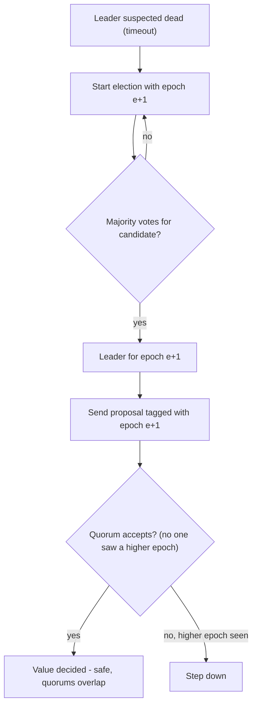
*(Diagram, not a book figure: the epoch-and-quorum idea in flowchart form.)*

**Comparison with 2PC.** This looks superficially like two-phase commit, but differs in crucial ways:

| | Two-phase commit | Fault-tolerant consensus |
|---|---|---|
| Who leads | Coordinator is **not elected** | Leader is **elected** (per epoch) |
| Votes needed | **"Yes" from every** participant | Only a **majority** (quorum) |
| After a failure | Wait for the coordinator to recover | A defined **recovery procedure** brings nodes back to a consistent state once a new leader takes over, preserving safety |

These differences are what make consensus algorithms correct and fault-tolerant.

#### Limitations of consensus

Consensus algorithms are a **huge breakthrough**: they bring concrete safety (agreement, integrity, validity) to an environment where everything else is uncertain, while staying fault-tolerant (they progress whenever a majority is up and reachable). Because they give you total order broadcast, they can also offer **linearizable atomic operations** in a fault-tolerant way. Yet they aren't used everywhere, because the benefits cost something:

1. **Synchronous replication cost.** Voting on proposals before deciding is a kind of **synchronous replication**. Many databases are configured for **asynchronous** replication, accepting that some committed data may be lost on failover, for better performance.
2. **Strict majority needed.** Tolerating **1 failure needs at least 3 nodes** (the remaining 2 of 3 are a majority); tolerating **2 failures needs at least 5** (3 of 5). If a network failure splits the nodes, **only the majority side can make progress**; the rest is blocked.
3. **Fixed membership.** Most algorithms assume a **fixed set of voting nodes**, so the cluster's membership can't simply be changed. **Dynamic membership** extensions exist but are much less well understood.
4. **Timeouts and false elections.** Failure detection relies on **timeouts**. With highly variable delays — especially in **geographically distributed** systems — a node may wrongly think the leader failed due to a transient glitch. Safety isn't harmed, but **frequent leader elections cause terrible performance**: the system may spend more time electing leaders than doing useful work.
5. **Sensitivity to network problems.** **Raft** has been shown to have nasty edge cases: if the whole network works except **one consistently unreliable link**, leadership can **bounce between two nodes** forever, or the leader is repeatedly forced to resign, so the system effectively **never makes progress**. Other algorithms have similar issues; algorithms that cope well with unreliable networks remain **an open research question**.

### Membership and Coordination Services

**ZooKeeper** and **etcd** get described as "distributed key-value stores" or as "coordination and configuration services". Their API looks like a database: read and write a key's value, iterate over keys. So why do they bother with consensus, and what makes them different from other databases?

**You rarely use ZooKeeper directly** — it's not a good general-purpose database. You more likely rely on it **indirectly**: **HBase** (a distributed database), **Hadoop YARN** (a cluster resource manager), **OpenStack Nova** (a cloud VM manager) **and Kafka** (a distributed log / message broker) each depend on a ZooKeeper cluster behind the scenes.

**Design:** ZooKeeper and etcd hold **small amounts of data that fit entirely in memory** (still written to disk for durability) — you wouldn't store all your application data there. That data is replicated to all nodes with a **fault-tolerant total order broadcast algorithm** — exactly what database replication needs (same writes, same order, consistent replicas).

ZooKeeper is modelled on **Google's Chubby lock service** (Google's internal coordination service). Besides total order broadcast (and thus consensus), it offers features that are especially handy for distributed systems:

| Feature | What it gives you |
|---|---|
| **Linearizable atomic operations** | With atomic compare-and-set you can build a **lock**: if several nodes try the same operation concurrently, only one succeeds. Consensus guarantees atomicity and linearizability even if nodes fail or the network breaks. A distributed lock is usually a **lease** with an expiry time, so it's released eventually if the client fails. |
| **Total ordering of operations** | When a lock or lease guards a resource, a **fencing token** (a number that grows every time the lock is taken) prevents clients from clashing after a process pause. ZooKeeper totally orders every operation, assigning each one an ever-increasing **zxid** (transaction ID) and **cversion** (version number). |
| **Failure detection** | Clients keep a **long-lived session** with ZooKeeper servers and exchange **heartbeats** (small "I'm still alive" messages sent at regular intervals). Brief connection drops or a ZooKeeper node failure don't end the session; but if heartbeats stop for longer than the **session timeout**, the session is declared dead. A session's locks can optionally be freed automatically on timeout — ZooKeeper calls these **ephemeral nodes**. |
| **Change notifications** | A client can **watch** locks and values created by others and be told when they change — e.g. learn when a client joins the cluster (from the value it writes) or fails (its session expires, so its ephemeral nodes disappear). This avoids frequent polling (repeatedly asking "has it changed yet?"). |

Of these, **only the linearizable atomic operations truly need consensus** — but it's the **combination** that makes ZooKeeper so useful for coordination.

#### Allocating work to nodes

1. **Leader/primary selection.** You run several instances of a process or service and need one to be **leader or primary**; if it fails, another takes over. Useful for single-leader databases, **job schedulers** (systems that decide when and where tasks run) and similar stateful systems.
2. **Partition assignment.** You have some partitioned resource — a database, message streams, file storage, a distributed actor system (a program built from many small independent "actors" that only talk by messages), and so on — and must decide **which partition goes on which node**. When nodes **join**, some partitions move to them to rebalance load (Chapter 6); when nodes **leave or fail**, others take over their work.

These tasks can be done with careful use of **atomic operations, ephemeral nodes and notifications** in ZooKeeper. Done right, the application **recovers from faults automatically**, without humans. It's not easy, even with libraries like **Apache Curator** that provide higher-level tools over the ZooKeeper client API — but far better than implementing consensus from scratch, which has a **poor track record**.

A sketch of leader election with ZooKeeper-style primitives (own example, pseudocode):

```python
# Every candidate creates an EPHEMERAL + SEQUENTIAL node under /election
me = zk.create("/election/candidate-", data=my_address,
               ephemeral=True, sequential=True)    # e.g. candidate-0000000017

def check_leadership():
    children = sorted(zk.get_children("/election"))
    if children[0] == me.name:
        become_leader()                            # lowest number wins
    else:
        # watch the candidate just ahead of me; if its session dies,
        # its ephemeral node disappears and I get notified
        prev = children[children.index(me.name) - 1]
        zk.exists("/election/" + prev, watch=lambda _: check_leadership())

check_leadership()
```

- **Ephemeral** ties the node to the session: if this process dies, its entry vanishes (failure detection).
- **Sequential** numbering comes from ZooKeeper's total order, so all candidates agree who is "lowest".
- The **watch** is a change notification, so no polling is needed.

**Scale.** An application may start on one node and grow to **thousands**. Majority voting across thousands of machines would be hopelessly inefficient. So ZooKeeper runs on a **small fixed set of nodes (typically three or five)**, does its majority votes among them, and serves a potentially huge number of clients. It lets you **"outsource"** coordination work — **consensus, operation ordering, failure detection** — to an external service.

**Slow-changing data.** ZooKeeper data typically changes slowly: facts such as "**node 10.1.1.23 currently leads partition 7**", changing on a scale of **minutes or hours**. It's **not** meant for runtime application state that could change **thousands or even millions of times each second**. To replicate that kind of state between nodes, use other tools such as **Apache BookKeeper** (a replicated log-storage service).

#### Service discovery

ZooKeeper, etcd and **Consul** (HashiCorp's service registry) are also used for **service discovery**: finding which **IP address** (the numeric network address of a machine) to connect to for a given service. In cloud datacenters, **virtual machines come and go** constantly, so you often don't know service IPs in advance. Instead, services **register their network endpoints in a service registry** at startup, where other services can find them.

**Does service discovery need consensus? Less clear.** **DNS** (the Domain Name System — the internet's phone book that turns names into IP addresses; see [System Design Fundamentals](../00a-system-design-fundamentals/README.md)) is the traditional way to look up a service's IP. It uses many **layers of caching** for performance and availability. **DNS reads are absolutely not linearizable**, and slightly stale results usually aren't a problem. What matters more is that DNS is **reliably available and robust to network interruptions**.

However, **leader election does need consensus**. So if your consensus system already knows the leader, it can sensibly also help other services **find out who the leader is**. To support that, some consensus systems offer **read-only caching replicas**: they asynchronously receive the log of all consensus decisions but **don't vote**, so they can serve reads that **don't need to be linearizable**.

#### Membership services

ZooKeeper and similar systems belong to a long line of research on **membership services**, going back to the **1980s**, which matters for highly reliable systems such as **air traffic control**.

A membership service decides **which nodes are currently active, live members of a cluster**. As Chapter 8 showed, unbounded network delays mean you can never be certain whether another node has failed. But by **coupling failure detection with consensus**, nodes can **agree** on which nodes are considered alive.

A node might still be wrongly declared dead by consensus even though it's alive. Even so, **agreement on the current membership** is very valuable. Example: choosing a leader could simply mean picking the **lowest-numbered current member** — but that only works if all nodes agree on who the current members are.

## Summary

The book's own summary ties the chapter together:

- **Linearizability** — makes replicated data look like a **single copy** with **atomic** operations. Easy to understand (the database acts just like a variable in single-threaded code), but **slow**, especially with large network delays.
- **Causality** — orders events by cause and effect. Weaker than linearizability: some things can be **concurrent**, so history is a timeline that **branches and merges**. Causal consistency skips linearizability's coordination overhead and **copes far better with network problems**.
- **Limits of causal ordering** — even with causal ordering captured (e.g. with **Lamport timestamps**), some things can't be done that way. The **unique username** example: to accept a registration, a node must know that no other node is concurrently registering the same name. That led to **consensus**.
- **Consensus** — deciding something so that **all nodes agree** and the decision is **irrevocable**. Many problems turn out to be **equivalent** to consensus (a solution to one can be transformed into a solution to another):

| Equivalent problem | What must be decided |
|---|---|
| **Linearizable compare-and-set registers** | Whether to set the value, atomically, based on whether the current value equals the given parameter |
| **Atomic transaction commit** | Whether a distributed transaction commits or aborts |
| **Total order broadcast** | The order in which to deliver messages |
| **Locks and leases** | Which of several racing clients acquired the lock |
| **Membership/coordination service** | Using some failure detector (such as timeouts), which nodes are alive and which are dead because their sessions timed out |
| **Uniqueness constraint** | Which of several concurrent transactions creating conflicting records with the same key succeeds, and which fails with a constraint violation |

All of these are easy **on a single node**, or if you give all decision-making power to **one node** — which is what a **single-leader database** does, and why it can offer linearizable operations, uniqueness constraints, a totally ordered replication log and more.

But if that leader **fails** or becomes **unreachable**, the system can't progress. Three ways to handle that:

1. **Wait for the leader to recover**, accepting that the system is blocked meanwhile. **Many XA/JTA transaction coordinators** do this. It doesn't fully solve consensus — it violates **termination**: if the leader never recovers, the system blocks forever.
2. **Manually fail over**: humans pick a new leader and reconfigure. **Many relational databases** work this way. It's consensus by **"act of God"** — a human operator outside the system decides. Failover speed is limited by human speed, usually slower than computers.
3. **Automatically choose a new leader** with an algorithm. This needs a **consensus algorithm**, and you should use a **proven** one that correctly handles adverse network conditions.

A single-leader database can be linearizable **without a consensus round per write**, but it **still depends on consensus to keep and hand over leadership**. So a leader merely **"kicks the can down the road"**: consensus remains necessary, only in another place and less frequently. The good news: fault-tolerant consensus algorithms and systems exist.

Tools like **ZooKeeper** provide an **"outsourced" consensus, failure detection and membership service**. Not easy to use, but much better than building your own algorithms to survive all the problems in Chapter 8. If you need something **reducible to consensus** and want it **fault-tolerant**, use something like ZooKeeper.

Still, **not every system needs consensus**: **leaderless and multi-leader** systems usually don't use global consensus. Their conflicts come from *not* having consensus across leaders — but maybe that's fine; maybe we can live without linearizability and learn to work with **branching and merging version histories**.

The chapter drew on a lot of theoretical research. The papers can be hard and sometimes make unrealistic assumptions, but they're **very valuable** for practical work: they show what can and can't be done and reveal counterintuitive ways distributed systems fail.

This ends **Part II** (replication, partitioning, transactions, failure models, consistency and consensus). **Part III** returns to practical systems: building powerful applications from heterogeneous building blocks.

## Chapter summary

- **Eventual consistency** only promises convergence "some time"; stronger models are easier to use but cost performance/availability.
- **Linearizability** = one copy + atomic operations + real-time recency. Once any read sees a new value, all later reads must too. It's needed for **locks/leader election**, **hard uniqueness constraints**, and avoiding **cross-channel races**.
- It's **not** serializability (transactions, some serial order) — both together = **strict serializability**. SSI isn't linearizable.
- **Which replication is linearizable:** single-leader (potentially), consensus (yes), multi-leader (no), leaderless (probably not — even strict quorums fail under variable delay).
- **CAP**: during a network partition, choose linearizability *or* availability. The book considers CAP too narrow and confusing to be useful. The deeper cost is **latency**: linearizable response time is at least proportional to network delay uncertainty (Attiya and Welch). Even multi-core RAM gives up linearizability — for **speed**.
- **Causality** is a **partial** order; linearizability is a **total** order. Linearizable ⇒ causal. **Causal consistency** is the strongest model that stays fast and available under network faults.
- **Lamport timestamps** (counter, node ID) + "carry the max" give a total order consistent with causality, but can't tell when the order is **final** — so they can't enforce uniqueness on the spot.
- **Total order broadcast** (reliable + same-order delivery, order fixed at delivery) = a replicated log; it powers state machine replication, fencing tokens (zxid), and linearizable CAS. Linearizable CAS/increment-and-get ⇔ total order broadcast ⇔ consensus.
- **2PC**: prepare (participants promise) → coordinator writes decision (commit point) → commit/abort retried forever. Coordinator crash leaves participants **in doubt**, holding locks. 3PC needs bounded delays. XA is a C API for heterogeneous 2PC; coordinators become single points of failure; heuristic decisions break atomicity.
- **Consensus** properties: agreement, integrity, validity (safety) + termination (liveness); needs a majority alive. VSR, Paxos (Multi-Paxos), Raft, Zab implement total order broadcast using **epochs** and **overlapping quorums**.
- **ZooKeeper/etcd**: small in-memory data, linearizable ops, zxid ordering, sessions/ephemeral nodes, watches; used for leader election, partition assignment, service discovery, membership.

## Interview angle

**1. "What is linearizability?"**
*30-second answer:* It's the promise that a replicated system acts like it holds one copy of the data, with each operation taking effect atomically at some instant between its request and response. Practically, once a write completes — or once *anyone* has read the new value — every later read everywhere returns that value or a newer one. It's a recency guarantee on single objects.
- *Follow-up: how is it different from serializability?* Serializability is about multi-object transactions behaving as if run in some serial order (not necessarily real-time order). Linearizability is about single-register recency in real time. Both together is strict serializability; SSI is serializable but not linearizable because it reads from snapshots.
- *Follow-up: do quorums (w + r > n) give linearizability?* Not necessarily. With variable delays, one reader can see the new value from one replica while a later reader hits two stale replicas. You'd need synchronous read repair and read-before-write; Cassandra still breaks with LWW, and CAS can't be done this way at all.

**2. "Explain the CAP theorem."**
*30-second answer:* When a network partition happens, a system must either refuse some requests to stay linearizable (consistent) or keep serving requests and give up linearizability (available). The popular "pick 2 of 3" framing is misleading: partitions aren't optional, so it's really "consistent or available *when partitioned*".
- *Follow-up: why do many databases avoid linearizability, then?* Mostly for performance, not partition tolerance. Linearizable operations are slow all the time — response time is at least proportional to network delay uncertainty. Multi-core CPUs drop it for the same reason.
- *Follow-up: what's the strongest model that stays available?* Causal consistency.

**3. "How does two-phase commit work, and what's its main weakness?"**
*30-second answer:* The coordinator assigns a global transaction ID; participants do their work; then the coordinator sends *prepare*. Each participant durably writes its data, checks constraints and votes yes — promising it can commit. If all vote yes, the coordinator writes "commit" to its log (the commit point) and sends commit, retrying forever. The weakness: if the coordinator crashes after participants voted yes, they're stuck *in doubt*, holding locks until it recovers.
- *Follow-up: why not just time out?* Aborting might contradict a participant that already committed; committing might contradict one that aborted. Only the coordinator knows.
- *Follow-up: does 3PC fix it?* Only if network delays and response times are bounded, which real networks don't guarantee. Nonblocking commit needs a perfect failure detector.
- *Follow-up: what are XA's practical problems?* Coordinator is often an unreplicated library in the app server (single point of failure, app no longer stateless), lowest-common-denominator (no cross-system deadlock detection, no SSI), failure amplification, orphaned transactions needing manual or heuristic resolution. MySQL distributed transactions reported over 10x slower.

**4. "What is consensus and what properties must it have?"**
*30-second answer:* Nodes propose values and all decide on one. Properties: uniform agreement (no two decide differently), integrity (decide at most once), validity (decided value was proposed), termination (every non-crashed node eventually decides). The first three are safety, termination is liveness and needs a majority of nodes up.
- *Follow-up: isn't consensus impossible (FLP)?* Only in the asynchronous model without clocks, timeouts or randomness. With timeouts or random numbers it's solvable in practice.
- *Follow-up: how do Raft/Paxos avoid split brain?* Epoch (term/ballot/view) numbers make the leader unique per epoch; every decision needs a quorum that overlaps the election quorum, so a stale leader learns of a higher epoch and can't decide.
- *Follow-up: how many nodes to tolerate 2 failures?* Five.

**5. "What's the relationship between total order broadcast, linearizability and consensus?"**
*30-second answer:* Total order broadcast delivers every message to every node in the same order, with order fixed at delivery — it's a replicated log. You can build linearizable compare-and-set from it (append a claim, wait for it to come back, first claim wins), and build it from a linearizable increment-and-get counter (gap-free sequence numbers). Linearizable CAS, total order broadcast and consensus are all equivalent; consensus algorithms like Raft and Zab are really total order broadcast algorithms.
- *Follow-up: why aren't Lamport timestamps enough?* They give a total order consistent with causality, but you never know whether some other node will later produce a lower timestamp — the order isn't final, and there can be gaps. Total order broadcast lets you know when it is final.

**6. "What is ZooKeeper used for?"**
*30-second answer:* It's an outsourced coordination service running consensus (Zab) on 3 or 5 nodes: linearizable atomic operations for locks/leases, zxid ordering for fencing tokens, session heartbeats with ephemeral nodes for failure detection, and watches for change notifications. Systems like HBase, Hadoop YARN, OpenStack Nova and Kafka use it for leader election, partition assignment and membership.
- *Follow-up: would you store application data in it?* No — it's for small, slow-changing data (minutes/hours); use something like Apache BookKeeper for high-rate replicated state.

## Self-check

1. **Why is eventual consistency hard to program against?**
   Because it gives no bound on when replicas converge; you might not even read your own write. Unlike a variable, the database can return old values, and the resulting bugs only appear under faults or high concurrency.

2. **In Figure 9-4, why is B's final read not linearizable even though it overlaps C's `cas(x, 2, 4)`?**
   Because A had already read 4 before B's read began. After any read returns a new value, all later reads must return it too, so B may not return 2.

3. **A website stores uploaded photos, then enqueues a resize job. Occasionally thumbnails are of an old photo. What's happening, and name two fixes.**
   A cross-channel race: the queue delivered the job faster than the file storage replicated the photo, so the resizer read a stale version. Fix with linearizable file storage, or — since you control the queue — a read-your-own-writes-style technique (the book names no specific mechanism; one own illustration is putting the photo's version number in the queue message and having the resizer wait until it can read at least that version).

4. **Does a Dynamo-style store with n = 3, w = 3, r = 2 give linearizability?**
   No. During a write, reader A can see the new value on one replica, and a later reader B can read two replicas that haven't received it yet and return the old value. Synchronous read repair plus read-before-write fixes reads/writes (at a cost), but not CAS.

5. **Why can't odd/even per-node counters give a causally consistent order, and how do Lamport timestamps fix it?**
   Nodes run at different rates, so one counter lags the other and numbers don't reflect cross-node causality. Lamport timestamps have every node and client carry the maximum counter seen and bump local counters to it, so every causal successor gets a larger timestamp.

6. **Why aren't Lamport timestamps enough to enforce unique usernames immediately?**
   The node can't know whether another node is concurrently assigning a lower timestamp to the same name; the total order is only known after all operations are collected. Checking with every node would halt on any failure.

7. **Name the two points of no return in 2PC.**
   A participant voting "yes" (it gives up the right to abort), and the coordinator writing its decision to its log (the decision becomes irrevocable).

8. **The coordinator's log is lost after a crash. What happens to the participants?**
   Transactions in doubt become orphaned: they hold their locks indefinitely, even across database restarts, blocking other transactions. An administrator must resolve them manually, or use a heuristic decision (which probably breaks atomicity).

9. **How does a Raft leader know it's still the leader when it makes a decision?**
   It sends each proposal to the nodes and needs a quorum to accept; nodes only accept if they know of no higher term. Because the proposal quorum overlaps the most recent election quorum, if no higher term appears the leader knows no newer election happened.

10. **Your team wants a 4-node consensus cluster to "tolerate more failures than 3 nodes". Is that right?**
    No. A majority of 4 is 3, so it still tolerates only 1 failure — the same as 3 nodes. You need 5 nodes to tolerate 2 failures.
