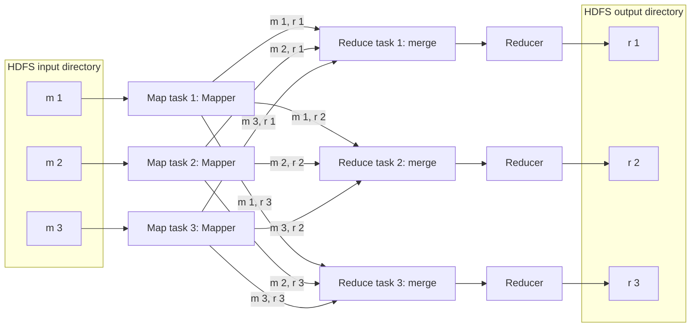
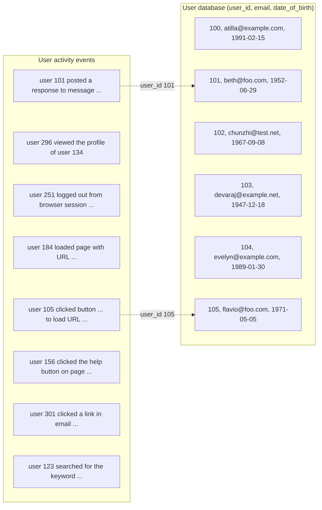
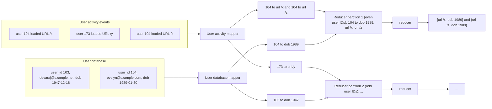
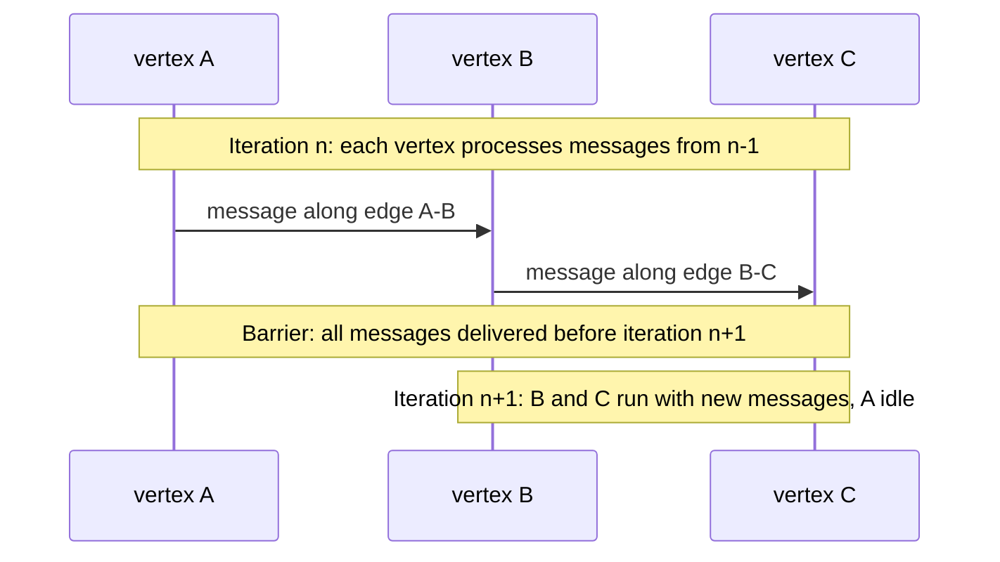

# Chapter 10 — Batch Processing
*Book: Chapter 10, pp. 389–438 (with the Part III introduction just before it)*

## Overview

### Part III opener: Derived Data (summary of the Part III introduction)

Parts I and II of the book built up everything that goes into *one* distributed database: how bytes sit on disk, how data is replicated and partitioned, how transactions and consensus work. Real applications are messier. A large application usually needs to read and process its data in many different ways, and no single database is good at all of them. So in practice an application glues together several stores: an OLTP database, a cache, a full-text search index, an analytics warehouse, and so on, plus the plumbing that moves data between them. Part III is about that integration problem. The book points out that vendors who promise "our product does everything" tend to ignore it, yet wiring different systems together correctly is one of the most important jobs in any non-trivial application.

The Part intro splits data systems into two broad kinds:

| Kind | What it means | Examples |
|---|---|---|
| **System of record** (also called *source of truth*) | Holds the authoritative copy of the data. New data (e.g., user input) is written here first. Each fact is stored exactly once, usually in normalized form. If another system disagrees with it, the system of record wins by definition. | The primary OLTP database of an app |
| **Derived data system** | Holds data produced by taking data from some other system and transforming it. If you lose it, you can rebuild it from the source. | Caches (fall back to the DB on a miss), indexes, denormalized values, materialized views, recommendation models built from usage logs |

Key points from the Part intro:

- Derived data is technically **redundant** (it duplicates information that exists elsewhere), but it is often essential for fast reads. It is typically denormalized, and one source can feed several derived datasets, each giving a different "view" of the same facts.
- Making the record-vs-derived distinction explicit clarifies the **dataflow** of your system: which component takes which inputs, produces which outputs, and depends on what.
- A given database product is *not* inherently one or the other. It is just a tool; whether it acts as a system of record or a derived store depends on how *your application* uses it.
- Chapter plan for Part III: Chapter 10 looks at batch dataflow systems like MapReduce; Chapter 11 applies the same ideas to streams (same kind of work, lower delay); Chapter 12 ties it all together into ideas for building reliable, scalable, maintainable applications in the future.

### What this chapter answers

**Question:** How do you process a huge, fixed pile of data (terabytes of logs, a whole database snapshot) to produce some useful output, reliably, across many machines?

The chapter contrasts three styles of system:

| Style | How it is triggered | Main performance metric | Example |
|---|---|---|---|
| **Services (online systems)** | A client sends a request and waits for a reply | Response time; availability also matters a lot | Web server, database, cache |
| **Batch processing (offline systems)** | A job is started (often on a schedule, e.g., once a day) over a large, fixed input; a run can last minutes or even days, so nobody sits waiting for them | **Throughput**: how long it takes to chew through an input of a given size | MapReduce, Spark jobs |
| **Stream processing (near-real-time / nearline)** | Consumes events shortly after they occur; has inputs and outputs rather than request/response | Latency lower than batch | Covered in Chapter 11 |

Why it matters: batch jobs build search indexes, recommendation models, analytics tables, and derived databases. The design ideas behind batch processing (immutable inputs, derived outputs, rerunnable jobs) are also the foundation for stream processing and for the "derived data" architecture of Part III.

A little history the book mentions:
- MapReduce was published by Google in **2004**, and was once described (somewhat over-enthusiastically) as the algorithm behind Google's massive scalability. It was later implemented in open source systems including **Hadoop, CouchDB, and MongoDB**.
- Compared with the parallel query engines built for data warehouses years earlier, MapReduce is quite *low-level*, but it let people process data at unprecedented scale on cheap commodity machines. Its importance is now declining, yet it is still the clearest way to understand why and how batch processing works.
- Batch processing is ancient: long before programmable digital computers, **punch card tabulating machines** such as the **Hollerith machines** used for the **1890 US Census** computed aggregate statistics over large inputs in a semi-mechanized batch style. MapReduce also bears an eerie likeness to the electromechanical **IBM card sorters** that companies relied on for **business data processing** during the 1940s and 1950s. History repeats itself.

**Everyday analogy:** A bank's end-of-day reconciliation. During the day, tellers serve customers one at a time (online system). At night, a clerk takes the whole day's stack of slips (a fixed, bounded input), sorts them by account number, and totals each account (batch job). Nobody is waiting at the counter for the result; what matters is getting through the whole stack by morning.

## Key terms

| Term | Plain-English meaning |
|---|---|
| System of record / source of truth | The authoritative copy of data; written first; wins any disagreement |
| Derived data | Data computed from other data; can be rebuilt if lost (caches, indexes, views) |
| Online system (service) | Handles requests while a user waits; judged by response time |
| Batch processing (offline) | Runs a job over a large, bounded input and writes output; judged by throughput |
| Stream processing (nearline) | Processes events soon after they happen; between online and batch |
| Throughput | Amount of data processed per unit of time |
| Bounded input | Input of a known, fixed size (e.g., yesterday's logs), so the job can finish |
| Working set | The data a job needs random access to in memory |
| Unix pipe | Connects one program's stdout to the next program's stdin via a small memory buffer |
| Uniform interface | Every program reads/writes the same kind of thing (in Unix: a file descriptor = sequence of bytes) |
| stdin / stdout | A program's default input and output streams |
| Loose coupling / late binding / inversion of control | The program does not decide where its input comes from or where its output goes; the caller wires it up |
| HDFS | Hadoop Distributed File System; open source version of Google File System (GFS) |
| NameNode | Central HDFS server that tracks which machine stores which file block |
| Shared-nothing | Architecture where each machine has its own CPU, RAM and disks, connected only by a normal network |
| Erasure coding (e.g., Reed–Solomon) | Storing redundancy codes so lost data can be rebuilt using less space than full copies |
| MapReduce | Programming model: a *mapper* emits key-value pairs, framework sorts by key, a *reducer* processes each key's values |
| Mapper | Function called once per input record; outputs zero or more key-value pairs; keeps no state between records |
| Reducer | Function called once per key with an iterator over all values for that key |
| Shuffle | Partitioning mapper output by reducer, sorting it, and copying it to reducers (no randomness involved) |
| Putting computation near the data (data locality) | Running a task on a machine that already stores a copy of its input |
| Workflow | A chain of jobs where one job's output directory is the next job's input |
| Workflow scheduler | Tool that starts jobs when their inputs are ready (Oozie, Azkaban, Luigi, Airflow, Pinball) |
| Join | Combining records that refer to each other (e.g., event with user ID + user profile) |
| Equi-join | A join where records match on equal values of a field |
| Full table scan | Reading every record of the input |
| Activity events / clickstream | Log of actions logged-in users took on a website |
| Sort-merge join | Reduce-side join: both inputs are keyed by join key, sorted, and merged in the reducer |
| Secondary sort | Arranging values *within* a key in a chosen order (e.g., user record first, then events by time) |
| Sessionization | Grouping all events of one user session to see the sequence of actions |
| Skew / hot spot | One partition gets far more work than others |
| Hot key / linchpin object | A key with a disproportionate amount of data (e.g., a celebrity) |
| Reduce-side join | Join logic runs in the reducer after sorting and shuffling |
| Map-side join | Join done in mappers only, no reducers and no sorting, by exploiting known input properties |
| Broadcast hash join | Small input loaded fully into a hash table in every mapper of the large input |
| Partitioned hash join (bucketed map join) | Both inputs partitioned the same way; each mapper joins one matching pair of partitions |
| Map-side merge join | Both inputs partitioned *and sorted* the same way; mapper merges them like a reducer would |
| Immutable | Never modified once written |
| Human fault tolerance | Ability to recover from buggy code (roll back code, rerun job) |
| MPP database | Massively parallel processing database: runs analytic SQL in parallel over a cluster |
| Data lake / enterprise data hub | Dumping raw data from across an organization into one place and deciding on schema later |
| Schema-on-read | The reader interprets the structure of the data, instead of enforcing it at write time |
| Sushi principle | "Raw data is better": keep data unprocessed so many views can be derived |
| Preemption | Killing a low-priority task to free resources for a higher-priority one |
| Materialization | Eagerly computing an intermediate result and writing it out (e.g., to files) |
| Straggler | A task that takes much longer than its peers |
| Dataflow engine | Engine (Spark, Tez, Flink) that runs a whole multi-stage workflow as one job |
| Operator | A generalized processing function in a dataflow engine (not restricted to map/reduce roles) |
| RDD | Resilient Distributed Dataset: Spark's abstraction that records how each piece of data was computed |
| Checkpoint | Saving state to durable storage so computation can resume from there |
| Deterministic operator | Always produces the same output given the same input |
| Pipelined execution | Passing output to the next operator incrementally, without waiting for all input |
| DAG | Directed acyclic graph; how dataflow engines arrange operators (not the same as graph data!) |
| Transitive closure | Repeatedly following edges until no new vertices are reached |
| Bulk synchronous parallel (BSP) / Pregel model | Graph processing in rounds; vertices send messages to each other between rounds |
| "Thinking like a vertex" | Writing graph code from the viewpoint of a single vertex |
| Declarative query language | You state *what* you want; an optimizer decides *how* |
| Cost-based query optimizer | Picks join algorithms and join order based on estimated cost |
| Vectorized execution | Processing data in tight CPU-cache-friendly loops without per-record function calls |
| k-nearest neighbors | Finding items closest to a given item in a multi-dimensional space |

## Batch Processing with Unix Tools

The chapter starts small: one machine, standard Unix commands. The point is that the *design ideas* of Unix carry straight over to huge distributed systems.

The running example is a web server log. Each request adds one line. In nginx's default format, a line records: client IP, a literal hyphen placeholder, remote user (a hyphen if not logged in), local time, the request line (method, path, protocol), HTTP status, response size in bytes, referrer URL, and user-agent string. The book's sample line decodes as: on 27 Feb 2015 at 17:55:11 UTC, IP 216.58.210.78 requested `/css/typography.css`, got status 200 with 3,377 bytes, using Chrome 40, because the page `http://martin.kleppmann.com/` referenced it.

A made-up line in the same shape:

```text
10.1.2.3 - - [03/Mar/2021:08:00:01 +0000] "GET /blog/intro.html HTTP/1.1" 200 5120 "https://example.org/" "Mozilla/5.0 (X11; Linux x86_64) Firefox/86.0"
```

- `10.1.2.3` = `$remote_addr`, the client's IP address.
- `-` `-` = a fixed hyphen in the format string, then `$remote_user` (a hyphen because the user is not logged in).
- `[03/Mar/2021:08:00:01 +0000]` = `$time_local`.
- `"GET /blog/intro.html HTTP/1.1"` = `$request`; splitting the whole line on spaces, the URL is the **7th field**.
- `200` = `$status`, `5120` = `$body_bytes_sent`.
- The last two quoted strings = `$http_referer` and `$http_user_agent`.

### Simple Log Analysis

**Goal:** find the 5 most requested pages. A Unix pipeline does it (own example, same idea):

```bash
cat /srv/logs/web-access.log |   # 1. stream the log file
  awk '{print $7}'           |   # 2. keep only field 7: the requested URL
  sort                       |   # 3. sort URLs so identical ones sit next to each other
  uniq -c                    |   # 4. collapse runs of identical lines, prefixing a count
  sort -r -n                 |   # 5. sort numerically (-n) by that count, biggest first (-r)
  head -n 5                      # 6. keep the first 5 lines only
```

How it works, step by step:
1. `cat` reads the file. (A footnote notes people like to say `cat` is unnecessary since `awk` could take the file name directly; the book uses it because it makes the linear pipeline obvious.)
2. `awk` splits each line on whitespace and prints the 7th field (the URL).
3. `sort` orders URLs alphabetically, so a URL requested *n* times appears as *n* adjacent lines.
4. `uniq -c` removes duplicate *adjacent* lines and, thanks to `-c`, prints how many there were.
5. The second `sort` orders by that leading number, largest first.
6. `head` keeps the top 5.

The output is a list like `4189 /favicon.ico`, `3631 /2013/05/24/...`, and so on down to the 5th URL. The book's point: this cryptic-looking one-liner can process **gigabytes of logs in seconds**, and is trivially tweakable:
- Skip CSS files: change the awk program to `'$7 !~ /\.css$/ {print $7}'`.
- Count top client IPs instead: `'{print $1}'`.

The book recommends learning `awk`, `sed`, `grep`, `sort`, `uniq`, and `xargs`: many analyses take minutes to write and run surprisingly fast. (One of the book's references is a blog post claiming command-line tools can beat a Hadoop cluster by 235x.)

#### Chain of commands versus custom program

You could write the same thing as a small program. Own Python example (the book uses Ruby):

```python
from collections import Counter

hits = Counter()                                   # dict of URL -> count, default 0
with open('/srv/logs/web-access.log') as f:
    for line in f:
        url = line.split()[6]                      # 7th whitespace field (index 6, zero-based)
        hits[url] += 1                             # bump that URL's counter
for url, n in hits.most_common(5):                 # sort by count descending, take top 5
    print(n, url)                                  # print "count url"
```

- `Counter()` is an in-memory hash table from URL to count.
- `line.split()[6]` extracts the URL (index 6 because lists start at 0).
- `hits[url] += 1` increments the count.
- `most_common(5)` sorts by count and takes the top 5.

It is less terse than the pipeline but readable; preferring one or the other is partly taste. The *real* difference is in how they execute on large inputs.

#### Sorting versus in-memory aggregation

| Approach | How it counts | Memory needed | When it wins |
|---|---|---|---|
| Hash table (the script) | Keeps one counter per distinct URL in memory | Proportional to the number of **distinct** URLs (a million hits to one URL still costs one entry) | When the working set fits in RAM; for most small/mid websites, all distinct URLs plus counters fit in about 1 GB, even on a laptop |
| Sorting (the pipeline) | Sorts the list so duplicates are adjacent, then counts runs | Can spill to disk | When the working set is bigger than memory |

Why sorting scales: it is the same trick as SSTables and LSM-trees (Chapter 3). Sort chunks in memory, write each chunk to disk as a sorted segment, then merge the segments into one sorted file. Mergesort reads and writes **sequentially**, which disks handle well (optimizing for sequential I/O keeps recurring throughout the book).

GNU Coreutils `sort` (Linux) automatically spills to disk when data exceeds memory and parallelizes across CPU cores. So the simple pipeline scales to big inputs without running out of memory; the likely bottleneck becomes how fast the input can be read from disk.

### The Unix Philosophy

The ease of the log example is not luck: composing small programs was a core design idea of Unix and still matters today.

> **Historical note.** Doug McIlroy, who invented Unix pipes, wrote in **1964** that programs should be connectable like segments of a garden hose, screwing in another piece whenever data needs to be processed differently. The plumbing metaphor stuck.

The Unix philosophy as described in **1978**, paraphrased:
1. Each program should do one thing well; for a new job, write a new program rather than piling features on an old one.
2. Assume a program's output will feed some other, not-yet-written program. Keep output free of clutter; avoid rigid columnar or binary input formats; do not require interactive input.
3. Get software (even an OS) into people's hands for trial quickly, ideally in weeks; don't be afraid to scrap the clumsy bits and rebuild them.
4. Lighten programming work with tools rather than unskilled helpers, even when making those tools is a detour and some get thrown away afterwards.

The book observes this (automation, rapid prototyping, incremental iteration, experimentation, splitting big projects into chunks) sounds a lot like today's **Agile and DevOps** movements; little has changed in four decades.

`sort` is the model "do one thing well" tool. It is arguably a better sort than most language standard libraries (those typically neither spill to disk nor use several threads), yet on its own it is barely useful; it becomes powerful combined with tools like `uniq`. A shell like `bash` lets you compose programs written by different people. What makes that composability possible?

#### A uniform interface

- If any program's output must be usable as any program's input, **all programs must share one I/O interface**.
- In Unix, that interface is a **file** (more precisely, a *file descriptor*): just an ordered sequence of bytes.
- Because it is so simple, lots of different things fit behind it: a real file, a pipe to another process (stdin, stdout, Unix sockets), a device driver (e.g., `/dev/audio`, `/dev/lp0`), a TCP connection socket.
- By convention many (not all) Unix tools treat the bytes as **ASCII text**, with records separated by newline `\n` (ASCII 0x0A). `awk`, `sort`, `uniq`, `head` all assume this. The choice is arbitrary: the ASCII **record separator 0x1E** was designed for exactly this and arguably would have been better. What matters is that everyone agreed.
- Parsing *within* a record is less standardized: whitespace, tabs, CSV, pipe-separated... even `xargs` has about half a dozen options for how to parse input.
- It is not pretty: `{print $7}` is cryptic; ideally you would write something like `{print $request_url}`. The book comes back to this idea later (structured formats like Avro/Parquet on Hadoop).

> **Aside: the web as a uniform interface.** URLs and HTTP play the same role: any site can link to any resource on any other site, even when run by unrelated organizations. Before that, bulletin board systems (BBSs) each had their own phone number and modem settings; to follow a reference you had to hang up, dial another BBS, and search manually. You could not link directly into another BBS's content.

Even decades later, few pieces of software compose as well as Unix tools. You cannot easily pipe your email account and your shopping history through a custom tool into a spreadsheet and then post the result somewhere. Even databases that share a data model often make it hard to move data from one to another. The book calls this lack of integration the **Balkanization of data**.

#### Separation of logic and wiring

- Unix tools read **stdin** and write **stdout**. By default stdin is the keyboard and stdout the screen, but you can redirect either to a file, or use a pipe to connect one process's stdout to another's stdin. A pipe uses a small in-memory buffer; it does *not* write the whole intermediate stream to disk.
- A program *can* open files itself, but the Unix approach works best when the program ignores file paths and just uses stdin/stdout. Then the shell user decides the wiring; the program neither knows nor cares where data comes from or goes. You can call this **loose coupling**, **late binding**, or **inversion of control**.
- So you can write your own tool (e.g., user-agent string to browser name, or IP address to country code) and drop it into the pipeline; `sort` does not care whether its neighbor is an OS tool or your code.

Limits of stdin/stdout:
- Programs needing **several inputs or outputs** are possible but awkward.
- You cannot pipe output straight into a **network connection**. (Footnote: except via separate tools like `netcat` or `curl`. BSD sockets broke the "everything is a file" convention; research OSes **Plan 9** and **Inferno** are more consistent, where a TCP connection shows up as a file under `/net/tcp`.)
- If a program opens files, spawns subprocesses, or opens network connections itself, then *it* owns that wiring. It may be configurable via command-line options, but you lose the shell's flexible rewiring.

#### Transparency and experimentation

Why Unix tools are so pleasant for exploration:
- **Inputs are treated as immutable.** Rerun commands as often as you like with different options; the input files are never damaged.
- **You can stop the pipeline anywhere**, pipe into `less`, and eyeball whether the output looks right. Great for debugging.
- **You can save one stage's output to a file** and feed it to the next stage, so you can restart later stages without redoing the whole pipeline.

Unix tools are blunt compared with a relational query optimizer, but superb for experimenting. Their **biggest limitation**: they run on a single machine. That is where Hadoop comes in.

## MapReduce and Distributed Filesystems

**What it is:** MapReduce is roughly "Unix tools spread over up to thousands of machines". It is also blunt and brute-force, yet surprisingly effective.

Parallels with Unix:
- One MapReduce **job** ≈ one Unix **process**: takes one or more inputs, produces one or more outputs.
- A job normally **does not modify its input** and has **no side effects** except producing output.
- Output files are written **once, sequentially**; no part of a file is modified after it is written.
- Where Unix uses stdin/stdout, MapReduce reads and writes files on a **distributed filesystem**. In Hadoop that is **HDFS**, an open source re-implementation of Google's **GFS**.

Other distributed filesystems: **GlusterFS**, **Quantcast File System (QFS)**. Object stores like **Amazon S3, Azure Blob Storage, OpenStack Swift** are similar in many ways. The chapter uses HDFS as the example, but the ideas apply generally.

> **Footnote: HDFS vs object stores.** HDFS lets the scheduler run a task on a machine that holds a copy of the input file, while object stores typically separate compute from storage. Local reads help when network bandwidth is the bottleneck. But if erasure coding is used, that locality benefit disappears, because pieces from several machines must be combined to rebuild the file.

**How HDFS works:**
1. HDFS follows the **shared-nothing** principle (from Part II), unlike **shared-disk** storage such as **NAS** (Network Attached Storage) and **SAN** (Storage Area Network), which rely on a central storage appliance, often custom hardware and special networking like **Fibre Channel**. Shared-nothing needs only ordinary computers on an ordinary datacenter network.
2. A **daemon** process runs on every machine, exposing a network service so other nodes can read files stored on that machine's disks.
3. A central server, the **NameNode**, records which file blocks live on which machine.
4. Conceptually, the result is one huge filesystem that can use disk space on every machine where the daemon runs.
5. To survive machine/disk failure, blocks are **replicated**: either plain copies on several machines (as in Chapter 5) or **erasure coding** (an error-correcting-code technique) like **Reed–Solomon codes**, which recovers lost data with less storage overhead than full copies. This is like **RAID** (redundancy across disks in one machine), except done over a normal network without special hardware.

Scale: when the book was written, the largest HDFS clusters spanned **tens of thousands of machines** with **hundreds of petabytes** in total. This is viable because storing and accessing data on HDFS with commodity hardware and open source software costs far less than equivalent capacity on a dedicated storage appliance.

### MapReduce Job Execution

MapReduce is a programming framework for processing big datasets stored in a filesystem like HDFS. The log example maps onto it almost exactly:

1. **Read input files and split into records.** (In the log example, one record = one line; `\n` is the separator.) Handled by the *input format parser*.
2. **Call the mapper** on each record to extract a key and a value. (Log example: `awk '{print $7}'`; key = URL, value empty.) *You write this.*
3. **Sort all key-value pairs by key.** (Log example: the first `sort`.) *Implicit*: MapReduce always sorts mapper output before the reducer sees it.
4. **Call the reducer** to walk over the sorted pairs. Equal keys are adjacent, so values can be combined without holding much state. (Log example: `uniq -c`.) *You write this.*

The two callbacks:
- **Mapper:** called once per input record; extracts key(s) and value(s). It may emit any number of pairs (including zero). It carries **no state** between records; every record is handled on its own.
- **Reducer:** the framework collects every value sharing a key and invokes the reducer once for that key, handing it an **iterator** over the values. The reducer can emit output records (e.g., the count for that URL).

The log pipeline had a *second* sort (step 5, ranking URLs by count). In MapReduce you would write a **second job** whose input is the first job's output. Big picture: the mapper's role is to put data into a form suitable for sorting; the reducer's role is to process data that has been sorted.

Own illustrative MapReduce-style code (pseudocode in Python) counting requests per URL:

```python
def mapper(line):                 # called once per input record (one log line)
    fields = line.split()
    yield (fields[6], 1)          # key = URL, value = 1 (one hit)

def reducer(url, counts):         # called once per distinct key, after sort
    yield (url, sum(counts))      # counts is an iterator of all the 1s for this URL
```

- The mapper holds no state; it just emits `(url, 1)`.
- The framework partitions, sorts, and groups by URL.
- The reducer sums the values for one URL and emits the total.

#### Distributed execution of MapReduce

The big difference from Unix pipelines: MapReduce **parallelizes across many machines without you writing parallel code**. Mapper and reducer only see one record (or one key) at a time and do not know where data comes from or goes, so the framework can move data between machines for you.

- Unix tools *can* be used as mappers/reducers in a distributed job, but usually they are functions in a normal language. In **Hadoop MapReduce** they are Java classes implementing an interface; in **MongoDB and CouchDB** they are JavaScript functions.
- Parallelism is based on **partitioning** (Chapter 6). A job's input is usually an HDFS directory, and **each file or file block is a separate partition** handled by its own **map task**.

*Figure 10-1 (redrawn): a job with three map tasks and three reduce tasks. Map task i reads input block m i from HDFS, and its mapper writes three sorted files "m i, r 1", "m i, r 2", "m i, r 3" on local disk, one per reducer. Reduce task j fetches file "m i, r j" from every map task, merges them, runs the reducer, and writes output r j to HDFS.*



How a job runs, step by step:
1. **Scheduling map tasks near the data.** Input files are typically hundreds of MB each. The scheduler tries to run each mapper on a machine that holds a replica of its input block, if that machine has spare RAM and CPU. This is **putting the computation near the data**: less copying over the network, better locality.
2. **Shipping code.** The mapper code usually is not on that machine yet, so the framework copies it there (e.g., JAR files for Java), then launches the task, which reads its input block and feeds the mapper record by record. The mapper emits key-value pairs.
3. **Deciding reducers.** The number of map tasks = number of input blocks. The number of reduce tasks is **chosen by the job author** (can differ from the map count). To guarantee that pairs sharing a key meet at one reducer, the framework picks the reducer from a **hash of the key** (as in "Partitioning by Hash of Key", Chapter 6).
4. **Sorting in stages.** The data is too big to sort on one machine. Every map task **splits its output into one partition per reducer** (via key hash) and stores each partition as a **sorted file on its own local disk**, much like SSTables/LSM-trees do.
5. **Fetching.** When a mapper finishes, the scheduler tells the reducers they can fetch from it. Each reducer connects to every mapper and downloads the sorted file for its own partition.
6. **The shuffle.** Steps 4–5 (partition by reducer, sort, copy to reducers) are called the **shuffle**. Common confusion: unlike shuffling cards, there is **no randomness**.
7. **Merge.** The reducer merges the files from all mappers, keeping sort order, so equal keys from different mappers end up adjacent.
8. **Reduce.** For each key, the reducer gets an iterator that streams through that key's records bit by bit (they might not all fit in memory). It can run arbitrary logic and emit any number of records.
9. **Write output.** Output goes to the distributed filesystem: usually one copy on the reducer's local disk plus replicas on other machines.

#### MapReduce workflows

- One job can do only so much. In the log example, one job can count views per URL but cannot also rank them, because ranking needs a second sort.
- So jobs are chained into **workflows**: output of one job = input of the next.
- Hadoop MapReduce has **no built-in workflow support**. The chaining is implicit, via **directory names**: job 1 writes to a chosen HDFS directory, job 2 is configured to read that directory. The framework sees two unrelated jobs.
- Chained MapReduce jobs therefore behave less like a Unix pipe (direct, small buffer) and more like commands that each write a **temporary file** read by the next command. (Pros/cons are discussed under "Materialization of Intermediate State".)
- A job's output counts as valid **only if the job fully succeeds**; MapReduce throws away partial output of failed jobs. So a job may start only after all jobs producing its inputs have succeeded.
- **Workflow schedulers** for Hadoop handle these dependencies: **Oozie, Azkaban, Luigi, Airflow, Pinball**. They also help manage large collections of jobs.
- Scale: recommendation systems commonly use workflows of **50 to 100 MapReduce jobs**, and in big organizations many teams run jobs that read each other's outputs, so tooling matters.
- Higher-level tools on Hadoop (**Pig, Hive, Cascading, Crunch, FlumeJava**) also build multi-stage MapReduce workflows and wire the stages together automatically.

### Reduce-Side Joins and Grouping

Chapter 2 discussed joins at the data-model level; now we see how they are actually executed.

- Records often reference others: a **foreign key** (relational), a **document reference** (document model), or an **edge** (graph model). You need a **join** whenever code must see both sides of such a link. Denormalization reduces joins but usually cannot eliminate them.
- In a database, a query touching few records uses an **index** to find them (maybe several index lookups for a join). MapReduce has **no indexes** in the usual sense.
- A MapReduce job reads **all** of its input files, which a database would call a **full table scan**. That is absurdly expensive if you only want a few records, but for analytics (aggregating over lots of records) scanning everything is reasonable, especially when parallelized across machines.
- So in batch processing, a "join" means resolving **every** occurrence of an association across the whole dataset (e.g., for all users at once), not looking up one user (which an index does far better).

> **Footnote: equi-joins.** The joins in the book are generally **equi-joins**: records match when a field has an identical value (like an ID). Some databases support more general joins (e.g., using less-than instead of equality), but the book does not cover them.

#### Example: analysis of user activity events

*Figure 10-2 (redrawn): on the left, a log of user activity events (each mentions only a user ID); on the right, a user database table with user_id, email and date_of_birth. The arrows show two events being matched to their user rows (values as in the book's figure).*



- Left: a log of what logged-in users did on a website (**activity events** / **clickstream data**). Right: the users database.
- In star-schema terms (Chapter 3), the event log is the **fact table** and the user DB is one of the **dimensions**.
- Goal: correlate activity with profile data, e.g., using date of birth to find which pages are popular with which age groups.
- Events carry only the user ID; copying the full profile into every event would be wasteful. So you must join.

**Naive approach and why it fails:** loop over events and query a remote user DB for each user ID.
- Throughput is capped by the **round-trip time** to the DB server.
- A local cache helps only if the data distribution is favorable.
- Running many queries in parallel could easily **overwhelm the database**.
- Also, the job becomes **nondeterministic**, because the remote DB can change while the job runs.

**Better approach:** keep the computation local to one machine as much as possible. Copy the user database into the distributed filesystem (e.g., extract it from a backup via **ETL**, see "Data Warehousing"), alongside the event logs. Now both datasets are files in HDFS and MapReduce can bring matching records together efficiently.

#### Sort-merge joins

*Figure 10-3 (redrawn): joining on user ID in the reducers via sort-merge, using the book's example values. The activity mapper turns each event into (user ID, URL); the user-database mapper turns each profile into (user ID, date of birth). Partitioning sends even-numbered user IDs to reducer partition 1 and odd-numbered ones to partition 2. Partition 1's reducer sees user 104's date of birth first, then both URLs, and outputs one joined record per URL. (If an input is split across several files, several mappers can process it in parallel.)*



How it works:
1. One set of mappers reads the **activity events**, emitting key = user ID, value = the event.
2. Another set reads the **user database**, emitting key = user ID, value = date of birth. (If inputs are split across many files, each file can have its own mapper, running in parallel.)
3. The framework partitions by key and sorts, so the user record and all events for the same user ID become **adjacent** in the reducer's input.
4. With a **secondary sort**, the job can arrange that the reducer always sees the **user record first**, then the events in **timestamp order**.
5. The reducer is called once per user ID. It keeps the date of birth in a variable, then loops over the events, emitting pairs like (viewed URL, viewer age in years).
6. Later jobs could compute the age distribution per URL and cluster by age group.

Why it is efficient: the reducer holds **one user record in memory** at a time and makes **no network requests**. The name **sort-merge join** comes from sorting mapper output by key and then merging the sorted lists from both join inputs in the reducer.

Own illustrative code (MapReduce pseudocode):

```python
def event_mapper(event):                    # input 1: activity events
    yield (event['uid'], ('E', event['ts'], event['url']))

def user_mapper(user):                      # input 2: user profiles
    yield (user['uid'], ('U', user['birth_year']))

def join_reducer(uid, values):              # values arrive user-record-first (secondary sort)
    birth_year = None
    for v in values:
        if v[0] == 'U':
            birth_year = v[1]               # remember the one profile field we need
        elif birth_year is not None:
            _, ts, url = v
            yield (url, 2021 - birth_year)  # emit (page, approximate viewer age)
```

- Both mappers use the user ID as key, so matching records meet in one reducer call.
- The tag `'U'` / `'E'` tells the reducer which input a value came from.
- Only one profile is held in memory at a time.

#### Bringing related data together in the same place

- The mappers plus the sort guarantee that everything needed to join one user ID lands in **one reducer call**. The reducer can then be simple, single-threaded code with high throughput and low memory use.
- Mental model: mappers **"send messages"** to reducers. The emitted key acts like a **destination address**: not an IP and port, just a string, but all pairs with the same key get delivered to the same place.
- MapReduce thereby **separates network communication** (getting data to the right machine) **from application logic** (processing it). Contrast with typical database use, where a fetch is often buried deep inside application code.
- Because the framework handles all network traffic, it also shields your code from **partial failures** (e.g., another node crashing): failed tasks are retried transparently without affecting your logic.

#### GROUP BY

Grouping (like SQL `GROUP BY`) uses the same "bring related data together" pattern. After grouping, you typically aggregate per group, e.g.:
- Count records per group (like the page-view count; `COUNT(*)` in SQL).
- Sum a field (`SUM(fieldname)`).
- Pick the top *k* records by some ranking.

Implementation: have mappers use the **grouping key** as the output key; partitioning and sorting bring each group to one reducer. So on MapReduce, **grouping and joining look very similar**.

Own SQL example of the same idea:

```sql
SELECT url, COUNT(*) AS views      -- one output row per distinct URL
FROM page_views                    -- the input "table" (log records)
GROUP BY url;                      -- in MapReduce: mapper emits url as the key
```

**Sessionization:** grouping all events of one user session to recover the sequence of actions. Uses: deciding whether users who saw a new site version buy more than those who saw the old one (**A/B testing**), or whether a marketing campaign is worthwhile. With many web servers, one user's events are scattered across many servers' logs; use a session cookie, user ID, or similar as the grouping key, so one user's events meet in one place while different users are spread over partitions.

#### Handling skew

- "All records with the same key go to one place" breaks down when **one key has a huge amount of data**. Example: most social network users have a few hundred connections, but a few **celebrities** have millions of followers. Such records are called **linchpin objects** or **hot keys**.
- Sending all activity for a celebrity (e.g., replies to their posts) to one reducer causes **skew** (a **hot spot**): one reducer does far more work than the rest.
- A MapReduce job finishes only when **all** mappers and reducers finish, so downstream jobs wait for the slowest reducer.

Remedies the book lists:

| Technique | How it works | Cost / requirement |
|---|---|---|
| **Pig skewed join** | First runs a **sampling job** to find hot keys. During the join, mappers route each hot-key record to **a randomly picked reducer out of several** (instead of deterministically by hash). Records from the *other* join input with that key are **replicated to all** those reducers. | Spreads work over several reducers; cost is replicating the other input |
| **Crunch sharded join** | Same idea as Pig's | Hot keys must be **specified explicitly**, no sampling job |
| **Hive skewed join optimization** | Hot keys are declared in **table metadata**; their records are stored in **separate files**. At join time, a **map-side join** is used for the hot keys | Requires explicit declaration |
| **Two-stage aggregation** (for grouping) | Stage 1 sends records to a **random reducer**; each reducer groups its subset of the hot key and outputs a compact partial aggregate. Stage 2 job combines the partial values into one value per key | Extra job |

The random-reducer trick is the same as the randomization used to relieve hot spots in partitioned databases (Chapter 6, "Skewed Workloads and Relieving Hot Spots").

### Map-Side Joins

The joins above do the join logic in the reducers, so they are **reduce-side joins**. Mappers just prepare data: extract key and value, assign a reducer partition, sort.

| | Reduce-side join | Map-side join |
|---|---|---|
| Assumptions about input | **None**: works whatever the input's structure | Requires known properties (size, partitioning, sorting) |
| Cost | Sorting, copying to reducers, and merging can be **expensive**; depending on buffer sizes, data may hit disk multiple times along the way | Faster: no reducers and no sorting |
| Structure | Mappers + shuffle + reducers | Cut-down job: each mapper reads one input block and writes one output file |

#### Broadcast hash joins

**When:** a **large** dataset joined with a **small** one that fits entirely **in memory** in each mapper.

How it works:
1. Suppose the user database in Figure 10-2 is small.
2. When each mapper starts, it loads the **entire** user DB out of HDFS and builds an **in-memory hash table** from it.
3. It then scans its block of activity events, looking up each event's user ID in the hash table.
4. There is one map task per block of the **large** input; every one of them loads the full small input.

Name: **broadcast** because the small input is effectively sent to every partition of the large input; **hash** because of the hash table. Supported by **Pig** ("replicated join"), **Hive** ("MapJoin"), **Cascading**, **Crunch**, and data warehouse engines like **Impala**.

> **Footnote.** The example assumes one hash table entry per key (true for users: an ID identifies one user). In general the hash table may hold several entries per key, and the join outputs every match.

Variant: instead of an in-memory hash table, store the small input as a **read-only index on local disk**. The hot parts stay in the OS **page cache**, so lookups are almost as fast as in memory, without needing the data to fit in RAM.

#### Partitioned hash joins

**When:** both inputs are **partitioned the same way**.

Example: partition both the activity events and the users by the **final digit (base 10) of each user's ID**, giving 10 partitions on each side. **Mapper 3** loads all users whose ID ends in 3 into a hash table, then scans all events for users whose IDs end in 3.

- If partitioning is correct, every pair of records that could join sits in the same-numbered partition, so each mapper reads just one partition of each input, and its hash table is smaller.
- Requirement: both inputs have the **same number of partitions**, assigned by the **same key** and **same hash function**. This is reasonable if the inputs came from earlier MapReduce jobs that already grouped them that way.
- In **Hive** these are called **bucketed map joins**.

#### Map-side merge joins

**When:** inputs are partitioned the same way **and sorted by the same key**.

- Now it does not matter whether either input fits in memory: the mapper can do the merge a reducer would do, reading both files incrementally in ascending key order and matching equal keys.
- If this is possible, earlier jobs probably produced this partitioned, sorted layout. In principle the join could have happened in that earlier job's reduce stage. But a separate map-only join can still make sense, e.g., when other jobs also want those partitioned, sorted datasets.

#### MapReduce workflows with map-side joins

- The join choice affects the **shape of the output** for downstream jobs:
  - A reduce-side join produces output **partitioned and sorted on the join key**.
  - Map-side join output is **partitioned and sorted like the large input** (one map task per block of the large input, whether broadcast or partitioned join).
- Map-side joins assume more about input size, sorting, and partitioning. So when optimizing joins, you must know the **physical layout** of datasets: not just encoding format and directory name, but also **number of partitions** and the **keys** used for partitioning and sorting.
- In Hadoop this partitioning metadata is often kept in **HCatalog** and the **Hive metastore**.

### The Output of Batch Workflows

What is all this processing *for*? Recall (Chapter 3):
- **OLTP** queries look up a few records by key via indexes to show to a user.
- **Analytic** queries scan many records, group and aggregate, and produce **reports** (a metric over time, top 10 items, breakdowns) for analysts or managers making business decisions.

Batch processing is **neither** exactly. It is closer to analytics (it scans big chunks of input), but a MapReduce workflow is not the same as an analytic SQL query, and what it produces is frequently **some other kind of structure rather than a report**.

#### Building search indexes

- Google's **original** use of MapReduce was building its search engine's indexes, implemented as **5 to 10 chained MapReduce jobs**. Google later moved away from MapReduce for this, but the example still illuminates MapReduce. **Hadoop MapReduce remains a good way to build indexes for Lucene/Solr.**
- Recap of a full-text index like **Lucene** (Chapter 3): a file (the **term dictionary**) where you look up a keyword and get the list of document IDs containing it (the **postings list**). Real indexes also need extra data for relevance ranking, spelling correction, synonyms, etc., but the principle holds.
- Building it in batch for a fixed document set: mappers **partition the documents**, every reducer **builds an index over its own partition**, and the resulting index files land in HDFS. Such **document-partitioned** indexes (Chapter 6) parallelize very well.
- Since searching is read-only, index files are **immutable** once built.
- When documents change, two options:

| Option | How | Pros | Cons |
|---|---|---|---|
| Periodic full rebuild | Rerun the whole indexing workflow on all docs; swap the old index files for the new ones wholesale | Simple mental model: feed in documents, get out indexes | Expensive if only a few documents changed |
| Incremental | Lucene writes new segment files and merges/compacts them in the background (Chapter 3) | Efficient for small changes | More complex; more on incremental processing in Chapter 11 |

#### Key-value stores as batch process output

- Another common output: **machine learning** systems like **classifiers** (e.g., spam filtering, anomaly detection, image recognition) and **recommendation systems** (people you may know, products you may like, related searches).
- These jobs usually output a **database**, e.g., queried by user ID to get suggested friends, or by product ID to get related products.
- The web app that serves users usually runs **separately** from the Hadoop cluster. How does batch output reach a database the app can query?

**Bad idea: write directly from mappers/reducers to the production database, one record at a time.** It works (if firewalls allow it), but:
1. A network request **per record** is orders of magnitude slower than normal batch throughput; client-side batching still performs poorly.
2. Many parallel tasks writing at batch rates can **overwhelm the database**, hurting its query performance and causing operational problems elsewhere.
3. It breaks MapReduce's **all-or-nothing** guarantee. Normally, a job that succeeds produces output identical to each task having run once, retries notwithstanding, and a failed job produces no output. Writes to an outside system are **side effects others can see**, and the framework cannot hide them, so you must worry about partial results being visible, plus Hadoop **task attempts** and **speculative execution** (duplicate task runs).

**Good idea: have the batch job construct a fresh database itself**, emitting it as files into the job's HDFS output directory (just like the search index files). The files are immutable and can be **bulk-loaded** into servers that answer read-only queries.
- Key-value stores that support building their files in MapReduce: **Voldemort**, **Terrapin**, **ElephantDB**, and **HBase bulk loading**.
- This suits MapReduce well: extracting a key and sorting by it is already much of the work of building an index.
- Since these stores are read-only (written once by a batch job), their data structures are simple; e.g., they do **not need a WAL** (write-ahead log).
- **Voldemort loading, step by step:**
  1. Server keeps serving requests from the **old** data files.
  2. Meanwhile, the new files are downloaded from HDFS onto the server's own disk.
  3. When copying finishes, the server **atomically switches** to the new files.
  4. If anything goes wrong, it can switch back, since the old files are still there and immutable.

#### Philosophy of batch process outputs

Unix makes dataflow explicit: read input, write output, leave input untouched, fully replace previous output, no other side effects. So you can rerun freely while debugging. MapReduce output handling follows the same philosophy. Treating inputs as immutable and avoiding side effects (like writing to external DBs) gives good performance **and** maintainability:

- **Recover from bugs easily.** If buggy code produces bad output, roll back the code and rerun; or even simpler, keep the old output in another directory and switch back. Contrast: with read-write transactional DBs, rolling back buggy code does **not** undo the bad data it wrote. This ability to recover from buggy code is called **human fault tolerance**.
- **Faster feature development**, because mistakes are not irreversible. **Minimizing irreversibility** helps Agile development.
- **Safe automatic retries.** If a task fails, the framework reruns it on the same input. A bug makes it crash repeatedly and eventually fail the job after a few tries; a transient fault is tolerated. Retrying is safe only because inputs are immutable and failed tasks' outputs are discarded.
- **Reuse of inputs.** The same files can feed many jobs, including **monitoring jobs** that compute metrics and check whether output looks as expected (e.g., compare with the previous run's output).
- **Separation of logic and wiring** (input/output directories are configuration): one team builds a job that does one thing well; other teams decide where and when to run it.

Where Hadoop differs from Unix: Unix tools assume untyped text and spend effort on parsing (`{print $7}`). Hadoop often avoids that low-value parsing by using structured formats: **Avro** (Chapter 4; e.g., Avro object container files) and **Parquet** (column-oriented storage, Chapter 3), which give efficient schema-based encoding and support schema evolution.

### Comparing Hadoop to Distributed Databases

Hadoop is like a distributed Unix: **HDFS** plays the filesystem, and **MapReduce** is an oddly specific process that always runs `sort` between its map and reduce phases. We have built joins and grouping on these primitives.

When the MapReduce paper came out, it was in a sense **not new**: all these parallel join and processing algorithms already existed in **massively parallel processing (MPP) databases** over ten years before; pioneers included **Teradata**, **Tandem NonStop SQL**, and the **Gamma database machine**.

**Biggest difference:** MPP databases focus on running **analytic SQL in parallel**, whereas MapReduce + a distributed filesystem behaves more like a **general-purpose operating system** able to execute **arbitrary programs**.

#### Diversity of storage

- Databases make you structure data by a model (relational, document). Distributed filesystem files are **just bytes**, in any model/encoding: DB records, but equally text, images, videos, genome sequences, sensor readings, feature vectors, sparse matrices, or anything else.
- Hadoop made it possible to **dump data into HDFS first and figure out processing later**. MPP databases usually need careful up-front modeling of data and query patterns before import into their proprietary storage format.
- A purist would prefer careful modeling (better quality data), but in practice **making data available quickly**, even in a quirky raw format, is often worth more than agreeing on the ideal model first.
- Similar to a **data warehouse**: just gathering data from across an organization is valuable because it enables joins between previously separate datasets. Careful MPP schema design slows collection; collecting raw data and designing schema later speeds it up. This is called a **data lake** or **enterprise data hub**.
- Raw dumping shifts interpretation to the **consumer** (**schema-on-read**, Chapter 2) rather than forcing the producer to standardize. Useful when the producing and consuming teams have different priorities. There may be no single ideal model, only different views for different purposes; raw data allows several transformations. This is the **sushi principle: "raw data is better."**
- Hence Hadoop is often used for **ETL**: dump raw data from OLTP systems into HDFS, write MapReduce jobs to clean and transform it into relational form, then load the result into an MPP data warehouse where analysts query it. Modeling still happens, but as a **separate step decoupled from collection**, which is possible because the filesystem accepts any format.

#### Diversity of processing models

| | MPP database | Hadoop (MapReduce and beyond) |
|---|---|---|
| Architecture | **Monolithic**, tightly integrated: storage layout, query planning, scheduling, execution tuned together | Open platform: many processing models over shared files |
| Strength | Excellent performance on the queries it was designed for; SQL is expressive and elegant, usable from BI tools like **Tableau** without code | Run **arbitrary code** over large datasets |
| Weakness | Not everything fits SQL | Raw MapReduce is limited/slow for some tasks, so other models were built on Hadoop |

- Tasks that do not fit SQL well: machine learning and recommendation systems, full-text search with relevance ranking, image analysis. These are application-specific (feature engineering for ML, natural language models for translation, risk estimation for fraud prediction) and require **code, not just queries**.
- With HDFS + MapReduce you can build a SQL engine on top (**Hive** did exactly that), and also write many batch jobs that SQL cannot express.
- Later, MapReduce proved too limiting and too slow for some workloads, so more models were developed on Hadoop (see "Beyond MapReduce"). SQL plus MapReduce was not enough; Hadoop's openness made more models feasible, which a monolithic MPP DB would not allow.
- Crucially, all these models can run on **one shared cluster** reading the **same files**. No need to import data into several specialized systems; not moving data around makes it easier to get value and to experiment.
- The Hadoop ecosystem includes random-access OLTP stores like **HBase** (LSM-based) and MPP-style analytic databases like **Impala**. **Neither uses MapReduce, but both store data in HDFS**; very different approaches coexist in one system.

#### Designing for frequent faults

Two more differences: fault handling and memory/disk use. Batch jobs are less fault-sensitive than online systems: failure does not immediately hurt users, and jobs can be rerun.

| | MPP databases | MapReduce |
|---|---|---|
| Node crash mid-query | **Abort the whole query**; user resubmits or it reruns automatically. Fine because queries run seconds to minutes | **Retry just the failed map or reduce task**; job as a whole is unaffected |
| Memory vs disk | Keep as much as possible **in memory** (e.g., hash joins) to avoid disk reads | Very **eager to write to disk**, partly for fault tolerance, partly assuming data will not fit in memory anyway |
| Best for | Short queries | Huge, long jobs likely to hit at least one task failure, where rerunning everything would be wasteful |

Task-level recovery adds overhead that slows the fault-free case, but can be worth it if task failures are frequent enough. But machine failures are actually fairly rare in most clusters, so most jobs will not see one. Is the overhead worth it?

**Why MapReduce was designed this way (Google's environment):**
1. Google runs **mixed-use datacenters**: online production services and offline batch jobs share machines.
2. Every task is granted a fixed **share of resources** (cores, memory, disk and so on), enforced using **containers**.
3. Each task has a **priority**. If a higher-priority task needs resources, lower-priority tasks on that machine can be **terminated (preempted)**.
4. Priority also sets **price**: teams pay for resources, and higher priority costs more.
5. This lets low-priority resources be **overcommitted** (the system can reclaim them), which improves machine utilization and efficiency compared with segregating production and non-production work.
6. MapReduce runs at low priority, so it can be preempted at any time. In the book's words, batch jobs "pick up the scraps under the table": they use whatever resources the high-priority processes leave.

The numbers: at Google, a MapReduce task running for **one hour** has about a **5% risk of being terminated** to make room for higher-priority work. That rate exceeds failures from hardware, reboots, and other causes by **more than 10x (an order of magnitude)**. At that rate, a job with **100 tasks of 10 minutes each** has a **greater than 50% risk** that at least one task gets killed before finishing.

**So:** MapReduce tolerates frequent unexpected task termination **not because hardware is unreliable**, but because the freedom to kill processes enables better cluster resource utilization.

Open source schedulers use preemption less. **YARN's CapacityScheduler** supports preemption for balancing resources between queues, but **general priority preemption** was missing from **YARN, Mesos, and Kubernetes** when the book was written. Where tasks are rarely killed, MapReduce's design choices make less sense, which motivates the alternatives in the next section.

## Beyond MapReduce

- MapReduce got huge hype in the late 2000s, but it is only one programming model. Depending on data volume, structure, and processing type, other tools may fit better.
- The book spent so long on MapReduce because it is a **clear, simple abstraction** over a distributed filesystem: simple to *understand*, not simple to *use*. Writing complex jobs with raw MapReduce APIs is hard; e.g., you must implement join algorithms yourself.
- Higher-level models (**Pig, Hive, Cascading, Crunch**) were built on top to make common tasks easier; they are easy to learn if you understand MapReduce.
- But some problems are in the **execution model itself** and cannot be fixed by adding abstraction layers; they show up as poor performance. MapReduce is **very robust** (it will finish almost arbitrarily large jobs on unreliable, multi-tenant clusters with frequent task kills, just slowly), while other tools can be **orders of magnitude faster** for some workloads.
- Chapter 11 will treat stream processing as another way to speed up batch processing.

### Materialization of Intermediate State

- Each MapReduce job is **independent**; it touches the world only via its input and output directories. To chain jobs, you point job 2's input at job 1's output, and an external scheduler starts job 2 after job 1 finishes.
- That is sensible if job 1's output is a dataset you want to **publish widely** in the organization: others can refer to it by name and reuse it. Publishing to a well-known location gives **loose coupling** (jobs need not know who produces or consumes their data).
- Frequently, though, a job's output feeds exactly **one other job**, owned by the **same team**. Then the files are just **intermediate state**, a way to pass data along. The 50–100-job recommendation workflows have lots of it.
- Writing intermediate state out to files is **materialization**: eagerly computing a result and writing it out, rather than computing on demand. (Same term as in materialized views, Chapter 3.)
- Unix pipes do **not** fully materialize; they stream output to input incrementally through a small buffer.

Downsides of MapReduce fully materializing intermediate state (vs pipes):
1. **Waiting for stragglers.** A job can start only when **all** tasks of the jobs producing its input are done; piped processes start together and consume output as soon as it appears. Because of skew or uneven machine load, jobs often have a few **straggler** tasks, and waiting for them slows the whole workflow.
2. **Redundant mappers.** Mappers often just re-read the file a reducer just wrote and prepare it for the next partition-and-sort. If the reducer output were already partitioned and sorted like mapper output, reducers could be chained directly without mapper stages in between.
3. **Over-replication.** Intermediate files in a distributed filesystem are **replicated across several nodes**, which is overkill for temporary data.

#### Dataflow engines

To fix these problems, new engines for distributed batch computation appeared; the best known are **Spark**, **Tez**, and **Flink**. Design details differ, but they share one idea: **handle the entire workflow as a single job** instead of independent subjobs.

- Because they explicitly model data flowing through several stages, they are called **dataflow engines**.
- Like MapReduce, they invoke a user-defined function over and over, **one record per call, single-threaded**, parallelize by **partitioning inputs**, and copy one function's output over the network as another's input.
- Unlike MapReduce, functions need not alternate strictly as map then reduce. They are general **operators**, and there are several ways to connect one operator's output to the next:
  1. **Repartition and sort by key**, like MapReduce's shuffle; enables sort-merge joins and grouping.
  2. **Partition several inputs the same way but skip sorting**; saves work for partitioned hash joins, where partitioning matters but order does not (building a hash table scrambles order anyway).
  3. **Broadcast**: send the same output to all partitions of the join operator, for broadcast hash joins.
- Based on research systems **Dryad** and **Nephele**.

Advantages over MapReduce:
- **Sort only where needed**, not always between every map and reduce.
- **No unnecessary map tasks**: a mapper's work can usually be folded into the previous reduce operator (a mapper does not change partitioning).
- **Locality optimizations**: all joins and data dependencies are declared, so the scheduler knows what data is needed where. It can place a consumer task on the same machine as the producer, exchanging data via a **shared memory buffer** instead of the network.
- **Intermediate state in memory or on local disk** is usually enough, much less I/O than HDFS (replicated and written to disk on each replica). MapReduce already did this for mapper output; dataflow engines generalize it to all intermediate state.
- **Operators start as soon as their input is ready**, without waiting for the whole previous stage.
- **Reuse JVM processes** for new operators, reducing startup cost versus MapReduce, which launches a **new JVM per task**.

Result: the same computations as MapReduce workflows, usually **significantly faster**. Since operators generalize map and reduce, the same code runs on either engine: **Pig, Hive, or Cascading workflows can move from MapReduce onto Tez or Spark just by changing configuration**, without touching code.

- **Tez** is a fairly **thin library** relying on the **YARN shuffle service** to copy data between nodes.
- **Spark and Flink** are **big frameworks** with their own network layer, scheduler, and user-facing APIs.

#### Fault tolerance

- Fully materializing to a distributed filesystem makes MapReduce fault tolerance easy: the data is durable, so a failed task just restarts elsewhere and re-reads the same input.
- Spark, Flink, and Tez **keep intermediate state out of HDFS**. If a machine dies and its intermediate state is lost, they **recompute** it from data still available: a prior intermediate stage if possible, else the original input (usually on HDFS).
- To recompute, the framework has to remember **the recipe for each piece of data**: which input partitions it came from and which operators were applied.
  - **Spark:** the **resilient distributed dataset (RDD)** abstraction tracks data **ancestry**.
  - **Flink:** **checkpoints operator state**, so it can resume an operator that failed mid-run.

**Determinism matters.** If lost data was already sent downstream, and the recomputed version differs, downstream operators face contradictions between old and new data. For nondeterministic operators the usual fix is to **kill the downstream operators too** and rerun them on the new data. To avoid such cascading faults, make operators **deterministic**. Nondeterminism creeps in easily:
- Many languages do **not guarantee iteration order** over hash tables.
- Many probabilistic/statistical algorithms use **random numbers** (fix: pseudorandom numbers with a **fixed seed**).
- Reading the **system clock** or consulting **external data sources**.

Recomputation is not always best: when the intermediate result is **far smaller** than its source, or producing it **burns a lot of CPU**, writing it to files is likely cheaper than redoing it.

#### Discussion of materialization

- Unix analogy: MapReduce = writing each command's output to a temp file; dataflow engines ≈ **Unix pipes**. **Flink** especially is built on **pipelined execution**: passing output incrementally to the next operators without waiting for complete input.
- **Sorting is an exception**: it must consume its entire input before emitting anything, because the very last input could have the smallest key and need to come out first. Any operator needing a sort must accumulate state at least temporarily. Most other stages, though, can be pipelined.
- When the job finishes, output must go somewhere **durable** so users can find it, usually the distributed filesystem again. So with dataflow engines, materialized HDFS datasets are still usually the **inputs and final outputs**; inputs are immutable and output is completely replaced, as with MapReduce. The win is that the **intermediate** results no longer have to be written to the filesystem.

| | MapReduce workflow | Dataflow engine (Spark/Tez/Flink) |
|---|---|---|
| Unit of scheduling | Independent jobs chained by directories | Whole workflow as one job (DAG of operators) |
| Intermediate state | Written to HDFS, replicated | In memory or local disk |
| Sorting | Always between map and reduce | Only where needed |
| Start of next stage | After all preceding tasks finish | As soon as input is ready (pipelined) |
| Fault recovery | Re-run failed task from durable input | Recompute lost data from lineage (Spark RDD) or checkpoints (Flink) |
| Process startup | New JVM per task | Reuse JVMs |

### Graphs and Iterative Processing

- Chapter 2 discussed graphs for **OLTP**-style queries (quickly find a few matching vertices). Here: **batch** analysis over an **entire graph**, common in ML (recommendation engines) and ranking.
- Famous example: **PageRank**, which estimates a web page's popularity from which other pages link to it; used as part of how web search engines order results.

> **Naming confusion warning.** Dataflow engines like Spark, Flink, and Tez arrange their operators as a **directed acyclic graph (DAG)**. That is **not** graph processing: in a dataflow engine the *flow between operators* is a graph while the records are typically relational-style tuples; in graph processing, by contrast, the *data* is the graph.

- Many graph algorithms move **one edge at a time**, joining a vertex with a neighbor to pass information along, and **repeat until done** (no more edges to follow, or some metric **converges**). Chapter 2's Figure 2-6 example (listing all locations within North America by repeatedly following "within" edges) is a **transitive closure**.
- You can store a graph in a distributed filesystem (files of vertices and edges), but plain MapReduce does a **single pass** and cannot express "repeat until done". So it is done **iteratively**:
  1. An **external scheduler** launches a batch job that computes one step of the algorithm.
  2. When it finishes, the scheduler checks the **completion condition** (no more edges to follow, or change since last iteration below a threshold).
  3. If not finished, go back to step 1 for another round.
- This works but is **very inefficient in MapReduce**: each iteration reads the **whole input** and writes a **completely new output**, even when very little of the graph changed since the last round.

#### The Pregel processing model

- An optimization for batch graph processing: the **bulk synchronous parallel (BSP)** model. Implementations include **Apache Giraph**, the **GraphX** API in Spark, and the **Gelly** API in Flink. Also called the **Pregel model** after Google's Pregel paper that popularized it.
- Analogy with MapReduce: mappers "send messages" to reducer calls via keys. In Pregel, **one vertex sends a message to another vertex**, usually along the graph's edges.

How it works:
1. The computation proceeds in **iterations** (rounds).
2. Every iteration invokes a function **once per vertex**, passing in the messages addressed to that vertex (similar to a reducer call).
3. Unlike MapReduce, a vertex **remembers its state in memory** between iterations, so the function processes only **new** messages.
4. Regions of the graph where no messages are flowing need **no work** at all.
5. Between rounds, the framework hands over every message produced in the round before.

Comparison with the **actor model** (Chapter 4): picture each vertex as an actor, with the difference that vertex state and inter-vertex messages are **durable and fault-tolerant**, and communication happens in **fixed rounds**. Actors normally have no such timing guarantee.

*Illustrative sketch (no numbered figure in the book): one Pregel superstep.*



Own illustrative code (vertex-centric pseudocode, shortest distance from a source):

```python
def compute(vertex, messages):                # called once per vertex per iteration
    best = min(messages, default=vertex.value)
    if best < vertex.value or vertex.first_round:
        vertex.value = best                   # state is kept in memory across rounds
        for edge in vertex.out_edges:
            send(edge.target, best + edge.weight)   # message delivered next round
    vertex.vote_to_halt()                     # inactive until a new message arrives
```

- Each call sees only this vertex and its incoming messages ("thinking like a vertex").
- State (`vertex.value`) persists between rounds, so only new messages cause work.
- `send` addresses a vertex ID; the framework routes it.

##### Fault tolerance (Pregel)

- Vertices communicate **only by messages**, never by querying each other directly. That boosts performance: messages can be sent in **batches** and less time is spent waiting.
- The only waiting is **between iterations**: since all messages from one iteration must be delivered in the next, the previous iteration must fully finish and its messages be copied over the network first.
- Even though the network may drop, duplicate, or delay messages arbitrarily (Chapter 8), Pregel implementations guarantee each message is processed **exactly once** by its target vertex in the next iteration. As with MapReduce, fault recovery is invisible to the algorithm.
- Mechanism: **periodically checkpoint** all vertex state at the **end of an iteration** (write it fully to durable storage). If a node dies and loses its in-memory state, the easy fix is to **roll the entire graph computation back** to the most recent checkpoint and continue from there. If the algorithm is **deterministic** and **messages are logged**, you can recover **only the lost partition** (as with dataflow engines).

##### Parallel execution

- A vertex does not know which machine it runs on; it just sends messages to a **vertex ID**. The framework partitions the graph (which vertex runs where) and routes messages.
- Because code deals with one vertex at a time (**"thinking like a vertex"**), the framework is free to split the graph any way it likes. Ideally, vertices that talk a lot would be colocated, but finding such a partitioning is hard, so graphs are often partitioned simply by an **arbitrarily assigned vertex ID**, with no attempt to group related vertices.
- Consequence: lots of **cross-machine communication**, and the intermediate state (messages) is often **bigger than the original graph**. Network overhead can significantly slow distributed graph algorithms.

**Practical advice from the book:**

| Graph size | Best approach |
|---|---|
| Fits in memory on one machine | A **single-machine** algorithm, possibly even a single-threaded one, will likely outperform a distributed batch job |
| Bigger than memory but fits on one machine's disks | Single-machine frameworks like **GraphChi** are viable |
| Too big for one machine | Distributed approach like **Pregel** is unavoidable; efficient parallel graph algorithms are an area of ongoing research |

### High-Level APIs and Languages

- Since MapReduce first got popular, execution engines have matured: infrastructure can now store and process **many petabytes** on clusters of **over 10,000 machines**. With operating at that scale considered more or less solved, attention has moved to: a better **programming model**, more **efficient processing**, and a **wider range of problems**.
- **Hive, Pig, Cascading, Crunch** became popular because hand-writing MapReduce is laborious. When **Tez** appeared, these languages could move to the new engine **without rewriting job code**. **Spark and Flink** have their own high-level dataflow APIs, often inspired by **FlumeJava**.
- These APIs use **relational-style building blocks**: join datasets on a field, group tuples by key, filter by condition, aggregate by counting/summing/etc. Internally they use the join and grouping algorithms from this chapter.
- Benefits:
  - **Less code**.
  - **Interactive use**: write analysis code bit by bit in a shell and run it often to see what it does. Great for exploring data, and reminiscent of the Unix philosophy.
  - Not only human productivity: they also improve **machine-level execution efficiency** (next subsections).

Own illustrative high-level dataflow example (PySpark-style):

```python
views = spark.read.parquet("hdfs:///logs/views")            # large input
users = spark.read.parquet("hdfs:///snapshots/users")       # small input
by_age = (views.join(users, "uid")                          # declarative join: engine picks algorithm
               .groupBy("url", "age_band")                  # grouping by key
               .count())                                    # aggregation
by_age.write.parquet("hdfs:///derived/views_by_age")        # final output, materialized
```

- Only *what* to join and group is stated; the optimizer may choose a broadcast hash join if `users` is small.
- Parquet is columnar, so only the needed columns are read.

#### The move toward declarative query languages

- Expressing joins as **relational operators** (rather than code that performs the join) lets the framework inspect join inputs and **choose the best join algorithm** automatically. **Hive, Spark, and Flink** ship **cost-based query optimizers** capable of this and can even **reorder joins** to minimize intermediate state.
- Join choice hugely affects performance, and it is convenient not having to memorize every algorithm. That is possible when joins are **declarative**: the app says which joins it needs, the optimizer decides how (idea from "Query Languages for Data", Chapter 2).
- But MapReduce and its successors differ from fully declarative SQL: they are built on **function callbacks**. For each record or group, a user-defined function is called and may run **arbitrary code**. Advantage: you can use the huge ecosystem of libraries for parsing, natural language analysis, image analysis, numerical/statistical algorithms.
- This freedom to run arbitrary code has long distinguished MapReduce-heritage systems from **MPP databases**. Databases do have **user-defined functions**, but they are often cumbersome and poorly integrated with language package managers and dependency systems (**Maven** for Java, **npm** for JavaScript, **Rubygems** for Ruby).
- Still, dataflow engines found value in **more declarative features beyond joins**:
  - If a callback just filters or selects fields, calling a function per record costs significant **CPU overhead**. Expressed declaratively, the optimizer can exploit **column-oriented storage** and read only needed columns from disk.
  - **Hive, Spark DataFrames, and Impala** use **vectorized execution**: tight inner loops friendly to CPU caches, avoiding function calls. **Spark generates JVM bytecode**; **Impala uses LLVM** to emit native machine code for them.
- Net effect: with declarative high-level APIs plus optimizers, batch frameworks **look more like MPP databases** (with comparable performance), while keeping their **flexibility**: run arbitrary code, read arbitrary formats.

#### Specialization for different domains

- Arbitrary code is useful, but common patterns recur, so reusable building blocks are worthwhile. MPP databases traditionally serve **business intelligence** and reporting, which is just one domain.
- **Statistical and numerical algorithms** for ML (classification, recommendation) are increasingly important. Reusable implementations: **Mahout** (ML on MapReduce, Spark, Flink) and **MADlib** (comparable features running within **Apache HAWQ**, a relational MPP database).
- **Spatial algorithms** like **k-nearest neighbors**: find items near a given item in a multi-dimensional space (similarity search).
- **Approximate search** for **genome analysis**: find strings that closely resemble each other without being exact matches.
- Batch engines are used for an ever-wider range of domains. As batch systems gain built-in functionality and declarative operators, while MPP databases grow more flexible and programmable, the two **converge**: in the end, both are just systems for storing and processing data.

## Chapter summary

- **Unix roots.** Tools like `awk`, `grep`, `sort` show principles that carried into MapReduce and dataflow engines: **immutable inputs**, outputs meant to feed an **unknown next program**, and solving problems by **composing small tools** that each do one thing well.
- **Uniform interface.** Unix: files and pipes. MapReduce: the **distributed filesystem**. Dataflow engines add pipe-like transport to avoid materializing intermediate state, but a job's initial input and final output are still usually on HDFS.
- **Two core problems** of distributed batch frameworks:
  - **Partitioning.** MapReduce: mappers per input block; mapper output is **repartitioned, sorted, and merged** into however many reducer partitions the author configured, to bring related data (same key) together. Dataflow engines avoid sorting unless needed but partition similarly.
  - **Fault tolerance.** MapReduce writes to disk often, so a single failed task is easy to recover but the fault-free case is slower. Dataflow engines materialize less and keep more in memory, so they recompute more after a failure; **deterministic operators** reduce recomputation.
- **Join algorithms** (also used inside MPP databases and dataflow engines):
  - **Sort-merge join:** each input's mapper extracts the join key; partition, sort, merge bring matching records to one reducer call, which outputs joined records.
  - **Broadcast hash join:** small input loaded into a hash table in each mapper of the large input; scan large input and probe.
  - **Partitioned hash join:** both inputs partitioned identically (same key, hash function, partition count); hash join per partition.
- **Restricted programming model = hidden distributed-systems problems.** Callbacks are assumed **stateless** with **no external side effects** beyond their output. So tasks can be **retried safely**, failed tasks' output discarded, and if several attempts of a partition succeed, only one output becomes visible. The final output equals a fault-free run, which is far stronger than what typical online services offer when they update databases as a by-product of serving requests.
- **Defining feature of batch:** it reads input and produces **derived** output without modifying the input, and the input is **bounded** (known, fixed size, e.g., log files at a point in time or a DB snapshot). So the job knows when it has read everything and eventually **finishes**.
- **Next:** stream processing, where input is **unbounded**, so a job is never complete; similar in some ways, but that assumption changes a lot.

## Interview angle

**1. Explain MapReduce in 30 seconds.**
A batch framework over a distributed filesystem. You write a *mapper* that turns each input record into key-value pairs and a *reducer* that processes all values for one key. The framework runs mappers near the data (one per input block), partitions their output by hash of key, sorts it, ships each partition to its reducer (the shuffle), merges, and calls the reducer per key. Output is written to HDFS. Inputs are never modified, so failed tasks can be retried safely.
- *Follow-up: Why is there always a sort?* Sorting makes equal keys adjacent so the reducer can process a key's values with little memory; it also scales past RAM using external merge sort with sequential I/O.
- *Follow-up: What is the shuffle?* Partitioning mapper output by reducer, sorting it on the mapper's local disk, and having reducers fetch and merge their partition from every mapper. No randomness.

**2. How do you join two large datasets in a batch job?**
Default: a **reduce-side sort-merge join**: map both inputs to (join key, record), let the shuffle bring matching keys together, optionally secondary-sort so one side arrives first, and join in the reducer. If one side is small, use a **broadcast hash join** (load it into every mapper's hash table). If both are already partitioned identically, a **partitioned hash join**; if also sorted, a **map-side merge join**. Never query a remote database per record: too slow, overloads the DB, and makes the job nondeterministic.
- *Follow-up: How do you handle a hot key (celebrity)?* Detect hot keys (Pig samples; Crunch/Hive need them declared), spread hot-key records across several random reducers and replicate the other side to each; or for aggregations, do a two-stage aggregation (random partial aggregates, then combine).
- *Follow-up: Does join choice affect downstream jobs?* Yes: reduce-side output is partitioned/sorted by join key; map-side output follows the large input's layout.

**3. How should a batch job publish results to a serving database?**
Do not write record-by-record into the production DB (slow, overloads it, breaks all-or-nothing semantics with visible partial results and duplicate task attempts). Instead build immutable database files inside the job, write them to HDFS, and bulk-load them into a read-only store (Voldemort, Terrapin, ElephantDB, HBase bulk load). Voldemort serves old files while copying new ones, then atomically switches, and can switch back.
- *Follow-up: What's the operational benefit?* Human fault tolerance: buggy output is fixed by rolling back code and rerunning, or pointing back at the previous output.

**4. MapReduce vs Spark/Flink (dataflow engines)?**
MapReduce materializes every intermediate result to replicated HDFS, always sorts, has redundant map stages, waits for all tasks of a previous job, and starts a new JVM per task. Dataflow engines treat the whole workflow as a DAG of operators, sort only when needed, keep intermediate data in memory/local disk, pipeline operators, reuse JVMs, and optimize locality. They recover by recomputing lost partitions from lineage (Spark RDD) or checkpoints (Flink).
- *Follow-up: Why does determinism matter for recovery?* If recomputed data differs from what downstream already consumed, you must also kill and rerun downstream operators. Avoid unordered hash iteration, unseeded randomness, clocks, external lookups.
- *Follow-up: When is recomputation worse than materializing?* When the intermediate result is tiny compared with its source, or very CPU-expensive to produce.

**5. Why was MapReduce so eager to write to disk and retry at task granularity?**
Because at Google, batch tasks run at low priority on shared machines and get preempted: an hour-long task has about a 5% chance of being killed, over 10x the hardware failure rate. With 100 tasks of 10 minutes, the chance at least one is killed exceeds 50%. Task-level retry avoids rerunning whole jobs. Open source schedulers (YARN, Mesos, Kubernetes) mostly lacked general priority preemption at the time, so these trade-offs make less sense there.

**6. Hadoop vs MPP databases?**
MPP databases are monolithic, need upfront schema modeling, and are excellent for analytic SQL. Hadoop is like a general-purpose OS: any data format (dump raw data, schema-on-read, data lake, sushi principle) and any processing model (MapReduce, SQL via Hive, Spark, HBase, Impala) on one shared cluster. MPP aborts the whole query on failure and keeps data in memory; MapReduce retries tasks and spills to disk. They are converging as batch frameworks get declarative optimizers and MPP DBs get more programmable.

## Self-check

1. **What distinguishes a system of record from a derived data system, and can the same database product be either?**
   A system of record holds the authoritative, normalized copy written first; derived data is computed from other data and can be rebuilt if lost. Yes: the distinction depends on how the application uses the tool, not on the tool.

2. **Why can the `sort | uniq -c` pipeline handle more distinct URLs than an in-memory hash table approach?**
   `sort` spills sorted chunks to disk and merges them (external mergesort, sequential I/O), so memory is not a hard limit; a hash table needs every distinct key in RAM.

3. **List the three things that make Unix tools composable and easy to experiment with.**
   A uniform interface (files as byte sequences, newline-separated text), separation of logic and wiring (stdin/stdout, shell decides the plumbing), and transparency (immutable inputs, inspect any stage, save stage output to files).

4. **In a MapReduce job, what decides the number of map tasks and the number of reduce tasks?**
   Map tasks: the number of input file blocks. Reduce tasks: configured by the job author. The reducer for a key is chosen by hashing the key.

5. **Scenario: you must join 10 TB of click events with a 200 MB table of product metadata. Which join do you pick and why?**
   Broadcast hash join: the small table fits in memory, so each mapper over a block of clicks loads it into a hash table and probes it; no shuffle or sort needed.

6. **Why is writing directly from reducers into a production database a bad idea? Give three reasons.**
   Per-record network calls are orders of magnitude slower; parallel tasks can overwhelm the DB and hurt its serving; and it creates externally visible side effects that break MapReduce's all-or-nothing output guarantee (partial results, retried and speculative task attempts).

7. **What is "human fault tolerance" and how do immutable batch outputs provide it?**
   The ability to recover from deploying buggy code. Since inputs are unchanged and outputs are fully replaced, you roll back the code and rerun, or switch back to the previous output directory. A read-write DB would keep the bad writes.

8. **Name three drawbacks of MapReduce materializing intermediate state, and how dataflow engines address them.**
   Waiting for all tasks of the previous job (stragglers), redundant mappers that re-read reducer output, and replication of temporary files in HDFS. Dataflow engines run the whole workflow as one job, fold map work into preceding operators, keep intermediate data in memory/local disk, and start operators as soon as input is ready.

9. **Why is iterative graph processing inefficient in plain MapReduce, and how does Pregel improve it?**
   Each iteration rereads the whole graph and writes a whole new output even if little changed. Pregel keeps vertex state in memory between rounds and only processes vertices that received new messages, with checkpoints at iteration boundaries for fault tolerance.

10. **Trade-off: when might a single machine beat a distributed graph framework?**
    When the graph fits in one machine's memory (or even on its disks, using something like GraphChi): distributed graph processing suffers heavy cross-machine messaging because partitioning by arbitrary vertex ID ignores which vertices communicate, so messages can outgrow the graph itself.

11. **What does "bounded input" mean, and why is it the defining property of batch processing?**
    The input has a known, fixed size (e.g., logs up to a point in time or a DB snapshot), so the job knows when it has read everything and can finish. Stream processing drops this assumption.
