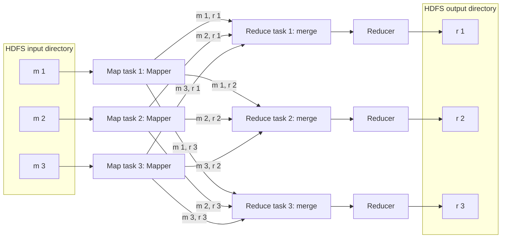
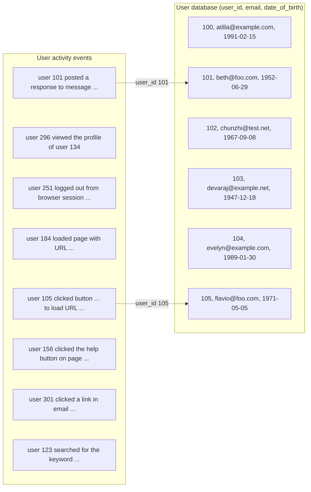
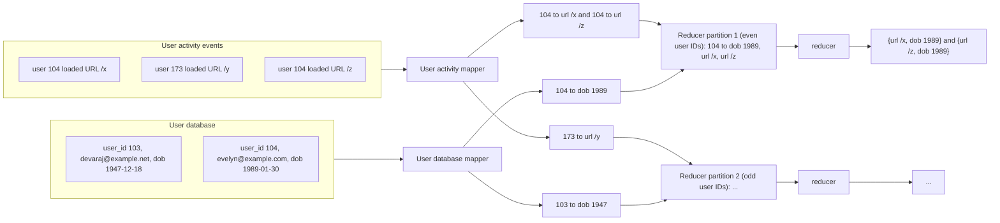
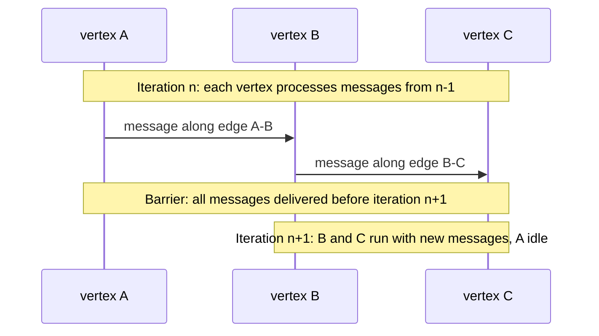

# Chapter 10 — Batch Processing
*Book: Chapter 10, pp. 389–438 (with the Part III introduction just before it)*

## Overview

### Part III opener: Derived Data (summary of the Part III introduction)

Parts I–II covered *one* distributed database. Real applications need to access data in many ways no single database handles well, so they combine an OLTP database (online transaction processing — the main everyday read/write store), a cache, a full-text search index, an analytics warehouse, and so on, plus plumbing to move data between them. Part III is about that **integration problem**, which "our product does everything" vendors tend to ignore but which is one of the most important jobs in any non-trivial application.

| Kind | What it means | Examples |
|---|---|---|
| **System of record** (*source of truth*) | Authoritative copy; new data (e.g. user input) is written here first; each fact stored once, usually **normalized** (no duplication). On disagreement it wins by definition. | The app's primary OLTP database |
| **Derived data system** | Data produced by transforming data from another system; if lost, it can be **rebuilt** from the source. | Caches, indexes, denormalized values, materialized views (stored precomputed query results), recommendation models |

- Derived data is **redundant** but often essential for fast reads; typically denormalized, and one source can feed several derived "views".
- Making the distinction explicit clarifies the system's **dataflow**: which component consumes and produces what.
- A database product is *not* inherently one or the other — it depends on **how your application uses it**.
- Part III plan: Chapter 10 batch dataflow (e.g. MapReduce); Chapter 11 the same ideas on streams (lower delay); Chapter 12 ties it together for future applications.

### What this chapter answers

**How do you process a huge, fixed pile of data (terabytes of logs, a database snapshot) into useful output, reliably, across many machines?**

| Style | Triggered by | Main metric | Example |
|---|---|---|---|
| **Services (online)** | Client request, waits for reply | Response time; availability | Web server, database, cache |
| **Batch processing (offline)** | A job (often scheduled, e.g. daily) over a large fixed input; runs minutes to days, nobody waits | **Throughput** — time to process an input of a given size | MapReduce, Spark |
| **Stream processing (near-real-time / nearline)** | Consumes events shortly after they occur; inputs and outputs, not request/response | Lower latency than batch | Chapter 11 |

Batch jobs build search indexes, recommendation models, analytics tables and derived databases; their ideas (immutable inputs, derived outputs, rerunnable jobs) underpin stream processing and Part III's derived-data architecture.

History:
- **MapReduce** was published by Google in **2004** (once over-enthusiastically called the algorithm behind Google's scalability) and implemented in **Hadoop**, **CouchDB** and **MongoDB**.
- Compared with older data-warehouse parallel query engines it is *low-level*, but it enabled processing at unprecedented scale on cheap **commodity machines** (see [System Design Fundamentals](../00a-system-design-fundamentals/README.md)). Its importance is declining, but it is still the clearest way to understand batch processing.
- Batch processing predates computers: **Hollerith** punch-card tabulating machines computed statistics for the **1890 US Census**, and MapReduce eerily resembles the **IBM card sorters** used for **business data processing** in the 1940s–50s.

**Analogy:** a bank's end-of-day reconciliation — tellers serve customers one at a time (online); at night a clerk sorts the day's slips by account and totals each (batch). What matters is finishing the stack by morning.

## Key terms

| Term | Plain-English meaning |
|---|---|
| System of record / source of truth | Authoritative copy; written first; wins disagreements |
| Derived data | Computed from other data; rebuildable (caches, indexes, views) |
| Online system / batch / stream | Request-response judged by latency / bounded job judged by throughput / events processed soon after they happen |
| Throughput | Data processed per unit of time |
| Bounded input | Known, fixed-size input, so the job can finish |
| Working set | Data a job needs random access to in memory |
| Unix pipe | Connects stdout of one program to stdin of the next via a small memory buffer |
| Uniform interface | Every program reads/writes the same kind of thing (Unix: a file descriptor = byte sequence) |
| stdin / stdout | A program's default input and output streams |
| Loose coupling / late binding / inversion of control | The program doesn't choose its input/output; the caller wires it |
| HDFS / NameNode | Hadoop Distributed File System (open-source GFS) / its central server tracking which machine holds which block |
| Shared-nothing | Each machine has its own CPU, RAM, disks; only a normal network connects them |
| Erasure coding (e.g. Reed–Solomon) | Redundancy codes that rebuild lost data using less space than full copies |
| MapReduce / mapper / reducer | Model where a stateless *mapper* emits key-value pairs per record, the framework sorts by key, and a *reducer* processes each key's values via an iterator |
| Shuffle | Partitioning mapper output by reducer, sorting, copying to reducers (no randomness) |
| Data locality | Running a task on a machine that already holds its input |
| Workflow / workflow scheduler | Chain of jobs linked by output→input directories / tool that starts jobs when inputs are ready (Oozie, Azkaban, Luigi, Airflow, Pinball) |
| Join / equi-join | Combining records that refer to each other / matching on equal field values |
| Full table scan | Reading every input record |
| Activity events / clickstream | Log of actions logged-in users took on a site |
| Sort-merge join | Reduce-side join: both inputs keyed by join key, sorted, merged in the reducer |
| Secondary sort | Ordering values *within* a key (e.g. user record first, then events by time) |
| Sessionization | Grouping one user session's events to see the action sequence |
| Skew / hot spot; hot key / linchpin object | One partition gets far more work; a key with disproportionate data (e.g. a celebrity) |
| Reduce-side vs map-side join | Join in reducers after shuffle (no input assumptions) vs in mappers only, exploiting known input properties |
| Broadcast hash join | Small input loaded into a hash table in every mapper of the large input |
| Partitioned hash join (bucketed map join) | Both inputs partitioned identically; each mapper joins one matching pair of partitions |
| Map-side merge join | Inputs partitioned *and sorted* identically; mapper merges them |
| Immutable | Never modified once written |
| Human fault tolerance | Recovering from buggy code by rolling back and rerunning |
| MPP database | Massively parallel processing database running analytic SQL over a cluster |
| Data lake / enterprise data hub | Raw organizational data dumped in one place, schema decided later |
| Schema-on-read | The reader interprets structure, not enforced at write time |
| Sushi principle | "Raw data is better" — keep it unprocessed so many views can be derived |
| Preemption | Killing a low-priority task to free resources for a higher-priority one |
| Materialization | Eagerly computing an intermediate result and writing it out |
| Straggler | A task much slower than its peers |
| Dataflow engine / operator | Engine (Spark, Tez, Flink) running a whole multi-stage workflow as one job / its generalized processing function |
| RDD | Spark's Resilient Distributed Dataset, recording how each piece of data was computed |
| Checkpoint | Saving state durably so computation can resume |
| Deterministic operator | Same input → same output |
| Pipelined execution | Passing output to the next operator incrementally |
| DAG | Directed acyclic graph — how dataflow engines arrange operators (not graph data!) |
| Transitive closure | Repeatedly following edges until no new vertices are reached |
| BSP / Pregel model | Graph processing in rounds; vertices message each other between rounds |
| "Thinking like a vertex" | Writing graph code from one vertex's viewpoint |
| Declarative query language / cost-based optimizer | State *what*, optimizer decides *how* / picks join algorithm and order by estimated cost |
| Vectorized execution | Tight CPU-cache-friendly loops without per-record function calls |
| k-nearest neighbors | Finding items closest to a given item in multi-dimensional space |

## Batch Processing with Unix Tools

Unix design ideas carry straight over to huge distributed systems.

Running example: a web server log, one line per request. nginx's default format records client IP, a literal hyphen, remote user (hyphen if not logged in), local time, request line (method, path, protocol), HTTP status (200 OK, 404 not found), response bytes, referrer URL and user-agent (browser/OS) string. The book's sample decodes as: on 27 Feb 2015 at 17:55:11 UTC, IP 216.58.210.78 requested `/css/typography.css`, status 200, 3,377 bytes, Chrome 40, referred by `http://martin.kleppmann.com/`.

A made-up line in the same shape:

```text
10.1.2.3 - - [03/Mar/2021:08:00:01 +0000] "GET /blog/intro.html HTTP/1.1" 200 5120 "https://example.org/" "Mozilla/5.0 (X11; Linux x86_64) Firefox/86.0"
```

Fields: `$remote_addr` (`10.1.2.3`), fixed `-`, `$remote_user` (`-`), `$time_local`, `$request` (split on spaces, the URL is the **7th field**), `$status` (`200`), `$body_bytes_sent` (`5120`), `$http_referer`, `$http_user_agent`.

### Simple Log Analysis

**Goal:** the 5 most requested pages (own example, same idea):

```bash
cat /srv/logs/web-access.log |   # 1. stream the log file
  awk '{print $7}'           |   # 2. keep only field 7: the requested URL
  sort                       |   # 3. sort URLs so identical ones sit next to each other
  uniq -c                    |   # 4. collapse runs of identical lines, prefixing a count
  sort -r -n                 |   # 5. sort numerically (-n) by that count, biggest first (-r)
  head -n 5                      # 6. keep the first 5 lines only
```

`sort` makes a URL requested *n* times appear as *n* adjacent lines; `uniq -c` collapses *adjacent* duplicates with a count; the second sort ranks by count. (A footnote: `cat` is technically unnecessary, but makes the linear pipeline obvious.) Output looks like `4189 /favicon.ico`, `3631 /2013/05/24/...`. This one-liner processes **gigabytes in seconds** and is easy to tweak — skip CSS with `'$7 !~ /\.css$/ {print $7}'`, or count client IPs with `'{print $1}'`.

Learn `awk`, `sed`, `grep`, `sort`, `uniq` and `xargs`: analyses take minutes to write and run fast (a book reference claims command-line tools beating a Hadoop cluster by 235x).

#### Chain of commands versus custom program

Own Python version (the book uses Ruby):

```python
from collections import Counter

hits = Counter()                                   # dict of URL -> count, default 0
with open('/srv/logs/web-access.log') as f:
    for line in f:
        url = line.split()[6]                      # 7th whitespace field (index 6, zero-based)
        hits[url] += 1                             # bump that URL's counter
for url, n in hits.most_common(5):                 # sort by count descending, take top 5
    print(n, url)                                  # print "count url"
```

`Counter` is an in-memory **hash table** (finds a value by key in roughly constant time) from URL to count. Readability is partly taste; the *real* difference is execution on large inputs.

#### Sorting versus in-memory aggregation

| Approach | How it counts | Memory | Wins when |
|---|---|---|---|
| Hash table (script) | One counter per distinct URL | Proportional to **distinct** URLs (a million hits to one URL = one entry) | Working set fits in RAM — for most small/mid sites about 1 GB, even on a laptop |
| Sorting (pipeline) | Sort so duplicates are adjacent, count runs | Can spill to disk | Working set exceeds memory |

Sorting scales via the SSTable/LSM-tree trick (Chapter 3): sort chunks in memory, write sorted segments to disk, merge them. Mergesort's **sequential** I/O suits disks (a recurring theme). GNU Coreutils `sort` **spills to disk** automatically and **parallelizes across cores**, so the bottleneck becomes disk read speed.

### The Unix Philosophy

> **Historical note.** Doug McIlroy, inventor of Unix pipes, wrote in **1964** that programs should connect like segments of a garden hose.

The **1978** Unix philosophy, paraphrased:
1. Each program does one thing well; for new jobs write new programs rather than adding features.
2. Expect output to feed another, unknown program: no clutter, no rigid columnar/binary input, no interactive input.
3. Ship software (even an OS) for trial early, ideally in weeks; rebuild clumsy parts without fear.
4. Use tools rather than unskilled help to lighten programming, even if tools are thrown away later.

This (automation, rapid prototyping, incremental iteration, experimentation, splitting big projects) resembles today's **Agile** and **DevOps** movements. `sort` is the model tool: arguably better than most languages' standard-library sorts (which neither spill to disk nor use multiple threads), yet useful mainly combined with others like `uniq`. A shell like `bash` composes programs by different authors. What enables that?

#### A uniform interface

- If any output can feed any input, **all programs need one I/O interface** — in Unix a **file** (*file descriptor*): an ordered sequence of bytes.
- Many things fit behind it: a real file, a pipe (stdin, stdout, Unix sockets), a device driver (`/dev/audio`, `/dev/lp0`), a TCP socket.
- By convention many tools treat bytes as **ASCII text** with records separated by `\n` (0x0A); `awk`, `sort`, `uniq`, `head` assume this. The ASCII **record separator 0x1E** would arguably have been better — what matters is agreement.
- Parsing *within* a record is less standard (whitespace, tabs, CSV, pipes; `xargs` has about half a dozen options). `{print $7}` is cryptic — `{print $request_url}` would be nicer; structured formats like **Avro/Parquet** on Hadoop address this later.

> **Aside: the web as a uniform interface.** URLs and HTTP let any site link to any resource. Before that, each **bulletin board system (BBS)** had its own phone number and modem settings; following a reference meant hanging up, dialing another BBS and searching manually.

Few systems compose as well today: you can't pipe your email and shopping history through a tool into a spreadsheet. Even same-model databases make data movement hard — the **Balkanization of data**.

#### Separation of logic and wiring

- Tools read **stdin**, write **stdout** (default keyboard/screen), redirectable to files or piped; a pipe uses a small in-memory buffer, **not** disk.
- A program that ignores file paths and uses only stdin/stdout lets the shell user decide the wiring — **loose coupling**, **late binding**, **inversion of control**. You can drop your own tool (user-agent → browser, IP → country) into the pipeline.

Limits:
- **Several inputs or outputs** are awkward.
- You can't pipe output into a **network connection** (except via `netcat` or `curl`). BSD sockets broke "everything is a file"; research OSes **Plan 9** and **Inferno** expose TCP connections as files under `/net/tcp`.
- A program that opens files, subprocesses or connections itself owns that wiring (configurable via command-line options), losing shell flexibility.

#### Transparency and experimentation

- **Inputs are immutable** — rerun with different options without damaging input.
- **Stop anywhere**, pipe into `less`, inspect output — great for debugging.
- **Save a stage's output to a file** and restart later stages from it.

Blunt compared with a relational query optimizer, but superb for experimentation. **Biggest limitation: one machine** — hence Hadoop.

## MapReduce and Distributed Filesystems

MapReduce is roughly "Unix tools across up to thousands of machines" — blunt and brute-force but effective.
- One **job** ≈ one Unix **process**: one or more inputs → one or more outputs.
- It **doesn't modify input** and has **no side effects** besides output.
- Output files are written **once, sequentially**, never modified.
- Instead of stdin/stdout it uses a **distributed filesystem** — in Hadoop, **HDFS**, an open-source reimplementation of Google's **GFS**.

Others: **GlusterFS**, **Quantcast File System (QFS)**; object stores (**Amazon S3, Azure Blob Storage, OpenStack Swift**) are similar in many ways.

> **Footnote: HDFS vs object stores.** HDFS lets the scheduler run a task where a copy of its input lives (helps when network bandwidth is the bottleneck); object stores usually separate compute and storage. With **erasure coding**, the locality benefit disappears, since pieces from several machines must be combined.

**How HDFS works:**
1. **Shared-nothing**, unlike **shared-disk** storage — **NAS** (Network Attached Storage), **SAN** (Storage Area Network) — which needs a central appliance and special networks like **Fibre Channel**.
2. A **daemon** (background process) on every machine serves its local files over the network.
3. The **NameNode** records which blocks live where.
4. Together: one huge filesystem over all machines' disks.
5. Blocks survive failures via **replication** (copies, Chapter 5) or **erasure coding** like **Reed–Solomon codes** (less overhead) — like **RAID** but over an ordinary network.

Scale at writing: largest clusters had **tens of thousands of machines** and **hundreds of petabytes** (1 PB = 1,000 TB). Viable because commodity hardware and open-source software cost far less than a dedicated storage appliance.

### MapReduce Job Execution

The log example maps almost exactly:
1. **Read input files, split into records** (log: one line per record) — *input format parser*.
2. **Mapper** extracts key and value per record (log: `awk '{print $7}'`, key = URL, empty value) — *you write this*.
3. **Sort pairs by key** (log: first `sort`) — *implicit, always happens*.
4. **Reducer** walks sorted pairs; equal keys are adjacent, so little state is needed (log: `uniq -c`) — *you write this*.

- **Mapper:** called once per record; emits any number of pairs (including zero); **no state** between records.
- **Reducer:** called once per key with an **iterator** over its values (streamed, not all in memory); emits output records.

The second sort (ranking) needs a **second job** taking the first job's output. In short: mappers prepare data for sorting; reducers process sorted data.

Own pseudocode:

```python
def mapper(line):                 # called once per input record (one log line)
    fields = line.split()
    yield (fields[6], 1)          # key = URL, value = 1 (one hit)

def reducer(url, counts):         # called once per distinct key, after sort
    yield (url, sum(counts))      # counts is an iterator of all the 1s for this URL
```

#### Distributed execution of MapReduce

MapReduce **parallelizes across machines without parallel code**: mappers and reducers see one record/key at a time and don't know data locations, so the framework moves data.
- Mappers/reducers can be Unix tools but are usually functions — **Java classes implementing an interface** in **Hadoop MapReduce**, **JavaScript functions** in **MongoDB and CouchDB**.
- Parallelism comes from **partitioning** (Chapter 6): input is usually an HDFS directory, and **each file or block is a partition** handled by one **map task**.

*Figure 10-1 (redrawn): a job with three map tasks and three reduce tasks. Map task i reads input block m i from HDFS, and its mapper writes three sorted files "m i, r 1", "m i, r 2", "m i, r 3" on local disk, one per reducer. Reduce task j fetches file "m i, r j" from every map task, merges them, runs the reducer, and writes output r j to HDFS.*



1. **Map tasks near the data:** inputs are typically hundreds of MB; the scheduler runs each mapper on a machine holding a replica of its block if it has spare RAM/CPU — **putting the computation near the data** (less network copying, better locality).
2. **Ship code:** the framework copies the mapper code (e.g. **JAR files** for Java) to that machine and starts the task, which feeds its block to the mapper record by record.
3. **Reducers:** map task count = input block count; reduce task count is **chosen by the job author**. A key's reducer is picked by **hash of the key** (Chapter 6), so equal keys meet.
4. **Sort in stages:** each map task **partitions its output by reducer** and writes each partition as a **sorted file on local disk** (SSTable-like).
5. **Fetch:** when a mapper finishes, reducers download their partition's file from every mapper.
6. Steps 4–5 are the **shuffle** — despite the name, **no randomness**.
7. **Merge:** reducers merge files preserving order, so equal keys from all mappers are adjacent.
8. **Reduce:** per key, an iterator streams its records; arbitrary logic, any number of outputs.
9. **Output** goes to the distributed filesystem (one copy local, replicas elsewhere).

#### MapReduce workflows

- One job can count views per URL but not also rank them (needs a second sort), so jobs are chained into **workflows**.
- Hadoop has **no built-in workflow support**: chaining is implicit via **directory names** — more like commands writing **temporary files** than a pipe (see "Materialization of Intermediate State").
- Output is valid **only if the job fully succeeds** (partial output of failed jobs is discarded), so a job starts only after all its input-producing jobs succeed.
- **Workflow schedulers:** **Oozie, Azkaban, Luigi, Airflow, Pinball** manage dependencies and large job collections.
- Recommendation systems commonly run **50 to 100 MapReduce jobs**; many teams read each other's outputs, so tooling matters.
- Higher-level tools (**Pig, Hive, Cascading, Crunch, FlumeJava**) build and wire multi-stage workflows automatically.

### Reduce-Side Joins and Grouping

- Records reference each other via a **foreign key** (relational), **document reference**, or graph **edge**; code needing both sides needs a **join**. Denormalization reduces but rarely removes joins.
- Databases use an **index** for queries touching few records. MapReduce has **no indexes**: it reads **all** input — a **full table scan**. Absurd for a few records, reasonable for analytics, especially in parallel.
- So a batch "join" resolves **every** occurrence of an association across the dataset (all users at once), not one lookup.

> **Footnote: equi-joins.** The book's joins are **equi-joins** (matching identical values); more general joins (e.g. less-than) aren't covered.

#### Example: analysis of user activity events

*Figure 10-2 (redrawn): on the left, a log of user activity events (each mentions only a user ID); on the right, a user database table with user_id, email and date_of_birth. The arrows show two events being matched to their user rows (values as in the book's figure).*



The **activity events** (**clickstream data**) are the star schema's **fact table**, the user DB a **dimension** (Chapter 3). Goal: correlate activity with profiles, e.g. which pages are popular with which age groups. Events carry only user IDs (copying profiles in would be wasteful), so we must join.

**Naive approach — query a remote user DB per event — fails:** throughput capped by **round-trip time**; a cache helps only with favorable distributions; parallel queries can **overwhelm the database**; and the job becomes **nondeterministic** because the DB changes during the run.

**Better:** keep computation local. Copy the user DB into HDFS (e.g. from a backup via **ETL** — Extract, Transform, Load) next to the events, so MapReduce can bring matching records together.

#### Sort-merge joins

*Figure 10-3 (redrawn): joining on user ID in the reducers via sort-merge, using the book's example values. The activity mapper turns each event into (user ID, URL); the user-database mapper turns each profile into (user ID, date of birth). Partitioning sends even-numbered user IDs to reducer partition 1 and odd-numbered ones to partition 2. Partition 1's reducer sees user 104's date of birth first, then both URLs, and outputs one joined record per URL. (If an input is split across several files, several mappers can process it in parallel.)*



1. One set of mappers emits (user ID, event); another emits (user ID, date of birth). Multiple files → parallel mappers.
2. Partitioning and sorting make each user's record and events **adjacent** in one reducer.
3. A **secondary sort** delivers the **user record first**, then events in **timestamp order**.
4. The reducer, called once per user ID, stores the date of birth and emits (viewed URL, viewer age) per event. Later jobs can compute age distributions per URL.

Efficient: **one user record in memory** at a time, **no network requests**. Named **sort-merge join** because mapper output is sorted by key and the reducer merges both sorted inputs.

Own pseudocode:

```python
def event_mapper(event):                    # input 1: activity events
    yield (event['uid'], ('E', event['ts'], event['url']))

def user_mapper(user):                      # input 2: user profiles
    yield (user['uid'], ('U', user['birth_year']))

def join_reducer(uid, values):              # values arrive user-record-first (secondary sort)
    birth_year = None
    for v in values:
        if v[0] == 'U':
            birth_year = v[1]               # remember the one profile field we need
        elif birth_year is not None:
            _, ts, url = v
            yield (url, 2021 - birth_year)  # emit (page, approximate viewer age)
```

The `'U'`/`'E'` tag tells the reducer which input a value came from.

#### Bringing related data together in the same place

- Everything for one key lands in **one reducer call**, so reducers are simple, single-threaded, high-throughput, low-memory code.
- Mental model: mappers **"send messages"** to reducers; the key is the **destination address**.
- MapReduce **separates network communication from application logic** (unlike databases, where fetches hide inside app code), and the framework shields your code from **partial failures** by transparently retrying failed tasks.

#### GROUP BY

Grouping (SQL `GROUP BY`) uses the same pattern: mappers emit the **grouping key**, then aggregate per group — count records (`COUNT(*)`), sum a field (`SUM(fieldname)`), take the top *k*. So **grouping and joining look very similar** on MapReduce.

```sql
SELECT url, COUNT(*) AS views      -- one output row per distinct URL
FROM page_views                    -- the input "table" (log records)
GROUP BY url;                      -- in MapReduce: mapper emits url as the key
```

**Sessionization** groups a user session's events to see their sequence — e.g. for **A/B testing** (show versions to random groups and compare purchases) or judging a marketing campaign. One user's events are scattered over many web servers' logs, so group by **session cookie** or user ID.

#### Handling skew

When **one key has huge data** — e.g. **celebrities** with millions of followers (**linchpin objects** / **hot keys**) — its reducer gets **skew** (a **hot spot**). A job finishes only when **all** tasks finish, so everything waits for the slowest reducer.

| Technique | How it works | Cost / requirement |
|---|---|---|
| **Pig skewed join** | A **sampling job** finds hot keys; hot-key records go to **a random one of several reducers**, and the other input's matching records are **replicated to all** of them | Replicating the other input |
| **Crunch sharded join** | Same idea | Hot keys **specified explicitly** (no sampling) |
| **Hive skewed join optimization** | Hot keys declared in **table metadata**, stored in **separate files**, joined with a **map-side join** | Explicit declaration |
| **Two-stage aggregation** (grouping) | Stage 1: records go to **random reducers** that emit compact partial aggregates; stage 2 combines them per key | Extra job |

The random-reducer trick mirrors hot-spot relief in partitioned databases (Chapter 6, "Skewed Workloads and Relieving Hot Spots").

### Map-Side Joins

| | Reduce-side join | Map-side join |
|---|---|---|
| Input assumptions | **None** | Known properties (size, partitioning, sorting) |
| Cost | Sorting, copying and merging are **expensive**; data may hit disk several times | Faster: no reducers, no sorting |
| Structure | Mappers + shuffle + reducers | Each mapper reads one input block, writes one output file |

#### Broadcast hash joins

**When:** a **large** input joined with one **small enough to fit in memory**. Each mapper (one per block of the large input) loads the **entire** small input from HDFS into an **in-memory hash table**, then scans its block and probes per record. **Broadcast**: the small input goes to every partition of the large one. Supported by **Pig** ("replicated join"), **Hive** ("MapJoin"), **Cascading**, **Crunch**, and **Impala**.

> **Footnote.** One entry per key is assumed (one user per ID); in general the table may hold several and the join outputs every match.

Variant: store the small input as a **read-only index on local disk**; hot parts stay in the OS **page cache**, nearly as fast as memory without needing to fit in RAM.

#### Partitioned hash joins

**When:** both inputs are **partitioned the same way** — e.g. by the **last decimal digit of user ID** (10 partitions each); **mapper 3** loads users ending in 3 into a hash table and scans events for those users. Each mapper reads one partition of each input, with a smaller hash table. Requires the **same number of partitions**, **same key** and **same hash function** — plausible if earlier jobs grouped them so. Hive calls these **bucketed map joins**.

#### Map-side merge joins

**When:** inputs are partitioned **and sorted by the same key** identically. Neither needs to fit in memory: the mapper merges both files incrementally in key order, like a reducer. The join could have been done in the earlier job's reduce stage, but a separate map-only join makes sense if other jobs also want those datasets.

#### MapReduce workflows with map-side joins

- **Reduce-side** join output is **partitioned and sorted by join key**; **map-side** output follows the **large input's** layout.
- Map-side joins require knowing datasets' **physical layout** — encoding, directory, **number of partitions**, and partitioning/sorting **keys** — often kept in **HCatalog** and the **Hive metastore**.

### The Output of Batch Workflows

**OLTP** queries look up a few records by key via indexes; **analytic** queries scan, group and aggregate into **reports** (Chapter 3). Batch is closer to analytics but often produces **some other kind of structure rather than a report**.

#### Building search indexes

- Google's **original** MapReduce use was building search indexes — **5 to 10 chained jobs**. Google later moved on, but **Hadoop MapReduce remains a good way to build indexes for Lucene/Solr** (Lucene: open-source search library; Solr: server built on it).
- A **Lucene** full-text index (Chapter 3) maps each keyword (**term dictionary**) to the document IDs containing it (**postings list**), plus ranking, spelling and synonym data.
- Batch build: mappers **partition documents**, each reducer **indexes its partition**, files go to HDFS — **document-partitioned** indexes (Chapter 6) parallelize well. Index files are **immutable**.

| Option on document changes | How | Pros | Cons |
|---|---|---|---|
| Periodic full rebuild | Rerun everything, swap index files wholesale | Simple: documents in, indexes out | Expensive for few changes |
| Incremental | Lucene writes new **segment files** and merges/compacts them in the background (Chapter 3) | Efficient for small changes | More complex (Chapter 11) |

#### Key-value stores as batch process output

**Machine learning** systems — **classifiers** (spam filtering, anomaly detection, image recognition) and **recommendation systems** (people you may know, related products) — usually output a **database** queried by user or product ID, served by a web app **separate** from the Hadoop cluster.

**Bad: write records one by one from mappers/reducers into the production DB** (if firewalls allow):
1. A network request **per record** is orders of magnitude slower than batch throughput, even with client-side batching.
2. Many parallel tasks can **overwhelm the database**, hurting serving.
3. It breaks MapReduce's **all-or-nothing** guarantee (a successful job's output equals each task running once; a failed job produces none): external writes are **visible side effects**, raising partial-result issues with Hadoop **task attempts** and **speculative execution** (running a duplicate of a slow task and keeping whichever finishes first).

**Good: build a fresh database as files** in the job's HDFS output, then **bulk-load** them into read-only servers.
- Stores supporting this: **Voldemort**, **Terrapin**, **ElephantDB**, **HBase bulk loading**.
- Fits MapReduce: extracting and sorting by key is much of building an index.
- Read-only stores are simple — e.g. **no WAL** (write-ahead log) needed.
- **Voldemort loading:** keep serving **old** files; download new files from HDFS; **atomically switch** to them (no request sees a half-switched state); **switch back** if anything goes wrong, since old files are immutable and still there.

#### Philosophy of batch process outputs

Like Unix (read input, write output, leave input alone, fully replace output, no other side effects), MapReduce's immutability and side-effect-free outputs give performance **and** maintainability:
- **Easy bug recovery:** roll back code and rerun, or switch back to the old output directory. With read-write databases, rolling back code **doesn't undo** bad writes. This is **human fault tolerance**.
- **Faster development:** **minimizing irreversibility** aids Agile.
- **Safe automatic retries:** a crashing bug fails the job after a few tries; transient faults are tolerated — safe only because inputs are immutable and failed outputs discarded.
- **Input reuse,** including **monitoring jobs** that compute metrics and compare output with previous runs.
- **Separation of logic and wiring:** one team writes a job; others decide where and when it runs.

Unlike Unix's untyped text and parsing (`{print $7}`), Hadoop often uses structured formats: **Avro** (Chapter 4; e.g. object container files) and **Parquet** (columnar, Chapter 3) — efficient schema-based encoding with schema evolution.

### Comparing Hadoop to Distributed Databases

Hadoop is a distributed Unix: **HDFS** is the filesystem and **MapReduce** an oddly specific process that always runs `sort` between map and reduce. Its algorithms were **not new**: **massively parallel processing (MPP) databases** — **Teradata**, **Tandem NonStop SQL**, the **Gamma database machine** — had them over ten years earlier. **Biggest difference:** MPP databases run **analytic SQL in parallel**; MapReduce + a distributed filesystem is more like a **general-purpose operating system** running **arbitrary programs**.

#### Diversity of storage

- Databases impose a data model; HDFS files are **just bytes** — DB records, text, images, video, genome sequences, sensor readings, feature vectors, sparse matrices.
- Hadoop let you **dump data first and figure out processing later**; MPP databases need careful up-front modeling into proprietary formats. Purists prefer modeling, but **making data available quickly** often matters more.
- Like a **data warehouse**, collecting data enables joins across previously separate datasets; collecting raw data and designing schemas later is a **data lake** or **enterprise data hub**.
- Interpretation shifts to the **consumer** (**schema-on-read**, Chapter 2) — useful when producer and consumer teams differ; there may be no single ideal model. This is the **sushi principle: "raw data is better."**
- Hence Hadoop for **ETL**: dump raw OLTP data into HDFS, clean/transform with MapReduce into relational form, load into an MPP warehouse — modeling **decoupled from collection**.

#### Diversity of processing models

| | MPP database | Hadoop |
|---|---|---|
| Architecture | **Monolithic**: storage, planning, scheduling, execution tuned together | Open platform: many models over shared files |
| Strength | Excellent on designed-for queries; SQL usable from **BI** (business intelligence) tools like **Tableau** without code | **Arbitrary code** over large datasets |
| Weakness | Not everything fits SQL | Raw MapReduce limited/slow for some tasks |

- ML, recommendations, full-text search with ranking, image analysis — feature engineering, language models, fraud risk — need **code, not just queries**.
- You can build SQL on HDFS + MapReduce (**Hive** did) plus jobs SQL can't express; when MapReduce proved too slow/limiting, Hadoop's openness allowed new models ("Beyond MapReduce").
- All run on **one shared cluster** over the **same files** — no importing into several specialized systems.
- The ecosystem includes **HBase** (LSM-based random-access OLTP) and **Impala** (MPP-style analytics): **neither uses MapReduce, both store data in HDFS**.

#### Designing for frequent faults

| | MPP databases | MapReduce |
|---|---|---|
| Node crash mid-query | **Abort the whole query** (fine for seconds-to-minutes queries) | **Retry only the failed task** |
| Memory vs disk | Keep data **in memory** (e.g. hash joins) | **Eager to write to disk** — for fault tolerance and because data won't fit anyway |
| Best for | Short queries | Huge, long jobs likely to hit a task failure |

Batch jobs are less fault-sensitive (no immediate user impact; rerunnable). Task-level recovery slows the fault-free case, and machine failures are rare — so why?

**Google's environment:**
1. **Mixed-use datacenters**: online services and batch share machines.
2. Each task gets a fixed **resource share** (cores, memory, disk) enforced by **containers**.
3. Tasks have **priorities**; lower-priority tasks are **preempted** when higher ones need resources.
4. Priority sets **price** — higher costs more.
5. Low-priority resources can be **overcommitted**, improving utilization versus segregating production and batch.
6. MapReduce runs at low priority — batch jobs "pick up the scraps under the table".

At Google, a **one-hour** task has about a **5% risk** of preemption — **more than 10x** the rate from hardware failures, reboots etc. A job of **100 tasks of 10 minutes** has a **greater than 50% risk** that at least one is killed. So MapReduce tolerates frequent task kills **not because hardware is unreliable** but because killing processes enables better utilization.

Open source: **YARN's CapacityScheduler** preempts to balance queues, but **general priority preemption** was missing from **YARN, Mesos and Kubernetes** at the time; where tasks are rarely killed, MapReduce's choices make less sense.

## Beyond MapReduce

- MapReduce is one programming model among several. The book dwells on it because it is a **clear, simple abstraction** — simple to *understand*, not to *use* (e.g. you implement joins yourself with raw APIs).
- **Pig, Hive, Cascading, Crunch** make common tasks easier and are easy to learn if you know MapReduce.
- Some problems lie in the **execution model** itself and show as poor performance. MapReduce is **very robust** (finishes almost any job on unreliable, **multi-tenant** clusters with frequent kills, just slowly); other tools can be **orders of magnitude faster**. Chapter 11 treats streaming as another speedup.

### Materialization of Intermediate State

- Jobs are **independent**, linked via input/output directories and an external scheduler. That's good when output is a dataset **published widely** (others reuse it by name — **loose coupling**).
- Often, though, output feeds **one other job** by the **same team** — just **intermediate state** (plenty of it in 50–100-job workflows).
- Writing it out is **materialization** (eagerly computing and storing a result, as in materialized views). Unix pipes **stream** instead through a small buffer.

Downsides of full materialization:
1. **Waiting for stragglers:** a job starts only when **all** tasks of its predecessors finish; skew and load create **straggler** tasks that slow the workflow.
2. **Redundant mappers:** mappers often just re-read a reducer's output to repartition/sort; reducers could be chained directly.
3. **Over-replication:** intermediate files are **replicated across nodes** — overkill for temporary data.

#### Dataflow engines

**Spark**, **Tez** and **Flink** handle **the entire workflow as one job** — **dataflow engines**. Like MapReduce they call a user function **one record at a time, single-threaded**, parallelize by **partitioning**, and ship output over the network. Unlike it, functions are general **operators** connected by:
1. **Repartition and sort by key** (like the shuffle) — for sort-merge joins and grouping.
2. **Partition identically without sorting** — for partitioned hash joins (hashing scrambles order anyway).
3. **Broadcast** the same output to all partitions — for broadcast hash joins.

Based on research systems **Dryad** and **Nephele**. Advantages:
- **Sort only where needed.**
- **No unnecessary map tasks** — mapper work folds into the previous operator (it doesn't change partitioning).
- **Locality:** declared dependencies let the scheduler co-locate producer and consumer, exchanging data via a **shared memory buffer**.
- **Intermediate state in memory or local disk**, far less I/O than replicated HDFS (generalizing what MapReduce did for mapper output).
- **Operators start as soon as input is ready.**
- **Reuse JVM processes** instead of a **new JVM per task** (slow startup).

Same computations, usually **significantly faster**. **Pig, Hive or Cascading workflows can switch from MapReduce to Tez or Spark by configuration**, without code changes. **Tez** is a **thin library** using the **YARN shuffle service** to move data; **Spark and Flink** are **big frameworks** with their own network layer, scheduler and APIs.

#### Fault tolerance

- MapReduce: durable materialized data → failed task restarts elsewhere on the same input.
- Spark, Flink, Tez **keep intermediate state out of HDFS**, so lost state is **recomputed** from an earlier stage or the original input. The framework must know each piece's **recipe** (source partitions and operators): **Spark's resilient distributed dataset (RDD)** tracks **ancestry**; **Flink checkpoints operator state**.

**Determinism matters:** if recomputed data differs from what downstream already consumed, downstream operators must be **killed and rerun** too. Make operators **deterministic**; watch for **unordered hash-table iteration**, **random numbers** (use pseudorandom numbers with a **fixed seed**), the **system clock** and **external data sources**.

Recomputation isn't always best: if an intermediate result is **much smaller** than its source or **CPU-expensive**, materializing is cheaper.

#### Discussion of materialization

- MapReduce ≈ writing each command's output to a temp file; dataflow engines ≈ **Unix pipes** — **Flink** especially uses **pipelined execution**.
- **Sorting** must consume all input before emitting (the last record may have the smallest key), so sort operators accumulate state; most other stages pipeline.
- Inputs and final outputs still usually live on HDFS (immutable inputs, fully replaced outputs) — the gain is not materializing **intermediate** results.

| | MapReduce workflow | Dataflow engine (Spark/Tez/Flink) |
|---|---|---|
| Unit of scheduling | Independent jobs chained by directories | Whole workflow as one job (DAG of operators) |
| Intermediate state | HDFS, replicated | Memory or local disk |
| Sorting | Always between map and reduce | Only where needed |
| Next stage starts | After all preceding tasks finish | As soon as input is ready |
| Fault recovery | Rerun failed task on durable input | Recompute from lineage (RDD) or checkpoints (Flink) |
| Process startup | New JVM per task | Reuse JVMs |

### Graphs and Iterative Processing

Chapter 2 covered graph **OLTP** queries; here, **batch** analysis over **entire graphs** for ML (recommendations) and ranking — famously **PageRank**, estimating a page's popularity from incoming links for search ranking.

> **Naming confusion warning.** Dataflow engines arrange operators as a **directed acyclic graph (DAG)** — that is *not* graph processing: there the *flow* is a graph while records are relational-style tuples; in graph processing the *data* is the graph.

Many graph algorithms follow **one edge at a time**, passing information between neighbors, **until done** (no more edges, or a metric **converges**) — e.g. Figure 2-6's places within North America is a **transitive closure**. MapReduce does a **single pass**, so iteration needs an **external scheduler**: run one step; check the **completion condition**; repeat. Very **inefficient**: each iteration reads the **whole input** and writes a **whole new output** even if little changed.

#### The Pregel processing model

The **bulk synchronous parallel (BSP)** model — implemented by **Apache Giraph**, Spark's **GraphX**, Flink's **Gelly**; also the **Pregel model** after Google's paper. As mappers "send messages" to reducers, in Pregel **a vertex sends messages to other vertices**, usually along edges:
1. Computation runs in **iterations**.
2. Each iteration calls a function **once per vertex** with its incoming messages (like a reducer call).
3. A vertex **keeps its state in memory** between iterations, so only **new** messages are processed.
4. Quiet regions of the graph need **no work**.
5. Between rounds, the framework delivers all messages from the previous round.

Like the **actor model** (Chapter 4: actors with private state communicating by messages), but vertex state and messages are **durable and fault-tolerant**, and communication is in **fixed rounds**.

*Illustrative sketch (no numbered figure in the book): one Pregel superstep.*



Own vertex-centric pseudocode (shortest distance from a source):

```python
def compute(vertex, messages):                # called once per vertex per iteration
    best = min(messages, default=vertex.value)
    if best < vertex.value or vertex.first_round:
        vertex.value = best                   # state is kept in memory across rounds
        for edge in vertex.out_edges:
            send(edge.target, best + edge.weight)   # message delivered next round
    vertex.vote_to_halt()                     # inactive until a new message arrives
```

Each call sees one vertex and its messages; `vertex.value` persists between rounds; `send` addresses a vertex ID.

##### Fault tolerance (Pregel)

- Vertices communicate **only by messages** (no direct queries), so messages can be **batched** and waiting is reduced — the only wait is **between iterations**.
- Despite lossy, duplicating, delaying networks (Chapter 8), each message is processed **exactly once** by its target in the next iteration; recovery is invisible to the algorithm.
- Mechanism: **checkpoint all vertex state at the end of an iteration**; on node loss, **roll the whole computation back** to the latest checkpoint. With **deterministic** algorithms and **logged messages**, only **the lost partition** need be recovered.

##### Parallel execution

- Vertices message a **vertex ID**; the framework partitions the graph and routes messages. Thanks to **"thinking like a vertex"**, any partitioning works — ideally co-locating chatty vertices, but that is hard, so graphs are often split by **arbitrarily assigned vertex ID**.
- Result: heavy **cross-machine communication**; messages can be **bigger than the graph**, slowing distributed graph algorithms.

| Graph size | Best approach |
|---|---|
| Fits in one machine's memory | A **single-machine** (even single-threaded) algorithm likely beats a distributed job |
| Exceeds memory but fits on one machine's disks | Single-machine frameworks like **GraphChi** |
| Too big for one machine | Distributed **Pregel**-style is unavoidable; efficient parallel graph algorithms are ongoing research |

### High-Level APIs and Languages

- Infrastructure now handles **many petabytes** on **over 10,000 machines**; with scale more or less solved, focus moved to a better **programming model**, more **efficient processing**, and a **wider range of problems**.
- **Hive, Pig, Cascading, Crunch** spared hand-written MapReduce and moved to **Tez** **without rewriting job code**; **Spark and Flink** have their own high-level dataflow APIs, often inspired by **FlumeJava**.
- They use **relational-style building blocks** (join on a field, group by key, filter, aggregate) implemented with this chapter's algorithms. Benefits: **less code**, **interactive use** in a shell (Unix-like exploration), and better **machine-level efficiency**.

Own PySpark-style example:

```python
views = spark.read.parquet("hdfs:///logs/views")            # large input
users = spark.read.parquet("hdfs:///snapshots/users")       # small input
by_age = (views.join(users, "uid")                          # declarative join: engine picks algorithm
               .groupBy("url", "age_band")                  # grouping by key
               .count())                                    # aggregation
by_age.write.parquet("hdfs:///derived/views_by_age")        # final output, materialized
```

The optimizer may pick a broadcast hash join if `users` is small; columnar Parquet reads only needed columns.

#### The move toward declarative query languages

- Joins as **relational operators** let the framework **choose the join algorithm**; **Hive, Spark and Flink** have **cost-based query optimizers** that can also **reorder joins** to minimize intermediate state. This is the **declarative** idea from Chapter 2 ("Query Languages for Data").
- Unlike fully declarative SQL, these systems use **function callbacks** running **arbitrary code**, giving access to huge library ecosystems (parsing, NLP, image analysis, numerics) — long a distinction from **MPP databases**, whose **user-defined functions** are cumbersome and poorly integrated with package managers (**Maven**, **npm**, **Rubygems**).
- Declarative features beyond joins also pay off: a per-record callback for simple filtering/projection costs **CPU overhead**, whereas declarative filters let the optimizer use **column-oriented storage** and read only needed columns. **Hive, Spark DataFrames and Impala** use **vectorized execution**; **Spark generates JVM bytecode**, **Impala uses LLVM** to emit native code.
- Net: batch frameworks **look more like MPP databases** in performance while keeping the **flexibility** of arbitrary code and formats.

#### Specialization for different domains

Common patterns deserve reusable building blocks; MPP databases traditionally serve **business intelligence** and reporting, just one domain:
- **Statistical/numerical ML algorithms** (classification, recommendation): **Mahout** (on MapReduce, Spark, Flink) and **MADlib** (inside **Apache HAWQ**, a relational MPP database).
- **Spatial algorithms** like **k-nearest neighbors** (similarity search).
- **Approximate search** for **genome analysis** (similar but not identical strings).

Batch systems gain declarative operators while MPP databases become more programmable — the two **converge**; both are just systems for storing and processing data.

## Chapter summary

- **Unix roots:** `awk`, `grep`, `sort` embody **immutable inputs**, outputs for an **unknown next program**, and **composing small tools**.
- **Uniform interface:** Unix files and pipes; MapReduce the **distributed filesystem**; dataflow engines add pipe-like transport, but initial input and final output usually stay on HDFS.
- **Two core problems:**
  - **Partitioning:** mappers per input block; output **repartitioned, sorted and merged** into the configured reducer partitions to bring equal keys together. Dataflow engines sort only when needed.
  - **Fault tolerance:** MapReduce writes to disk often (easy task recovery, slower fault-free runs); dataflow engines keep more in memory and recompute more; **deterministic operators** limit recomputation.
- **Joins:** **sort-merge** (partition, sort, merge into one reducer call); **broadcast hash** (small input in each mapper's hash table); **partitioned hash** (identical partitioning, per-partition hash join).
- **Restricted programming model hides distributed-systems problems:** callbacks are **stateless** with **no external side effects**, so tasks retry safely, failed outputs are discarded, and only one successful attempt per partition is visible — output equals a fault-free run, far stronger than online services updating databases as side effects.
- **Defining feature:** batch reads **bounded** input (fixed size, e.g. logs at a point in time or a DB snapshot) and writes **derived** output without modifying input, so it knows when it's done and **finishes**.
- **Next:** stream processing — **unbounded** input, so a job never completes.

## Interview angle

**1. Explain MapReduce in 30 seconds.**
A batch framework over a distributed filesystem. A *mapper* turns each record into key-value pairs; a *reducer* processes all values of one key. The framework runs mappers near the data (one per block), partitions output by key hash, sorts, ships partitions to reducers (the shuffle), merges and calls the reducer per key; output goes to HDFS. Inputs are never modified, so failed tasks retry safely.
- *Follow-up: Why always a sort?* Equal keys become adjacent so reducers need little memory; external merge sort with sequential I/O scales past RAM.
- *Follow-up: What is the shuffle?* Partitioning mapper output by reducer, sorting on mapper local disk, reducers fetching and merging their partition from every mapper. No randomness.

**2. How do you join two large datasets in a batch job?**
Default: **reduce-side sort-merge join** — map both to (join key, record), shuffle, optionally secondary-sort, join in the reducer. Small side: **broadcast hash join**. Identically partitioned: **partitioned hash join**; also sorted: **map-side merge join**. Never query a remote DB per record (slow, overloads it, nondeterministic).
- *Follow-up: Hot key (celebrity)?* Detect hot keys (Pig samples; Crunch/Hive need declaration), spread them over random reducers and replicate the other side; for aggregation, two-stage aggregation.
- *Follow-up: Does join choice affect downstream jobs?* Yes: reduce-side output is partitioned/sorted by join key; map-side follows the large input's layout.

**3. How should a batch job publish results to a serving database?**
Not record-by-record into production (slow, overloads it, breaks all-or-nothing with visible partial results and duplicate attempts). Build immutable DB files in the job, write to HDFS, bulk-load into a read-only store (Voldemort, Terrapin, ElephantDB, HBase bulk load). Voldemort serves old files while copying, atomically switches, can switch back.
- *Follow-up: Operational benefit?* Human fault tolerance: roll back code and rerun, or point back to the previous output.

**4. MapReduce vs Spark/Flink (dataflow engines)?**
MapReduce materializes every intermediate result to replicated HDFS, always sorts, has redundant map stages, waits for whole jobs, starts a JVM per task. Dataflow engines run a DAG of operators, sort only when needed, keep intermediates in memory/local disk, pipeline, reuse JVMs and optimize locality; they recover by recomputing from lineage (RDD) or checkpoints (Flink).
- *Follow-up: Why does determinism matter?* If recomputed data differs from what downstream consumed, downstream must be rerun too. Avoid unordered hash iteration, unseeded randomness, clocks, external lookups.
- *Follow-up: When is recomputation worse?* When the intermediate result is tiny relative to its source or CPU-expensive.

**5. Why was MapReduce so eager to write to disk and retry per task?**
At Google batch runs at low priority and is preempted: an hour-long task has ~5% kill risk, over 10x hardware failure rates; 100 ten-minute tasks have >50% chance one is killed. Task-level retry avoids rerunning jobs. YARN, Mesos and Kubernetes mostly lacked general priority preemption then, so the trade-off fits less there.

**6. Hadoop vs MPP databases?**
MPP: monolithic, upfront schemas, excellent analytic SQL, aborts whole query on failure, in-memory. Hadoop: general-purpose OS-like — any format (raw dumps, schema-on-read, data lake, sushi principle) and any model (MapReduce, Hive SQL, Spark, HBase, Impala) on one cluster; retries tasks, spills to disk. They are converging.

## Self-check

1. **System of record vs derived data — can one product be either?**
   System of record: authoritative, normalized, written first. Derived: computed, rebuildable. Yes — it depends on how the application uses the tool.

2. **Why can `sort | uniq -c` handle more distinct URLs than a hash table?**
   `sort` spills sorted chunks to disk and merges them (sequential I/O); a hash table needs every distinct key in RAM.

3. **Three things that make Unix tools composable and easy to experiment with?**
   A uniform interface (byte-sequence files, newline-separated text), separation of logic and wiring (stdin/stdout), and transparency (immutable inputs, inspect any stage, save stage output).

4. **What decides the number of map and reduce tasks?**
   Map: number of input blocks. Reduce: the job author. A key's reducer is chosen by hashing the key.

5. **Scenario: join 10 TB of clicks with a 200 MB product table. Which join?**
   Broadcast hash join — the small table fits in memory in each mapper; no shuffle or sort.

6. **Three reasons not to write from reducers into a production DB?**
   Per-record calls are orders of magnitude slower; parallel tasks overwhelm the DB; external side effects break all-or-nothing output (partial results, retried and speculative attempts).

7. **What is "human fault tolerance" and how do immutable outputs provide it?**
   Recovering from buggy code: inputs unchanged and outputs fully replaced, so roll back and rerun or switch to the previous output. A read-write DB keeps the bad writes.

8. **Three drawbacks of materializing intermediate state, and the dataflow-engine fixes?**
   Waiting for stragglers, redundant mappers, replicating temporary files. Dataflow engines run one job, fold map work into previous operators, keep intermediates in memory/local disk, start operators when input is ready.

9. **Why is iterative graph processing slow in MapReduce; how does Pregel help?**
   Each iteration rereads and rewrites the whole graph. Pregel keeps vertex state in memory and processes only vertices with new messages, checkpointing at iteration boundaries.

10. **When might a single machine beat a distributed graph framework?**
    When the graph fits in memory (or on disk, with GraphChi): arbitrary vertex-ID partitioning causes heavy cross-machine messaging that can exceed the graph's size.

11. **What does "bounded input" mean and why is it batch's defining property?**
    Known, fixed-size input, so the job knows when it has read everything and finishes. Stream processing drops this.
