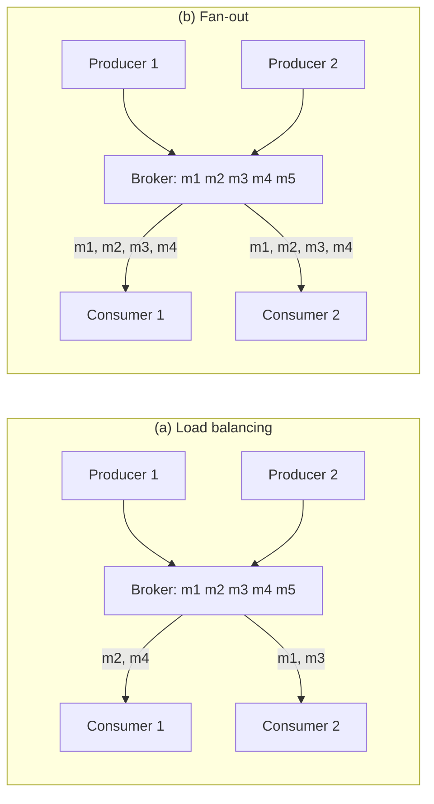
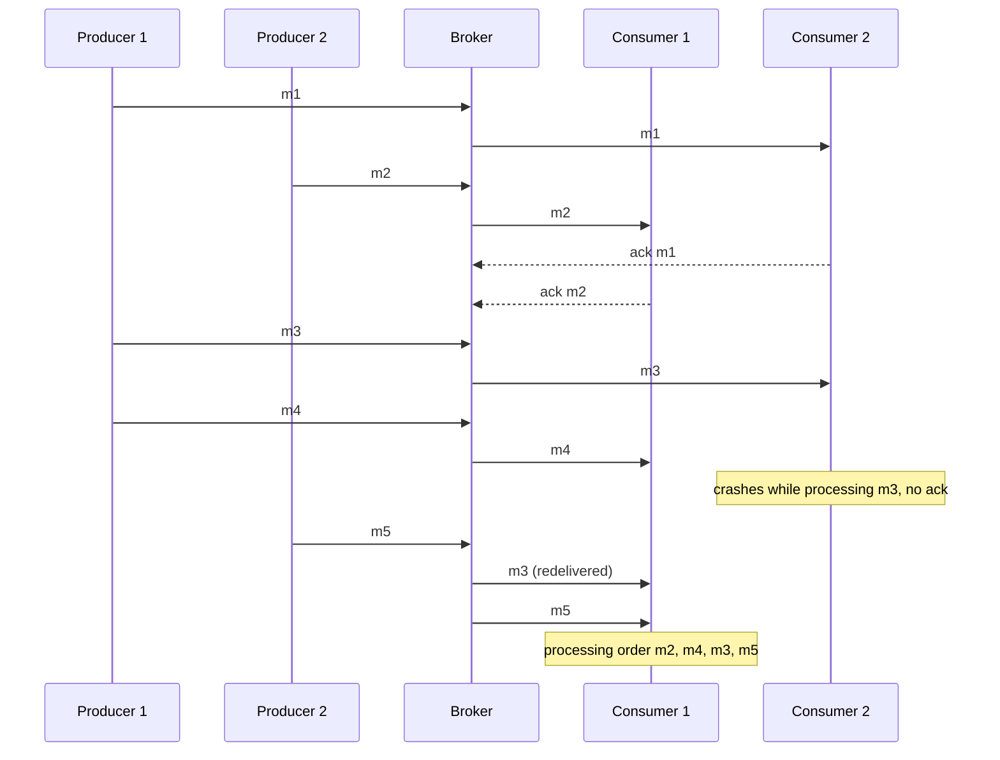
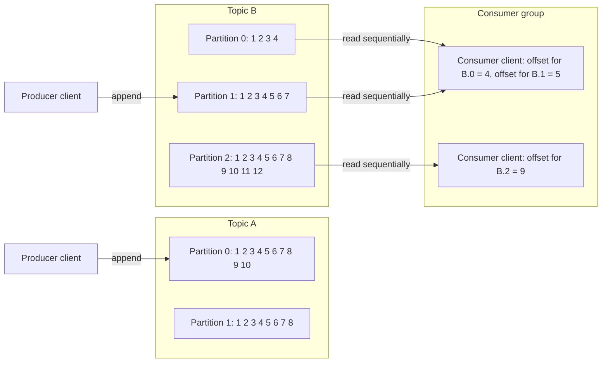
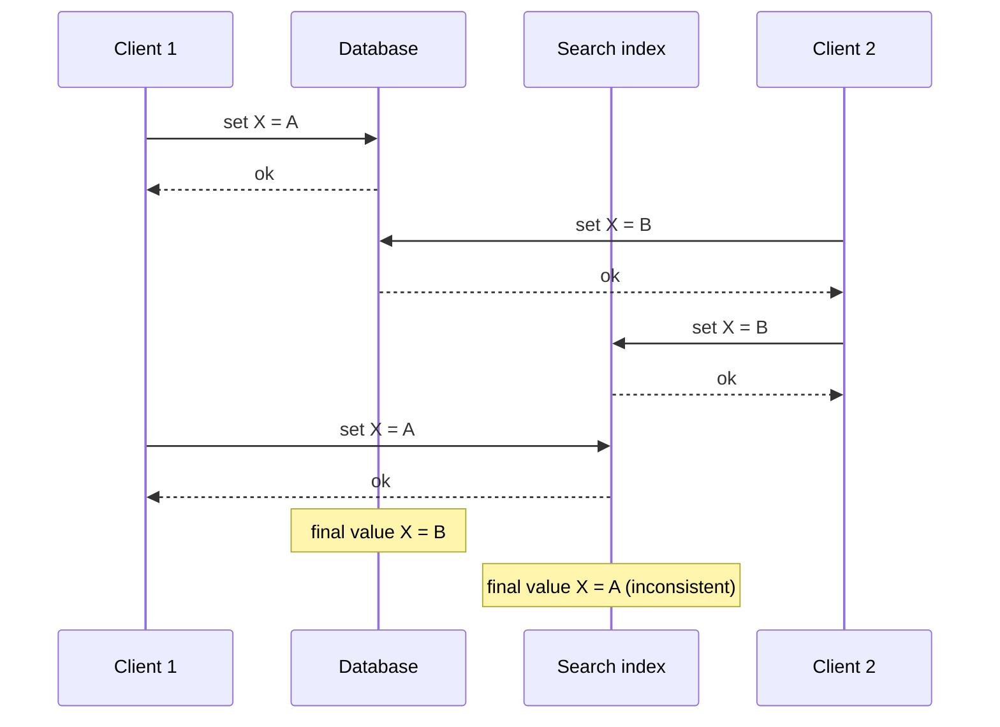
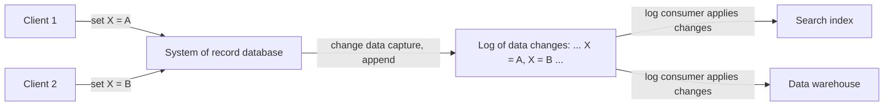
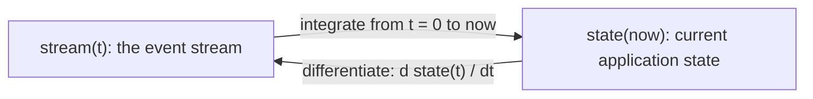
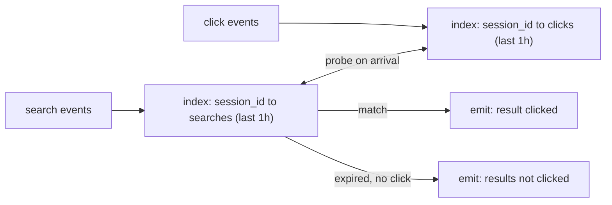

# Chapter 11 — Stream Processing
*Book: Chapter 11, pp. 439–487*

## Overview

**Question this chapter answers:** What if the input never ends? How do you move, store, and process data that keeps arriving (clicks, sensor readings, database writes) with low delay, while keeping the good properties of batch processing (derived outputs, rerunnability, fault tolerance)?

**Where it fits:** Chapter 10's batch jobs read a set of files and produce new files, a form of **derived data** that can be recreated by rerunning the job (search indexes, recommendations, analytics). But batch assumed the input is **bounded**: known, finite size, so the job knows when it has read everything. Sorting, the heart of MapReduce, *needs* this: it cannot emit its first output until it has seen all input, because the very last record might have the smallest key.

Real data is usually **unbounded**: your users produced data yesterday, today, and will tomorrow; unless the business shuts down, the dataset is never "complete". Batch systems fake completeness by chopping data into fixed time slices (a day's data at the end of each day, or an hour's at the end of each hour). With a daily job, a change to the input only appears in the output a day afterwards, and many impatient users will not wait that long. You can shrink the slice (a second's worth every second), or drop slices entirely and **process each event as it happens**. That is **stream processing**.

A "stream" in general means data made available **incrementally over time**. The idea shows up in Unix stdin/stdout, lazy lists in programming languages, filesystem APIs like Java's `FileInputStream`, TCP connections, and audio/video delivery over the internet. This chapter treats **event streams as a way of managing data**: the never-ending, processed-bit-by-bit sibling of Chapter 10's batch data. Plan:
1. How streams are represented, stored, and sent over a network ("Transmitting Event Streams").
2. How streams relate to databases ("Databases and Streams").
3. How to process streams continuously and build applications with them ("Processing Streams").

**Why it matters:** fraud detection, monitoring, live dashboards, keeping caches/search indexes in sync with a database, and real-time analytics all depend on it. The log-based messaging and change-data-capture ideas here underpin modern data integration (Kafka and friends).

**Everyday analogy:** Batch processing is reading yesterday's newspaper: a finished, bounded bundle. Stream processing is a live news ticker: items keep scrolling past forever, you react to each as it appears, and there is no "last page".

## Key terms

| Term | Plain-English meaning |
|---|---|
| Bounded / unbounded data | Finite, known-size input vs. input that keeps arriving forever |
| Stream | Data made available bit by bit over time |
| Event | A small, self-contained, immutable record of something that happened at some time, usually with a timestamp |
| Producer (publisher, sender) | Creates events |
| Consumer (subscriber, recipient) | Processes events |
| Topic / stream | A named group of related events (like a filename groups related records) |
| Polling | Consumer repeatedly asking "anything new?" |
| Trigger | Database feature that reacts to a change (e.g., a row insert); limited |
| Messaging system | Pushes messages containing events from producers to consumers |
| Publish/subscribe | Many producers can publish to a topic; many consumers can subscribe |
| Backpressure (flow control) | Blocking the producer when the consumer cannot keep up |
| UDP multicast | Unreliable one-to-many network sending; used for low-latency feeds |
| Brokerless messaging | Libraries (ZeroMQ, nanomsg) sending pub/sub directly between nodes |
| Webhook | Registering a callback URL with a service, which calls it when an event occurs |
| Message broker (message queue) | A server, essentially a database specialized for message streams, through which producers and consumers communicate |
| JMS / AMQP | Standards for traditional message brokers |
| Load balancing (messaging) | Each message goes to one of the consumers, sharing work |
| Fan-out | Each message goes to all consumers |
| Acknowledgment | Consumer telling the broker it finished a message, so it can be removed |
| Redelivery | Broker resending an unacknowledged message, possibly to another consumer |
| Log | Append-only sequence of records on disk |
| Partitioned log | A topic split into partitions, each an independent log on possibly different machines |
| Offset | Monotonically increasing sequence number of a message within a partition |
| Log-based message broker | Broker storing messages in a durable partitioned log (Kafka, Kinesis Streams, DistributedLog) |
| Consumer group | Set of consumer nodes sharing a topic's partitions |
| Head-of-line blocking | One slow message delays all later messages behind it |
| Consumer offset | The position up to which a consumer has processed a partition |
| Log segment | Chunk of a log file; old segments are deleted or archived |
| Circular buffer / ring buffer | Fixed-size buffer that discards the oldest data when full |
| Replay | Re-reading old messages from an earlier offset |
| Dual writes | Application writing the same change separately to each system (DB, index, cache) |
| Race condition | Outcome depends on unlucky timing of concurrent operations |
| Change data capture (CDC) | Observing every change written to a database and extracting it as a stream |
| Initial snapshot | Consistent full copy of a database matched to a known log offset |
| Log compaction | Keeping only the latest value for each key in a log |
| Tombstone | Special null value marking a key as deleted |
| Change stream / change feed | A database's first-class API for subscribing to its changes |
| Event sourcing | Storing all application changes as immutable, application-level events |
| Domain-driven design (DDD) | Software design community where event sourcing originated |
| Command | A user request that may still be rejected by validation |
| Changelog | Log of all changes; describes the evolution of state over time |
| Ledger | Accountants' append-only log of transactions |
| Compensating transaction | A new entry that corrects an earlier mistaken one instead of erasing it |
| CQRS | Command query responsibility segregation: separating the write form of data from its read forms |
| Excision / shunning | Datomic's / Fossil's features for truly deleting data from immutable history |
| Operator / job | A piece of code that processes streams |
| Complex event processing (CEP) | Searching streams for patterns of events using stored queries |
| Stream analytics | Aggregations and statistics over streams (rates, averages) |
| Window | The time interval over which an aggregation is computed |
| Probabilistic algorithm | Gives approximate answers with far less memory (Bloom filter, HyperLogLog) |
| Materialized view | A derived, query-optimized view kept up to date as underlying data changes |
| Percolator | Elasticsearch feature for matching documents against stored queries |
| Distributed RPC | Storm feature interleaving user queries with stream events |
| Event time | When the event actually happened (timestamp in the event) |
| Processing time | When the stream processor handles the event (processor's clock) |
| Straggler event | Event arriving after its window was declared complete |
| Tumbling / hopping / sliding / session window | Types of time windows (defined below) |
| Stream-stream join (window join) | Joining two event streams on related events within a time window |
| Stream-table join (enrichment) | Adding database info to each event using a local, CDC-updated copy |
| Table-table join | Joining two changelog streams to maintain a materialized join view |
| Slowly changing dimension (SCD) | Data-warehouse problem of joining with a value that changes over time |
| Exactly-once (effectively-once) semantics | Output looks as though each input was processed exactly once, despite retries |
| Microbatching | Splitting a stream into tiny batches (~1 second) processed like batch jobs |
| Checkpointing | Periodically saving operator state to durable storage |
| Idempotent | Doing it many times has the same effect as doing it once |
| Fencing | Preventing a node wrongly believed dead from interfering |

## Transmitting Event Streams

In batch processing, a job's inputs and outputs are **files**. What is the streaming equivalent?

- **Events instead of records.** A file is first parsed into records. In streaming, a record is usually called an **event**: a small, self-contained, **immutable** object describing something that occurred at a particular moment. It usually carries a **timestamp** from a time-of-day clock (Chapter 8).
- **Examples:** a user action (viewing a page, making a purchase), or a machine source (periodic temperature sensor reading, CPU utilization metric). Each line of Chapter 10's web server log is an event.
- **Encoding:** text, JSON, or a binary form (Chapter 4). Encoding lets you store the event (append to a file, insert into a relational table, write to a document DB) or send it over the network to another node.
- **Producers and consumers.** In batch, a file is written once and may be read by several jobs. In streaming, a **producer** creates each event once (**publisher**, **sender**) and may be processed by several **consumers** (**subscribers**, **recipients**). Where a filesystem groups related records by **filename**, a streaming system groups related events into a **topic** or **stream**.

**Why not just use a database or file?** In principle that works: producers write every event to the datastore; each consumer periodically **polls** for events newer than its last run. That is effectively what a daily batch job does. But for continual, low-delay processing, polling gets expensive if the store is not built for it: the more often you poll, the smaller the share of requests that find anything new, so overhead climbs. It is better if consumers are **notified** when new events appear.

Databases have not traditionally been good at notifications. Relational **triggers** can respond to a change such as an inserted row, but they can do very little and have been something of an afterthought in database design. So specialized tools were built for delivering event notifications.

### Messaging Systems

**What:** A **messaging system** tells consumers about new events: the producer emits a message carrying the event, and the system **pushes** it out to consumers. (Chapter 4's "Message-Passing Dataflow" touched on this.)

The simplest possible messaging system would be a direct link between producer and consumer, such as a Unix pipe or a TCP connection. But pipes and TCP connect exactly **one sender to one receiver**; messaging systems let **many producers** send to the same topic and **many consumers** receive from it. Within this **publish/subscribe** model, systems vary widely and no approach is right for everything. Two questions help tell them apart:

**Question 1: What if producers send faster than consumers can process?** Three options:

| Option | What happens | Example / caveat |
|---|---|---|
| **Drop** messages | Excess is discarded | Fine only if loss is tolerable |
| **Buffer** in a queue | Messages wait | Must ask: as the queue grows, does the system crash when it no longer fits in memory, or spill to disk? And how does disk access affect performance? |
| **Backpressure** (flow control) | Producer is blocked from sending more | Unix pipes and TCP do this: a small fixed-size buffer; when full, the sender blocks until the receiver drains it |

**Question 2: What if nodes crash or go offline temporarily; are messages lost?** As with databases, durability needs some mix of writing to disk and/or replication, which costs something. If losing the odd message is tolerable, the same hardware can usually deliver more throughput with less latency.

Whether loss is OK depends on the application:
- **Sensor readings and metrics** sent periodically: an occasional missing point may not matter, since a fresh value comes shortly. **Beware:** if many messages are dropped, it may not be obvious that the metrics are wrong.
- **Counting events:** reliable delivery matters more, since every lost message makes the counters wrong.

Recall that batch systems (Chapter 10) give a strong guarantee: failed tasks are retried and their partial output is discarded, so output equals a failure-free run. Later the chapter looks at achieving similar guarantees for streams.

#### Direct messaging from producers to consumers

Some messaging systems skip intermediary nodes and talk directly over the network:

- **UDP multicast** is popular in the **financial industry** for low-latency streams such as **stock market feeds**. UDP itself does not guarantee delivery, but protocols layered on top at the application level can recover missing packets, provided the producer keeps a record of what it sent and retransmits on request.
- **Brokerless messaging libraries** such as **ZeroMQ** and **nanomsg** do something similar, implementing pub/sub over TCP or IP multicast.
- **StatsD** and **Brubeck** use unreliable **UDP** to collect metrics from all machines on a network for monitoring. In the StatsD protocol, **counter** metrics are correct only if every message arrives, so UDP makes them approximate at best (see Chapter 8, "TCP Versus UDP").
- If a consumer exposes a network service, producers can push via a direct **HTTP or RPC** request (Chapter 4). This is the idea behind **webhooks**: one service registers a callback URL with another, which calls that URL whenever an event occurs.

Limits: these work well in their niches, but application code must generally cope with **message loss**. They tolerate few faults: even when protocols detect and retransmit lost packets, they usually assume producers and consumers are **always online**. An offline consumer may miss messages sent while it was unreachable. Some protocols let the producer retry failed deliveries, but that fails if the **producer crashes** and loses its buffer of messages to retry.

#### Message brokers

**What:** A widely used alternative is a **message broker** (also called a **message queue**), essentially a **database optimized for message streams**. It runs as a server that both producers and consumers connect to as clients: producers hand messages to it, consumers fetch messages from it.

Why it helps:
- **Centralizing data** in the broker makes it easy to cope with clients that connect, disconnect, or crash at will. **Durability becomes the broker's job.**
- Some brokers keep messages only **in memory**; others can be configured to persist them **to disk**, so a broker crash loses nothing.
- With slow consumers, brokers generally allow **unbounded queueing** (rather than dropping or backpressure), though this can depend on configuration.
- Consequence: consumers are **asynchronous**. A producer usually waits only for the broker to confirm it has **buffered** the message, not for consumers to process it. Consumers get the message at some unspecified later moment: usually well under a second, but possibly much later when a backlog has built up.

#### Message brokers compared to databases

Some brokers can even take part in **two-phase commit** using **XA** or **JTA** (Chapter 9), which makes them resemble databases. But there are important practical differences:

| Aspect | Database | Traditional message broker |
|---|---|---|
| Retention | Keeps data until explicitly deleted | Most **delete a message once it is successfully delivered**; not suitable for long-term storage |
| Working set | Can be large | Assumes a **small working set** (short queues). If lots of messages must be buffered for slow consumers (maybe spilling to disk), each message takes longer and **overall throughput may degrade** |
| Selecting data | **Secondary indexes** and various search methods | **Subscribing to a subset of topics** matching a pattern. Different mechanisms, same purpose: letting a client pick the part of the data it cares about |
| Change notification | Query results are a **point-in-time snapshot**; if someone later changes the data, you do not find out unless you re-query or poll | **No arbitrary queries**, but clients **are notified** when data changes (new messages arrive) |

This classic picture of a broker is written down in the **JMS** and **AMQP** standards, and products implementing it include **RabbitMQ**, **ActiveMQ**, **HornetQ**, **Qpid**, **TIBCO Enterprise Message Service**, **IBM MQ**, **Azure Service Bus**, and **Google Cloud Pub/Sub**.

#### Multiple consumers

When several consumers read the same topic, there are two main patterns:

- **Load balancing:** each message goes to **one** of the consumers, so they share the work. The broker may assign messages arbitrarily. Useful when messages are **expensive to process** and you want to add consumers to parallelize. (In **AMQP**: several clients consuming from the same queue. In **JMS**: a **shared subscription**.)
- **Fan-out:** each message goes to **all** consumers. Independent consumers can each "tune in" to the same broadcast with no interference between them; this mirrors several batch jobs reading the same input file. (**JMS**: **topic subscriptions**. **AMQP**: **exchange bindings**.)

*Figure 11-1 (redrawn): producers 1 and 2 publish m1 to m5 into the broker. (a) Load balancing: consumer 1 processes m2 and m4, consumer 2 processes m1 and m3, so each message goes to one consumer. (b) Fan-out: consumer 1 and consumer 2 each process m1, m2, m3, m4 (m5 has not been delivered yet when the figure ends).*



The two can be **combined**: e.g., two separate consumer groups each subscribe to a topic, so each group as a whole gets every message, but inside each group only one node gets any given message.

#### Acknowledgments and redelivery

**Problem:** consumers can crash anytime, so a broker might deliver a message that the consumer never processes, or only partly processes.

**Mechanism:**
1. Broker delivers a message to a consumer.
2. The consumer must **explicitly acknowledge** when it has finished, so the broker can remove the message from the queue.
3. If the connection closes or times out with no acknowledgment, the broker assumes the message was **not processed** and **redelivers** it to another consumer.

**Caveat:** the message might actually have been fully processed with only the ack lost in the network. Handling that needs an **atomic commit protocol** (Chapter 9, "Distributed Transactions in Practice").

**Effect on ordering (Figure 11-2):** combined with load balancing, redelivery **reorders** messages. Consumers generally process messages in the order producers sent them. But suppose consumer 2 crashes while handling **m3**, at the same moment consumer 1 is handling **m4**. The unacknowledged m3 is later redelivered to consumer 1, so consumer 1 processes **m4, m3, m5**. Now m3 and m4 are processed in a different order than producer 1 sent them.

*Figure 11-2 (redrawn): producer 1 sends m1, m3, m4 and producer 2 sends m2, m5. Consumer 2 handles m1, consumer 1 handles m2, then consumer 2 dies midway through m3 while consumer 1 is busy with m4. The broker later redelivers m3 to consumer 1, which therefore processes m4, m3, m5.*



Even though brokers otherwise try to preserve order (both **JMS and AMQP require it**), load balancing plus redelivery **inevitably reorders** messages. To avoid it, use a **separate queue per consumer** (no load balancing). Reordering does not matter if messages are fully independent, but it can matter a lot if there are **causal dependencies** between them (seen later in the chapter).

### Partitioned Logs

**Mindset problem:** sending a packet or calling a network service is normally **transient**; it leaves no permanent trace (you *could* record it via packet capture and logging, but normally don't). Even brokers that persist messages on disk remove them shortly after delivering them, since their whole design assumes messages are fleeting. Databases and filesystems are the opposite: whatever you write is expected to stay until someone explicitly deletes it.

This difference hugely affects how **derived data** is built:
- Batch jobs can be rerun as often as you like on read-only input without harming it.
- With **AMQP/JMS**-style messaging, receiving is **destructive** if the ack deletes the message from the broker, so rerunning a consumer will not give the same result.
- A **new consumer** added to such a system usually only gets messages sent **after it registered**; earlier messages are gone forever. With files and databases, a new client can read data written arbitrarily long ago (unless the application overwrote or deleted it).

**Idea:** combine the **durable storage** of databases with the **low-latency notifications** of messaging. That is the **log-based message broker**.

#### Using logs for message storage

- A **log** is simply records on disk that are only ever **appended** to (seen in Chapter 3 for log-structured storage and write-ahead logs, and Chapter 5 for replication).
- Used as a broker: to send, a **producer** **appends** the message at the end of the log; to receive, a **consumer** reads through the log **in order**. Having caught up with the end, the consumer waits for a notification that something new was appended. The Unix command **`tail -f`**, which follows a file as data is added to it, behaves much the same way.
- **Scaling:** one disk has limited throughput, so the log is **partitioned** (Chapter 6). Partitions can live on different machines, each an independent log readable and writable separately. A **topic** is then a **group of partitions** carrying messages of the same type.
- **Offsets:** within each partition, the broker gives every message a **monotonically increasing sequence number**, the **offset**. Such numbering works because a partition only grows at its end, which puts its messages in a **total order**. Between different partitions, however, **no order is guaranteed**.

*Figure 11-3 (redrawn): Topic A has partitions 0 (messages 1 to 10) and 1 (1 to 8); topic B has partitions 0 (1 to 4), 1 (1 to 7) and 2 (1 to 12). The numbers in the boxes are offsets. Producer clients append new messages to the end of a partition (one to topic A partition 0, one to topic B partition 1). A consumer group of two clients reads topic B sequentially: one client owns B.0 and B.1 (recorded offsets 4 and 5), the other owns B.2 (offset 9).*



Systems that work like this: **Apache Kafka**, **Amazon Kinesis Streams**, and **Twitter's DistributedLog**. **Google Cloud Pub/Sub** has a similar architecture but presents a **JMS-style API** to clients instead of exposing a log. Although every message goes to disk, these brokers handle **millions of messages per second** thanks to partitioning over many machines, and get fault tolerance by **replicating** messages.

#### Logs compared to traditional messaging

- **Fan-out is trivial:** many consumers can read the log independently; reading does not delete anything.
- **Load balancing** works by assigning **whole partitions** (not individual messages) to nodes in a **consumer group**. Each client consumes all messages in its assigned partitions, typically **sequentially and single-threaded**.

Downsides of this coarse-grained load balancing:
1. The number of consumer nodes sharing a topic is **at most the number of partitions**, since one partition's messages go to one node.
2. A single **slow message holds up** all later messages in that partition (**head-of-line blocking**, Chapter 1).

> **Footnote: sharing one partition.** You could have two consumers both read a whole partition, one handling only even-numbered offsets and the other odd. Or spread processing over a thread pool, though that complicates offset management. Generally, single-threaded processing per partition is preferable; add parallelism by adding partitions.

| Situation | Better choice |
|---|---|
| Messages **expensive** to process, want **per-message parallelism**, ordering **not important** | **JMS/AMQP**-style broker |
| **High throughput**, each message **fast** to process, ordering **important** | **Log-based** broker |

#### Consumer offsets

- Reading a partition sequentially makes progress easy to track: every message with an offset **below** the consumer's current offset is done; everything **above** is unseen.
- So the broker need not track acks per message, only **periodically record consumer offsets**. Less bookkeeping plus chances for **batching and pipelining** boost throughput.
- This offset is very much like the **log sequence number** in single-leader replication (Chapter 5, "Setting Up New Followers"): it lets a disconnected follower reconnect and resume without skipping writes. Same principle here: **the broker acts like a leader database, the consumer like a follower**.
- **Consumer failure:** another node in the group takes over the failed consumer's partitions and starts from the **last recorded offset**. Any messages the failed node handled after its last recorded offset will be **processed a second time**. (Handled later in the chapter.)

#### Disk space usage

- Only appending would eventually fill the disk. So the log is split into **segments**, and old segments are periodically **deleted or moved to archive storage**. (A smarter method, log compaction, comes later.)
- So a **slow consumer** that falls so far behind that its offset points at a **deleted segment** will **miss messages**. The log is effectively a **bounded-size buffer that discards old messages when full**, a **circular buffer** or **ring buffer**, but on disk, so it can be **very large**.

**Back-of-the-envelope calculation (book's numbers):**
1. When the book was written, a typical big hard drive stored **6 TB** with a sequential write speed of **150 MB/s**.
2. Writing at full speed, filling it takes about **11 hours** (6,000,000 MB ÷ 150 MB/s ≈ 40,000 s ≈ 11 h).
3. So one disk buffers **about 11 hours** of messages before overwriting old ones. The ratio stays the same with many disks and machines.
4. Real deployments rarely use full disk write bandwidth, so a log can usually retain **several days or even weeks** of messages.

Throughput stays **roughly constant regardless of retention**, because each message hits the disk no matter what. Contrast with systems that keep messages in memory and spill to disk only when queues grow: those are fast with short queues and **much slower** once they start writing to disk, so their throughput depends on how much history is retained.

#### When consumers cannot keep up with producers

- In the drop / buffer / backpressure taxonomy, a log counts as **buffering**, using a **big buffer of fixed size** bounded by available disk space.
- A consumer that falls behind further than the retained data **cannot read** them anymore, which means the broker has in effect **dropped messages older than the buffer can hold**.
- You can **monitor how far a consumer lags** behind the log head and **alert** if it is far behind. With such a big buffer, a human has time to fix the slow consumer before it misses anything.
- Only the lagging consumer is affected; **others are not disrupted**. Big operational win: you can read a **production log** while developing, testing, or debugging, with little risk of harming production services.
- A consumer that is shut down or crashes **stops using resources**; only its offset remains. Contrast: with traditional brokers you must remember to **delete queues** whose consumers are gone, or they keep piling up messages and stealing memory from active consumers.

#### Replaying old messages

- With AMQP/JMS brokers, processing and acking is **destructive** (messages get deleted). In a log-based broker, consuming is like **reading a file**: **read-only**, the log is unchanged.
- The only side effect (apart from the consumer's output) is that the **consumer offset moves forward**, and the consumer itself controls that offset. E.g., start a **copy of a consumer with yesterday's offsets**, write output elsewhere, and **reprocess the last day's messages**. Repeat as often as you like with different code.
- This makes log-based messaging like **batch processing**: derived data is cleanly separated from input via a repeatable transformation. That encourages experimentation and makes recovering from mistakes and bugs easier, which is why it suits **integrating dataflows across an organization**.

Own illustrative example (Kafka-style consumer pseudocode):

```python
consumer = Consumer(group="search-indexer", topic="page-edits")
consumer.seek(partition=0, offset=41_200)   # rewind to replay from an older position
for msg in consumer.poll_forever():         # sequential read; nothing is deleted
    index.update(msg.key, msg.value)        # derived output goes somewhere else
    consumer.commit(msg.offset + 1)         # record progress periodically, not per-message ack
```

- `seek` works because the log is retained: you can replay.
- `commit` records the offset; after a crash, processing resumes from here (anything processed after the last commit is redone).

## Databases and Streams

Log-based brokers took ideas **from databases** and applied them to messaging. The reverse also works: apply ideas from messaging and streams **to databases**.

- An event records something that happened: a user action (typing a search query), a sensor reading, **or a database write**. That a write occurred is itself an event you can capture, store, and process. So the link between databases and streams is **fundamental**, not just about storing logs on disk.
- A **replication log** (Chapter 5) *is* a stream of write events that the leader emits while executing transactions; followers apply it to their copy and end up with the same data.
- The **state machine replication** principle (Chapter 9, "Total Order Broadcast"): if each event is a database write and all replicas apply identical events in identical order, every replica ends in the same state (assuming processing is **deterministic**). Another case of event streams.

### Keeping Systems in Sync

- No single system satisfies every storage, query, and processing need. Nontrivial applications combine several: an **OLTP database** for user requests, a **cache** for common requests, a **full-text index** for search, a **data warehouse** for analytics. Each keeps its own copy of the data in its own optimized representation.
- They must be **kept in sync**: an item updated in the database must also be updated in the cache, search indexes, and warehouse.
- For warehouses this is usually **ETL**: take a full copy of a database, transform it, bulk-load it into the warehouse, i.e., a **batch process**. Search indexes and recommendation systems can likewise be built in batch (Chapter 10).
- If periodic full dumps are too slow, a sometimes-used alternative is **dual writes**: the application code itself writes to each system on every change (e.g., write the DB, then update the search index, then invalidate cache entries, or even do these concurrently).

**Problem 1 with dual writes: race condition (Figure 11-4).**
1. Two clients concurrently update item **X**: client 1 sets it to **A**, client 2 to **B**.
2. Each client writes the database first, then the search index.
3. Unlucky interleaving: the **database** receives client 1's write (A) then client 2's (B), so it ends at **B**.
4. The **search index** receives client 2's write first, then client 1's, so it ends at **A**.
5. The two systems are now **permanently inconsistent**, even though no error occurred.

*Figure 11-4 (redrawn): each write is acknowledged with "ok". The database gets A then B (final X = B), but the search index gets B then A (final X = A).*



Without an extra concurrency-detection mechanism, such as **version vectors** (Chapter 5, "Detecting Concurrent Writes"), you would not even notice concurrent writes happened; one value silently overwrites the other.

**Problem 2: partial failure.** One write might fail while the other succeeds. This is about **fault tolerance**, not concurrency, yet it also leaves the systems inconsistent. Guaranteeing all-or-nothing across both is the **atomic commit** problem, and solving it is **costly** (Chapter 9, 2PC).

**Root cause:** with a single-leader replicated database, the leader fixes the write order, so state machine replication works among its replicas. In Figure 11-4 there is **no single leader**: the database and the search index might each have their own leader, but neither is a follower of the other, so conflicts arise (as with multi-leader replication, Chapter 5). It would be better to have **one leader** (say the database) and make the search index its **follower**. Is that possible in practice? Enter CDC.

### Change Data Capture

- Most databases' replication logs have long been treated as an **internal implementation detail**, not a public API. Clients are meant to use the data model and query language, not parse replication logs.
- For **decades**, many databases had **no documented way** to get the log of changes written to them. So replicating all changes to another storage technology (search index, cache, warehouse) was hard.
- **Change data capture (CDC)**: **watching every change written to a database** and pulling it out in a form that **other systems can replicate**. It is most useful when changes are exposed **as a stream the moment they are written**.
- Example: capture changes in a database and continually apply them to a search index. If changes are applied **in the same order**, the search index should match the database. The search index, like any other derived system, is simply **one more consumer of the change stream**.

*Figure 11-5 (redrawn): client 1 sets X = A and client 2 sets X = B in the system-of-record database. Change data capture appends the changes, in the order the database applied them, to a log of data changes (... X = A, X = B ...). A log consumer applies them in that same order to the derived data systems: a search index and a data warehouse.*



#### Implementing change data capture

- Log consumers are **derived data systems** (Part III intro): the search index and warehouse data are just other **views** of the **system of record**. CDC makes sure every change to the system of record is reflected in the derived systems, so they hold accurate copies.
- **CDC makes one database the leader** (the one changes are captured from) and **turns the others into followers**.
- A **log-based message broker** is a good transport for change events because it **preserves message order** (avoiding Figure 11-2's reordering).

Implementation options:

| Approach | How | Trade-off |
|---|---|---|
| **Database triggers** (Chapter 5, "Trigger-based replication") | Register triggers observing all changes to data tables and add entries to a **changelog table** | Tend to be **fragile** with **significant performance overhead** |
| **Parsing the replication log** | Read the DB's own log | **More robust**, but has challenges such as **handling schema changes** |

Named systems:
- **LinkedIn's Databus**, **Facebook's Wormhole**, **Yahoo!'s Sherpa** use this idea at large scale.
- **Bottled Water**: CDC for **PostgreSQL**, built on an API for decoding PostgreSQL's **write-ahead log**.
- **Maxwell** and **Debezium**: similar for **MySQL** by parsing the **binlog**.
- **Mongoriver**: reads the **MongoDB oplog**.
- **GoldenGate**: similar facilities for **Oracle**.

CDC is usually **asynchronous** like brokers: the system of record does **not wait** for consumers to apply a change before committing. Upside: adding a **slow consumer** does not hurt the system of record much. Downside: all the **replication lag** problems apply (Chapter 5).

#### Initial snapshot

- With the log of **all** changes ever made, you could rebuild the full database state by replaying it. But keeping every change forever usually needs **too much disk**, and replaying takes **too long**, so the log gets **truncated**.
- Building a new full-text index, for instance, needs a **full copy** of the database; recent changes alone would miss items not updated recently. So without the complete history, you start from a **consistent snapshot** (Chapter 5, "Setting Up New Followers").
- The snapshot must correspond to a **known position/offset in the change log**, so you know where to start applying changes after loading the snapshot. Some CDC tools have this built in; others leave it as a **manual** step.

#### Log compaction

If you can keep only limited history, you need the snapshot process every time you add a new derived system. **Log compaction** is a good alternative.

- From Chapter 3 ("Hash Indexes", Figure 3-2): every so often the storage engine looks for log records sharing a **key**, discards the duplicates, and retains **just the newest update for each key**. It runs in the **background**.
- A **tombstone** (a special **null** value) marks a key as **deleted**, and causes its removal during compaction. Otherwise, a key that is never overwritten or deleted stays in the log **forever**.
- Hence a compacted log's size is governed by what the database **currently contains**, **not by how many writes** have ever happened. Frequently overwritten keys eventually have old values **garbage-collected**, leaving just the latest.
- Same idea for **log-based brokers and CDC**: if every change has a **primary key** and each update **replaces** the previous value for that key, keeping just the latest write per key is enough.
- To rebuild a derived system (e.g., a search index), start a **new consumer at offset 0** of the compacted topic and scan all messages. The log is guaranteed to have the **latest value for every key** (maybe some older ones too), i.e., a **full copy** of the database, **without taking another snapshot** of the source.
- **Apache Kafka supports log compaction**. It lets the broker serve as **durable storage**, not just transient messaging.

Own illustrative example of compaction on a CDC topic:

```text
before compaction (offset: key=value)      after compaction
0: user:7 = {name: "Ana"}                  3: user:9 = {name: "Raj"}
1: user:9 = {name: "Raj"}                  4: user:7 = {name: "Ana M."}
2: user:5 = {name: "Li"}                   5: user:5 = null (tombstone, removed later)
3: user:9 = {name: "Raj"}
4: user:7 = {name: "Ana M."}
5: user:5 = null
```

- Older values for `user:7` and `user:9` are dropped; only the newest per key survives.
- The tombstone for `user:5` tells compaction to eventually remove that key entirely.

#### API support for change streams

Databases increasingly offer change streams as a **first-class interface** instead of retrofitted, reverse-engineered CDC:
- **RethinkDB**: queries can **subscribe to notifications** when their results change.
- **Firebase** and **CouchDB**: data synchronization based on a **change feed** also exposed to applications.
- **Meteor**: subscribes to data changes through the **MongoDB oplog** and refreshes the user interface accordingly.
- **VoltDB**: transactions can continuously **export data as a stream**. In the relational model, an output stream is a **table that transactions can insert tuples into but that cannot be queried**. The stream is the log of tuples committed transactions wrote to that special table, **in commit order**. External consumers read it asynchronously to update derived systems.
- **Kafka Connect**: an effort to integrate CDC tools for many database systems with **Kafka**. Once change events are in Kafka, they can update derived systems like search indexes and feed stream processors.

### Event Sourcing

**Event sourcing** is a technique from the **domain-driven design (DDD)** community with parallels to CDC. As with CDC, **every change to application state is kept as an event in a log**. The big difference is the **level of abstraction**:

| | Change data capture | Event sourcing |
|---|---|---|
| How the app uses the DB | **Mutably**: updates and deletes at will | App logic is **explicitly built on immutable events** written to an **event log** |
| Where the log comes from | Extracted **at a low level** (e.g., parsing the replication log), guaranteeing the extracted order matches the real write order (avoiding Figure 11-4's race) | The **event store is append-only**; updates/deletes are **discouraged or prohibited** |
| App awareness | App **need not know** CDC is happening | App is designed around events |
| What events mean | **Low-level state changes** | Things that happened **at the application level** |

**Why it is powerful for data modeling:** recording the **user's actions** as immutable events is more meaningful than recording their **effect** on a mutable database. It makes applications easier to **evolve**, aids **debugging** (you can later work out why something happened), and protects against **application bugs**.

**The book's example:** the event "**student cancelled their course enrollment**" states the intent of one action neutrally. Describing it instead by its side effects (a row removed from the **enrollments** table plus a cancellation reason inserted into the **student feedback** table) bakes in lots of assumptions about how the data will later be used. If a new feature is later added, say **offering the freed place to whoever is next on the waiting list**, event sourcing lets you simply chain that new side effect off the existing event.

Related ideas: event sourcing resembles the **chronicle data model**, and an event log resembles the **fact table** of a star schema (Chapter 3). Specialized databases like **Event Store** support event-sourced apps, but the technique is tool-agnostic: you can build this style of application on a **conventional database** or a **log-based broker** too.

Own illustrative example of event-sourced events (JSON):

```json
{"type": "SeatHoldRequested", "show": "S12", "seat": "C7", "user": "u42", "ts": "2021-03-03T19:00:05Z"}
{"type": "SeatHoldConfirmed", "show": "S12", "seat": "C7", "user": "u42", "ts": "2021-03-03T19:00:06Z"}
{"type": "SeatReleased",      "show": "S12", "seat": "C7", "user": "u42", "ts": "2021-03-04T08:12:40Z"}
```

- Each line is an immutable fact about what a user did, not a row update.
- Releasing the seat does not delete the earlier events; it is a new event.

#### Deriving current state from the event log

- An event log alone is not very useful to users, who want **current state**, not history. On a **shopping website**, users expect to see their cart's **current contents**, not an append-only list of every change they ever made to it.
- So event-sourced apps **transform the event log** (how data is **written**) into application state suitable for display (how data is **read**). The transformation can use arbitrary logic, but should be **deterministic**, so rerunning it gives the same state.
- Replaying the log reconstructs current state, as with CDC, but **log compaction differs**:

| | CDC | Event sourcing |
|---|---|---|
| Event content | Update event usually holds the **entire new version** of the record | Event expresses **user intent**, not the mechanics of the resulting state update |
| Can later events override earlier ones? | Yes: current value for a key is fully determined by its **latest** event | Usually **no**: later events do not replace earlier ones |
| Log compaction | Can discard earlier events for the same key | **Not possible in the same way**; you need the **full history** |

- Event-sourced apps usually store **snapshots** of the derived current state so they need not reprocess the whole log every time. But this is **only a performance optimization** for reads and crash recovery; the goal remains that **every raw event is kept forever** and the **entire log can be reprocessed** on demand. (Questioned in "Limitations of immutability".)

#### Commands and events

Event sourcing carefully separates **commands** and **events**:

1. A user request first arrives as a **command**. It **may still fail**, e.g., if an integrity condition is violated.
2. The application must **validate** that it can execute the command.
3. Once validation passes and the command is accepted, it turns into an **event**: **durable** and **immutable** from then on.

**Example:** a user tries to **register a username**, or **book a seat on a plane or in a theater** (the same example as Chapter 9, "Fault-Tolerant Consensus"). The app checks the username/seat is not taken; if OK, it emits an event such as "username registered by user ID X" or "seat reserved for customer Y".

- Once generated, an event is a **fact**. If the customer later changes or cancels, it remains true that they **once held** that reservation; the change/cancellation is a **separate, later event**.
- A consumer of the event stream **may not reject an event**: when the event reaches it, the event is already fixed in the log and may have been read by other consumers. So **validation of a command must happen synchronously, before it becomes an event**, e.g., with a **serializable transaction** that checks the command and emits the event as one atomic step.
- **Alternative:** split the seat reservation into **two events**: a **tentative reservation**, then a separate **confirmation** once validated (Chapter 9, "Implementing linearizable storage using total order broadcast"). This allows validation to happen **asynchronously**.

### State, Streams, and Immutability

Batch processing benefits from **immutable input files** (run experiments without fear of damage). The same **immutability** principle is what makes event sourcing and CDC so powerful.

- Databases usually store the **current state**, optimized for reads and convenient for queries. State **changes**, so databases support updates and deletes as well as inserts. How does that square with immutability?
- State that changes is always **produced by the events that modified it** over time. Book examples: the list of **available seats** results from the **reservations** processed; the **account balance** results from **credits and debits**; the **response-time graph** of a web server aggregates the individual response times of all requests.
- However state changes, a **sequence of events** caused it. Even when things are done and undone, those events still **happened**. Key idea: **mutable state and an immutable, append-only event log do not conflict; each is one side of the same coin**. The **changelog** (the log of every change) shows how the state evolved over time.

**The calculus view (Figure 11-6):** for the mathematically minded, **integrating the event stream over time yields the application state**, and **differentiating the state with respect to time yields the change stream**. The analogy has limits (e.g., a second derivative of state does not seem meaningful), but it is a useful starting point.

*Figure 11-6 (redrawn): the book shows two formulas. state(now) = integral from t = 0 to now of stream(t) dt, and stream(t) = d state(t) / dt.*



- Storing the changelog **durably** simply makes state **reproducible**. If you treat the **event log as the system of record** and all mutable state as **derived** from it, reasoning about dataflow gets easier.

> **Pat Helland's view (paraphrased).** A transaction log records every change to the database, and fast appends are the only way to change it. Seen that way, the database's contents are just a **cache of the latest values** from the log. **The log is the truth**; the database merely caches part of it, specifically the most recent value of every record and index entry.

- **Log compaction** narrows the gap between a log and database state: it retains the newest version of every record and throws away versions that were overwritten.

#### Advantages of immutable events

- **Old idea: accounting.** Accountants have used immutability for **centuries**. Each transaction goes into an **append-only ledger**, essentially a log of events recording money, goods, or services moving between parties. Reports like the **profit and loss** statement or the **balance sheet** are **derived** by summing the ledger's transactions.
- **Mistakes are not erased.** Accountants add a **compensating transaction** (e.g., refunding an incorrect charge). The wrong transaction stays in the ledger forever, for **auditing**. If wrong figures derived from the ledger were already published, the next accounting period's figures include a **correction**. This is entirely normal in accounting.
- **Auditability** matters most in finance but helps many less-regulated systems too. As with batch outputs (Chapter 10), if buggy code writes bad data, recovery is much harder when the code can **destructively overwrite** data. An append-only log of immutable events makes it much easier to **diagnose and recover**.
- **More information than current state.** On a shopping site, a customer adds an item to the cart, then removes it. For order fulfillment, the second event cancels the first. But for **analytics**, it is useful to know the customer considered the item and then decided against it; maybe they buy it later, or found a substitute. The event log keeps this; a database that deletes removed cart items loses it.

#### Deriving several views from the same event log

- Separating mutable state from the immutable log lets you derive **several read-oriented representations** from the same events, just like multiple stream consumers (Figure 11-5):
  - **Druid**, an analytic database, takes its input straight from **Kafka** in this manner.
  - **Pistachio**, a distributed key-value store, treats **Kafka as its commit log**. (The text does not say who built it; the book's index files it under Yahoo!.)
  - **Kafka Connect sinks** export data from Kafka to many different databases and indexes.
  - Many other systems, such as **search servers**, could sensibly take input from a distributed log too.
- **Easier evolution:** with an explicit translation step from log to database, a new feature that presents existing data differently can build a **separate read-optimized view** from the log and run **alongside** existing systems without modifying them. Running old and new side by side is often easier than a complicated **schema migration** in place. When the old system is no longer needed, shut it down and reclaim its resources.
- **Flexibility:** storing data is easy if you do not care how it will be queried; much of the complexity of schema design, indexing, and storage engines comes from supporting particular query and access patterns (Chapter 3). So separating **the form data is written in** from **the form it is read in**, with **several read views**, gives lots of flexibility. This is called **command query responsibility segregation (CQRS)**.
- **Normalization debate dissolves:** traditional schema design rests on the **fallacy** that data has to be stored in exactly the shape in which it will be queried. Once you can translate a **write-optimized event log** into **read-optimized state**, normalization vs denormalization (Chapter 2) matters much less: it is perfectly reasonable to **denormalize** read views, because the translation process keeps them **consistent** with the log.
- **Book example: Twitter home timelines** (Chapter 1, "Describing Load"): a cache of recent tweets by the people a user follows, like a mailbox. Highly **denormalized** (your tweet is copied into every follower's timeline), yet the **fan-out service** updates all those copies whenever tweets are posted or follow relationships change, keeping the duplication manageable.

#### Concurrency control

**Biggest downside** of event sourcing and CDC: log consumers are usually **asynchronous**, so a user could append to the log, immediately read a derived view, and **find their write missing** (Chapter 5, "Reading Your Own Writes").

Fixes:
1. Update the read view **synchronously** with appending to the log. This needs a **transaction** combining the writes atomically: either store both the log and the read view in **one storage system**, or run a **distributed transaction** spanning the systems.
2. Use the approach from Chapter 9, "Implementing linearizable storage using total order broadcast".

On the other hand, deriving state from an event log **simplifies** some concurrency control:
- **Multi-object transactions** (Chapter 7) are often needed only because **a single user action touches data in several places**. Event sourcing lets you design each event to **describe one user action completely on its own**. The action then needs **one write in one place** (appending the event), which is easy to make **atomic**.
- If the event log and application state are **partitioned the same way** (e.g., a customer's event in log **partition 3** only ever changes **partition 3** of the state), then a plain **single-threaded consumer** of the log requires **no write concurrency control**, since it only ever handles one event at a time (compare "Actual Serial Execution", Chapter 7). Within a partition, the log fixes a **serial order** of events and so **eliminates concurrency's nondeterminism**.
- If an event touches **multiple state partitions**, more work is needed (Chapter 12).

#### Limitations of immutability

- Many non-event-sourced systems still use immutability: databases rely internally on **immutable structures or multi-version data** to offer point-in-time snapshots (Chapter 7, "Indexes and snapshot isolation"); version control systems **Git, Mercurial, and Fossil** use immutable data to keep file history.
- **Can you keep all history forever?** Depends on **churn**:
  - Workloads that mostly **add** data and rarely update/delete are easy to make immutable.
  - Workloads that **update and delete heavily on a relatively small dataset**: immutable history may grow **prohibitively large**, **fragmentation** can become a problem, and **compaction and garbage collection** performance becomes crucial to operational robustness.
- **Administrative deletion**, despite immutability:
  - **Privacy regulations** might oblige you to erase someone's personal data once they close their account.
  - **Data protection legislation** may require removing erroneous information.
  - Sensitive information that **leaked by accident** may have to be contained.
  - Appending a "please treat as deleted" event is **not enough**; you want to **rewrite history** as if the data had never been written. **Datomic** calls this **excision**; the **Fossil** version control system has a similar concept called **shunning**.
- **Truly deleting is surprisingly hard**, because copies live in many places: storage engines, filesystems, and SSDs frequently put new data in a fresh location rather than overwriting the old bytes, and **backups** are often deliberately immutable to prevent accidental deletion or corruption. Deletion is more "making data harder to retrieve" than "making it impossible to retrieve". Still, you sometimes must try (Chapter 12, "Legislation and self-regulation").

## Processing Streams

So far the chapter covered the sources of streams (user activity events, sensors, writes to databases) and how they are transported (direct messaging, brokers, event logs). What can you **do** with a stream? Three broad options:

1. **Write the events to a storage system** (database, cache, search index) for other clients to query. As in Figure 11-5, a good way to keep a database in sync with changes elsewhere, especially if the **stream consumer is the only writer** to that database. This is the streaming equivalent of Chapter 10's batch outputs.
2. **Push events to users**, e.g., **email alerts**, **push notifications**, or a **real-time dashboard**. A **human** is the final consumer.
3. **Process input stream(s) to produce output stream(s)**, possibly through a **pipeline** of several stages before reaching output (option 1 or 2).

The rest of the chapter covers option 3. Code that does this is an **operator** or **job**. It is closely related to Unix processes and MapReduce jobs: a stream processor **reads input streams read-only** and **writes output to a different location append-only**.

- **Partitioning and parallelization** patterns are very similar to MapReduce and dataflow engines (Chapter 10), so the book does not repeat them. Basic **mapping** operations (transforming, filtering records) work the same.
- **The crucial difference: a stream never ends.** Consequences:
  - **Sorting makes no sense** on unbounded data, so **sort-merge joins cannot be used**.
  - **Fault tolerance must change:** a batch job running a few minutes can restart a failed task from the beginning, but a stream job running for **several years** may not be able to restart from the beginning after a crash.

### Uses of Stream Processing

Long used for **monitoring**, where an organization wants alerts when certain things happen:
- **Fraud detection**: notice unexpected changes in a credit card's usage pattern and block it if likely stolen.
- **Trading systems**: watch for market price movements and place trades according to predefined rules.
- **Manufacturing**: monitor factory machines and quickly identify the problem on malfunction.
- **Military and intelligence**: track a potential aggressor's activities and raise the alarm on signs of an attack.

These need fairly sophisticated **pattern matching and correlations**. Other uses have emerged too:

#### Complex event processing

- **CEP**, developed in the **1990s**, analyzes event streams, geared toward **searching for patterns of events**. Like a **regular expression** finds character patterns in a string, CEP lets you specify rules to find event patterns in a stream.
- Patterns are described either in a **high-level declarative, SQL-like query language** or through a **graphical user interface**. These queries are handed to an engine that reads the input streams and runs an internal **state machine** to do the matching. Whenever a pattern is found, it outputs a **complex event** (the source of the name) describing what was detected.
- **Reversed relationship between queries and data:** an ordinary database keeps data **permanently** while queries are **short-lived** (it looks up matching data, answers, and forgets the query). CEP stores **queries long-term**, and events continuously **flow past** them looking for a matching pattern.
- Implementations: **Esper**, **IBM InfoSphere Streams**, **Apama**, **TIBCO StreamBase**, **SQLstream**. **Samza** and similar distributed stream processors are also adding **SQL support** so streams can be queried declaratively.

#### Stream analytics

The boundary with CEP is blurry, but analytics is generally less about specific event sequences and more about **aggregations and statistical metrics** over many events, e.g.:
- Measuring the **rate** of some event type (how often per time interval).
- Computing a **rolling average** of a value over a time period.
- **Comparing current statistics to previous intervals** (detect trends, or alert on metrics unusually high/low versus the same time last week).

- Usually computed over **fixed time intervals**, e.g., a service's mean **queries per second** across the **past 5 minutes**, plus the **99th percentile** response time for that span. Averaging over a few minutes smooths second-to-second noise while still showing traffic changes promptly. The interval is a **window** (details in "Reasoning About Time").
- **Probabilistic algorithms** are sometimes used: **Bloom filters** for set membership (Chapter 3), **HyperLogLog** for estimating cardinality (number of distinct items), and assorted algorithms for **estimating percentiles** (Chapter 1). They give approximate results but need **much less memory** than exact ones.
- **Common confusion:** this leads some to believe stream processing is **inherently lossy and inexact**. **Wrong**: nothing about stream processing is inherently approximate; probabilistic algorithms are **merely an optimization**.
- Open source distributed frameworks designed with analytics in mind: **Apache Storm, Spark Streaming, Flink, Concord, Samza, Kafka Streams**. Hosted: **Google Cloud Dataflow**, **Azure Stream Analytics**.

#### Maintaining materialized views

- Keeping derived systems (caches, search indexes, warehouses) up to date from a database's change stream (earlier section) is a special case of maintaining **materialized views** (Chapter 3): deriving an alternative, efficiently queryable view of a dataset and updating it whenever the underlying data changes.
- In **event sourcing**, application state, maintained by applying the event log, is **also a materialized view**.
- Unlike analytics, considering only events in a limited time window is usually **not enough**: building the view may need **all events over an arbitrary period**, except obsolete ones discarded by log compaction. Effectively a **window stretching back to the beginning of time**.
- Any stream processor could in principle do this, but retaining events indefinitely **clashes with what some analytics-focused frameworks assume**, since they mostly work with short, bounded windows. **Samza and Kafka Streams** support this usage, building on **Kafka's log compaction**.

#### Search on streams

- Besides CEP (patterns of **multiple** events), sometimes you need to search **individual events** by complex criteria like **full-text search** queries.
- **Media monitoring** services subscribe to news article feeds and media broadcasts, searching for mentions of companies, products, or topics of interest: formulate the query in advance, then continually match the news stream against it. **Real estate websites** can alert users as soon as a newly listed property fits their search. **Elasticsearch's percolator** feature is one way to implement this.
- **Inverted processing:** conventional search engines **index documents first, then run queries** over the index. Stream search **stores the queries** and runs documents past them, as in CEP. The simplest way tests every document against every query, which gets slow with many queries. Optimization: **build an index over the queries** as well as over the documents, so only candidate queries need to be checked.

#### Message passing and RPC

Message-passing systems (Chapter 4), e.g., the **actor model**, are also based on messages and events, but are normally not thought of as stream processors:

| Actor frameworks | Stream processing |
|---|---|
| Mainly a way to manage **concurrency** and **distributed execution** of communicating modules | Mainly a **data management** technique |
| Communication often **ephemeral and one-to-one** | Event logs are **durable and multi-subscriber** |
| Can communicate **arbitrarily**, including **cyclic request/response** | Usually **acyclic pipelines**: every stream is produced by exactly one job, computed from a clearly defined set of inputs |

Crossover exists:
- **Apache Storm's distributed RPC** farms user queries out to nodes that also process event streams; queries are **interleaved** with input-stream events, and results are aggregated and returned to the user (see also Chapter 12, "Multi-partition data processing").
- Streams **can** be processed with actor frameworks, but many do **not guarantee message delivery on crashes**, so processing is not fault-tolerant without extra retry logic.

### Reasoning About Time

Stream processors often handle time, especially for analytics with windows like "**the average over the last five minutes**". That sounds unambiguous, but is surprisingly tricky.

- **Batch:** tasks crunch quickly through a big collection of **historical** events. Any breakdown by time must use the **timestamp embedded in each event**. Consulting the clock of whatever machine runs the job is pointless, since the job's run time is unrelated to when the events occurred. A batch job may read **a year's** events in **a few minutes**; the timeline of interest is the year, not the minutes. Using event timestamps also makes processing **deterministic**: rerunning on the same input gives the same result (Chapter 10, "Fault tolerance").
- **Many stream frameworks** instead use the **local system clock** of the processing machine (**processing time**) for windowing. Simple, and fine if the gap between event creation and processing is negligible. It **breaks down** with significant **processing lag**.

#### Event time versus processing time

Reasons processing gets delayed: **queueing**, **network faults** (Chapter 8), **performance problems** that create contention in the broker or processor, a **restart** of the consumer, or **replaying historical events** while recovering from a fault or after a bug fix.

Message delays also cause **unpredictable ordering**. Example: a user makes one web request (handled by **server A**), then a second (handled by **server B**). A and B each emit an event, but **B's event reaches the broker before A's**. Stream processors see B then A, although they happened in the opposite order.

> **Star Wars analogy (credited to Kostas Kloudas of the Flink community).** Episode IV came out in 1977, Episode V in 1980, Episode VI in 1983, then Episodes I, II, III in 1999, 2002, 2005, and Episode VII in 2015. Watching in release order, the order you process the movies differs from the order of the story. **Episode number = event timestamp; the date you watched = processing time.** Humans cope; stream algorithms must be written explicitly to handle such timing and ordering issues.

**Confusing the two gives bad data.** A stream processor measures the **request rate** (requests per second). You **redeploy** it; it is down for **a minute**, then processes the backlog on restart. Measured by processing time, it looks like a sudden anomalous **spike** in requests while the backlog drains, although the real rate was **steady**.

*Figure 11-7 (described): the top of the figure shows a web server emitting request events at a steady pace, and a stream processor that consumes them but has a "restarting" gap, after which it works through the backlog at a faster pace. Below are two charts. "Rate as measured by processing time" starts at 10, dips to 0 while the processor restarts, then climbs above 10 (to about 15) while the backlog drains, before settling back down. "Actual request rate" (by event time) is a flat line at 10 the whole time. The dip and the spike are artifacts purely of variations in processing rate.*

#### Knowing when you're ready

With event-time windows, you can **never be sure** you have received **all** events for a window, or whether some are still coming.

Example: grouping into **one-minute windows** to count requests per minute. You have counted events with timestamps in the **37th minute** of the hour; time moves on and most incoming events are now in the **38th and 39th minutes**. When do you declare the 37th-minute window finished and output its count?

You can **time out** after seeing no new events for that window for a while, but some events might still be **buffered on another machine**, delayed by a **network interruption**. You must handle such **straggler events** arriving after the window was declared complete. Two broad options:
1. **Ignore stragglers**; normally they are a small percentage. **Count dropped events** as a metric, and **alert** when the number becomes significant.
2. **Publish a correction**: re-emit the window's value with the stragglers counted, possibly **retracting** the earlier result.

Sometimes producers can send a special marker meaning "**nothing with a timestamp before t will arrive after this**", letting consumers close windows. But with several producers on different machines, each with its own minimum-timestamp threshold, consumers must **track each producer individually**, and **adding/removing producers** becomes trickier.

#### Whose clock are you using, anyway?

Timestamping is even harder when events are **buffered at several points**. Example: a **mobile app** reports usage-metric events to a server. Used **offline**, it buffers events locally and sends them when a connection is next available, possibly **hours or even days later**. To consumers these look like **extremely delayed stragglers**.

- The event timestamp should really be **when the user interaction happened**, per the **device's local clock**. But a user-controlled device's clock **often cannot be trusted**: it may be accidentally or deliberately wrong (Chapter 8).
- The **server's receive time** (server clock) is more likely **accurate** (you control the server) but **less meaningful** for describing the user interaction.

**Fix: log three timestamps.**
1. When the event **occurred**, by the **device clock**.
2. When the event was **sent** to the server, by the **device clock**.
3. When the event was **received** by the server, by the **server clock**.

Then:
- **Offset estimate** = (3) − (2): the difference between the device clock and server clock, assuming **network delay is negligible** relative to the needed accuracy.
- **True event time estimate** = (1) + offset, assuming the device clock's offset **stayed the same** from the moment of the event until it was sent.

Own illustrative calculation:

```text
t1 (occurred, device clock)  = 09:00:00
t2 (sent,     device clock)  = 12:00:00   # phone came back online 3 h later
t3 (received, server clock)  = 12:05:00
offset        = t3 - t2 = +5 min          # device clock runs 5 min slow
true time est = t1 + offset = 09:05:00
```

This problem is **not unique to streaming**: batch processing has exactly the same time-reasoning issues; streaming just makes the passage of time more noticeable.

#### Types of windows

Once you know how to timestamp events, you decide how to define windows, then aggregate within them (count events, average values, etc.). Common types:

| Window | Definition | Book's example | How to implement |
|---|---|---|---|
| **Tumbling** | **Fixed length**; every event belongs to **exactly one** window | 1-minute window: events from **10:03:00–10:03:59** in one window, **10:04:00–10:04:59** in the next | **Round each timestamp down** to the nearest minute to find its window |
| **Hopping** | **Fixed length**, but windows **overlap** for smoothing | **5-minute** window with **1-minute hop**: **10:03:00–10:07:59**, then **10:04:00–10:08:59**, and so on | Compute **1-minute tumbling** windows, then aggregate over several adjacent ones |
| **Sliding** | Contains all events occurring **within some interval of each other** | A 5-minute sliding window includes both **10:03:39** and **10:08:12**, since they are under 5 minutes apart; tumbling or hopping 5-minute windows would separate them because their **boundaries are fixed** | Keep a **buffer of events sorted by time**, removing old ones as they expire from the window |
| **Session** | **No fixed duration**; collects a **single user's** events that happen close together in time, closing after the user has been **inactive** for a while | E.g., the session closes once **30 minutes** pass with no events | Sessionization, common in **website analytics** (Chapter 10, "GROUP BY") |

*Illustrative diagram (not a numbered book figure): tumbling vs hopping boundaries for the same minute-by-minute timeline.*

```mermaid
gantt
    dateFormat HH:mm
    axisFormat %H:%M
    section Tumbling 1 min
    W1 :t1, 10:03, 1m
    W2 :t2, 10:04, 1m
    W3 :t3, 10:05, 1m
    section Hopping 5 min hop 1 min
    H1 :h1, 10:03, 5m
    H2 :h2, 10:04, 5m
    H3 :h3, 10:05, 5m
```



Own illustrative code for a tumbling-window count by event time:

```python
from collections import defaultdict
counts = defaultdict(int)
def on_event(ev):
    window_start = ev.ts - (ev.ts % 60)   # round event time down to the minute
    counts[window_start] += 1            # tumbling: each event lands in exactly one window
```

### Stream Joins

Chapter 10 showed batch jobs joining datasets by key, a key ingredient of data pipelines. Stream processing extends pipelines to incremental processing of **unbounded** data, so it needs joins just as much. But new events can appear **anytime**, making stream joins harder. Three types: **stream-stream**, **stream-table**, and **table-table** joins.

#### Stream-stream join (window join)

**Example (book's):** a website has a **search feature**, and you want to spot recent trends in which URLs people search for.
- Every search logs an event with the **query and results returned**.
- Every click on a result logs another event recording the **click**.
- Computing the **click-through rate** of every URL shown in results requires combining the search and click events, which share the same **session ID**. Advertising systems need similar analyses.

Complications:
- If the user gives up on the search, **no click ever arrives**.
- Even when it comes, the delay varies wildly: often a few seconds, but possibly **days or weeks** (user runs a search, forgets the browser tab, returns and clicks later).
- Due to network delays, the **click may arrive before the search** event.
- So choose a **join window**, e.g., pair a click with a search only when **no more than one hour** separates them.

**Common confusion:** embedding the search details into the click event is **not** equivalent to a join. It only tells you about searches that got clicks, not the ones where **no result was clicked**. Judging search quality needs correct click-through rates, which requires **both** kinds of events.

**How it works:**
1. The processor keeps **state**, e.g., all events from the **last hour**, **indexed by session ID**.
2. When a search or click event arrives, add it to the appropriate index.
3. Also check the **other** index for an event with the same session ID that already arrived.
4. When a pair matches, output an event recording **which result got clicked**.
5. If a search event **expires** with no matching click, emit an event saying **which results were not clicked**.

*Illustrative diagram (not a numbered book figure): state kept for a stream-stream window join.*



#### Stream-table join (stream enrichment)

**Example (book's):** Chapter 10's Figure 10-2 joined **user activity events** with a **database of user profiles**. Treat the activity events as a **stream** and do the join continuously: input is a stream of events containing a user ID; output is a stream of events where the user ID is **augmented with profile information**. This is called **enriching** the activity events with database information.

How it works:
1. Take the activity events one by one.
2. Find each event's user ID in the profile database.
3. Add the profile info to the event.

Where to look up:
- **Querying a remote database**: likely **slow** and risks **overloading** the database (same concern as Chapter 10).
- **Keep a copy of the database inside the stream processor** so lookups are local and need no network round trip. Very like Chapter 10's **map-side hash joins**: the local copy could be an **in-memory hash table** if small, or an **index on local disk**.

**Difference from batch:** a batch job reads a **snapshot** of the database taken at one moment, whereas a stream processor **runs for a long time** while the database keeps **changing**, so the local copy must stay **up to date**. Solution: **CDC**. Besides the activity stream, the processor also subscribes to the **profile database's changelog**; when a profile is created or modified, it updates its local copy. So we get a **join between two streams**: activity events and profile updates.

A stream-table join is thus very like a stream-stream join. The biggest difference: the **table changelog** side is joined using a window that extends back to the **"beginning of time"** (conceptually infinite), with newer record versions **overwriting** older ones. For the **event** stream, the join may keep **no window at all**.

Own illustrative code:

```python
profiles = {}                                  # local copy of the users table
def on_profile_change(chg):                    # from the CDC changelog stream
    profiles[chg.user_id] = chg.new_row        # newer version overwrites older (infinite window)
def on_activity(ev):                           # from the activity event stream
    emit({**ev, "profile": profiles.get(ev.user_id)})   # enriched event, no window kept
```

#### Table-table join (materialized view maintenance)

**Example (book's): Twitter timelines** (Chapter 1). Reading a user's home timeline by iterating over everyone they follow, finding recent tweets, and merging them is too expensive. Instead keep a **timeline cache**: a per-user **"inbox"** that tweets are written into as they are sent, so reading a timeline is a **single lookup**.

Maintaining that cache requires these event handlers:
- When user **u** sends a new tweet, add it to the timeline of **every user following u**.
- When a user **deletes** a tweet, remove it from **all** users' timelines.
- When **u1 starts following u2**, add u2's **recent tweets** to u1's timeline.
- When **u1 unfollows u2**, remove u2's tweets from u1's timeline.

So the stream processor needs event streams for **tweets** (send, delete) and **follow relationships** (follow, unfollow), and must maintain a database of each user's **followers**, to know which timelines to update for a new tweet.

Equivalently, it maintains a **materialized view** of a query joining two tables (tweets and follows). Own SQL in the same spirit (different names than the book's):

```sql
SELECT f.reader_id AS timeline_owner,                        -- one timeline per follower
       array_agg(p.* ORDER BY p.posted_at DESC) AS timeline  -- that follower's posts, newest first
FROM   posts p
JOIN   subscriptions f ON f.author_id = p.author_id          -- follower sees posts by authors they follow
GROUP  BY f.reader_id;
```

- `JOIN ... ON f.author_id = p.author_id` is exactly the stream join of post events and subscription events.
- `GROUP BY f.reader_id` produces one timeline row per reader.
- The timelines are a **cache of this query's result**, updated whenever either underlying table changes.

> **Footnote: product rule.** If a stream is the derivative of a table (Figure 11-6), and a join is a product of two tables **u·v**, then changes to the joined result obey the **product rule (u·v)′ = u′v + uv′**. Put simply: new tweet changes get joined with the follower lists as they are **now**, and follower changes get joined with the tweets as they are **now**.

#### Time-dependence of joins

- All three join types share a structure: the processor builds **state** from **one** input (recent search/click events, user profiles, or follower lists) and **looks it up** for each message on the **other** input.
- **Order of state-maintaining events matters** (following then unfollowing differs from the reverse). A partitioned log keeps order **inside** each partition, but usually guarantees **nothing about order between different streams or partitions**.
- **Question:** if events on different streams happen at about the same time, which order are they processed in? In the stream-table case, when someone edits their profile, which of their activity events get the **old** profile (processed before the update) and which with the **new** one? In short: when state changes over time, **what point in time do you join against?**
- **Book example: tax rates.** Selling things requires applying the right **tax rate** to invoices, depending on **country or state**, **product type**, and **date of sale** (rates change). Joining sales with a tax-rate table, you probably want the rate **at the time of sale**, which may differ from the current rate when **reprocessing historical data**.
- If ordering across streams is undetermined, the join is **nondeterministic**: rerunning the same job on the same input may not give the same result, because input events may interleave differently.
- In data warehouses this is the **slowly changing dimension (SCD)** problem, often solved by giving each **version** of the joined record a **unique identifier**: every time the tax rate changes it gets a new ID, and the invoice records the ID of the rate at sale time. This makes the join **deterministic**, but **log compaction becomes impossible**, since all versions of the table's records must be kept.

| Join type | Inputs | State kept | Window | Book example |
|---|---|---|---|---|
| Stream-stream | Two activity-event streams (or one stream self-joined) | Recent events of both sides, indexed by key | Limited (e.g., 1 hour) | Search events + click events by session ID |
| Stream-table | Activity stream + database changelog | Local copy of the table | Infinite for the table; none for the stream | Activity events enriched with user profiles |
| Table-table | Two database changelogs | Latest state of both tables | Infinite for both | Twitter timelines from tweets + follows |

### Fault Tolerance

**Batch recap:** if a MapReduce task fails, just restart it on another machine and discard the failed task's output. Retrying invisibly is possible because **inputs never change**, each task's output goes to **its own file in HDFS**, and that output becomes visible **only after the task succeeds**.

- The result: output identical to a run with no failures at all, even though some tasks did fail. It looks as if every input record was processed **exactly once**: none skipped, none processed twice. Restarts may actually process records multiple times, but the **visible effect** is as if once. This is **exactly-once semantics**, though **effectively-once** would be more accurate.
- **Streaming problem:** you cannot wait until a task finishes before revealing its output, because a stream is infinite and processing **never finishes**.

#### Microbatching and checkpointing

**Microbatching** (used in **Spark Streaming**):
1. Break the stream into **small blocks**.
2. Treat each block like a **miniature batch process**.
- Batch size is typically **around one second**, a performance compromise: **smaller batches** cost more in **scheduling and coordination**, while **bigger batches** make you **wait longer** to see results.
- As a side effect, microbatching creates a **tumbling window the size of one batch**, based on **processing time** rather than on the events' own timestamps. Jobs needing larger windows must explicitly **carry state over** from one microbatch to the next.

**Checkpointing** (used in **Apache Flink**):
1. Every so often, take **rolling checkpoints of operator state** and save them to **durable storage**.
2. If an operator crashes, it **restarts from its latest checkpoint** and **discards any output** produced between that checkpoint and the crash.
- Checkpoints are triggered by **barriers** in the message stream, similar to microbatch boundaries but **without forcing a particular window size**.

**Limit:** within the stream processing framework, both give the same exactly-once semantics as batch. But once output **leaves the processor** (database writes, messages to an outside broker, emails), the framework **cannot discard** a failed batch's output. Restarting a failed task then causes the external **side effect twice**; microbatching or checkpointing alone cannot prevent that.

#### Atomic commit revisited

To appear exactly-once despite faults, **every output and side effect** of handling an event must happen **if and only if** the handling succeeds. These include:
- Messages to **downstream operators** or to **outside messaging systems**, emails and **push notifications** included.
- **Database writes**.
- Changes to **operator state**.
- **Acknowledging input messages**, which in a log-based broker means **advancing the consumer offset**.

They must **all happen atomically, or none happen**, and not drift out of sync. This is the idea from Chapter 9's "Exactly-once message processing" (distributed transactions and 2PC).

Chapter 9 covered problems with traditional distributed transactions like **XA**. But in more **restricted environments** an efficient atomic commit facility is possible. Used in **Google Cloud Dataflow** and **VoltDB**, and **Apache Kafka** had comparable features planned. Unlike XA, these do **not** try to span **heterogeneous technologies**; they keep transactions **internal** by having the stream framework itself manage both state changes and messaging. Grouping several input messages into one transaction **amortizes** the protocol's cost.

#### Idempotence

Goal: throw away failed tasks' partial output so retries are **safe and never apply twice**. Distributed transactions achieve this; another is **idempotence**.

- **Idempotent operation:** doing it multiple times has the **same effect as once**.
  - **Assigning a fixed value to a key** in a key-value store is idempotent (rewriting just overwrites with an identical value).
  - **Incrementing a counter** is **not** (doing it again increments twice).
- **Making an operation idempotent with metadata:** messages read from **Kafka** each carry a durable, **monotonically increasing offset**. Whenever you write to an outside database, **save the offset of the message responsible for the latest write** together with the value. Then you can tell whether an update was already applied and skip repeating it.
- **Storm's Trident** state handling is based on a similar idea.

Own illustrative code:

```python
def apply(msg):                                    # msg.offset is monotonically increasing
    row = db.get(msg.key) or {"total": 0, "last_offset": -1}
    if msg.offset <= row["last_offset"]:
        return                                     # already applied before the crash: skip
    row["total"] += msg.amount                     # non-idempotent increment...
    row["last_offset"] = msg.offset                # ...made safe by storing the offset with it
    db.put(msg.key, row)                           # single write stores both atomically
```

**Assumptions** when relying on idempotence:
1. A restarted task must see **identical messages in identical order** on replay (log-based brokers provide this).
2. Processing must be **deterministic**.
3. **No other node may update** that value at the same time.

When failing over between processing nodes, **fencing** may be needed (Chapter 8, "The leader and the lock") to stop interference from a node thought dead but actually alive. Despite the caveats, idempotent operations can achieve exactly-once semantics with only **small overhead**.

#### Rebuilding state after a failure

Any stateful stream process, e.g., **windowed aggregations** (counters, averages, histograms) and **tables and indexes used for joins**, must be able to **recover that state** after a failure.

| Option | How | Trade-off / example |
|---|---|---|
| **Remote datastore**, replicated | Keep state in a remote DB | Querying a remote DB **per message can be slow** (as in stream-table joins) |
| **Local state, replicated periodically** | Keep state local to the processor; on recovery, the new task reads the replicated state and resumes **without data loss** | **Flink**: periodically snapshots operator state to durable storage such as **HDFS**. **Samza and Kafka Streams**: write state changes to a **dedicated, log-compacted Kafka topic**, much like CDC. **VoltDB**: **redundantly processes each input message on several nodes** (a form of statement-based replication; Chapter 7, "Actual Serial Execution") |
| **Rebuild from input streams**, no replication | Recompute state from inputs | If state aggregates a **fairly short window**, just **replay the input events** for that window. If state is a **local DB replica maintained by CDC**, rebuild it from the **log-compacted change stream** |

All these trade-offs depend on the **underlying infrastructure's performance**: on some systems the **network can beat disk on latency**, and **network throughput can rival disk throughput**. No choice is **best everywhere**, and the merits of local vs remote state may **shift as storage and networking technologies evolve**.

## Chapter summary

- **Stream processing = batch processing done continuously on unbounded input.** Message brokers and event logs are the streaming equivalent of a **filesystem**.
- **Two broker types:**

| | AMQP/JMS-style broker | Log-based broker |
|---|---|---|
| Delivery | Assigns **individual messages** to consumers | Hands a **whole partition** to **one consumer node**, delivering its messages in a **fixed order** |
| Progress tracking | Consumer **acks each message**; message **deleted** once acked | Consumer **checkpoints the offset** of the last processed message |
| Parallelism | Per message | Through **partitioning** |
| Rereading | Not possible | Messages **retained on disk**; you can jump back and reread |
| Good for | **Asynchronous RPC**, e.g., a **task queue**, where exact order does not matter and old messages need not be reread | Stream processing that consumes inputs and produces **derived state or streams** |

- The log approach resembles **database replication logs** (Chapter 5) and **log-structured storage engines** (Chapter 3).
- **Sources of streams:** user activity events, sensors emitting periodic readings, data feeds such as **financial market data**, and **writes to a database**. The changelog can be captured **implicitly via CDC** or **explicitly via event sourcing**. **Log compaction** lets a stream retain a **full copy** of a database.
- **Databases as streams** enable powerful integration: keep search indexes, caches, and analytics systems continuously updated by consuming the change log; build **fresh views** by consuming the log from the beginning to now.
- **Maintaining state as streams and replaying messages** underpin stream **joins** and **fault tolerance**.
- **Purposes of stream processing:** **CEP** (event patterns), **stream analytics** (windowed aggregations), **materialized views** (keeping derived data current).
- **Time is hard:** **processing time vs event time**, and **stragglers** arriving after a window seemed complete.
- **Three join types:**
  - **Stream-stream:** both inputs are activity events; find related events within a time window (e.g., two actions by the **same user within 30 minutes**). The two inputs can be the **same stream** (a **self-join**).
  - **Stream-table:** activity events + a **database changelog** keeping a local DB copy current; each event is **enriched** by querying it.
  - **Table-table:** both inputs are **changelogs**; each change on either side is combined with the **current state** of the opposite side, producing a stream of updates to the **materialized view of the join**.
- **Fault tolerance / exactly-once:** as in batch, discard partial output of failed tasks. But a stream job runs forever and emits output continuously, so you cannot discard everything; use finer-grained recovery: **microbatching, checkpointing, transactions, or idempotent writes**.

## Interview angle

**1. Kafka-style log vs RabbitMQ-style queue: when to use which?**
Traditional (AMQP/JMS) brokers deliver individual messages to consumers, delete them on ack, and load-balance per message; good for task queues where messages are expensive and order does not matter. Log-based brokers append to partitioned, durable logs; each partition is consumed in order by one consumer in a group; progress is an offset; messages are retained and can be replayed. Good for high-throughput, order-sensitive streams and for building derived data.
- *Follow-up: Why does a queue reorder messages?* Load balancing plus redelivery: if a consumer crashes mid-message, the broker redelivers it to another consumer that has already moved on (m4, m3, m5). Fix: one queue per consumer.
- *Follow-up: What limits parallelism in a log?* Consumers in a group ≤ number of partitions; a slow message causes head-of-line blocking in its partition.

**2. How do you keep a search index / cache in sync with the database?**
Avoid dual writes: they race (DB ends at B, index at A) and can partially fail. Use change data capture: make the database the single leader, capture its replication log (e.g., Debezium/Maxwell for MySQL binlog, Bottled Water for PostgreSQL WAL, Mongoriver for the oplog), publish changes in order through a log-based broker, and let the index and cache consume them as followers. Bootstrap new consumers with a consistent snapshot tied to a log offset, or from a log-compacted topic starting at offset 0.
- *Follow-up: Downside?* CDC is asynchronous, so replication-lag anomalies (e.g., not reading your own writes) apply.

**3. What is event sourcing, and how is it different from CDC?**
Event sourcing stores immutable application-level events ("student cancelled enrollment") as the source of truth and derives current state from them; CDC extracts low-level changes from a mutably used database. Event sourcing separates commands (validated, may fail) from events (facts, cannot be rejected by consumers), enables multiple read views (CQRS), auditability, and easier evolution. But you cannot compact the log per key, you need snapshots for speed, and deleting data (privacy law) requires excision-like features.
- *Follow-up: How do you validate a seat booking?* Synchronously before emitting the event (serializable transaction), or split into tentative-reservation and confirmation events.

**4. Event time vs processing time; how do you handle late data?**
Event time is when it happened; processing time is when the processor sees it. Windowing by processing time creates artifacts (restart backlog looks like a spike). With event time you never know a window is complete: ignore stragglers (and monitor drops), or publish corrections/retractions; optionally use "no earlier than t" markers per producer. For untrusted device clocks, log occurred/sent (device) and received (server) timestamps and correct by the offset.
- *Follow-up: Name the window types.* Tumbling, hopping, sliding, session.

**5. Stream joins?**
Stream-stream (window join, e.g., searches and clicks within 1 hour by session ID), stream-table (enrichment with a local CDC-maintained copy of the table), table-table (materialized view such as Twitter timelines from tweets and follows). All keep state from one input and query it with the other; cross-stream ordering is not guaranteed, so joins can be nondeterministic. The SCD fix is to version joined records (e.g., tax-rate IDs), at the cost of losing log compaction.

**6. How do stream processors achieve exactly-once?**
Microbatching (Spark Streaming, ~1s batches) or checkpointing via barriers (Flink) give exactly-once inside the framework. For external side effects, use atomic commit kept internal to the framework (Google Cloud Dataflow, VoltDB, planned for Kafka) or idempotent writes (store the Kafka offset with the value; requires deterministic replay in the same order, no concurrent writers, fencing on failover). State is recovered via snapshots (Flink to HDFS), compacted changelog topics (Samza, Kafka Streams), redundant processing (VoltDB), or replaying the input.
- *Follow-up: Is "exactly-once" literally true?* No; records may be processed more than once, but the visible effect is as if once, so "effectively-once" is more accurate.

## Self-check

1. **Why does polling a database for new events become expensive at low latency, and what do messaging systems do instead?**
   The more often you poll, the smaller the fraction of polls that find anything new, so overhead grows. Messaging systems push/notify consumers when new events arrive.

2. **List the three options when producers outpace consumers, and say which one Unix pipes/TCP use and which one a log-based broker uses.**
   Drop, buffer, backpressure. Pipes and TCP use backpressure (small fixed buffer, sender blocks). A log-based broker buffers with a large but fixed-size on-disk buffer.

3. **Using the book's numbers, how long can one disk buffer messages, and why is this usually longer in practice?**
   A 6 TB drive written sequentially at 150 MB/s fills in about 11 hours. Deployments rarely use full write bandwidth, so logs often hold days or weeks of messages.

4. **Scenario: two clients concurrently set item X to A and B using dual writes to a database and a search index. What can go wrong and how does CDC fix it?**
   Writes can interleave differently at each system (DB ends at B, index at A), leaving permanent silent inconsistency; also one write may fail. CDC makes the DB the single leader and applies its changes to the index in the DB's commit order.

5. **Why can a CDC topic be log-compacted but an event-sourced log generally cannot?**
   A CDC update carries the full new record, so the latest event per key determines state. Event-sourced events express intent and do not override earlier ones, so full history is needed.

6. **What is the difference between a command and an event, and where must validation happen?**
   A command is a request that may still fail validation; once accepted it becomes an immutable event (a fact). Consumers cannot reject events, so validation must happen synchronously before the event is written (or split into tentative + confirmation events).

7. **Give two reasons, other than performance, that immutability can be a problem.**
   Legal/administrative deletion needs (privacy regulation after account closure, data protection requiring removal of wrong data, containing leaks), which require rewriting history (Datomic excision, Fossil shunning); and true deletion is hard since copies persist in SSDs, filesystems, and immutable backups.

8. **A dashboard shows a traffic spike right after you redeployed the stream processor. What is likely happening?**
   It windows by processing time; the backlog accumulated during the one-minute downtime was processed all at once, creating an artificial spike although the real (event-time) rate was steady.

9. **Which window type would put events at 10:03:39 and 10:08:12 in the same 5-minute window, and why wouldn't the others?**
   A sliding window, since the events are under 5 minutes apart. Tumbling and hopping windows use fixed boundaries, so these events fall in different windows.

10. **What assumptions does idempotent-write-based exactly-once rely on?**
    Replay of the same messages in the same order after restart, deterministic processing, no other node concurrently updating the same value, plus fencing during failover to block zombie nodes.

11. **Trade-off: when would you rebuild operator state from the input stream instead of replicating it?**
    When the state is an aggregation over a fairly short window (replaying is fast), or when it is a CDC-maintained local database copy that can be rebuilt from a log-compacted change stream.
