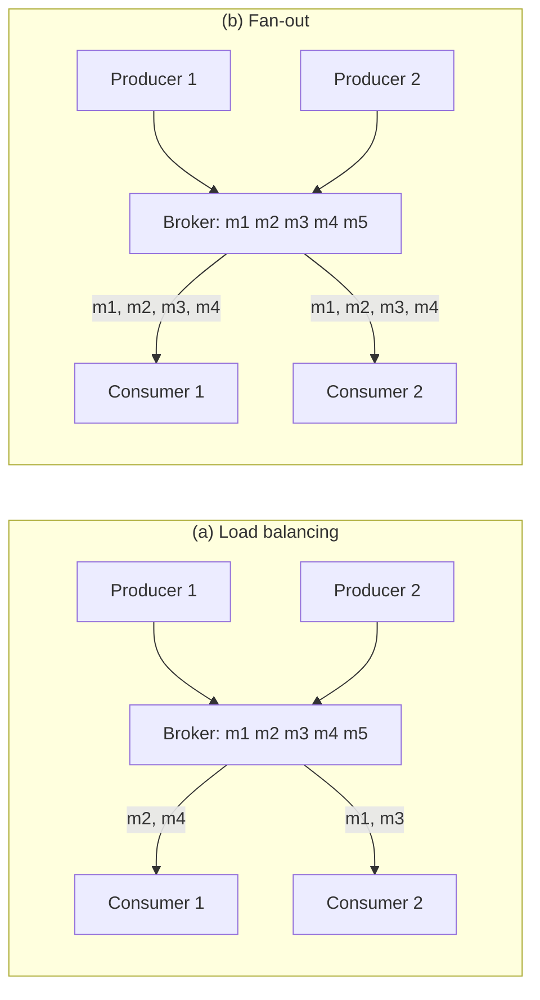
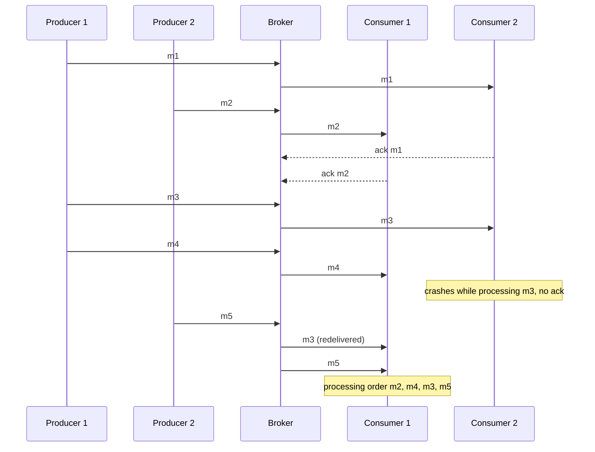
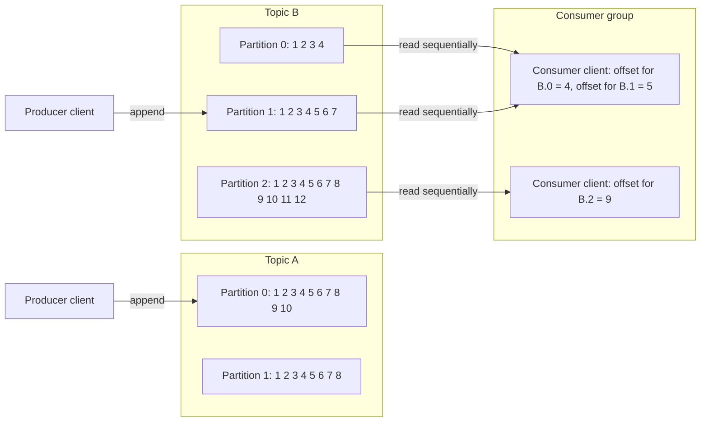
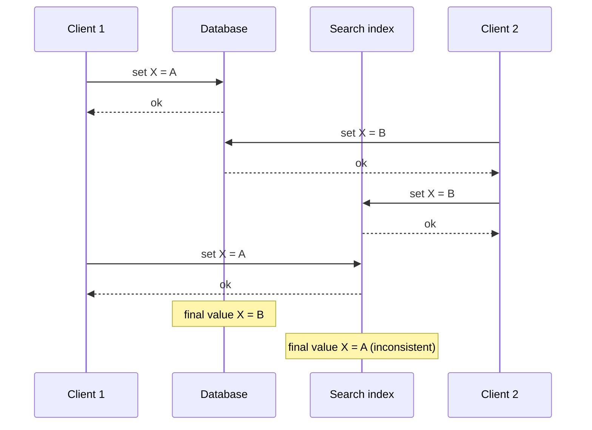
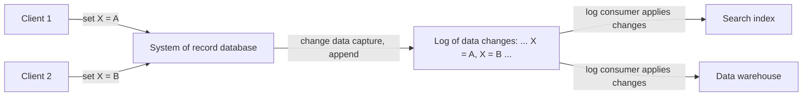
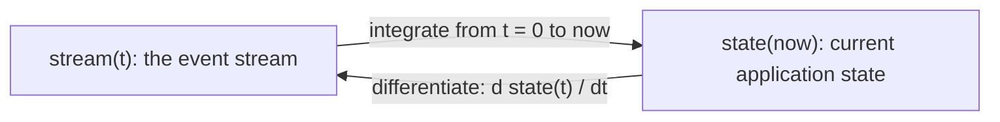
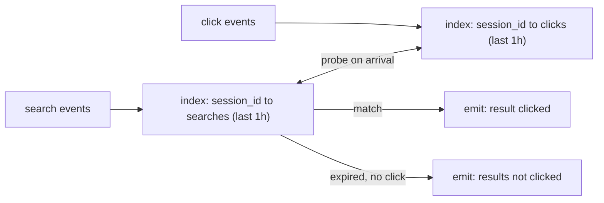

# Chapter 11 — Stream Processing
*Book: Chapter 11, pp. 439–487*

## Overview

**Question:** what if the input never ends? How do you move, store and process continuously arriving data (clicks, sensor readings, database writes) with low delay while keeping batch processing's good properties (derived outputs, rerunnability, fault tolerance)?

**Where it fits:** Chapter 10's batch jobs read files and write **derived data** (rebuildable by rerunning). Batch assumes **bounded** input — sorting, the heart of MapReduce, can't emit anything until it has seen all input, since the last record might have the smallest key. Real data is **unbounded**: users keep producing it. Batch fakes completeness with time slices (a day's data each day); a daily job shows changes a day late, too slow for impatient users. Shrink the slices, or drop them and **process each event as it happens** — **stream processing**.

A "stream" is data made available **incrementally over time** — as in Unix stdin/stdout, lazy lists, file APIs like Java's `FileInputStream`, TCP connections, and internet audio/video. This chapter treats **event streams as a way of managing data**:
1. Representing, storing and transmitting streams ("Transmitting Event Streams").
2. How streams relate to databases ("Databases and Streams").
3. Processing streams continuously ("Processing Streams").

**Why it matters:** fraud detection, monitoring, live dashboards, syncing caches and search indexes with a database, real-time analytics. Log-based messaging and change data capture underpin modern data integration (Kafka — a widely used open-source event-stream platform — and friends).

**Analogy:** batch is yesterday's newspaper (finished bundle); stream processing is a live news ticker with no last page.

## Key terms

| Term | Plain-English meaning |
|---|---|
| Bounded / unbounded data | Finite, known-size input vs input that keeps arriving forever |
| Stream | Data made available bit by bit over time |
| Event | Small, self-contained, immutable record of something that happened, usually timestamped |
| Producer (publisher, sender) / consumer (subscriber, recipient) | Creates events / processes events |
| Topic / stream | Named group of related events (like a filename for records) |
| Polling | Consumer repeatedly asking "anything new?" |
| Trigger | Database feature reacting to a change (e.g. row insert); limited |
| Messaging system | Pushes messages containing events from producers to consumers |
| Publish/subscribe | Many producers publish to a topic; many consumers subscribe |
| Backpressure (flow control) | Blocking the producer when the consumer can't keep up |
| UDP multicast | Unreliable one-to-many sending; low-latency feeds |
| Brokerless messaging | Libraries (ZeroMQ, nanomsg) doing pub/sub directly between nodes |
| Webhook | Callback URL a service calls when an event occurs |
| Message broker (message queue) | Server — a database specialized for message streams — between producers and consumers |
| JMS / AMQP | Standards for traditional message brokers |
| Load balancing vs fan-out | Each message to one consumer (share work) vs to all consumers |
| Acknowledgment / redelivery | Consumer confirming completion so the broker deletes the message / resending an unacked message, possibly to another consumer |
| Log / partitioned log | Append-only records on disk / topic split into independent logs on possibly different machines |
| Offset | Monotonically increasing message number within a partition |
| Log-based message broker | Broker storing messages in a durable partitioned log (Kafka, Kinesis Streams, DistributedLog) |
| Consumer group | Consumer nodes sharing a topic's partitions |
| Head-of-line blocking | One slow message delays everything behind it |
| Consumer offset | Position up to which a consumer has processed a partition |
| Log segment | Chunk of a log; old segments are deleted or archived |
| Circular / ring buffer | Fixed-size buffer discarding oldest data when full |
| Replay | Re-reading old messages from an earlier offset |
| Dual writes | Application writing each change separately to every system |
| Race condition | Outcome depends on unlucky timing of concurrent operations |
| Change data capture (CDC) | Extracting every change written to a database as a stream |
| Initial snapshot | Consistent full database copy matched to a known log offset |
| Log compaction / tombstone | Keeping only the latest value per key / null value marking a key deleted |
| Change stream / change feed | A database's first-class API for subscribing to its changes |
| Event sourcing | Storing all application changes as immutable application-level events |
| Domain-driven design (DDD) | Design community where event sourcing originated |
| Command | User request that may still fail validation |
| Changelog / ledger | Log of all changes / accountants' append-only transaction log |
| Compensating transaction | New entry correcting an earlier mistaken one instead of erasing it |
| CQRS | Command query responsibility segregation: separate write form from read forms |
| Excision / shunning | Datomic's / Fossil's features for truly deleting data from immutable history |
| Operator / job | Code that processes streams |
| Complex event processing (CEP) | Searching streams for event patterns with stored queries |
| Stream analytics | Aggregations and statistics over streams |
| Window | Time interval over which an aggregation is computed |
| Probabilistic algorithm | Approximate answers with far less memory (Bloom filter, HyperLogLog) |
| Materialized view | Derived, query-optimized view kept up to date as data changes |
| Percolator | Elasticsearch feature matching documents against stored queries |
| Distributed RPC | Storm feature interleaving user queries with stream events |
| Event time / processing time | When the event happened (its timestamp) / when the processor handles it (its clock) |
| Straggler event | Arrives after its window was declared complete |
| Tumbling / hopping / sliding / session window | Window types (defined below) |
| Stream-stream join (window join) | Joining related events from two streams within a time window |
| Stream-table join (enrichment) | Adding database info to each event via a local CDC-updated copy |
| Table-table join | Joining two changelog streams to maintain a materialized join view |
| Slowly changing dimension (SCD) | Joining with a value that changes over time (warehouse term) |
| Exactly-once (effectively-once) | Output looks as if each input was processed exactly once despite retries |
| Microbatching | Splitting a stream into ~1-second batches processed like batch jobs |
| Checkpointing | Periodically saving operator state durably |
| Idempotent | Doing it many times = doing it once |
| Fencing | Stopping a node wrongly believed dead from interfering |

## Transmitting Event Streams

Batch inputs/outputs are **files**. The streaming equivalents:
- **Events instead of records:** a small, self-contained, **immutable** object describing something at a moment, usually with a **timestamp** from a time-of-day clock (Chapter 8). Sources: user actions (page view, purchase) or machines (temperature sensor, CPU metric); each line of Chapter 10's web log is an event.
- **Encoding:** text, JSON, or binary (Chapter 4), so events can be stored (file, relational table, document DB) or sent over the network.
- **Producers and consumers:** an event is created once by a **producer** (**publisher**, **sender**) and processed by possibly many **consumers** (**subscribers**, **recipients**). Related events form a **topic** or **stream** (like a filename groups records).

**Why not just a database or file?** Producers write events; consumers **poll** for new ones — effectively a daily batch job. For low delay, frequent polling gets expensive: the more often you poll, the fewer requests find anything new. Better to **notify** consumers. Databases have been weak at this: relational **triggers** react to changes (e.g. an inserted row) but can do little and are an afterthought. Hence specialized tools.

### Messaging Systems

A **messaging system** **pushes** messages carrying events from producers to consumers (cf. Chapter 4, "Message-Passing Dataflow"). A Unix pipe or TCP connection links **one sender to one receiver**; messaging systems let **many producers** and **many consumers** share a topic — **publish/subscribe**. Two questions distinguish them:

**1. Producers faster than consumers?**

| Option | What happens | Example / caveat |
|---|---|---|
| **Drop** | Excess discarded | Only if loss is tolerable |
| **Buffer** | Messages queue | As the queue grows, does it crash when memory runs out or spill to disk, and how does disk hurt performance? |
| **Backpressure** (flow control) | Producer blocked | Unix pipes and TCP: small fixed buffer; sender blocks until it drains |

**2. Nodes crash or go offline — are messages lost?** Durability needs disk writes and/or replication, at a cost; tolerating some loss buys more **throughput** and lower **latency** on the same hardware ([System Design Fundamentals](../00a-system-design-fundamentals/README.md)). It depends on the app: occasional missing **sensor readings and metrics** may be fine (a fresh value comes soon) — but **beware** that heavy dropping may silently make metrics wrong; **counting events** needs reliability, since every loss skews counts.

Batch systems guarantee output equal to a failure-free run (retry tasks, discard partial output); similar guarantees for streams come later.

#### Direct messaging from producers to consumers

- **UDP multicast** is popular in **finance** for low-latency **stock market feeds**. UDP doesn't guarantee delivery, but application-level protocols can recover lost packets if the producer remembers and retransmits on request.
- **Brokerless libraries** **ZeroMQ** and **nanomsg** do pub/sub over TCP or IP multicast.
- **StatsD** and **Brubeck** collect metrics over unreliable **UDP**; StatsD **counters** are correct only if every message arrives, so they're approximate at best (Chapter 8, "TCP Versus UDP").
- If the consumer exposes a service, producers can push via **HTTP or RPC** (remote procedure call) — the idea behind **webhooks**: register a callback URL that the other service calls on each event.

Limits: application code must cope with **message loss**; fault tolerance is limited — protocols usually assume producers and consumers are **always online**, so an offline consumer misses messages, and producer retries fail if the **producer crashes** and loses its retry buffer.

#### Message brokers

A **message broker** (**message queue**) is a **database optimized for message streams**: a server that producers write to and consumers read from.
- **Centralizing data** handles clients connecting, disconnecting and crashing; **durability becomes the broker's job**. Some keep messages **in memory**, others persist **to disk**.
- Slow consumers usually get **unbounded queueing** (configurable).
- Consumers are **asynchronous**: producers wait only for the broker to **buffer** the message; delivery is usually well under a second, but can be much later with a backlog.

#### Message brokers compared to databases

Some brokers can join **two-phase commit** via **XA** or **JTA** (Chapter 9), resembling databases, but:

| Aspect | Database | Traditional message broker |
|---|---|---|
| Retention | Until explicitly deleted | Most **delete a message once delivered** — not for long-term storage |
| Working set | Can be large | Assumes **small** (short queues); buffering many messages (spilling to disk) **degrades throughput** |
| Selecting data | **Secondary indexes** and search | **Subscribing to topics matching a pattern** — same purpose, different mechanism |
| Change notification | Results are a **point-in-time snapshot**; you don't learn of later changes unless you re-query | **No arbitrary queries**, but clients **are notified** of new messages |

This model is standardized in **JMS** and **AMQP** and implemented by **RabbitMQ**, **ActiveMQ**, **HornetQ**, **Qpid**, **TIBCO Enterprise Message Service**, **IBM MQ**, **Azure Service Bus** and **Google Cloud Pub/Sub**.

#### Multiple consumers

- **Load balancing:** each message goes to **one** consumer — for **expensive** messages and adding parallel consumers. (**AMQP**: several clients on one queue; **JMS**: **shared subscription**.)
- **Fan-out:** each message goes to **all** consumers, independently — like several batch jobs reading one file. (**JMS**: **topic subscriptions**; **AMQP**: **exchange bindings**.)

*Figure 11-1 (redrawn): producers 1 and 2 publish m1 to m5 into the broker. (a) Load balancing: consumer 1 processes m2 and m4, consumer 2 processes m1 and m3, so each message goes to one consumer. (b) Fan-out: consumer 1 and consumer 2 each process m1, m2, m3, m4 (m5 has not been delivered yet when the figure ends).*



They **combine**: two consumer groups each get every message, but within a group only one node gets each message.

#### Acknowledgments and redelivery

Consumers may crash mid-message, so they must **explicitly acknowledge** completion; the broker then removes the message. If the connection closes or times out without an ack, the broker **redelivers** it to another consumer. (The message may actually have been processed with only the ack lost — handling that needs an **atomic commit protocol**, Chapter 9.)

**Reordering (Figure 11-2):** with load balancing, consumer 2 crashes processing **m3** while consumer 1 handles **m4**; m3 is redelivered to consumer 1, which processes **m4, m3, m5** — out of producer 1's order.

*Figure 11-2 (redrawn): producer 1 sends m1, m3, m4 and producer 2 sends m2, m5. Consumer 2 handles m1, consumer 1 handles m2, then consumer 2 dies midway through m3 while consumer 1 is busy with m4. The broker later redelivers m3 to consumer 1, which therefore processes m4, m3, m5.*



Though **JMS and AMQP require** order preservation, load balancing + redelivery **inevitably reorders**. Use a **separate queue per consumer** to avoid it. Harmless for independent messages; serious with **causal dependencies**.

### Partitioned Logs

Network communication is normally **transient** (no permanent trace unless you capture packets), and even disk-persisting brokers delete messages soon after delivery. Databases and filesystems keep data until deleted. This matters for **derived data**:
- Batch jobs can rerun on read-only input harmlessly.
- With **AMQP/JMS**, receiving is **destructive** (the ack deletes), so rerunning a consumer gives different results.
- A **new consumer** only gets messages sent **after it registered**; with files/databases, a new client can read old data.

**Idea:** combine databases' **durable storage** with messaging's **low-latency notifications** — the **log-based message broker**.

#### Using logs for message storage

- A **log** is an append-only sequence of records on disk (Chapter 3 log-structured storage and WALs; Chapter 5 replication).
- A **producer appends** messages; a **consumer reads sequentially**, then waits for notification of new appends — like **`tail -f`**.
- One disk limits throughput, so the log is **partitioned** (Chapter 6) across machines; a **topic** is a **group of partitions** carrying one type of message.
- Within a partition each message gets a **monotonically increasing offset**; a partition is append-only, so its messages are **totally ordered** — but there is **no ordering across partitions**.

*Figure 11-3 (redrawn): Topic A has partitions 0 (messages 1 to 10) and 1 (1 to 8); topic B has partitions 0 (1 to 4), 1 (1 to 7) and 2 (1 to 12). The numbers in the boxes are offsets. Producer clients append new messages to the end of a partition (one to topic A partition 0, one to topic B partition 1). A consumer group of two clients reads topic B sequentially: one client owns B.0 and B.1 (recorded offsets 4 and 5), the other owns B.2 (offset 9).*



Examples: **Apache Kafka**, **Amazon Kinesis Streams**, **Twitter's DistributedLog**; **Google Cloud Pub/Sub** is architecturally similar but exposes a **JMS-style API**. Despite writing everything to disk they handle **millions of messages per second** via partitioning, and **replicate** for fault tolerance.

#### Logs compared to traditional messaging

- **Fan-out is trivial:** consumers read independently; reading deletes nothing.
- **Load balancing** assigns **whole partitions** to nodes in a **consumer group**; each consumes its partitions **sequentially, single-threaded**. Downsides: consumers ≤ **number of partitions**, and one **slow message holds up** its partition (**head-of-line blocking**, Chapter 1).

> **Footnote: sharing one partition.** Two consumers could split one partition by even/odd offsets, or use a **thread pool**, but that complicates offset management. Prefer single-threaded per partition and add partitions for parallelism.

| Situation | Better choice |
|---|---|
| Messages **expensive**, want **per-message parallelism**, order **unimportant** | **JMS/AMQP** broker |
| **High throughput**, messages **fast** to process, order **important** | **Log-based** broker |

#### Consumer offsets

- Sequential reading means all messages **below** the consumer's offset are done, all **above** unseen — the broker only **periodically records consumer offsets**, not per-message acks. Less bookkeeping plus **batching and pipelining** raise throughput.
- The offset is like the **log sequence number** in single-leader replication (Chapter 5, "Setting Up New Followers"): **the broker acts like a leader database, the consumer like a follower**.
- **Consumer failure:** another group member takes its partitions from the **last recorded offset**; messages processed after that offset are **processed a second time** (addressed later).

#### Disk space usage

The log is split into **segments**; old ones are **deleted or archived** (log compaction comes later). A **slow consumer** whose offset points at a **deleted segment misses messages**. The log is a **circular buffer** / **ring buffer** on disk — so it can be **very large**.

**Book's estimate:** a typical large drive held **6 TB** with **150 MB/s** sequential write; filling it takes about **11 hours** (6,000,000 MB ÷ 150 MB/s ≈ 40,000 s). So a disk buffers **~11 hours** at full speed (the ratio holds across many disks); real deployments rarely use full bandwidth, so logs keep **several days or even weeks**.

Throughput stays **roughly constant regardless of retention**, since every message hits disk anyway — unlike memory-first systems that are fast with short queues but **much slower** once they spill to disk.

#### When consumers cannot keep up with producers

- A log is **buffering** with a **big fixed-size buffer** (disk space). A consumer lagging beyond retention can't read old messages — effectively **dropped**.
- **Monitor consumer lag** and **alert**; the big buffer gives humans time to fix it.
- Only the lagging consumer suffers — others aren't disrupted, so you can safely read a **production log** for development, testing or debugging.
- A stopped/crashed consumer **uses no resources** except its offset — unlike traditional brokers, where abandoned **queues must be deleted** or they keep accumulating messages and stealing memory.

#### Replaying old messages

- In AMQP/JMS, processing+ack is **destructive**; in a log, consuming is **read-only**, like reading a file.
- The only side effect is the **consumer offset moving forward**, which the consumer controls — e.g. run a **copy of a consumer with yesterday's offsets**, write output elsewhere, **reprocess the last day**, as often as you like with different code.
- This makes log-based messaging like **batch**: derived data cleanly separated from input by a repeatable transformation — good for experimentation, recovering from bugs, and **integrating dataflows across an organization**.

Own Kafka-style pseudocode:

```python
consumer = Consumer(group="search-indexer", topic="page-edits")
consumer.seek(partition=0, offset=41_200)   # rewind to replay from an older position
for msg in consumer.poll_forever():         # sequential read; nothing is deleted
    index.update(msg.key, msg.value)        # derived output goes somewhere else
    consumer.commit(msg.offset + 1)         # record progress periodically, not per-message ack
```

`seek` works because the log is retained; after a crash, processing resumes from the last `commit` (later work is redone).

## Databases and Streams

Log-based brokers borrowed from databases; the reverse works too.
- A **database write** is itself an event that can be captured, stored and processed — the link is **fundamental**.
- A **replication log** (Chapter 5) *is* a stream of write events the leader emits; followers apply it.
- **State machine replication** (Chapter 9, "Total Order Broadcast"): replicas applying identical events in identical order reach the same state (given **deterministic** processing).

### Keeping Systems in Sync

- Nontrivial apps combine an **OLTP database**, a **cache**, a **full-text index**, a **data warehouse** — each with its own optimized copy, which must stay **in sync**.
- Warehouses typically use **ETL** (Extract, Transform, Load) — a **batch** full copy; search indexes and recommenders can also be built in batch (Chapter 10).
- If full dumps are too slow, apps sometimes use **dual writes**: the application writes each change to every system (DB, then search index, then **invalidate** cache entries — or concurrently).

**Problem 1: race condition (Figure 11-4).** Clients 1 and 2 concurrently set **X** to **A** and **B**, each writing the database then the search index. The **database** gets A then B (ends **B**); the **index** gets B then A (ends **A**) — **permanently inconsistent**, with no error.

*Figure 11-4 (redrawn): each write is acknowledged with "ok". The database gets A then B (final X = B), but the search index gets B then A (final X = A).*



Without concurrency detection like **version vectors** (Chapter 5, "Detecting Concurrent Writes"), you wouldn't even notice.

**Problem 2: partial failure.** One write may fail and the other succeed — a **fault-tolerance** issue; ensuring all-or-nothing is the costly **atomic commit** problem (Chapter 9, 2PC).

**Root cause:** there's **no single leader** — DB and index each act independently, as in multi-leader replication (Chapter 5). Better: make the database the **one leader** and the index its **follower**. Enter CDC.

### Change Data Capture

- Replication logs were long an **internal implementation detail**; for **decades** many databases had **no documented way** to get their change log, making replication to other technologies hard.
- **Change data capture (CDC)** **observes every change written to a database** and extracts it in a form **other systems can replicate**, ideally **as a stream the moment it's written**.
- Applying changes to a search index **in the same order** keeps it matching the database; the index is just **another consumer of the change stream**.

*Figure 11-5 (redrawn): client 1 sets X = A and client 2 sets X = B in the system-of-record database. Change data capture appends the changes, in the order the database applied them, to a log of data changes (... X = A, X = B ...). A log consumer applies them in that same order to the derived data systems: a search index and a data warehouse.*



#### Implementing change data capture

Log consumers are **derived data systems** — other **views** of the **system of record**. **CDC makes one database the leader and the others followers.** A **log-based broker** suits transport because it **preserves order** (avoiding Figure 11-2's reordering).

| Approach | How | Trade-off |
|---|---|---|
| **Database triggers** (Chapter 5, "Trigger-based replication") | Triggers record all table changes in a **changelog table** | **Fragile**, **significant performance overhead** |
| **Parsing the replication log** | Read the DB's own log | **More robust**, but must handle **schema changes** |

Systems: **LinkedIn's Databus**, **Facebook's Wormhole**, **Yahoo!'s Sherpa** at large scale; **Bottled Water** (PostgreSQL, via an API decoding its **write-ahead log**); **Maxwell** and **Debezium** (MySQL, parsing the **binlog**); **Mongoriver** (MongoDB **oplog**); **GoldenGate** (Oracle).

CDC is usually **asynchronous**: the system of record doesn't wait for consumers. A **slow consumer** barely affects it, but all **replication lag** issues apply (Chapter 5).

#### Initial snapshot

Replaying a log of **all** changes would rebuild the database, but keeping everything needs **too much disk** and replay takes **too long**, so logs are **truncated**. A new full-text index needs a **full copy**, so start from a **consistent snapshot** (Chapter 5, "Setting Up New Followers") tied to a **known log offset**, then apply later changes. Some CDC tools do this; others leave it **manual**.

#### Log compaction

An alternative to repeated snapshots:
- As in Chapter 3 ("Hash Indexes", Figure 3-2), the engine periodically, in the **background**, finds records with the same **key**, discards duplicates and keeps **only the newest per key**.
- A **tombstone** (special **null** value) marks a **deletion** and removes the key during compaction; otherwise a key stays **forever**.
- So a compacted log's size depends on **current contents**, **not on how many writes** occurred; overwritten values are **garbage-collected**.
- For brokers and CDC: if each change has a **primary key** and **replaces** the previous value, the latest write per key suffices.
- Rebuild a derived system by reading the compacted topic from **offset 0** — it holds the **latest value for every key**, a **full copy** **without another snapshot**.
- **Apache Kafka supports log compaction**, letting the broker serve as **durable storage**, not just transient messaging.

Own example:

```text
before compaction (offset: key=value)      after compaction
0: user:7 = {name: "Ana"}                  3: user:9 = {name: "Raj"}
1: user:9 = {name: "Raj"}                  4: user:7 = {name: "Ana M."}
2: user:5 = {name: "Li"}                   5: user:5 = null (tombstone, removed later)
3: user:9 = {name: "Raj"}
4: user:7 = {name: "Ana M."}
5: user:5 = null
```

#### API support for change streams

Databases increasingly offer change streams as a **first-class interface**, not reverse-engineered CDC:
- **RethinkDB**: queries **subscribe to notifications** when results change.
- **Firebase** and **CouchDB**: sync based on a **change feed** also exposed to apps.
- **Meteor**: follows the **MongoDB oplog** to refresh the UI.
- **VoltDB**: transactions **export data as a stream** — a **table that transactions insert tuples into but that cannot be queried**; its log of committed tuples, **in commit order**, is read asynchronously by consumers.
- **Kafka Connect**: integrates CDC tools for many databases with **Kafka**, from which search indexes and stream processors are updated.

### Event Sourcing

**Event sourcing**, from the **domain-driven design (DDD)** community, also keeps **every change as an event in a log**, but at a different **level of abstraction**:

| | Change data capture | Event sourcing |
|---|---|---|
| How the app uses the DB | **Mutably** (updates, deletes) | Logic **built on immutable events** in an **event log** |
| Log origin | Extracted **at a low level** (replication log), guaranteeing true write order (avoiding Figure 11-4's race) | **Append-only event store**; updates/deletes **discouraged or prohibited** |
| App awareness | **Need not know** | Designed around events |
| Event meaning | **Low-level state changes** | Things that happened **at the application level** |

**Why powerful:** recording the **user's actions** as immutable events is more meaningful than recording their **effects** on mutable state. It eases **evolution**, aids **debugging**, and guards against **application bugs**.

**Book example:** "**student cancelled their course enrollment**" states intent neutrally; the side-effect version (row deleted from **enrollments**, reason added to **student feedback**) bakes in assumptions about future data use. A later feature — **offering the place to the next person on the waiting list** — simply chains off the existing event.

Event sourcing resembles the **chronicle data model**; an event log resembles a star schema's **fact table** (Chapter 3). **Event Store** is a specialized database for it, but any **conventional database** or **log-based broker** works.

Own JSON example:

```json
{"type": "SeatHoldRequested", "show": "S12", "seat": "C7", "user": "u42", "ts": "2021-03-03T19:00:05Z"}
{"type": "SeatHoldConfirmed", "show": "S12", "seat": "C7", "user": "u42", "ts": "2021-03-03T19:00:06Z"}
{"type": "SeatReleased",      "show": "S12", "seat": "C7", "user": "u42", "ts": "2021-03-04T08:12:40Z"}
```

Each line is an immutable fact; releasing the seat is a new event, not a deletion.

#### Deriving current state from the event log

Users want **current state** (a **shopping cart's** current contents), not history. So apps **transform the event log** (how data is **written**) into display state (how it is **read**) with **deterministic** logic, so reruns give the same state.

| | CDC | Event sourcing |
|---|---|---|
| Event content | Usually the **entire new record version** | **User intent**, not state-update mechanics |
| Later events override earlier? | Yes — **latest** event per key determines state | Usually **no** |
| Log compaction | Possible | **Not possible the same way** — need **full history** |

Apps store **snapshots** of derived state to avoid full replays, but that is **only a performance optimization**; the intent is to **keep every raw event forever** and be able to **reprocess the whole log** (questioned under "Limitations of immutability").

#### Commands and events

1. A user request arrives as a **command**, which **may still fail** (e.g. an integrity violation).
2. The app **validates** it.
3. Once accepted it becomes an **event**: **durable** and **immutable**.

Example: **registering a username** or **booking a seat on a plane or in a theater** (Chapter 9, "Fault-Tolerant Consensus") → "username registered by user ID X" / "seat reserved for customer Y".
- An event is a **fact**: a later change or cancellation is a **separate event**; it remains true they **once held** the reservation.
- Consumers **may not reject** an event (it's already in the log, possibly read by others), so **validation must be synchronous, before the event is written** — e.g. a **serializable transaction** that validates and emits atomically.
- **Alternative:** a **tentative reservation** event then a separate **confirmation** (Chapter 9, "Implementing linearizable storage using total order broadcast"), allowing **asynchronous** validation.

### State, Streams, and Immutability

**Immutability** — what makes batch inputs safe to experiment on — powers event sourcing and CDC too. Databases store **current state** and support updates/deletes, but changing state is always **produced by events**: **available seats** from **reservations**, an **account balance** from **credits and debits**, a **response-time graph** from individual request times. **Mutable state and an append-only event log are two sides of the same coin**; the **changelog** shows how state evolved.

**Calculus view (Figure 11-6):** **integrating the event stream over time gives the state**; **differentiating state over time gives the change stream**. The analogy has limits (a second derivative of state seems meaningless).

*Figure 11-6 (redrawn): the book shows two formulas. state(now) = integral from t = 0 to now of stream(t) dt, and stream(t) = d state(t) / dt.*



Storing the changelog **durably** makes state **reproducible**; treating the **event log as the system of record** and mutable state as **derived** simplifies reasoning about dataflow.

> **Pat Helland's view (paraphrased).** The transaction log records every change; the database is just a **cache of the latest values** in the log. **The log is the truth.**

**Log compaction** bridges the two: it keeps only the newest version of each record.

#### Advantages of immutable events

- **Accounting** has used immutability for **centuries**: an **append-only ledger** of transactions; the **profit and loss** statement and **balance sheet** are **derived** by summing it.
- **Mistakes aren't erased:** add a **compensating transaction** (e.g. a refund); the wrong entry stays for **auditing**, and published figures get a **correction** next period.
- **Auditability** helps beyond finance: like batch outputs (Chapter 10), recovering from buggy code is much easier when it can't **destructively overwrite** data.
- **More information than current state:** a customer adds then removes a cart item — irrelevant for fulfillment, but valuable for **analytics** (they considered it; maybe they'll buy later or chose a substitute). Deleting the item loses this.

#### Deriving several views from the same event log

- Several **read-oriented representations** can come from one log, like multiple consumers (Figure 11-5): **Druid** ingests directly from **Kafka**; **Pistachio** (a distributed key-value store; the book's index files it under Yahoo!) uses **Kafka as its commit log**; **Kafka Connect sinks** export to many databases and indexes; **search servers** could do likewise.
- **Easier evolution:** a new feature builds a **separate read-optimized view** from the log, running **alongside** existing systems — often easier than an in-place **schema migration**; retire the old view when done.
- **Flexibility:** much of schema/index/storage-engine complexity comes from supporting particular query patterns (Chapter 3). Separating **the form data is written in** from **the forms it is read in** is **command query responsibility segregation (CQRS)**.
- **Normalization debate dissolves:** traditional design assumes the **fallacy** that data must be stored as it will be queried. With a **write-optimized event log** translated into **read-optimized state**, it's fine to **denormalize** read views (Chapter 2) — the translation keeps them **consistent**.
- **Twitter home timelines** (Chapter 1, "Describing Load"): a highly **denormalized** per-user cache of followed users' tweets, kept consistent by the **fan-out service** that copies each tweet to followers and reacts to follow changes.

#### Concurrency control

**Biggest downside:** consumers are **asynchronous**, so a user may write to the log, read a derived view, and **not see their write** (Chapter 5, "Reading Your Own Writes"). Fixes: (1) update the read view **synchronously** with the append, via a **transaction** — both in **one storage system**, or a **distributed transaction**; (2) Chapter 9's "Implementing linearizable storage using total order broadcast".

But event logs also **simplify** concurrency:
- **Multi-object transactions** (Chapter 7) are often needed because **one user action touches several places**; an event can **describe the whole action**, needing **one atomic append**.
- If log and state are **partitioned the same way** (an event in log **partition 3** only changes state **partition 3**), a **single-threaded consumer** needs **no write concurrency control** (cf. "Actual Serial Execution", Chapter 7): the log fixes a **serial order**, **removing nondeterminism**.
- Events touching **multiple state partitions** need more work (Chapter 12).

#### Limitations of immutability

- Immutability is common elsewhere: databases use **immutable structures or multi-version data** for snapshots (Chapter 7); **Git, Mercurial and Fossil** keep immutable history.
- **Keeping all history forever** depends on **churn**: mostly-append workloads are easy; workloads with **heavy updates/deletes on a small dataset** make history **prohibitively large**, cause **fragmentation**, and make **compaction and garbage collection** performance crucial.
- **Administrative deletion:** **privacy regulations** (erase personal data after account closure), **data protection legislation** (remove erroneous data), and **accidental leaks**. A "treat as deleted" event isn't enough — you must **rewrite history**: **Datomic's excision**, **Fossil's shunning**.
- **True deletion is hard:** storage engines, filesystems and **SSDs** often write new data elsewhere rather than overwrite, and **backups** are deliberately immutable. Deletion is more "harder to retrieve" than "impossible" — but sometimes you must try (Chapter 12, "Legislation and self-regulation").

## Processing Streams

Having covered stream sources (user activity, sensors, database writes) and transport (direct messaging, brokers, logs), what can you **do** with a stream?
1. **Write events to a storage system** (database, cache, search index) — the streaming equivalent of batch outputs; works best if the **stream consumer is the only writer** (Figure 11-5).
2. **Push events to users** — **email alerts**, **push notifications**, a **real-time dashboard**; a **human** is the consumer.
3. **Process input streams into output streams**, possibly via a **pipeline** of stages ending in 1 or 2.

Code doing 3 is an **operator** or **job**: like Unix processes and MapReduce jobs, it **reads inputs read-only** and **writes output append-only elsewhere**. Partitioning, parallelization and **mapping** (transform, filter) work as in Chapter 10. **The crucial difference: a stream never ends** — so **sorting makes no sense** (no **sort-merge joins**), and **fault tolerance changes**: a job running **for years** can't restart from the beginning.

### Uses of Stream Processing

Long used for **monitoring**: **fraud detection** (unusual credit-card patterns → block), **trading systems** (rule-based trades on price movements), **manufacturing** (identify malfunctions quickly), **military and intelligence** (alarm on signs of attack). These need **pattern matching and correlations**.

#### Complex event processing

- **CEP** (from the **1990s**) **searches for patterns of events**, as a **regular expression** finds character patterns.
- Patterns are written in a **declarative, SQL-like language** or a **GUI**; an engine runs an internal **state machine** and emits a **complex event** when a pattern matches.
- **Reversed relationship:** databases store data **permanently** and queries are **short-lived**; CEP stores **queries long-term** while events **flow past** them.
- Implementations: **Esper**, **IBM InfoSphere Streams**, **Apama**, **TIBCO StreamBase**, **SQLstream**; **Samza** and others are adding **SQL support**.

#### Stream analytics

Less about specific sequences, more about **aggregations and statistics**: event **rates**, **rolling averages** over a recent period, **comparing current statistics with previous intervals** (trends, alerts vs last week).
- Usually over **fixed time intervals** — e.g. mean **queries per second** over the **past 5 minutes** and the **99th percentile** response time (99% of requests are faster) for that span (smoothing noise yet reacting promptly). The interval is a **window**.
- **Probabilistic algorithms** — **Bloom filters** (set membership: "definitely not" or "probably present", Chapter 3), **HyperLogLog** (cardinality), **percentile estimation** (Chapter 1) — use **much less memory** for approximate results.
- **Common confusion:** stream processing is **not inherently lossy or inexact** — probabilistic algorithms are **merely an optimization**.
- Frameworks: **Apache Storm, Spark Streaming, Flink, Concord, Samza, Kafka Streams**; hosted **Google Cloud Dataflow**, **Azure Stream Analytics**.

#### Maintaining materialized views

- Keeping caches, indexes and warehouses current from a change stream is maintaining **materialized views** (Chapter 3); in **event sourcing**, application state is **also a materialized view**.
- Unlike analytics, a limited window **isn't enough**: you need **all events over an arbitrary period** (minus what compaction discards) — a **window back to the beginning of time**.
- This **clashes with** analytics frameworks built for short windows; **Samza and Kafka Streams** support it via **Kafka's log compaction**.

#### Search on streams

- Searching **individual events** with complex criteria like **full-text queries**: **media monitoring** (news feeds matched against stored queries for companies/products/topics), **real estate websites** alerting users to new matching listings. **Elasticsearch's percolator** implements this.
- **Inverted processing:** normal search **indexes documents, then runs queries**; stream search **stores queries** and runs documents past them (like CEP). Testing every document against every query is slow, so **index the queries** too, checking only candidates.

#### Message passing and RPC

Message-passing systems like the **actor model** (Chapter 4) aren't usually considered stream processors:

| Actor frameworks | Stream processing |
|---|---|
| Manage **concurrency** and **distributed execution** of modules | A **data management** technique |
| Communication often **ephemeral and one-to-one** | Event logs **durable and multi-subscriber** |
| **Arbitrary**, including **cyclic request/response** | Usually **acyclic pipelines**: each stream produced by one job from defined inputs |

Crossover: **Apache Storm's distributed RPC** interleaves user queries with stream events and aggregates results (Chapter 12, "Multi-partition data processing"). Actor frameworks can process streams, but many **don't guarantee delivery on crashes**, so they aren't fault-tolerant without extra retries.

### Reasoning About Time

Windows like "**the average over the last five minutes**" are surprisingly tricky.
- **Batch** processes **historical** events quickly — a **year's** events in **a few minutes** — so it must use the **timestamp in each event**, not the machine clock. This also makes processing **deterministic** (Chapter 10, "Fault tolerance").
- **Many stream frameworks** window by the processor's **local clock** (**processing time**) — simple, and fine when lag is negligible, but it **breaks down** with significant **processing lag**.

#### Event time versus processing time

Delays come from **queueing**, **network faults** (Chapter 8), **contention** in broker or processor, consumer **restarts**, and **replaying history** after faults or bug fixes. Delays also cause **reordering**: a user's first request (server **A**) and second (server **B**) emit events, but **B's reaches the broker first**.

> **Star Wars analogy (credited to Kostas Kloudas of the Flink community).** Episodes IV, V, VI came out in 1977, 1980, 1983; I, II, III in 1999, 2002, 2005; VII in 2015. Watching in release order differs from story order: **episode number = event timestamp; viewing date = processing time.** Humans cope; algorithms must handle it explicitly.

**Confusing them gives bad data:** a processor measuring **request rate** is **redeployed** and down for **a minute**; draining the backlog afterwards looks like a **spike** by processing time, while the real rate was **steady**.

*Figure 11-7 (described): the top of the figure shows a web server emitting request events at a steady pace, and a stream processor that consumes them but has a "restarting" gap, after which it works through the backlog at a faster pace. Below are two charts. "Rate as measured by processing time" starts at 10, dips to 0 while the processor restarts, then climbs above 10 (to about 15) while the backlog drains, before settling back down. "Actual request rate" (by event time) is a flat line at 10 the whole time. The dip and the spike are artifacts purely of variations in processing rate.*

#### Knowing when you're ready

With event-time windows you can **never be sure** all events have arrived. Counting per **one-minute window**: events for the **37th minute** are counted and new events are now in the **38th and 39th** — when do you close the 37th? A **timeout** helps, but events may still be **buffered on another machine** behind a **network interruption**. For such **straggler events**:
1. **Ignore them** (usually few); **count dropped events** and **alert** if significant.
2. **Publish a correction** — re-emit the window's value, possibly **retracting** the earlier result.

Producers can emit a marker "**nothing with a timestamp before t will follow**", but with many producers consumers must **track each one**, and **adding/removing producers** gets harder.

#### Whose clock are you using, anyway?

Events may be **buffered at several points**: a **mobile app** used **offline** sends events when reconnected, perhaps **hours or days later** — extreme stragglers. The meaningful timestamp is the **device's local clock**, which **can't be trusted** (accidentally or deliberately wrong, Chapter 8); the **server's receive time** is **accurate** but **less meaningful**.

**Fix: log three timestamps** — (1) **occurred** (device clock), (2) **sent** (device clock), (3) **received** (server clock). **Offset** = (3) − (2), assuming **negligible network delay**; **true event time** ≈ (1) + offset, assuming the device offset **didn't change** between event and send.

```text
t1 (occurred, device clock)  = 09:00:00
t2 (sent,     device clock)  = 12:00:00   # phone came back online 3 h later
t3 (received, server clock)  = 12:05:00
offset        = t3 - t2 = +5 min          # device clock runs 5 min slow
true time est = t1 + offset = 09:05:00
```

This problem **isn't unique to streaming** — batch has it too; streaming just makes time more visible.

#### Types of windows

| Window | Definition | Book's example | Implementation |
|---|---|---|---|
| **Tumbling** | **Fixed length**; each event in **exactly one** window | 1-minute: **10:03:00–10:03:59**, then **10:04:00–10:04:59** | **Round timestamp down** to the minute |
| **Hopping** | **Fixed length**, **overlapping** for smoothing | **5-minute** window, **1-minute hop**: **10:03:00–10:07:59**, **10:04:00–10:08:59**, … | **1-minute tumbling** windows aggregated over adjacent ones |
| **Sliding** | All events **within some interval of each other** | 5-minute sliding includes **10:03:39** and **10:08:12** (under 5 min apart); fixed **boundaries** of tumbling/hopping would split them | **Time-sorted buffer**, evicting expired events |
| **Session** | **No fixed duration**; a **single user's** events close together, ending after **inactivity** | Closes after **30 minutes** without events | Sessionization, common in **website analytics** (Chapter 10, "GROUP BY") |

*Illustrative diagram (not a numbered book figure): tumbling vs hopping boundaries for the same minute-by-minute timeline.*

```mermaid
gantt
    dateFormat HH:mm
    axisFormat %H:%M
    section Tumbling 1 min
    W1 :t1, 10:03, 1m
    W2 :t2, 10:04, 1m
    W3 :t3, 10:05, 1m
    section Hopping 5 min hop 1 min
    H1 :h1, 10:03, 5m
    H2 :h2, 10:04, 5m
    H3 :h3, 10:05, 5m
```



Own tumbling-window count by event time:

```python
from collections import defaultdict
counts = defaultdict(int)
def on_event(ev):
    window_start = ev.ts - (ev.ts % 60)   # round event time down to the minute
    counts[window_start] += 1            # tumbling: each event lands in exactly one window
```

### Stream Joins

Joins are as essential to streaming pipelines as to batch (Chapter 10), but events may arrive **anytime**. Three types: **stream-stream**, **stream-table**, **table-table**.

#### Stream-stream join (window join)

**Book's example:** spotting URL search trends. Each search logs the **query and results**; each click logs a **click** event. **Click-through rate** per URL requires joining searches and clicks by **session ID** (ad systems need the same).
- An abandoned search produces **no click**.
- Click delay varies from seconds to **days or weeks** (forgotten tab).
- Network delay can make the **click arrive before the search**.
- So choose a **join window**, e.g. **no more than one hour** apart.

**Common confusion:** embedding search details in the click event is **not** a join — it misses searches with **no clicks**, which accurate click-through rates need.

**How:** keep **state** — events from the **last hour** **indexed by session ID**. On each event, add it to its index and probe the **other** index; on a match emit **which result was clicked**; when a search **expires** unmatched, emit **which results were not clicked**.

*Illustrative diagram (not a numbered book figure): state kept for a stream-stream window join.*



#### Stream-table join (stream enrichment)

**Book's example:** Figure 10-2's join of **user activity events** with **user profiles**, done continuously: events with a user ID come in; events **augmented with profile information** go out — **enriching** the events.
- **Querying a remote database** per event is **slow** and risks **overloading** it.
- Instead keep a **local copy** in the processor — like Chapter 10's **map-side hash joins**: an **in-memory hash table** if small, or an **index on local disk**.

**Difference from batch:** batch uses a **snapshot**; a long-running stream processor must keep its copy **up to date** — via **CDC**, subscribing to the **profile changelog** and updating the copy. So it is really a **join of two streams**. Unlike a stream-stream join, the **table changelog** side uses a window back to the **"beginning of time"** with newer versions **overwriting** older ones, while the **event** side may keep **no window**.

```python
profiles = {}                                  # local copy of the users table
def on_profile_change(chg):                    # from the CDC changelog stream
    profiles[chg.user_id] = chg.new_row        # newer version overwrites older (infinite window)
def on_activity(ev):                           # from the activity event stream
    emit({**ev, "profile": profiles.get(ev.user_id)})   # enriched event, no window kept
```

#### Table-table join (materialized view maintenance)

**Book's example: Twitter timelines** (Chapter 1). Instead of merging followed users' tweets at read time, keep a per-user **timeline cache** ("**inbox**") so reads are a **single lookup**. Handlers:
- User **u** tweets → add to the timeline of **every follower of u**.
- A tweet is **deleted** → remove it from **all** timelines.
- **u1 follows u2** → add u2's **recent tweets** to u1's timeline.
- **u1 unfollows u2** → remove u2's tweets from u1's timeline.

The processor consumes streams of **tweets** (send, delete) and **follows** (follow, unfollow) and keeps a database of each user's **followers** — i.e. it maintains a **materialized view** of a join of two tables. Own SQL (different names than the book's):

```sql
SELECT f.reader_id AS timeline_owner,                        -- one timeline per follower
       array_agg(p.* ORDER BY p.posted_at DESC) AS timeline  -- that follower's posts, newest first
FROM   posts p
JOIN   subscriptions f ON f.author_id = p.author_id          -- follower sees posts by authors they follow
GROUP  BY f.reader_id;
```

The timelines are a **cache of this query's result**, updated whenever either table changes.

> **Footnote: product rule.** If a stream is a table's derivative (Figure 11-6) and a join is a product **u·v**, changes obey **(u·v)′ = u′v + uv′**: tweet changes join with follower lists as they are **now**, and follower changes join with tweets as they are **now**.

#### Time-dependence of joins

- All three build **state** from **one** input and **look it up** for messages on the **other**.
- **Order matters** (follow then unfollow ≠ the reverse). Partitioned logs order **within** a partition but **not across streams or partitions**.
- So which activity events see the **old** profile and which the **new**? **What point in time do you join against?**
- **Tax rates** depend on **country/state**, **product type** and **date of sale**; reprocessing history, you want the rate **at the time of sale**, not today's.
- Undetermined cross-stream order makes the join **nondeterministic** — reruns may differ.
- Warehouses call this the **slowly changing dimension (SCD)** problem, solved by giving each **version** a **unique ID** (each tax-rate change gets a new ID recorded on the invoice): **deterministic**, but **log compaction becomes impossible** (all versions retained).

| Join type | Inputs | State kept | Window | Book example |
|---|---|---|---|---|
| Stream-stream | Two activity streams (or one self-joined) | Recent events of both, indexed by key | Limited (e.g. 1 hour) | Searches + clicks by session ID |
| Stream-table | Activity stream + DB changelog | Local table copy | Infinite for table; none for stream | Activity enriched with profiles |
| Table-table | Two DB changelogs | Latest state of both | Infinite for both | Twitter timelines from tweets + follows |

### Fault Tolerance

**Batch recap:** a failed MapReduce task restarts elsewhere and its output is discarded — possible because **inputs never change**, each task writes **its own HDFS file**, and output becomes visible **only on success**. The result equals a failure-free run, as if each record was processed **exactly once** (restarts may process records repeatedly, but the **visible effect** is once) — **exactly-once semantics**, better called **effectively-once**. **Streaming problem:** a stream is infinite, so you **can't wait for a task to finish** before exposing output.

#### Microbatching and checkpointing

**Microbatching** (**Spark Streaming**): split the stream into **small blocks** (typically **about one second**), each a **miniature batch**. Smaller batches raise **scheduling/coordination** cost; bigger ones **delay results**. It implicitly creates a **tumbling window of one batch** by **processing time**; larger windows must **carry state** across microbatches.

**Checkpointing** (**Apache Flink**): periodically take **rolling checkpoints of operator state** to **durable storage**; on a crash, **restart from the latest checkpoint** and **discard output** produced since. Triggered by **barriers** in the stream — like microbatch boundaries but **without forcing a window size**.

**Limit:** both give exactly-once **inside** the framework, but output that **leaves the processor** (DB writes, external messages, emails) **can't be discarded**, so a restart repeats external **side effects**.

#### Atomic commit revisited

For exactly-once despite faults, **every output and side effect** of processing an event must happen **if and only if** processing succeeds: messages to **downstream operators** or **external systems** (emails, **push notifications**), **database writes**, **operator state** changes, and **acknowledging input** (in a log, **advancing the offset**) — **all atomically or none** (Chapter 9, "Exactly-once message processing").

**XA** has problems (Chapter 9), but **restricted environments** allow efficient atomic commit: **Google Cloud Dataflow**, **VoltDB**, and planned for **Apache Kafka**. Rather than spanning **heterogeneous technologies**, they keep transactions **internal** to the framework (managing both state and messaging), and **amortize** cost by grouping many input messages per transaction.

#### Idempotence

Alternative to distributed transactions: **idempotent** operations — repeating has the **same effect as once**.
- **Setting a key to a fixed value** is idempotent; **incrementing a counter** is **not**.
- **Make it idempotent with metadata:** Kafka messages carry a durable, **monotonically increasing offset**; store the **offset of the message that caused the latest write** with the value, and skip updates already applied.
- **Storm's Trident** (higher-level API on Apache Storm) uses a similar idea.

```python
def apply(msg):                                    # msg.offset is monotonically increasing
    row = db.get(msg.key) or {"total": 0, "last_offset": -1}
    if msg.offset <= row["last_offset"]:
        return                                     # already applied before the crash: skip
    row["total"] += msg.amount                     # non-idempotent increment...
    row["last_offset"] = msg.offset                # ...made safe by storing the offset with it
    db.put(msg.key, row)                           # single write stores both atomically
```

**Assumptions:** (1) replay gives **identical messages in identical order** (log-based brokers do); (2) processing is **deterministic**; (3) **no other node concurrently updates** the value. On failover, **fencing** (Chapter 8, "The leader and the lock") blocks a node thought dead. With these, idempotence gives exactly-once at **small overhead**.

#### Rebuilding state after a failure

Stateful operators — **windowed aggregations** (counters, averages, histograms) and **join tables/indexes** — must **recover state**:

| Option | How | Trade-off / example |
|---|---|---|
| **Remote replicated datastore** | State in a remote DB | Querying it **per message can be slow** |
| **Local state, replicated periodically** | New task reads replicated state and resumes **without data loss** | **Flink** snapshots operator state to durable storage such as **HDFS**; **Samza and Kafka Streams** write state changes to a **dedicated log-compacted Kafka topic** (like CDC); **VoltDB** **processes each input on several nodes redundantly** (statement-based replication — sending commands, not results; Chapter 7, "Actual Serial Execution") |
| **Rebuild from input streams** | Recompute | **Short window**: **replay** its input; **CDC-maintained local replica**: rebuild from the **log-compacted change stream** |

Choices depend on **infrastructure performance**: sometimes the **network beats disk on latency** and **network throughput rivals disk**. Nothing is **best everywhere**, and local vs remote trade-offs may **shift as technology evolves**.

## Chapter summary

- **Stream processing = batch done continuously on unbounded input**; brokers and event logs are the streaming **filesystem**.

| | AMQP/JMS-style broker | Log-based broker |
|---|---|---|
| Delivery | **Individual messages** to consumers | **Whole partition** to **one consumer node**, in **fixed order** |
| Progress | **Ack per message**; **deleted** once acked | **Checkpoint the offset** |
| Parallelism | Per message | Via **partitioning** |
| Rereading | Not possible | **Retained on disk**; jump back and reread |
| Good for | **Asynchronous RPC** (fire a request, don't wait), e.g. a **task queue**, where order doesn't matter and old messages needn't be reread | Producing **derived state or streams** |

- Logs resemble **database replication logs** (Chapter 5) and **log-structured storage engines** (Chapter 3).
- **Stream sources:** user activity, periodic sensor readings, **financial market data** feeds, **database writes** — captured **implicitly via CDC** or **explicitly via event sourcing**; **log compaction** retains a **full database copy**.
- **Databases as streams** keep search indexes, caches and analytics continuously updated, and let you build **fresh views** by consuming the log from the start.
- **State-as-streams and replay** underpin **joins** and **fault tolerance**.
- **Purposes:** **CEP** (patterns), **stream analytics** (windowed aggregations), **materialized views**.
- **Time is hard:** **processing vs event time**; **stragglers**.
- **Joins:** **stream-stream** (related events within a window, e.g. same user within **30 minutes**; can be a **self-join** of one stream); **stream-table** (events **enriched** from a CDC-maintained local copy); **table-table** (both **changelogs**, each change combined with the other side's **current state** to update the **materialized join view**).
- **Exactly-once:** discard failed partial output — but streams run forever, so use finer-grained **microbatching, checkpointing, transactions, or idempotent writes**.

## Interview angle

**1. Kafka-style log vs RabbitMQ-style queue: when to use which?**
Traditional (AMQP/JMS) brokers deliver individual messages, delete on ack, load-balance per message — good for task queues with expensive, order-insensitive messages. Log-based brokers append to durable partitioned logs consumed in order per partition, track offsets, and allow replay — good for high-throughput, order-sensitive streams and derived data.
- *Follow-up: Why does a queue reorder?* Load balancing + redelivery: a crashed consumer's message goes to one that has moved on (m4, m3, m5). Fix: one queue per consumer.
- *Follow-up: What limits log parallelism?* Consumers per group ≤ partitions; a slow message blocks its partition (head-of-line blocking).

**2. How do you keep a search index / cache in sync with the database?**
Avoid dual writes (race: DB ends B, index A; partial failure). Use CDC: database as single leader, capture its log (Debezium/Maxwell for MySQL binlog, Bottled Water for PostgreSQL WAL, Mongoriver for the oplog), publish in order through a log-based broker, consumers as followers. Bootstrap from a snapshot tied to an offset, or a compacted topic from offset 0.
- *Follow-up: Downside?* Asynchronous, so replication-lag anomalies apply.

**3. What is event sourcing and how does it differ from CDC?**
Immutable application-level events ("student cancelled enrollment") are the source of truth and state is derived; CDC extracts low-level changes from a mutable database. Event sourcing separates commands (may fail) from events (facts consumers can't reject), enables CQRS read views, auditability and evolution — but logs can't be compacted per key, snapshots are needed for speed, and deletion needs excision-like features.
- *Follow-up: Validating a seat booking?* Synchronously before emitting (serializable transaction), or tentative-reservation + confirmation events.

**4. Event time vs processing time; late data?**
Event time = when it happened; processing time = when processed. Processing-time windows create artifacts (restart backlog = spike). Event-time windows are never known complete: ignore stragglers (monitor drops) or publish corrections; optionally per-producer "nothing before t" markers. For device clocks, log occurred/sent (device) and received (server) timestamps and correct by the offset.
- *Follow-up: Window types?* Tumbling, hopping, sliding, session.

**5. Stream joins?**
Stream-stream (searches + clicks within 1 hour by session ID), stream-table (enrichment from a local CDC-maintained table), table-table (materialized view like Twitter timelines). All keep state from one input and probe it with the other; cross-stream order isn't guaranteed, so joins can be nondeterministic — SCD fix: version joined records (tax-rate IDs), losing log compaction.

**6. How do stream processors achieve exactly-once?**
Inside the framework: microbatching (Spark Streaming, ~1 s) or barrier checkpoints (Flink). For external effects: framework-internal atomic commit (Google Cloud Dataflow, VoltDB, planned for Kafka) or idempotent writes (store the Kafka offset with the value; needs same-order deterministic replay, no concurrent writers, fencing on failover). State recovery: snapshots (Flink → HDFS), compacted changelog topics (Samza, Kafka Streams), redundant processing (VoltDB), or replaying input.
- *Follow-up: Literally exactly once?* No — records may be processed more than once; the visible effect is once ("effectively-once").

## Self-check

1. **Why does polling become expensive at low latency, and what do messaging systems do instead?**
   More frequent polls find new data less often, so overhead grows. Messaging systems notify consumers of new events.

2. **Three options when producers outpace consumers; which do pipes/TCP and log brokers use?**
   Drop, buffer, backpressure. Pipes/TCP: backpressure. Log brokers: buffering in a large fixed-size on-disk buffer.

3. **Book's numbers: how long can one disk buffer messages, and why longer in practice?**
   6 TB at 150 MB/s fills in ~11 hours; deployments rarely use full bandwidth, so logs hold days or weeks.

4. **Scenario: dual writes of X = A and X = B to a DB and search index. What goes wrong; how does CDC fix it?**
   Different interleavings (DB ends B, index A) cause silent permanent inconsistency; one write may also fail. CDC makes the DB the single leader and applies its changes to the index in commit order.

5. **Why can a CDC topic be compacted but an event-sourced log generally not?**
   CDC updates carry the full record, so the latest per key determines state; event-sourced events express intent and don't override earlier ones.

6. **Command vs event; where must validation happen?**
   A command may fail validation; once accepted it becomes an immutable event. Consumers can't reject events, so validate synchronously before writing (or tentative + confirmation events).

7. **Two non-performance problems with immutability?**
   Legal/administrative deletion (privacy, erroneous data, leaks) needs history rewriting (Datomic excision, Fossil shunning); and true deletion is hard because copies persist in SSDs, filesystems and immutable backups.

8. **Dashboard spike right after redeploying the stream processor — why?**
   Processing-time windowing: the backlog from the one-minute downtime was processed at once, though the event-time rate was steady.

9. **Which window puts 10:03:39 and 10:08:12 in one 5-minute window; why not others?**
   Sliding (under 5 minutes apart); tumbling and hopping have fixed boundaries that separate them.

10. **Assumptions behind idempotent-write exactly-once?**
    Same messages in the same order on replay, deterministic processing, no concurrent updater, plus fencing on failover.

11. **When rebuild operator state from input instead of replicating it?**
    When state aggregates a short window (fast replay) or is a CDC-maintained local copy rebuildable from a compacted change stream.
