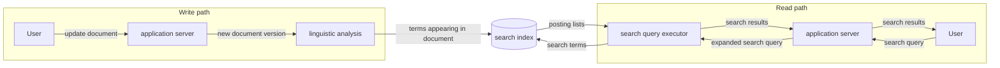
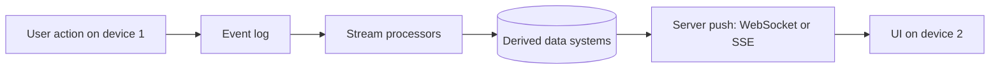
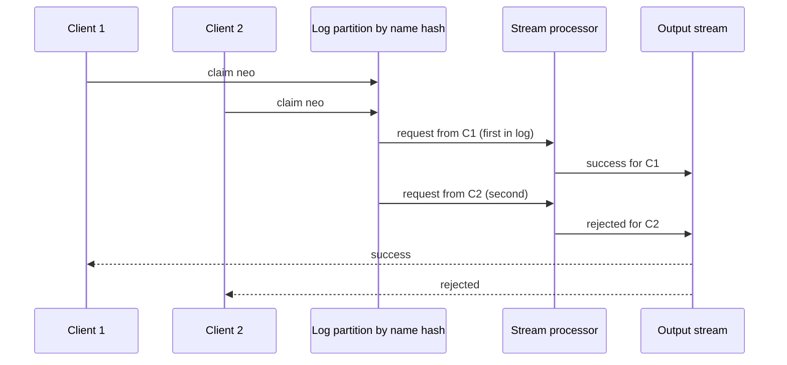
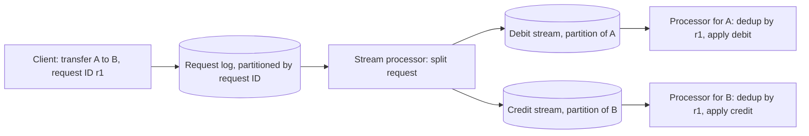
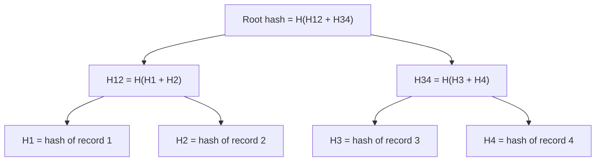
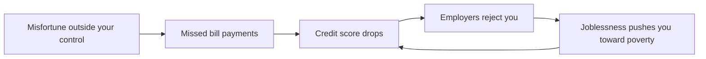

# Chapter 12 — The Future of Data Systems
*Book: Chapter 12, pp. 489–552*

## Overview

Earlier chapters describe how data systems work **today**; this one argues how they **ought** to be built. Being opinion, Kleppmann writes in the first person and invites disagreement.

The epigraph (Thomas Aquinas, usually paraphrased as *a captain whose only goal was to keep the ship safe would never leave port*) makes the point that a system exists for a purpose beyond survival. Reliability, scalability and maintainability (Chapter 1) are means; the goal is applications that are **robust, correct, evolvable, and ultimately good for people**.

Four big questions:
1. **Data integration** — real apps glue together a database, search index, cache, warehouse…; how do you keep all copies consistent?
2. **Unbundling databases** — can a database's internal mechanisms (indexes, views, replicas kept in sync) be pulled "out" to wire a whole organisation together?
3. **Aiming for correctness** — with asynchronous logs (append-only event sequences read by each consumer at its own pace) and stream processors instead of distributed transactions, how do we avoid lost, duplicated or corrupted data?
4. **Doing the right thing** — ethics around prediction, bias, surveillance and privacy.

Why it matters: most sizeable companies have a "zoo" of data stores fed from each other. The ideas here — one ordered log as the source of truth, everything else derived, idempotent consumers, end-to-end request IDs, auditing — are how modern **event-driven architectures** (Kafka + stream processors + downstream stores) are built. New to cache, replication, partitioning or queue? See [System Design Fundamentals](../00a-system-design-fundamentals/README.md).

**Analogy:** a spreadsheet — change a cell and every dependent formula updates. The dream is company-wide data infrastructure that behaves the same, correctly, even when machines crash.

## Key terms

| Term | Plain-English meaning |
|---|---|
| Data integration | Getting the same data, in the right shape, into every system that needs it |
| System of record | Authoritative source-of-truth copy; new writes land here first |
| Derived data / derived dataset | Computed from other data by a repeatable process (index, cache, view, ML model); can be rebuilt |
| Dataflow | The path data takes as it moves and transforms between systems |
| Change data capture (CDC) | Reading a database's change stream so others can apply the same changes |
| Event sourcing | Storing every user action as an immutable event and deriving state from the log |
| Total order / total order broadcast | Every consumer sees all events in the same sequence; equivalent to consensus |
| Causal dependency | B happened because of (or after seeing) A, so B mustn't be processed as if A hadn't happened |
| Logical timestamp | Counter-based timestamp (e.g. Lamport clock) ordering events without physical clocks |
| Idempotent | Same effect applied once or many times |
| Deterministic | Same input always gives the same output (no randomness, clock reads, network calls) |
| Reprocessing | Rerunning a (new) transformation over all old data to build a new view |
| Lambda architecture | Batch and stream systems side by side over the same events, outputs merged |
| Unified batch and stream processing | Historical reprocessing and live processing in one engine |
| Exactly-once (effectively-once) | End result as if each message were processed once despite retries |
| Event time vs processing time | When an event happened vs when it's processed |
| Unbundling databases | Treating a database's features (indexes, views, replication) as separate components joined by logs |
| Federated database / polystore | One query interface over many stores ("unifying reads") |
| Database inside-out | Another name for the unbundling/dataflow approach (author's 2014 talk) |
| Derivation function | Code turning base data into a derived dataset |
| Stateless service | App server that forgets each request after answering; state lives in a database |
| Observer pattern | Subscribing to a value to be notified of changes instead of polling |
| Stream-table join (enrichment) | Joining each event with a locally kept, up-to-date table |
| Write path / read path | Eager work when data arrives / lazy work when someone asks |
| Offline-first application | Works against a local on-device database, syncing in the background |
| Server-sent events / WebSockets | Protocols letting a server push messages to a browser over a long-lived connection |
| End-to-end argument | Some guarantees (dedup, integrity, security) need the endpoints, not just lower layers |
| Operation identifier / request ID | Client-generated unique ID for one logical action, used to drop duplicates downstream |
| Uniqueness constraint | No two records may share a value (username, seat, request ID) |
| Compensating transaction | A later corrective action (refund, apology, rebooking) instead of prevention |
| Timeliness | Users see up-to-date state; violations are temporary ("eventual consistency") |
| Integrity | No lost, duplicated, contradictory or false data; violations are permanent ("perpetual inconsistency") |
| Coordination-avoiding data system | Keeps integrity without synchronous cross-node coordination |
| System model | Assumptions about what can and can't go wrong |
| Auditing | Actively checking that data is still correct and complete |
| Rowhammer | Repeated memory-row access flipping bits in neighbouring rows |
| Merkle tree | Tree of hashes cheaply proving a record belongs to a dataset |
| Certificate transparency | Public Merkle-tree log for checking TLS/SSL certificates |
| Predictive analytics | Forecasting, including about individuals (credit risk, reoffending) |
| Algorithmic prison | Systematic exclusion from jobs, loans, travel etc. because an algorithm labelled you risky |
| Feedback loop | A prediction changes the world so as to reinforce itself |
| Systems thinking | Considering the whole system, humans included, to foresee consequences |
| Surveillance | Tracking people mainly to serve someone else's interests |
| Data exhaust | Behavioural data produced as a by-product of using a service |
| Data broker | Company that buys, combines, infers and resells personal data |

---

## Data Integration

Every problem in the book had several trade-off-laden solutions — log-structured storage vs B-trees vs column storage (Chapter 3), single-leader vs multi-leader vs leaderless replication (Chapter 5). One product must commit to one approach (covering every use case guarantees mediocrity), so even "general-purpose" databases suit particular usage patterns. Two challenges follow:
1. **Matching tools to situations** — vendors don't advertise weaknesses; the earlier chapters give you the questions to ask.
2. **Using data in many ways at once** — no single tool fits all of an application's access patterns, so you combine several.

### Combining Specialized Tools by Deriving Data

**Classic example:** an OLTP database plus a full-text search index. PostgreSQL's built-in full-text search suffices for simple apps, but serious search needs a dedicated tool (e.g. Elasticsearch), and search indexes make poor durable systems of record — so you need both. Often also: analytics copies (warehouses, batch and stream processors), caches or **denormalized** objects, ML/classification/ranking/recommendation systems, and change-triggered notifications.

> **Beware "99% of people only need X".** Such claims reveal more about the speaker's experience than the technology; what's useless to one team is central to another. Data integration needs become obvious only across the **whole organisation**.

#### Reasoning about dataflows

With copies in several stores, be clear where data is **written first**, which representation is **derived from which**, and how and in what format each copy is populated. A clean design:
1. The app writes **only** to the system-of-record database.
2. **CDC** (Chapter 11) reads its change stream.
3. The index applies changes **in exactly the order they happened**.

If CDC is the *only* path, the index agrees with the database (barring bugs).

**Dual writes go wrong:** if the app writes to both, concurrent conflicting writes may be applied in opposite orders (Figure 11-4); neither store controls ordering, so they diverge **forever**.

**Fix — a single ordering authority:** route all input through one system that orders writes, and derive everything else in that order — state machine replication (Chapter 9, "Total Order Broadcast"). CDC or event-sourcing log, the principle is the same: **decide on a total order once**. Updates from a log can usually be **deterministic and idempotent**, so recovery is just replay.

#### Derived data versus distributed transactions

The traditional alternative is a distributed transaction (atomic commit / 2PC, Chapter 9: prepare all, then commit or abort all).

| Aspect | Distributed transactions | Log-based derived data |
|---|---|---|
| Write ordering | Locks for mutual exclusion (e.g. two-phase locking) | Position in a log |
| Exactly-once | Atomic commit | Deterministic retry + idempotence |
| Timing | Usually **linearizable** — read your own writes | Usually **asynchronous** — no such guarantee by default |
| Faults | One failing participant aborts all, spreading failure | Faults stay local; slow consumers just lag |
| Cross-vendor practicality | **XA** has poor fault tolerance and performance | Simpler; works across heterogeneous systems |

Author's view: distributed transactions work in constrained environments willing to pay; XA is severely limited; a better protocol would be hard to get adopted. So **log-driven derived data is the best bet** for integrating systems today. But he rejects "eventual consistency is inevitable, deal with it" without guidance — guarantees like read-your-writes matter; "Aiming for Correctness" seeks a middle ground.

#### The limits of total ordering

A single-leader database already totally orders writes, but at scale:
1. **Throughput:** one leader may not keep up; **partitioning** the log (Chapter 11) leaves order **across partitions** undefined.
2. **Geography:** multiple **datacenters** typically have a leader each (cross-datacenter sync is too slow; multi-leader, Chapter 5), so events from different datacenters are unordered.
3. **Microservices:** each service has its own state; no order across services.
4. **Client-side / offline state:** clients and servers likely see events in different orders.

Total order broadcast is **equivalent to consensus** (Chapter 9); most algorithms assume one node handles the whole stream. Scaling consensus beyond one node and across geographies is **an open research problem**.

#### Ordering events to capture causality

Unrelated events can go in any order, and same-object updates can be ordered by routing by object ID. But causality can hide. **The book's example:** A and B break up; A **unfriends** B, then messages friends complaining about B, expecting B not to see it. Friendships and messages live in different systems, so the notification service may process the message **before** the unfriend and notify B. The notification is effectively a **join** of messages with the friend list — Chapter 11's time-dependence-of-joins problem.

| Technique | Helps because | Limitation |
|---|---|---|
| Logical timestamps (Chapter 9, "Sequence Number Ordering") | Total order without coordination | Recipients still handle out-of-order delivery; extra metadata travels with events |
| Log an event recording **what the user saw** before deciding, with a unique ID later events reference | Records the causal dependency explicitly | Revisited in "Reads are events too" — logging reads costs storage and I/O |
| Conflict resolution algorithms (Chapter 5) | Handle unexpected order when maintaining state | Useless for external side effects like notifications |

The author hopes for patterns that capture causality without the total-order bottleneck.

### Batch and Stream Processing

Data integration's goal: **every place that needs data gets it in the shape it needs** — reading, transforming, joining, filtering, aggregating, training models and writing outputs (search indexes, materialized views, recommendations, metrics). Batch and stream share principles; the key difference is **unbounded** streams vs **finite** batch inputs. Implementations are blurring: **Spark** streams via **microbatches** (e.g. one second each) on a batch engine; **Apache Flink** does batch on a streaming engine. Either can emulate the other, with performance differences — microbatching can be slow for **hopping or sliding windows** (overlapping fixed-length windows).

#### Maintaining derived state

Batch has a **functional** flavour: **deterministic, pure functions**; **no side effects** beyond explicit output; **immutable inputs**, **append-only outputs**. Stream processing adds **managed, fault-tolerant operator state** (Chapter 11). Clear deterministic functions aid fault tolerance (idempotence) and make dataflows easier to reason about — caches, models and indexes are all **pipelines** deriving one thing from another.

**Why asynchronous?** You could update derived systems synchronously like a database's secondary indexes, but asynchrony keeps **faults local**, whereas distributed transactions abort if **any** participant fails, **amplifying failures**. Cross-partition indexes (Chapter 6) — **term-partitioned** (global; writes go to several partitions) or **document-partitioned** (local; reads go to all partitions) — also scale and behave best when updated **asynchronously**.

#### Reprocessing data for application evolution

| Stream processing | Batch processing |
|---|---|
| Reflects input changes in views with low delay | Reprocesses accumulated history into **new** views |

Reprocessing powers **evolution** (Chapter 4). Without it, schema evolution — under **schema-on-write** or **schema-on-read** — is limited to small steps (optional field, new record type); with it you can restructure into an **entirely different model**.

> **Schema migrations on railways (book sidebar).** 19th-century English railways used competing **gauges**. After a standard was chosen in **1846**, lines were converted by adding a **third rail** ("dual/mixed gauge") so both gauges could run, removing it once all trains converted. Expensive — which is why nonstandard gauges survive, e.g. **BART** in the San Francisco Bay Area differs from most of the US.

**Derived views enable gradual migration:** keep old and new schemas as **two independently derived views**; route a small share of users to the new one to test; increase gradually; drop the old view. Every step is **reversible**, lowering risk and letting you move faster.

#### The lambda architecture

1. Record input as immutable events in a growing dataset (like event sourcing).
2. Derive read-optimised views.
3. Run **batch** (e.g. **Hadoop MapReduce**) and **stream** (e.g. **Storm**) systems **in parallel**: streaming gives a quick **approximate** view; batch later produces a **corrected** one.

Rationale: batch was simpler and less buggy, stream processors less reliable, and streaming could use fast approximate algorithms. Influential — it popularised immutable events and reprocessing — but:
- **Double implementation:** logic in two frameworks; **Summingbird** (Twitter) abstracts over both, but you still operate and debug two systems.
- **Merging outputs** per request: easy for **tumbling-window** aggregations, much harder for joins, sessionization or non-time-series output.
- **Full reprocessing is expensive**, so batch runs incrementally (e.g. hourly), reintroducing **stragglers** and cross-boundary windows — defeating its simplicity.

#### Unifying batch and stream processing

Newer systems do **both** in **one system**, requiring:

| Feature | Why | Example |
|---|---|---|
| Replay history through the live engine | Same code path for reprocessing | Log-based brokers replay; some stream processors read from **HDFS** |
| **Exactly-once** in stream processors | Output equals a fault-free run (discard failed partial output) | Chapter 11 fault tolerance |
| Windowing by **event time** | Processing time is meaningless during replay | **Apache Beam** API, running on **Apache Flink** or **Google Cloud Dataflow** |

---

## Unbundling Databases

Abstractly, databases, Hadoop and operating systems all **store data and let you process and query it** — records in a data model vs files. (Chapter 10: Hadoop is like a distributed Unix.) Differences exist — many filesystems struggle with **10 million small files** in a directory, while 10 million small records is normal for a database.

| | Unix | Relational databases |
|---|---|---|
| Goal | Logical but **low-level** hardware abstraction | **High-level** abstraction hiding disk structures, concurrency, crash recovery |
| Building blocks | Pipes and byte-sequence files | SQL and transactions |
| "Simple" because | Thin wrapper over hardware | A short declarative query taps huge machinery (optimizer, indexes, joins, concurrency control, replication) |

Both from the early 1970s; the tension is unresolved. The author sees **NoSQL** (from about 2009) as applying Unix-style low-level thinking to distributed OLTP. This section tries to combine the best of both.

### Composing Data Storage Technologies

Database features — **secondary indexes**, **materialized views** (Chapter 3), **replication logs** (Chapter 5), **full-text search indexes** — have parallels built outside databases in Chapters 10–11: batch-built full-text indexes, stream-maintained materialized views, and CDC replication to derived systems.

#### Creating an index

`CREATE INDEX`:
1. Takes a **consistent snapshot** of the table and scans it.
2. Extracts indexed values, **sorts** them, writes the index.
3. Processes the **backlog** of writes since the snapshot (if the table wasn't locked).
4. Keeps the index updated on every later write.

Nearly identical to **setting up a new follower** (Chapter 5) and **bootstrapping CDC** with a snapshot (Chapter 11): it **reprocesses the existing dataset** into a new view (state being the result of applying the change stream).

#### The meta-database of everything

**All of an organisation's dataflow looks like one giant database.** Batch, stream and ETL jobs ≈ **triggers, stored procedures and view-maintenance routines**; derived systems ≈ **index types** (B-tree, hash, spatial…). The difference: separate software, machines and teams. Two ways to compose tools into a whole:

| | Federated databases: **unifying reads** | Unbundled databases: **unifying writes** |
|---|---|---|
| Idea | One query interface over many engines (a **polystore**) | Reliably propagate every change to every store, despite faults |
| Example | PostgreSQL's **foreign data wrapper** | CDC + event logs feeding many stores |
| Specialised access | Apps can still use engines directly | Each store keeps its own API |
| Tradition | Relational: integrated, high-level, elegant, complicated | Unix: small tools, uniform low-level API (pipes), composed by a high-level language (shell) |
| Weakness | Doesn't solve synchronising **writes** | Still missing the "shell" |

"Unbundling" means taking index maintenance apart to sync writes across **different technologies**.

#### Making unbundling work

Federated reads need data-model mapping (manageable); **keeping writes in sync is harder**. Heterogeneous distributed transactions are, in the author's view, the **wrong** solution. Transactions **within** one store or stream processor are fine (some use them internally for exactly-once), but across systems built by **different groups** (e.g. a stream processor writing to a key-value store or search index) there's no standard protocol. An **ordered event log with idempotent consumers** is far simpler.

The win is **loose coupling**:
1. **System level:** if a consumer is slow or down, the log **buffers**; others continue and the broken consumer catches up later without loss. Synchronous transactions instead turn local faults into large failures.
2. **Human level:** teams build and run components independently behind clean interfaces. Event logs are strong enough for fairly strong consistency (durable, ordered) yet general enough for any data.

#### Unbundled versus integrated systems

Unbundling won't **replace** databases: stream processors need state stores, outputs need serving databases, and specialised engines (e.g. **MPP data warehouse** query engines for exploratory analytics) still matter. Costs: each component has its own learning curve and quirks, so **deploy as few moving parts as possible**; an integrated product may perform **better and more predictably**; building for unneeded scale is premature optimisation. Unbundling aims for **breadth, not depth**. **If one product does everything you need, use it.**

#### What's missing?

The unbundled equivalent of the **Unix shell** — a high-level declarative language for wiring systems. The author's wish: `mysql | elasticsearch`, an unbundled `CREATE INDEX` that indexes every MySQL document in Elasticsearch and then continuously applies later changes, with no custom glue. An imaginary sketch:

```text
# hypothetical "data shell" - not a real product
postgres://shop/products  |  opensearch://catalog-index
#  left side : source of truth; take a snapshot, then follow its change stream
#  "|"       : keep the right side continuously in sync with the left
#  right side: derived view that can be dropped and rebuilt at any time
```

Likewise, **declaring caches** as materialized views over complex (even recursive graph) queries, maintained automatically. Research like **differential dataflow** (efficiently updating results when a small part of the input changes) points this way.

### Designing Applications Around Dataflow

Composing specialised stores and processors with app code is the **"database inside-out"** approach (author's 2014 talk) — a design pattern, not a grand new architecture. Influences: dataflow languages **Oz** and **Juttle**, **Elm** (functional reactive programming, FRP), logic language **Bloom**; the term *unbundling* comes from **Jay Kreps**.

**Spreadsheets** beat most programming languages at dataflow — change an input and dependent formulas recalculate. Data systems still have lessons from **VisiCalc (1979)**, but must also be **fault-tolerant, scalable and durable**, and integrate technologies written by different people over time.

#### Application code as a derivation function

| Derived dataset | Derivation function |
|---|---|
| Secondary index | Pick indexed values per row/document and sort (B-tree or SSTable, Chapter 3) |
| Full-text search index | NLP — language detection, word segmentation, stemming or lemmatization, spelling correction, synonyms — then an **inverted index** (word → documents) |
| ML model | **Feature extraction** and statistical analysis over training data; predictions derive from input + model |
| Cache | Data aggregated into the UI's shape — UI changes may require redefining and rebuilding it |

Secondary indexes are so common databases build them in (`CREATE INDEX`); basic full-text search may be built in, advanced needs tuning; ML **feature engineering** is notoriously app-specific. Non-standard derivations need **custom code**, where databases struggle: **triggers, stored procedures and UDFs** (user-defined functions) are an afterthought.

#### Separation of application code and state

Databases make poor hosts for modern development needs: dependency/package management, version control, **rolling upgrades**, evolvability, monitoring, network calls, external integration. **Mesos, YARN, Docker and Kubernetes** focus on running code and do it far better. So some parts specialise in **durable storage**, others in **running code**.

Most web apps are **stateless services** (any server handles any request and forgets it) with state in a database — logic out of the database, state out of the app.

> **The joke.** Functional programmers favour keeping "Church and state" apart — *Church* being Alonzo Church, creator of the **lambda calculus**, which has no mutable variables.

The database acts as a **mutable shared variable** accessed synchronously over the network. But most languages **can't subscribe** to a variable's changes (you must hand-code the **observer pattern**), and databases inherited this: you **poll** to detect changes. Change subscriptions are only emerging (Chapter 11, "API support for change streams").

#### Dataflow: Interplay between state changes and application code

Think of **state, state changes, and code that processes them** collaborating: code reacts to changes in one place by producing changes elsewhere. Precedents: subscribable database change logs (Chapter 11); **actors** and message passing (Chapter 4); 1980s **tuple spaces**; triggers and index updates inside databases. Unbundling applies this to derived datasets **outside** the database (caches, full-text indexes, ML, analytics).

**Maintaining derived data ≠ running background jobs asynchronously** (messaging's traditional job):

| Requirement | Why | What breaks it |
|---|---|---|
| **Order of state changes matters** | Views from the same log must stay mutually consistent | Brokers that reorder when redelivering unacknowledged messages; dual writes |
| **Fault tolerance is essential** | One lost message leaves a view permanently wrong | Actor systems that keep state and messages in memory by default |

Stable ordering and fault-tolerant processing are demanding but **much cheaper and more robust than distributed transactions**; modern stream processors provide them at scale and run arbitrary app code as operators. Like Unix pipes, **stream operators compose**: state-change streams in, state-change streams out.

#### Stream processors and services

Today's **services** communicate via **synchronous** requests (e.g. REST APIs); their advantage over a **monolith** is **organisational scalability via loose coupling** (teams deploy independently). Stream operators resemble microservices but use **one-way, asynchronous message streams**.

Dataflow can also be **faster**. **Book's example:** a purchase priced in one currency, paid in another, needs the exchange rate.
1. **Microservices:** **query** an exchange-rate service at purchase time.
2. **Dataflow:** **subscribe in advance** to rate updates, store them in a **local database**, and read locally at purchase time.

The second is **faster** and **more robust** to the other service failing — the fastest, most reliable network request is the one you don't make. The RPC becomes a **stream-table join** of purchases and rate updates.

> **Footnote.** A microservice could cache the rate, but keeping it fresh needs polling or subscribing — i.e. the dataflow approach.

The join is **time-dependent**: reprocessing later needs the **historical** rate at purchase time (Chapter 11, "Time-dependence of joins"). Subscribing to changes moves us toward the spreadsheet model; questions remain, but the author finds it very promising.

### Observing Derived State

The **write path** is the eager process by which written information flows through batch/stream stages into every derived dataset. The **read path** serves queries from those datasets, perhaps with further processing. Together they cover data from collection to consumption.

| Write path | Read path |
|---|---|
| Precomputed **eagerly** on arrival, whether or not anyone asked | Only when someone asks |
| Like **eager evaluation** | Like **lazy evaluation** |

**The derived dataset is where they meet**, embodying a write-time vs read-time trade-off.

*Figure 12-1 (redrawn): in a search index, writes (document updates) and reads (queries) meet at the index. On the write path a new document version goes through linguistic analysis and its terms go into the index; on the read path a query is expanded, its terms are looked up in the index, and the posting lists (for each term, the list of documents containing it) come back as results.*


#### Materialized views and caching

In a full-text index, **writes** update entries per term; **reads** look up query words and apply Boolean AND/OR (e.g. synonyms). Moving the boundary:

| Option | Write-path work | Read-path work | Verdict |
|---|---|---|---|
| **No index** (scan like `grep`) | None | Huge | Only for small collections |
| **Normal index** | Update entries per term | Lookups + Boolean logic | Usual balance |
| **Precompute every possible query** | Infinite | Trivial | Impossible |
| **Precompute popular queries**, index for the rest | Update cached results as matching documents arrive | Fast for common queries | A **materialized view** ("cache of common queries") |

> **Footnote.** For a finite corpus, queries with **non-empty** results are finite but grow exponentially with term count — still hopeless.

**Caches, indexes and materialized views all shift the boundary**: more write-path work to save read-path work. This is Chapter 1's **Twitter** home-timeline example, with the boundary drawn differently for celebrities — after some 500 pages, full circle.

#### Stateful, offline-capable clients

We assume the **client/server model** (stateless clients, servers own data) too readily. Browsers were stateless and useless offline, but **single-page JavaScript apps** hold UI state and persistent local storage, and **mobile apps** keep much state on-device. This revives **offline-first** apps: use a **local database**, work offline, **sync in the background** — valuable on slow, unreliable mobile networks (Chapter 5, "Clients with offline operation"). Mental model: **on-device state is a cache of server state** — screen pixels are a materialized view of client model objects, which replicate state in a remote datacenter.

#### Pushing state changes to clients

A loaded web page doesn't learn of server changes until reload — device state is a **stale cache** unless you poll (RSS feeds are polling too). **Server-sent events** (the **EventSource API**) and **WebSockets** keep a TCP connection open so the server can **push** changes. This **extends the write path to the end user's device**: read initial state once via the read path, then follow a **stream of state changes**. **Offline devices** reconnect and resume from their **offset**, like log consumers (Chapter 11, "Consumer offsets") — each device is a small subscriber to a small stream.

#### End-to-end event streams

UI tools — **Elm**, Facebook's **React, Flux and Redux** — already manage client state by consuming event streams (user input, server responses), much like event sourcing. Let the **server feed its state-change events into that pipeline** too, giving an **end-to-end write path**:

*Illustration (not a book figure): the end-to-end write path from one user's device to another's screen.*


Changes could propagate in **under one second**, as in instant messaging and online games ("real-time" meaning low delay, not Chapter 8's hard guarantees). Why not everywhere? Request/response is baked into databases, libraries, frameworks and protocols; few datastores offer "one request, a **stream** of responses" (subscriptions). Moving from **request/response** to **publish/subscribe** is worth it for responsive UIs and offline support — design for **subscribing to changes**, not just querying.

#### Reads are events too

The derived-data store is where the write path hands over to the read path, allowing random-access lookups instead of reading the whole log. Stream processors already hold state for aggregations and joins; some let outside clients **query that state**. Going further: represent **read requests as events**, send reads and writes through the **same stream processor**, and emit results on an **output stream**. That is a **stream-table join** (queries vs database); reads must be routed to the partition holding the data (Chapter 6, "Request Routing"), just as joins co-partition inputs by key (Chapter 10). A **one-off read** passes through the join and is forgotten; a **subscription** is a **long-lived join** with past and future events.

**Benefit: causality and provenance.** Logging reads records **what the user saw before deciding** — e.g. the shipping date and stock status shown in a shop influence purchases. It costs storage and I/O (optimising that is open research); if you already log reads, making the log the **source** of requests is a small step.

#### Multi-partition data processing

Overkill for single-partition queries, but it enables **distributed execution of complex queries** using the stream processor's routing, partitioning and joins:
- **Storm's distributed RPC** computed **how many people have seen a URL on Twitter** — the union of follower sets of everyone who tweeted it, across partitions.
- **Fraud prevention:** scoring a purchase needs reputation lookups for IP, email, billing and shipping addresses — a **chain of joins** over differently partitioned datasets.

MPP databases' internal query graphs look similar; if you need multi-partition joins, such a database is probably **simpler**, but query-as-stream is an option at very large scale.

---

## Aiming for Correctness

A buggy **stateless** service is fixed by a restart; **stateful** systems remember forever, so mistakes may **last forever**. For about **four decades**, **atomicity, isolation and durability** (Chapter 7) have been the tools for correctness, but:
- they're **weaker than they look** (confusing weak isolation levels);
- some areas **abandon transactions** for faster, messier models (leaderless replication, Chapter 5);
- **consistency** is poorly defined (Chapters 7, 9), and "embrace weak consistency" often lacks clarity.

It's hard to know if an app is safe at a given isolation level or replication configuration; simple solutions work at low concurrency and fail under stress. **Kyle Kingsbury's Jepsen** tests (injecting network faults and crashes) exposed gaps between **claimed** and **actual** guarantees; and apps must still **use** infrastructure correctly, which is error-prone with confusing configuration (isolation levels, quorums).

| If your app… | Then… |
|---|---|
| Tolerates occasional unpredictable loss/corruption | Life is easy |
| Needs stronger correctness | **Serializability** and **atomic commit** work, but usually only **within one datacenter** and **limit scale and fault tolerance** |

Transactions aren't going away, but aren't the **final word**; this section explores correctness in **dataflow architectures**.

### The End-to-End Argument for Databases

Strong safety properties (e.g. serializable transactions) don't protect against **application bugs** that write wrong data or delete data — hence **immutable, append-only data** (Chapter 11, "State, Streams, and Immutability"), which helps but isn't a cure-all.

#### Exactly-once execution of an operation

When processing fails, you either **give up** (data loss) or **retry** (risking processing **twice** if the first try actually succeeded). **Processing twice is corruption too** — double charging, double counting. **Exactly-once** (**effectively-once**, Chapter 11) means the **final effect equals a fault-free run**. The best approach is **idempotence**, which may need extra metadata (e.g. the set of operation IDs already applied) and **fencing** (increasing tokens rejecting a node that lost its role) on failover (Chapter 8, "The leader and the lock").

#### Duplicate suppression

**TCP** uses packet sequence numbers to reorder and drop duplicates — but **only within one connection**. Databases tie transactions to connections; if the client sends `COMMIT` and the connection times out before the reply, it **doesn't know** whether it committed (Chapter 8, Figure 8-1).

Our own version of Example 12-1 (the book moves $11.00 between accounts 4321 and 1234; values differ here):

```sql
BEGIN TRANSACTION;                                           -- start one atomic unit of work
UPDATE wallets SET funds = funds + 25.00 WHERE wallet_id = 77;  -- credit the receiving wallet
UPDATE wallets SET funds = funds - 25.00 WHERE wallet_id = 88;  -- debit the paying wallet
COMMIT;                                                      -- make both changes permanent together
```

"Add 25" is **not idempotent**. If the `COMMIT` reply is lost and the client retries on a new connection, TCP can't recognise it — in the book's example **$22 could move instead of $11**. So the textbook atomicity example is **not correct**, and **real banks don't work this way**.

**Does 2PC help?** It decouples transactions from connections (the coordinator reconnects and resolves in-doubt transactions), but **no**: duplicates also arise between the **end user's device** and the **application server**. A user on weak mobile signal submits an HTTP **POST**; the response is lost; they retry and confirm the browser's resubmission warning. (**Post/Redirect/Get** — redirecting after a POST so refresh doesn't resend — avoids the warning normally but not after a timeout.) The retry is a **new request** and a **new transaction**; usual dedup misses it.

#### Operation identifiers

For idempotence across **several network hops**, consider the request's **whole journey**: generate a **unique operation ID** in the client — a **UUID** (128-bit random ID) in a hidden form field, or a **hash of the form fields** — so resubmissions carry the **same ID**, and pass it to the database, ensuring **one** execution per ID.

Our own version of Example 12-2:

```sql
ALTER TABLE transfer_log ADD UNIQUE (op_id);   -- the database will reject a second row with the same op_id

BEGIN TRANSACTION;
INSERT INTO transfer_log (op_id, payer, payee, amount)
  VALUES ('9b1f2c4e-5a6d-4e7f-8a90-b1c2d3e4f501', 88, 77, 25.00);  -- record the request; fails if op_id already exists
UPDATE wallets SET funds = funds + 25.00 WHERE wallet_id = 77;     -- credit
UPDATE wallets SET funds = funds - 25.00 WHERE wallet_id = 88;     -- debit
COMMIT;
```

- The `UNIQUE` constraint makes a retry's `INSERT` fail, **aborting** the whole transaction.
- Databases usually enforce uniqueness correctly **even under weak isolation**, whereas app-level "check then insert" can fail (Chapter 7, write skew and phantoms).
- The requests table is effectively an **event log**: balance updates could be **derived** downstream from the request event, processed exactly once via the same ID.

#### The end-to-end argument

Formulated by **Saltzer, Reed and Clark in 1984**, paraphrased: *a function can be implemented completely and correctly only with the help of the applications at both ends; the communication system can't provide it fully on its own, though a partial version can improve performance.* TCP dedups **packets**, some stream processors give exactly-once **message processing**, but neither stops a **user** resubmitting — you need an **end-to-end** transaction ID from client to database.

| Concern | Low-level mechanism | Misses | End-to-end fix |
|---|---|---|---|
| Data integrity | Checksums in **Ethernet, TCP and TLS** | Software bugs at sender/receiver; disk corruption | **End-to-end checksums** |
| Encryption | Home **WiFi password** | Attackers elsewhere on the internet | **End-to-end encryption and authentication** |
| Encryption | **TLS/SSL** (the encryption behind HTTPS) client–server | A compromised server | End-to-end encryption and authentication |

Low-level mechanisms remain **useful** (HTTP would often be garbled without TCP) — just **not sufficient**.

#### Applying end-to-end thinking in data systems

**The application must take end-to-end measures** like duplicate suppression. Ideally that machinery would be hidden in an **abstraction**, but we **haven't found it yet**. **Transactions** reduce many problems (crashes, disk failures, concurrent writes, constraint violations, network interruptions) to **commit or abort** — a huge simplification but not enough, and **expensive**, especially across **heterogeneous** stores (Chapter 9). Avoiding them pushes fault tolerance into **application code**, where the author suspects most mechanisms **don't work correctly**. We need abstractions that make **application-specific end-to-end correctness** easy and perform well at scale.

### Enforcing Constraints

Within the unbundled approach, a request ID flowing to the database gives end-to-end dedup. What about other constraints, especially **uniqueness** (Chapter 9): one user per username/email, one file per name, one buyer per seat? Similar: balance never negative, don't oversell stock, no overlapping meeting-room bookings.

#### Uniqueness constraints require consensus

Concurrent requests for the same value need a winner — **consensus** (Chapter 9).
- **Common method:** a single **leader** decides — fine if you accept routing through one node; surviving its failure brings back consensus.
- **Scale out** by partitioning on the unique value: same request ID → same partition; usernames by **hash of username**.
- **Asynchronous multi-master replication** is **ruled out** (masters could accept conflicting writes).
- **Immediately rejecting** violations requires **synchronous coordination**.

#### Uniqueness in log-based messaging

A log gives all consumers an **identical order** — **total order broadcast**, equivalent to consensus. A processor reads a partition **sequentially on one thread**, so partitioning by the unique value lets it decide which conflicting operation came **first**. **Usernames:**
1. Each request is appended to a partition chosen by **hash of the username**.
2. A processor tracks taken names in a **local database**, emitting **success** or **rejection** to an output stream.
3. The client **watches the output stream** for its result.

*Illustration (not a book figure): two clients race for the same username; the log order decides the winner.*


This is Chapter 9's "implementing linearizable storage using total order broadcast", and it **scales** by adding partitions. The principle — **route potentially conflicting writes to the same partition and process them sequentially** — works for many constraints with **arbitrary validation logic** (what counts as a conflict: Chapter 5 "What is a conflict?", Chapter 7 write skew). **Bayou** (Xerox PARC, replicated data on mobile devices) pioneered this in the **1990s**.

#### Multi-partition request processing

Example 12-2 may touch **three** partitions: the **request ID**'s, the **payee**'s and the **payer**'s. **Traditionally**, an **atomic commit across all three** forces a total order with everything else on them, hurting **throughput**. **Log-based, without atomic commit:**
1. The client gives the transfer (A → B) a **unique request ID** and appends it to a partition chosen **by request ID**.
2. A processor emits a **debit instruction** for A (partitioned by A) and a **credit instruction** for B (by B), both with the request ID.
3. Further processors **dedupe by request ID** and apply the balance changes.

*Illustration (not a book figure): a money transfer split into two differently partitioned stages, no atomic commit needed.*


Sending debit and credit directly would need a two-partition atomic commit; instead the request is **logged durably as one message** — **single-object writes are atomic** almost everywhere. If the step-2 processor crashes it resumes from its **checkpoint**, possibly re-emitting instructions, but being **deterministic** it emits the **same** ones, which step 3 drops via the request ID. **Overdraft prevention:** a processor partitioned by **payer account** validates transfers before they enter the step-1 log. Result: **two differently partitioned stages** plus an end-to-end request ID give **exactly-once** application to payer and payee **without atomic commit** (cf. event-sourcing concurrency control, Chapter 11).

### Timeliness and Integrity

Transactions are usually **linearizable**: once committed, **every reader sees** the writes. Unbundled stages are **asynchronous**, though a client **can** wait on an output stream (as in the username check). There, **correctness doesn't depend on waiting** — waiting only notifies the sender; it is **separable** from the processing.

**Consistency** conflates two requirements:

| | **Timeliness** | **Integrity** |
|---|---|---|
| Meaning | Users see the **latest** state | **No corruption**: no loss, no contradictory or false data; derived data correctly reflects its source |
| Violation example | Stale replica read (Chapter 5, replication lag) | An index missing records |
| Nature | **Temporary** — wait and retry | **Permanent** — needs explicit checking and repair |
| Related | CAP "consistency" = **linearizability** (strong timeliness); weaker **read-after-write** consistency also useful | ACID "consistency" ≈ app-specific integrity; **atomicity and durability** protect it |
| Slogan | **"Eventual consistency"** | **"Perpetual inconsistency"** |

**Integrity usually matters much more**: timeliness violations annoy, integrity violations can be **catastrophic**. **Credit card example:** a purchase from the **last 24 hours** missing from your statement is normal (banks reconcile **asynchronously**); but a balance not equal to **previous balance plus transactions**, or being **charged while the merchant isn't paid**, are integrity violations.

#### Correctness of dataflow systems

**ACID** gives **both** (linearizability for timeliness, atomic commit for integrity). **Event-based dataflow decouples them:** **no timeliness guarantee** unless consumers wait, but **integrity is central** — exactly-once exists to preserve it, so **reliable delivery** and **duplicate dropping** (idempotence) are essential. Integrity without distributed transactions:
1. Represent the **write as a single message** (atomic; fits event sourcing).
2. **Derive all other updates** with **deterministic functions**, like stored procedures (Chapter 7, "Actual Serial Execution").
3. Pass a **client-generated request ID** through every stage for end-to-end dedup.
4. Keep messages **immutable** and **recompute** derived data periodically to recover from bugs.

#### Loosely interpreted constraints

A **traditional** uniqueness constraint needs consensus (one node per partition) — unavoidable, even with streams. But many apps accept **weaker** constraints:

| Situation | Handled after the fact by |
|---|---|
| Two people take the same username or seat | Apologise and ask one to choose again — a **compensating transaction** |
| More items ordered than in stock | Reorder, apologise, discount — the same process needed if a **forklift truck destroyed** stock, so a linearizable stock constraint may be unnecessary |
| Airlines **overbook** flights; hotels overbook rooms | Deliberately broken; compensation (refunds, upgrades, a room at a neighbouring hotel); apologies needed anyway for **bad weather or strikes** |
| Withdrawing more than you have | **Overdraft fee** and repayment; a **daily withdrawal limit** bounds risk |

Apologies are often cheap: send a correction email; refund a double charge (fees, maybe a complaint); cash from an **ATM** can't be recalled, though debt collectors could pursue an unrepaid overdraft. Whether the cost is acceptable is a **business call**; if so, **write optimistically and check afterwards** (but still validate before **expensive-to-undo** actions). These apps need **integrity** (no lost reservations, no vanishing money) but not **timeliness** of constraint enforcement — like Chapter 5's conflict resolution ("Handling Write Conflicts").

#### Coordination-avoiding data systems

1. Dataflow systems can guarantee derived-data integrity **without atomic commit, linearizability or synchronous cross-partition coordination**.
2. Many apps accept **loose constraints** temporarily violated and fixed later, **as long as integrity holds**.

Together these give **coordination-avoiding** systems with **strong integrity** that outperform and outlast coordinated ones. E.g. **multi-datacenter**, **multi-leader**, **asynchronous** cross-region replication: weak timeliness (no linearizability without coordination) but strong integrity. **Serializable transactions** still help **within a limited scope**; **XA** isn't required; synchronous coordination can be added **only where needed** (e.g. before irreversible operations).

**The apology trade-off:** coordination **reduces apologies for inconsistency** but may **increase apologies for outages**; aim for the balance where both are acceptably rare.

### Trust, but Verify

Our **system model** (Chapter 8) assumes crashes, power loss and arbitrary network delay/loss can happen, but perhaps not data loss after **fsync**, memory corruption, or a wrong CPU **multiplication instruction**. Reasonable, but models are **binary** while reality is **probabilistic**: do violations happen **often enough to matter**? Data rots on disk (Chapter 7); network corruption can **slip past TCP checksums** (Chapter 8). **Anecdote:** crash reports in an app the author worked on made sense only as **random memory bit-flips** — rare per device, inevitable across many. Besides **radiation** and faulty hardware, the **rowhammer** effect flips bits **in healthy memory** via pathological access patterns, breaking OS security. Such flips remain **very rare** on modern hardware — just not impossible.

#### Maintaining integrity in the face of software bugs

Checksums can't catch software bugs. The author has seen **MySQL** fail to uphold a **uniqueness constraint** and **PostgreSQL's serializable isolation** exhibit **write skew** — in robust, battle-tested databases; less mature software is likely worse. **Application code** has far more bugs and often misuses integrity features (**foreign keys**, **uniqueness constraints**). **ACID consistency** assumes **bug-free transactions**; misuse (e.g. unsafe weak isolation) voids it.

#### Don't just blindly trust what they promise

Corruption is **inevitable sooner or later**, so **detect**, fix and trace it — **auditing**. Crucial in finance (Chapter 11, "Advantages of immutable events"), useful everywhere. **HDFS** and **Amazon S3** **don't fully trust disks**: background processes **read back files, compare replicas and move files** to fight silent corruption. **Read your data to check it's there**, and **test restoring backups**.

#### A culture of verification

HDFS and S3 assume disks **usually** work, not **always**. Few systems have this **"trust, but verify"** attitude; the author wants more **self-validating / self-auditing** systems. He fears the **ACID culture** encouraged **blind trust**, neglecting auditability; then **NoSQL** normalised **weaker consistency** and **less mature storage** without audit mechanisms — blind trust became more dangerous.

#### Designing for auditability

A multi-object transaction's **meaning** is hard to recover later; even CDC logs show inserts/updates/deletes, not **why** — the deciding app invocation is **transient**. **Event-based systems are more auditable:** user input is a **single immutable event** and state is **derived** **deterministically and repeatably**. Explicit dataflow (Chapter 10) gives clear **provenance**, enabling checks: **hash** the event log; **rerun** derivations and compare, or run a **redundant derivation side by side**. Deterministic dataflow also enables **time-travel debugging** — recreating the exact conditions behind a surprise.

#### The end-to-end argument again

Without fully trustworthy components, **periodically check integrity**, or corruption surfaces only after downstream damage. Checks work best **end to end**: verifying a whole pipeline **implicitly checks** every disk, network, service and algorithm in it. Like automated tests, continuous auditing gives **confidence** to **move faster** and adopt new technology.

#### Tools for auditable data systems

Auditability is **first-class** in few systems. Apps write **audit tables**, but can't easily verify those or the database are intact. Signing a log with a **hardware security module** makes it **tamper-proof** but doesn't prove the **right** transactions were written.

**Cryptographic tools** could prove integrity even against **malicious** actions: **cryptocurrencies, blockchains and distributed ledger technologies** — **Bitcoin, Ethereum, Ripple, Stellar**. The author can't judge them as currencies, but as data systems they're **distributed databases** whose replicas belong to **mutually distrusting organisations**, constantly verifying each other and running **consensus**. He's **somewhat skeptical** of their **Byzantine fault tolerance** aspects and finds **proof of work** (mining puzzles) **hugely wasteful**; Bitcoin's throughput is **rather low** (for political/economic more than technical reasons). The **integrity-checking** is the interesting part.

**Merkle trees** — **trees of hashes** efficiently proving a record is in a dataset — underpin this. **Certificate transparency** uses them to check **TLS/SSL certificates**.

*Illustration (not a book figure): a Merkle tree over four records. To prove record 3 is included you only need H4 and H12 to recompute the root.*


The author expects such auditing algorithms to spread to general data systems, once they **scale** comparably and their **performance cost** is small.

---

## Doing the Right Thing

The book's final section addresses what it left out: **ethics**.
- Every system has a **purpose** and **intended and unintended consequences**; engineers are **responsible** for thinking them through.
- Many datasets are **about people**; handle them with **humanity and respect** — **human dignity comes first**.
- Guidelines exist — the ACM's (Association for Computing Machinery) **Software Engineering Code of Ethics and Professional Practice** — but are rarely discussed or enforced, so engineers are sometimes **very cavalier** about privacy and harm.
- **Technology is neither good nor evil by itself** — what matters is its use and effects (true of a search engine as of a gun). Engineers **share** the responsibility.

### Predictive Analytics

A big part of the "Big Data" hype. Forecasting **weather** or **disease spread** is harmless; predicting whether a **convict will reoffend**, a **loan applicant will default**, or an **insurance customer will make expensive claims** **directly affects lives**. Organisations avoid risk — stopping **fraudulent transactions**, **bad loans**, **hijackings**, **ineffective or untrustworthy** hires — and since a missed opportunity costs little, **when in doubt they say no**. As algorithmic decisions spread, someone labelled risky (**rightly or wrongly**) may get **many** "no"s — exclusion from **jobs, air travel, insurance, property rental, financial services** — called **"algorithmic prison"**. Justice **presumes innocence**; automated systems can exclude **systematically and arbitrarily**, without proof and with little **chance to appeal**.

#### Bias and discrimination

Humans are biased too, and discrimination can be **culturally institutionalised**; data-driven decisions might be **fairer** and help the **overlooked**. But predictive analytics **infers the rules from data**, yielding **opaque** patterns; **systematically biased** input is **learned and amplified**.
- **Anti-discrimination laws** protect traits like **ethnicity, age, gender, sexuality, disability, beliefs**.
- Other data can **correlate** with them: in **racially segregated neighbourhoods**, race is predictable from **postal code** or even **IP address**.
- Expecting **fair, impartial output** from **biased data** is absurd — machine learning as **"money laundering for bias"**.
- Models **extrapolate from the past** and **codify** past discrimination; a better future needs **moral imagination**, which only humans have. **Data and models should serve us, not rule us.**

#### Responsibility and accountability

Humans who err can be held accountable and appealed against; algorithms? Who's to blame when a **self-driving car** crashes? Can people disadvantaged by **credit scoring** by **race or religion** get redress? Can you explain an ML decision under **judicial review**?

**Credit rating agencies** at least use **relevant facts about actual borrowing history**, and errors can be corrected (with difficulty). **ML-based scoring** uses **far wider inputs** and is **far more opaque**.

| Traditional credit score | Predictive analytics |
|---|---|
| **Your own** past behaviour | **Who resembles you** and how they behaved |
| Your history | **Stereotyping**, e.g. by where you live (proxy for race and class) |

People put in the **wrong bucket**, or judged on **wrong data**, have almost no recourse. Data is **statistical**: with average life expectancy **80 years**, you're not expected to die on your **80th birthday** — predictions can be wrong for individuals. **Blind faith in data is delusional and dangerous**: we need algorithms that are **transparent and accountable**, that **don't entrench biases**, and ways to **correct** their errors. Analytics can **target aid** to those in need — or help **predatory businesses** sell vulnerable people **high-cost loans** and **worthless college degrees**.

#### Feedback loops

**Recommendation systems** can show people **only what they already agree with** — **echo chambers** breeding **stereotypes, misinformation and polarisation**, already affecting **election campaigns**. **Self-reinforcing feedback loops** are worst — e.g. **employers using credit scores**:

*Illustration (not a book figure): the credit-score feedback loop described in the book.*


A capable employee hit by misfortune enters a **downward spiral** driven by toxic assumptions **disguised as mathematical rigour**. **Systems thinking** — considering computers **and the humans** interacting with them — helps foresee such effects: does the system **reinforce** differences (**rich get richer, poor get poorer**) or **combat injustice**? Beware **unintended consequences**.

### Privacy and Tracking

Collecting data itself raises issues. If a system stores what a user **explicitly entered**, it **serves the user** (the **customer**). If behaviour is **recorded incidentally**, the service develops **its own interests**, which may **clash** with the user's. Tracking powers useful features — click-based ranking, "people who liked X also liked Y", **A/B tests**, **user flow analysis** — that **benefit users**. But with an **advertising** business model, **advertisers are the real customers**: tracking deepens, data is kept longer, **detailed per-person profiles** are built, and users are **nudged to engage** with a **free service**. A more sinister word fits: **surveillance**.

#### Surveillance

**Thought experiment:** replace *data* with *surveillance* — "Our surveillance-driven company gathers real-time surveillance streams into a surveillance warehouse…". The author jokingly retitles the book **"Designing Surveillance-Intensive Applications"**:
- Making software **"eat the world"** built the **largest mass surveillance infrastructure** in history.
- With the **Internet of Things**, every inhabited space may hold an **internet-connected microphone** — phones, smart TVs, voice assistants, baby monitors, **children's toys** using cloud speech recognition — many with **terrible security**.
- **Totalitarian regimes** could only dream of a microphone in every room and a tracker in every pocket; we accept it **voluntarily, even enthusiastically** — from **corporations** rather than governments.

Why accept it? You may have **"nothing to hide"** — i.e. you fit existing power structures and needn't fear persecution; not everyone is so lucky. Or it seems **benign** (recommendations, marketing) — but with predictive analytics the line blurs: **car insurance** tied to **in-car trackers**, **health insurance** requiring a **fitness tracker**, decisions on **insurance or employment**; a **smartwatch's movement sensor** can infer what you're **typing (e.g. passwords)**.

#### Consent and freedom of choice

"Users chose the service and accepted the **privacy policy and terms of service**, so they **consent**, and tracking pays for a valuable service." Problems:
1. **Users don't know** what's collected or how it's processed; policies **obscure more than they explain** — **no meaningful consent**.
2. One user's data reveals **other people** who never agreed.
3. **Derived datasets** combining the whole user base with tracking and external data are beyond users' understanding.
4. Extraction is **one-way**, not a fair exchange — **no negotiation**; the relationship is **asymmetric** and the **service sets the terms**.

Opting out isn't a free choice when a service is **necessary for social life** — **de facto mandatory** (smartphone, **Facebook**, **Google**), with **network effects** making non-use socially costly. Declining is possible only for the **privileged few** with time, expertise and opportunities to spare; for the **less privileged**, **surveillance is inescapable**.

#### Privacy and use of data

**"Privacy is dead"** is **false**. Privacy isn't secrecy — it's the **freedom to decide** what to disclose, to whom — a **decision right** on the spectrum from **secrecy** to **transparency**, central to **freedom and autonomy**. Surveillance **transfers** that right **to the data collector**, who asks to be **trusted** and keeps much of what it learns **secret** (revealing it would seem **creepy** and harm a business built on knowing more than competitors). Intimate facts surface **indirectly**, e.g. ad targeting of **people with a particular illness** — even without **re-identification**, people have **lost agency** over disclosure; the **company exercises the privacy right to maximise profit**.
- Companies manage **perceptions** of creepiness rather than actual intrusiveness — and even then badly: **factually correct** content can **trigger painful memories**.
- Expect data to be **wrong, undesirable or inappropriate**; the latter two need **human judgment** algorithms lack — build **mechanisms for these failures** and be **humble**.
- **Privacy settings** limit what **other users** see, but the **service** keeps **unrestricted access**; even promising not to **sell to third parties**, it reserves **unlimited internal processing rights**.

This transfer of privacy rights is **unprecedented in scale**: surveillance used to be **costly and manual**, not **automated and scalable**; trust relationships (doctor, lawyer) were constrained by **ethics, law and regulation**. Internet services amass **sensitive data without meaningful consent** at scale.

#### Data as assets and power

Behavioural data is called **"data exhaust"**, implying worthless waste. Rather, if **targeted advertising** pays, **behavioural data is the core asset** and the app merely **lures users** to feed the surveillance machine, **cynically exploiting** their creativity and relationships. Evidence: **data brokers** (a **shady, secretive industry** buying, aggregating, inferring and reselling data, mostly for **marketing**); startups valued by users ("**eyeballs**") — i.e. surveillance capacity.

Valuable data attracts **companies**, **governments** (secret deals, coercion, legal compulsion, theft), buyers in **bankruptcy** sales, and **breaches**. Hence data as a **"toxic asset"** or **"hazardous material"**: weigh benefits against it reaching the wrong people — **criminal or foreign-spy break-ins**, **insider leaks**, **unscrupulous future management**, or a **regime takeover** demanding the data. Consider **all possible future governments**; deploying technology that could enable a **police state** is bad civic hygiene. **"Knowledge is power"**, and watching while unwatched is a major power — why **totalitarian governments want surveillance**. Tech companies' data gives them **considerable, largely hidden power over our lives**, outside public oversight.

#### Remembering the Industrial Revolution

Data defines the **information age**, reshaping the **global economy and society** like the **Industrial Revolution**:

| Industrial Revolution | |
|---|---|
| Brought | Technological and agricultural advances, sustained growth, much better long-run **living standards** |
| Also brought | **Air** and **water pollution**; owners in splendour while workers had bad housing and harsh hours; common **child labour**, including in **mines** |
| Eventually fixed by | **Environmental protection**, **workplace safety**, **outlawing child labour**, **food health inspections** |
| Cost/benefit | Higher business costs, but huge social benefit — few would go back |

**Bruce Schneier**: *data is the information age's pollution problem, and protecting privacy is its environmental challenge* — how we contain and dispose of lingering data is central; our grandchildren will judge us as we judge those who ignored pollution.

#### Legislation and self-regulation

The **1995 European Data Protection Directive** requires collection for **specified, explicit and legitimate purposes**, no **incompatible** later processing, and data **adequate, relevant and not excessive**. This clashes with the **Big Data philosophy** of maximal collection, combination and exploration for **unforeseen purposes**; **updated regulations are being developed**. Industry **opposes regulation** as anti-innovation — **partly justified**: sharing **medical data** risks privacy but could save lives through better diagnostics; **over-regulation** could block breakthroughs.

The author calls for a **culture shift**: treat users not as **metrics to optimise** but as **humans deserving respect, dignity and agency**; **self-regulate** to earn **trust**; **teach users** what happens to their data; let people keep their **privacy**. Individual data control is like a **national park** — without protection, a **tragedy of the commons**. **Ubiquitous surveillance is not inevitable.** Starting points:
1. **Don't keep data forever** — **purge** it when unneeded (conflicts with **immutability**, Chapter 11, but solvable).
2. Enforce **access control through cryptographic protocols**, not just policy.
3. **Culture and attitude change** overall.

---

## Chapter summary

- **No single tool serves every use case**, so apps **compose** tools — the **data integration** problem, solved by flowing changes through **batch processing and event streams**.
- Designate **systems of record** and **derive** everything else (indexes, views, ML models, summaries); **asynchronous, loosely coupled** derivation contains faults.
- Dataflows as **transformations** aid **evolution**: rerun new code over all input; **fix the code and reprocess** after bugs; derived views allow **gradual, reversible migrations**; unified batch/stream engines avoid the **lambda architecture**'s duplication.
- **Unbundling** takes a database's components apart and composes them (federation unifies reads; unbundling unifies writes); a high-level composition "shell" is still missing.
- **Derived state can be observed** by subscribing, all the way to **end-user devices** (dynamic, **offline**-capable UIs). Caches, indexes and views **move the write-path/read-path boundary**; reads can be events too.
- **Correctness:** strong **integrity** at scale via asynchronous processing, **end-to-end operation IDs** for idempotence, and **asynchronously checked constraints** — clients **wait** or **proceed and risk apologising**. More scalable and robust than distributed transactions, and closer to how businesses work.
- Separate **timeliness** (temporary) from **integrity** (permanent); integrity matters more. Dataflow lets us **avoid most coordination** while keeping integrity.
- **Audits** detect corruption: trust, but verify, end to end.
- **Ethics:** data can cause **significant harm** — hard-to-appeal life-affecting decisions, **discrimination and exploitation**, normalised **surveillance**, exposed **intimate information**, **breaches**, **unintended consequences**. Engineers must work toward treating people with **humanity and respect**.

## Interview angle

**1. How do you keep a database, a search index and a cache consistent?**
*30-second answer:* No dual writes. Make one store the system of record, capture its changes in order (CDC or event-sourcing log), and have each derived system apply them in that order with idempotent, deterministic consumers. A single total order prevents permanent divergence; replay rebuilds any derived store.
- *Follow-up: Why not XA/2PC?* — Poor fault tolerance and performance; one failure aborts all and amplifies failures; no standard protocol across heterogeneous systems by different teams. Logs with idempotent consumers are simpler and contain faults.
- *Follow-up: What do you give up?* — Timeliness: asynchronous updates, no read-your-writes by default; clients can wait for changes if needed.

**2. Lambda architecture vs a unified stream/batch engine?**
*30-second answer:* Lambda runs batch (Hadoop MapReduce) and speed (Storm) layers over the same immutable events: fast approximate results corrected later. Problems: logic maintained twice, merging outputs (hard for joins/sessionization), expensive full reprocessing making batch incremental and complex. Unified systems (Flink, Apache Beam on Flink/Cloud Dataflow) use replayable logs, exactly-once and event-time windows.
- *Follow-up: Why event time?* — During replay, processing time is just "now".

**3. How do you make a payment request exactly-once end to end?**
*30-second answer:* Client-generated operation ID (UUID or form-field hash) passed through every hop, with a uniqueness constraint where the effect is recorded; retries are rejected. TCP dedup, DB transactions and stream-processor exactly-once each cover only their hop — the end-to-end argument (Saltzer, Reed, Clark, 1984).
- *Follow-up: Does 2PC solve it?* — No; it handles coordinator–database reconnection, not a user resubmitting a timed-out POST.

**4. How can you enforce uniqueness (e.g. usernames) in a log-based system?**
*30-second answer:* Partition the request log by username hash; a single-threaded processor per partition checks a local table and emits success/rejection; the client waits on the output. Total order broadcast per partition — still consensus, but it scales by adding partitions.
- *Follow-up: Multi-partition transfer without atomic commit?* — Log the request as one message, deterministically split it into debit/credit messages with the request ID, dedupe per account.

**5. Timeliness vs integrity — which matters more?**
*30-second answer:* Timeliness violations are temporary ("eventual consistency"); integrity violations (loss, duplication, contradiction) are permanent ("perpetual inconsistency"). Integrity matters far more — a lagging card statement is fine, vanishing money isn't. Dataflow gives up guaranteed timeliness but keeps integrity via exactly-once and idempotence.
- *Follow-up: Compensating transactions?* — Fix-ups after a loosely enforced constraint is violated (apology and rebooking, refund, overdraft fee); acceptability is a business decision.

**6. Why audit data if the database is ACID?**
*30-second answer:* Hardware corrupts data (bit-flips, rowhammer, disk rot, errors past TCP checksums) and software has bugs — even MySQL (uniqueness) and PostgreSQL (write skew under serializable). ACID assumes bug-free transactions. HDFS and S3 re-read and compare replicas. Deterministic event-sourced dataflow enables end-to-end checks (hash the log, rerun derivations).

## Self-check

1. **Why is it dangerous for an app to write directly to both a database and a search index?**
   Concurrent writes may apply in different orders and neither store controls ordering, so they diverge permanently. Write once to the system of record and derive the index from its ordered change log.

2. **Four situations where a single total order becomes hard?**
   Throughput beyond one leader (partitioned logs), multiple datacenters with separate leaders, microservices with separate state, and clients with local/offline state.

3. **Unfriend-then-message: what went wrong; remedies?**
   The notification service processed the message before the unfriend (different systems), notifying the ex-partner. Remedies: logical timestamps, logging what the user saw (with an ID later events reference), or conflict resolution — useless for external side effects.

4. **What does `CREATE INDEX` share with adding a follower replica?**
   Snapshot, process it, catch up on the backlog, then follow ongoing changes — deriving a new view by reprocessing existing data.

5. **When should you NOT unbundle?**
   When one product meets all needs; more moving parts mean learning curves and operational quirks, and integrated products may perform more predictably. Unbundling is breadth, not depth.

6. **Write path vs read path, and how does a cache move the boundary?**
   Eager work on arrival vs lazy work at query time, meeting at the derived dataset. A cache precomputes more on the write path to save read-path work; no index does the opposite.

7. **Scenario: a flaky-network user retries a payment. Prevent double charging?**
   Client-generated operation ID (UUID in a hidden field) passed to the database with a unique constraint, so the second insert fails and the transaction aborts.

8. **Why might an airline deliberately violate "one person per seat"?**
   Overbooking expects no-shows; compensation handles excess demand, and apology processes exist anyway (weather, strikes).

9. **What is "algorithmic prison", and how does predictive analytics differ from a credit score?**
   Systematic exclusion from jobs, travel, insurance, rentals and finance due to a risk label, often without proof or appeal. Credit scores use your own history; predictive analytics judges you by similar people — stereotyping and opaque.

10. **What does privacy mean, and why is "privacy is dead" wrong?**
    The freedom to decide what to reveal to whom — a decision right, not secrecy. Public sharing exercises that right; surveillance transfers it to the collector.
