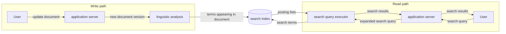
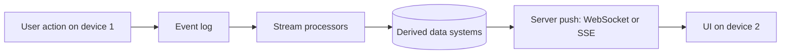
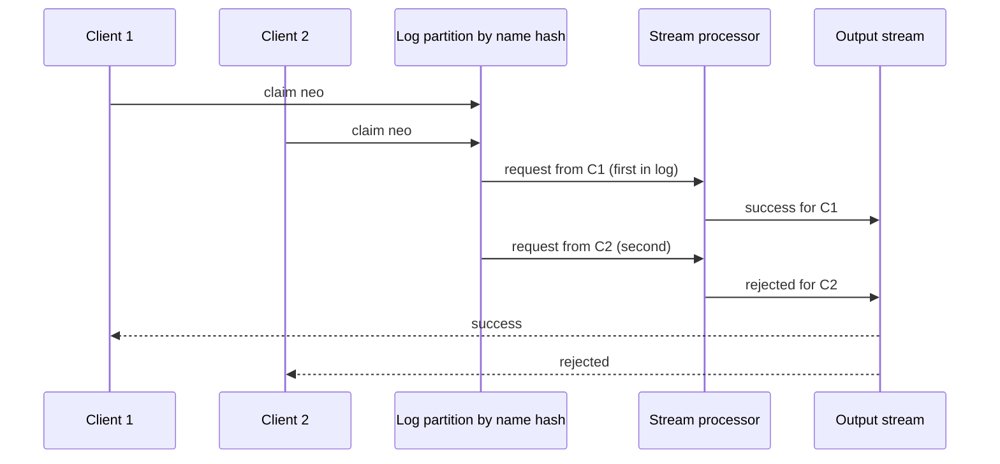
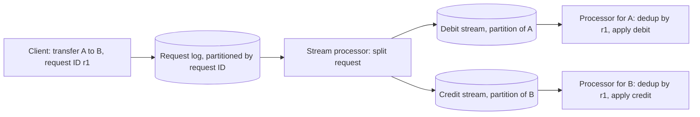
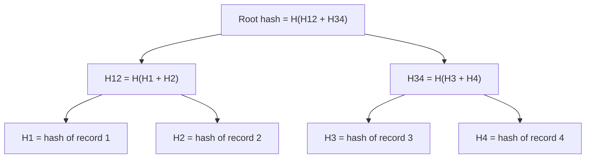
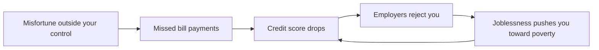

# Chapter 12 — The Future of Data Systems
*Book: Chapter 12, pp. 489–552*

## Overview

Every earlier chapter described how data systems work **today**. This last chapter changes tone: Kleppmann looks ahead and argues for how data systems **ought** to be built. Because this is opinion rather than settled fact, he writes in the first person and openly invites the reader to disagree.

The chapter opens with a quotation from Thomas Aquinas that is usually paraphrased as: *a captain whose only goal was to keep the ship safe would never leave port*. The point: a system exists to serve a purpose beyond merely surviving. Reliability, scalability and maintainability (the themes of Chapter 1: keep working when things break, cope as load grows, stay easy for people to operate and change) are means, not ends. The final goal is applications that are **robust, correct, evolvable, and ultimately good for people**.

The chapter tries to answer four big questions:

1. **Data integration** – No single tool does everything well, so real applications glue several tools together (a database; a search index, which finds records by keyword; a cache, a fast copy of frequently read data; a data warehouse for analytics...). How do you keep all those copies of the data consistent?
2. **Unbundling databases** – A database internally already keeps indexes, views and replicas in sync. Can we take those internal mechanisms "out" of the database and use them to wire an entire organisation's systems together?
3. **Aiming for correctness** – If we build systems out of asynchronous logs (append-only sequences of events that each consumer reads at its own pace) and stream processors (programs that continuously consume and transform such events) instead of big distributed transactions (one transaction that must commit on several separate machines or systems at once), how can we still be sure data is not lost, duplicated or corrupted?
4. **Doing the right thing** – Data is often about people. What ethical responsibilities do engineers have around prediction, bias, surveillance and privacy?

Why it matters in real systems: almost every company of meaningful size ends up with a "zoo" of data stores fed from one another. The ideas here — a single ordered log as the source of truth, everything else derived from it, idempotent consumers, end-to-end request IDs, auditing — are exactly how many modern event-driven architectures (designs where components communicate by publishing and reacting to events — e.g., Kafka, a popular durable, partitioned log, + stream processors + many downstream stores) are designed. If words like cache, replication, partitioning or queue are new to you, the [System Design Fundamentals](../00a-system-design-fundamentals/README.md) primer explains them from scratch.

**Everyday analogy.** Think of a spreadsheet. You type a number into one cell and every formula that depends on it updates by itself. You never write "now please go refresh cell D17". This chapter's dream is a whole company's data infrastructure that behaves like that spreadsheet: change the source record, and every search index, cache, report and recommendation that depends on it updates automatically, correctly, and even if machines crash along the way.

## Key terms

| Term | Plain-English meaning |
|---|---|
| Data integration | Making sure the same data ends up, in the right shape, in every system that needs it (database, search index, cache, warehouse, ML model...). |
| System of record | The authoritative "source of truth" copy of the data; new writes land here first. |
| Derived data / derived dataset | Any dataset computed from other data by a repeatable process (index, cache, materialized view, ML model). You can throw it away and rebuild it. |
| Dataflow | The path data takes as it moves and gets transformed from system to system. |
| Change data capture (CDC) | Reading a database's stream of changes so other systems can apply the same changes. |
| Event sourcing | Storing every user action as an immutable event in a log and deriving current state from that log. |
| Total order / total order broadcast | Every consumer sees all events in exactly the same sequence; formally equivalent to consensus. |
| Causal dependency | Event B depends on event A (B happened because of, or after seeing, A), so B must not be processed as if A had not happened. |
| Logical timestamp | A counter-based timestamp (e.g., Lamport clock) that orders events without relying on physical clocks. |
| Idempotent | An operation that has the same effect whether you apply it once or many times. |
| Deterministic | Same input always gives the same output (no randomness, no clock reading, no network calls). |
| Reprocessing | Re-running a (new) transformation over all the old data to build a new derived view. |
| Lambda architecture | Running a batch system and a stream system side by side over the same events, then merging their outputs. |
| Unified batch and stream processing | Doing both historical reprocessing and live processing in one engine. |
| Exactly-once (effectively-once) semantics | The end result is as if every message were processed once, even though retries happened. |
| Event time vs processing time | When an event actually happened vs when the system gets round to processing it. |
| Unbundling databases | Treating the features inside a database (indexes, views, replication) as separate components you plug together with logs. |
| Federated database / polystore | One query interface that reads from many different underlying stores ("unifying reads"). |
| Database inside-out | Another name for the unbundling / dataflow approach, after a 2014 talk by the author. |
| Derivation function | The code that turns base data into a derived dataset (e.g., "extract field and sort" for an index). |
| Stateless service | An application server that forgets everything after answering a request; state lives in a database. |
| Observer pattern | Code subscribes to a value and is notified when it changes, instead of repeatedly checking. |
| Stream-table join (enrichment) | Joining each incoming event with the latest state of some table kept locally. |
| Write path | Work done eagerly when data arrives (updating indexes, caches, views). |
| Read path | Work done lazily only when someone asks a question. |
| Offline-first application | App that works mainly against a local on-device database and syncs with servers in the background. |
| Server-sent events / WebSockets | Protocols letting a server push messages to a browser over a long-lived connection. |
| End-to-end argument | Some guarantees (dedup, integrity, security) can only be fully achieved by the endpoints of a communication, not by lower layers alone. |
| Operation identifier / request ID | A unique ID generated by the client for one logical action, used to detect and drop duplicates everywhere downstream. |
| Uniqueness constraint | Rule that no two records may share a value (username, seat, request ID). |
| Compensating transaction | A later action that corrects a mistake (refund, apology, rebooking) instead of preventing it up front. |
| Timeliness | Users see an up-to-date state. Violations are temporary ("eventual consistency"). |
| Integrity | No lost, duplicated, contradictory or false data. Violations are permanent ("perpetual inconsistency"). |
| Coordination-avoiding data system | A system that keeps integrity without synchronous cross-node coordination. |
| System model | The set of assumptions about what can and cannot go wrong (crashes, delays, disk loss...). |
| Auditing | Actively checking that data is still correct and complete. |
| Rowhammer | Hardware effect where repeatedly accessing memory rows flips bits in neighbouring rows. |
| Merkle tree | A tree of hashes that lets you cheaply prove a record is part of a dataset. |
| Certificate transparency | A public, Merkle-tree-based log used to check TLS/SSL certificates. |
| Predictive analytics | Using data to forecast things, including about individual people (credit risk, reoffending). |
| Algorithmic prison | Being systematically shut out of jobs, loans, travel, etc. because an algorithm labelled you risky. |
| Feedback loop | A prediction changes the world in a way that reinforces the prediction. |
| Systems thinking | Considering the whole system, including the humans in it, to foresee consequences. |
| Surveillance | Tracking people mainly to serve someone else's interests (e.g., advertisers). |
| Data exhaust | Label for behavioural data produced as a by-product of using a service. |
| Data broker | A company that buys, combines, infers and resells personal data. |

---

## Data Integration

Throughout the book, every problem had several solutions with different trade-offs: log-structured storage (only ever appends to files) vs B-trees (update fixed-size pages in place) vs column storage (stores each column separately, good for analytics) (Chapter 3), single-leader vs multi-leader vs leaderless replication (one node, several nodes, or any node accepts writes; Chapter 5), and so on. "Store data and find it again" has no single right answer.

Any one software product has to commit to one approach, because making even one code path fast and robust is hard; trying to cover every use case in one product nearly guarantees a mediocre implementation. So even a "general-purpose" database is really tuned for some particular usage pattern.

This creates two challenges:

1. **Matching tools to situations.** Vendors rarely advertise what their product is bad at. The earlier chapters are meant to give you the questions to ask so you can see the trade-offs yourself.
2. **Using data in many ways at once.** Even if you know exactly which tool suits which job, a complex application uses the same data in several different ways, and no one tool fits all of them. You inevitably combine several pieces of software.

### Combining Specialized Tools by Deriving Data

**The classic example:** an OLTP database (one serving many small, fast reads and writes from users) plus a full-text search index. PostgreSQL has built-in full-text search that is good enough for simple apps, but serious search needs a dedicated information-retrieval tool (e.g., Elasticsearch, a widely used open-source search engine). Search indexes, on the other hand, make poor durable systems of record. So you need both.

And it rarely stops at two. You might also need:

- copies in analytics systems (data warehouses, batch and stream processors),
- caches or denormalized versions of objects (copies that deliberately duplicate data so reads need no joins),
- machine learning, classification, ranking or recommendation systems fed from the data,
- notifications triggered by changes.

> **Beware "99% of people only need X".** The author notes engineers often claim most people do or don't need some feature. He argues this reveals more about the speaker's own experience than about the technology. What looks useless to one team is central to another. The need for data integration usually becomes obvious only when you look at data flows across the **whole organisation**.

#### Reasoning about dataflows

When copies of the same data live in several stores (each optimised for a different access pattern), you must be crystal clear about:

- where data is **written first**, and
- which representation is **derived from which** source,
- how each copy gets populated, and in which format.

A clean design:

1. The application writes **only** to the system-of-record database.
2. Change data capture (CDC, Chapter 11) reads that database's change stream.
3. The index consumes those changes and applies them **in exactly the order they happened**.

If CDC is the *only* way the index is updated, the index is purely derived from the database and will agree with it (apart from software bugs). The database write is the single entry point for new information.

**What goes wrong otherwise (dual writes).** If the application writes to both the database and the search index itself, two clients can send conflicting writes concurrently and the two stores may apply them in opposite orders (the book's Figure 11-4 in Chapter 11). Neither store is "in charge" of the order, so they can make contradictory choices and stay inconsistent **forever**.

**The fix is a single ordering authority.** Push all user input through one system that decides the order of all writes; then every other representation can be derived by processing writes in that same order. This is state machine replication again — every replica starts in the same state and applies the same commands in the same order, so all end up identical (see "Total Order Broadcast", Chapter 9). Whether that log is a CDC stream or an event-sourcing log matters less than the principle: **decide on a total order once**.

Updating a derived system from an event log can usually be made **deterministic and idempotent**, which makes recovering from faults fairly easy (replay the log).

#### Derived data versus distributed transactions

The traditional way to keep different systems in agreement is a distributed transaction (atomic commit / two-phase commit, Chapter 9 — a coordinator first asks every participant to prepare, then tells all of them to commit or all of them to abort). How do derived-data systems compare?

| Aspect | Distributed transactions | Log-based derived data (CDC / event sourcing) |
|---|---|---|
| How write order is decided | Locks for mutual exclusion (only one holder at a time; e.g., two-phase locking) | Position in a log |
| How "exactly once" is achieved | Atomic commit | Deterministic retry + idempotence |
| Timing guarantee | Usually linearizable (acts like one up-to-date copy), so you can read your own writes | Usually updated asynchronously, so no such timing guarantee by default |
| Fault behaviour | One failing participant aborts everything, spreading failure | Faults stay local; a slow consumer just falls behind |
| Practicality across vendors | XA (the standard cross-system 2PC protocol) has poor fault tolerance and performance | Much simpler abstraction, works across heterogeneous systems |

The author's view:

- Distributed transactions have worked in constrained environments willing to pay their price.
- XA in particular performs and tolerates faults poorly (Chapter 9), which limits it severely.
- A better distributed transaction protocol might be possible, but getting everyone to adopt and integrate it would be hard and slow.
- So, for integrating different systems today, he considers **derived data driven by a log the best bet**.
- But he rejects telling people "eventual consistency is inevitable, deal with it" (eventual consistency: copies may disagree for a while but converge once writes stop) without guidance. Guarantees like reading your own writes are valuable. The "Aiming for Correctness" section later looks for a middle ground.

#### The limits of total ordering

For small systems, building one totally ordered log is easy — any single-leader database (one node, the leader, accepts all writes and so fixes their order) already does it. At larger scale, limits appear:

1. **Throughput** (how many events per second the system can handle). A total order usually means every event goes through one leader node. If one machine can't keep up, you partition the log — split it into independent sub-logs on different machines (Chapter 11, "Partitioned Logs"), and then the relative order of events in **different partitions** is undefined.
2. **Geography.** With several datacenters (buildings full of servers, often in different regions) — e.g., to survive losing a whole datacenter — you typically have a leader per datacenter because synchronous cross-datacenter coordination is too slow (multi-leader replication, Chapter 5). Events that start in different datacenters have no defined order.
3. **Microservices** (an application split into many small, independently deployed services). A common design gives each service its own durable state with nothing shared. Events from different services have no defined order between them.
4. **Client-side state / offline clients.** Apps that update local state instantly (without waiting for the server) or work offline mean clients and servers very likely see events in different orders.

Formally, agreeing on a total order of events is called **total order broadcast**, and it is **equivalent to consensus** (Chapter 9; consensus means getting several nodes to agree on one decision even when some of them fail). Most consensus algorithms assume one node can handle the whole event stream and have no way to spread the ordering work over many nodes. Designing consensus that scales past one node's throughput and works well across geographies is **still an open research problem**.

#### Ordering events to capture causality

When events are unrelated, lacking a total order is harmless — concurrent events can be ordered any way. Some cases are easy: all updates to the same object can be ordered by routing everything for that object ID to the same log partition. But causality can hide in subtler places.

**The book's example (social network break-up):**

1. User A and user B were a couple and have just broken up.
2. A **unfriends** B.
3. A then sends a message to remaining friends complaining about B. A expects B not to see it, because the message came *after* the unfriending.
4. But friendships are stored in one system and messages in another. The "unfriend happened before message" dependency can get lost.
5. The notification service might process the message event **before** the unfriend event, and notify B. Wrong.

The notification is effectively a **join** between messages and the friend list, so this is the same time-dependence-of-joins issue from Chapter 11. There's no simple answer, but starting points include:

| Technique | Helps because | Limitation |
|---|---|---|
| Logical timestamps (Chapter 9, "Sequence Number Ordering") | Give a total order without coordination | Recipients must still handle out-of-order delivery; extra metadata must travel with events |
| Log an event recording **what the user saw** before deciding, give it a unique ID, and have later events reference that ID | Explicitly records the causal dependency | Not discussed here; revisited in "Reads are events too", which notes logging reads adds storage and I/O cost |
| Conflict resolution algorithms (Chapter 5) | Handle events that arrive in an unexpected order when maintaining state | Useless when the action has external side effects, like sending a notification |

The author hopes application patterns will emerge that capture causality efficiently without forcing everything through the total-order-broadcast bottleneck.

### Batch and Stream Processing

The author's summary of data integration's goal: **every place that needs the data gets it, in the shape it needs**. Getting there means reading inputs, then transforming, joining, filtering and aggregating them, training and evaluating models, and finally writing the results out — exactly what batch and stream processors are for. Their outputs are derived datasets: search indexes, materialized views, recommendations, aggregate metrics, etc.

From Chapters 10 and 11: batch and stream processing share most principles. The fundamental difference is that streams are **unbounded** (never end) while batch inputs are **finite and known in size**. Implementation differences exist but are blurring:

- **Spark** (Apache Spark, a widely used cluster computing engine) does streaming on top of a batch engine by chopping the stream into **microbatches** (tiny batches covering, say, one second of events each).
- **Apache Flink** (an open-source stream processing engine) does batch on top of a streaming engine.
- In principle either can emulate the other, though performance differs — e.g., microbatching can be slow for **hopping or sliding windows** (fixed-length time windows that overlap, e.g., a 5-minute window starting every minute).

#### Maintaining derived state

Batch processing has a strongly **functional** flavour (in the style of functional programming, built from functions that only turn inputs into outputs), even if the code isn't in a functional language:

- deterministic, pure functions (the result is determined solely by what goes in),
- no side effects (changes to anything outside the function, such as writing a file or calling a service) apart from explicit outputs,
- inputs treated as immutable (never modified), outputs as append-only (only added to, never overwritten).

Stream processing is similar but adds **managed, fault-tolerant state** to operators (the individual processing steps of a stream job) (Chapter 11).

Deterministic functions with clear inputs and outputs help fault tolerance (idempotence) **and** make an organisation's dataflows easier to reason about. Be it a cache, a statistical model or a search index, think of it as a **pipeline** deriving one thing from another: state changes in one system flow through functional code and get applied to derived systems.

**Why asynchronous?** You *could* maintain derived systems synchronously, the way a relational database updates secondary indexes (extra lookup structures on non-key columns) in the same transaction as the table write. But asynchrony is what makes log-based systems robust:

- A fault in one part stays contained locally.
- Distributed transactions abort if **any** participant fails, so they amplify failures across the system.

Secondary indexes on partitioned data often cross partition boundaries (Chapter 6): a **term-partitioned** (global) index — split up by the indexed value — needs writes to go to several partitions; a **document-partitioned** (local) index — each partition indexes only its own records — needs reads sent to all partitions. That communication between partitions also scales best and is most dependable if the index is updated **asynchronously** (see also "Multi-partition data processing" below).

#### Reprocessing data for application evolution

Both styles are useful for derived data:

| Stream processing | Batch processing |
|---|---|
| Reflects input changes in derived views with low delay | Reprocesses large amounts of accumulated history to create **new** views of existing data |

Reprocessing is a powerful way to **evolve** a system (Chapter 4). Without it, schema evolution (changing the schema — the description of the data's fields and types — over time) is limited to small steps like adding an optional field or a new record type — true for both schema-on-write (structure enforced when data is stored) and schema-on-read (structure interpreted only when data is read). With reprocessing you can restructure a dataset into an **entirely different model** to fit new requirements.

> **Schema migrations on railways (book sidebar).** In 19th-century England, railways used competing track **gauges** (distance between rails), and trains for one gauge couldn't run on another. After a standard gauge was chosen in **1846**, other tracks had to be converted without shutting lines for years. The trick: add a **third rail** to make "dual/mixed gauge" track, so trains of both gauges can run. Once all trains use the standard gauge, remove the extra rail. This lets old and new coexist during a slow migration — but it's expensive, which is why nonstandard gauges survive, e.g., **BART** in the San Francisco Bay Area differs from most of the US.

**Derived views enable gradual migration**, just like the third rail:

1. Keep the old schema and the new schema as **two independently derived views** over the same underlying data.
2. Route a small share of users to the new view to test performance and find bugs; most users stay on the old one.
3. Gradually raise the share on the new view.
4. Eventually drop the old view.

Every step is **reversible** — you always have a working system to fall back on. Lower risk of irreversible damage means more confidence, which means you can move faster.

#### The lambda architecture

If batch handles history and streaming handles recent updates, how do you combine them? The **lambda architecture** is a well-known proposal:

1. Record incoming data as immutable events appended to an ever-growing dataset (like event sourcing).
2. Derive read-optimised views from those events.
3. Run **two systems in parallel**: a batch system (e.g., **Hadoop MapReduce**, the classic open-source framework for large batch jobs on a cluster) and a stream system (e.g., **Storm**, an early open-source stream processor).
4. The stream processor quickly produces an **approximate** update to the view.
5. Later the batch processor handles the same events and produces a **corrected** view.

Rationale: batch is simpler and less bug-prone; stream processors were considered flakier and tougher to make fault-tolerant; and the streaming half could get away with quick approximate algorithms while the batch half ran slower exact ones.

It was influential and positive — it popularised deriving views from immutable event streams and reprocessing when needed. But the author lists practical problems:

- **Double implementation.** The same logic must run in both a batch and a stream framework. Libraries like **Summingbird** (from Twitter: write the logic once, run it on both) abstract over both, but you still debug, tune and operate two systems.
- **Merging outputs.** Stream and batch produce separate outputs that must be merged per user request. Easy for simple aggregations over a tumbling window (fixed, non-overlapping time intervals); much harder for joins, sessionization (grouping a user's events into visits), or non-time-series output.
- **Full reprocessing is expensive.** So batch often runs incrementally (e.g., each hour's data at the end of the hour). That brings back stream-like problems — stragglers (events that arrive late), windows spanning batch boundaries — and makes the batch layer more complex, defeating its purpose of being simple.

#### Unifying batch and stream processing

Newer work gets lambda's benefits without its downsides by running **both** historical reprocessing and live event processing **in the same system**. This needs:

| Required feature | Why | Example |
|---|---|---|
| Replay historical events through the same engine that handles live events | Reprocessing uses the same code path | Log-based brokers can replay messages; some stream processors read input from HDFS (Hadoop's distributed file system) |
| Exactly-once semantics in stream processors | Output equals a fault-free run even if faults happened; like batch, requires discarding partial output of failed tasks | Chapter 11 fault tolerance |
| Windowing by **event time**, not processing time | Processing time is meaningless when replaying old events | **Apache Beam** API (one programming model, many engines), runnable on **Apache Flink** or **Google Cloud Dataflow** |

---

## Unbundling Databases

Viewed abstractly enough, a database, Hadoop and an operating system all do one job: **store data and let you process and query it**. A database stores records in some data model (rows, documents, graph vertices); an OS filesystem stores files. Both are "information management" systems. Chapter 10 already showed Hadoop is a bit like a distributed Unix.

There are practical differences — e.g., many filesystems struggle with a directory holding **10 million small files**, while a database with 10 million small records is perfectly normal. Still, comparing the two is instructive.

**Two philosophies (both born in the early 1970s):**

| | Unix | Relational databases |
|---|---|---|
| Goal | Give programmers a logical but fairly **low-level** abstraction of the hardware | Give programmers a **high-level** abstraction hiding disk data structures, concurrency, crash recovery |
| Building blocks | Pipes (feed one program's output into the next), and files that are plain byte sequences | SQL and transactions |
| Why it's "simple" | A thin wrapper over hardware | A short declarative query taps huge machinery (optimizer that picks the execution plan, indexes, join algorithms, concurrency control, replication) without you knowing the details |

The tension between them is decades old and unresolved. The author reads the **NoSQL movement** (the wave of non-relational databases, such as key-value and document stores, from about 2009) as applying the Unix-style low-level approach to distributed OLTP storage. This section tries to combine the best of both.

### Composing Data Storage Technologies

Features we've seen databases provide:

- **Secondary indexes** — search records efficiently by a field's value (Chapter 3).
- **Materialized views** — a precomputed cache of query results (Chapter 3).
- **Replication logs** — keep copies on other nodes up to date (Chapter 5).
- **Full-text search indexes** — keyword search in text; built into some relational databases (Chapter 3).

Chapters 10 and 11 built the **same kinds of things** outside the database: full-text indexes built by batch jobs, materialized view maintenance in stream processors, and replicating database changes to derived systems with CDC. There's a clear parallel between database-internal features and the derived systems people build with batch and stream processors.

#### Creating an index

What does `CREATE INDEX` actually do in a relational database?

1. Take a **consistent snapshot** of the table (a view of it frozen at one point in time) and scan it.
2. Extract the values of the indexed field(s), **sort** them, and write out the index.
3. Process the **backlog** of writes made since the snapshot (assuming the table wasn't locked, so writes kept arriving).
4. From then on, keep the index updated whenever a transaction writes to the table.

This is almost identical to **setting up a new follower replica** (Chapter 5) and to **bootstrapping CDC** with an initial snapshot (Chapter 11). In effect, `CREATE INDEX` **reprocesses the existing dataset** and derives a new view of it. The input may be a snapshot of state rather than a full change log, but those are closely related (state = result of applying the stream of changes).

#### The meta-database of everything

Seen this way, **all the dataflow in an organisation looks like one giant database**. Every batch, stream or ETL job that moves data from one place and format to another behaves like the database subsystem that keeps indexes and materialized views current.

- Batch and stream processors ≈ elaborate **triggers, stored procedures and view-maintenance routines** (triggers: code the database runs automatically when data changes; stored procedures: application logic stored and run inside the database).
- The derived systems they maintain ≈ different **index types** (like a relational DB offering B-tree, hash, spatial indexes...).
- The difference: instead of one integrated product, these "features" are separate software, on different machines, run by different teams.

Starting from "no single data model or storage format suits every access pattern", the author sees two ways to compose many tools into a cohesive whole:

| | Federated databases: **unifying reads** | Unbundled databases: **unifying writes** |
|---|---|---|
| Idea | One query interface over many storage engines and processing methods (also called a **polystore**) | Reliably plug stores together so every change reaches every place, even with faults |
| Example | PostgreSQL's **foreign data wrapper** (queries outside systems as if they were local tables) | Change data capture + event logs feeding many stores |
| Specialised access | Apps can still go straight to underlying engines; users combining data use the federated interface | Each store keeps its own API |
| Tradition it follows | Relational: one integrated system, high-level language, elegant semantics, complicated implementation | Unix: small tools doing one thing well, a uniform low-level API (pipes), composed by a higher-level language (the shell) |
| Weakness | Doesn't solve synchronising **writes** | Still missing the "shell" (see below) |

"Unbundling" means taking a database's index-maintenance features apart so they can sync writes across **different technologies**.

#### Making unbundling work

Federation and unbundling are really one goal seen from two angles: building a reliable, scalable, maintainable system from diverse parts. Federated reads need mapping between data models — thoughtful but manageable. **Keeping writes to several stores in sync is the harder problem**, so the author focuses there.

- The traditional answer is distributed transactions across heterogeneous stores — which the author thinks is the **wrong** solution.
- Transactions **inside** one store or one stream processor are fine. For example, some stream processors use distributed transactions internally to get exactly-once semantics, and that can work well.
- But when a transaction must span systems built by **different groups of people** (say, a stream processor writing to a key-value store — a database that looks up values by a unique key — or search index), there's no standard protocol, so integration is hard.
- An **ordered event log with idempotent consumers** is a much simpler abstraction and far more feasible across heterogeneous systems.

The big win is **loose coupling**, in two senses:

1. **System level.** Asynchronous event streams make the whole robust to outages or slowness of single components. If a consumer is slow or down, the log **buffers** messages; producers and other consumers carry on. The broken consumer catches up after it's fixed and misses nothing. Synchronous distributed transactions do the opposite: they turn local faults into large-scale failures.
2. **Human level.** Different teams can build, improve and run different components independently, each focusing on one thing, with clean interfaces between teams. Event logs are an interface strong enough to carry fairly strong consistency properties (because events are durable and ordered) yet general enough for almost any data.

#### Unbundled versus integrated systems

Unbundling won't **replace** databases:

- Stream processors still need databases to keep state.
- Batch and stream outputs still need databases to serve queries.
- Specialised engines still matter — e.g., **MPP data warehouse** (massively parallel processing: one query split across many machines) query engines are excellent at exploratory analytic queries.

Costs of running many pieces:

- Every piece of software has its own learning curve, configuration issues and operational quirks, so **deploy as few moving parts as possible**.
- A single integrated product may give **better, more predictable performance** on the workloads it targets than a hand-assembled combination.
- Building for scale you don't need wastes effort and can lock you into an inflexible design — a form of premature optimisation (as the Preface says).

The aim of unbundling is **breadth, not depth**: not beating a specialist database on its own workload, but covering a much wider range of workloads than any one product can. **If one product already does everything you need, just use it.** Unbundling only pays off when no single tool meets all your requirements.

#### What's missing?

Tools for composing systems are improving, but a big piece is absent: the unbundled equivalent of the **Unix shell** (the command line, where small programs are chained together with pipes) — a high-level, declarative language for wiring storage and processing systems together.

The author's wish: to write something like `mysql | elasticsearch`, the unbundled version of `CREATE INDEX`. It would:

1. Take every document in a MySQL database (MySQL: a popular open-source relational database) and index it in an Elasticsearch cluster.
2. Continuously capture every later change to MySQL and apply it to the index automatically — no custom glue code.

Here is an illustrative sketch of what such a declaration might look like (this is imaginary syntax, not a real tool):

```text
# hypothetical "data shell" - not a real product
postgres://shop/products  |  opensearch://catalog-index
#  left side : source of truth; take a snapshot, then follow its change stream
#  "|"       : keep the right side continuously in sync with the left
#  right side: derived view that can be dropped and rebuilt at any time
```

Similarly, it would be great to **declare caches** as materialized views over complex queries — even recursive graph queries and application logic — and have them precomputed and updated automatically. Early research such as **differential dataflow** (a system that efficiently updates computed results when only a small part of the input changes) works in this direction; the author hopes these ideas reach production.

### Designing Applications Around Dataflow

Composing specialised stores and processors with application code has come to be called the **"database inside-out"** approach, after a 2014 conference talk by the author. He stresses it's a design pattern and a starting point for discussion rather than a grand "new architecture". The ideas come from many others:

- dataflow languages such as **Oz** and **Juttle**,
- **Elm**, a functional reactive programming (FRP) language,
- logic programming languages such as **Bloom**,
- the term *unbundling* in this sense comes from **Jay Kreps**.

**Spreadsheets** are far ahead of most mainstream programming languages at dataflow: put a formula in a cell (say, the sum of a column), and whenever any input changes, the result recalculates automatically. That is exactly what we want from data systems: change a record, and every index, cached view and aggregation that depends on it updates, without you worrying about how. Data systems still have lessons to learn from **VisiCalc (1979)**. The differences: data systems must also be **fault-tolerant, scalable and durable**, and must integrate technologies written by different people over time, reusing existing libraries and services (you can't force everything into one language or framework).

#### Application code as a derivation function

Every derived dataset comes from some **transformation function**:

| Derived dataset | Derivation function |
|---|---|
| Secondary index | For each row/document, pick the indexed column values and sort by them (B-tree or SSTable, Chapter 3) |
| Full-text search index | Natural-language processing — language detection, word segmentation, stemming or lemmatization (reducing words to a base form), spelling correction, synonym detection — then build a lookup structure such as an **inverted index** (word → documents containing it) |
| Machine learning model | Feature extraction (turning raw data into numeric inputs) and statistical analysis applied to training data; predictions on new input are derived from input + model (and thus indirectly from training data) |
| Cache | Aggregates data into the shape the UI displays; so the cache logic depends on which fields the UI uses, and UI changes may require redefining and rebuilding the cache |

- The secondary-index function is so common that databases build it in: just say `CREATE INDEX`.
- Basic full-text features for common languages may be built in, but advanced ones need domain-specific tuning.
- ML **feature engineering** is notoriously application-specific and needs detailed knowledge of user interaction and deployment.

When the derivation isn't a standard "cookie-cutter" function, you need **custom code**, and that's where databases struggle. Relational DBs offer triggers, stored procedures and user-defined functions (UDFs: custom functions you load into the database) to run app code inside the database, but these have been something of an afterthought in database design.

#### Separation of application code and state

In theory a database could host arbitrary application code, like an OS. In practice databases are a poor fit for modern development needs: managing dependencies and packages, version control, rolling upgrades (updating servers one at a time with no downtime), evolvability, monitoring and metrics, calls to network services, integration with external systems.

Tools like **Mesos, YARN, Docker and Kubernetes** (cluster schedulers and container tools that package programs and run them across many machines) are built specifically to run application code, and by focusing on that one job they do it far better than a database offering UDF execution as a side feature.

So it makes sense for some parts of a system to specialise in **durable storage** and others in **running code**, interacting but independent.

Most web apps today run as **stateless services**: any request can go to any server, and the server forgets the request after replying. That's convenient (add/remove servers freely), but the state must live somewhere — usually a database. The trend is to keep application logic out of the database and persistent state out of the application.

> **The joke.** A functional-programming quip is that they support keeping "Church and state" apart. The author spells it out: *Church* means Alonzo Church, the mathematician behind the **lambda calculus**, the foundation of most functional languages. Lambda calculus has no variables that can be overwritten, so (mutable) state really does live apart from Church's work.

In this model, the database is like a **mutable shared variable** you access synchronously over the network; the app reads and updates it, and the database makes it durable and handles some concurrency control and fault tolerance.

But in most languages you **can't subscribe** to a variable's changes; you can only read it periodically. Unlike a spreadsheet, readers aren't told when it changes. (You can hand-code the **observer pattern**, but few languages have it built in.) Databases inherited this passive attitude: to find out if something changed you usually have to **poll** (re-run your query). Change subscriptions are only beginning to appear (Chapter 11, "API support for change streams").

#### Dataflow: Interplay between state changes and application code

Dataflow thinking renegotiates the relationship between code and state. Instead of a passive database manipulated by the app, think about the **collaboration between state, state changes, and the code that processes them**: code reacts to state changes in one place by producing state changes somewhere else.

Precedents:

- Treating a database's change log as a subscribable event stream (Chapter 11).
- **Actors** (independent units that keep private state and communicate only by sending messages) and other message-passing systems that respond to events (Chapter 4).
- The **tuple spaces** model of the 1980s: distributed computation as processes that watch state changes and react.
- Inside a database: a trigger firing on a change, or a secondary index updating after a table write.

Unbundling applies this to derived datasets **outside** the primary database — caches, full-text indexes, ML, analytics — using stream processing and messaging.

**Important: keeping derived data up to date is a different task from running background jobs asynchronously** (what messaging systems were traditionally designed for):

| Requirement for derived data | Why | What breaks it |
|---|---|---|
| **Order of state changes matters** | Views derived from the same log must process events in the same order to stay consistent with each other | Many message brokers (servers relaying messages from producers to consumers) reorder when redelivering unacknowledged (not yet confirmed as processed) messages; dual writes are ruled out too |
| **Fault tolerance is essential** | Losing one message leaves the derived dataset permanently out of sync; both delivery and state updates must be reliable | Many actor systems keep actor state and messages in memory by default, lost on a crash |

Stable ordering and fault-tolerant processing are demanding, but **much cheaper and more operationally robust than distributed transactions**. Modern stream processors provide them at scale and let you run application code as stream operators — code that can do arbitrary processing that built-in database derivation functions can't. Just as Unix tools can be joined with pipes, **stream operators compose**: each takes streams of state changes in and emits streams of state changes out.

#### Stream processors and services

Today's trendy style splits functionality into **services** talking over **synchronous** network requests (e.g., REST APIs — HTTP interfaces organised around resources and URLs). The main advantage over a monolith (one large application deployed as a single unit) is **organisational scalability via loose coupling**: different teams own different services and coordinate less (as long as services deploy independently).

Composing stream operators resembles microservices, but the communication is fundamentally different: **one-way, asynchronous message streams** instead of synchronous request/response.

Besides the fault-tolerance benefits of message passing (Chapter 4), dataflow can also be **faster**. The book's example: a customer buys an item priced in one currency and pays in another, so you need the current exchange rate.

1. **Microservices approach:** the purchase code **queries** an exchange-rate service or database at purchase time.
2. **Dataflow approach:** the purchase code **subscribes in advance** to a stream of exchange-rate updates and writes each new rate into a **local database** as it arrives. At purchase time it only reads the local DB.

The second replaces a synchronous network call with a local query (maybe same machine or even same process). It's **faster** and **more robust** to the other service failing. As the book puts it in spirit: the quickest, most dependable network request is the one you never make. Instead of an RPC (remote procedure call: calling a function on another machine over the network) we now have a **stream-table join** between purchase events and rate-update events.

> **Footnote.** A microservice could cache the rate locally to avoid the call, but keeping that cache fresh needs periodic polling or subscribing to a change stream — which is just the dataflow approach.

This join is **time-dependent**: if you reprocess purchase events later, the rate will have changed, so to reproduce the original output you need the **historical** rate at purchase time. Whether you query or subscribe, you must handle this (Chapter 11, "Time-dependence of joins").

Subscribing to changes rather than querying current state moves us towards the spreadsheet model: when data changes, everything depending on it updates quickly. Open questions remain (e.g., time-dependent joins), but the author finds dataflow-based applications very promising.

### Observing Derived State

The dataflow systems above give you a process for creating and maintaining derived datasets (search indexes, materialized views, predictive models). Call it the **write path**: when information is written, it may pass through several batch/stream stages until every derived dataset reflects it.

Why build a derived dataset at all? To **query it later**. That's the **read path**: to serve a request you read the derived dataset, maybe process the result further, and build the response.

Together they cover the full journey of data, from collection to consumption (probably by a human):

| Write path | Read path |
|---|---|
| Precomputed; done **eagerly** as soon as data arrives, whether or not anyone asked | Done only when someone asks |
| Like **eager evaluation** in functional programming | Like **lazy evaluation** |

**The derived dataset is where the two paths meet**, and it embodies a trade-off between work at write time and work at read time.

*Figure 12-1 (redrawn): in a search index, writes (document updates) and reads (queries) meet at the index. On the write path a new document version goes through linguistic analysis and its terms go into the index; on the read path a query is expanded, its terms are looked up in the index, and the posting lists (for each term, the list of documents containing it) come back as results.*


#### Materialized views and caching

Take a full-text search index. Both sides do work:

- **Writes** update index entries for every term in the document.
- **Reads** look up every word in the query and apply Boolean logic: AND (documents containing all words) or OR (any synonym of each word).

Now move the boundary around:

| Option | Write-path work | Read-path work | Verdict |
|---|---|---|---|
| **No index** — scan every document like `grep` (Unix text search) | None | Huge for many documents | Fine only for small collections |
| **Normal index** | Update entries per term | Look up terms + Boolean logic | The usual balance |
| **Precompute results for every possible query** | Infinite — the set of possible queries is infinite | Trivial lookup | Impossible |
| **Precompute results only for the most popular queries**, use the index for the rest | Must update these cached results when new matching documents arrive | Fast for common queries | A "cache of common queries", which is really a **materialized view** |

> **Footnote nuance.** For a finite corpus, the number of distinct queries with **non-empty** results is finite, but it grows exponentially with the number of terms — still hopeless.

So an index is just one possible boundary. **Caches, indexes and materialized views all shift the boundary**: they do more work on the write path (precomputing) to save work on the read path.

This is exactly the **Twitter** home-timeline example from Chapter 1 ("Describing Load"), where the write/read boundary was drawn differently for celebrities than for ordinary users. The author notes that after some 500 pages the book has come full circle.

#### Stateful, offline-capable clients

Two decades of web apps have made us assume the **client/server model** — mostly stateless clients, servers owning the data — so strongly that we forget alternatives. It's worth questioning.

- Traditionally a browser was a stateless client, useless offline (you could basically just scroll a page loaded while online).
- Modern **single-page JavaScript apps** (web apps that load once and then update the page in the browser without full reloads) have lots of state: client-side UI interaction and persistent local storage in the browser.
- **Mobile apps** keep much state on the device and don't need a server round-trip for most interactions.

This revives **offline-first** apps: do as much as possible against a **local database on the device**, work without internet, and **sync in the background** when connected. Since mobile networks are often slow and unreliable, not blocking the UI on network calls and working offline is a big user benefit (Chapter 5, "Clients with offline operation").

Once state lives on devices, a useful mental model appears: **on-device state is a cache of server state**. The pixels on screen are a materialized view of the client's model objects; those model objects in turn replicate, locally, state held in a far-away datacenter.

#### Pushing state changes to clients

On a typical web page, if server data changes after you load the page, your browser doesn't know until you reload. It reads once and assumes the data is static — no subscription. So device state is a **stale cache** unless you poll. (RSS — a format for update feeds that readers fetch periodically — and similar HTTP feed subscriptions are basically polling; HTTP is the web's request/response protocol.)

Newer protocols go beyond HTTP request/response:

- **Server-sent events** (the **EventSource API**) and
- **WebSockets**

both keep a TCP connection (TCP: the internet protocol giving a reliable, ordered byte stream between two machines; see [System Design Fundamentals](../00a-system-design-fundamentals/README.md)) open so the server can **push** messages to the browser while it stays connected. The server can tell the client about changes to state the client has cached, reducing staleness.

In write-path/read-path terms, pushing changes to devices **stretches the write path right up to the end user's device**:

1. When a client starts, it uses the **read path** once to fetch initial state.
2. After that, it relies on a **stream of state changes** from the server.

Stream processing and messaging ideas therefore needn't stay in the datacenter; they can reach end-user devices.

**What about offline devices?** Already solved: in Chapter 11 ("Consumer offsets"), a consumer of a log-based broker reconnects and resumes from its offset (its position number in the log), missing nothing. Each device is just a small subscriber to a small event stream.

#### End-to-end event streams

Tools for stateful clients and UIs — the **Elm** language and Facebook's **React, Flux and Redux** (JavaScript libraries for building UIs and managing UI state) — already handle client state by consuming an event stream (user input, server responses), much like event sourcing.

A natural extension is for the **server to feed its own state-change events into that client pipeline** as well. Then state changes flow along an **end-to-end write path**:

*Illustration (not a book figure): the end-to-end write path from one user's device to another's screen.*


Changes could travel quickly — e.g., in **less than one second** from end to end. Instant messaging and online games already work like this ("real-time" meaning low delay, not hard response-time guarantees as in Chapter 8).

**Why not every app?** Because stateless clients and request/response are deeply baked into databases, libraries, frameworks and protocols. Many datastores offer "one request, one response"; far fewer offer "one request, a **stream** of responses over time" (subscriptions). Extending the write path to users means moving from **request/response** to **publish/subscribe** dataflow (producers publish messages to a topic, and everyone subscribed to it receives them). The author believes the payoff — more responsive UIs, better offline support — is worth it, and urges designers to keep **subscribing to changes** in mind, not just querying current state.

#### Reads are events too

When a stream processor writes derived data into a store and user requests query that store, the store is **where the write path hands over to the read path**; it permits random-access lookups that would otherwise mean reading the entire event log.

Often the store is separate from the streaming system. But stream processors keep state for aggregations and joins anyway, normally hidden; some frameworks let outside clients **query that state**, making the stream processor a simple database.

The author goes further. Usually writes flow via the event log, whereas reads are short-lived network requests sent directly to the storage nodes. Alternatively:

1. Represent **read requests as events** too.
2. Send both read events and write events through the **same stream processor**.
3. The processor answers a read event by emitting the result on an **output stream**.

When both reads and writes are events routed to the same operator, you're really performing a **stream-table join**: query stream on one side, database on the other. The read event must go to the partition holding the data (Chapter 6, "Request Routing"), just as batch and stream joins must co-partition inputs by key (split both inputs the same way, so matching keys land in the same partition) (Chapter 10, reduce-side joins).

This link between serving requests and joins is fundamental:

- A **one-off read** passes through the join operator and is immediately forgotten.
- A **subscription** is a **long-lived join** against both earlier and later events.

**Benefit: causality and provenance.** Logging reads lets you reconstruct **what the user saw before deciding**. E.g., in an online shop, the predicted shipping date and stock status shown probably influence whether the customer buys; to analyse that, you must record the result of the customer's shipping/inventory query. This helps capture causal dependencies (see "Ordering events to capture causality" above) but costs extra storage and I/O; optimising that is an open research problem. If you already log reads for operations, making that log the **source** of the requests is a small step.

#### Multi-partition data processing

For single-partition queries, routing through streams is probably overkill. But the idea enables **distributed execution of complex queries** that combine data from many partitions, reusing the stream processor's routing, partitioning and joining infrastructure.

- **Storm's distributed RPC** supports this. It's been used to compute **how many people have seen a URL on Twitter** — the union of the follower sets of everyone who tweeted that URL. Since Twitter's users are partitioned, this combines results from many partitions.
- **Fraud prevention:** to score a purchase's risk, look up reputation scores for the user's IP address, email, billing address, shipping address, etc. Each reputation database is partitioned differently, so answering takes a **chain of joins** against datasets partitioned in different ways.

MPP databases' internal query execution graphs look similar. If you need multi-partition joins, a database with that built-in feature is probably the **simpler choice**; but treating queries as streams is an option for large-scale apps that outgrow off-the-shelf solutions.

---

## Aiming for Correctness

**Stateless vs stateful.** If a stateless, read-only service misbehaves, you fix the bug, restart it, and all is well. Databases are different: they're built to remember things (more or less) forever, so a mistake's effects may **also last forever**. Stateful systems deserve more careful thought.

We want applications that are **reliable and correct** — programs whose behaviour is well defined and understood even when faults occur. For roughly **four decades**, the go-to tools here have been the transaction guarantees of **atomicity, isolation and durability** (all-or-nothing; no interference between concurrent transactions; committed data survives crashes) (Chapter 7). But:

- Those foundations are **weaker than they look** — consider the confusion around weak isolation levels (settings that allow some concurrency anomalies in return for speed) (Chapter 7).
- Some areas are **abandoning transactions** for models with better performance and scalability but messier semantics (e.g., leaderless replication, Chapter 5).
- **Consistency** is talked about a lot but poorly defined (Chapter 7, Chapter 9). Some people say "embrace weak consistency" for availability without a clear idea of what that means in practice.

Our understanding and engineering methods are surprisingly **flaky**. It's very hard to tell whether an app is safe at a given isolation level or replication configuration. Simple solutions often seem fine at low concurrency without faults, then reveal subtle bugs under stress.

- **Kyle Kingsbury's Jepsen** experiments (a test harness that injects network faults and crashes into databases and checks the results) exposed stark gaps between products' **claimed** safety guarantees and their **actual** behaviour under network problems and crashes.
- Even if the infrastructure were flawless, application code must still **use it correctly**, which is error-prone when configuration is hard to understand (weak isolation levels, quorum settings, etc.).

| If your app... | Then... |
|---|---|
| Can tolerate occasionally losing or corrupting data unpredictably | Life is easy; you might get away with hoping for the best |
| Needs stronger correctness | **Serializability** (transactions behave as if run one at a time) and **atomic commit** are the established tools, but they usually work only **within a single datacenter** (ruling out geo-distribution) and **limit scale and fault tolerance** |

The author doesn't think traditional transactions are going away, but he doesn't think they're the **final word** either. This section explores correctness in **dataflow architectures**.

### The End-to-End Argument for Databases

Using a data system with strong safety properties (e.g., serializable transactions) does **not** guarantee that your application is free of data loss or corruption. If the app has a bug that writes wrong data or deletes data, serializability won't help.

That might sound trivial, but application bugs and human mistakes happen. This was the argument (Chapter 11, "State, Streams, and Immutability") for **immutable, append-only data**: if faulty code can't destroy good data, recovery is easier. Immutability helps but isn't a cure-all; here's a subtler corruption case.

#### Exactly-once execution of an operation

Recall **exactly-once** (or **effectively-once**) semantics (Chapter 11). When processing a message fails, you can either:

- **give up** (drop the message → data loss), or
- **retry** — but maybe it actually succeeded the first time and you just never heard back, so it gets processed **twice**.

**Processing twice is also corruption**: charging a customer twice (overbilling), or incrementing a counter twice (inflating a metric). Exactly-once means arranging the computation so the **final effect equals a fault-free run**, even if retries happened.

The most effective approach: make the operation **idempotent** — same effect whether run once or many times. Turning a non-idempotent operation into an idempotent one takes care: you may need extra metadata (e.g., the set of operation IDs that already updated a value), and **fencing** (tagging requests with an increasing token so a node that has lost its role gets rejected) when failing over (switching to a replacement node) between nodes (Chapter 8, "The leader and the lock").

#### Duplicate suppression

Duplicate suppression appears in many places beyond stream processing.

**TCP** numbers packets (the small chunks data is split into for sending) with sequence numbers so the receiver can put them in order and detect lost or duplicated packets. Lost ones are retransmitted and duplicates dropped by the TCP stack before the app sees the data.

**But that only works within one TCP connection.** Many databases tie a transaction to a client connection (queries sent on the same connection belong to the same transaction). Suppose the client sends `COMMIT`, then the network drops and the connection times out before the reply arrives. The client **doesn't know** whether the transaction committed or aborted (Chapter 8, Figure 8-1).

Our own version of the book's Example 12-1 (a non-idempotent money transfer; the book moves $11.00 between accounts 4321 and 1234 — here we use different values to illustrate):

```sql
BEGIN TRANSACTION;                                           -- start one atomic unit of work
UPDATE wallets SET funds = funds + 25.00 WHERE wallet_id = 77;  -- credit the receiving wallet
UPDATE wallets SET funds = funds - 25.00 WHERE wallet_id = 88;  -- debit the paying wallet
COMMIT;                                                      -- make both changes permanent together
```

- Line 1 starts a transaction so both updates succeed or fail together.
- Lines 2–3 add to one balance and subtract from another. "Add 25" is **not idempotent**: running it twice adds 50.
- Line 4 commits. If the reply to `COMMIT` is lost and the client reconnects and retries, TCP can't recognise the retry (it's a new connection). In the book's example this means **$22 could move instead of the intended $11**.

So even though this is the textbook example of **atomicity**, it's actually **not correct**, and **real banks don't work this way**.

**Does two-phase commit help?** 2PC breaks the one-connection-one-transaction link, because the coordinator must be able to reconnect after a network fault and instruct the database whether an in-doubt transaction (one that has voted to commit but not yet heard the final decision) should commit or abort. Is that enough to guarantee once-only execution? **No.**

Even if duplicates are suppressed between the database client and server, there's still the network between the **end user's device** and the **application server**:

1. A user on a weak mobile connection submits a form via HTTP POST (the HTTP method browsers use to send data that changes something on the server).
2. The POST arrives, but the signal fades before the response comes back.
3. The user sees an error and retries. The browser warns that the form will be resubmitted and asks for confirmation; the user agrees, because they do want it done.
4. (The **Post/Redirect/Get** pattern — after a POST the server redirects the browser to an ordinary page, so refreshing doesn't resend the form — avoids that warning in normal use, but doesn't help when the POST times out.)
5. To the web server the retry is a **new request**; to the database it's a **new transaction**. The usual deduplication mechanisms don't catch it.

#### Operation identifiers

To make an operation idempotent across **several network hops**, relying on the database's transactions isn't enough; you have to think about the request's **whole journey, end to end**.

1. Generate a **unique operation ID** (e.g., a **UUID** — a 128-bit random identifier that is practically guaranteed to be unique) in the client — say as a hidden form field — or compute a **hash of all relevant form fields** (a hash is a short fingerprint computed from data; identical input gives an identical hash).
2. If the browser submits the POST twice, both carry the **same ID**.
3. Pass that ID all the way to the database and make sure only **one** operation per ID ever executes.

Our own version of the book's Example 12-2:

```sql
ALTER TABLE transfer_log ADD UNIQUE (op_id);   -- the database will reject a second row with the same op_id

BEGIN TRANSACTION;
INSERT INTO transfer_log (op_id, payer, payee, amount)
  VALUES ('9b1f2c4e-5a6d-4e7f-8a90-b1c2d3e4f501', 88, 77, 25.00);  -- record the request; fails if op_id already exists
UPDATE wallets SET funds = funds + 25.00 WHERE wallet_id = 77;     -- credit
UPDATE wallets SET funds = funds - 25.00 WHERE wallet_id = 88;     -- debit
COMMIT;
```

- The `UNIQUE` constraint on the ID column is the key: if a retry attempts to add an ID that is already present, the `INSERT` is rejected and the entire transaction **aborts**, so it can't take effect twice.
- Relational databases usually uphold a uniqueness constraint properly **even under weak isolation**, whereas doing "look first, then insert" in application code can break under non-serializable isolation (Chapter 7, write skew and phantoms — two transactions each check a condition, then both write, and together they break a rule the check was meant to protect).
- Bonus: the requests table is effectively an **event log**, pointing towards event sourcing. The balance updates don't even need to be in the same transaction — they are redundant, so a downstream consumer could **derive** them from the request event, provided the event is processed exactly once (again enforceable with the request ID).

#### The end-to-end argument

Duplicate suppression is one instance of a general principle, the **end-to-end argument**, set out by **Saltzer, Reed and Clark in 1984**. In paraphrase: *a function can only be implemented completely and correctly if the applications at the two ends of the communication take part; so the communication system itself cannot provide it completely. A partial version inside the communication system can still be useful to improve performance.*

Applied to our example:

- TCP suppresses duplicate **packets** within a connection.
- Some stream processors offer exactly-once at the **message-processing** level.
- Neither stops a **user** resubmitting after a timeout.
- TCP, database transactions and stream processors **by themselves** can't rule these duplicates out. You need an **end-to-end** solution: a transaction ID passed from the end-user client all the way to the database.

The same argument covers:

| Concern | Low-level mechanism | What it misses | End-to-end fix |
|---|---|---|---|
| Data integrity | Checksums (short codes that reveal altered bytes) in **Ethernet, TCP and TLS** catch corrupted packets | Bugs in sending/receiving software; corruption on disk | **End-to-end checksums** |
| Encryption | Home **WiFi password** stops snooping on your WiFi | Attackers elsewhere on the internet | **End-to-end encryption and authentication** |
| Encryption | **TLS/SSL** (the encryption behind HTTPS) between client and server stops network attackers | A compromised server | End-to-end encryption and authentication |

The lower-level mechanisms (WiFi encryption, Ethernet checksums, TCP's dedup) remain **useful** — they make higher-level problems less likely. HTTP would often get garbled without TCP reordering packets. They're just **not sufficient** for end-to-end correctness.

#### Applying end-to-end thinking in data systems

Back to the thesis: strong safety properties in the database don't make the application immune to loss or corruption. **The application must take end-to-end measures** such as duplicate suppression.

That's a pity, since fault-tolerance machinery is tricky to build correctly. The low-level ones (like TCP's) work well, so the remaining high-level faults are fairly rare. It would be great to wrap the remaining high-level machinery in an **abstraction** so app code needn't worry — but the author fears we **haven't found that abstraction yet**.

- **Transactions** have long been the favourite abstraction and are useful. They squash many possible problems — crashes, disk failures, concurrent writes, broken constraints, network interruptions — into just **two outcomes: commit or abort**. A huge simplification, but not enough.
- Transactions are **expensive**, especially across **heterogeneous** storage technologies (Chapter 9).
- When we refuse distributed transactions as too costly, we end up **reimplementing fault tolerance in application code**. Since concurrency and partial failure are hard and counterintuitive, the author suspects most such app-level mechanisms **don't work correctly**, leading to lost or corrupted data.

So it's worth exploring fault-tolerance abstractions that make **application-specific end-to-end correctness** easy while also performing and operating well in large distributed environments.

### Enforcing Constraints

Now think about correctness within the **unbundled database** idea. We've seen that a request ID travelling from the client to the database that stores the write gives end-to-end dedup. Can **other constraints** be handled too?

Focus on **uniqueness constraints** (like the one Example 12-2 relied on). Examples from Chapter 9:

- a username or email address must identify exactly one user,
- a file storage service can't have two files with the same name,
- a theatre or flight seat can't be sold to two people.

Similar constraints: an account balance must never go negative; don't sell more items than are in the warehouse; a meeting room can't have overlapping bookings. Techniques for uniqueness often work for these too.

#### Uniqueness constraints require consensus

From Chapter 9: in a distributed setting, enforcing uniqueness **requires consensus**. If several concurrent requests want the same value, the system must pick which one wins and reject the others.

- **Most common method:** make one node the **leader** and let it decide everything. That's OK provided you accept routing every request via one node (even for distant clients) and that node never dies. To tolerate leader failure, you're back to the consensus problem.
- **Scaling out:** partition by the value that must be unique. For request-ID uniqueness (Example 12-2), route all requests with the same ID to the same partition. For unique usernames, partition by **hash of username**.
- **Ruled out:** **asynchronous multi-master replication** (several nodes accept writes and sync with each other later) — different masters could concurrently accept conflicting writes, breaking uniqueness.
- If you want to **immediately reject** violating writes, **synchronous coordination is unavoidable**.

#### Uniqueness in log-based messaging

A log ensures every consumer receives messages in an **identical order** — formally **total order broadcast**, equivalent to consensus (Chapter 9). With log-based messaging in the unbundled approach, we can enforce uniqueness similarly.

A stream processor consumes a log partition **sequentially on a single thread**. So if the log is partitioned by the value that must be unique, the processor can decide deterministically and unambiguously which conflicting operation came **first**. The book's example — several users claiming the **same username**:

1. Every username request becomes a **message** appended to a partition chosen by the **hash of the username**.
2. A stream processor reads requests in order, using a **local database** to track taken names. If the name is free, it records it as claimed and writes a **success** message to an output stream; if taken, it emits a **rejection** message.
3. The requesting client **watches the output stream** for the success/rejection matching its request.

*Illustration (not a book figure): two clients race for the same username; the log order decides the winner.*


This is essentially the "implementing linearizable storage using total order broadcast" algorithm from Chapter 9. It **scales** to high throughput by adding partitions, since each partition is processed independently.

It works for many constraints, not just uniqueness. The core principle: **route any writes that might conflict to the same partition and process them sequentially**. What counts as a conflict depends on the application (Chapter 5 "What is a conflict?", Chapter 7 write skew), but the stream processor can run **arbitrary validation logic**. **Bayou** (a Xerox PARC research system for replicated data on mobile devices) pioneered a similar approach back in the **1990s**.

#### Multi-partition request processing

It gets trickier with several partitions. Example 12-2 may touch **three** of them: one holding the **request ID**, the one holding the **payee** account, and the one holding the **payer** account — independent things with no reason to be colocated.

**Traditional approach:** an **atomic commit across all three**, which forces the transaction into a total order with everything else on those partitions. With cross-partition coordination, partitions can't be processed independently, so **throughput suffers**.

**Log-based approach, same correctness, no atomic commit:**

1. The client gives the transfer (account A → account B) a **unique request ID** and appends it to a log partition chosen by **request ID**.
2. A stream processor reads the request log. For each request it emits two messages: a **debit instruction** for payer A (partitioned by A) and a **credit instruction** for payee B (partitioned by B). Both carry the original request ID.
3. Further processors consume the credit and debit streams, **drop duplicates using the request ID**, and update the balances.

*Illustration (not a book figure): a money transfer split into two differently partitioned stages, no atomic commit needed.*


Why steps 1 and 2? If the client sent debit and credit **directly**, making sure both-or-neither happen would need an atomic commit across two partitions. Instead we **durably log the request as one message** and derive both instructions from it. **Single-object writes are atomic** in almost every data system, so the request is either in the log or not — no multi-partition atomic commit needed.

**Crash handling:** if the step-2 processor crashes, it resumes from its last **checkpoint** (a periodically saved record of its state and how far through the log it got). It won't skip requests, but may reprocess some and emit duplicate credit/debit instructions. Being **deterministic**, it emits the **same** instructions, and the step-3 processors discard them thanks to the end-to-end request ID.

**Preventing overdraft:** add another stream processor, partitioned by the **payer's account number**, that tracks balances and validates transfers; only valid transactions are placed in the step-1 request log.

Result: breaking the multi-partition transaction into **two stages, each partitioned differently**, plus the end-to-end request ID achieves the same correctness (each request applied **exactly once** to both payer and payee), even with faults, **without an atomic commit protocol**. This parallels "Multi-partition data processing" above (and concurrency control in event sourcing, Chapter 11).

### Timeliness and Integrity

Transactions are usually **linearizable**: the writer waits for commit, and from then on **every reader sees** its writes.

Not so when an operation is unbundled across several stream-processing stages: log consumers are **asynchronous by design**, so the sender doesn't wait for processing. But a client **can** choose to wait for a message on an output stream — as with the username check above.

In that example, the **correctness of the check doesn't depend on whether the sender waits**. Waiting just tells the sender synchronously whether it worked; that notification is **separable** from what processing the message actually does.

The author argues the word **consistency** mixes two different requirements:

| | **Timeliness** | **Integrity** |
|---|---|---|
| Meaning | What users see reflects the **latest** state | **Absence of corruption**: no data loss, no contradictory or false data; derived datasets correctly reflect their source |
| Example of violation | Reading a stale replica shows an inconsistent state (Chapter 5, replication lag: the delay before a copy receives a write) | An index missing some records (not very useful) |
| Nature of violation | **Temporary** — waiting and retrying fixes it | **Permanent** — waiting won't fix corruption; needs explicit checking and repair |
| Related concepts | CAP's "consistency" = **linearizability**, a strong form of timeliness; weaker forms like **read-after-write** consistency (you always see your own writes) can also be useful | ACID (atomicity, consistency, isolation, durability) "consistency" usually means an app-specific idea of integrity; **atomicity and durability** are the main tools that protect it |
| Slogan | Violations = **"eventual consistency"** | Violations = **"perpetual inconsistency"** |

**Integrity usually matters much more than timeliness.** Timeliness violations are annoying and confusing; integrity violations can be **catastrophic**.

**Credit card example:**

- A purchase from the **last 24 hours** not yet showing on your statement is normal — these systems lag; banks reconcile and settle **asynchronously**; timeliness isn't critical.
- It would be really bad, though, if the new balance **didn't match the previous balance plus the listed transactions** (a sum error), or if you were **charged but the merchant never got paid** (money vanishing). Those are **integrity** violations.

#### Correctness of dataflow systems

**ACID transactions** normally provide **both**: timeliness (through linearizability) and integrity (through atomic commit), so from an ACID viewpoint the distinction hardly matters.

**Event-based dataflow systems decouple them**:

- **No timeliness guarantee** when processing streams asynchronously — unless you deliberately build consumers that wait for a message before returning.
- **Integrity is central.** Exactly-once / effectively-once semantics exist to preserve integrity: a lost event or an event applied twice could violate it. So **reliable, fault-tolerant delivery** plus **dropping duplicates** (e.g., via idempotent operations) are essential.

Reliable stream processing can preserve integrity **without distributed transactions or atomic commit**, potentially achieving comparable correctness with much better performance and operational robustness. The recipe:

1. Represent the **write operation as a single message**, easily written atomically (fits event sourcing).
2. **Derive all other state updates** from that message using **deterministic derivation functions**, similar to stored procedures (Chapter 7, "Actual Serial Execution").
3. Pass a **client-generated request ID** through every level of processing for end-to-end duplicate suppression and idempotence.
4. Make messages **immutable** and allow derived data to be **recomputed** periodically, so bugs are easier to recover from.

The author sees this combination as a very promising direction for fault-tolerant applications.

#### Loosely interpreted constraints

A **traditional** uniqueness constraint requires consensus, typically by funnelling a partition's events through a single node. That's unavoidable if you want the traditional form, and stream processing can't dodge it.

But many real applications can live with **weaker uniqueness**:

| Situation | How it's handled after the fact |
|---|---|
| Two people grab the same username, or the same seat, at the same moment | Send one an apology and ask them to choose another. Such a corrective change is a **compensating transaction** |
| Customers order more items than are in the warehouse | Order more stock, apologise for the delay, offer a discount. You'd need the very same process if a **forklift truck destroyed** part of the stock — so the apology process must exist anyway, and a linearizable stock constraint may be unnecessary |
| Airlines **overbook** flights expecting no-shows; hotels overbook rooms expecting cancellations | "One person per seat" is **deliberately** broken for business reasons; compensation (refunds, upgrades, a free room at a neighbouring hotel) handles excess demand. Even without overbooking, apologies are needed for cancellations due to **bad weather or strikes** |
| Someone withdraws more money than they have | The bank charges an **overdraft fee** and asks for repayment; a **daily withdrawal limit** bounds the bank's risk |

Many businesses find it fine to **break a constraint for a while and repair it afterwards with an apology**. The apology's cost (money, reputation) varies but is often low:

- A sent email can't be recalled, but a correction email can follow it.
- If you charge a card twice, refund one charge; the cost is processing fees and maybe a complaint.
- Cash paid out of an **ATM** can't be directly recovered, though if the account went overdrawn and the customer refuses to repay, debt collectors could in principle be sent.

Deciding whether that apology cost is tolerable is a **business call**. If it is, checking every constraint **before** writing is unnecessarily strict, and a linearizable constraint isn't needed. It can be reasonable to **write optimistically and check afterwards**. You can still validate **before** doing things that are expensive to undo — just not necessarily before writing the data.

These apps **do need integrity** (don't lose a reservation; don't let money vanish through mismatched credits and debits) but **don't need timeliness** in enforcing the constraint. This resembles conflict resolution in Chapter 5 ("Handling Write Conflicts").

#### Coordination-avoiding data systems

Two observations:

1. Dataflow systems can guarantee integrity of derived data **with no atomic commit, no linearizability and no synchronous coordination across partitions**.
2. Strict uniqueness constraints need timeliness and coordination, but many applications are fine with **loose constraints** that may be temporarily violated and fixed later, **as long as integrity holds throughout**.

Together: dataflow systems can manage data for many applications **without coordination** while still giving **strong integrity**. Such **coordination-avoiding** systems can outperform and be more fault-tolerant than systems needing synchronous coordination.

- Example: a system spread over **multiple datacenters** in a **multi-leader** setup, replicating **asynchronously** between regions. Each datacenter runs independently with no synchronous cross-region coordination. Timeliness is weak (it can't be linearizable without coordination), but integrity can be strong.
- **Serializable transactions** are still useful for maintaining derived state, but only **within a limited scope**, where they perform well. Heterogeneous distributed transactions like **XA** are **not required**.
- Synchronous coordination can still be added **where needed** (e.g., strict constraints before an irreversible operation), but not everything has to pay for it if only a small part of the app needs it.

**The apology trade-off:** coordination and constraints **reduce apologies due to inconsistency**, but may also reduce performance and availability, **increasing apologies due to outages**. You can't get apologies to zero; aim for the balance point where both inconsistencies and outages are kept acceptably rare.

### Trust, but Verify

All our reasoning assumes some things can go wrong and others can't. Those assumptions are our **system model** (Chapter 8). We assume processes can crash, machines can lose power, and networks can delay or drop messages arbitrarily. We might also assume data isn't lost after **fsync** (the system call that forces buffered writes onto disk), memory isn't corrupted, and the CPU's **multiplication instruction** always gives the right answer.

These are reasonable (true most of the time) — it would be paralysing to constantly doubt the computer. Traditional system models are **binary** ("can happen" / "never happens"), but reality is **probabilistic**. The real question: do violations happen **often enough to meet in practice**?

- Data can get corrupted while sitting untouched on disk (Chapter 7).
- Network corruption can occasionally **slip past TCP checksums** (Chapter 8).

**Anecdote:** an application the author worked on collected crash reports from clients, and a few reports made sense only as **random bit-flips in the devices' memory** (a stored 0 spontaneously becoming 1, or vice versa). Unlikely per device, but with enough devices, unlikely things happen.

- Apart from random corruption caused by **radiation** or faulty hardware, some pathological patterns of memory access can flip bits **even when the memory itself is healthy** — the **rowhammer** effect — which can be exploited to break OS security.
- Hardware is not quite the perfect abstraction it appears.
- Important caveat: on modern hardware such random bit-flips remain **very rare**; they're just not impossible, so they deserve attention.

#### Maintaining integrity in the face of software bugs

Checksums at the network, memory or filesystem level can't catch software bugs. Even popular databases contain bugs; the author has personally seen:

- **MySQL** not upholding a **uniqueness constraint** correctly, and
- **PostgreSQL's serializable isolation** level exhibiting **write skew** anomalies,

even though both are robust, respected, battle-tested databases. Less mature software is likely much worse. Despite careful design, testing and review, bugs creep in; they're rare and eventually fixed, but can corrupt data in the meantime.

**Application code** likely has far more bugs, since it gets much less review and testing than database code. Many apps don't even correctly use the database's integrity features, such as **foreign key** (a column that must point to an existing row in another table) or **uniqueness constraints**.

**ACID consistency** assumes the database starts consistent and each transaction moves it from one consistent state to another. That only holds if transactions are **bug-free**. If the app misuses the database (e.g., uses a weak isolation level unsafely), integrity can't be guaranteed.

#### Don't just blindly trust what they promise

Since hardware and software fall short of the ideal, corruption seems **inevitable sooner or later**. So we need a way to **detect** it, fix it, and trace its cause. Checking data integrity is called **auditing**.

- Auditing isn't only for finance (Chapter 11, "Advantages of immutable events"), but it's crucial in finance precisely because everyone knows mistakes happen and must be detectable and fixable.
- Mature systems consider unlikely failures and manage the risk. Large-scale storage like **HDFS** and **Amazon S3** (Amazon's cloud file/object storage service) **don't fully trust disks**: background processes continually **read back files, compare with other replicas, and move files between disks** to reduce the risk of silent corruption.
- To be sure your data is still there, **actually read it and check**. Usually it's fine; if not, find out early.
- Likewise, **test restoring from backups** periodically, or you may discover a broken backup only after data is lost.

#### A culture of verification

HDFS and S3 still assume disks **usually** work — reasonable, but different from assuming they **always** work. Few systems yet have this **"trust, but verify"** attitude of continual self-auditing; many treat correctness guarantees as absolute and make no provision for rare corruption. The author hopes for more **self-validating / self-auditing** systems.

He fears the **ACID culture** encouraged building apps on **blind trust** in technology (like transactions), neglecting auditability; since the trusted tech worked well enough, auditing wasn't seen as worth it.

Then the landscape changed: under the **NoSQL** banner, **weaker consistency** became normal and **less mature storage** became widespread. But audit mechanisms hadn't been developed, so apps kept being built on blind trust — now more dangerous.

#### Designing for auditability

If a transaction mutates several objects, it's hard to tell afterwards **what it meant**. Even with captured transaction logs (CDC), inserts/updates/deletes across tables don't show **why** they happened. The application logic invocation that decided them is **transient** and can't be reproduced.

**Event-based systems are more auditable:**

- In event sourcing, user input is a **single immutable event**; all state updates are **derived** from it.
- The derivation can be **deterministic and repeatable**: the same events through the same version of the code give the same state.
- Explicit dataflow (Chapter 10, "Philosophy of batch process outputs") makes data **provenance** (where each piece of data came from and how it was produced) clear, so integrity checks become feasible:
  - For the event log, use **hashes** to check storage isn't corrupted.
  - For derived state, **rerun** the batch/stream processors and compare the outputs, or even run a **second, redundant derivation side by side**.
- A deterministic, clearly defined dataflow also helps you **debug and trace** the reasons behind the system's behaviour — you can recreate precisely the conditions that led to a surprise, which amounts to **time-travel debugging**.

#### The end-to-end argument again

If we can't fully trust every component — every piece of hardware fault-free, every piece of software bug-free — we must **periodically check integrity**. Otherwise we only notice corruption after it's caused downstream damage, when it's harder and costlier to trace.

Integrity checks work best **end to end**: the more systems included in a check, the fewer places corruption can slip by unnoticed. If an entire derived data pipeline is verified end to end, all the disks, networks, services and algorithms along the way are **implicitly checked**.

Continuous end-to-end integrity checks give **confidence**, which lets you **move faster**. Like automated tests, auditing catches bugs quickly and lowers the risk that a change or a new storage technology causes damage. If you're not afraid of change, you can evolve the application much better.

#### Tools for auditable data systems

Right now, auditability is a **first-class concern** in only a few data systems.

- Some apps build their own audit mechanisms, e.g., writing every change into a separate **audit table** — yet it remains hard to be sure both that table and the database itself are intact.
- Periodically signing a transaction log with a **hardware security module** (a tamper-resistant device that holds cryptographic keys and signs data) makes it **tamper-proof**, yet that says nothing about whether the **correct** transactions were written into it.

An intriguing idea is using **cryptographic tools** to demonstrate system integrity robustly against many hardware and software issues, even **malicious** actions. **Cryptocurrencies, blockchains and distributed ledger technologies** (systems where many mutually distrusting parties each keep a copy of a shared, append-only record of transactions, chained together with cryptographic hashes) — **Bitcoin, Ethereum, Ripple, Stellar** and others — explore this.

- The author says he isn't qualified to judge them as currencies or contract mechanisms.
- Seen as data systems, they're **distributed databases** (each with its own data model and transaction mechanism) whose replicas are hosted by **organisations that don't trust each other**; the replicas constantly verify one another and run a **consensus protocol** to settle which transactions to execute.
- He's **somewhat skeptical** of their **Byzantine fault tolerance** aspects (working correctly even if some nodes lie or act maliciously; Chapter 8) and regards **proof of work** (nodes race to solve deliberately costly puzzles to win the right to add the next block, as in Bitcoin mining) as **hugely wasteful**. Bitcoin's transaction throughput is **rather low**, though more for political and economic reasons than technical ones.
- The **integrity-checking** aspects are the interesting part.

**Merkle trees** underpin much cryptographic auditing: **trees of hashes** that can efficiently prove a record is in a dataset (and a few other things). Outside the crypto hype, **certificate transparency** uses Merkle trees to check the validity of **TLS/SSL certificates** (signed files that prove a website's identity to your browser).

*Illustration (not a book figure): a Merkle tree over four records. To prove record 3 is included you only need H4 and H12 to recompute the root.*


The author imagines such integrity-checking and auditing algorithms (as in certificate transparency and distributed ledgers) spreading to data systems generally. Effort is still needed so they **scale** as well as non-cryptographic systems and so their **performance cost** stays small — an area to watch.

---

## Doing the Right Thing

In the book's final section the author steps back. The whole book compared architectures and techniques for reliable, scalable, maintainable systems, but left out something fundamental, which he now addresses: **ethics**.

- Every system has a **purpose**, and every action has **intended and unintended consequences**. The purpose may just be making money, but effects on the world can go far beyond it. Engineers are **responsible** for thinking those consequences through and consciously choosing what kind of world we want.
- We talk about data abstractly, but many datasets are **about people** — their behaviour, interests and identity. Such data must be handled with **humanity and respect**. Users are human, and **human dignity comes first**.
- Software development increasingly involves **important ethical choices**. Guidelines exist — e.g., the ACM's (Association for Computing Machinery, the main professional body for computing) **Software Engineering Code of Ethics and Professional Practice** — but are rarely discussed, applied or enforced. So engineers and product managers are sometimes **very cavalier** about privacy and harmful consequences.
- **A technology is neither good nor evil by itself**; its use and its effect on people are what count. That's as true of a search engine as of a weapon such as a gun. It's not enough for engineers to care only about the tech while ignoring its effects; we **share** the ethical responsibility. Ethics is hard to reason about, but too important to skip.

### Predictive Analytics

**Predictive analytics** is a big part of the "Big Data" hype (the trend of collecting and analysing extremely large datasets). Forecasting the **weather** or how **diseases spread** is fairly harmless. Predicting whether a **convict will reoffend**, whether a **loan applicant will default**, or whether an **insurance customer will make expensive claims** is different: these **directly affect individual lives**.

Organisations naturally want to avoid risk: payment networks try to stop **fraudulent transactions**, banks try to dodge **bad loans**, airlines want no **hijackings**, companies want to avoid hiring **ineffective or untrustworthy** people. To them, a missed opportunity costs little, while a bad loan or bad hire costs a lot, so **when in doubt, they say no**.

But as algorithmic decisions spread, a person labelled risky by some algorithm (**rightly or wrongly**) may receive **many** of those "no"s. Being systematically excluded from **jobs, air travel, insurance, property rental, financial services** and other key parts of society is such a severe restriction of freedom that it's been called **"algorithmic prison"**. Where human rights are respected, criminal justice **presumes innocence** until guilt is proven; automated systems can exclude someone **systematically and arbitrarily**, with no proof of guilt and hardly any **chance to appeal**.

#### Bias and discrimination

Algorithmic decisions aren't inherently better or worse than human ones. People have biases even when trying not to, and discrimination can become **culturally institutionalised**. There's hope that data-based decisions could be **fairer** than subjective, instinctive human judgments and help people often **overlooked** by traditional systems.

But predictive analytics doesn't just automate a human's decision by coding explicit yes/no rules — it lets the **rules themselves be inferred from data**. Those learned patterns are **opaque**: we may see a correlation without knowing why. If the input has a **systematic bias**, the system will most likely **learn and amplify** it.

- Many countries' **anti-discrimination laws** forbid treating people differently based on **protected traits** — **ethnicity, age, gender, sexuality, disability, beliefs** and the like.
- Other data about a person may be analysed — but what if it **correlates** with protected traits? In **racially segregated neighbourhoods**, race can be predicted quite reliably from someone's **postal code**, or even from their **IP address**.
- So believing an algorithm can take **biased data** and produce **fair, impartial output** is absurd, yet proponents of data-driven decisions often seem to imply it. One satirical description of this attitude: machine learning as **"money laundering for bias"**.
- Predictive systems only **extrapolate from the past**; if the past was discriminatory, they **codify** it. A better future needs **moral imagination**, which only humans can supply. **Data and models ought to serve us, not rule us.**

#### Responsibility and accountability

Automated decisions raise **responsibility and accountability** questions. A human who errs can be held accountable, and the affected person can appeal. Algorithms err too — but who's accountable?

- Who is to blame when a **self-driving car** crashes?
- If an automated **credit scoring** system consistently disadvantages people of some **race or religion**, can they get redress?
- If your ML system's decision faces **judicial review**, can you explain to a judge how it decided?

**Credit rating agencies** are a long-standing case of deciding things about people from data. A bad score makes life hard, but at least it's normally based on **relevant facts about actual borrowing history**, and errors can be corrected (though agencies don't make that easy). **ML-based scoring** usually uses a **much wider range of inputs** and is **far more opaque**, so it's harder to see how a decision arose or whether someone is treated unfairly.

| Traditional credit score | Predictive analytics |
|---|---|
| Asks about **your own** past behaviour | Asks **who resembles you**, and how such people behaved |
| Based on your own history | Implies **stereotyping**, e.g., by where you live (a close proxy for race and socioeconomic class) |

What about people put in the **wrong bucket**? And if a decision is wrong because the **data is wrong**, recourse is almost impossible.

Much data is **statistical**: even if the overall probability distribution is right, **individual cases may be wrong**. Suppose your country's average life expectancy is **80 years**; you're not expected to die on your **80th birthday**; the average and distribution say little about one person's lifespan. Likewise, predictions are **probabilistic** and may be wrong for individuals.

Blind faith in data's supremacy for decisions is **not just delusional but dangerous**. As data-driven decisions spread, we'll need ways to make algorithms **transparent and accountable**, to **stop them entrenching existing biases**, and to **correct** the errors they will inevitably make.

We also need to stop data from being turned against people, and instead unlock the **good** it can do. Analytics can reveal people's financial and social circumstances. That power could **target aid** at those most in need — or be used by **predatory businesses** to find vulnerable people and sell them risky products like **high-cost loans** and **worthless college degrees**.

#### Feedback loops

Even less far-reaching predictive systems like **recommendation systems** raise hard issues. When services get good at predicting what users want to see, they may show people **only opinions they already agree with**, creating **echo chambers** where **stereotypes, misinformation and polarisation** grow. Social media echo chambers are already affecting **election campaigns**.

When predictions affect lives, **self-reinforcing feedback loops** are especially harmful. The book's example — **employers using credit scores** to evaluate candidates:

*Illustration (not a book figure): the credit-score feedback loop described in the book.*


Imagine you're a capable employee with a healthy score, hit financial trouble through no fault of your own, miss payments, see your score fall, find it harder to get work, become poorer, and see your score fall further — a **downward spiral** driven by toxic assumptions **disguised as mathematical rigour and data**.

We can't always foresee such loops, but many consequences can be predicted by considering the **whole system** — the computer parts **and** the **humans** who interact with them — which is known as **systems thinking**. Ask how the analysis system responds to different behaviours, structures or characteristics: does it **reinforce and amplify** existing differences (**rich get richer, poor get poorer**) or **combat injustice**? Even with good intentions, beware of **unintended consequences**.

### Privacy and Tracking

Apart from automated decision-making, the very act of **collecting** data raises ethical issues. What's the relationship between the **collector** and the **people whose data is collected**?

- If a system stores only what a user **explicitly entered**, because they want it stored and processed a certain way, the system is **serving the user**: the user is the **customer**.
- If the user's behaviour is **recorded incidentally** while they do something else, things get murkier. The service no longer just follows the user's instructions; it develops **its own interests**, and these may **clash** with the user's.

**Tracking behavioural data** powers many useful user-facing features: which search results get clicked (improves ranking), "people who liked X also liked Y" recommendations, **A/B tests** (showing two versions to different users and comparing the results) and **user flow analysis** (studying the paths users take through an app) to improve the UI. These require some tracking, and **users benefit**.

But depending on the **business model**, tracking often goes further. If the service is funded by **advertising**, the **advertisers are the real customers**, and users' interests come second. Tracking gets more detailed, analyses reach further, and data is kept longer to build **detailed per-person profiles** for marketing.

The relationship now looks different: the user gets a **free service** and is **nudged to engage as much as possible**; the tracking primarily serves the **advertisers** who pay. The author says a more sinister word fits: **surveillance**.

#### Surveillance

**Thought experiment:** replace the word *data* with *surveillance* in common phrases and see if they still sound good. The book's example, paraphrased: "Our surveillance-driven company gathers real-time surveillance streams into a surveillance warehouse, where surveillance scientists use advanced analytics and surveillance processing to derive new insights."

The author admits this is unusually polemical for a book he jokingly retitles **"Designing Surveillance-Intensive Applications"**, but thinks strong words are needed:

- In trying to make software **"eat the world"**, we've built the **largest mass surveillance infrastructure** in history.
- Heading into an **Internet of Things** (everyday devices connected to the internet), we're approaching a world where every inhabited space has at least one **internet-connected microphone**: smartphones, smart TVs, voice-controlled assistants, baby monitors, even **children's toys** using cloud speech recognition. Many have **terrible security records**.
- Even the most **totalitarian, repressive regimes** could only dream of a microphone in every room and forcing everyone to carry a location-tracking device. Yet we seem to embrace this **voluntarily, even enthusiastically**. The only difference is that **corporations**, not government agencies, collect the data.

Not all data collection is surveillance, but viewing it that way clarifies our relationship with the collector. **Why do we accept corporate surveillance?**

- Perhaps you feel you have **"nothing to hide"** — meaning you fit existing power structures, aren't a marginalised minority, and needn't fear persecution. Not everyone is so lucky.
- Perhaps the purpose seems **benign**: not overt coercion, just better recommendations and more personalised marketing. But combined with predictive analytics, that line blurs.

Examples of it becoming less benign:

- **Car insurance premiums** tied to **tracking devices in cars**.
- **Health insurance coverage** depending on wearing a **fitness tracker**.
- When surveillance decides important life matters like **insurance or employment**, it looks less harmless.
- Analysis can reveal surprisingly **intrusive** things: a **smartwatch or fitness tracker's movement sensor** can infer what you're **typing (e.g., passwords)** with fairly good accuracy. And analysis algorithms will only improve.

#### Consent and freedom of choice

One could argue users **choose** the service, accept the **privacy policy and terms of service**, and therefore **consent**; and that they get valuable service in exchange, with tracking being necessary to provide it. Social networks, search engines and other free services are undoubtedly valuable — but the argument has problems:

1. **Users don't know** what data they feed in or how it's kept and processed; most privacy policies **obscure more than they explain**. Without understanding, there's **no meaningful consent**.
2. One user's data often reveals things about **other people** who aren't users and never agreed to anything.
3. The **derived datasets** discussed in this part of the book — combining the whole user base with behavioural tracking and external data — are precisely what users **can't meaningfully understand**.
4. Data is extracted through a **one-way process**, not a reciprocal relationship or fair exchange. There's **no dialogue** or negotiation over how much data is given for what service; the relationship is **asymmetric**, and the **service sets the terms**.

For someone who doesn't consent, the only alternative is **not using the service**. But that's not a free choice either: if a service is so widespread that most people consider it **necessary just to take part in social life**, opting out isn't reasonable — using it is **de facto mandatory**. In most Western social communities it's normal to carry a **smartphone**, use **Facebook** to socialise and **Google** to find information. With **network effects** (a service becoming more valuable the more people use it), not using a service carries a **social cost**.

Declining a service over tracking is only possible for the **privileged few** who have the time and expertise to understand a privacy policy and can afford to lose the social or professional opportunities it offers. For the **less privileged**, there's no real choice: **surveillance becomes inescapable**.

#### Privacy and use of data

Some claim **"privacy is dead"** because some users post everything about their lives on social media, from mundane to deeply personal. The author says that's **false** and misunderstands privacy.

- **Privacy isn't keeping everything secret.** It's the **freedom to decide** which things you disclose, to whom, which you publish, and which you keep private.
- Privacy is a **decision right**: in every situation, each person picks their own point between full **secrecy** and full **transparency**. It's central to **freedom and autonomy**.

When data is extracted via surveillance, privacy rights aren't necessarily destroyed but **transferred to the data collector**. Companies are in effect asking people to **trust them** with the data, which shifts the decision about what to reveal from the individual to the **company**.

Companies then keep much of what surveillance reveals **secret**, because revealing it would seem **creepy** and hurt their business model (which depends on knowing more about people than competitors do). Intimate information surfaces only **indirectly**, e.g., as ad-targeting tools for specific groups (such as **people with a particular illness**).

Even if individuals can't be **re-identified** (linked back to their real identity) from the group an ad targets, they've **lost agency** over disclosing intimate facts like whether they have an illness. It's not the user deciding what to reveal to whom based on their preferences — it's the **company exercising the privacy right to maximise profit**.

- Many companies aim **not to be perceived as creepy** — managing **perceptions** rather than asking how intrusive their collection really is. Even perceptions are handled badly: something may be **factually correct** yet **trigger painful memories** the user doesn't want brought up.
- With any data, expect that it may be **wrong, undesirable or inappropriate**, and build **mechanisms to handle those failures**. "Undesirable" and "inappropriate" need **human judgment**; algorithms are blind to them unless explicitly programmed to respect human needs. Engineers must be **humble** and plan for such failures.
- **Privacy settings** controlling what **other users** can see are a start at returning control. But the **service itself** still has **unrestricted access** and can use data however the privacy policy allows. Even if it promises not to **sell to third parties**, it typically reserves **unlimited rights to process and analyse internally**, often far beyond what users can see.

Moving privacy rights from individuals to companies **on this scale has never happened before**. Surveillance is old, but it used to be **costly and done by hand**, not **automated and scalable**. Relationships of trust (a patient and a doctor, a defendant and a lawyer) are old too, yet in those the use of data was tightly limited by **ethics, law and regulation**. Internet services make it easy to amass **huge amounts of sensitive data without meaningful consent** and use it at scale without users understanding.

#### Data as assets and power

Behavioural data, as a by-product of using a service, is sometimes called **"data exhaust"** — implying worthless waste, so analytics is a sort of recycling.

The author says look at it the **other way round**: if **targeted advertising** pays for the service, **behavioural data is the core asset**, and the app the user interacts with is merely a way to **lure users** into feeding ever more personal data into the surveillance machine. The human creativity and relationships expressed online get **cynically exploited** by the data extraction machine.

Evidence that personal data is a valuable asset:

- **Data brokers** — a **shady, secretive industry** buying, aggregating, analysing, inferring and reselling intrusive personal data, mostly for **marketing**.
- **Startups get valued by how many users** ("**eyeballs**") they have — which is to say, by how much they can surveil.

Because data is valuable, **many people want it**:

- **Companies** — that's why they collect it.
- **Governments** — via secret deals, coercion, legal compulsion, or plain theft.
- When a company goes **bankrupt**, its collected personal data is **sold as an asset**.
- Data is hard to secure, so **breaches** happen disconcertingly often.

Hence critics describe data as a **"toxic asset"**, or at minimum **"hazardous material"**. Even if we're confident we won't misuse it, every collection decision must weigh benefits against the danger of the data **reaching the wrong people**:

- **break-ins** by criminals or by hostile foreign spy agencies,
- **leaks by insiders**,
- the company falling under **unscrupulous management** that doesn't share our values,
- the country being **taken over by a regime** that forces us to hand over the data.

Consider not just today's politics but **all possible future governments**. Not every future government will respect **human rights and civil liberties**; as one quoted source puts it, deploying technology that might one day enable a **police state** is bad civic hygiene.

**"Knowledge is power"**, and watching others while escaping being watched yourself is among the most significant kinds of power. That's why **totalitarian governments want surveillance**: it lets them control the population. Today's tech companies aren't openly seeking political power, but their accumulated data and knowledge hand them **considerable power over our lives**, much of it **hidden and outside public oversight**.

#### Remembering the Industrial Revolution

Data defines the **information age**. The internet, data storage, processing and software automation are reshaping the **global economy and society**, and will probably keep changing it radically for decades. The **Industrial Revolution** is a natural comparison.

| Industrial Revolution | |
|---|---|
| Brought | Major technological and agricultural advances, sustained economic growth, much better long-run **living standards** |
| Also brought | Dreadful **air pollution** (smoke, chemical processes) and **water pollution** (industrial and human waste); factory owners in splendour while city workers endured bad housing and long, harsh working days; common **child labour**, including dangerous, poorly paid work in **mines** |
| Eventually fixed by (after a long time) | **Environmental protection** regulations, **workplace safety** protocols, **outlawing child labour**, **food health inspections** |
| Cost/benefit | Business costs rose when factories couldn't dump waste in rivers, sell tainted food or exploit workers — but society benefited hugely, and few would go back |

Likewise the information age has a dark side to confront, and the author believes **data collection and use** is one such problem. He quotes **Bruce Schneier**, whose point in brief: *data is the information age's pollution problem, and protecting privacy is its environmental challenge*. Computers constantly generate information that lingers; how we contain and dispose of it is central to a healthy information economy. Just as we wonder how our ancestors ignored pollution, our grandchildren will judge how we handled data collection and misuse — and we should try to make them proud.

#### Legislation and self-regulation

**Data protection laws** might help preserve individual rights. The **1995 European Data Protection Directive** requires personal data to be gathered for **specified, explicit and legitimate purposes**, with no later processing **incompatible** with those purposes, and must be **adequate, relevant and not excessive** relative to those purposes.

But its effectiveness on today's internet is doubtful. These rules clash head-on with the **Big Data philosophy**: maximise collection, combine with other datasets, experiment and explore for new insights. Exploration means using data for **unforeseen purposes** — the reverse of the narrowly "specified and explicit" purposes the user agreed to (if consent is even meaningful). **Updated regulations are being developed.**

Companies collecting lots of personal data **oppose regulation** as burdensome and harmful to innovation. That's **partly justified**: sharing **medical data** has clear privacy risks but also opportunities — how many deaths might be prevented by better diagnostics or treatments from data analysis? **Over-regulation** could block such breakthroughs. Balancing opportunity and risk is hard.

The author's conclusion: the tech industry needs a **culture shift** about personal data.

- Stop treating users as **metrics to optimise**; remember they're **humans deserving respect, dignity and agency**.
- **Self-regulate** data collection and processing to build and keep the **trust** of people who depend on our software.
- **Teach end users** what happens to their data rather than hiding it from them.
- Let each person keep their **privacy** (control over their own data) instead of stealing it via surveillance.

Each person's right to control their own data resembles the wilderness of a **national park**: without explicit protection and care it will be destroyed — a **tragedy of the commons** (a shared resource ruined because everyone acts in their own short-term interest) leaving everyone worse off. **Ubiquitous surveillance is not inevitable**; we can still stop it.

How exactly is an open question. Starting points:

1. **Don't keep data forever**; **purge** it once it's no longer needed. This conflicts with **immutability** (Chapter 11, "Limitations of immutability"), but that can be solved.
2. A promising approach: enforce **access control through cryptographic protocols**, not merely by policy.
3. Overall, **culture and attitude changes** are needed.

---

## Chapter summary

- **No single tool serves every use case**, so applications must **compose** several pieces of software. This is the **data integration** problem, solved by letting data changes flow between systems via **batch processing and event streams**.
- Designate some systems as **systems of record** and **derive** everything else (indexes, materialized views, ML models, statistical summaries) through transformations. Making derivations **asynchronous and loosely coupled** stops a problem in one area spreading to others, improving robustness and fault tolerance.
- Expressing dataflows as **transformations** helps **evolution**: to change a processing step (e.g., an index or cache structure), rerun the new code over the whole input to rederive the output; if something breaks, **fix the code and reprocess** to recover. Derived views allow **gradual, reversible migrations**. Unified batch/stream engines avoid the duplicated effort of the **lambda architecture**.
- Since databases already do this internally, the chapter reframes dataflow applications as **taking a database's components apart (unbundling)** and composing those loosely coupled parts (federation unifies reads; unbundling unifies writes). What's still missing is a high-level "shell" for composing systems.
- **Derived state can be observed** by subscribing to changes, and derived state can itself be observed downstream — all the way to **end-user devices**, giving UIs that update dynamically and work **offline**. Caches, indexes and views **move the line where write-path work stops and read-path work starts**; reads can even be modelled as events.
- For **correctness** under faults: strong **integrity** can be achieved scalably with asynchronous event processing, **end-to-end operation IDs** for idempotence, and **asynchronously checked constraints**. Clients can **wait** for the check or **proceed and risk apologising**. This is more scalable and robust than distributed transactions and matches how many businesses actually work.
- Separate **timeliness** (temporary violations) from **integrity** (permanent violations); integrity usually matters more. Dataflow + asynchronous constraint checks let us **avoid most coordination** while keeping integrity and performing well, even geo-distributed and under faults.
- **Audits** verify integrity and detect corruption: trust, but verify, end to end.
- **Ethics:** data can do good but also **significant harm** — justifying decisions that seriously affect lives and are hard to appeal, enabling **discrimination and exploitation**, normalising **surveillance**, exposing **intimate information**, risking **breaches**, and producing **unintended consequences**. Engineers are responsible for working towards a world where people are treated with **humanity and respect**.

## Interview angle

**1. How do you keep a database, a search index and a cache consistent?**
*30-second answer:* Don't let the application dual-write to all of them. Make one store the system of record, capture its changes in order (CDC or an event-sourcing log), and have each derived system consume that log and apply changes in the same order with idempotent, deterministic consumers. A single total order prevents stores from permanently diverging; replaying the log rebuilds any derived store.
- *Follow-up: Why not a distributed transaction (XA/2PC)?* — XA has poor fault tolerance and performance; one failing participant aborts everything and amplifies failures; and there's no standard protocol across heterogeneous systems built by different teams. A log with idempotent consumers is simpler and contains faults.
- *Follow-up: What do you give up?* — Timeliness: derived stores update asynchronously, so no read-your-writes by default. You can have clients wait for the change to appear if needed.

**2. Lambda architecture vs a unified stream/batch engine?**
*30-second answer:* Lambda runs a batch layer (e.g., Hadoop MapReduce) and a speed layer (e.g., Storm) over the same immutable events; streaming gives fast approximate results, batch later corrects them. Problems: the same logic is maintained in two frameworks, outputs must be merged (hard for joins/sessionization), and full reprocessing is costly so batch becomes incremental and complex. Unified systems (e.g., Flink, Apache Beam on Flink/Cloud Dataflow) handle both with replayable logs, exactly-once semantics, and event-time windowing.
- *Follow-up: Why must windows use event time?* — When replaying history, processing time is just "now" and tells you nothing about when events happened.

**3. How do you make a payment request exactly-once end to end?**
*30-second answer:* Generate a unique operation ID in the client (UUID or hash of form fields), pass it through every hop, and enforce a uniqueness constraint on it where the effect is recorded; a retry with the same ID is rejected. TCP dedup, DB transactions and stream-processor exactly-once each only cover their own hop — that's the end-to-end argument (Saltzer, Reed, Clark, 1984).
- *Follow-up: Does 2PC solve it?* — No; it handles coordinator–database reconnection, but not a user resubmitting a timed-out POST, which looks like a brand-new request.

**4. How can you enforce uniqueness (e.g., usernames) in a log-based system?**
*30-second answer:* Partition the request log by hash of the username. A single-threaded stream processor per partition reads requests in order, checks a local table of taken names, and emits success or rejection to an output stream; the client waits on that stream. This is total order broadcast per partition — consensus is still needed, but it scales by adding partitions.
- *Follow-up: Multi-partition transfer without atomic commit?* — Log the whole request as one message (atomic single-object write), have a deterministic processor split it into debit and credit messages carrying the request ID, and have per-account processors dedupe by ID.

**5. Timeliness vs integrity — which matters more?**
*30-second answer:* Timeliness is seeing up-to-date data; violations are temporary ("eventual consistency"). Integrity is no loss, duplication or contradiction; violations are permanent ("perpetual inconsistency") and need repair. Integrity usually matters far more — a card statement lagging a day is fine, money disappearing is not. Dataflow systems give up guaranteed timeliness but keep integrity via exactly-once processing and idempotence.
- *Follow-up: What are compensating transactions?* — Fix-ups after a loosely enforced constraint is violated (apologise and rebook, refund, overdraft fee). Whether the apology cost is acceptable is a business decision.

**6. Why audit data if the database is ACID?**
*30-second answer:* Hardware corrupts data (bit-flips, rowhammer, disk rot, errors slipping past TCP checksums) and software has bugs — even MySQL (uniqueness) and PostgreSQL (write skew under serializable). ACID consistency assumes bug-free transactions. HDFS and S3 continually re-read and compare replicas. Event-sourced, deterministic dataflow makes end-to-end integrity checks possible (hash the log, rerun derivations).

## Self-check

1. **Why is it dangerous for an application to write to both a database and a search index directly?**
   Concurrent conflicting writes can be applied in different orders by the two stores; neither is in charge of ordering, so they may become permanently inconsistent. Fix: write once to the system of record and derive the index from its ordered change log.

2. **Name four situations where building a single total order of events becomes hard.**
   Throughput beyond one leader (partitioned logs), multiple geographically distributed datacenters with separate leaders, microservices each with their own state, and clients with local/offline state.

3. **In the unfriend-then-message example, what went wrong and what are possible remedies?**
   The notification service processed the message before the unfriend event because they lived in different systems, so the ex-partner was notified. Remedies: logical timestamps, logging an event of what the user saw (with an ID later events reference), or conflict resolution — though the last doesn't help with external side effects like notifications.

4. **What does `CREATE INDEX` have in common with adding a follower replica?**
   Both take a consistent snapshot, process it, then catch up on the backlog of changes since the snapshot, and keep up with ongoing changes — i.e., derive a new view by reprocessing existing data.

5. **Trade-off: when should you NOT unbundle?**
   When one product already meets all your needs. Many moving parts mean learning curves, configuration and operational quirks, and an integrated product may perform more predictably. Unbundling is about breadth, not beating a specialist on depth.

6. **Explain the write path and read path, and how a cache moves the boundary.**
   Write path = eager work when data arrives; read path = lazy work at query time. The derived dataset is where they meet. A cache/materialized view does more on the write path (precomputing) to save work on the read path; no index does the opposite.

7. **Scenario: a user on a flaky mobile network submits a payment and retries after an error. How do you prevent a double charge?**
   Include a client-generated operation ID (e.g., UUID in a hidden form field) with the request, pass it to the database, and enforce a unique constraint on it so the second insert fails and the transaction aborts.

8. **Why might an airline deliberately allow a "one person per seat" constraint to be violated?**
   Overbooking expects no-shows; excess demand is handled with compensation (refunds, upgrades). Apology processes are needed anyway (weather, strikes), so strict linearizable enforcement isn't worth the cost.

9. **What is "algorithmic prison", and why is predictive analytics different from a traditional credit score?**
   Systematic exclusion from jobs, travel, insurance, rentals and finance because an algorithm labelled you risky, often without proof or appeal. A credit score reflects your own borrowing history; predictive analytics judges you by similar people, which stereotypes and is opaque.

10. **According to the author, what does privacy actually mean, and why is "privacy is dead" wrong?**
    Privacy is the freedom to decide what to reveal to whom — a decision right — not total secrecy. People sharing things publicly are exercising that right; surveillance doesn't abolish privacy but transfers the right to the data collector.
