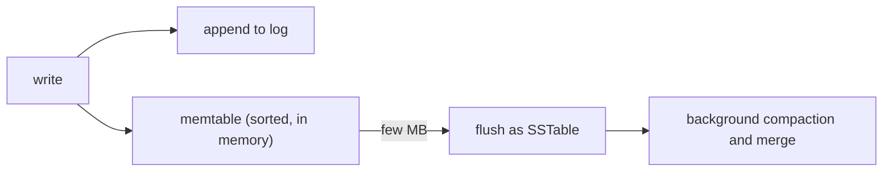
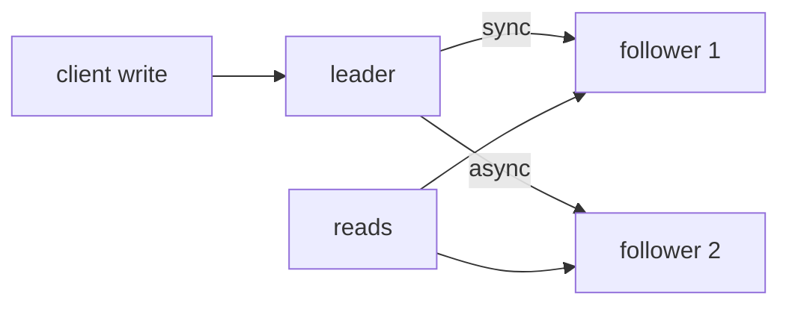
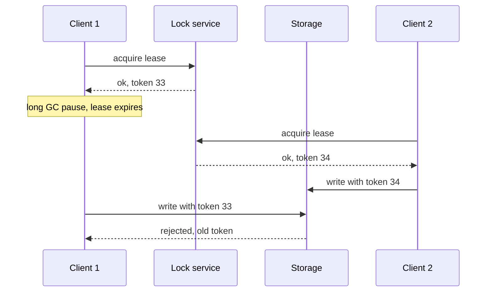
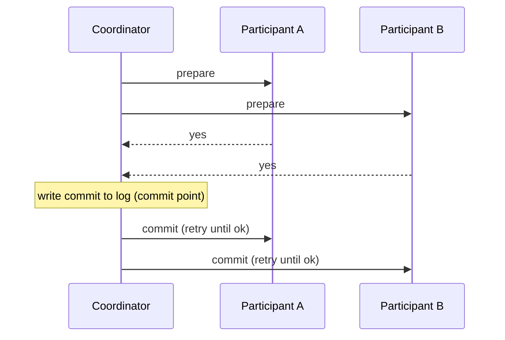

# Designing Data-Intensive Applications — Interview Edition

## How to use this edition
The night-before version of the DDIA study notes: every chapter's key ideas, comparison tables, likely questions and traps, with the explanations stripped out. Everything here comes from the full chapter notes (`../chapters/NN-*/README.md`); go there when a line needs its "why".

- **Must-know** — the terms and rules you must be able to say in one breath.
- **Key facts & numbers** — comparison tables (LSM vs B-tree, encodings, replication, partitioning, isolation levels, consistency models, consensus, batch vs stream) and the book's numbers.
- **Code to remember** — only the few snippets worth writing on a whiteboard.
- **In the interview** — the most likely questions with 1–3 sentence answers. Say the answer out loud before reading it.
- **Gotchas** — the traps: "wrong idea → right idea".
- **TL;DR** — the chapter in one or two lines.

**Suggested passes.** 30 minutes: Top 25 questions + every TL;DR + Last-minute checklist. 2 hours: all Key facts tables + In the interview. Before a system-design round, reread Chapters 5, 6, 7, 9 and 11 — they carry most of the questions.

**How to answer a DDIA-style question.** Name the trade-off, not the product: what does the design guarantee, what does it give up, and what happens when a node, a clock or the network fails?

## Top 25 questions across the book
| # | Question | One-line answer | Ch |
|---|---|---|---|
| 1 | Fault vs failure? | A component deviating from spec vs the whole system stopping service; design fault tolerance so faults don't become failures. | 1 |
| 2 | Why percentiles, not averages? | The mean hides the tail; p99/p999 hit the most valuable users and are amplified by fan-out. | 1 |
| 3 | Twitter timeline: fan-out on read or write? | Write fan-out because reads are ~100× writes; hybrid read-time merge for celebrities. | 1 |
| 4 | Relational, document or graph? | Trees loaded whole → document; many-to-many and joins → relational; everything connected → graph. | 2 |
| 5 | LSM-tree or B-tree? | LSM: sequential writes, high write throughput, compaction cost; B-tree: in-place pages, fast predictable reads. Benchmark. | 3 |
| 6 | Why column storage for analytics? | Read only the few columns a query needs; columns compress well and process vectorised. | 3 |
| 7 | Backward vs forward compatibility? | New code reads old data vs old code reads new data; both needed for rolling upgrades. | 4 |
| 8 | Protobuf vs Avro schema evolution? | Protobuf: numeric field tags, never reuse; Avro: writer's vs reader's schema resolved by name, defaults. | 4 |
| 9 | Sync vs async replication? | Sync: follower guaranteed current but can block writes; async: fast but may lose confirmed writes on failover. | 5 |
| 10 | What goes wrong in failover? | Lost writes, reused keys, split brain, bad timeouts. | 5 |
| 11 | Quorums: does w + r > n give strong consistency? | Overlap makes fresh reads likely, but sloppy quorums, LWW, concurrency and partial failures break it — not linearizable. | 5, 9 |
| 12 | Replication-lag anomalies? | Read-your-writes, monotonic reads, consistent prefix — fix by leader reads, replica pinning, causal partitioning. | 5 |
| 13 | Key-range vs hash partitioning? | Range: cheap scans, hot-spot risk; hash: even load, no range queries. | 6 |
| 14 | Why not hash mod N? | Changing N moves most keys; use fixed partitions, dynamic splits, or partitions per node. | 6 |
| 15 | Local vs global secondary index? | Local: cheap writes, scatter/gather reads; global: one-partition reads, async multi-partition writes. | 6 |
| 16 | What does ACID really mean? | Abortability, app invariants, isolation (often not serializable), durability; C is the app's job. | 7 |
| 17 | Snapshot isolation vs serializable? | SI (MVCC) stops dirty reads and read skew but allows write skew and phantoms; only serializable stops all. | 7 |
| 18 | Three ways to serializability? | Serial execution, 2PL, SSI — simple/one core vs blocking/deadlocks vs optimistic/aborts. | 7 |
| 19 | How is a leader wrong about its lease? | Process pauses (GC, VM suspend); fix with fencing tokens checked by storage. | 8 |
| 20 | Why not order events by timestamps? | Clocks skew and jump; LWW silently drops causally later writes; use logical clocks. | 8 |
| 21 | Linearizability vs serializability? | Single-object real-time recency vs transactions in some serial order; both = strict serializability. | 9 |
| 22 | CAP theorem? | During a partition choose linearizable or available; "2 of 3" is misleading; the real cost is latency. | 9 |
| 23 | 2PC and its weakness? | Prepare → all yes → coordinator logs commit; coordinator crash leaves participants in doubt holding locks. | 9 |
| 24 | Kafka log vs RabbitMQ queue? | Log: ordered replayable partitions, offsets; queue: per-message ack and load balancing, no replay. | 11 |
| 25 | Keep DB, index and cache in sync; make payments exactly-once? | No dual writes: CDC/event log with idempotent consumers; end-to-end operation ID with a unique constraint. | 11, 12 |

## 0. Preface — how to read the book
The lasting principles and trade-offs underneath the buzzwords (NoSQL, sharding, ACID, CAP, MapReduce, real-time).

### Must-know
- **Data-intensive** app — the hard part is the data (amount, complexity, speed of change); **compute-intensive** — the bottleneck is CPU. The book is about the first kind.
- **Forces behind the change** — internet-scale companies, business agility, open source winning, many cores + faster networks (parallelism), cheap distribution via IaaS, less tolerance for downtime.
- **Central promise** — tools change fast; principles and trade-offs change slowly. Learn those and you can place any new tool.
- **Scope** — architecture of data systems and their trade-offs; not install guides, not ops/security; "Big Data" is avoided as too vague. Sharper contrasts are used instead: **single-node vs distributed**, **online/interactive vs offline/batch**.
- **"You're not Google"** — building for scale you do not need is premature optimisation, but picking the right tool still matters; relational is important but not the last word.

### Key facts & numbers
| Part | Chapters | Theme |
|---|---|---|
| I · Foundations | 1–4 | Reliability/scalability/maintainability, data models, storage engines, encoding |
| II · Distributed Data | 5–9 | Replication, partitioning, transactions, distributed-systems trouble, consistency & consensus |
| III · Derived Data | 10–12 | Batch, stream, the future (integration, unbundling, correctness, ethics) |

### In the interview
**Q:** What question should you ask of any new data tool? **A:** What data model does it use, what guarantees does it give, and what does it give up to get them?

### TL;DR
Part I is the prerequisite for Part II, Part II for Part III. Judge tools by their trade-offs, not their marketing.

## 1. Reliable, Scalable, and Maintainable Applications
The three nonfunctional goals every data system is judged by, and how to describe load and performance with numbers.

### Must-know
- **Data system** — umbrella for databases, caches, search indexes, queues, batch/stream processors; the tools overlap (Redis as a queue, Kafka with database-like durability) and apps glue several together into a composite system.
- **Functional vs nonfunctional** — what the system does vs general properties it must have (reliability, scalability, security, maintainability...).
- **Reliability** — keeps working correctly, at the needed performance, even when things go wrong.
- **Fault vs failure** — a **fault** is one component deviating from spec; a **failure** is the whole system no longer serving users. Goal: stop faults turning into failures (**fault tolerance**).
- **Hardware faults** — mostly random and independent; handled by redundancy (RAID, dual power, hot-swap CPUs) and increasingly by software tolerating whole-machine loss (enables **rolling upgrades**).
- **Software errors** — **systematic**, correlated across nodes (same bug everywhere at once); cause **cascading failures**. Mitigate with testing, process isolation, restarts, measuring, monitoring.
- **Human errors** — the leading cause of outages. Mitigate with good APIs/abstractions, sandboxes, thorough testing, quick rollback and gradual rollout, recompute tools, **telemetry**, training.
- **Chaos Monkey** — Netflix tool that kills processes on purpose so the fault-handling path stays exercised.
- **Scalability** — not a yes/no label; it is "what are our options if load grows like X?"
- **Load parameters** — the few numbers that describe load (requests/s, read/write ratio, active users, cache hit rate, **fan-out**).
- **Throughput vs response time** — records/s (batch) vs time from request to reply as the client sees it (online).
- **Response time vs latency** — response time = service time + network + queueing delays; **latency** is only the time spent waiting to be handled.
- **Percentiles** — p50 (median) = typical experience; **p95/p99/p999** = the **tail**. Use them, not the mean.
- **Head-of-line blocking** — a few slow requests in front of a queue delay fast ones behind them → measure on the **client side**.
- **Tail latency amplification** — one user request that needs many backend calls is only as fast as the slowest call.
- **Scale up vs out** — bigger machine (vertical) vs many machines (**shared-nothing**, horizontal). Stateless services scale out easily; stateful data is harder.
- **Elastic** — adds resources automatically when load rises; manual scaling is simpler with fewer surprises.
- **Maintainability = operability + simplicity + evolvability.**
- **Accidental complexity** — complexity from the implementation, not the problem; removed with good **abstractions**. A project drowning in it is a **big ball of mud**.

### Key facts & numbers
| Fact | Value |
|---|---|
| Hard disk MTTF | ~10–50 years → a 10,000-disk cluster loses ~1 disk/day |
| Outages involving hardware (study cited) | only 10–25%; operator config errors lead |
| Systematic bug example | leap second, 30 June 2012, Linux kernel bug hung many apps at once |
| Twitter post tweet | 4.6k req/s avg (12k peak) |
| Twitter home timeline read | 300k req/s (~100× writes) |
| Avg followers per tweet | ~75 → ~345k timeline-cache writes/s |
| Amazon percentile target | p999 (not p9999: too costly) |
| Amazon cost of latency | +100 ms → −1% sales; others: +1 s → −16% satisfaction |
| Example SLA | median < 200 ms, p99 < 1 s, met ≥ 99.9% of the time |
| Cheap percentile algorithms | forward decay, t-digest, HdrHistogram |

| Twitter timeline | Approach 1: fan-out on read | Approach 2: fan-out on write | Hybrid (final) |
|---|---|---|---|
| Work at post time | insert one row | push tweet into every follower's cached timeline | write fan-out for normal users |
| Work at read time | join follows + tweets, merge, sort | read one cache | merge in celebrity tweets at read time |
| Breaks when | reads are 100× writes | a user has 30M+ followers | — |

| Maintainability part | Means | How |
|---|---|---|
| Operability | easy for ops to keep it running | monitoring, automation, no single-machine dependency, docs, sane defaults, self-healing with manual override, predictable behaviour |
| Simplicity | easy for new engineers to understand | remove accidental complexity with abstractions |
| Evolvability | easy to change for new requirements | simple, well-abstracted systems are easier to adapt |

### In the interview
**Q:** Fault vs failure? **A:** A fault is one part going wrong; a failure is the whole system stopping service. You cannot prevent all faults, so design fault tolerance and test it (e.g. Chaos Monkey).

**Q:** Why are software bugs worse than hardware faults? **A:** Hardware faults are mostly independent; a bug is systematic and hits every node with the same input at once (2012 leap second), so it can take down the whole fleet.

**Q:** Design the Twitter home timeline — fan-out on write or read? **A:** Reads outnumber posts ~100×, so precompute timelines on write; but celebrities make write fan-out explode, so use a hybrid that fetches celebrity tweets at read time. The key load parameter is the distribution of followers per user.

**Q:** Why percentiles, not the average? **A:** The mean hides how many users suffer; percentiles show the distribution, and the tail often belongs to the most valuable users and is amplified by fan-out.

**Q:** Can you average p99s from 10 servers? **A:** No — merge the histograms instead.

**Q:** Where should latency be measured? **A:** On the client, because queueing and head-of-line blocking add delay the server never sees.

**Q:** Scale up or out? **A:** Up is simpler but expensive at the high end; out goes further but adds complexity for stateful data. Real systems mix both, and the architecture is usually redesigned at each order-of-magnitude of growth.

**Q:** What makes a system maintainable? **A:** Operability, simplicity (no accidental complexity) and evolvability.

**Q:** When is it OK to sacrifice reliability? **A:** Deliberately, to cut development cost (a prototype for an unproven market) or operating cost (thin margins) — as long as you know you are cutting corners.

### Gotchas
- "The system is scalable" → meaningless; say which load parameter grows and what your options are.
- Load test that waits for each response before sending the next → keeps queues short and makes response times look better than reality.
- Latency ≠ response time.
- Same bytes/s ≠ same architecture: 100,000 × 1 kB req/s and 3 × 2 GB req/min need very different designs — there is no generic scalable design.
- Optimising p9999 → usually not worth it; it is dominated by random events you cannot control.

### TL;DR
Reliability = tolerate hardware, software and human faults; scalability = describe load and percentiles with numbers, then pick options; maintainability = operability, simplicity, evolvability.

## 2. Data Models and Query Languages
Relational vs document vs graph models, and declarative vs imperative ways to query them.

### Must-know
- **Relational model** (Codd, 1970) — relations (tables) of unordered tuples (rows); won because the **query optimizer** picks access paths automatically.
- **NoSQL drivers** — scale (big data, high write throughput), open source, specialised queries, frustration with rigid schemas. Leads to **polyglot persistence**.
- **Impedance mismatch** — awkward translation between app objects and rows; ORMs (ActiveRecord, Hibernate) reduce boilerplate but do not remove it.
- **One-to-many** = a tree (fits documents); **many-to-one / many-to-many** = needs joins (fits relational/graph).
- **Normalization** — store each human-meaningful fact once, reference it by **ID**; IDs never need to change. **Denormalization** duplicates data to avoid joins at the cost of keeping copies in sync.
- **Hierarchical model (IMS)** — one big tree like JSON; bad at many-to-many; no joins. **Network model (CODASYL)** — records with many parents; programmer follows **access paths** by hand.
- **Document databases** repeat IMS for one-to-many, but use **document references** (like foreign keys) resolved by joins or follow-up queries for many-to-one.
- **Schema-on-read vs schema-on-write** — "schemaless" is misleading; the structure is implicit and interpreted by the reader (like dynamic typing) vs enforced on write (like static typing).
- **Locality** — a document is one contiguous string (JSON/XML/BSON), so loading it whole is fast; but the whole thing is loaded and updates often rewrite it → keep documents small. Relational locality features: Spanner interleaved tables, Oracle multi-table index clusters, Bigtable column families.
- **Convergence** — relational DBs added JSON/XML support; RethinkDB supports joins; some MongoDB drivers resolve references (a slower **client-side join**).
- **Declarative** (SQL, CSS) — say *what* result you want; the optimizer decides *how*; no promised order, so storage can change; easy to parallelise. **Imperative** — you give the operations and their order.
- **MapReduce** — between declarative and imperative: you write `map` and `reduce` as **pure functions** so they can run anywhere, in any order, and be retried. MongoDB added the declarative **aggregation pipeline** (2.2).
- **Property graph** — vertices and edges each with an ID and key-value properties; edges have tail, head and a label. Any vertex can connect to any other; traverse forwards and backwards.
- **Triple-store** — (subject, predicate, object); object is either a value (a property) or another vertex (an edge). RDF/Turtle, queried with **SPARQL**.
- **Datalog** — rules build derived predicates from facts; a subset of Prolog; the foundation later languages build on (Datomic, Cascalog).

### Key facts & numbers
| | Document | Relational | Graph |
|---|---|---|---|
| Best for | self-contained trees, loaded whole | many-to-one, many-to-many via joins | anything related to everything; variable-length traversals |
| Schema | usually on read | on write | usually not enforced |
| Joins | weak (RethinkDB yes; MongoDB no; CouchDB only predeclared views) | strong | traversals are the point |
| Query language | MongoDB aggregation pipeline, MapReduce | SQL | Cypher (Neo4j), SPARQL, Datalog |
| Examples | MongoDB, RethinkDB, CouchDB, Espresso | — | Neo4j, Titan, InfiniteGraph (property); Datomic, AllegroGraph (triples) |

| Graph DB vs CODASYL | Graph database | CODASYL network model |
|---|---|---|
| Schema on links | none; any vertex to any vertex | schema restricts which record types nest |
| Reaching a record | by ID or index | only by following access paths |
| Order | unordered vertices/edges | ordered child sets |
| Query style | declarative (Cypher, SPARQL) | imperative only |

| Fact | Value |
|---|---|
| Recursive query in SQL | `WITH RECURSIVE` (SQL:1999) — book's example 29 lines vs 4 in Cypher |
| MySQL `ALTER TABLE` | copies the whole table → possible long downtime; workaround: nullable column, fill at read time |

### Code to remember
```cypher
MATCH
  (p) -[:BORN_IN]->  () -[:WITHIN*0..]-> (:Location {name:'India'}),
  (p) -[:LIVES_IN]-> () -[:WITHIN*0..]-> (:Location {name:'Canada'})
RETURN p.name
```
`*0..` = follow WITHIN edges zero or more times; the optimizer decides forward or backward traversal.

### In the interview
**Q:** Relational or document? **A:** A self-contained one-to-many tree loaded whole → document (locality, schema flexibility, no shredding). Many-to-one/many-to-many → relational joins. Highly interconnected → graph.

**Q:** Is a document DB schemaless? **A:** No — it is schema-on-read; the code still assumes a structure, the database just does not enforce it.

**Q:** Why store IDs rather than text? **A:** Normalization: one fact stored once, renames are one update, no inconsistent copies; costs joins.

**Q:** Why did relational beat CODASYL? **A:** CODASYL made programmers navigate access paths by hand; relational let the optimizer choose paths, so new indexes and queries did not require rewriting code.

**Q:** Why does declarative matter? **A:** Shorter queries, the engine can change storage or algorithms without breaking them, and parallel execution is much easier.

**Q:** Where does MapReduce fit? **A:** Between: snippets of code (pure functions) run by the framework; harder to coordinate and gives less room to optimise than a declarative pipeline.

**Q:** Graph queries in SQL? **A:** Possible with recursive CTEs, but clumsy compared with Cypher.

**Q:** Property graph vs triple-store? **A:** Mostly equivalent ways of saying the same thing.

### Gotchas
- "Document DBs are schemaless" → schema-on-read.
- Big documents → whole doc loaded and rewritten on growth; keep them small.
- Client-side joins → extra round-trips, less optimisation than in-database joins.
- Emulating one model in another is possible but awkward — pick the model that fits.
- Map and reduce with side effects or extra queries → breaks retries and parallelism.

### TL;DR
Documents for trees, relational for joins, graphs for everything-connects-to-everything; declarative languages let the engine optimise for you.

## 3. Storage and Retrieval
How storage engines lay data out: logs, hash indexes, LSM-trees, B-trees, and column stores for analytics.

### Must-know
- **Log** — append-only file: cheapest possible write; reading without an index is O(n).
- **Index** — extra structure derived from the data; speeds reads, slows every write → index deliberately.
- **Hash index (Bitcask)** — in-memory map key → byte offset in the log. Great for many updates to few keys (play count per video URL). Keys must fit in RAM; no efficient range queries.
- **Segments + compaction** — close a segment at a size limit; compaction throws away duplicate keys, merging combines segments; old segments are deleted. **Tombstone** = delete marker.
- **SSTable** — segment with keys **sorted**; merge like mergesort; a **sparse** in-memory index is enough; blocks between index entries can be compressed.
- **LSM-tree** — write → append to log (crash safety) + insert into in-memory balanced tree (**memtable**); at a few MB flush to an SSTable; reads check memtable then newest→oldest SSTables; background merge/compaction. Used by LevelDB, RocksDB, Cassandra, HBase, Lucene (term dictionary).
- **Bloom filter** — tells an LSM "key definitely not in this SSTable", avoiding reads for missing keys.
- **Size-tiered vs leveled compaction** — merge newer/smaller into older/larger (HBase) vs split key range into small tables across levels, more incremental and less disk (LevelDB, RocksDB); Cassandra supports both.
- **B-tree** — fixed-size **pages** (traditionally 4 KB) overwritten in place; a root, internal pages holding key-range references, leaf pages; **branching factor** usually several hundred; full page → **split** and update parent → always balanced, O(log n) depth, usually 3–4 levels.
- **WAL (redo log)** — append-only log of every B-tree change before applying it, so a crash mid-split can be repaired. **Latches** (light locks) protect concurrent access. Alternative: **copy-on-write** pages (LMDB).
- **B-tree optimisations** — abbreviated keys in internal pages (B+ tree flavour), leaf pages laid out in order, sibling pointers, fractal trees.
- **Write amplification** — one logical write → several physical writes (WAL + page; repeated compaction). Limits throughput and wears out SSDs.
- **Secondary index** — keys not unique: store a list of row IDs or make keys unique by appending the row ID.
- **Heap file vs clustered vs covering index** — pointer to a row stored elsewhere vs full row in the index (InnoDB primary key; SQL Server one per table) vs some columns included.
- **Concatenated index** — several fields joined in one key (phone book: last, first); useless for "first name only". **Multi-dimensional** (R-tree, PostGIS; HyperDex) for geo-rectangles and similar.
- **Fuzzy index** — Lucene's in-memory automaton over terms supports search within an edit distance.
- **In-memory DBs** (VoltDB, MemSQL, RAMCloud, Redis) — faster because they avoid **encoding** data for disk, not because they avoid disk reads (the OS cache already does that). Can also offer data models hard on disk (Redis sets, queues). **Anti-caching** evicts to disk.
- **OLTP vs OLAP** — see table; analytics goes to a separate **data warehouse** loaded by **ETL** (extract–transform–load).
- **Star schema** — central **fact table** (one row per event) with foreign keys to **dimension tables** (who, what, where, when, how, why). **Snowflake** normalises dimensions further.
- **Column-oriented storage** — each column in its own file, same row order in every file; queries read only the columns they need.
- **Column compression** — bitmap encoding + **run-length encoding**; fits CPU cache → **vectorised processing**.
- **Sort order** — sort whole rows (never columns independently) by a chosen key; first sort key compresses best. C-Store/Vertica keep **several sort orders** on different replicas.
- **Writes to column stores** — buffer in memory (LSM-style), merge into column files in bulk; queries combine both (Vertica).
- **Materialized view / data cube** — precomputed aggregates stored on disk: fast reads, costlier writes, less flexible than raw data.

### Key facts & numbers
| Aspect | B-tree | LSM-tree |
|---|---|---|
| Typical strength | reads, predictable latency | writes, throughput |
| Write pattern | random page overwrites | sequential segment writes |
| Write amplification | WAL + full page writes (sometimes twice) | repeated compaction (often lower overall) |
| Space | fragmentation leaves empty space | more compact, better compression |
| Background work | none | compaction can hurt tail latency / fall behind |
| Key location | exactly one place (good for range locks in transactions) | possibly many segments |
| Maturity | very mature; default in relational DBs | increasingly popular in new datastores |

| Storage family | Rule | Members |
|---|---|---|
| Log-structured | only append; delete obsolete files; never modify | Bitcask, SSTables, LSM-trees, LevelDB, RocksDB, HBase, Cassandra, Lucene |
| Update-in-place | overwrite fixed-size pages | B-trees (all major relational DBs, many others) |

| Property | OLTP | OLAP |
|---|---|---|
| Read pattern | few records by key | aggregate over very many records |
| Write pattern | low-latency random writes from users | bulk import (ETL) or event stream |
| Used by | end users via the app | internal analysts |
| Data represents | latest state | history of events |
| Size | GB–TB | TB–PB |
| Bottleneck | disk seek time | disk bandwidth |

| Index option | Stores | Read cost | Write/storage cost |
|---|---|---|---|
| Heap (nonclustered) | pointer to row | extra hop | lowest |
| Covering | some columns | no hop for covered queries | medium |
| Clustered | entire row | no hop | highest |

| Fact | Value |
|---|---|
| 4 levels × branching 500 × 4 KB pages | up to 256 TB |
| Typical B-tree depth | 3–4 levels |
| Memtable flush threshold | a few MB |
| Virtual vs materialized view | query expanded on the fly vs results stored on disk and kept updated |



### In the interview
**Q:** B-tree or LSM-tree? **A:** B-tree: in-place pages + WAL, each key in one place, fast predictable reads — default for relational DBs. LSM: memtable + sequential SSTables + compaction, higher write throughput and compression but reads may check several files and compaction can hurt tail latency. Write-heavy → LSM; read-heavy/transactional → B-tree; benchmark your workload.

**Q:** How does an LSM survive a crash? **A:** Every write is also appended to a log; on restart the log is replayed into the memtable; the log is discarded once its memtable is flushed.

**Q:** How does an LSM avoid reading every SSTable for a missing key? **A:** A Bloom filter per SSTable.

**Q:** What if compaction cannot keep up? **A:** Unmerged segments pile up, reads slow down, disk fills; engines usually do not throttle writes, so monitor it.

**Q:** How does a B-tree stay balanced and crash-safe? **A:** Overflowing pages split and the parent gets a new boundary (O(log n) depth); a WAL makes multi-page changes recoverable; latches handle concurrency.

**Q:** Why a separate data warehouse? **A:** Analyst scans would hurt user-facing OLTP latency and OLTP indexes are poor for scans, so ETL copies data into a read-optimised (often columnar, star-schema) warehouse.

**Q:** Why are column stores fast for analytics? **A:** Queries touch a few of 100+ columns, so read only those; columns compress well (bitmaps, RLE), chunks fit CPU cache for vectorised processing.

**Q:** Are Cassandra/HBase column stores? **A:** No — column families are still row-oriented within each family and do not use column compression.

**Q:** Why are in-memory DBs faster? **A:** They skip encoding in-memory structures into disk format.

**Q:** Why not a (lat, lon) concatenated index for "shops in this rectangle"? **A:** It narrows latitude but scans all longitudes; use a spatial index (R-tree) or a space-filling curve.

### Gotchas
- Sorting each column independently → breaks row reconstruction; sort whole rows.
- "In-memory = no disk" → most write a log/snapshots to disk for durability; the win is avoiding encoding.
- Data cube only → cannot answer questions along dimensions you did not include; keep raw data too.
- Materialized views in OLTP → every write must update them; they fit read-heavy warehouses.
- "LSM always beats B-tree for writes" → depends on workload and configuration; test it.

### TL;DR
Logs and LSM-trees turn random writes into sequential ones; B-trees give each key one home and predictable reads; analytics wants columns, compression and sort order.

## 4. Encoding and Evolution
Turning data into bytes (JSON, Thrift, Protocol Buffers, Avro) and changing schemas safely while old and new code run side by side.

### Must-know
- **Encoding (serialization/marshalling)** — in-memory objects → self-contained bytes; **decoding** is the reverse.
- **Backward compatibility** — new code reads old data (easy: you know the old format). **Forward compatibility** — old code reads new data (harder: old code must ignore additions).
- **Why both** — **rolling upgrades** and un-updated clients mean old and new versions coexist and read each other's data.
- **Language-specific formats** (Java Serializable, Ruby Marshal, Python pickle, Kryo) — language lock-in, remote-code-execution risk when decoding untrusted bytes, weak versioning, poor efficiency. Only for very short-lived data.
- **JSON/XML/CSV** — universal and readable, but number ambiguity (integers > 2^53 not exact in JavaScript doubles), no binary strings (Base64, +33%), optional/complex schemas, CSV has none.
- **Binary JSON** (MessagePack, BSON...) — still stores field names; saves little.
- **Thrift / Protocol Buffers** — schema in an IDL; each field has a **tag number**; data holds tag + type + value, never names. Code generation for many languages.
- **Tag rules** — rename freely; **never change or reuse a tag**; new fields must be optional or have a default; only optional fields may be removed.
- **Avro** — no tags, no type markers; values in schema order. Decoding needs the exact **writer's schema**, resolved against the **reader's schema** by **field name**: unknown fields ignored, missing ones filled with defaults.
- **Avro rules** — add/remove only fields that have a **default**; null via a **union** (`union { null, long }`); changing a type works if Avro can convert it.
- **Where the writer's schema comes from** — object container file header (once per file), a per-record **version number** + schema list in the DB (Espresso), or negotiation at connection setup (Avro RPC).
- **Dynamically generated schemas** — Avro suits schemas generated from DB tables (no tag bookkeeping).
- **Merits of schemas** — compact, always-up-to-date documentation, compatibility checks before deploy, code generation in static languages (ASN.1 did it first, 1984).
- **Data outlives code** — a DB holds values written years apart; preserve **unknown fields** on read-modify-write; archive dumps with the latest schema (Avro container files, Parquet).
- **REST vs SOAP vs RPC** — REST: philosophy on HTTP, simple formats; SOAP: XML protocol with WSDL, heavy tooling; RPC: tries to make remote calls look local (**location transparency**) — flawed.
- **Service compatibility** — assume servers upgrade first: **backward-compatible requests, forward-compatible responses**. Version via URL, `Accept` header, or per-API-key settings.
- **Message broker** — buffers, redelivers, hides addresses, fans out, decouples; one-way and async (replies need a separate queue). Consumers that republish must keep fields they do not understand.
- **Distributed actors** (Akka, Orleans, Erlang OTP) — location transparency fits better because actors already assume message loss; still need compatible encodings for rolling upgrades.

### Key facts & numbers
| Encoding (book's example record) | Bytes |
|---|---|
| JSON, whitespace removed | 81 |
| MessagePack | 66 |
| Thrift BinaryProtocol | 59 |
| Thrift CompactProtocol | 34 |
| Protocol Buffers | 33 |
| Avro | 32 |

| Family | Examples | Readable | Schema | Compatibility |
|---|---|---|---|---|
| Language-specific | Java Serializable, pickle, Kryo | No | implicit in classes | often none; insecure |
| Textual | JSON, XML, CSV | Yes | optional / none | depends on usage |
| Binary JSON | MessagePack, BSON | No | none | like JSON |
| Tag-based binary | Thrift, Protocol Buffers | No | required, with tags | clear rules via tags |
| Name-resolved binary | Avro | No | writer's + reader's | name matching + defaults |

| Change | Protobuf/Thrift | Avro |
|---|---|---|
| Rename field | OK (names not encoded) | only via aliases (names matter) |
| Add field | must be optional/defaulted, new tag | must have a default |
| Remove field | only optional; never reuse its tag | only if it had a default |
| int32 → int64 | new code fine; old code may truncate | OK if convertible |
| optional → repeated | protobuf OK (old code sees last element) | — |

| Dataflow mode | Who encodes / decodes | Compatibility needs |
|---|---|---|
| Database | writer encodes, (later) reader decodes | both directions; keep unknown fields |
| REST/RPC | client encodes request, server decodes and replies | backward requests, forward responses |
| Async messages | sender encodes, recipient decodes | both; preserve unknown fields on republish |

| Local call | Network call |
|---|---|
| predictable | may be lost, slow, or target down |
| returns / throws | may **time out** with unknown outcome |
| retry is your choice | retry may duplicate → need **idempotence** |
| steady latency | ms to many seconds |
| pass pointers | encode every parameter to bytes |

### Code to remember
```protobuf
message Book {
  required string book_title = 1;   // tag 1 is forever
  optional int64  page_count = 2;
  repeated string genres     = 3;   // a list
}
```

### In the interview
**Q:** Backward vs forward compatibility — why both? **A:** New reads old vs old reads new; during rolling upgrades both versions run at once and read each other's data.

**Q:** How does protobuf evolve schemas? **A:** Fields are identified by numeric tags; old code skips unknown tags (the type gives the length), new code reads old data if new fields are optional/defaulted. Never change or reuse tags.

**Q:** How is Avro different? **A:** No tags; the reader resolves the writer's schema against its own by field name, with defaults for missing fields. Great for auto-generated schemas.

**Q:** How does an Avro reader find the writer's schema? **A:** File header, per-record version number + schema registry, or connection negotiation.

**Q:** Which compatibility does a database need? **A:** Both, plus preserving unknown fields when old code rewrites a record.

**Q:** Why is RPC's "remote looks local" flawed? **A:** Network calls can be lost, time out with unknown outcome, be duplicated on retry, vary wildly in latency, and cross type systems.

**Q:** REST or RPC? **A:** REST for public APIs (debuggable, universal tooling); binary RPC (gRPC, Thrift) inside an organisation where performance matters.

**Q:** Broker vs direct RPC? **A:** Broker buffers, redelivers, decouples and fans out; costs you a one-way asynchronous flow.

**Q:** Why avoid pickle/Java serialization for stored data? **A:** Language lock-in, security holes, poor versioning and efficiency.

### Gotchas
- Old code reads a record, updates it, writes it back → new field silently lost; preserve unknown fields.
- Adding a `required` protobuf field or an Avro field without a default → breaks reading old data.
- 64-bit IDs as JSON numbers → JavaScript loses precision; Twitter sends IDs as strings too.
- Binary JSON "saves space" → barely (66 vs 81 bytes); schema formats get 32–34.
- Reusing a deleted field's tag → old data decoded as the wrong field.

### TL;DR
Code and data of different ages coexist, so every encoding must be backward and forward compatible; schema-driven binary formats (tags or writer/reader schemas) make that precise and compact.

## 5. Replication
Keeping a copy of the same data on several machines: single-leader, multi-leader and leaderless, and what replication lag does to users.

### Must-know
- **Why distribute data (Part II intro)** — scalability, fault tolerance/high availability, latency (servers near users). Architectures: **shared-memory** (scale up), **shared-disk** (NAS/SAN, locking limits it), **shared-nothing** (nodes coordinate in software over a normal network — the focus of Part II).
- **Replication vs partitioning** — same data on many nodes vs cutting data into pieces; independent, usually combined.
- **Leader-based (master–slave, active/passive)** — clients write to the leader; it sends a **replication log** to followers; reads can go to any replica.
- **Synchronous vs asynchronous** — wait for a follower's ack (follower guaranteed current, but one stalled follower blocks all writes) vs don't wait (fast, but confirmed writes can be lost). **Semi-synchronous** = one sync follower, rest async. Fully async is common, weakening durability.
- **New follower** — take a consistent snapshot tied to a log position (LSN / binlog coordinates), copy it, then apply all changes since that position.
- **Follower failure** — catch-up recovery from its log. **Leader failure** — **failover**: detect (timeout, e.g. 30 s), choose new leader (freshest replica; a consensus problem), reconfigure clients; old leader must step down.
- **Failover dangers** — lost unreplicated writes (durability broken), clashes with outside systems (GitHub reused MySQL autoincrement keys also used in Redis → private data shown to wrong users), **split brain**, timeout choice (too short → needless failovers that worsen overload). Some teams fail over manually.
- **Fencing / STONITH** — shut one leader down when two are detected; badly designed versions shut down both.
- **Replication lag** — async followers can be behind; **eventual consistency** is vague about how far.
- **Read-after-write (read-your-writes)** — users always see their own submitted data.
- **Monotonic reads** — once you have seen newer data, you never see older data later.
- **Consistent prefix reads** — writes seen in the order they happened (question before answer); mainly a partitioned-store problem.
- **Multi-leader** — several nodes accept writes and replicate to each other asynchronously. Use cases: **multi-datacenter**, **offline clients** (each device is a leader; CouchDB), **collaborative editing**.
- **Conflict avoidance** — route all writes for a record to one home leader; breaks when that leader changes.
- **Convergent resolution** — all replicas must end at the same value: highest unique ID / **LWW** (data loss), higher replica ID wins (data loss), merge values, or record the conflict for the app.
- **Custom resolution** — **on write** (Bucardo Perl handler, background, cannot ask user) or **on read** (CouchDB returns all versions). Resolution is per row/document, not per transaction.
- **Automatic resolution** — **CRDTs** (Riak 2.0), mergeable persistent data structures (Git-like three-way merge), **operational transformation** (Etherpad, Google Docs). Amazon's cart once kept additions but not removals → deleted items came back.
- **Topologies** — circular (MySQL default), star/tree, all-to-all. Loops avoided by tagging writes with node IDs. Circular/star: one failed node blocks replication. All-to-all: messages can overtake each other → causality problem; timestamps are not enough → **version vectors**.
- **Leaderless (Dynamo-style)** — Riak, Cassandra, Voldemort: client (or coordinator) writes to and reads from several replicas in parallel; no failover.
- **Read repair vs anti-entropy** — fix stale replica noticed during a read (good for hot data) vs background process copying missing data in no order (Voldemort has none).
- **Quorum** — n replicas, write needs w acks, read asks r; **w + r > n** → read and write sets overlap. Typical n = 3 or 5, w = r = ⌈(n+1)/2⌉.
- **Sloppy quorum + hinted handoff** — when home nodes are unreachable, accept writes on other nodes and hand them back later; better write availability, but no overlap guarantee. On by default in Riak; off in Cassandra and Voldemort.
- **Concurrent** — neither operation knew about the other (not about wall-clock time). **Happens-before** — B knows about, depends on, or builds on A.
- **Version number algorithm** — server keeps a version per key; client must read before write and send back the version it read; server overwrites values ≤ that version and keeps higher ones as **siblings**; client merges. Across replicas → **version vector** (Riak: dotted version vectors, "causal context").
- **Tombstone** — marker kept in place of a deleted item so the deletion survives sibling merges.

### Key facts & numbers
| Approach | How writes flow | Pros | Cons |
|---|---|---|---|
| Single-leader | all writes via one leader → followers | simple; no conflicts | writes depend on one leader; failover is fraught |
| Multi-leader | each write to one of several leaders; leaders sync async | tolerates node/network trouble, local write latency | conflicts; hard to reason about |
| Leaderless | write/read several nodes; quorums | no failover; very available | very weak consistency; conflicts |

| Replication log method | Sends | Pros | Cons | Examples |
|---|---|---|---|---|
| Statement-based | SQL statements | compact | nondeterminism (NOW(), RAND()), ordering, side effects | MySQL < 5.1, VoltDB |
| WAL shipping | disk-block changes | exact copy | tied to storage format; upgrades need downtime | PostgreSQL, Oracle |
| Logical (row-based) | row changes | version-independent; good for CDC | a second log format | MySQL binlog (row mode) |
| Trigger-based | whatever app code records | flexible | overhead, bugs | Databus, Bucardo |

| Anomaly | User sees | Guarantee | Fix |
|---|---|---|---|
| Own write missing | "my post disappeared" | read-after-write | read own data from leader (or for 1 min after a write); track last-write timestamp/LSN |
| Time goes backwards | item appears then vanishes | monotonic reads | pin each user to one replica (hash of user ID) |
| Effect before cause | answer before question | consistent prefix | causally related writes in one partition; track causality |

| Quorum config | Tolerates |
|---|---|
| n = 3, w = r = 2 | 1 unavailable node |
| n = 5, w = r = 3 | 2 unavailable nodes |
| w = n, r = 1 | fast reads; one node down → all writes fail |

| Multi-DC | Single-leader | Multi-leader |
|---|---|---|
| Write latency | every write crosses to the leader's DC | local writes, async sync |
| DC outage | failover to another DC | each DC keeps running |
| Network trouble | very sensitive (sync over internet) | tolerates interruptions |



### In the interview
**Q:** Single-leader vs multi-leader vs leaderless? **A:** Single: one write node, ordered log, no conflicts, fragile failover. Multi: a leader per DC/device, local writes, must resolve conflicts. Leaderless: quorum reads/writes, no failover, weak consistency.

**Q:** Why not multi-leader inside one datacenter? **A:** Conflicts and trouble with autoincrement keys, triggers and constraints rarely pay off on a fast, reliable local network.

**Q:** Is AWS DynamoDB leaderless? **A:** The book notes it uses single-leader replication; Dynamo was Amazon's internal system.

**Q:** Sync vs async? **A:** Sync guarantees a current copy but blocks writes if the follower stalls; async is fast but loses confirmed writes on leader failure; semi-sync is the compromise.

**Q:** What can go wrong in failover? **A:** Lost writes, reused keys clashing with other systems, split brain, and bad timeout choice.

**Q:** Explain quorums. **A:** w + r > n makes read and write sets overlap, so at least one replica read has the newest value; read repair and anti-entropy fix stragglers.

**Q:** Does w + r > n guarantee fresh reads? **A:** No — sloppy quorums, LWW with clock skew, writes concurrent with reads, partially failed writes not rolled back, restores from stale replicas, timing edge cases. It is a probability knob, not linearizability.

**Q:** Fix "my comment disappeared after reload"? **A:** Read-after-write: read own content from the leader or require replicas that have caught up to the user's last write position.

**Q:** How do you detect concurrent writes, and why not LWW? **A:** Version numbers/vectors show whether one write knew of the other; keep concurrent ones as siblings to merge. LWW silently drops writes — safe only for write-once keys (e.g. UUID keys in Cassandra).

**Q:** Offline-first notes app syncing phone and laptop? **A:** Multi-leader with very long lag; plan conflict resolution (CRDTs or on-read like CouchDB).

### Gotchas
- "Eventual consistency" → says nothing about how long; lag can be seconds or minutes under load.
- Timestamps to order multi-leader writes → clocks drift; use version vectors.
- Making all followers synchronous → any one outage halts all writes.
- Multi-device read-your-writes → last-write metadata must be central; route all of a user's devices to one DC.
- Merging siblings by union → deletions reappear; use tombstones or CRDTs.
- PostgreSQL BDR gives no causal ordering; Tungsten Replicator for MySQL does not detect conflicts — read the docs and test.

### TL;DR
Replication buys availability, latency and read scale; async lag creates read-your-writes, monotonic and prefix anomalies; multi-leader and leaderless trade simplicity for conflicts you must detect (version vectors) and resolve.

## 6. Partitioning
Splitting a dataset too big for one machine into partitions (shards), indexing them, rebalancing them, and routing requests to them.

### Must-know
- **Partition** — each record belongs to exactly one partition; a.k.a. shard (MongoDB, Elasticsearch, SolrCloud), region (HBase), tablet (Bigtable), vnode (Cassandra, Riak), vBucket (Couchbase).
- **Partitioning + replication** — each partition is replicated; a node can be leader for some partitions and follower for others.
- **Goal** — spread data and query load evenly. **Skew** = unfair split; **hot spot** = one partition with disproportionate load.
- **Random assignment** — even load, but you would have to query every node to find a record.
- **Key-range partitioning** — each partition owns a contiguous range of sorted keys (like encyclopedia volumes); boundaries adapt to the data. Range scans are cheap; sequential keys (timestamps) create hot spots. Bigtable, HBase, RethinkDB, MongoDB before 2.4.
- **Hash partitioning** — each partition owns a range of hash values; spreads load, loses range queries. Needs a hash that is the same in every process (MD5 in Cassandra/MongoDB, Fowler–Noll–Vo in Voldemort) — not Java `hashCode()`.
- **Consistent hashing** — Karger et al.'s random-boundary method for CDN caches; "consistent" has nothing to do with replica or ACID consistency; works poorly for databases → say **hash partitioning**.
- **Compound key (Cassandra)** — first column hashed to pick the partition, remaining columns sort data within it: `(user_id, update_timestamp)` → efficient range over one user's timestamps.
- **Hot keys (celebrities)** — hashing does not help (same key, same hash). Append a random two-digit number → 100 keys; reads fetch all 100 and combine; only for the few hot keys, and you must track which keys are split.
- **Document-partitioned (local) secondary index** — each partition indexes only its own documents; write touches one partition; read must **scatter/gather** to all (tail-latency amplification).
- **Term-partitioned (global) secondary index** — the index itself is partitioned by term; read hits one partition; a write may touch several index partitions and is usually **asynchronous**.
- **Rebalancing requirements** — load fair afterwards; DB keeps serving during it; move no more data than necessary.
- **Hash mod N** — don't: changing N moves most keys.
- **Fixed number of partitions** — many more partitions than nodes (e.g. 10 nodes, 1,000 partitions); a new node steals whole partitions; key→partition mapping never changes. Caps node count; count is hard to choose.
- **Dynamic partitioning** — split a partition when it grows too big (HBase default 10 GB), merge when small. Empty DB starts with one partition → **pre-splitting** (HBase, MongoDB).
- **Partitions proportional to nodes** — fixed number per node (Cassandra 256); a new node splits random existing partitions; closest to original consistent hashing.
- **Automatic vs manual rebalancing** — automatic + automatic failure detection can turn a slow node into a **cascading failure**; a human approving suggested plans (Couchbase, Riak, Voldemort) is slower but safer.
- **Request routing (service discovery)** — (1) any node forwards, (2) a routing tier, (3) partition-aware clients. Hard part: everyone agreeing on the partition map → often **ZooKeeper**; Cassandra/Riak use **gossip**. DNS is fine for node IPs.
- **MPP** — analytic databases split complex queries into stages executed in parallel across partitions.

### Key facts & numbers
| | Key-range | Hash |
|---|---|---|
| Partition owns | a sorted key range | a range of hash values |
| Range queries | efficient | inefficient (order lost; MongoDB hash mode sends them to all partitions) |
| Hot-spot risk | high for sequential keys | lower |
| Typical rebalancing | dynamic split/merge | fixed partitions moved whole (dynamic also possible) |
| Users | Bigtable, HBase, RethinkDB, MongoDB < 2.4 | Cassandra, MongoDB (MD5), Voldemort (FNV) |

| | Local (document-partitioned) | Global (term-partitioned) |
|---|---|---|
| Index lives | with each data partition | separately, partitioned by term |
| Writes | one partition | possibly several index partitions |
| Reads | scatter/gather to all | only partitions with the term |
| Freshness | updated with the doc | often async; may lag |
| Examples | MongoDB, Riak, Cassandra, Elasticsearch, SolrCloud, VoltDB | DynamoDB GSIs, Riak search, Oracle DW (either) |

| Rebalancing | # partitions | Partition size | Used by | Watch out |
|---|---|---|---|---|
| hash mod N | = nodes | varies | avoid | most keys move |
| Fixed number | fixed at setup | grows with data | Riak, Elasticsearch, Couchbase, Voldemort | choosing the count |
| Dynamic | grows with data | bounded (HBase 10 GB) | HBase, RethinkDB, MongoDB | starts with one; pre-split |
| Proportional to nodes | fixed per node | fairly stable | Cassandra (256/node), Ketama | random splits can be unfair |

| hash = 123456 | N = 10 | N = 11 | N = 12 |
|---|---|---|---|
| mod N → node | 6 | 3 | 0 |

| Routing | Who |
|---|---|
| ZooKeeper tracks assignment | HBase, SolrCloud, Kafka; Espresso via Helix |
| own config servers + mongos routers | MongoDB |
| gossip; any node forwards | Cassandra, Riak |
| routing tier moxi, no auto-rebalancing | Couchbase |

### In the interview
**Q:** Key-range vs hash partitioning? **A:** Range keeps order (cheap scans, hot-spot risk with sequential keys); hash spreads load evenly but kills range queries. Cassandra's compound key gets some of both.

**Q:** Timestamp-keyed sensor data overloads one node — fix? **A:** Prefix the key with the sensor name so writes spread; reading many sensors then needs one range query per sensor.

**Q:** Why is hash mod N bad? **A:** Changing N remaps most keys. Use a fixed large number of partitions, dynamic splitting, or partitions per node.

**Q:** Downside of a fixed partition count? **A:** Caps node count; too big → costly rebalancing/recovery, too small → overhead.

**Q:** Local vs global secondary index? **A:** Local: cheap writes, scatter/gather reads. Global: single-partition reads, multi-partition writes usually applied asynchronously (DynamoDB GSIs normally within a fraction of a second).

**Q:** Why not update global indexes synchronously? **A:** It needs a distributed transaction across index partitions, which many DBs lack.

**Q:** Celebrity hot key? **A:** Split it with a random suffix across ~100 keys, read and combine all; bookkeeping needed.

**Q:** How does a request find its partition? **A:** Forwarding node, routing tier, or partition-aware client; the partition map is kept consistent in ZooKeeper or spread by gossip.

**Q:** Should rebalancing be automatic? **A:** Risky: a merely slow node may be declared dead, and moving its load can cascade; keep a human in the loop.

### Gotchas
- "Consistent hashing" in database docs → usually inaccurate; say hash partitioning.
- Java `hashCode()` for partitioning → differs across processes.
- Hashing a hot key → still one partition.
- Scatter/gather reads → tail latency grows with partition count.
- Dynamic partitioning on an empty DB → one node takes every write until the first split.
- Writes spanning partitions → partial failure is hard (later chapters).

### TL;DR
Partition by key range (order, hot-spot risk) or hash (even load, no ranges); index locally (scatter reads) or globally (async multi-partition writes); rebalance by moving whole partitions, never mod N; route via ZooKeeper or gossip.

## 7. Transactions
What ACID really means, the weak isolation levels and the races they allow, and three ways to get serializability.

### Must-know
- **Transaction** — groups several reads and writes into one logical unit that either commits or aborts; lets the app ignore many faults and concurrency issues and simply **retry** after an abort.
- **Atomicity** — on a fault, discard all of the transaction's writes; really **abortability**. Not the threading sense of "no one sees half-done state".
- **Consistency** — app-defined invariants hold; mostly the **app's** job (the DB checks only some, like foreign keys or uniqueness). "Consistency" also means replica consistency, consistent hashing and linearizability (CAP) elsewhere.
- **Isolation** — concurrent transactions don't interfere; the textbook ideal is **serializability**, but most DBs default to weaker levels.
- **Durability** — committed data is not lost: disk + WAL, or replication. Never perfect (correlated faults, SSD bugs, corruption).
- **BASE** — Basically Available, Soft state, Eventual consistency: vaguer than ACID; mainly "not ACID".
- **Single-object operations** — atomicity via a log, isolation via a per-object lock; plus atomic increment and compare-and-set. These are not "transactions" in the usual sense.
- **Why multi-object transactions** — foreign-key references, denormalized documents, secondary indexes must all stay in sync.
- **Read committed** — **no dirty reads** (only see committed data) and **no dirty writes** (only overwrite committed data). Implemented with row-level write locks; readers get the old committed value (no read locks, which would stall readers behind long writes).
- **Read skew (nonrepeatable read)** — seeing different parts of the DB at different points in time (Alice's $1,000 appears as $900). Hurts **backups** and **analytic queries / integrity checks**.
- **Snapshot isolation** — each transaction reads from a **consistent snapshot** taken at its start. Implemented with **MVCC**: rows tagged `created_by` / `deleted_by` txid; an update = delete + create; garbage collection removes invisible versions. **Readers never block writers, writers never block readers.**
- **Visibility rules** — ignore writes by transactions in progress at start, by aborted transactions, and by transactions with a later txid; everything else is visible.
- **Indexes under MVCC** — point to all versions and filter, or append-only/copy-on-write B-trees (CouchDB, Datomic, LMDB).
- **Lost update** — two concurrent read-modify-write cycles; one clobbers the other. Fixes: **atomic write** operations, **explicit locking** (`SELECT ... FOR UPDATE`), **automatic detection**, **compare-and-set**; with replication: commutative ops or sibling merge (LWW loses updates).
- **Write skew** — two transactions read the same data, then update **different** objects based on it, breaking an invariant (both on-call doctors go off call; double-booked room; duplicate username; double spending). A generalisation of lost update.
- **Phantom** — a write in one transaction changes the result of a search query in another. `FOR UPDATE` cannot lock rows that don't exist yet.
- **Materializing conflicts** — pre-create lock rows (e.g. room × 15-minute slots) to lock on; last resort, leaks concurrency control into the data model.
- **Actual serial execution** — one transaction at a time on one thread (VoltDB/H-Store, Redis, Datomic); feasible since ~2007 because RAM is cheap and OLTP transactions are short. Requires **stored procedures** (no interactive multi-round-trip transactions), data in memory, low write throughput per partition.
- **Two-phase locking (2PL)** — shared lock to read, exclusive to write, **held until commit/abort**. Writers block readers and writers; readers block writers. Deadlocks detected and one transaction aborted. **Predicate locks** / cheaper **index-range (next-key) locks** stop phantoms. MySQL InnoDB & SQL Server serializable, DB2 "repeatable read".
- **2PL ≠ 2PC** — 2PL is isolation on one DB; 2PC is atomic commit across nodes (Ch 9).
- **Serializable snapshot isolation (SSI)** — snapshot isolation + detecting serialization conflicts, abort at commit. **Optimistic**. Detects (1) **stale MVCC reads** (ignored an uncommitted write that later committed) and (2) **writes that affect prior reads** (non-blocking index-range "tripwires"). PostgreSQL serializable since 9.1; FoundationDB distributes detection.
- **Pessimistic vs optimistic** — wait if anything *might* go wrong (2PL, serial execution) vs carry on and check at commit (SSI); optimistic is faster with spare capacity and low contention, worse under high contention.

### Key facts & numbers
| Anomaly | What happens | Prevented by |
|---|---|---|
| Dirty read | read another's uncommitted write | read committed and stronger |
| Dirty write | overwrite another's uncommitted write | almost all implementations |
| Read skew | parts of DB seen at different moments | snapshot isolation (MVCC) |
| Lost update | concurrent read-modify-write; one lost | some SI implementations detect it; else `FOR UPDATE` / atomic ops |
| Write skew | decision on a premise that is false by commit | only serializable |
| Phantom | another write changes your search result | SI for read-only queries; write-skew phantoms need index-range locks / serializable |

| Level | Versions kept | Snapshot per |
|---|---|---|
| Read committed | 2 (committed + uncommitted) | each query |
| Snapshot isolation | many committed | whole transaction |

| Naming chaos | Means |
|---|---|
| Oracle "serializable" | snapshot isolation |
| PostgreSQL / MySQL "repeatable read" | snapshot isolation |
| DB2 "repeatable read" | serializability |

| Detects lost updates automatically? | |
|---|---|
| PostgreSQL repeatable read, Oracle serializable, SQL Server snapshot isolation | Yes |
| MySQL/InnoDB repeatable read | **No** |

| Serializability | How | Strengths | Weaknesses |
|---|---|---|---|
| Actual serial execution | single thread, stored procedures, in memory | simple; no lock overhead | one core per partition; tiny transactions; cross-partition slow (~1,000 writes/s in VoltDB) |
| 2PL | shared/exclusive locks to end + predicate/index-range locks | decades of use; prevents everything | blocking, unstable tail latency, frequent deadlocks |
| SSI | SI + conflict detection, abort at commit | no blocking; predictable latency; scales across machines | aborts under contention; long read-write transactions abort |

| Retrying an aborted transaction — dangers | Why |
|---|---|
| Commit succeeded, ack lost | runs twice without app-level dedup |
| Overload | retry worsens it → limit retries, exponential backoff |
| Permanent error (constraint) | pointless; retry only transient errors |
| Side effects outside DB (email) | happen even on abort |
| Client dies mid-retry | data lost |

### Code to remember
```sql
UPDATE counters SET value = value + 1 WHERE key = 'foo';   -- atomic write
SELECT * FROM doctors WHERE on_call = true AND shift_id = 1234
  FOR UPDATE;                                               -- lock rows you depend on
UPDATE wiki_pages SET content = 'new'
  WHERE id = 1234 AND content = 'old';                      -- compare-and-set
```

### In the interview
**Q:** What does ACID mean; which letter is misleading? **A:** Atomicity = abortability, consistency = app invariants (app's job), isolation = no interference (often not serializable), durability = committed data survives. The C barely belongs; "ACID compliant" says little.

**Q:** Read committed vs snapshot isolation? **A:** RC stops dirty reads/writes but allows read skew; SI gives each transaction one consistent snapshot via MVCC, so backups and analytics see a coherent state, and readers never block writers.

**Q:** Why no read locks for read committed? **A:** One long write would stall many readers.

**Q:** Lost update — how to prevent? **A:** Atomic updates, `SELECT FOR UPDATE`, automatic detection (PostgreSQL RR, Oracle serializable, SQL Server SI — not InnoDB RR), compare-and-set.

**Q:** Is compare-and-set always safe? **A:** No — if the WHERE reads from an old snapshot, it may pass despite a concurrent write.

**Q:** What is write skew? **A:** Two transactions read the same premise and write different objects; together they break an invariant (on-call doctors). SI doesn't catch it; use serializable or lock the rows you read.

**Q:** Why can't FOR UPDATE fix double-booking? **A:** The check is for rows that do not exist — a phantom; use unique constraints, materialized conflicts, or serializable.

**Q:** Compare the three serializable implementations. **A:** Serial: simple, one core per partition. 2PL: correct but blocking and deadlock-prone. SSI: optimistic, non-blocking, aborts under contention.

**Q:** Why does SSI wait until commit to abort? **A:** The reader may be read-only, and the other writer may still abort; waiting avoids needless aborts and keeps long reads working.

**Q:** Why do apps need to retry aborts, and when is retry dangerous? **A:** Aborts exist so retry is safe (many ORMs don't retry); danger when the commit actually succeeded, under overload, on permanent errors, and with external side effects.

### Gotchas
- "Repeatable read" → means different things per vendor; check what you really get.
- Atomicity ≠ concurrency; it is about undoing partial work after a fault.
- Snapshot isolation ≠ serializable → write skew and write-skew phantoms remain.
- MySQL/InnoDB repeatable read → no automatic lost-update detection.
- 2PL latency → unbounded waits; one slow transaction can halt the system.
- Serial execution with interactive transactions → throughput dies on network round-trips; use stored procedures.

### TL;DR
Weak isolation leaves races (dirty reads/writes, read skew, lost updates, write skew, phantoms); only serializable stops all of them — via serial execution, 2PL, or SSI.

## 8. The Trouble with Distributed Systems
Everything that can go wrong once work spans several machines: partial failures, unreliable networks, unreliable clocks, process pauses — and how nodes can know anything at all.

### Must-know
- **Partial failure** — some parts broken, others fine, **nondeterministically**; the defining trait of distributed systems. Build **fault tolerance** into software.
- **HPC vs cloud** — supercomputers checkpoint and restart the whole job on a failure (partial → total failure); internet services must stay up on commodity hardware where something is always broken.
- **Asynchronous packet network** — a request can be lost, queued, the remote node crashed or paused, or the request processed and the reply lost or delayed. **Silence looks the same in every case.**
- **Network faults are common** — one medium-sized datacenter study: ~12 faults/month, half a single machine, half a whole rack. **Network partition (netsplit)** = one part cut off from another.
- **Detecting faults** — explicit signals help sometimes (TCP RST/FIN, HBase crash script notifying peers, switch management queries, ICMP Destination Unreachable) but cannot be relied on; you need an **application-level** positive response. TCP ack ≠ processed.
- **Timeouts** — the only practical detector. Too short → false "dead", duplicated actions, **cascading failure** on an overloaded cluster; too long → slow recovery. Choose from measured round-trip distributions or adapt (**Phi Accrual** failure detector: Akka, Cassandra).
- **Unbounded delays** — mostly **queueing**: switch queues, OS queues when CPUs are busy, VM pauses, TCP flow control and retransmission; noisy neighbours in shared clouds.
- **Circuit vs packet switching** — a phone circuit (ISDN: 16 bits per frame, 4,000 frames/s) reserves bandwidth → bounded delay, wasted capacity; Ethernet/IP shares bandwidth for bursty traffic → queues, unbounded delay. Bounded delay is possible but a cost/utilisation trade-off.
- **UDP vs TCP** — VoIP prefers UDP: late data is worthless, so skip retransmission.
- **Time-of-day clock** — wall time since the epoch; NTP-synced; can **jump backwards**; ignores leap seconds → unsuitable for durations.
- **Monotonic clock** — only moves forward (slewed ≤ 0.05%); absolute value meaningless; not comparable across machines → use for timeouts and elapsed time.
- **Clock accuracy is poor** — quartz drift (Google assumes 200 ppm), NTP limited by network delay, VMs pausing, leap seconds, misconfigured NTP, user-controlled device clocks.
- **LWW with timestamps is dangerous** — a causally later write can carry an earlier timestamp and be silently dropped (Cassandra, Riak use LWW). Use **logical clocks** (counters) for ordering.
- **Confidence interval** — a clock reading is really a range; **Spanner TrueTime** returns [earliest, latest] and **waits out the uncertainty** before committing so intervals don't overlap.
- **Process pauses** — GC (sometimes minutes), VM suspend / live migration, context switches and steal time, synchronous disk I/O (even lazy class loading, network disks like EBS), swapping/thrashing, SIGSTOP. A node resumes unaware it was paused.
- **Real-time** — hard real-time needs RTOS, bounded-time libraries, heavy testing; expensive; used in safety-critical embedded systems. Limiting GC impact: planned GC pauses (drain node first) or restart processes periodically.
- **The truth is defined by the majority** — a node cannot trust its own judgement; decisions need a **quorum** (majority: only one can exist at a time).
- **Fencing token** — a number that increases every time a lock/lease is granted (e.g., ZooKeeper zxid/cversion); the **storage service** rejects writes with an older token. Stops a paused ex-holder from corrupting data (the HBase bug).
- **Byzantine fault** — a node lies (sends corrupted or malicious messages). BFT needs **more than two-thirds** of nodes honest; relevant for aerospace and peer-to-peer (Bitcoin), usually not worth it inside one datacenter. Weak lying (corrupted packets, bad input) → checksums, input validation, multiple NTP servers.
- **System models** — timing: synchronous / **partially synchronous** (realistic) / asynchronous; faults: crash-stop / **crash-recovery** (realistic) / Byzantine.
- **Safety vs liveness** — "nothing bad happens" (violation is permanent and pinpointable: uniqueness, monotonic sequence) vs "something good eventually happens" (availability; can carry caveats). **Eventual consistency** is a liveness property.

### Key facts & numbers
| Fact | Value |
|---|---|
| Network faults in one medium datacenter | ~12/month; half single machine, half whole rack |
| Limping node example | Gigabit NIC dropping to 1 Kb/s (driver bug) |
| Quartz drift (Google assumption) | 200 ppm → 6 ms per 30 s resync, 17 s per day |
| NTP over internet | ~35 ms minimum error, spikes ~1 s |
| Spanner TrueTime uncertainty | ~7 ms (GPS/atomic clock per DC) |
| Figure 8-3 LWW bug | later write stamped 42.003 vs earlier 42.004, skew < 3 ms |
| BFT requirement | > 2/3 honest nodes |
| Majority quorum | 3 nodes tolerate 1 failure; 5 tolerate 2 |

| | Time-of-day | Monotonic |
|---|---|---|
| Answers | what time is it? | how much time passed? |
| Linux / Java | `CLOCK_REALTIME` / `System.currentTimeMillis()` | `CLOCK_MONOTONIC` / `System.nanoTime()` |
| Can jump backwards | yes (NTP reset) | no |
| Comparable across machines | if synced | no |

| Timing model | Assumption | Realistic? |
|---|---|---|
| Synchronous | bounded delay, pauses, clock error | no |
| Partially synchronous | usually bounded, sometimes arbitrarily large | **yes** |
| Asynchronous | no timing assumptions, no clocks | possible but very limiting |

| Fault model | Assumption |
|---|---|
| Crash-stop | node crashes and never returns |
| Crash-recovery | may crash and resume; disk survives, memory lost |
| Byzantine | may do anything, including lie |

| | Safety | Liveness |
|---|---|---|
| Meaning | nothing bad happens | something good eventually happens |
| Violation | at a specific moment; cannot be undone | may be satisfied later |
| Requirement | always, in every situation | may have caveats (majority up, network recovers) |



### In the interview
**Q:** Why are timeouts the only practical failure detector, and how do you pick one? **A:** A lost request, dead node, paused node and lost reply all look like silence. Measure round-trip distributions or adapt (Phi Accrual); short → false positives and cascades, long → slow recovery.

**Q:** Why can't we bound network delay like the phone network? **A:** Packet switching shares bandwidth for bursty traffic, so queues form; reserving circuits wastes capacity and clouds don't offer it.

**Q:** TCP acked my packet — was it processed? **A:** Not necessarily; the app may crash first. Require an application-level response.

**Q:** Which clock for a timeout? **A:** Monotonic; time-of-day clocks can jump backwards.

**Q:** Why is LWW with timestamps dangerous? **A:** Skew can give a causally later write an earlier timestamp, silently dropping it; LWW can't tell sequential from concurrent. Use logical clocks/version vectors.

**Q:** How does Spanner use clocks safely? **A:** TrueTime gives [earliest, latest]; Spanner waits out the interval before commit, with GPS/atomic clocks keeping it ~7 ms.

**Q:** How can a lock holder wrongly think it still holds the lease, and how do you fix it? **A:** A process pause (GC, VM suspend, I/O, swapping) lets the lease expire unnoticed. Fix with fencing tokens checked by the storage.

**Q:** Do fencing tokens stop malicious nodes? **A:** No — that needs Byzantine fault tolerance (> 2/3 honest), usually not worth it in one datacenter.

**Q:** Which system model do real systems use? **A:** Partially synchronous timing with crash-recovery faults.

**Q:** Safety vs liveness? **A:** Safety must always hold and a violation is permanent; liveness may be conditional. Eventual consistency is liveness.

### Gotchas
- `currentTimeMillis()` for durations → can go backwards; use `nanoTime()`.
- "NTP makes clocks accurate" → only to network-delay precision; misconfiguration can silently drift.
- A single node deciding it is still leader → it may be paused or partitioned; the majority decides.
- Limping node → often worse than a dead one.
- Very short timeouts on overloaded clusters → cascading failure.
- If one machine is enough, stay on one machine — distribution opens Pandora's box.

### TL;DR
Networks lose and delay messages, clocks drift and jump, processes pause; so use timeouts carefully, never trust wall clocks for ordering, let the majority decide, and fence stale leaders with tokens.

## 9. Consistency and Consensus
The strong guarantees you can build on an unreliable network — linearizability, causal ordering, total order broadcast, atomic commit — and why they all come back to consensus.

### Must-know
- **Eventual consistency (convergence)** — replicas agree "some time"; no bound, you may not read your own write; bugs appear only under faults or load.
- **Linearizability (atomic / strong consistency)** — the system behaves as if there were **one copy** and each operation takes effect atomically at one instant between request and response. **Recency guarantee**: once any read returns a new value, every later read must return it or newer.
- **Linearizability ≠ serializability** — serializability: multi-object transactions behave as if in *some* serial order; linearizability: single-object real-time recency. Both = **strict serializability** (2PL or actual serial execution); **SSI is not linearizable** (it reads snapshots).
- **Needs linearizability** — **locks and leader election** (ZooKeeper, etcd), **hard uniqueness constraints** (usernames, no negative balance, no double booking), **cross-channel timing dependencies** (photo stored, resize job enqueued, resizer reads old photo).
- **Which replication is linearizable** — single-leader: potentially; consensus: yes; multi-leader: no; leaderless: probably not (LWW with clocks, sloppy quorums; even strict quorums fail under variable delay).
- **CAP** — when the network is **partitioned**, choose **linearizable or available**. "Pick 2 of 3" is misleading (partitions are not optional); the book finds CAP too narrow to be useful.
- **Real cost is latency** — linearizable response time is at least proportional to network-delay uncertainty (Attiya and Welch). Even multi-core RAM gives up linearizability for speed.
- **Causality** — a **partial order** (concurrent ops are incomparable); linearizability is a **total order**. Linearizable ⇒ causally consistent. **Causal consistency** is the strongest model that stays available and fast under network faults.
- **Capturing causality** — track what each operation knew (version vectors); SSI does this for reads.
- **Noncausal sequence generators** (odd/even per node, physical timestamps, block allocators) — break causality.
- **Lamport timestamp** — (counter, node ID); every node and client carries the **max counter seen** → total order consistent with causality. Can't tell concurrency apart, and the order is not **final** at the time you need to decide (unique username).
- **Total order broadcast (atomic broadcast)** — **reliable delivery** + **totally ordered delivery**, order fixed at delivery time = a replicated **log**. Powers **state machine replication**, fencing tokens (zxid), serializable transactions.
- **Linearizable storage from TOB** — append a claim ("I take username X"), wait for it to come back; first claim wins. Linearizable reads: sequence reads through the log (etcd quorum reads), fetch latest position (ZooKeeper `sync()`), or read a synchronously updated replica (chain replication).
- **TOB from linearizable storage** — linearizable increment-and-get counter gives gap-free sequence numbers.
- **Equivalence** — linearizable CAS ⇔ total order broadcast ⇔ consensus (⇔ atomic commit, locks/leases, membership, uniqueness).
- **Atomic commit** — all nodes commit or all abort; single node: the commit record on disk is the deciding moment.
- **Two-phase commit (2PC)** — coordinator gets a global transaction ID; participants do work; **prepare**: each writes data durably and votes yes (promise it *can* commit); coordinator writes decision to its log (**commit point**), then sends commit/abort and **retries forever**.
- **Two points of no return** — participant votes yes; coordinator writes its decision.
- **In doubt (uncertain)** — coordinator crashes after yes votes → participants wait, **holding locks**, until it recovers. If its log is lost → orphaned transactions; manual or **heuristic** resolution (breaks atomicity).
- **3PC** — nonblocking only with bounded delay and a perfect failure detector → not practical.
- **Distributed transactions in practice** — database-internal (VoltDB, MySQL Cluster NDB) often work well; **heterogeneous (XA)** across different systems is hard. MySQL distributed transactions reported >10× slower.
- **XA problems** — coordinator often an unreplicated library in the app server (single point of failure; app no longer stateless); lowest common denominator (no cross-system deadlock detection, no SSI); **failure amplification**.
- **Exactly-once message processing** — atomically commit the message ack and the DB writes via distributed transaction (only if all systems support the same protocol).
- **Consensus properties** — **uniform agreement**, **integrity**, **validity** (safety) + **termination** (liveness; needs a majority alive).
- **FLP** — no deterministic consensus in the asynchronous model; solvable in practice with timeouts or randomness.
- **Algorithms** — VSR, **Paxos** (Multi-Paxos), **Raft**, **Zab**; they are really total order broadcast algorithms.
- **Epochs + quorums** — epoch (ballot / view / term) numbers make the leader unique per epoch; every decision needs a quorum that **overlaps** the election quorum, so a stale leader discovers a higher epoch.
- **Limits of consensus** — synchronous replication cost, strict majority (3 → 1 failure, 5 → 2), fixed membership mostly, timeout sensitivity (frequent elections; Raft edge cases).
- **ZooKeeper / etcd** — small in-memory data, consensus-replicated on 3 or 5 nodes: linearizable atomic ops (locks, leases), **zxid** total order (fencing tokens), sessions + heartbeats + **ephemeral nodes** (failure detection), **watches** (change notifications). Used for leader election, partition assignment, **service discovery**, **membership**. Not for high-rate app state (use e.g. Apache BookKeeper).

### Key facts & numbers
| Consistency model | Order | Available under partition? | Notes |
|---|---|---|---|
| Eventual | none | yes | only convergence |
| Causal | partial (cause before effect) | yes | strongest model that stays available |
| Linearizable | total, real-time | no | single-copy illusion; slow |
| Serializable | some serial order of transactions | — | not about recency |
| Strict serializable | serializable + linearizable | no | 2PL, actual serial execution |

| Replication | Linearizable? |
|---|---|
| Single-leader | potentially (reads from leader or sync followers; if leader is truly the leader) |
| Consensus (ZooKeeper, etcd) | yes |
| Multi-leader | no |
| Leaderless | probably not |

| | Version vectors | Lamport timestamps |
|---|---|---|
| Purpose | tell concurrent from dependent | impose a total order |
| Detect concurrency | yes | no |
| Size | one counter per node | one (counter, node ID) pair |

| | 2PC | Fault-tolerant consensus |
|---|---|---|
| Leader | coordinator, not elected | elected per epoch |
| Votes needed | yes from **every** participant | a **majority** |
| After failure | wait for coordinator | defined recovery; new leader keeps safety |

| Consensus property | Type | TOB equivalent |
|---|---|---|
| Uniform agreement | safety | same messages, same order everywhere |
| Integrity | safety | no duplicates |
| Validity | safety | not corrupted or invented |
| Termination | liveness | not lost |

| Epoch name | Algorithm |
|---|---|
| ballot number | Paxos |
| view number | Viewstamped Replication |
| term number | Raft |

| Leader fails — options | Who does it | Problem |
|---|---|---|
| Wait for recovery | many XA/JTA coordinators | violates termination |
| Manual failover | many relational DBs | human speed |
| Automatic election | consensus algorithm | use a proven one |



### In the interview
**Q:** What is linearizability? **A:** The system acts as if there is one copy and every operation is atomic at an instant between request and response; once anyone reads a new value, all later reads see it.

**Q:** Linearizability vs serializability? **A:** Recency of single objects in real time vs transactions equivalent to some serial order; both together is strict serializability; SSI isn't linearizable.

**Q:** Do quorums (w + r > n) give linearizability? **A:** No — with variable delays one reader can see the new value and a later reader the old. Synchronous read repair plus read-before-write fixes reads/writes at a cost, not CAS.

**Q:** Explain CAP. **A:** During a partition, either refuse requests (linearizable) or serve them (available). Many DBs skip linearizability for performance, not partitions.

**Q:** How does 2PC work, and what's its weakness? **A:** Prepare → all vote yes → coordinator logs commit → commit retried forever. If the coordinator dies after yes votes, participants are in doubt holding locks.

**Q:** Why can't in-doubt participants just time out? **A:** Either choice may contradict another participant; only the coordinator knows.

**Q:** What is consensus? **A:** Nodes propose values and all irrevocably decide one: agreement, integrity, validity, termination.

**Q:** Isn't consensus impossible (FLP)? **A:** Only in the fully asynchronous model; timeouts or randomness make it solvable.

**Q:** How do Raft/Paxos avoid split brain? **A:** Epoch numbers + overlapping quorums: a leader can't decide without a quorum that would reveal any newer epoch.

**Q:** How many nodes to tolerate 2 failures? **A:** Five; four nodes still tolerate only one.

**Q:** TOB vs linearizability vs consensus? **A:** Equivalent: build CAS from TOB, TOB from a linearizable counter; consensus algorithms are TOB.

**Q:** Why aren't Lamport timestamps enough for unique usernames? **A:** You never know if another node will later produce a lower timestamp; the order isn't final.

**Q:** What is ZooKeeper for? **A:** Outsourced consensus: locks/leases, fencing via zxid, failure detection with ephemeral nodes, watches; leader election, partition assignment, service discovery, membership.

### Gotchas
- "CAP: pick 2 of 3" → you can't opt out of partitions.
- "Quorum = strong consistency" → not linearizable in general.
- 2PL vs 2PC → isolation vs atomic commit.
- 4-node consensus cluster → no better than 3.
- Heuristic decisions in XA → break atomicity.
- Storing lots of fast-changing data in ZooKeeper → it's for small, slow-changing coordination data.
- Single-leader DB "doesn't need consensus" → it still needs it to choose and hand over leadership.

### TL;DR
Linearizability = single-copy recency (costly, not available under partition); causality is the cheaper partial order; total order broadcast, linearizable CAS, atomic commit and consensus are equivalent — outsource them to ZooKeeper/etcd.

## 10. Batch Processing
Computing derived data from a bounded input: Unix pipelines, MapReduce on a distributed filesystem, join algorithms, and dataflow engines beyond MapReduce.

### Must-know
- **System of record vs derived data (Part III intro)** — authoritative copy written first, normalized, wins any disagreement vs data computed from other data (caches, indexes, materialized views, models) that can be rebuilt. A product is not inherently either; it depends on how you use it.
- **Three kinds of systems** — services (online, response time), **batch** (offline, throughput), **stream** (near-real-time, in between).
- **Batch job** — reads **bounded** input, produces derived output, **never modifies its input**; knows when it is done.
- **Unix philosophy** — each program does one thing well; output becomes input of an unknown next program; **uniform interface** (files/stdin/stdout); **separation of logic and wiring**; **transparency** (immutable inputs, inspect any stage).
- **Sort vs in-memory hash** — hash table needs all distinct keys in RAM; `sort` spills to disk and merges (external mergesort, sequential I/O) → scales past memory.
- **HDFS** — shared-nothing distributed filesystem; NameNode tracks blocks; blocks replicated or erasure-coded (Reed–Solomon).
- **MapReduce** — mapper: record → key-value pairs; reducer: all values for one key. One map task per input block, run near the data (**putting computation near the data**); number of reducers configured; reducer for a key chosen by hash of key.
- **Shuffle** — partition mapper output by reducer, sort on mapper's local disk, reducers fetch and merge. Nothing random about it.
- **Workflows** — chained jobs communicate through HDFS directories; schedulers (Oozie, Azkaban, Luigi, Airflow, Pinball); higher-level tools (Pig, Hive, Cascading, Crunch, FlumeJava).
- **Reduce-side sort-merge join** — map both inputs to (join key, record); **secondary sort** lets one side arrive first; reducer joins. Works on any input; costly shuffle.
- **Never query a remote DB per record** — slow, overloads the DB, nondeterministic.
- **Map-side joins** — **broadcast hash join** (small input loaded into each mapper's hash table), **partitioned hash join** (both inputs partitioned identically), **map-side merge join** (also sorted identically). Faster, but need known input properties.
- **Skew / hot keys** — Pig skewed join (sampling job; hot-key records to random reducers, other side replicated), Crunch sharded join (keys declared), Hive skewed join (metadata; map-side join), **two-stage aggregation**.
- **Batch outputs** — build search indexes (Google's original MapReduce use) or **immutable key-value files** bulk-loaded into read-only stores (Voldemort, Terrapin, ElephantDB, HBase bulk load); atomic switch, easy rollback.
- **Human fault tolerance** — immutable inputs + fully replaced outputs → roll back code and rerun.
- **Hadoop vs MPP databases** — storage diversity (dump raw data; **schema-on-read**, **data lake**, "sushi principle: raw data is better"), processing diversity (any code: MapReduce, Hive, Spark, HBase, Impala), and designing for frequent faults (task-level retry, eager disk writes).
- **Dataflow engines** (Spark, Tez, Flink) — whole workflow as one DAG of operators; sort only when needed; intermediate state in memory/local disk; pipelined; reuse JVMs; recover via lineage (Spark **RDD**) or checkpoints (Flink).
- **Deterministic operators** — recomputed data must match what downstream consumed; avoid unordered hash iteration, unseeded randomness, clocks, external lookups.
- **Graph processing** — **Pregel / bulk synchronous parallel**: "think like a vertex"; rounds of messages; vertex state in memory; checkpoint between iterations (Apache Giraph, Spark GraphX, Flink Gelly). Partitioning by arbitrary vertex ID causes heavy cross-machine messaging.
- **High-level APIs** — declarative joins let a **cost-based optimizer** choose algorithms; **vectorized execution**; domain libraries (Mahout, MADlib, k-nearest neighbours).

### Key facts & numbers
| | Reduce-side join | Map-side join |
|---|---|---|
| Input assumptions | none | known size / partitioning / sort order |
| Cost | sort + copy + merge; may hit disk several times | no reducers, no sort |
| Output layout | partitioned and sorted by join key | follows the large input |

| Join | When |
|---|---|
| Sort-merge (reduce-side) | default; any inputs |
| Broadcast hash | one input small enough for memory (e.g. 10 TB clicks × 200 MB products) |
| Partitioned hash | both inputs partitioned the same way |
| Map-side merge | partitioned **and** sorted the same way |

| | MapReduce workflow | Dataflow engine |
|---|---|---|
| Scheduling unit | independent jobs chained by directories | one job, DAG of operators |
| Intermediate state | HDFS, replicated | memory or local disk |
| Sorting | always between map and reduce | only where needed |
| Next stage starts | after all previous tasks finish | as soon as input is ready |
| Recovery | re-run task from durable input | recompute from lineage / checkpoint |
| Process startup | new JVM per task | reused JVMs |

| | MPP database | MapReduce |
|---|---|---|
| Node crash | abort whole query | retry just that task |
| Memory vs disk | in memory where possible | eager to write to disk |
| Best for | short queries, SQL | huge long jobs likely to hit a task failure |

| Fact | Value |
|---|---|
| Google preemption | an hour-long task has ~5% chance of being killed (> 10× hardware failure rate) |
| 100 tasks × 10 min | > 50% chance at least one is killed |
| Distinct URLs, small/mid site | fit in ~1 GB RAM |
| Graph fits on one machine | single-machine algorithm (or GraphChi on disk) likely beats distributed |

### Code to remember
```bash
cat /srv/logs/web-access.log |
  awk '{print $7}' |      # URL field
  sort | uniq -c |        # count identical URLs
  sort -r -n | head -n 5  # top 5
```

### In the interview
**Q:** Explain MapReduce. **A:** Mappers turn records into key-value pairs near the data; the shuffle partitions by key hash, sorts and delivers each partition to a reducer, which processes all values per key; output goes to HDFS; inputs never change, so tasks retry safely.

**Q:** Why is there always a sort? **A:** It makes equal keys adjacent so reducers use little memory, and external merge sort scales past RAM with sequential I/O.

**Q:** How do you join two large datasets? **A:** Reduce-side sort-merge join by default; broadcast hash join if one side is small; partitioned hash or map-side merge join if inputs are laid out identically.

**Q:** How do you handle a hot key? **A:** Detect it (sampling), spread its records across random reducers and replicate the other side, or do two-stage aggregation.

**Q:** How should batch results reach a serving DB? **A:** Build immutable DB files in the job and bulk-load them into a read-only store with atomic switch — not per-record writes (slow, overloads DB, breaks all-or-nothing output).

**Q:** MapReduce vs Spark/Flink? **A:** MapReduce materializes every intermediate result to replicated HDFS and always sorts; dataflow engines run a DAG, pipeline in memory, sort only when needed, and recover by recomputation.

**Q:** Why does determinism matter? **A:** A recomputed partition that differs forces downstream operators to be rerun too.

**Q:** Why was MapReduce so eager to write to disk? **A:** At Google, low-priority batch tasks are often preempted, so task-level retry from durable data avoids rerunning whole jobs.

**Q:** Hadoop vs MPP databases? **A:** MPP: monolithic, schema up front, fast SQL, abort whole query on failure. Hadoop: any data format and processing model, task retry. They are converging.

### Gotchas
- Calling a remote DB per record from a mapper → slow and nondeterministic; copy the DB into HDFS and join.
- Writing to a production DB from reducers → partial, duplicated side effects.
- Nondeterministic operators in dataflow engines → recovery cascades.
- Distributing a graph that fits in RAM → often slower than one machine.
- "DAG" in dataflow engines ≠ graph data.

### TL;DR
Batch = immutable bounded input → derived output; MapReduce partitions, sorts and retries tasks; joins are sort-merge, broadcast or partitioned; dataflow engines keep the model but drop needless materialization.

## 11. Stream Processing
Batch processing done continuously on unbounded input: message brokers and logs, change data capture, event sourcing, time and windows, stream joins, and exactly-once.

### Must-know
- **Event** — small, self-contained, immutable record of something that happened, with a timestamp. **Producer** writes it once; many **consumers** read it; related events grouped into a **topic** (stream).
- **Polling vs notification** — polling gets expensive at low latency; messaging systems notify consumers.
- **Producer faster than consumer** — **drop**, **buffer**, or **backpressure** (Unix pipes, TCP). Also ask: what if nodes crash — are messages lost?
- **Direct messaging** (UDP multicast, ZeroMQ, StatsD, webhooks) — low latency, but the app must handle loss.
- **Message broker** — a database optimised for streams: deletes messages once delivered, small working set, topic subscription instead of queries, notifies on change.
- **Load balancing vs fan-out** — each message to one consumer (shared work) vs to all consumers; combinable with consumer groups.
- **Acks and redelivery** — broker redelivers unacked messages; with load balancing this **reorders** messages (fix: a queue per consumer).
- **Log-based broker** (Kafka, Kinesis, DistributedLog) — append-only **partitioned log** on disk; each partition read in order by one consumer in a group; progress = **offset** (like a replication-log position); messages retained → **replay**. Parallelism ≤ number of partitions; a slow message blocks its partition (**head-of-line blocking**).
- **Disk as buffer** — a large but bounded **circular buffer**; a slow consumer falls behind and only it is affected; monitor lag.
- **Dual writes** — writing app data to DB and index separately **races** (DB ends at B, index at A) and can partially fail → permanent silent inconsistency.
- **Change data capture (CDC)** — make the DB the leader and turn its replication log into a stream consumed by indexes, caches, warehouses (followers). Tools: Debezium/Maxwell (MySQL binlog), Bottled Water (PostgreSQL WAL), Mongoriver (oplog), LinkedIn Databus, Facebook Wormhole. Asynchronous → replication-lag anomalies apply.
- **Initial snapshot** — tied to a known log offset; or **log compaction** (keep latest value per key; null = tombstone) so a new consumer can start from offset 0 of a compacted topic.
- **Event sourcing** — store immutable **application-level events** (intent) as the source of truth; derive current state; snapshots for speed. Not compactable per key.
- **Commands vs events** — a command may fail validation; once accepted it becomes an immutable **event** (fact) that consumers cannot reject → validate synchronously before writing, or split into tentative + confirmation events.
- **State = integral of the stream; stream = derivative of state** — the log is the truth, the DB is a cache of the latest log values.
- **Immutability advantages** — auditability (accounting ledger), recovery from bugs, more information kept (item added then removed from cart), **several read views from one log** (**CQRS**: separate write and read forms).
- **Limits of immutability** — high churn → big history; **deletion** for legal/privacy reasons needs rewriting history (Datomic excision, Fossil shunning); copies linger in backups and SSDs.
- **Uses** — **CEP** (queries stored, events flow through them: Esper, IBM InfoSphere Streams), **stream analytics** (rates, rolling averages, trends; probabilistic algorithms like Bloom filters, HyperLogLog), **materialized views**, **search on streams** (percolator), message passing.
- **Event time vs processing time** — when it happened vs when the processor saw it. Processing-time windows create artifacts (restart backlog looks like a spike).
- **Stragglers** — you never know a window is complete: ignore late events (monitor drops) or publish a **correction**.
- **Untrusted device clocks** — log time occurred (device clock), time sent (device clock), time received (server clock); offset = received − sent; apply to occurred.
- **Windows** — tumbling, hopping, sliding, session (see table).
- **Stream joins** — stream-stream (window join), stream-table (**enrichment** from a CDC-maintained local copy), table-table (**materialized view** of the join). Order across streams isn't guaranteed → nondeterministic; version joined data (slowly changing dimensions), at the cost of log compaction.
- **Exactly-once / effectively-once** — records may be processed twice but the visible effect is once. **Microbatching** (Spark Streaming, ~1 s), **checkpointing** with barriers (Flink), **atomic commit** internal to the framework (Google Cloud Dataflow, VoltDB, Kafka planned), **idempotent writes** (store Kafka offset with the value).
- **Rebuilding state** — remote datastore (slow per message), local state replicated (Flink snapshots to HDFS; Samza/Kafka Streams changelog topic; VoltDB redundant processing), or replay input.

### Key facts & numbers
| | AMQP/JMS broker | Log-based broker |
|---|---|---|
| Delivery | individual messages to consumers | whole partition to one consumer, fixed order |
| Progress | ack each message; deleted after ack | checkpoint offset |
| Parallelism | per message | per partition |
| Reread | no | yes (retained on disk) |
| Best for | task queue: expensive messages, order irrelevant | high throughput, fast messages, order matters, derived data |
| Examples | RabbitMQ, ActiveMQ, HornetQ, Qpid, TIBCO, IBM MQ, Azure Service Bus, Google Cloud Pub/Sub | Kafka, Amazon Kinesis, Twitter DistributedLog |

| | Batch (Ch 10) | Stream (Ch 11) |
|---|---|---|
| Input | bounded, known size | unbounded, never complete |
| Storage abstraction | distributed filesystem | broker / event log |
| Output | written at the end, all-or-nothing | emitted continuously |
| Fault recovery | discard failed task output, rerun | microbatch, checkpoint, transactions, idempotence |
| Time | event timestamps in data, no clock reads | event vs processing time, stragglers |

| | CDC | Event sourcing |
|---|---|---|
| DB use | mutable; app unaware | built on immutable events |
| Events mean | low-level state changes (full new record) | app-level intent |
| Later event overrides earlier? | yes | usually no |
| Log compaction | yes | no — full history needed |

| Window | Definition | Example |
|---|---|---|
| Tumbling | fixed length, each event in exactly one | 10:03:00–10:03:59, then 10:04:00–10:04:59 |
| Hopping | fixed length, overlapping | 5 min with 1-min hop: 10:03:00–10:07:59, 10:04:00–10:08:59 |
| Sliding | events within an interval of each other | 5 min: 10:03:39 and 10:08:12 together |
| Session | per user, closes after inactivity | ends after 30 min idle |

| Join | Inputs | State kept | Example |
|---|---|---|---|
| Stream-stream | two event streams (or self-join) | recent events of both sides | searches + clicks by session ID within 1 h |
| Stream-table | events + DB changelog | local copy of the table | enrich activity with user profiles |
| Table-table | two changelogs | latest state of both | Twitter timelines from tweets + follows |

| Fact | Value |
|---|---|
| Disk buffer | 6 TB at 150 MB/s fills in ~11 hours; in practice days or weeks |

### In the interview
**Q:** Kafka-style log or RabbitMQ-style queue? **A:** Queue for task-style work where messages are expensive and order doesn't matter; log for high-throughput ordered streams, replay and derived data.

**Q:** Why does a queue reorder messages? **A:** Load balancing plus redelivery after a consumer crash sends the message to a consumer that has moved on.

**Q:** What limits parallelism in a log? **A:** Consumers in a group ≤ partitions; one slow message blocks its partition.

**Q:** How do you keep a search index/cache in sync with the DB? **A:** Not dual writes — CDC: the DB is the leader, its log is published in order, index and cache consume as followers; bootstrap from a snapshot at a known offset or a compacted topic.

**Q:** Event sourcing vs CDC? **A:** Immutable app-level events as the source of truth vs low-level changes extracted from a mutable DB; event logs can't be compacted per key and need snapshots.

**Q:** How do you validate a seat booking with events? **A:** Validate synchronously before emitting the event, or split into tentative reservation + confirmation events.

**Q:** Event time vs processing time, and late data? **A:** Window by event time; ignore stragglers (and monitor) or publish corrections; correct device clocks with sent/received offsets.

**Q:** Name the window types. **A:** Tumbling, hopping, sliding, session.

**Q:** Name the stream joins. **A:** Stream-stream (window), stream-table (enrichment), table-table (materialized view); all keep state from one side and query it with the other.

**Q:** How do stream processors get exactly-once? **A:** Microbatching or checkpoints inside the framework; for external effects, internal atomic commit or idempotent writes (needs deterministic replay order, no concurrent writers, fencing on failover).

**Q:** Is exactly-once literally true? **A:** No — effectively-once: repeated processing, one visible effect.

### Gotchas
- Dual writes → race and partial failure; use CDC or event log.
- Windowing by processing time → restart backlog looks like a traffic spike.
- Too many consumers for a Kafka topic → extras idle (max = partitions).
- CDC consumers read your own writes? → no guarantee; it's async.
- Immutable log + "right to be forgotten" → needs excision-style rewriting.
- Stream joins with changing dimension data → nondeterministic unless versioned.

### TL;DR
Streams are unbounded batch: log-based brokers give ordered, replayable partitions; CDC and event sourcing turn databases into streams; handle time with event-time windows and stragglers; get effectively-once with checkpoints, atomic commit or idempotence.

## 12. The Future of Data Systems
Putting it all together: integrating specialised tools through derived data, "unbundling" the database, correctness end to end, and doing the right thing with data.

### Must-know
- **Data integration** — no single tool fits every use, so apps compose several; make one store the **system of record** and **derive** everything else (indexes, views, caches, ML models) from its ordered change log.
- **Dual writes are the enemy** — two stores may apply conflicting writes in different orders; a single log decides the order.
- **Derived data vs distributed transactions** — log position instead of locks; deterministic retry + idempotence instead of atomic commit; asynchronous (no read-your-writes by default) instead of linearizable; faults stay local instead of amplifying.
- **Limits of total ordering** — throughput beyond one leader (partitioned logs), multiple datacenters, microservices with their own state, offline clients. Causality across systems (unfriend then message) needs logical timestamps or logging "what the user saw".
- **Reprocessing for evolution** — rerun new code over the whole history to build a new view; run old and new views side by side and shift traffic gradually (**gradual, reversible migration**) — like a railway gauge change with a third rail.
- **Lambda architecture** — batch layer (Hadoop) + speed layer (Storm) over the same immutable events; problems: logic maintained twice, merging outputs, costly reprocessing. **Unified** engines need replay, exactly-once, and **event-time** windows (Apache Beam on Flink / Cloud Dataflow).
- **Unbundling databases** — a database's internals (indexes, materialized views, replication logs, triggers) done as separate systems connected by logs. `CREATE INDEX` = snapshot + catch up on backlog, just like adding a follower.
- **Federation vs unbundling** — **unifying reads** (one query interface over many stores, polystore; PostgreSQL foreign data wrappers) vs **unifying writes** (CDC + event logs feed every store). Still missing: a high-level "shell" to compose them.
- **Unbundled vs integrated** — unbundling gives breadth; if one product meets all needs, use it (fewer moving parts, more predictable performance).
- **Application code as a derivation function** — secondary index, full-text index, ML model, cache are all functions of the source data.
- **Stream processors and services** — instead of a synchronous call to an exchange-rate service, subscribe to the rate stream and keep a local copy: faster and more robust.
- **Write path vs read path** — eager work when data arrives vs lazy work at query time; the derived dataset is where they meet. Caches/indexes/materialized views **move the boundary**.
- **Push to clients** — offline-capable clients hold a cache of server state; push state changes to devices (EventSource, WebSockets) → end-to-end event streams (Elm, React/Flux/Redux). **Reads are events too** (log reads to capture causality; costs storage).
- **Exactly-once end to end** — TCP dedup, DB transactions, stream-processor exactly-once each cover only one hop; a user resubmitting a timed-out POST looks new. Fix with a client-generated **operation ID** + uniqueness constraint.
- **End-to-end argument** (Saltzer, Reed, Clark, 1984) — a function can be fully correct only with the endpoints' knowledge; low-level features help performance but don't suffice (checksums, encryption, dedup).
- **Uniqueness needs consensus** — but it scales by partitioning: log requests partitioned by hash of the value; a single-threaded processor per partition decides in order and emits success/rejection.
- **Multi-partition without atomic commit** — log the whole request as one message (with request ID), a deterministic processor splits it into debit/credit messages, per-account processors dedupe by ID.
- **Timeliness vs integrity** — see table; integrity usually matters more. Dataflow systems give up guaranteed timeliness but keep integrity with exactly-once/idempotence.
- **Loosely interpreted constraints** — many business constraints can be violated temporarily and fixed with a **compensating transaction** (apology, refund, overdraft fee); the apology process must exist anyway.
- **Coordination-avoiding systems** — integrity without atomic commit or linearizability; geo-distributed, multi-leader; serializable transactions only where needed.
- **Trust, but verify** — hardware corrupts data, software has bugs (MySQL uniqueness, PostgreSQL write skew under serializable bugs); HDFS and S3 continually re-read and compare replicas. **Auditability**: event-sourced, deterministic dataflow allows hashing logs and rerunning derivations; Merkle trees, certificate transparency.
- **Doing the right thing** — predictive analytics can lead to bias, discrimination and "**algorithmic prison**" (exclusion without proof or appeal); accountability; **feedback loops** (bad credit score → can't get a job → worse score). Tracking becomes **surveillance**; consent is weak when terms are opaque and opting out isn't a real choice. **Privacy** = the right to decide what to reveal to whom — surveillance transfers that right to the collector. Data is a hazardous asset (breaches, future governments). Industrial Revolution analogy: regulation eventually fixed pollution and child labour.

### Key facts & numbers
| | Distributed transactions | Log-based derived data |
|---|---|---|
| Write order | locks (2PL) | position in a log |
| Exactly-once via | atomic commit | deterministic retry + idempotence |
| Timing | usually linearizable (read your writes) | asynchronous |
| Faults | one participant aborts all; failure amplification | stay local; slow consumer falls behind |
| Across vendors | XA: poor fault tolerance and performance | simple, heterogeneous |

| | Timeliness | Integrity |
|---|---|---|
| Meaning | users see the latest state | no loss, duplication or contradiction; derived data matches source |
| Violation | temporary ("eventual consistency") | permanent ("perpetual inconsistency") |
| Tools | linearizability, read-after-write | atomicity, durability, exactly-once, idempotence |
| Example | card statement a day behind: fine | money disappearing: not fine |

| | Federation (unify reads) | Unbundling (unify writes) |
|---|---|---|
| Idea | one query interface over many stores | every change reliably reaches every store |
| Example | PostgreSQL foreign data wrapper | CDC + event logs |
| Tradition | relational: one integrated system | Unix: small tools + pipes |

| Search option | Write-path work | Read-path work |
|---|---|---|
| No index (grep) | none | huge |
| Normal index | update per term | look up terms + Boolean logic |
| Precompute all queries | infinite | trivial |
| Precompute popular queries (materialized view) | update cached results | fast for common queries |

| Loose constraint | Compensation |
|---|---|
| Same username/seat grabbed twice | apologise, choose another |
| Oversold stock | reorder, apologise, discount |
| Airline/hotel overbooking | refunds, upgrades, neighbouring hotel |
| Overdrawn account | overdraft fee; daily withdrawal limit bounds risk |

### Code to remember
```sql
ALTER TABLE transfer_log ADD UNIQUE (op_id);
BEGIN TRANSACTION;
INSERT INTO transfer_log (op_id, payer, payee, amount)
  VALUES ('9b1f...f501', 88, 77, 25.00);  -- fails on retry
UPDATE wallets SET funds = funds + 25.00 WHERE wallet_id = 77;
UPDATE wallets SET funds = funds - 25.00 WHERE wallet_id = 88;
COMMIT;
```

### In the interview
**Q:** Keep a DB, search index and cache consistent? **A:** One system of record; capture its changes in order (CDC/event log); each derived store consumes the log with idempotent, deterministic consumers; replay rebuilds any store.

**Q:** Why not XA/2PC across them? **A:** Poor fault tolerance and performance, failure amplification, no standard across heterogeneous systems; the log contains faults.

**Q:** What do you give up? **A:** Timeliness — no read-your-writes by default; clients can wait for the change if needed.

**Q:** Lambda vs unified engine? **A:** Lambda duplicates logic in batch and speed layers and must merge outputs; unified engines replay history with exactly-once and event-time windows.

**Q:** Make a payment exactly-once end to end? **A:** Client-generated operation ID carried through every hop, unique constraint where the effect is recorded; 2PC doesn't cover a user resubmitting a timed-out POST.

**Q:** Enforce unique usernames in a log-based system? **A:** Partition requests by hash of the name; a single-threaded processor per partition checks and emits accept/reject; scales with partitions.

**Q:** Timeliness vs integrity? **A:** Temporary staleness vs permanent corruption; integrity matters more, and dataflow keeps it without coordination.

**Q:** When NOT to unbundle? **A:** When one product already covers your needs.

**Q:** Why audit an ACID database? **A:** Hardware corrupts data and software has bugs; ACID assumes bug-free transactions. Verify end to end.

**Q:** What does privacy mean per the book? **A:** The right to decide what to reveal to whom; surveillance moves that right to the collector.

### Gotchas
- Dual writes to DB + index → permanent divergence.
- "Exactly-once" in one component → not end-to-end; use operation IDs.
- Lambda architecture → two codebases for one logic.
- App-level "check then insert" for uniqueness → breaks under weak isolation; use a unique constraint.
- Strict linearizable constraints everywhere → often unnecessary when compensation exists anyway.
- Blind trust in the database → audit and verify.

### TL;DR
Compose specialised stores by deriving everything from ordered logs; unbundle the database; guarantee integrity end to end with operation IDs, idempotence and async checks; and remember the people behind the data.

## 13. Glossary — terms people mix up
The book's glossary, cut to the pairs that interviewers use to test precision.

### Must-know
- **Atomic** — two meanings: (1) concurrency: appears to happen at one instant; (2) transactions: all writes committed or all rolled back.
- **Consistency** — four meanings: replica convergence (eventual consistency), consistent hashing, linearizability (CAP), ACID invariants.
- **Skew** — two meanings: uneven load (hot spots) or a timing anomaly (read skew, write skew, clock skew).
- **Linearizable** — behaves as if one copy changed by atomic operations. **Serializable** — concurrent transactions give the same result as some serial order.
- **2PC** — all nodes commit or all abort. **2PL** — locks held to end of transaction for serializable isolation.
- **Idempotent** — safe to retry: running it several times = once.
- **Backpressure = flow control** — slow the producer when the receiver can't keep up.
- **Bounded / unbounded** — known maximum size or delay vs none.
- **Total vs partial order** — every pair comparable vs some pairs incomparable (concurrent).
- **System of record vs derived data** — authoritative source written first vs repeatable transformation that can be rebuilt.
- **Materialize** — compute eagerly and store the result.
- **Split brain** — two nodes both think they are leader.
- **Quorum** — minimum number of nodes that must vote for an operation to succeed.
- **Timeout** — simplest fault detector; cannot tell node failure from network failure.
- **Shared-nothing** — independent nodes with own CPU, memory, disks, linked by an ordinary network.
- **Stored procedure** — a transaction's whole logic runs on the DB server, no client round-trips.

### TL;DR
When a word has two meanings (atomic, consistency, skew), say which one you mean.

## Last-minute checklist
- Fault ≠ failure; hardware faults are independent, software bugs systematic, humans the top cause of outages.
- Describe load with parameters (fan-out!) and performance with percentiles measured client-side; never average percentiles.
- Documents for trees, relational for joins, graphs for many-to-many; "schemaless" = schema-on-read.
- LSM = memtable + SSTables + compaction + Bloom filters (writes); B-tree = pages + WAL + splits (reads); 4 levels × 500 × 4 KB = 256 TB.
- OLTP = seek-bound key lookups; OLAP = bandwidth-bound scans → star schema, column store, compression, sort order.
- Backward = new reads old; forward = old reads new; protobuf tags are forever; Avro needs defaults and the writer's schema.
- Single-leader / multi-leader / leaderless; async failover can lose writes; fence split brain.
- Read-your-writes, monotonic reads, consistent prefix — know one fix for each.
- w + r > n overlaps sets but is not linearizable; sloppy quorum + hinted handoff trade consistency for availability.
- Concurrent = neither knew of the other; version vectors detect it; LWW silently loses data.
- Partition by range (scans, hot spots) or hash (even, no ranges); rebalance by moving whole partitions, never mod N.
- Local index = scatter/gather reads; global index = async multi-partition writes; routing via ZooKeeper or gossip.
- Isolation ladder: read committed (no dirty reads/writes) → snapshot isolation (no read skew; MVCC) → serializable (no write skew/phantoms).
- Lost update fixes: atomic ops, FOR UPDATE, auto-detection (not InnoDB RR), compare-and-set.
- Serializable = serial execution (one core), 2PL (blocking; not 2PC!), SSI (optimistic; aborts at commit).
- Networks lose/delay messages; timeouts are the only detector; TCP ack ≠ processed.
- Monotonic clock for durations; wall clocks jump; Spanner waits out TrueTime uncertainty (~7 ms).
- The majority decides; fencing tokens stop paused ex-leaders; BFT needs > 2/3 honest.
- Linearizable = one copy + recency; causal = partial order, strongest that stays available; CAP only during partitions.
- Linearizable CAS ⇔ total order broadcast ⇔ consensus; Raft/Paxos/Zab use epochs + overlapping quorums; 5 nodes tolerate 2 failures.
- 2PC: two points of no return (yes vote, coordinator decision); coordinator crash → in doubt, locks held.
- Batch: bounded immutable input; sort-merge, broadcast hash, partitioned hash joins; dataflow engines skip needless materialization.
- Stream: log brokers (offsets, replay, partitions) vs queues (acks); CDC over dual writes; event time + windows; effectively-once.
- Future: system of record + derived views via logs; end-to-end operation IDs; integrity over timeliness; verify, and treat data with humanity.
